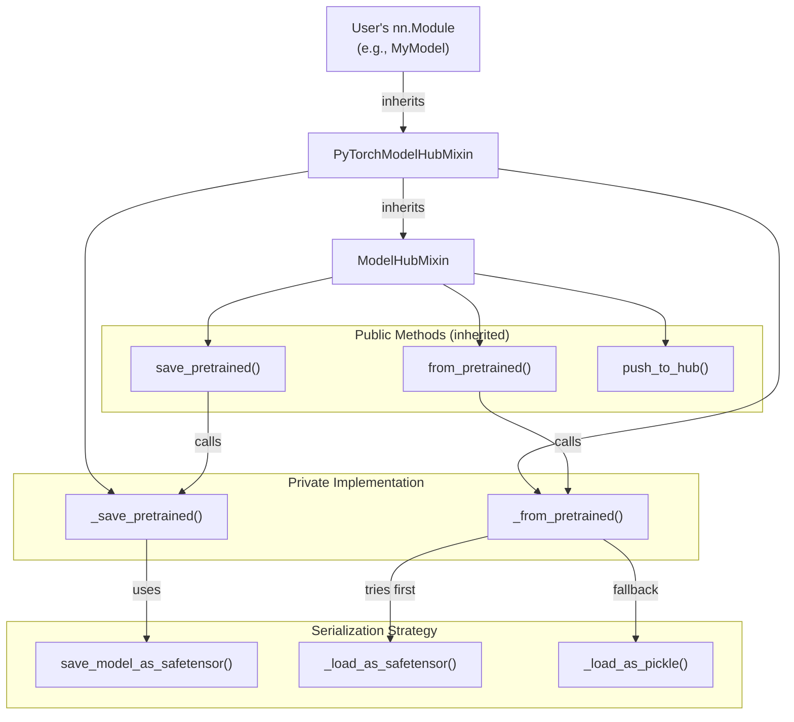
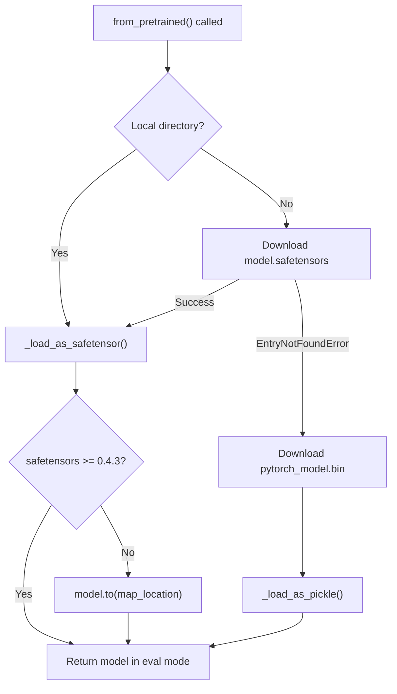
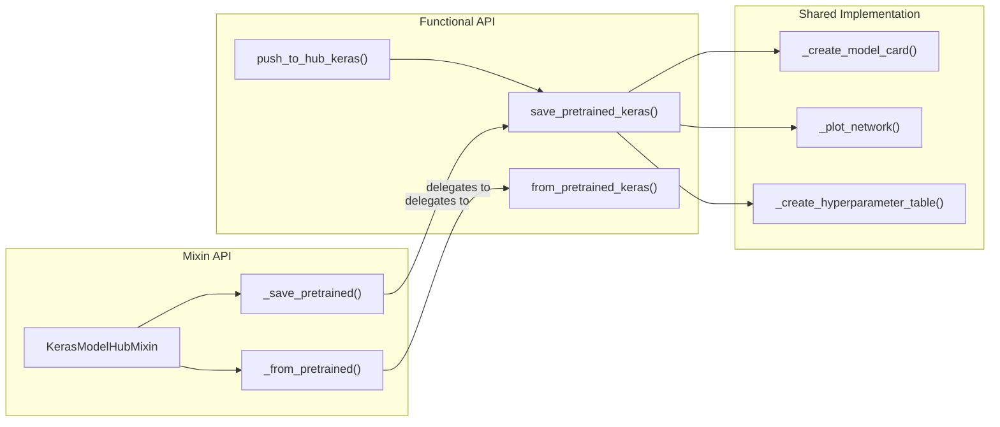
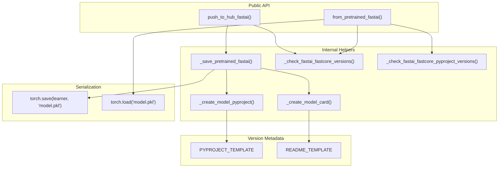
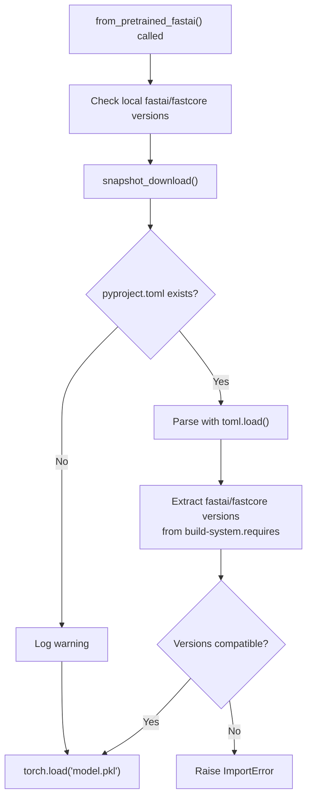
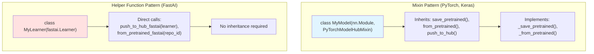

<!-- source: DeepWiki mcp.deepwiki.com · repo huggingface/huggingface_hub · page 5.2 Framework-Specific Implementations · fetched 2026-10-26 -->

# Framework-Specific Implementations

<details>
<summary>Relevant source files</summary>

The following files were used as context for generating this wiki page:

- [docs/source/de/guides/integrations.md](docs/source/de/guides/integrations.md)
- [docs/source/en/guides/integrations.md](docs/source/en/guides/integrations.md)
- [docs/source/en/guides/overview.md](docs/source/en/guides/overview.md)
- [docs/source/en/index.md](docs/source/en/index.md)
- [docs/source/en/quick-start.md](docs/source/en/quick-start.md)
- [src/huggingface_hub/_snapshot_download.py](src/huggingface_hub/_snapshot_download.py)
- [src/huggingface_hub/fastai_utils.py](src/huggingface_hub/fastai_utils.py)
- [src/huggingface_hub/hub_mixin.py](src/huggingface_hub/hub_mixin.py)
- [src/huggingface_hub/utils/_auth.py](src/huggingface_hub/utils/_auth.py)
- [tests/test_cache_layout.py](tests/test_cache_layout.py)
- [tests/test_hub_mixin.py](tests/test_hub_mixin.py)
- [tests/test_hub_mixin_pytorch.py](tests/test_hub_mixin_pytorch.py)
- [tests/test_snapshot_download.py](tests/test_snapshot_download.py)

</details>


This page documents the concrete framework-specific implementations that extend the base `ModelHubMixin` pattern. These implementations provide ready-to-use integrations for PyTorch, TensorFlow/Keras, and FastAI frameworks.

For information about the base mixin pattern and how to create custom integrations, see [ModelHubMixin Pattern](#5.1). For general ML framework integration concepts, see [ML Framework Integration](#5).

## Overview

The `huggingface_hub` library provides three main framework integrations with different implementation strategies:

| Framework | Integration Type | Serialization Format | Location |
|-----------|-----------------|---------------------|----------|
| PyTorch | Mixin class | Safetensors (with pickle fallback) | `PyTorchModelHubMixin` |
| TensorFlow/Keras | Mixin class + functional API | SavedModel format | `KerasModelHubMixin` |
| FastAI | Helper functions | Pickle with version checking | `push_to_hub_fastai` / `from_pretrained_fastai` |

## PyTorchModelHubMixin

`PyTorchModelHubMixin` provides a production-ready integration for PyTorch models using the safetensors format for secure weight serialization.

### Implementation Architecture



**Sources:** [src/huggingface_hub/hub_mixin.py:717-848]()

### Serialization Implementation

The `_save_pretrained` method serializes PyTorch models using safetensors format:

[src/huggingface_hub/hub_mixin.py:769-772]()

Key characteristics:
- Uses `SAFETENSORS_SINGLE_FILE` constant (`"model.safetensors"`)
- Handles `DataParallel` wrapped models via `model.module` attribute
- Saves to single file for simplicity

### Deserialization with Fallback

The loading strategy implements a two-tier fallback mechanism:



**Sources:** [src/huggingface_hub/hub_mixin.py:774-823](), [src/huggingface_hub/hub_mixin.py:825-829](), [src/huggingface_hub/hub_mixin.py:832-848]()

The safetensors version check at [src/huggingface_hub/hub_mixin.py:833-842]() ensures optimal device placement:
- Versions < 0.4.3: Load to CPU first, then move to target device
- Versions >= 0.4.3: Direct loading to target device

### Tag Management

`PyTorchModelHubMixin` automatically adds framework-specific tags via `__init_subclass__`:

[src/huggingface_hub/hub_mixin.py:763-767]()

This ensures models are tagged with `"pytorch_model_hub_mixin"` in addition to the base `"model_hub_mixin"` tag, enabling proper Hub categorization.

**Sources:** [src/huggingface_hub/hub_mixin.py:717-848]()

## KerasModelHubMixin

`KerasModelHubMixin` provides TensorFlow/Keras integration with special handling for SavedModel format and version compatibility.

### Dual API Design

Keras integration offers both mixin-based and functional APIs:



**Sources:** [src/huggingface_hub/keras_mixin.py:417-498](), [src/huggingface_hub/keras_mixin.py:156-238](), [src/huggingface_hub/keras_mixin.py:240-290]()

### Version Compatibility Enforcement

Keras integration includes version guards due to SavedModel format incompatibility:

[src/huggingface_hub/keras_mixin.py:41-52]()

The `_requires_keras_2_model` decorator prevents usage with Keras 3.x by checking for the `history` attribute (present in Keras 2.x models). Functions decorated with this raise `NotImplementedError` for Keras 3.x models.

**Sources:** [src/huggingface_hub/keras_mixin.py:41-52](), [src/huggingface_hub/keras_mixin.py:156-158](), [src/huggingface_hub/keras_mixin.py:294-295]()

### Model Card Generation

Keras implementation generates rich model cards with training metadata:

| Component | Source | Description |
|-----------|--------|-------------|
| Hyperparameters | `_create_hyperparameter_table()` | Flattened optimizer config + training precision |
| Network diagram | `_plot_network()` | Visual model architecture (requires graphviz/pydot) |
| Training history | `model.history.history` | Loss/metrics from training |

[src/huggingface_hub/keras_mixin.py:84-96]() extracts and flattens optimizer configuration, while [src/huggingface_hub/keras_mixin.py:98-110]() generates the network visualization.

The complete model card assembly occurs at [src/huggingface_hub/keras_mixin.py:112-154](), including metadata tags and training hyperparameters.

### SavedModel Serialization

Keras uses TensorFlow's SavedModel format:

[src/huggingface_hub/keras_mixin.py:237]()

This creates a directory structure with:
- `saved_model.pb`: Model architecture and computation graph
- `variables/`: Model weights
- `assets/`: Additional files
- `keras_metadata.pb`: Keras-specific metadata

**Sources:** [src/huggingface_hub/keras_mixin.py:156-238](), [src/huggingface_hub/keras_mixin.py:84-154]()

## FastAI Integration

FastAI integration uses a functional approach rather than mixins, with emphasis on version compatibility and pickle serialization.

### Helper Function Architecture



**Sources:** [src/huggingface_hub/fastai_utils.py:236-329](), [src/huggingface_hub/fastai_utils.py:331-411](), [src/huggingface_hub/fastai_utils.py:25-70]()

### Version Compatibility System

FastAI integration implements strict version checking to prevent pickle deserialization issues:

| Check Function | Purpose | Minimum Versions |
|---------------|---------|------------------|
| `_check_fastai_fastcore_versions()` | Validates local environment | fastai>=2.4, fastcore>=1.3.27 |
| `_check_fastai_fastcore_pyproject_versions()` | Validates remote model | Reads from `pyproject.toml` |

[src/huggingface_hub/fastai_utils.py:25-70]() checks the local environment before saving:

```python
def _check_fastai_fastcore_versions(
    fastai_min_version: str = "2.4",
    fastcore_min_version: str = "1.3.27",
):
    # Validates installed versions against minimums
```

[src/huggingface_hub/fastai_utils.py:72-165]() validates compatibility when loading from Hub by parsing `pyproject.toml`:



**Sources:** [src/huggingface_hub/fastai_utils.py:25-165]()

### Pyproject Template Generation

FastAI automatically generates `pyproject.toml` to record exact versions used during training:

[src/huggingface_hub/fastai_utils.py:201-204]()

This template captures:
- Python version via `get_python_version()`
- FastAI version via `get_fastai_version()`
- FastCore version via `get_fastcore_version()`

This metadata enables version checking during `from_pretrained_fastai()` to warn users of potential incompatibilities.

**Sources:** [src/huggingface_hub/fastai_utils.py:167-235]()

## Framework Comparison

### Serialization Formats

| Framework | Format | File Name(s) | Safety | Size Efficiency |
|-----------|--------|--------------|--------|-----------------|
| PyTorch | Safetensors | `model.safetensors` | ✓ Secure | High |
| PyTorch (fallback) | Pickle | `pytorch_model.bin` | ⚠ Unsafe code execution | Medium |
| Keras | SavedModel | Directory with `saved_model.pb` | ✓ Secure | Low (includes graph) |
| FastAI | Pickle | `model.pkl` | ⚠ Unsafe code execution | Medium |

### Integration Pattern Comparison



**Mixin Advantages:**
- Single class provides all Hub operations
- Automatic config handling
- Model card generation built-in
- Type hints and IDE autocomplete

**Helper Function Advantages:**
- No modification of existing class hierarchy
- Simpler for frameworks with complex base classes
- Explicit control over each operation
- Easier to add to existing codebases

**Sources:** [src/huggingface_hub/hub_mixin.py:717-848](), [src/huggingface_hub/keras_mixin.py:417-498](), [src/huggingface_hub/fastai_utils.py:236-411]()

## Extending for New Frameworks

To integrate a new framework, choose between patterns based on these criteria:

| Consideration | Use Mixin | Use Helper Functions |
|---------------|-----------|---------------------|
| Framework has simple base class | ✓ | |
| Need automatic config management | ✓ | |
| Framework uses pickle serialization | | ✓ |
| Complex serialization requirements | | ✓ |
| Want unified API with other frameworks | ✓ | |
| Need version compatibility checks | | ✓ |

### Mixin Extension Template

For mixin-based integration, inherit from `ModelHubMixin` and implement:

1. `_save_pretrained(save_directory: Path)` - Serialize model weights
2. `_from_pretrained(...)` - Deserialize and instantiate model
3. (Optional) Override `__init_subclass__` for framework-specific tags

Example structure:
```python
class MyFrameworkModelHubMixin(ModelHubMixin):
    def _save_pretrained(self, save_directory: Path) -> None:
        # Save weights to save_directory
        pass
    
    @classmethod
    def _from_pretrained(cls, model_id: str, ..., **model_kwargs):
        # Load weights and return instantiated model
        pass
```

### Helper Function Extension Template

For helper function integration, implement:

1. `push_to_hub_<framework>(model, repo_id, ...)` - Upload model
2. `from_pretrained_<framework>(repo_id, ...)` - Download and load model
3. Version checking functions if using pickle
4. Model card generation

Example structure:
```python
def push_to_hub_myframework(model, repo_id: str, **kwargs):
    with TemporaryDirectory() as tmpdir:
        # Save model files
        # Create README.md
        # Upload with api.upload_folder()
        pass

def from_pretrained_myframework(repo_id: str, **kwargs):
    # Download with snapshot_download()
    # Load model files
    # Return model instance
    pass
```

**Sources:** [src/huggingface_hub/hub_mixin.py:76-715](), [src/huggingface_hub/fastai_utils.py:1-411](), [docs/source/en/guides/integrations.md:117-239]()

---

