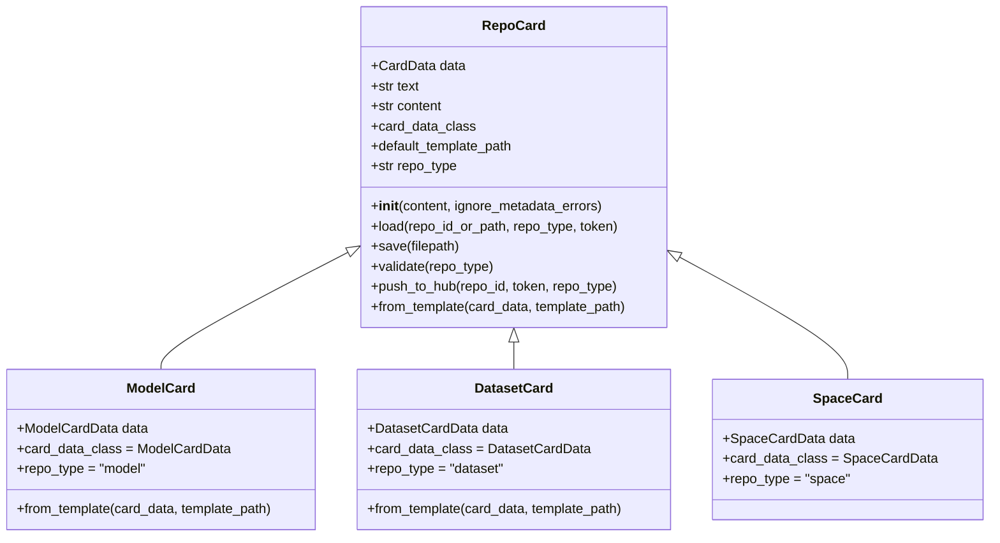
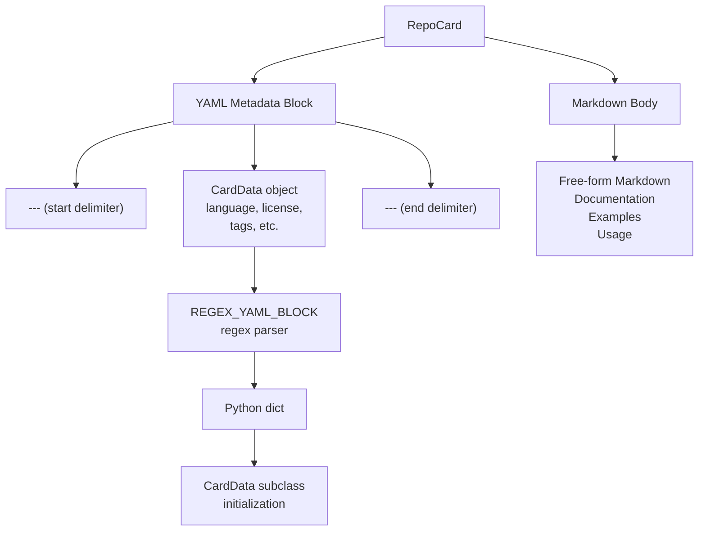
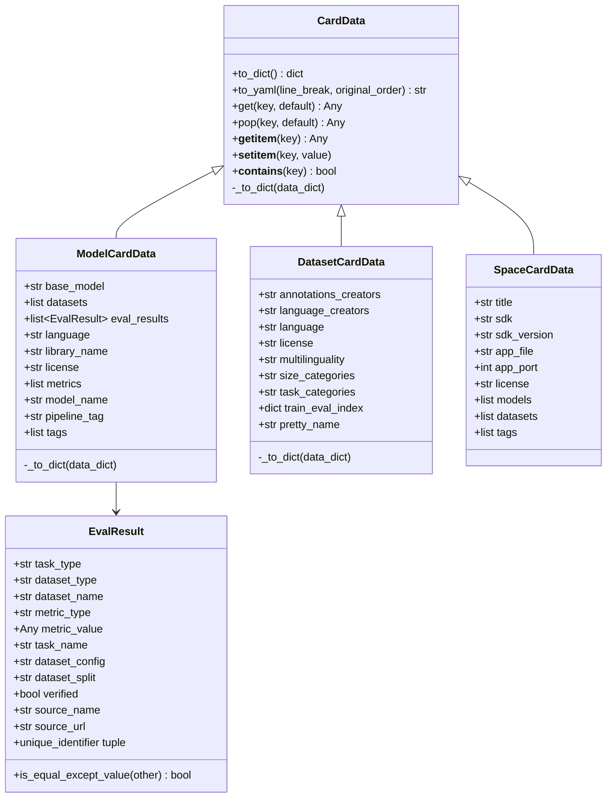
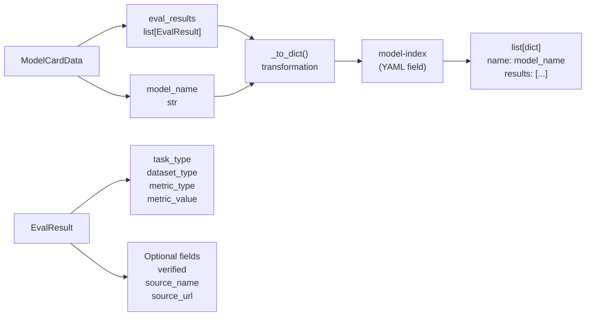
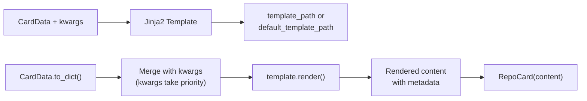
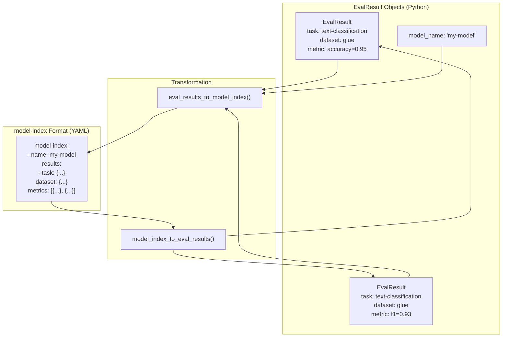

<!-- source: DeepWiki mcp.deepwiki.com · repo huggingface/huggingface_hub · page 6 Repository Cards and Metadata · fetched 2026-10-26 -->

# Repository Cards and Metadata

<details>
<summary>Relevant source files</summary>

The following files were used as context for generating this wiki page:

- [docs/source/en/package_reference/dataclasses.md](docs/source/en/package_reference/dataclasses.md)
- [src/huggingface_hub/README.md](src/huggingface_hub/README.md)
- [src/huggingface_hub/cli/repo_files.py](src/huggingface_hub/cli/repo_files.py)
- [src/huggingface_hub/cli/upload.py](src/huggingface_hub/cli/upload.py)
- [src/huggingface_hub/dataclasses.py](src/huggingface_hub/dataclasses.py)
- [src/huggingface_hub/repocard.py](src/huggingface_hub/repocard.py)
- [src/huggingface_hub/repocard_data.py](src/huggingface_hub/repocard_data.py)
- [tests/test_repocard.py](tests/test_repocard.py)
- [tests/test_repocard_data.py](tests/test_repocard_data.py)
- [tests/test_utils_strict_dataclass.py](tests/test_utils_strict_dataclass.py)

</details>


Repository cards are structured README.md files that contain both metadata (YAML front matter) and documentation (Markdown body). They provide essential information about models, datasets, and spaces on the Hugging Face Hub, including configuration, evaluation results, licensing, and usage instructions. This page documents the card system for creating, loading, validating, and publishing repository documentation.

For programmatic repository operations beyond cards (creating repos, uploading files, managing access), see [Repository Operations](#2.1). For ML framework integrations that automatically generate cards, see [ML Framework Integration](#5).

## Card Classes and Structure

The repository card system is organized around a base `RepoCard` class with specialized subclasses for different repository types. Each card consists of two parts: a YAML metadata block delimited by `---` markers and a Markdown content body.



**Sources:** [src/huggingface_hub/repocard.py:37-331](), [src/huggingface_hub/repocard.py:333-412](), [src/huggingface_hub/repocard.py:414-476](), [src/huggingface_hub/repocard.py:479-482]()

### Card Content Structure

Each repository card has a structured format with metadata and content clearly separated:



The `REGEX_YAML_BLOCK` pattern `^(\s*---[\r\n]+)([\S\s]*?)([\r\n]+---(\r\n|\n|$))` extracts the metadata block from card content. The card's `content` property dynamically reconstructs the full file by combining `data.to_yaml()` and `text`.

**Sources:** [src/huggingface_hub/repocard.py:34](), [src/huggingface_hub/repocard.py:79-110]()

### RepoCard Base Class

The `RepoCard` class provides the foundation for all card types:

| Method | Purpose |
|--------|---------|
| `__init__(content, ignore_metadata_errors)` | Parse card content string into data and text |
| `load(repo_id_or_path, repo_type, token)` | Load card from Hub or local file path |
| `save(filepath)` | Write card to local file, preserving line endings |
| `validate(repo_type)` | Validate metadata against Hub schema |
| `push_to_hub(repo_id, token, repo_type, ...)` | Upload card to repository |
| `from_template(card_data, template_path, **kwargs)` | Generate card from Jinja2 template |

The `content` property setter automatically parses the YAML front matter and Markdown body, creating the appropriate `CardData` instance. Line ending detection via `_detect_line_ending()` preserves newline style (LF, CRLF, or CR) to avoid creating large diffs when saving.

**Sources:** [src/huggingface_hub/repocard.py:37-331](), [src/huggingface_hub/repocard.py:485-503]()

### ModelCard Specifics

`ModelCard` extends `RepoCard` for model repositories, with `ModelCardData` as its metadata class. It includes special handling for evaluation results through the `model-index` metadata field:

```python
# Example ModelCard metadata structure
card_data = ModelCardData(
    language="en",
    license="apache-2.0",
    library_name="transformers",
    tags=["text-classification", "sentiment-analysis"],
    datasets=["glue"],
    eval_results=[
        EvalResult(
            task_type="text-classification",
            dataset_type="glue",
            dataset_name="GLUE",
            metric_type="accuracy",
            metric_value=0.95
        )
    ],
    model_name="my-model"
)
```

The default template is located at [src/huggingface_hub/templates/modelcard_template.md]().

**Sources:** [src/huggingface_hub/repocard.py:333-412](), [src/huggingface_hub/repocard.py:29]()

### DatasetCard Specifics

`DatasetCard` uses `DatasetCardData` for dataset-specific metadata fields:

| Field | Description |
|-------|-------------|
| `annotations_creators` | How annotations were created (crowdsourced, expert-generated, etc.) |
| `language_creators` | How text data was created (found, crowdsourced, etc.) |
| `language` | ISO language codes |
| `multilinguality` | Monolingual, multilingual, translation, other |
| `size_categories` | Dataset size ranges (n<1K, 1K<n<10K, etc.) |
| `task_categories` | Task types the dataset supports |
| `train_eval_index` | Evaluation configuration (stored as `train-eval-index` in YAML) |

The default template is at [src/huggingface_hub/templates/datasetcard_template.md]().

**Sources:** [src/huggingface_hub/repocard.py:414-476](), [src/huggingface_hub/repocard.py:30](), [src/huggingface_hub/repocard_data.py:394-472]()

### SpaceCard Specifics

`SpaceCard` uses `SpaceCardData` for Spaces configuration:

| Field | Description |
|-------|-------------|
| `title` | Space title |
| `sdk` | SDK type: gradio, streamlit, docker, static |
| `sdk_version` | SDK version |
| `app_file` | Path to main application file |
| `app_port` | Port for docker spaces |
| `duplicated_from` | Original space if this is a duplicate |

**Sources:** [src/huggingface_hub/repocard.py:479-482](), [src/huggingface_hub/repocard_data.py:474-552]()

## Metadata Data Classes

Metadata is structured using dataclass-based classes that provide dict-like behavior for flexibility while maintaining type safety.



**Sources:** [src/huggingface_hub/repocard_data.py:164-246](), [src/huggingface_hub/repocard_data.py:265-392](), [src/huggingface_hub/repocard_data.py:394-472](), [src/huggingface_hub/repocard_data.py:474-552](), [src/huggingface_hub/repocard_data.py:12-162]()

### CardData Base Class

`CardData` behaves like a dictionary while maintaining structure:

```python
# Dict-like operations
card_data = CardData(language="en", license="mit")
card_data["tags"] = ["pytorch"]           # __setitem__
value = card_data.get("license")          # .get()
value = card_data["language"]             # __getitem__
card_data.pop("license")                  # .pop()
if "language" in card_data: ...           # __contains__

# Export operations
yaml_str = card_data.to_yaml()            # YAML string
data_dict = card_data.to_dict()           # Python dict
```

The `to_dict()` method removes `None` values at the top level and calls `_to_dict()` for subclass-specific transformations. The `to_yaml()` method uses `yaml_dump()` from utils and preserves field order if `original_order` is provided.

**Sources:** [src/huggingface_hub/repocard_data.py:164-246]()

### ModelCardData and Evaluation Results

`ModelCardData` includes special handling for evaluation results:



The `eval_results` field stores evaluation data as `EvalResult` objects but exports to the `model-index` format in YAML through `eval_results_to_model_index()`. When loading, `model_index_to_eval_results()` converts the YAML structure back to `EvalResult` objects.

**Sources:** [src/huggingface_hub/repocard_data.py:265-392](), [src/huggingface_hub/repocard_data.py:387-392](), [src/huggingface_hub/repocard_data.py:12-162]()

### EvalResult Structure

`EvalResult` represents a single evaluation metric:

| Field | Required | Description |
|-------|----------|-------------|
| `task_type` | Yes | Task identifier (e.g., "text-classification") |
| `dataset_type` | Yes | Dataset identifier (e.g., "glue") |
| `dataset_name` | Yes | Human-readable dataset name |
| `metric_type` | Yes | Metric identifier (e.g., "accuracy") |
| `metric_value` | Yes | Metric value (float or string like "20.0 ± 1.2") |
| `task_name` | No | Human-readable task name |
| `dataset_config` | No | Dataset configuration/subset name |
| `dataset_split` | No | Split used (train, test, validation) |
| `metric_name` | No | Human-readable metric name |
| `metric_config` | No | Metric configuration |
| `verified` | No | Whether verified by HF evaluation service |
| `verify_token` | No | JWT token for verification |
| `source_name` | No | Source of evaluation (e.g., "Open LLM Leaderboard") |
| `source_url` | No | URL of evaluation source |

The `unique_identifier` property returns a tuple of `(task_type, dataset_type, dataset_config, dataset_split, dataset_revision)` for comparison. The `is_equal_except_value()` method checks if two results represent the same metric but with different values.

**Sources:** [src/huggingface_hub/repocard_data.py:12-162]()

## Loading and Saving Cards

```mermaid
graph TB
    subgraph "Load Operations"
        LoadInput["Input:<br/>repo_id or file path"]
        LoadInput --> CheckPath{"Is file path?"}
        CheckPath -->|Yes| LoadFile["Load from<br/>local file"]
        CheckPath -->|No| LoadHub["hf_hub_download()<br/>REPOCARD_NAME"]
        LoadHub --> LoadFile
        LoadFile --> Parse["Parse content:<br/>REGEX_YAML_BLOCK"]
        Parse --> CreateCard["RepoCard(content)"]
    end
    
    subgraph "Save Operations"
        SaveInput["RepoCard instance"]
        SaveInput --> DetectLineEnding["_detect_line_ending()<br/>preserve \\n or \\r\\n"]
        DetectLineEnding --> WriteFile["Write to file<br/>with newline=''"]
    end
    
    subgraph "Push Operations"
        PushInput["card.push_to_hub()"]
        PushInput --> Validate["validate()<br/>POST /api/validate-yaml"]
        Validate --> TempFile["SoftTemporaryDirectory"]
        TempFile --> Upload["upload_file()<br/>README.md"]
    end
```



**Sources:** [src/huggingface_hub/repocard.py:135-187](), [src/huggingface_hub/repocard.py:115-133](), [src/huggingface_hub/repocard.py:226-287](), [src/huggingface_hub/repocard.py:485-503]()

### Loading Cards from Hub or Files

The `load()` class method handles both local files and Hub repositories:

```python
# Load from Hub
card = ModelCard.load("bert-base-uncased", token=token)

# Load from local file
card = ModelCard.load("/path/to/README.md")

# Load with error handling
card = ModelCard.load(repo_id, ignore_metadata_errors=True)
```

The loading process:
1. Check if input is a file path using `Path.is_file()`
2. If not, download README.md using `hf_hub_download()` with `constants.REPOCARD_NAME`
3. Read file content with newline preservation (`newline=""`)
4. Pass content to `RepoCard.__init__()` for parsing

**Sources:** [src/huggingface_hub/repocard.py:135-187]()

### Saving Cards Locally

The `save()` method writes cards to disk while preserving line endings:

```python
card = ModelCard(content)
card.save("/path/to/README.md")
```

Line ending preservation prevents large diffs. The `_detect_line_ending()` function analyzes content to determine if it uses LF (`\n`), CRLF (`\r\n`), or CR (`\r`). The file is opened with `newline=""` to prevent Python from modifying line endings.

**Sources:** [src/huggingface_hub/repocard.py:115-133](), [src/huggingface_hub/repocard.py:485-503]()

### Validating and Publishing Cards

Cards are validated against Hub schemas before publishing:

```python
# Validate card
card.validate(repo_type="model")  # Raises ValueError if invalid

# Push to Hub (validation is automatic)
url = card.push_to_hub(
    repo_id="username/model-name",
    token=token,
    repo_type="model",
    commit_message="Update model card",
    create_pr=False
)
```

The validation flow:
1. Construct request body with `{"repoType": repo_type, "content": str(card)}`
2. POST to `https://huggingface.co/api/validate-yaml`
3. Raise `ValueError` with validation errors if status 400
4. Raise `HfHubHTTPError` for other errors

For publishing, `push_to_hub()` validates first, then creates a temporary file and uses `upload_file()` to upload README.md.

**Sources:** [src/huggingface_hub/repocard.py:189-225](), [src/huggingface_hub/repocard.py:226-287]()

## Template-Based Card Generation

Cards can be generated from Jinja2 templates with dynamic content:



**Sources:** [src/huggingface_hub/repocard.py:289-331]()

### Using from_template

The `from_template()` class method generates cards:

```python
# Using default template
card = ModelCard.from_template(
    card_data=ModelCardData(
        language="en",
        license="apache-2.0",
        library_name="transformers",
        tags=["text-classification"]
    ),
    model_description="This model classifies sentiment",
    training_data="IMDB dataset"
)

# Using custom template path
card = ModelCard.from_template(
    card_data=card_data,
    template_path="./my_template.md",
    custom_var="custom_value"
)

# Using template string
template_str = "---\n{{ card_data }}\n---\n# {{ model_name }}"
card = ModelCard.from_template(
    card_data=card_data,
    template_str=template_str,
    model_name="My Model"
)
```

The process:
1. Convert `card_data` to dict and merge with `template_kwargs` (kwargs take priority)
2. Load template from `template_path`, `template_str`, or `default_template_path`
3. Render template with merged variables using `jinja2.Template(template_str).render()`
4. Return new card instance with rendered content

**Sources:** [src/huggingface_hub/repocard.py:289-331](), [src/huggingface_hub/repocard.py:338-411]()

### Default Templates

Default templates are stored in [src/huggingface_hub/templates/]():

- `modelcard_template.md` - Model card template with sections for description, training, evaluation, uses, limitations
- `datasetcard_template.md` - Dataset card template with sections for dataset description, structure, creation

Templates use Jinja2 syntax and have access to:
- `card_data` - YAML string of metadata (via `{{ card_data }}`)
- All CardData fields as variables
- Any additional kwargs passed to `from_template()`

**Sources:** [src/huggingface_hub/repocard.py:29-30]()

## Metadata Management Functions

The module provides standalone functions for metadata operations without full card loading:

```mermaid
graph TB
    subgraph "metadata_load"
        LoadPath["Path to README.md"] --> ReadContent["Read file content"]
        ReadContent --> Extract["REGEX_YAML_BLOCK.search()"]
        Extract --> ParseYAML["yaml.safe_load()"]
        ParseYAML --> ReturnDict["Return dict or None"]
    end
    
    subgraph "metadata_save"
        SavePath["Path + data dict"] --> DetectNL["Detect line breaks"]
        DetectNL --> DumpYAML["yaml_dump(data)"]
        DumpYAML --> ReplaceBlock["Replace YAML block<br/>or prepend"]
        ReplaceBlock --> WriteFile["Write with preserved<br/>line endings"]
    end
    
    subgraph "metadata_update"
        UpdateRepo["repo_id + metadata"] --> LoadCard["Load or create card"]
        LoadCard --> MergeData["Merge metadata<br/>handle eval_results"]
        MergeData --> PushCard["card.push_to_hub()"]
    end
```



**Sources:** [src/huggingface_hub/repocard.py:506-549](), [src/huggingface_hub/repocard.py:679-826]()

### metadata_load and metadata_save

These functions operate directly on files:

```python
# Load metadata from file
metadata = metadata_load("/path/to/README.md")
# Returns: {'language': 'en', 'license': 'mit', ...} or None

# Save metadata to file
metadata_save("/path/to/README.md", {"language": "fr", "license": "apache-2.0"})
```

`metadata_load()` extracts the YAML block using regex and parses it with `yaml.safe_load()`. It returns `None` if no metadata block is found or if the block is empty.

`metadata_save()` preserves existing content while replacing or adding the YAML block. It detects line endings from the existing file and uses them when writing. If a YAML block exists, it replaces it; otherwise, it prepends one.

**Sources:** [src/huggingface_hub/repocard.py:506-549]()

### metadata_update

`metadata_update()` modifies metadata in a Hub repository:

```python
# Update simple metadata
url = metadata_update(
    repo_id="username/model",
    metadata={"language": "en", "tags": ["nlp"]},
    token=token,
    overwrite=False
)

# Add evaluation result
eval_metadata = metadata_eval_result(
    model_pretty_name="My Model",
    task_pretty_name="Text Classification",
    task_id="text-classification",
    metrics_pretty_name="Accuracy",
    metrics_id="accuracy",
    metrics_value=0.95,
    dataset_pretty_name="GLUE",
    dataset_id="glue",
    dataset_config="sst2",
    dataset_split="validation"
)
url = metadata_update(repo_id, eval_metadata, token=token, overwrite=True)
```

The update process:
1. Load existing card with `card_class.load()`, or create new card with `from_template(CardData())`
2. For `model-index` metadata, parse to `EvalResult` objects and merge with existing results
3. For other metadata, update directly (raises `ValueError` if key exists and `overwrite=False`)
4. Push updated card with `card.push_to_hub()`

Special handling for `model-index`:
- Extracts model name from existing card or uses `repo_id`
- Converts to `EvalResult` objects using `model_index_to_eval_results()`
- Merges with existing results, checking for duplicates with `is_equal_except_value()`
- Allows value updates only if `overwrite=True`

**Sources:** [src/huggingface_hub/repocard.py:679-826]()

### metadata_eval_result

Creates properly formatted evaluation metadata:

```python
metadata = metadata_eval_result(
    model_pretty_name="RoBERTa fine-tuned on ReactionGIF",
    task_pretty_name="Text Classification",
    task_id="text-classification",
    metrics_pretty_name="Accuracy",
    metrics_id="accuracy",
    metrics_value=0.266,
    dataset_pretty_name="ReactionGIF",
    dataset_id="julien-c/reactiongif",
    dataset_config="default",
    dataset_split="test",
    metrics_config="default",
    metrics_verified=True
)
# Returns: {'model-index': [...]}
```

This is a convenience wrapper around creating an `EvalResult` and converting it to model-index format with `eval_results_to_model_index()`.

**Sources:** [src/huggingface_hub/repocard.py:551-676]()

## Evaluation Results and Model Index

The model-index system connects model cards to leaderboards like Papers With Code:



**Sources:** [src/huggingface_hub/repocard_data.py:555-676]()

### Converting Between Formats

The conversion functions handle the transformation between Python objects and YAML structures:

```python
# Python objects to YAML
eval_results = [
    EvalResult(
        task_type="image-classification",
        dataset_type="beans",
        dataset_name="Beans",
        metric_type="accuracy",
        metric_value=0.9
    )
]
model_index = eval_results_to_model_index("my-model", eval_results)
# Returns: [{'name': 'my-model', 'results': [...]}]

# YAML to Python objects
model_index = [{
    'name': 'my-model',
    'results': [
        {
            'task': {'type': 'image-classification'},
            'dataset': {'type': 'beans', 'name': 'Beans'},
            'metrics': [{'type': 'accuracy', 'value': 0.9}]
        }
    ]
}]
model_name, eval_results = model_index_to_eval_results(model_index)
# Returns: ('my-model', [EvalResult(...)])
```

The model-index format groups metrics by task and dataset, while `EvalResult` represents individual metrics. Conversion handles:
- Flattening/unflattening the nested structure
- Mapping field names (e.g., `type` to `task_type`)
- Preserving optional fields like `verified`, `source_name`, `source_url`
- Extracting configuration details (`dataset_config`, `metric_config`)

**Sources:** [src/huggingface_hub/repocard_data.py:555-676]()

### Evaluation Result Deduplication

When updating cards with new evaluation results, the system checks for duplicates:

```python
# In metadata_update()
for new_result in new_results:
    result_found = False
    for existing_result in existing_results:
        if new_result.is_equal_except_value(existing_result):
            # Same metric, different value
            if new_result != existing_result and not overwrite:
                raise ValueError("Metric exists. Set overwrite=True")
            result_found = True
            existing_result.metric_value = new_result.metric_value
    if not result_found:
        card.data.eval_results.append(new_result)
```

The `is_equal_except_value()` method compares all fields except `metric_value` and `verify_token` (which is derived from the value). This allows updating metric values while preventing accidental duplicates.

**Sources:** [src/huggingface_hub/repocard.py:790-806](), [src/huggingface_hub/repocard_data.py:145-157]()

## Error Handling and Edge Cases

### Metadata Parsing Errors

When `ignore_metadata_errors=False` (default), parsing errors raise exceptions:

```python
# Invalid metadata type (must be dict)
content = "---\n- item1\n- item2\n---\nContent"
card = RepoCard(content)  # Raises ValueError

# Invalid model-index
content = "---\nmodel-index: invalid\n---\nContent"
card = ModelCard(content)  # Raises ValueError
```

With `ignore_metadata_errors=True`, errors are logged as warnings and problematic fields are skipped:

```python
card = ModelCard(content, ignore_metadata_errors=True)
# Logs warning: "Invalid model-index. Not loading eval results into CardData."
# card.data.eval_results is None
```

**Sources:** [src/huggingface_hub/repocard.py:42-110](), [src/huggingface_hub/repocard_data.py:360-385]()

### Missing Cards

When updating metadata on a repository without a README.md:

```python
# For models and datasets: creates default card
metadata_update(repo_id, metadata, repo_type="model")
# Creates new ModelCard.from_template(CardData()) with metadata

# For spaces: raises error
metadata_update(repo_id, metadata, repo_type="space")
# Raises ValueError: "Cannot update metadata on a Space without README.md"
```

Spaces must have a README.md file, as they're automatically created by the Hub with SDK-specific templates.

**Sources:** [src/huggingface_hub/repocard.py:762-770]()

### Line Ending Preservation

The system detects and preserves line endings to avoid large diffs:

```python
# Detection logic in _detect_line_ending()
cr = content.count("\r")
lf = content.count("\n")
crlf = content.count("\r\n")

if cr + lf == 0: return None
if crlf == cr and crlf == lf: return "\r\n"  # Windows
if cr > lf: return "\r"                      # Old Mac
else: return "\n"                            # Unix
```

Files are opened with `newline=""` to prevent Python from normalizing line endings. The detected line break is used when writing YAML via `yaml_dump(line_break=line_break)`.

**Sources:** [src/huggingface_hub/repocard.py:485-503](), [src/huggingface_hub/repocard.py:80-83](), [src/huggingface_hub/repocard.py:526-548]()

---

