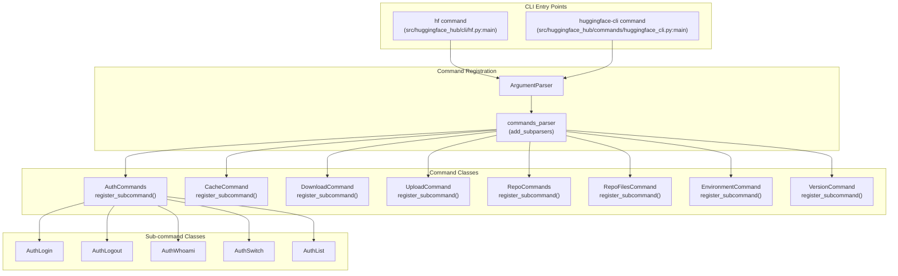
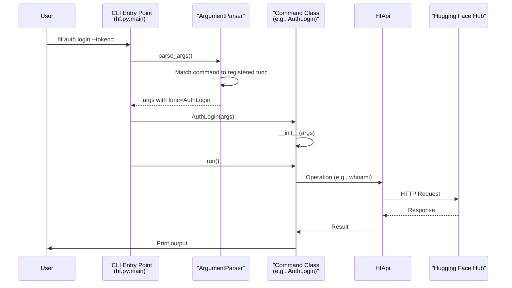
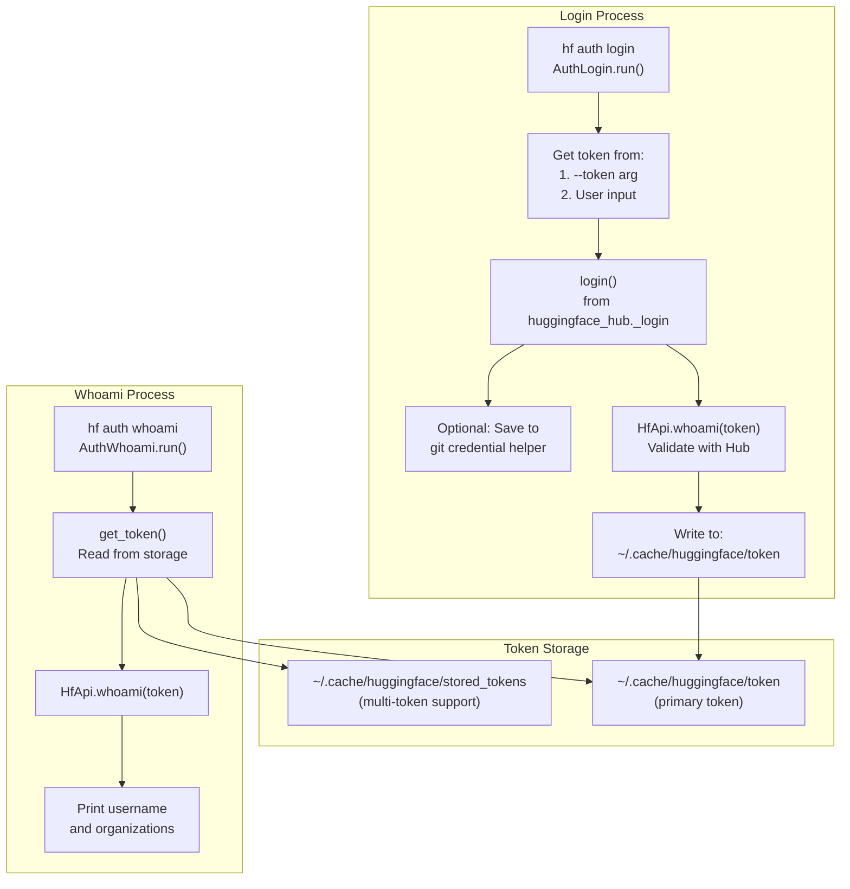
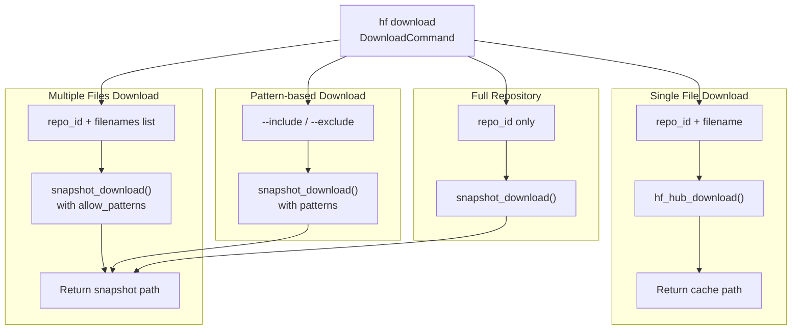
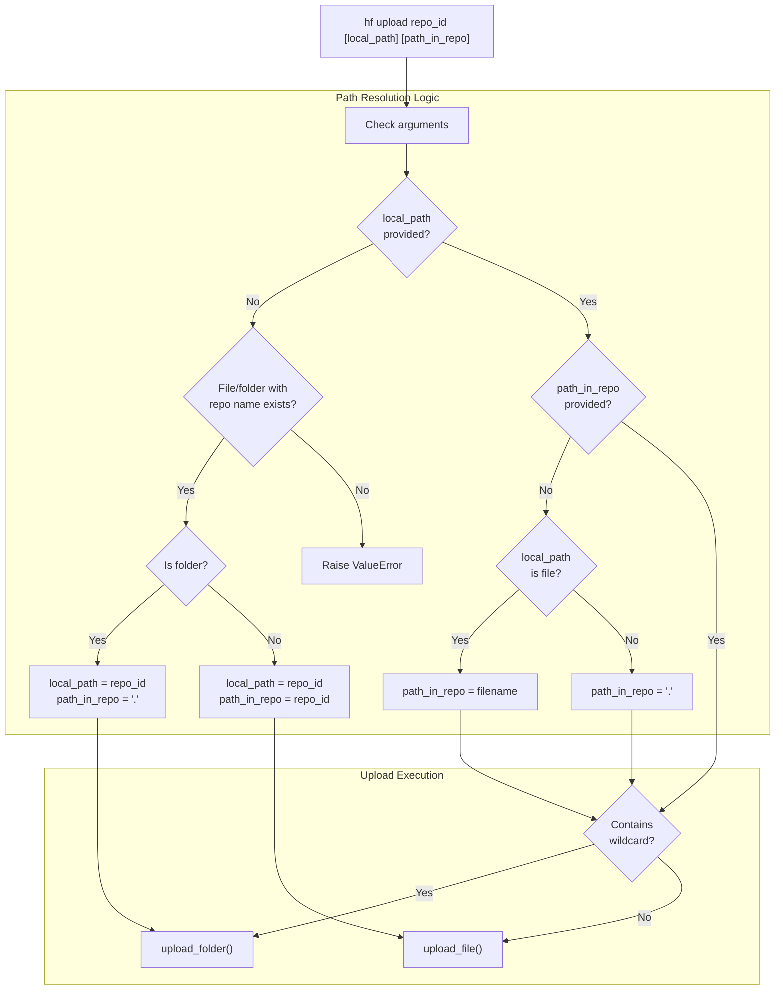
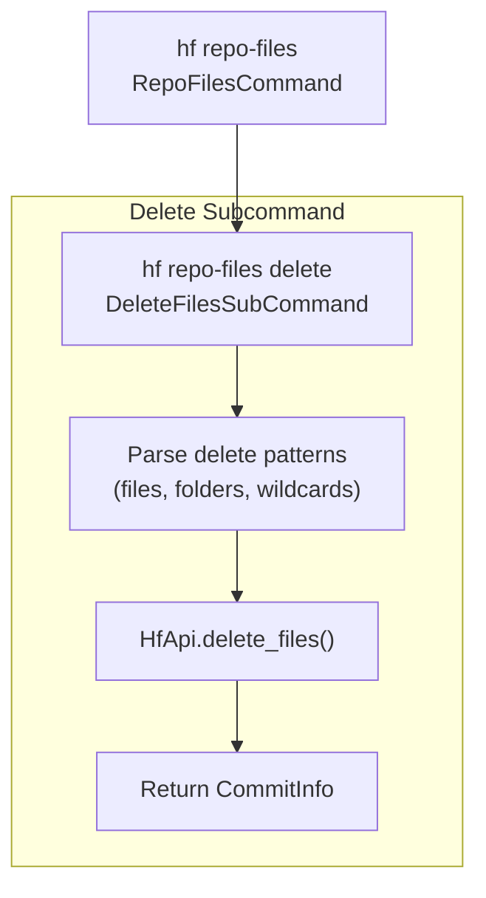
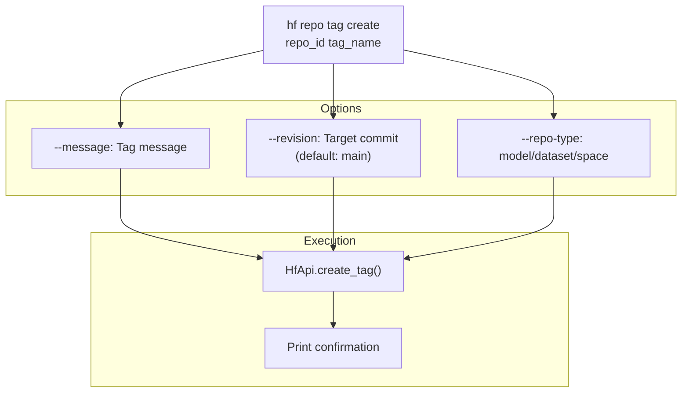
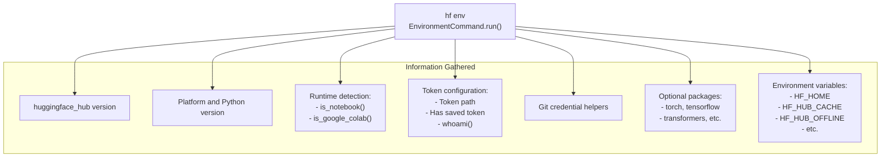

<!-- source: DeepWiki mcp.deepwiki.com · repo huggingface/huggingface_hub · page 7.1 File and Repository Commands · fetched 2026-10-26 -->

# Core CLI Commands

<details>
<summary>Relevant source files</summary>

The following files were used as context for generating this wiki page:

- [docs/source/en/_redirects.yml](docs/source/en/_redirects.yml)
- [docs/source/en/_toctree.yml](docs/source/en/_toctree.yml)
- [docs/source/en/guides/cli.md](docs/source/en/guides/cli.md)
- [docs/source/en/guides/jobs.md](docs/source/en/guides/jobs.md)
- [docs/source/en/guides/webhooks.md](docs/source/en/guides/webhooks.md)
- [docs/source/en/package_reference/cli.md](docs/source/en/package_reference/cli.md)
- [docs/source/en/package_reference/jobs.md](docs/source/en/package_reference/jobs.md)
- [src/huggingface_hub/__init__.py](src/huggingface_hub/__init__.py)
- [src/huggingface_hub/_commit_api.py](src/huggingface_hub/_commit_api.py)
- [src/huggingface_hub/_jobs_api.py](src/huggingface_hub/_jobs_api.py)
- [src/huggingface_hub/cli/_cli_utils.py](src/huggingface_hub/cli/_cli_utils.py)
- [src/huggingface_hub/cli/cache.py](src/huggingface_hub/cli/cache.py)
- [src/huggingface_hub/cli/datasets.py](src/huggingface_hub/cli/datasets.py)
- [src/huggingface_hub/cli/extensions.py](src/huggingface_hub/cli/extensions.py)
- [src/huggingface_hub/cli/hf.py](src/huggingface_hub/cli/hf.py)
- [src/huggingface_hub/cli/jobs.py](src/huggingface_hub/cli/jobs.py)
- [src/huggingface_hub/cli/models.py](src/huggingface_hub/cli/models.py)
- [src/huggingface_hub/cli/spaces.py](src/huggingface_hub/cli/spaces.py)
- [src/huggingface_hub/cli/webhooks.py](src/huggingface_hub/cli/webhooks.py)
- [src/huggingface_hub/constants.py](src/huggingface_hub/constants.py)
- [src/huggingface_hub/file_download.py](src/huggingface_hub/file_download.py)
- [src/huggingface_hub/hf_api.py](src/huggingface_hub/hf_api.py)
- [src/huggingface_hub/utils/__init__.py](src/huggingface_hub/utils/__init__.py)
- [tests/test_cli.py](tests/test_cli.py)
- [tests/test_file_download.py](tests/test_file_download.py)
- [tests/test_hf_api.py](tests/test_hf_api.py)
- [tests/testing_utils.py](tests/testing_utils.py)

</details>


## Purpose and Scope

This document covers the core CLI commands provided by the `hf` and `huggingface-cli` command-line tools for interacting with the Hugging Face Hub. These commands enable authentication, file download/upload, repository management, and cache operations directly from the terminal without writing Python code.

For information about Jobs-specific commands (`hf jobs`), see [Jobs System](#8.2). For general CLI usage patterns and installation, see [Command Line Interface](#8).

---

## CLI Architecture Overview

The CLI is built on top of the `argparse` library and organized into command groups. Each command is implemented as a class that inherits from `BaseHuggingfaceCLICommand` and registers itself with the argument parser.

### Command Registration System



**Sources:** [src/huggingface_hub/cli/hf.py:29-60](), [src/huggingface_hub/commands/huggingface_cli.py:32-62](), [src/huggingface_hub/cli/auth.py:58-115]()

### Command Execution Flow



**Sources:** [src/huggingface_hub/cli/hf.py:51-59](), [src/huggingface_hub/cli/auth.py:123-129]()

---

## Authentication Commands

Authentication commands manage user tokens for accessing the Hugging Face Hub. All authentication commands are under the `hf auth` namespace.

### Command Structure

| Command | Purpose | Implementation Class |
|---------|---------|---------------------|
| `hf auth login` | Log in with a token | `AuthLogin` |
| `hf auth logout` | Log out and remove tokens | `AuthLogout` |
| `hf auth whoami` | Display current user info | `AuthWhoami` |
| `hf auth switch` | Switch between stored tokens | `AuthSwitch` |
| `hf auth list` | List all stored tokens | `AuthList` |

**Sources:** [src/huggingface_hub/cli/auth.py:58-115]()

### Authentication Flow



**Sources:** [src/huggingface_hub/cli/auth.py:123-129](), [src/huggingface_hub/cli/auth.py:195-213]()

### Token Management Details

The CLI supports multiple authentication tokens through the `stored_tokens` mechanism:

- **Primary token**: Stored in `~/.cache/huggingface/token` and used by default
- **Named tokens**: Stored in `~/.cache/huggingface/stored_tokens` as a JSON mapping
- **Token switching**: The `switch` command updates the primary token by copying from stored tokens
- **Git credential integration**: Optionally saves tokens to git credential helpers for `git` operations

**Sources:** [src/huggingface_hub/cli/auth.py:138-187](), [docs/source/en/guides/cli.md:84-125]()

### Environment Variable Override

If the `HF_TOKEN` environment variable is set, it takes precedence over all stored tokens. In this case, `hf auth logout` will not remove the token, and users must unset the environment variable manually.

**Sources:** [docs/source/en/guides/cli.md:134-143]()

---

## File Operations

File operation commands handle downloading and uploading files between the local filesystem and the Hugging Face Hub.

### Download Command

The `hf download` command provides a CLI interface to the [`hf_hub_download`] and [`snapshot_download`] functions.

#### Download Command Variants



**Sources:** [src/huggingface_hub/cli/download.py](), [tests/test_cli.py:450-592]()

#### Download Options

| Option | Purpose | Example |
|--------|---------|---------|
| `--repo-type` | Specify dataset/space/model | `--repo-type dataset` |
| `--revision` | Download from specific branch/tag | `--revision v1.0` |
| `--include` | Pattern for files to include | `--include "*.safetensors"` |
| `--exclude` | Pattern for files to exclude | `--exclude "*.fp16.*"` |
| `--local-dir` | Download to specific directory | `--local-dir ./models` |
| `--cache-dir` | Custom cache location | `--cache-dir /tmp/cache` |
| `--token` | Authentication token | `--token hf_****` |
| `--quiet` | Suppress verbose output | `--quiet` |

**Sources:** [docs/source/en/guides/cli.md:145-288](), [tests/test_cli.py:409-448]()

### Upload Command

The `hf upload` command provides a CLI interface to the [`upload_file`] and [`upload_folder`] functions.

#### Upload Path Resolution



**Sources:** [src/huggingface_hub/cli/upload.py](), [tests/test_cli.py:184-241]()

#### Wildcard Pattern Support

The upload command supports wildcard patterns in the `local_path` argument. When a wildcard is detected:

1. `local_path` is set to current directory (`.`)
2. The wildcard pattern becomes an `--include` filter
3. `upload_folder()` is called instead of `upload_file()`

Example: `hf upload repo_id "*.safetensors"` uploads all `.safetensors` files from the current directory.

**Sources:** [tests/test_cli.py:98-133]()

#### Upload Options

| Option | Purpose | Example |
|--------|---------|---------|
| `--repo-type` | Specify dataset/space/model | `--repo-type dataset` |
| `--revision` | Upload to specific branch | `--revision dev` |
| `--include` | Pattern for files to include | `--include "*.json"` |
| `--exclude` | Pattern for files to exclude | `--exclude "*.log"` |
| `--delete` | Delete matching remote files | `--delete "*.old"` |
| `--commit-message` | Custom commit message | `--commit-message "Update"` |
| `--commit-description` | Commit description | `--commit-description "Details..."` |
| `--create-pr` | Create pull request | `--create-pr` |
| `--every` | Upload at intervals (seconds) | `--every 600` |
| `--private` | Create private repository | `--private` |

**Sources:** [docs/source/en/guides/cli.md:289-431](), [tests/test_cli.py:134-183]()

#### Revision and Branch Creation

When uploading with `--revision`:

1. If `--create-pr` is set, the revision is used as-is (no branch creation check)
2. Otherwise, the CLI checks if the revision exists using `HfApi.repo_info()`
3. If the revision doesn't exist, a new branch is created from `main` using `HfApi.create_branch()`

**Sources:** [tests/test_cli.py:327-373]()

---

## Repository Management

Repository management commands handle creating, configuring, and organizing repositories on the Hub.

### Repository Commands

| Command | Purpose | Implementation |
|---------|---------|----------------|
| `hf repo create` | Create a new repository | `RepoCreateCommand` |
| `hf repo tag create` | Create a tag on a repository | `TagCreateCommand` |
| `hf repo tag list` | List tags for a repository | `TagListCommand` |
| `hf repo tag delete` | Delete a tag | `TagDeleteCommand` |

**Sources:** [src/huggingface_hub/commands/repo.py:40-152](), [src/huggingface_hub/cli/repo.py]()

### Repository File Operations

The `hf repo-files` command group manages files within repositories:



**Sources:** [src/huggingface_hub/cli/repo_files.py](), [tests/test_cli.py:666-761]()

#### File Deletion Examples

```bash
# Delete a single file
hf repo-files delete repo_id file.txt

# Delete a folder
hf repo-files delete repo_id folder/

# Delete multiple files
hf repo-files delete repo_id file1.txt file2.txt folder/

# Delete with wildcards
hf repo-files delete repo_id "*.txt" "folder/*.bin"
```

**Sources:** [docs/source/en/guides/cli.md:433-466]()

### Tag Management

Tags provide immutable references to specific commits, useful for versioning models and datasets.

#### Tag Creation Flow



**Sources:** [tests/test_cli.py:594-650]()

---

## Cache Management

Cache management commands help users understand and control their local cache, which stores downloaded files from the Hub.

### Cache Commands

| Command | Purpose | Implementation |
|---------|---------|----------------|
| `hf cache scan` | Scan and report cache contents | `ScanCacheCommand` |
| `hf cache delete` | Interactively delete cache entries | `DeleteCacheCommand` |

**Sources:** [src/huggingface_hub/cli/cache.py](), [tests/test_cli.py:22-69]()

### Cache Scan Output

The `hf cache scan` command displays:

- **REPO ID**: Repository identifier
- **REPO TYPE**: model, dataset, or space
- **SIZE ON DISK**: Total disk space used
- **NB FILES**: Number of files in cache
- **LAST_ACCESSED**: Most recent access time
- **LAST_MODIFIED**: Most recent modification time
- **REFS**: Branches/tags cached
- **LOCAL PATH**: Absolute path to cached repository

Example output:

```
REPO ID                     REPO TYPE SIZE ON DISK NB FILES LAST_ACCESSED LAST_MODIFIED REFS                LOCAL PATH
--------------------------- --------- ------------ -------- ------------- ------------- ------------------- --------------
bert-base-cased             model             1.9G       13 1 week ago    2 years ago                       ~/.cache/huggingface/hub/models--bert-base-cased
```

**Sources:** [docs/source/en/guides/cli.md:467-486]()

### Cache Directory Structure

The cache uses a content-addressable storage system:

- **Blobs**: Content-addressed files by SHA hash
- **Snapshots**: Commit-specific directory structures with symlinks to blobs
- **Refs**: Mapping from branch/tag names to commit hashes

This structure enables:
- Deduplication of identical files across revisions
- Fast switching between different revisions
- Efficient storage when multiple revisions share common files

**Sources:** High-level architecture diagram (Diagram 2)

### Cache Deletion Strategy

The `hf cache delete` command provides an interactive interface to:

1. Select repositories to delete
2. Select specific revisions within repositories
3. Confirm deletion before removing files
4. Report freed disk space

The deletion strategy removes:
- Snapshot directories for selected revisions
- Blob files that are no longer referenced by any snapshot
- Ref files for deleted revisions

**Sources:** [docs/source/en/guides/cli.md:488-490]()

---

## System Commands

System commands provide information about the CLI environment and configuration.

### Environment Command

The `hf env` command prints comprehensive environment information useful for debugging:



**Sources:** [docs/source/en/guides/cli.md:554-599](), [src/huggingface_hub/cli/system.py]()

The output includes:

- Library versions (huggingface_hub, torch, tensorflow, etc.)
- Platform information (OS, Python version)
- Runtime context (notebook, Colab, etc.)
- Token configuration and authentication status
- Git credential helpers
- Environment variables affecting behavior

This information is valuable when opening issues or debugging problems.

**Sources:** [docs/source/en/guides/cli.md:554-599]()

### Version Command

The `hf version` command prints the current version of the `huggingface_hub` library:

```bash
$ hf version
0.19.0
```

**Sources:** [src/huggingface_hub/cli/system.py]()

---

## Command Option Patterns

Several patterns are consistent across commands:

### Common Options

| Option | Purpose | Used By |
|--------|---------|---------|
| `--token` | Explicit authentication token | All Hub-interacting commands |
| `--repo-type` | Specify model/dataset/space | Download, upload, repo commands |
| `--revision` | Target specific commit/branch/tag | Download, upload, tag commands |
| `--quiet` | Suppress verbose output | Download, upload |

### Token Resolution Priority

1. `--token` command-line argument
2. `HF_TOKEN` environment variable
3. Primary token from `~/.cache/huggingface/token`
4. Active token from `~/.cache/huggingface/stored_tokens`

**Sources:** High-level architecture diagram (Diagram 5), [src/huggingface_hub/cli/auth.py]()

### Output Modes

Commands support different output verbosity levels:

- **Normal mode**: Progress bars, warnings, file listings, and result URLs/paths
- **Quiet mode** (`--quiet`): Only final result (path or URL) printed to stdout
- **Verbose mode** (`-v`, `-vv`, `-vvv`): Additional debugging information (cache scan)

**Sources:** [docs/source/en/guides/cli.md:266-273](), [docs/source/en/guides/cli.md:424-431]()

---

## CLI Implementation Details

### Command Base Class

All command classes follow a consistent pattern:

```python
class SomeCommand(BaseHuggingfaceCLICommand):
    @staticmethod
    def register_subcommand(parser: _SubParsersAction):
        # Register command with argparse
        some_parser = parser.add_parser("some", help="...")
        some_parser.add_argument("--option", ...)
        some_parser.set_defaults(func=SomeCommand)
    
    def __init__(self, args: Namespace):
        # Parse and store arguments
        self.option = args.option
    
    def run(self):
        # Execute command logic
        api = HfApi(token=self.token)
        result = api.some_operation(...)
        print(result)
```

**Sources:** [src/huggingface_hub/cli/auth.py:117-122](), [src/huggingface_hub/cli/download.py](), [src/huggingface_hub/cli/upload.py]()

### Error Handling

Commands handle errors through:

1. **Argument validation**: In `__init__`, raising `ValueError` for invalid argument combinations
2. **HTTP errors**: Caught in `run()` and converted to user-friendly messages
3. **Exit codes**: Non-zero exit on errors for scripting integration

**Sources:** [tests/test_cli.py:375-382](), [src/huggingface_hub/cli/auth.py:210-213]()

### Mock Testing Strategy

The test suite uses extensive mocking to test CLI commands without hitting the Hub:

```python
@patch("huggingface_hub.cli.upload.HfApi.upload_folder")
@patch("huggingface_hub.cli.upload.HfApi.create_repo")
def test_upload_folder_mock(self, create_mock, upload_mock):
    cmd = UploadCommand(args)
    cmd.run()
    
    create_mock.assert_called_once_with(...)
    upload_mock.assert_called_once_with(...)
```

This approach validates:
- Correct method calls to `HfApi`
- Proper argument transformation from CLI to API
- Branch creation logic and revision handling

**Sources:** [tests/test_cli.py:257-355]()

---

