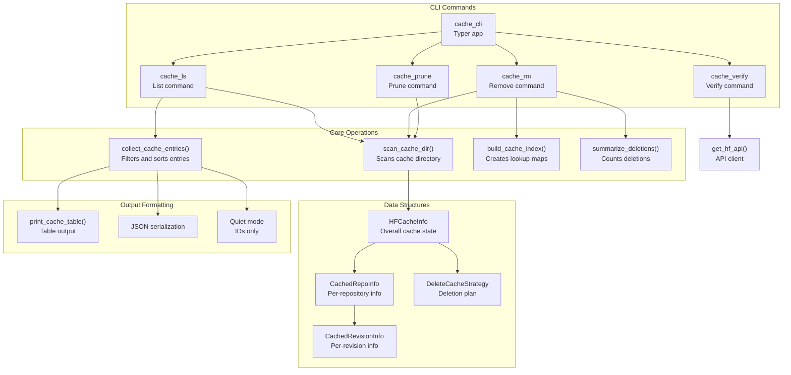
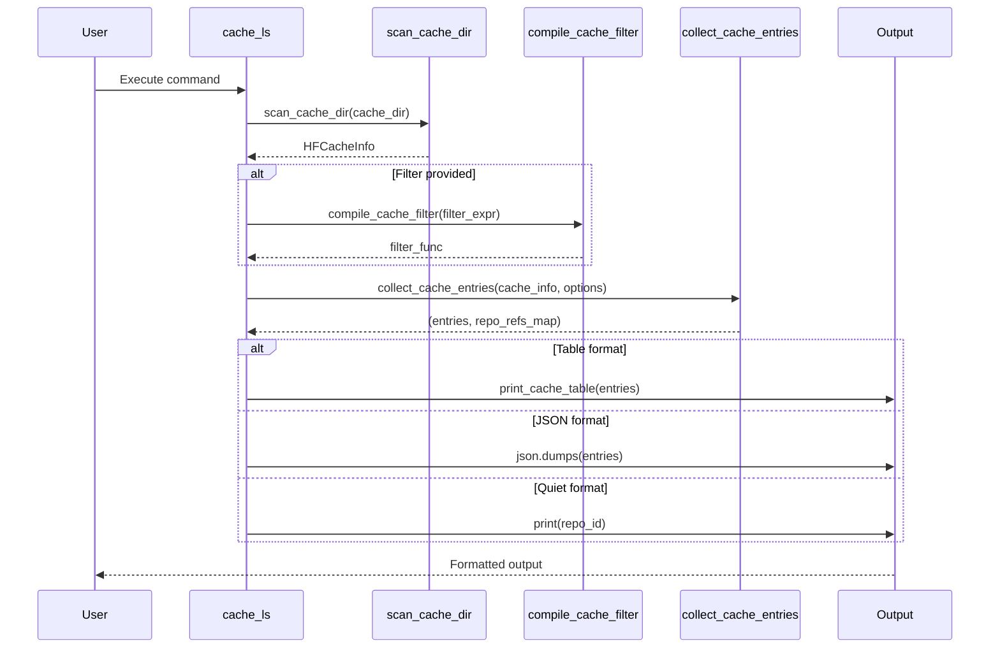
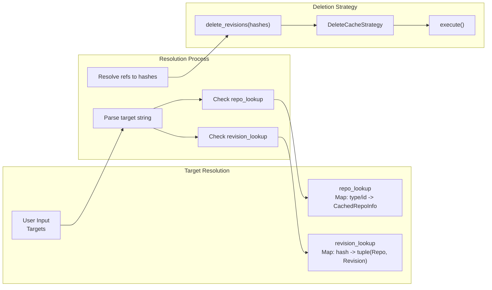
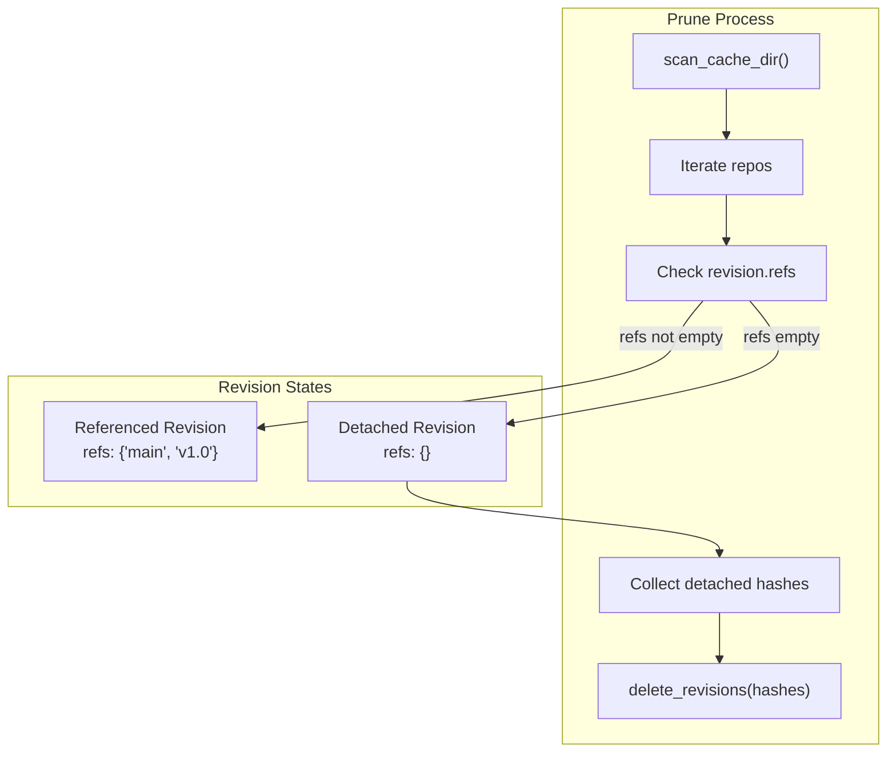
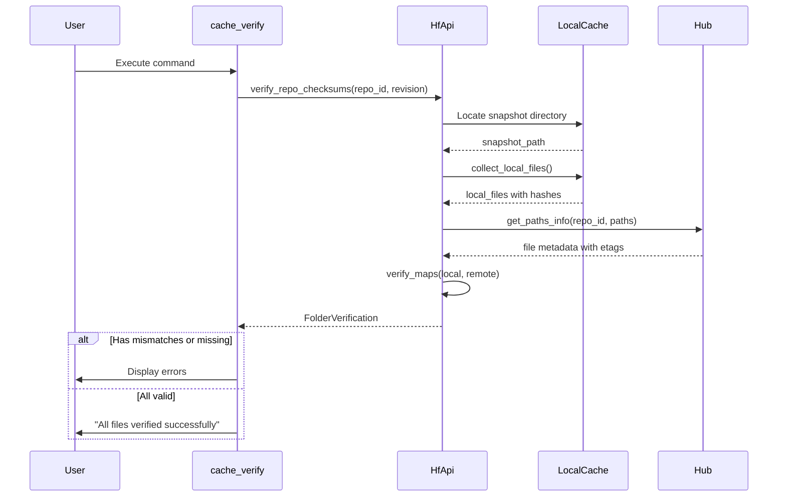
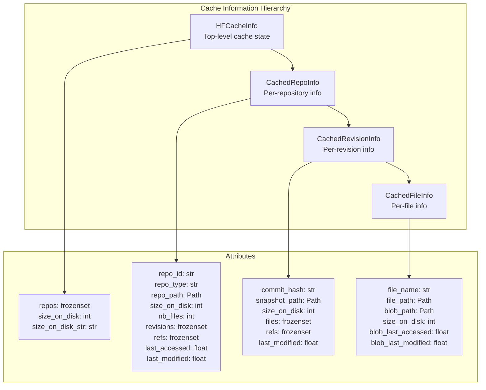
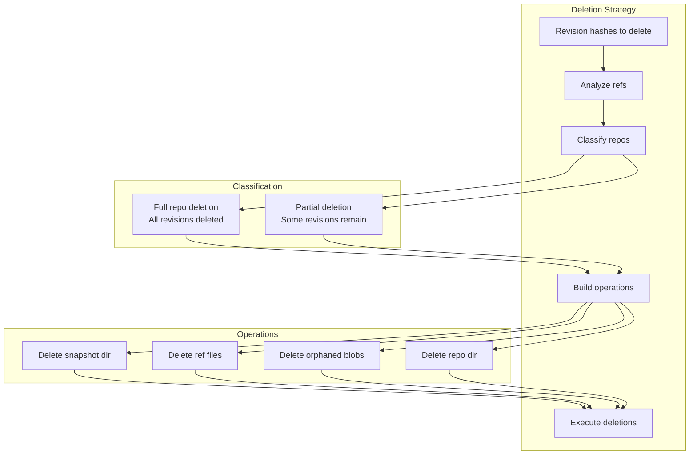
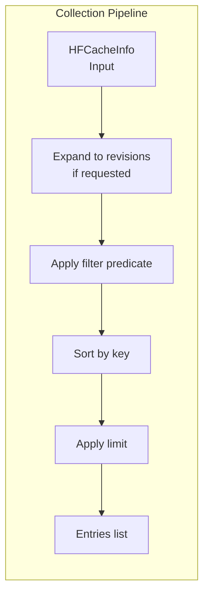

<!-- source: DeepWiki mcp.deepwiki.com · repo huggingface/huggingface_hub · page 7.2 Cache Management Commands · fetched 2026-10-26 -->

# Cache Management Commands

<details>
<summary>Relevant source files</summary>

The following files were used as context for generating this wiki page:

- [docs/source/en/_redirects.yml](docs/source/en/_redirects.yml)
- [docs/source/en/_toctree.yml](docs/source/en/_toctree.yml)
- [docs/source/en/guides/cli.md](docs/source/en/guides/cli.md)
- [docs/source/en/guides/jobs.md](docs/source/en/guides/jobs.md)
- [docs/source/en/guides/webhooks.md](docs/source/en/guides/webhooks.md)
- [docs/source/en/package_reference/cli.md](docs/source/en/package_reference/cli.md)
- [docs/source/en/package_reference/jobs.md](docs/source/en/package_reference/jobs.md)
- [src/huggingface_hub/__init__.py](src/huggingface_hub/__init__.py)
- [src/huggingface_hub/_commit_api.py](src/huggingface_hub/_commit_api.py)
- [src/huggingface_hub/_jobs_api.py](src/huggingface_hub/_jobs_api.py)
- [src/huggingface_hub/cli/_cli_utils.py](src/huggingface_hub/cli/_cli_utils.py)
- [src/huggingface_hub/cli/cache.py](src/huggingface_hub/cli/cache.py)
- [src/huggingface_hub/cli/datasets.py](src/huggingface_hub/cli/datasets.py)
- [src/huggingface_hub/cli/extensions.py](src/huggingface_hub/cli/extensions.py)
- [src/huggingface_hub/cli/hf.py](src/huggingface_hub/cli/hf.py)
- [src/huggingface_hub/cli/jobs.py](src/huggingface_hub/cli/jobs.py)
- [src/huggingface_hub/cli/models.py](src/huggingface_hub/cli/models.py)
- [src/huggingface_hub/cli/spaces.py](src/huggingface_hub/cli/spaces.py)
- [src/huggingface_hub/cli/webhooks.py](src/huggingface_hub/cli/webhooks.py)
- [src/huggingface_hub/constants.py](src/huggingface_hub/constants.py)
- [src/huggingface_hub/file_download.py](src/huggingface_hub/file_download.py)
- [src/huggingface_hub/hf_api.py](src/huggingface_hub/hf_api.py)
- [src/huggingface_hub/utils/__init__.py](src/huggingface_hub/utils/__init__.py)
- [tests/test_cli.py](tests/test_cli.py)
- [tests/test_file_download.py](tests/test_file_download.py)
- [tests/test_hf_api.py](tests/test_hf_api.py)
- [tests/testing_utils.py](tests/testing_utils.py)

</details>


## Purpose and Scope

This page documents the CLI commands for managing the local Hugging Face Hub cache directory. These commands allow users to inspect cached repositories, remove unnecessary files, and verify data integrity. The commands operate on the cache structure described in [Cache Architecture](#2.5) and provide both interactive and programmatic interfaces for cache maintenance.

For information about downloading files (which populates the cache), see [File Download System](#2.2). For programmatic cache access without the CLI, see the cache management utilities in [Cache Architecture](#2.5).

## Cache Management Overview

The `hf cache` command group provides four primary operations:

| Command | Purpose | Typical Use Case |
|---------|---------|------------------|
| `hf cache ls` | List cached content | View what's taking up space |
| `hf cache rm` | Remove specific items | Delete unwanted repositories or revisions |
| `hf cache prune` | Remove detached revisions | Clean up old commits no longer referenced |
| `hf cache verify` | Verify file integrity | Check for corruption after download |

All commands respect the `HF_HOME` and `HF_HUB_CACHE` environment variables for locating the cache directory. The default location is `~/.cache/huggingface/hub/`.

Sources: [src/huggingface_hub/cli/cache.py:15-28](), [docs/source/en/guides/cli.md:510-530]()

## Command Architecture



Sources: [src/huggingface_hub/cli/cache.py:34-54](), [src/huggingface_hub/cli/cache.py:79-117]()

## hf cache ls

The `cache_ls` command lists cached repositories or revisions with optional filtering, sorting, and output formatting.

### Basic Usage

```bash
# List all cached repositories
hf cache ls

# List individual revisions instead of aggregated repos
hf cache ls --revisions

# Filter by size (entries larger than 1GB)
hf cache ls --filter "size>1GB"

# Filter by repository type
hf cache ls --filter "type=model"

# Filter by access time (not accessed in 7 days)
hf cache ls --filter "accessed>7d"

# Combine multiple filters
hf cache ls --filter "size>1GB" --filter "type=model"

# Sort by size (descending)
hf cache ls --sort size:desc

# Limit results
hf cache ls --limit 10

# JSON output
hf cache ls --format json

# Quiet mode (IDs only)
hf cache ls --quiet
```

### Command Options

| Option | Type | Description |
|--------|------|-------------|
| `--cache-dir` | Path | Cache directory to scan (defaults to HF cache) |
| `--revisions` / `--no-revisions` | Flag | Include revisions instead of aggregated repos |
| `--filter` / `-f` | String | Filter expression (can be used multiple times) |
| `--format` | Enum | Output format: `table` or `json` |
| `--quiet` / `-q` | Flag | Print only IDs (repo IDs or revision hashes) |
| `--sort` | String | Sort key with optional `:asc` or `:desc` suffix |
| `--limit` | Integer | Limit number of results |

Sources: [src/huggingface_hub/cli/cache.py:79-141](), [docs/source/en/package_reference/cli.md:531-560]()

### Filter Expressions

The `--filter` option accepts expressions in the format `key operator value`:

| Filter Type | Operators | Example | Description |
|-------------|-----------|---------|-------------|
| Size | `>`, `<`, `>=`, `<=`, `=` | `size>1GB` | Filter by disk size |
| Type | `=` | `type=model` | Filter by repo type (model/dataset/space) |
| Access Time | `>`, `<` | `accessed>7d` | Filter by last access time |
| Modified Time | `>`, `<` | `modified>30d` | Filter by last modification time |

Size values support units: `B`, `KB`, `MB`, `GB`, `TB`. Time values support units: `s`, `m`, `h`, `d`.

Sources: [src/huggingface_hub/cli/cache.py:357-511]()

### Sort Keys

Supported sort keys with their default ordering:

| Sort Key | Default Order | Description |
|----------|---------------|-------------|
| `accessed` | `desc` | Sort by last access time (newest first) |
| `modified` | `desc` | Sort by last modification time (newest first) |
| `size` | `desc` | Sort by disk size (largest first) |
| `name` | `asc` | Sort alphabetically by repo ID |

Append `:asc` or `:desc` to explicitly set the order (e.g., `name:desc` or `size:asc`).

Sources: [src/huggingface_hub/cli/cache.py:142-200]()

### Output Formats

**Table Format (default):**
```
REPO ID                             REPO TYPE   SIZE ON DISK   REFS          LAST_ACCESSED   LAST_MODIFIED
----------------------------------- ----------- -------------- ------------- --------------- ---------------
model/gpt2                          model       548.1M         main          5 days ago      5 days ago
dataset/glue                        dataset     120.5M         main          2 weeks ago     2 weeks ago
```

**JSON Format:**
```json
[
  {
    "repo_id": "gpt2",
    "repo_type": "model",
    "size_on_disk": 574668800,
    "refs": ["main"],
    "last_accessed": 1704067200.0,
    "last_modified": 1704067200.0
  }
]
```

**Quiet Format:**
```
gpt2
glue
```

Sources: [src/huggingface_hub/cli/cache.py:202-278](), [src/huggingface_hub/cli/cache.py:280-317]()

### Implementation Flow



Sources: [src/huggingface_hub/cli/cache.py:79-141](), [src/huggingface_hub/cli/cache.py:319-355]()

## hf cache rm

The `cache_rm` command removes specific cached repositories or revisions.

### Basic Usage

```bash
# Remove a repository by repo ID
hf cache rm model/user/model-name

# Remove a specific revision by commit hash
hf cache rm abc123def456...

# Remove multiple items
hf cache rm model/repo1 model/repo2 abc123def

# Dry run to preview deletions
hf cache rm model/repo --dry-run

# Skip confirmation prompt
hf cache rm model/repo --yes
```

### Command Options

| Option | Type | Description |
|--------|------|-------------|
| `targets` | List[String] | One or more repo IDs or revision hashes to remove |
| `--cache-dir` | Path | Cache directory to scan |
| `--dry-run` / `--no-dry-run` | Flag | Preview deletions without removing |
| `--yes` / `-y` | Flag | Skip confirmation prompt |

Sources: [src/huggingface_hub/cli/cache.py:513-655](), [docs/source/en/package_reference/cli.md:589-596]()

### Target Resolution

The command accepts two types of targets:

1. **Repository IDs**: Format `type/namespace/repo_name` (e.g., `model/user/model`, `dataset/org/dataset`)
2. **Revision Hashes**: Full or partial commit hashes (e.g., `abc123def456...`)

The command builds lookup indices to resolve these targets:



Sources: [src/huggingface_hub/cli/cache.py:657-764]()

### Deletion Summary

Before deletion, the command displays a summary:

```
┌──────────────────────────────────────────────────────────────┐
│ DELETION SUMMARY                                             │
├──────────────────────────────────────────────────────────────┤
│ Repositories to delete entirely:      2                     │
│ Revisions to delete partially:        3                     │
│ Total revisions to delete:             5                     │
│ Expected freed disk space:             1.2 GB               │
└──────────────────────────────────────────────────────────────┘
```

Sources: [src/huggingface_hub/cli/cache.py:897-957]()

### Dry Run Mode

Use `--dry-run` to preview what will be deleted without actually removing anything:

```bash
hf cache rm model/gpt2 --dry-run
```

This scans the cache, builds the deletion strategy, and displays the summary, but skips calling `strategy.execute()`.

Sources: [tests/test_cli.py:188-215]()

## hf cache prune

The `cache_prune` command removes detached revisions (commits no longer referenced by any branch or tag).

### Basic Usage

```bash
# Prune detached revisions
hf cache prune

# Preview what would be pruned
hf cache prune --dry-run

# Skip confirmation prompt
hf cache prune --yes
```

### Command Options

| Option | Type | Description |
|--------|------|-------------|
| `--cache-dir` | Path | Cache directory to scan |
| `--dry-run` / `--no-dry-run` | Flag | Preview deletions without removing |
| `--yes` / `-y` | Flag | Skip confirmation prompt |

Sources: [src/huggingface_hub/cli/cache.py:766-846](), [docs/source/en/package_reference/cli.md:563-586]()

### Detached Revision Detection

A revision is considered "detached" if its `refs` set is empty. This typically happens when:

1. A branch is deleted after files are downloaded
2. Files are downloaded from a specific commit hash (not a branch)
3. A repository is renamed and old revisions remain

The prune command iterates through all cached repositories and identifies revisions with `len(revision.refs) == 0`:



Sources: [src/huggingface_hub/cli/cache.py:766-846]()

## hf cache verify

The `cache_verify` command verifies the integrity of cached files by comparing their checksums against the Hub.

### Basic Usage

```bash
# Verify a repository
hf cache verify user/model

# Verify a specific revision
hf cache verify user/model --revision main

# Verify a dataset
hf cache verify user/dataset --repo-type dataset

# Specify cache directory
hf cache verify user/model --cache-dir /path/to/cache

# JSON output
hf cache verify user/model --format json
```

### Command Options

| Option | Type | Description |
|--------|------|-------------|
| `repo_id` | String | Repository ID to verify |
| `--revision` | String | Git revision to verify (default: main) |
| `--repo-type` | Enum | Repository type: model, dataset, or space |
| `--cache-dir` | Path | Cache directory containing the files |
| `--format` | Enum | Output format: table or json |
| `--token` | String | Hugging Face access token |

Sources: [src/huggingface_hub/cli/cache.py:848-895](), [docs/source/en/package_reference/cli.md:526-530]()

### Verification Process

The command delegates to `HfApi.verify_repo_checksums()`, which:

1. Locates the snapshot directory for the given revision
2. Computes SHA-256 hashes for all local files
3. Fetches file metadata from the Hub (including ETags)
4. Compares local hashes against Hub hashes
5. Reports mismatches, missing files, and extra files



Sources: [src/huggingface_hub/cli/cache.py:848-895](), [src/huggingface_hub/utils/_verification.py:1-150]()

### Verification Output

**Success:**
```
✓ All 245 files in user/model (revision: main) verified successfully.
```

**With Mismatches:**
```
✗ Verification failed for user/model (revision: main)

Mismatches (2 files):
  - config.json (expected: abc123..., got: def456...)
  - pytorch_model.bin (expected: 789abc..., got: 012def...)

Missing from local (1 file):
  - tokenizer.json

Extra in local (1 file):
  - temp.txt
```

**JSON Output:**
```json
{
  "revision": "main",
  "checked_count": 245,
  "mismatches": [
    {"path": "config.json", "expected": "abc123...", "got": "def456..."}
  ],
  "missing_paths": ["tokenizer.json"],
  "extra_paths": ["temp.txt"],
  "verified_path": "/home/user/.cache/huggingface/hub/models--user--model/snapshots/abc123..."
}
```

Sources: [src/huggingface_hub/cli/cache.py:848-895]()

## Programmatic Cache Management

While the CLI provides convenient commands, the underlying cache management functions can be used programmatically:

### Scanning the Cache

```python
from huggingface_hub.utils import scan_cache_dir

# Scan the default cache directory
cache_info = scan_cache_dir()

# Print summary
print(f"Total repos: {len(cache_info.repos)}")
print(f"Total size: {cache_info.size_on_disk_str}")

# Iterate through repositories
for repo in cache_info.repos:
    print(f"{repo.repo_id}: {repo.size_on_disk_str}")
    for revision in repo.revisions:
        print(f"  {revision.commit_hash}: {revision.refs}")
```

### Deleting Cache Entries

```python
from huggingface_hub.utils import scan_cache_dir

# Scan cache
cache_info = scan_cache_dir()

# Delete specific revisions
strategy = cache_info.delete_revisions("abc123def456", "789012ghi345")

# Preview what will be deleted
print(f"Will free: {strategy.expected_freed_size_str}")

# Execute deletion
strategy.execute()
```

### Building Custom Filters

```python
from huggingface_hub.utils import scan_cache_dir
from datetime import datetime, timedelta

cache_info = scan_cache_dir()

# Find repos not accessed in 30 days
cutoff = datetime.now().timestamp() - (30 * 24 * 3600)
old_repos = [
    repo for repo in cache_info.repos
    if repo.last_accessed < cutoff
]

# Delete old repos
hashes = [
    rev.commit_hash
    for repo in old_repos
    for rev in repo.revisions
]
strategy = cache_info.delete_revisions(*hashes)
strategy.execute()
```

Sources: [src/huggingface_hub/utils/_cache_manager.py:1-500]()

## Implementation Details

### Data Structure Hierarchy



Sources: [src/huggingface_hub/utils/_cache_manager.py:60-300]()

### Cache Scanning Algorithm

The `scan_cache_dir()` function walks the cache directory structure:

1. **Locate cache root**: `~/.cache/huggingface/hub/` (or `HF_HUB_CACHE`)
2. **Find repository directories**: `models--namespace--repo/`, `datasets--namespace--repo/`
3. **Parse snapshots**: `snapshots/{commit_hash}/` directories
4. **Resolve refs**: `refs/{branch}` files containing commit hashes
5. **Collect file metadata**: Size, access time, modification time
6. **Build hierarchy**: Aggregate data from files → revisions → repos

Sources: [src/huggingface_hub/utils/_cache_manager.py:400-600]()

### Deletion Strategy

The `DeleteCacheStrategy` class implements safe deletion:



The strategy ensures:
- **Ref consistency**: Updates or removes ref files pointing to deleted revisions
- **Blob cleanup**: Removes blobs no longer referenced by any snapshot
- **Directory cleanup**: Removes empty directories after deletion
- **Atomicity**: Operations are grouped to minimize inconsistent states

Sources: [src/huggingface_hub/utils/_cache_manager.py:700-1000]()

### Filter Compilation

The `compile_cache_filter()` function parses filter expressions and returns a callable predicate:

```python
# Filter expression: "size>1GB"
# Compiles to: lambda entry: entry.size_on_disk > 1_000_000_000

# Filter expression: "type=model"
# Compiles to: lambda entry: entry.repo_type == "model"

# Filter expression: "accessed>7d"
# Compiles to: lambda entry: (now - entry.last_accessed) > (7 * 86400)
```

The compiler supports:
- **Size comparisons**: `>`, `<`, `>=`, `<=`, `=` with unit parsing (B, KB, MB, GB, TB)
- **Type matching**: `=` operator for exact string match
- **Time comparisons**: `>`, `<` for relative time with unit parsing (s, m, h, d)
- **Attribute access**: Validates attributes exist on the entry object

Sources: [src/huggingface_hub/cli/cache.py:357-511]()

### Collection and Sorting

The `collect_cache_entries()` function implements the filtering and sorting pipeline:



The function handles:
- **Aggregation vs. expansion**: Repos can be listed as aggregates or expanded into individual revisions
- **Multi-level sorting**: Supports primary and secondary sort keys
- **Filtering at correct level**: Filters apply to the entry type (repo or revision)
- **Efficient limiting**: Short-circuits iteration after reaching the limit

Sources: [src/huggingface_hub/cli/cache.py:319-355]()

---

