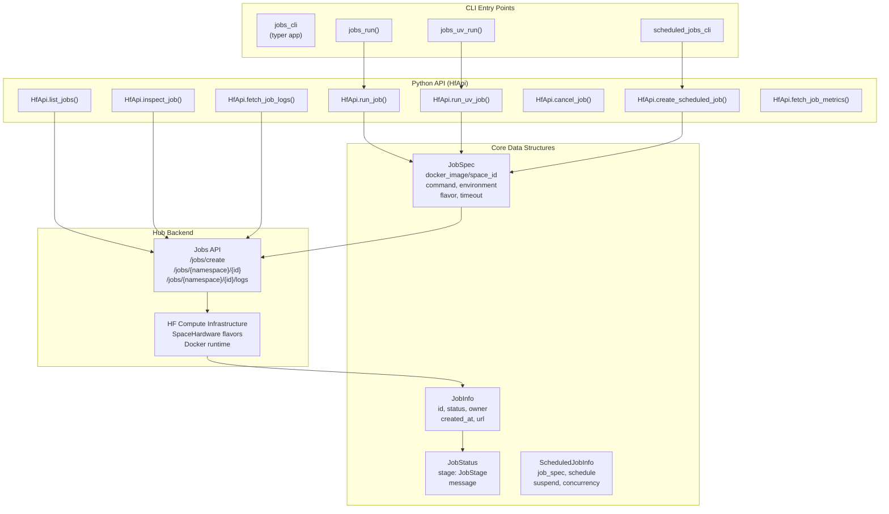
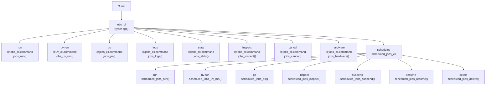
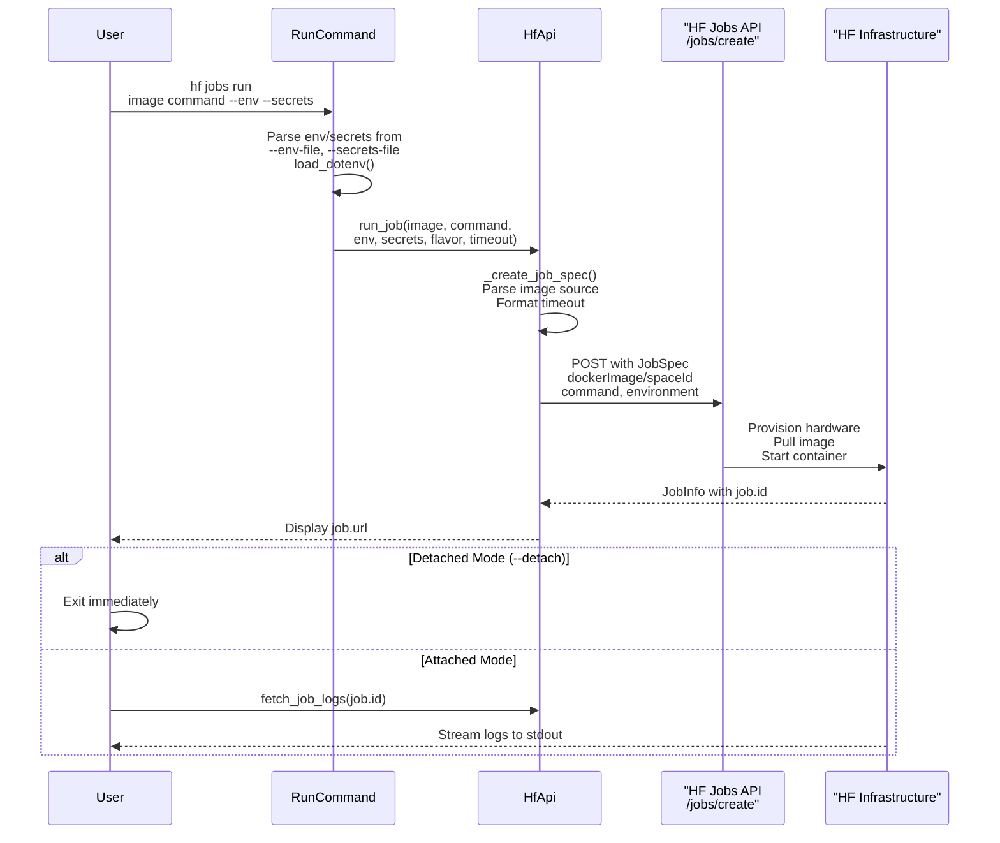
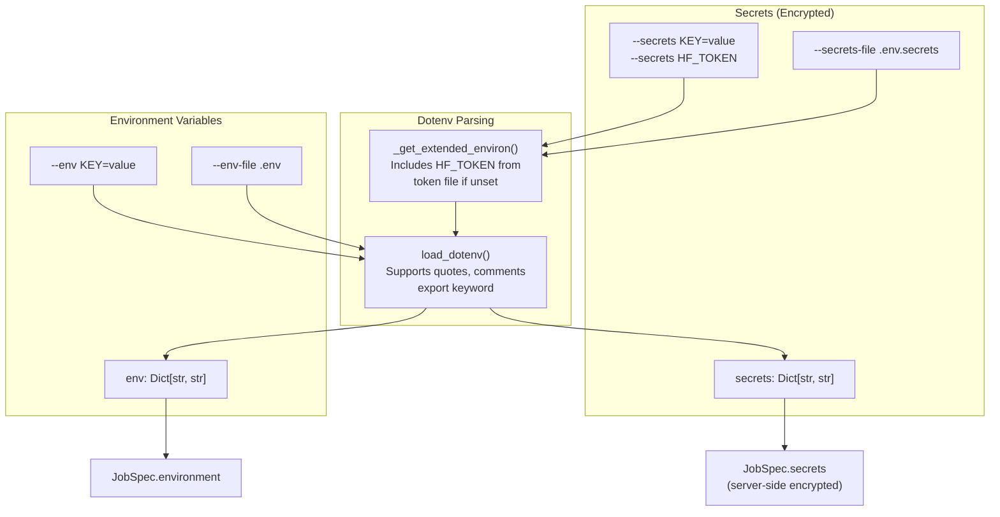
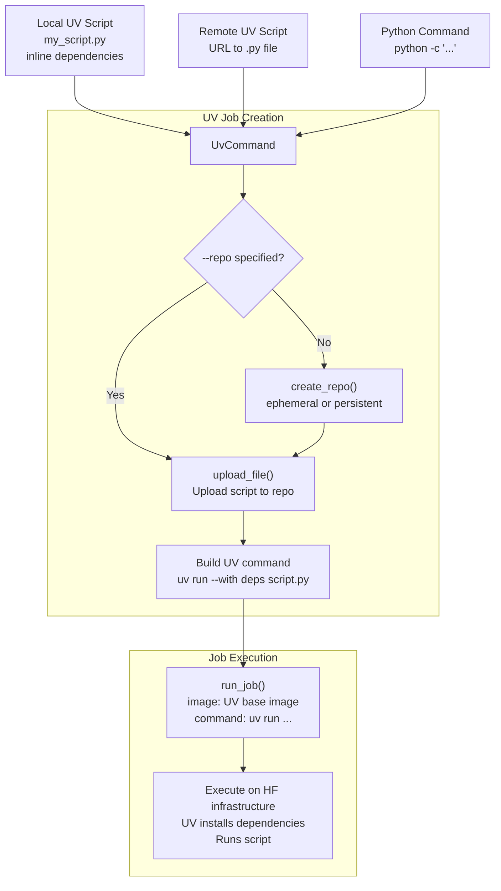
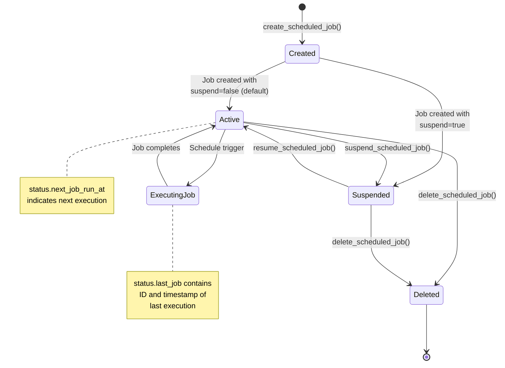
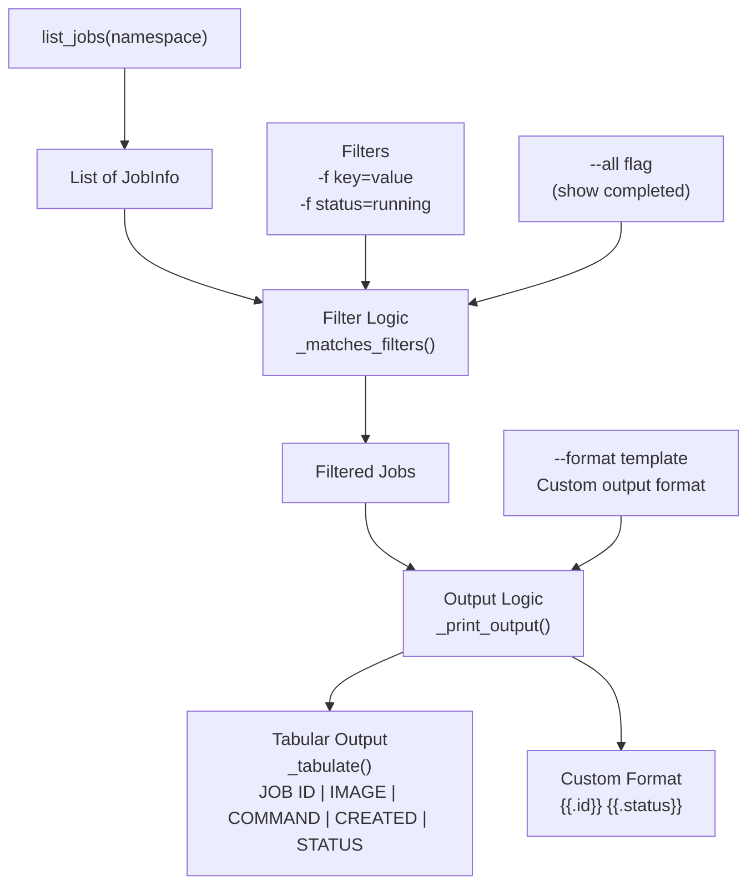
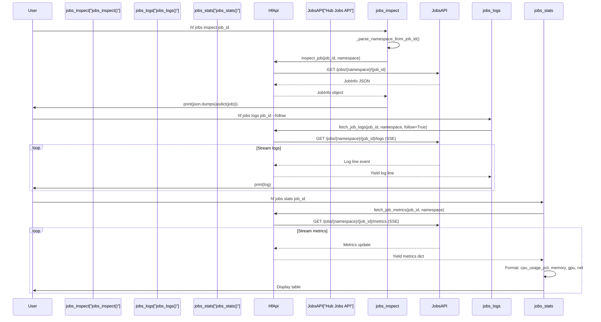
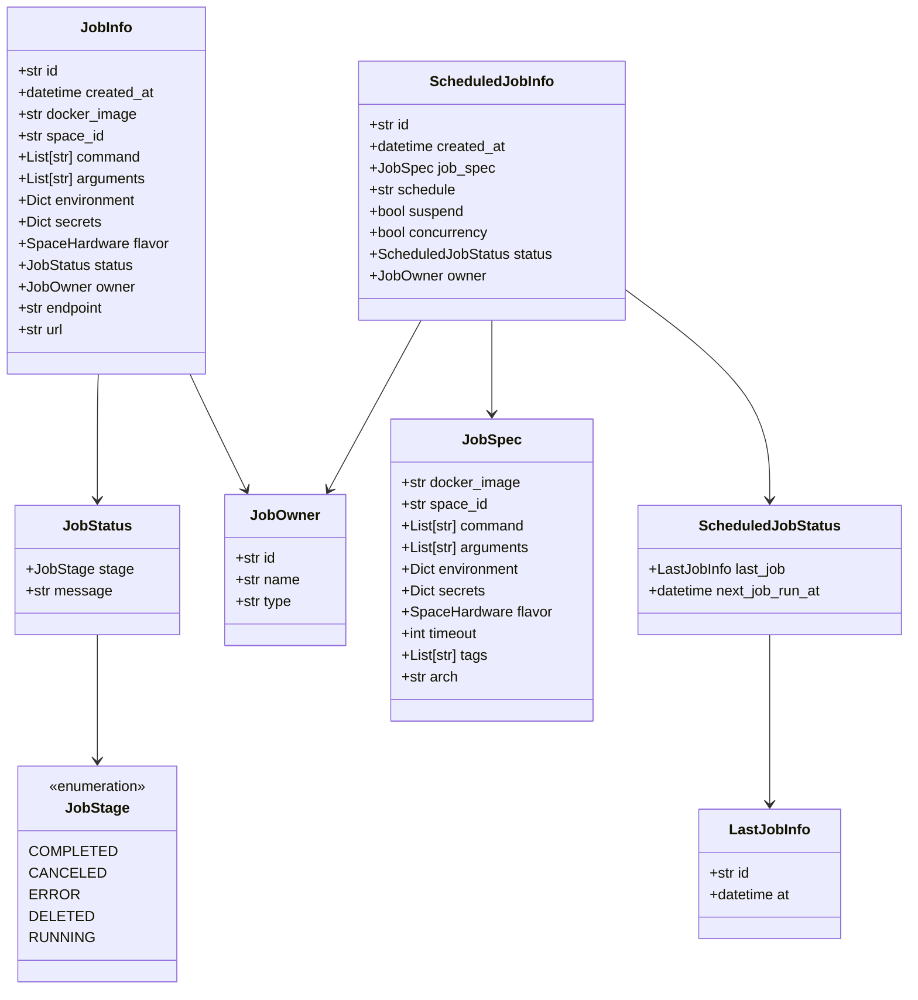

<!-- source: DeepWiki mcp.deepwiki.com · repo huggingface/huggingface_hub · page 7.3 Jobs and Compute System · fetched 2026-10-26 -->

# Jobs and Compute System

<details>
<summary>Relevant source files</summary>

The following files were used as context for generating this wiki page:

- [docs/source/en/_redirects.yml](docs/source/en/_redirects.yml)
- [docs/source/en/_toctree.yml](docs/source/en/_toctree.yml)
- [docs/source/en/guides/cli.md](docs/source/en/guides/cli.md)
- [docs/source/en/guides/jobs.md](docs/source/en/guides/jobs.md)
- [docs/source/en/guides/webhooks.md](docs/source/en/guides/webhooks.md)
- [docs/source/en/package_reference/cli.md](docs/source/en/package_reference/cli.md)
- [docs/source/en/package_reference/jobs.md](docs/source/en/package_reference/jobs.md)
- [src/huggingface_hub/_jobs_api.py](src/huggingface_hub/_jobs_api.py)
- [src/huggingface_hub/cli/_cli_utils.py](src/huggingface_hub/cli/_cli_utils.py)
- [src/huggingface_hub/cli/cache.py](src/huggingface_hub/cli/cache.py)
- [src/huggingface_hub/cli/datasets.py](src/huggingface_hub/cli/datasets.py)
- [src/huggingface_hub/cli/extensions.py](src/huggingface_hub/cli/extensions.py)
- [src/huggingface_hub/cli/hf.py](src/huggingface_hub/cli/hf.py)
- [src/huggingface_hub/cli/jobs.py](src/huggingface_hub/cli/jobs.py)
- [src/huggingface_hub/cli/models.py](src/huggingface_hub/cli/models.py)
- [src/huggingface_hub/cli/spaces.py](src/huggingface_hub/cli/spaces.py)
- [src/huggingface_hub/cli/webhooks.py](src/huggingface_hub/cli/webhooks.py)
- [tests/test_cli.py](tests/test_cli.py)

</details>


The Jobs system enables running compute workloads on Hugging Face infrastructure through CLI commands (`hf jobs`) or Python API methods. Jobs execute Docker containers with custom commands, run UV scripts (Python scripts with inline dependencies), or operate on recurring schedules. The system manages job lifecycle, hardware provisioning, environment configuration, and log/metrics streaming.

**Availability**: Jobs require [Pro subscription](https://huggingface.co/pro) or [Team/Enterprise organization](https://huggingface.co/enterprise) membership.

**Related Pages**: See [CLI Overview](#7) for general CLI usage. See [Core API Client (HfApi)](#2) for the underlying HTTP client.

## System Architecture

Title: **Jobs System Architecture and Code Entities**



The system has three layers:

1. **User Interfaces**: CLI commands in `jobs_cli` [src/huggingface_hub/cli/jobs.py:299]() and Python methods in `HfApi`
2. **Data Layer**: `JobSpec` for job configuration [src/huggingface_hub/_jobs_api.py:148-171](), `JobInfo` for job state [src/huggingface_hub/_jobs_api.py:59-146]()
3. **Execution Layer**: Hub's Jobs API and compute infrastructure

**Sources**: [src/huggingface_hub/cli/jobs.py:299-800](), [src/huggingface_hub/_jobs_api.py:25-302](), [docs/source/en/guides/jobs.md:1-450]()

## CLI Command Structure

Title: **Jobs CLI Command Tree with Function Names**



All commands are defined in [src/huggingface_hub/cli/jobs.py]():
- `jobs_cli` created at line 299 using `typer_factory()`
- `uv_cli` (for UV commands) at line 446
- `scheduled_jobs_cli` (for scheduled jobs) at line 548
- Command functions defined throughout the file with `@jobs_cli.command()` decorators

**Sources**: [src/huggingface_hub/cli/jobs.py:299-800](), [src/huggingface_hub/cli/hf.py:95]()

## Running Standard Docker Jobs

Standard jobs execute arbitrary commands in Docker containers. The container image can be sourced from Docker Hub or from Hugging Face Spaces.

### Basic Job Execution



**Sources**: [src/huggingface_hub/cli/jobs.py:120-161](), [src/huggingface_hub/_jobs_api.py:263-302](), [docs/source/en/guides/jobs.md:44-104]()

### Image Source Resolution

Jobs support multiple container image sources, distinguished by URL patterns:

| Image Pattern | Resolution | Example |
|--------------|------------|---------|
| `docker/image:tag` | Docker Hub | `python:3.12` |
| `registry.io/image` | Custom registry | `pytorch/pytorch:2.6.0-cuda12.4` |
| `https://huggingface.co/spaces/user/space` | HF Space | `hf.co/spaces/lhoestq/duckdb` |
| `hf.co/spaces/user/space` | HF Space (shorthand) | `hf.co/spaces/lhoestq/duckdb` |

The resolution logic is in [src/huggingface_hub/_jobs_api.py:289-300](). If the image starts with specific HF Space URL prefixes, the `spaceId` field is set instead of `dockerImage` in the `JobSpec`.

**Sources**: [src/huggingface_hub/_jobs_api.py:289-301](), [docs/source/en/guides/cli.md:608-623]()

### Environment and Secrets Management

Jobs distinguish between regular environment variables and secrets:



The `_get_extended_environ()` function [src/huggingface_hub/cli/jobs.py:803-821]() extends the environment with the HF token from the token file if the `HF_TOKEN` environment variable is not set. This allows `--secrets HF_TOKEN` to automatically retrieve the locally stored token.

The `load_dotenv()` utility [src/huggingface_hub/utils/_dotenv.py:6-55]() parses dotenv format strings, handling:
- Quoted values (single and double quotes)
- Escape sequences (`\n`, `\t`, `\\`, etc.)
- Comments (lines starting with `#` or inline after `#`)
- Export keyword (`export KEY=value`)
- Key-only entries that retrieve from provided environment

**Sources**: [src/huggingface_hub/cli/jobs.py:120-161](), [src/huggingface_hub/cli/jobs.py:803-821](), [src/huggingface_hub/utils/_dotenv.py:1-56](), [docs/source/en/guides/jobs.md:279-303]()

## UV Script Jobs (Experimental)

UV jobs execute Python scripts that declare their dependencies inline using UV's script format. This eliminates the need for separate `requirements.txt` files and makes scripts self-contained.

### UV Job Workflow



**Sources**: [src/huggingface_hub/cli/jobs.py:517-546](), [docs/source/en/guides/jobs.md:305-331]()

### UV Script Repository Management

UV jobs require the script to be in a Hugging Face repository. The system handles this automatically:

1. **Ephemeral Mode** (no `--repo` specified): Creates a temporary repository with name format `uv-scripts-{unique_id}` under the user's namespace. The repository is created with `private=True` and `exist_ok=True`. [src/huggingface_hub/cli/jobs.py:517-546]()

2. **Persistent Mode** (`--repo my-scripts`): Uses the specified repository, creating it if it doesn't exist. This allows scripts to be organized and reused.

3. **Remote URL Mode**: If the script argument is a URL, it's downloaded and then uploaded to a repository following the ephemeral/persistent logic above.

The script is uploaded with a filename derived from the original script name or a generated name for commands. [src/huggingface_hub/cli/jobs.py:517-546]()

**Sources**: [src/huggingface_hub/cli/jobs.py:517-546](), [docs/source/en/guides/cli.md:730-758]()

### UV Docker Image Selection

By default, UV jobs use the `astral-sh/uv:python3.12-bookworm` image. Users can specify a custom image with `--image` if they need a specific environment (e.g., ML frameworks pre-installed):

```bash
hf jobs uv run --image vllm/vllm-openai:latest script.py
```

The custom image must have `uv` pre-installed. [docs/source/en/guides/jobs.md:333-352]()

**Sources**: [docs/source/en/guides/jobs.md:333-352](), [src/huggingface_hub/cli/jobs.py:451-452]()

## Scheduled Jobs

Scheduled jobs run on a recurring schedule using cron syntax or predefined intervals. They wrap either standard Docker jobs or UV jobs.

### Schedule Expression Format

| Expression | Meaning | CRON Equivalent |
|-----------|---------|-----------------|
| `@annually` / `@yearly` | Once per year | `0 0 1 1 *` |
| `@monthly` | Once per month | `0 0 1 * *` |
| `@weekly` | Once per week | `0 0 * * 0` |
| `@daily` | Once per day | `0 0 * * *` |
| `@hourly` | Once per hour | `0 * * * *` |
| `*/5 * * * *` | Every 5 minutes | Custom CRON |
| `0 9 * * 1` | 9 AM every Monday | Custom CRON |

**Sources**: [docs/source/en/guides/cli.md:763-780](), [docs/source/en/guides/jobs.md:354-387]()

### Scheduled Job Lifecycle



**Sources**: [src/huggingface_hub/_jobs_api.py:183-261](), [docs/source/en/guides/jobs.md:390-412]()

### Scheduled Job Data Structures

Scheduled jobs use specialized data structures:

- **`ScheduledJobInfo`** [src/huggingface_hub/_jobs_api.py:196-261](): Contains `id`, `created_at`, `job_spec`, `schedule`, `suspend`, `concurrency`, `status`, `owner`
- **`ScheduledJobStatus`** [src/huggingface_hub/_jobs_api.py:184-193](): Contains `last_job` (ID and timestamp of last execution) and `next_job_run_at` (scheduled time for next run)
- **`JobSpec`** [src/huggingface_hub/_jobs_api.py:148-171](): Shared specification for the job to execute, containing `docker_image`/`space_id`, `command`, `environment`, `secrets`, `flavor`, `timeout`

The `concurrency` flag controls whether multiple instances of the job can run simultaneously. [src/huggingface_hub/_jobs_api.py:196-261]()

**Sources**: [src/huggingface_hub/_jobs_api.py:148-261]()

## Job Management Operations

### Listing Jobs

The `hf jobs ps` command lists jobs with Docker-style filtering:



The filtering supports:
- Exact substring matching: `-f status=running`
- Wildcard patterns: `-f image=python*`
- Multiple filters: `-f status=running -f image=pytorch*`

**Sources**: [src/huggingface_hub/cli/jobs.py:216-378](), [tests/test_cli.py:1196-1384]()

### Job Status and Lifecycle

Title: **Job Status Enumeration (JobStage)**

Jobs progress through stages defined in the `JobStage` enum [src/huggingface_hub/_jobs_api.py:25-43]():

| JobStage Value | Description |
|---------------|-------------|
| `RUNNING` | Job is executing |
| `COMPLETED` | Job finished successfully |
| `ERROR` | Job failed with error |
| `CANCELED` | User canceled job |
| `DELETED` | Job was deleted |

The `JobStatus` dataclass [src/huggingface_hub/_jobs_api.py:45-49]() combines `stage` (a `JobStage` enum value) with an optional `message` string for additional context.

**Sources**: [src/huggingface_hub/_jobs_api.py:25-49](), [docs/source/en/package_reference/jobs.md:27-34]()

### Job Inspection, Logs, and Metrics

Title: **Job Monitoring Flow**



**Command Functions**:
- `jobs_inspect()` [src/huggingface_hub/cli/jobs.py:431-445]() - Returns complete `JobInfo` as JSON
- `jobs_logs()` [src/huggingface_hub/cli/jobs.py:363-411]() - Streams logs using SSE, supports `--follow` and `--tail`
- `jobs_stats()` [src/huggingface_hub/cli/jobs.py:481-579]() - Streams resource metrics (CPU, memory, GPU, network)

**Namespace Parsing**: `_parse_namespace_from_job_id()` [src/huggingface_hub/cli/jobs.py:100-126]() extracts namespace from `namespace/job_id` format or uses provided `--namespace`.

**Sources**: [src/huggingface_hub/cli/jobs.py:100-126](), [src/huggingface_hub/cli/jobs.py:363-579](), [docs/source/en/guides/jobs.md:106-150]()

## Hardware Selection (Flavors)

Jobs run on hardware configurations called "flavors". Specify via `--flavor` CLI argument or `flavor` Python parameter.

### Available Flavors

| Category | Flavors | Typical Use Cases |
|----------|---------|-------------------|
| **CPU** | `cpu-basic`, `cpu-upgrade` | Scripts, data processing |
| **GPU (NVIDIA T4)** | `t4-small`, `t4-medium` | Light inference, small training |
| **GPU (NVIDIA L4)** | `l4x1`, `l4x4` | ML training, inference |
| **GPU (NVIDIA A10G)** | `a10g-small`, `a10g-large`, `a10g-largex2`, `a10g-largex4` | Model training, fine-tuning |
| **GPU (NVIDIA A100)** | `a100-large` | Large model training |
| **TPU (Google)** | `v5e-1x1`, `v5e-2x2`, `v5e-2x4` | TPU workloads |

**Default**: `cpu-basic`

**Implementation**: Flavors are values from the `SpaceHardware` enum. `SUGGESTED_FLAVORS` [src/huggingface_hub/cli/jobs.py:128]() filters out `zero-a10g` (not available for Jobs). The `jobs_hardware()` command [src/huggingface_hub/cli/jobs.py:845-857]() lists available flavors.

**Sources**: [src/huggingface_hub/cli/jobs.py:128](), [src/huggingface_hub/cli/jobs.py:845-857](), [docs/source/en/guides/jobs.md:164-215]()

## Timeout Configuration

Jobs have a default timeout of 30 minutes. For long-running workloads like model training, the timeout must be explicitly configured.

### Timeout Specification Format

The `timeout` parameter accepts:

1. **Integer/float**: Interpreted as seconds
   ```python
   run_job(..., timeout=7200)  # 2 hours
   ```

2. **String with units**: `s` (seconds), `m` (minutes), `h` (hours), `d` (days)
   ```python
   run_job(..., timeout="2h")    # 2 hours
   run_job(..., timeout="90m")   # 90 minutes
   run_job(..., timeout="1.5h")  # 1.5 hours
   ```

The conversion logic [src/huggingface_hub/_jobs_api.py:283-288]() multiplies the numeric value by the time unit factor to produce seconds, which is stored in `JobSpec.timeoutSeconds`.

**Sources**: [src/huggingface_hub/_jobs_api.py:283-288](), [docs/source/en/guides/jobs.md:201-277]()

## Namespace and Ownership

Jobs belong to a namespace (user or organization):

1. **User namespace** (default): Jobs under your username
2. **Organization namespace**: Jobs under an org where you have write access

Specify namespace via `--namespace` CLI option or `namespace` Python parameter. If omitted, uses current user's namespace.

### Namespace Parsing from Job IDs

The `_parse_namespace_from_job_id()` function [src/huggingface_hub/cli/jobs.py:100-126]() allows copying job IDs from the Hub UI in `namespace/job_id` format:

```python
# Input: "username/abc123" or "abc123"
# Output: job_id="abc123", namespace="username" (or None)
```

If both `namespace/job_id` format and `--namespace` are provided, they must match or a `CLIError` is raised.

**Data Structure**: `JobOwner` [src/huggingface_hub/_jobs_api.py:52-56]() tracks owner `id`, `name`, and `type` (user or org).

**Sources**: [src/huggingface_hub/cli/jobs.py:100-126](), [src/huggingface_hub/_jobs_api.py:52-56](), [docs/source/en/guides/jobs.md:48-77]()

## Job Data Structures Summary

The Jobs API uses several interconnected data structures:



**Sources**: [src/huggingface_hub/_jobs_api.py:25-261]()

## CLI to Python API Mapping

| CLI Command | Python API Method | Purpose |
|-------------|------------------|---------|
| `hf jobs run` | `run_job()` | Execute Docker job |
| `hf jobs uv run` | `run_uv_job()` | Execute UV script job |
| `hf jobs ps` | `list_jobs()` | List jobs |
| `hf jobs inspect` | `inspect_job()` | Get job details |
| `hf jobs logs` | `fetch_job_logs()` | Stream job logs |
| `hf jobs cancel` | `cancel_job()` | Cancel running job |
| `hf jobs scheduled run` | `create_scheduled_job()` | Create scheduled job |
| `hf jobs scheduled uv run` | `create_scheduled_uv_job()` | Schedule UV script |
| `hf jobs scheduled ps` | `list_scheduled_jobs()` | List schedules |
| `hf jobs scheduled inspect` | `inspect_scheduled_job()` | Get schedule details |
| `hf jobs scheduled suspend` | `suspend_scheduled_job()` | Pause schedule |
| `hf jobs scheduled resume` | `resume_scheduled_job()` | Resume schedule |
| `hf jobs scheduled delete` | `delete_scheduled_job()` | Delete schedule |

**Sources**: [src/huggingface_hub/cli/jobs.py:55-800](), [docs/source/en/package_reference/jobs.md:1-34]()

---

