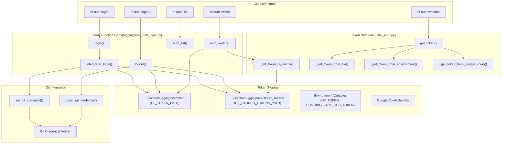
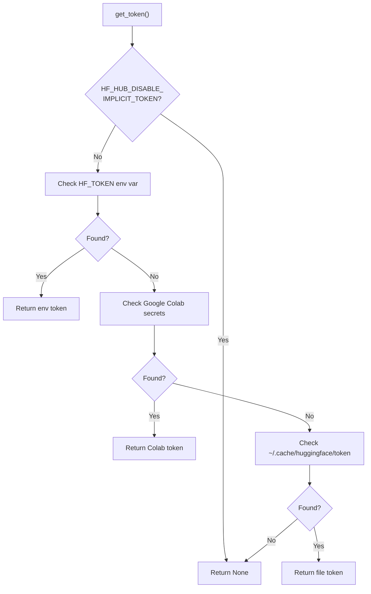
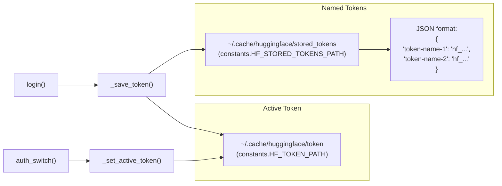
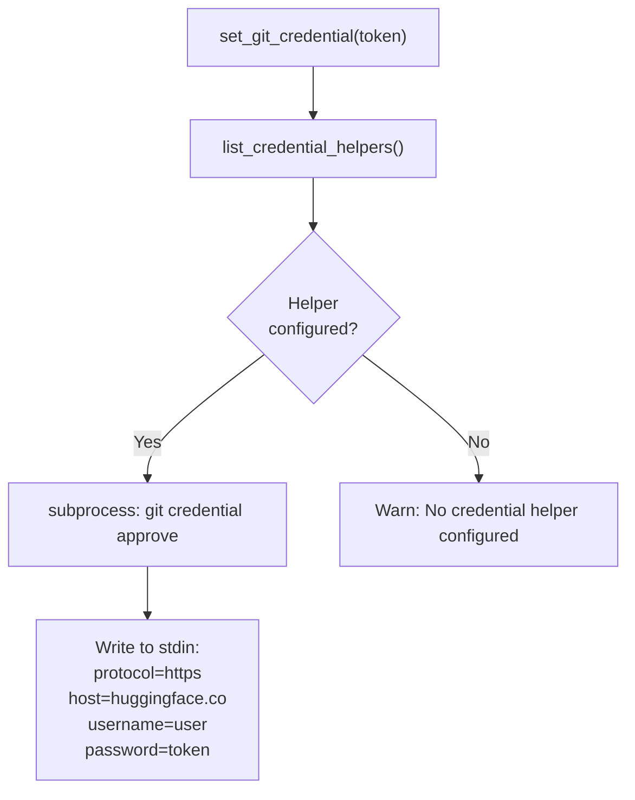

<!-- source: DeepWiki mcp.deepwiki.com · repo huggingface/huggingface_hub · page 7.4 Authentication Commands · fetched 2026-10-26 -->

# Authentication Commands

<details>
<summary>Relevant source files</summary>

The following files were used as context for generating this wiki page:

- [docs/source/en/_redirects.yml](docs/source/en/_redirects.yml)
- [docs/source/en/_toctree.yml](docs/source/en/_toctree.yml)
- [docs/source/en/guides/cli.md](docs/source/en/guides/cli.md)
- [docs/source/en/guides/jobs.md](docs/source/en/guides/jobs.md)
- [docs/source/en/guides/webhooks.md](docs/source/en/guides/webhooks.md)
- [docs/source/en/package_reference/cli.md](docs/source/en/package_reference/cli.md)
- [docs/source/en/package_reference/jobs.md](docs/source/en/package_reference/jobs.md)
- [src/huggingface_hub/_jobs_api.py](src/huggingface_hub/_jobs_api.py)
- [src/huggingface_hub/_login.py](src/huggingface_hub/_login.py)
- [src/huggingface_hub/cli/_cli_utils.py](src/huggingface_hub/cli/_cli_utils.py)
- [src/huggingface_hub/cli/cache.py](src/huggingface_hub/cli/cache.py)
- [src/huggingface_hub/cli/datasets.py](src/huggingface_hub/cli/datasets.py)
- [src/huggingface_hub/cli/extensions.py](src/huggingface_hub/cli/extensions.py)
- [src/huggingface_hub/cli/hf.py](src/huggingface_hub/cli/hf.py)
- [src/huggingface_hub/cli/jobs.py](src/huggingface_hub/cli/jobs.py)
- [src/huggingface_hub/cli/models.py](src/huggingface_hub/cli/models.py)
- [src/huggingface_hub/cli/spaces.py](src/huggingface_hub/cli/spaces.py)
- [src/huggingface_hub/cli/webhooks.py](src/huggingface_hub/cli/webhooks.py)
- [src/huggingface_hub/utils/_headers.py](src/huggingface_hub/utils/_headers.py)
- [src/huggingface_hub/utils/_runtime.py](src/huggingface_hub/utils/_runtime.py)
- [src/huggingface_hub/utils/_xet.py](src/huggingface_hub/utils/_xet.py)
- [tests/test_cli.py](tests/test_cli.py)
- [tests/test_utils_headers.py](tests/test_utils_headers.py)
- [tests/test_xet_utils.py](tests/test_xet_utils.py)

</details>


This document describes the CLI commands for managing authentication with the Hugging Face Hub. These commands allow users to log in, log out, switch between multiple accounts, and inspect authentication status from the command line.

For general authentication concepts and programmatic token management, see [Authentication](#8). For details on the broader CLI system, see [Command Line Interface](#7).

## Overview

The `hf auth` command group provides five subcommands for managing authentication tokens:

| Command | Purpose |
|---------|---------|
| `hf auth login` | Authenticate with the Hub using an access token |
| `hf auth logout` | Remove authentication credentials |
| `hf auth whoami` | Display currently authenticated user information |
| `hf auth switch` | Switch between multiple stored access tokens |
| `hf auth list` | List all stored access tokens |

These commands delegate to core authentication functions in [src/huggingface_hub/_login.py]() and manage token storage in the user's cache directory.

**Sources:** [docs/source/en/package_reference/cli.md:50-189](), [src/huggingface_hub/cli/hf.py:89]()

## Authentication System Architecture



**Sources:** [src/huggingface_hub/_login.py:59-228](), [src/huggingface_hub/utils/_auth.py]()

## Token Priority and Sources

The authentication system checks for tokens in the following priority order:



This priority system ensures environment variables and Colab secrets take precedence over stored tokens, allowing temporary overrides without modifying stored credentials.

**Sources:** [src/huggingface_hub/utils/_auth.py]()

## Command Reference

### hf auth login

Authenticates the user with the Hugging Face Hub by storing an access token.

**Syntax:**
```bash
hf auth login [OPTIONS]
```

**Options:**

| Option | Description |
|--------|-------------|
| `--token TEXT` | User access token from https://huggingface.co/settings/tokens |
| `--add-to-git-credential` / `--no-add-to-git-credential` | Save to git credential helper (default: no-add-to-git-credential) |

**Interactive Flow:**

When invoked without `--token`, the command enters interactive mode:

1. Displays ASCII logo and instructions
2. Prompts for token (input hidden)
3. Asks whether to add to git credential
4. Validates token with Hub API
5. Stores token in `~/.cache/huggingface/token`
6. Optionally configures git credential helper

**Examples:**
```bash
# Interactive login
hf auth login

# Non-interactive with token from environment
hf auth login --token $HF_TOKEN

# Login and configure git credentials
hf auth login --token $HF_TOKEN --add-to-git-credential
```

**Implementation Details:**

The command delegates to `login()` in [src/huggingface_hub/_login.py:59-117](), which calls `interpreter_login()` for terminal-based prompts [src/huggingface_hub/_login.py:235-271](). The token is:

1. Validated by calling the Hub API
2. Saved to `HF_TOKEN_PATH` via `_save_token()`
3. Optionally added to git credential store via `set_git_credential()`
4. Added to `HF_STORED_TOKENS_PATH` with a name if using multiple tokens

**Sources:** [src/huggingface_hub/_login.py:59-117](), [src/huggingface_hub/_login.py:235-271](), [docs/source/en/guides/cli.md:108-149]()

### hf auth logout

Removes stored authentication credentials from the machine.

**Syntax:**
```bash
hf auth logout [OPTIONS]
```

**Options:**

| Option | Description |
|--------|-------------|
| `--token-name TEXT` | Name of specific token to logout from (default: all tokens) |

**Behavior:**

- Without `--token-name`: Deletes both `HF_TOKEN_PATH` and `HF_STORED_TOKENS_PATH`
- With `--token-name`: Removes only the named token from `HF_STORED_TOKENS_PATH`
- Always calls `unset_git_credential()` to remove git credential helper entries
- Checks for environment variables and warns if still logged in via `HF_TOKEN` or Google Colab

**Examples:**
```bash
# Logout from all tokens
hf auth logout

# Logout from specific named token
hf auth logout --token-name my-token
```

**Implementation:** The command calls `logout()` in [src/huggingface_hub/_login.py:119-159](), which handles file deletion and git credential cleanup. If environment variables are still set, it raises `EnvironmentError` to inform the user.

**Sources:** [src/huggingface_hub/_login.py:119-159](), [docs/source/en/guides/cli.md:163-168]()

### hf auth whoami

Displays information about the currently authenticated user.

**Syntax:**
```bash
hf auth whoami [OPTIONS]
```

**Options:** None

**Output:**
```
<username>
orgs: <org1>,<org2>,...
```

The command retrieves the current token via `get_token()` and calls the Hub API to fetch user information. If not logged in, it prints an error message.

**Example:**
```bash
hf auth whoami
# Output:
# Wauplin
# orgs:  huggingface,eu-test,OAuthTesters
```

**Sources:** [docs/source/en/guides/cli.md:151-162](), [docs/source/en/package_reference/cli.md:169-189]()

### hf auth switch

Switches the active authentication token when multiple tokens are stored.

**Syntax:**
```bash
hf auth switch [OPTIONS]
```

**Options:**

| Option | Description |
|--------|-------------|
| `--token-name TEXT` | Name of the token to switch to |
| `--add-to-git-credential` / `--no-add-to-git-credential` | Update git credential helper (default: no-add-to-git-credential) |

**Behavior:**

1. Retrieves named token from `HF_STORED_TOKENS_PATH`
2. Writes token to `HF_TOKEN_PATH` (makes it active)
3. Optionally updates git credential helper
4. Warns if `HF_TOKEN` environment variable will override the switch

**Examples:**
```bash
# Switch to named token interactively
hf auth switch

# Switch to specific token
hf auth switch --token-name my-token

# Switch and update git credentials
hf auth switch --token-name my-token --add-to-git-credential
```

**Implementation:** Calls `auth_switch()` in [src/huggingface_hub/_login.py:161-188](), which uses `_get_token_by_name()` to retrieve the token and `_set_active_token()` to make it active.

**Sources:** [src/huggingface_hub/_login.py:161-188](), [docs/source/en/package_reference/cli.md:144-167]()

### hf auth list

Lists all stored access tokens with their names and masked values.

**Syntax:**
```bash
hf auth list [OPTIONS]
```

**Options:** None

**Output Format:**
```
  name                | token
--------------------- | ---------------
* token-name-1        | hf_***abc1234
  token-name-2        | hf_***def5678
```

The asterisk (*) indicates the currently active token. Tokens are masked showing only the first 3 and last 4 characters.

**Example:**
```bash
hf auth list
```

**Warnings:**

- If `HF_TOKEN` environment variable is set, displays: "Environment variable `HF_TOKEN` is set and is the current active token independently from the stored tokens"
- If no active token and no environment variable: "No active token is set... Use `hf auth login` to log in"

**Implementation:** Calls `auth_list()` in [src/huggingface_hub/_login.py:190-228](), which reads from `get_stored_tokens()` and formats the output as a table.

**Sources:** [src/huggingface_hub/_login.py:190-228](), [docs/source/en/package_reference/cli.md:72-92]()

## Token Storage Mechanisms

### File-Based Storage



The system maintains two files:

1. **Active Token File** (`HF_TOKEN_PATH`): Contains the currently active token as plain text
2. **Stored Tokens File** (`HF_STORED_TOKENS_PATH`): JSON file mapping token names to token values

**File Operations:**

- `_save_token()`: Writes token to `HF_TOKEN_PATH` and adds to `HF_STORED_TOKENS_PATH`
- `_save_stored_tokens()`: Serializes token dictionary to `HF_STORED_TOKENS_PATH`
- `get_stored_tokens()`: Deserializes `HF_STORED_TOKENS_PATH` into dictionary
- `_get_token_from_file()`: Reads single token from `HF_TOKEN_PATH`

**Sources:** [src/huggingface_hub/utils/_auth.py]()

### Git Credential Integration

When `--add-to-git-credential` is specified, the system integrates with Git's credential helper:



The integration uses Git's credential protocol:
- Calls `git credential approve` with token details on stdin
- Allows seamless `git clone` and `git push` operations without re-entering credentials
- Can be removed with `unset_git_credential()` which calls `git credential reject`

**Implementation Functions:**
- `set_git_credential()`: [src/huggingface_hub/utils/__init__.py]()
- `unset_git_credential()`: [src/huggingface_hub/utils/__init__.py]()
- `list_credential_helpers()`: Checks `git config --list` for credential helpers

**Sources:** [src/huggingface_hub/utils/__init__.py](), [src/huggingface_hub/_login.py:112]()

## Programmatic Usage

While this page focuses on CLI commands, the underlying functions can be used programmatically:

```python
from huggingface_hub import login, logout

# Programmatic login
login(token="hf_...", add_to_git_credential=True)

# Check if logged in
from huggingface_hub import get_token
token = get_token()  # Returns None if not logged in

# Logout
logout()
```

The CLI commands in [src/huggingface_hub/cli/auth.py]() are thin wrappers around these core functions.

**Sources:** [src/huggingface_hub/_login.py](), [docs/source/en/guides/cli.md:108-149]()

## Error Handling

The authentication system handles several error scenarios:

| Scenario | Behavior |
|----------|----------|
| Invalid token | Raises `ValueError` with message from Hub API |
| Organization token | Raises `ValueError` - only personal tokens allowed |
| Environment override | Warns user that `HF_TOKEN` env var overrides stored tokens |
| No credential helper | Warns when `--add-to-git-credential` used without git credential helper configured |
| Missing named token | Raises `ValueError` in `auth_switch()` if token name not found |

**Sources:** [src/huggingface_hub/_login.py:95-101](), [src/huggingface_hub/_login.py:177-188]()

## Security Considerations

1. **Token Masking**: `auth_list` masks tokens showing only first 3 and last 4 characters [src/huggingface_hub/_login.py:215]()
2. **Hidden Input**: `interpreter_login()` uses `getpass()` to hide token input [src/huggingface_hub/_login.py:267]()
3. **File Permissions**: Token files are stored in user-only accessible cache directory
4. **Environment Priority**: Environment variables take precedence to prevent accidental token exposure
5. **Validation**: All tokens are validated against Hub API before storage [src/huggingface_hub/_login.py:112]()

**Sources:** [src/huggingface_hub/_login.py:215](), [src/huggingface_hub/_login.py:267]()

---

