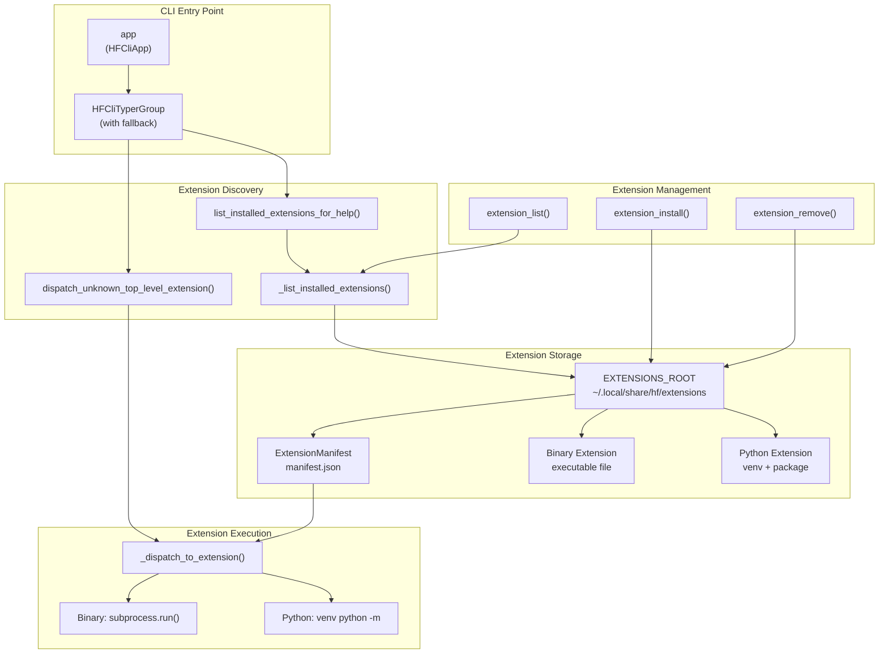
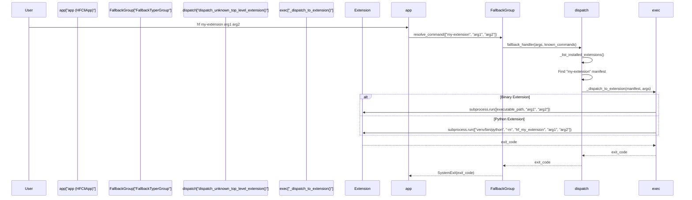
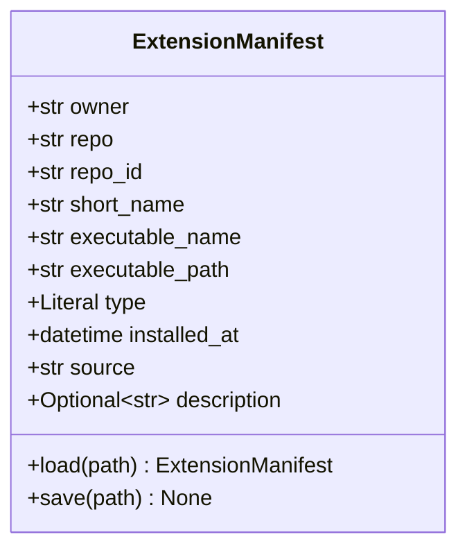
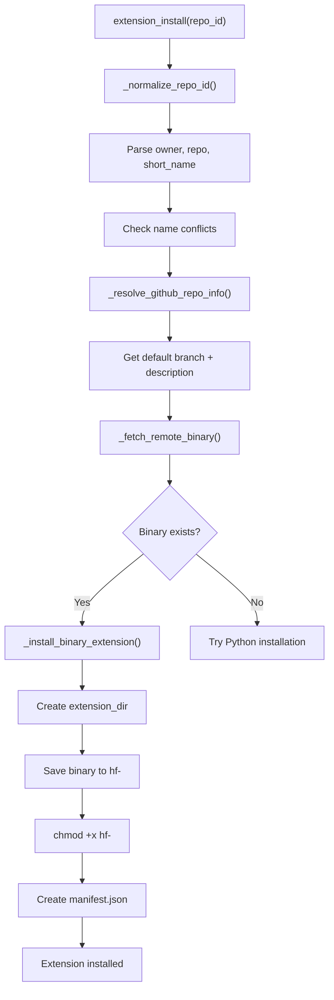
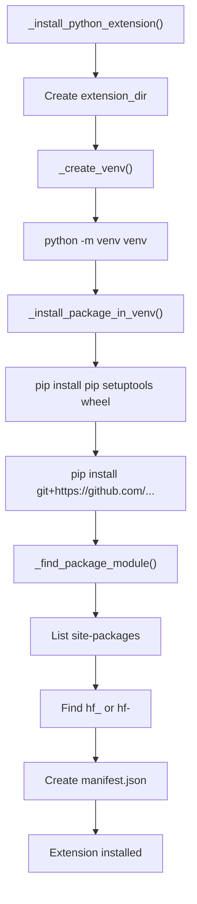
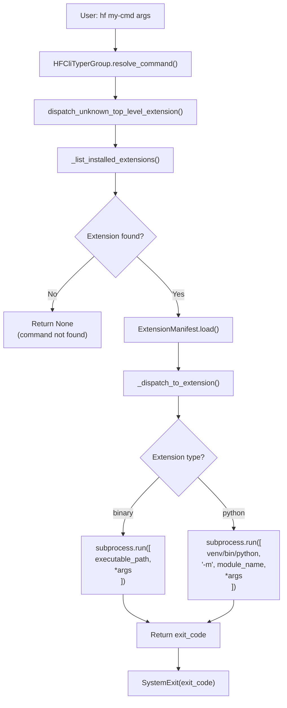
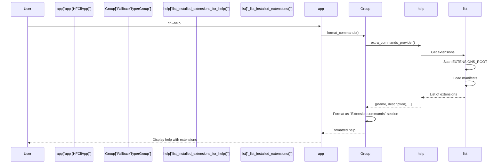
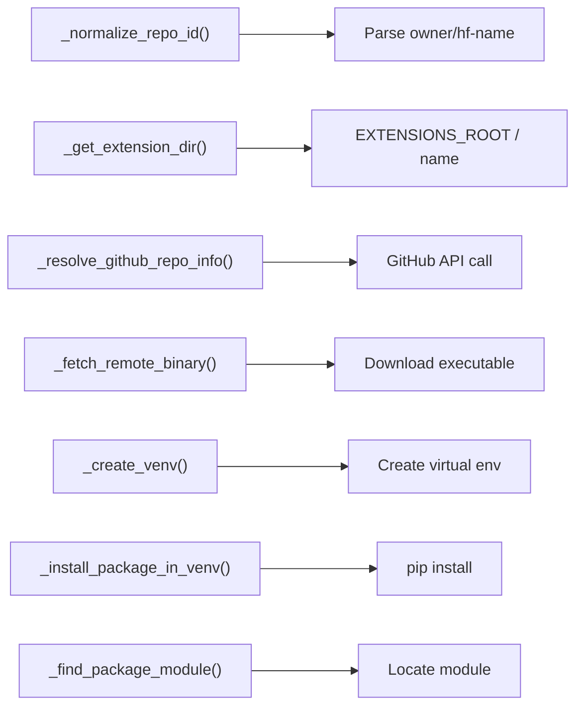

<!-- source: DeepWiki mcp.deepwiki.com · repo huggingface/huggingface_hub · page 7.5 Extensions System · fetched 2026-10-26 -->

# Extensions System

<details>
<summary>Relevant source files</summary>

The following files were used as context for generating this wiki page:

- [docs/source/en/_redirects.yml](docs/source/en/_redirects.yml)
- [docs/source/en/_toctree.yml](docs/source/en/_toctree.yml)
- [docs/source/en/guides/cli.md](docs/source/en/guides/cli.md)
- [docs/source/en/guides/jobs.md](docs/source/en/guides/jobs.md)
- [docs/source/en/guides/webhooks.md](docs/source/en/guides/webhooks.md)
- [docs/source/en/package_reference/cli.md](docs/source/en/package_reference/cli.md)
- [docs/source/en/package_reference/jobs.md](docs/source/en/package_reference/jobs.md)
- [src/huggingface_hub/_jobs_api.py](src/huggingface_hub/_jobs_api.py)
- [src/huggingface_hub/cli/_cli_utils.py](src/huggingface_hub/cli/_cli_utils.py)
- [src/huggingface_hub/cli/cache.py](src/huggingface_hub/cli/cache.py)
- [src/huggingface_hub/cli/datasets.py](src/huggingface_hub/cli/datasets.py)
- [src/huggingface_hub/cli/extensions.py](src/huggingface_hub/cli/extensions.py)
- [src/huggingface_hub/cli/hf.py](src/huggingface_hub/cli/hf.py)
- [src/huggingface_hub/cli/jobs.py](src/huggingface_hub/cli/jobs.py)
- [src/huggingface_hub/cli/models.py](src/huggingface_hub/cli/models.py)
- [src/huggingface_hub/cli/spaces.py](src/huggingface_hub/cli/spaces.py)
- [src/huggingface_hub/cli/webhooks.py](src/huggingface_hub/cli/webhooks.py)
- [tests/test_cli.py](tests/test_cli.py)

</details>


The Extensions System allows third-party developers to extend the `hf` CLI with custom commands. Extensions are installed from GitHub repositories and can be executed as `hf <extension-name> <args>`. This system provides a plugin architecture similar to git extensions or kubectl plugins.

**Security Warning**: Extensions are third-party executables or Python packages. Install only from sources you trust.

For general CLI usage, see [Command Line Interface](#7). For authentication commands, see [Authentication Commands](#7.4).

## Overview

The extensions system enables:
- Installing commands from public GitHub repositories
- Running custom commands as `hf <extension-name> ...`
- Managing extensions via `hf extensions install/list/remove`
- Supporting both binary executables and Python packages
- Displaying installed extensions in CLI help output

Extensions are stored in `~/.local/share/hf/extensions/` with each extension in its own subdirectory containing a manifest file and the extension code.

Sources: [src/huggingface_hub/cli/extensions.py:1-50]()

## Architecture

The extensions system integrates with the main CLI through a custom Typer group that provides fallback command resolution. When a command is not recognized, the system checks for installed extensions before raising an error.

### System Components



Sources: [src/huggingface_hub/cli/hf.py:52-58](), [src/huggingface_hub/cli/_cli_utils.py:173-194](), [src/huggingface_hub/cli/extensions.py:36-44]()

### Integration with Main CLI

The main CLI application uses a custom Typer group factory that provides two extension hooks:

1. **`dispatch_unknown_top_level_extension`** - Attempts to run unknown commands as extensions
2. **`list_installed_extensions_for_help`** - Lists installed extensions in help output



Sources: [src/huggingface_hub/cli/hf.py:52-58](), [src/huggingface_hub/cli/extensions.py:255-291](), [src/huggingface_hub/cli/extensions.py:294-324]()

## Extension Types

Extensions can be either binary executables or Python packages. The installation process detects which type based on repository contents.

### Binary Extensions

Binary extensions are standalone executables that can be run directly. The repository must contain an executable file named `hf-<name>` at the root.

**Characteristics**:
- Direct execution via subprocess
- No Python dependencies required
- Platform-specific (e.g., Linux x86_64)
- Faster startup time

**File Structure**:
```
~/.local/share/hf/extensions/my-extension/
├── manifest.json
└── hf-my-extension (executable)
```

Sources: [src/huggingface_hub/cli/extensions.py:373-408]()

### Python Extensions

Python extensions are Python packages installed in isolated virtual environments. The repository must contain a `setup.py` or `pyproject.toml` file.

**Characteristics**:
- Runs via `python -m <module_name>`
- Managed dependencies in isolated venv
- Cross-platform compatibility
- Slower startup due to Python interpreter

**File Structure**:
```
~/.local/share/hf/extensions/my-extension/
├── manifest.json
└── venv/
    ├── bin/python
    └── lib/python3.x/site-packages/hf_my_extension/
```

Sources: [src/huggingface_hub/cli/extensions.py:411-472]()

## Extension Manifest

Each extension has a `manifest.json` file storing metadata about the installation.

### ExtensionManifest Structure

| Field | Type | Description |
|-------|------|-------------|
| `owner` | str | GitHub repository owner |
| `repo` | str | GitHub repository name |
| `repo_id` | str | Full repo identifier (owner/repo) |
| `short_name` | str | Extension command name (e.g., "claude" for hf-claude) |
| `executable_name` | str | Name of executable/module |
| `executable_path` | str | Full path to executable or venv python |
| `type` | Literal["binary", "python"] | Extension type |
| `installed_at` | datetime | Installation timestamp |
| `source` | str | GitHub raw URL |
| `description` | Optional[str] | Description from GitHub repo |



Sources: [src/huggingface_hub/cli/extensions.py:52-79]()

## Installation Process

Extensions are installed from GitHub repositories following a multi-step process that differs for binary and Python extensions.

### Repository Naming Convention

Extensions must follow the naming pattern:
- Repository name: `hf-<name>` (e.g., `hf-claude`, `hf-mem`)
- Command name: `<name>` (e.g., `hf claude`, `hf mem`)
- Owner can be specified: `owner/hf-<name>` (defaults to `huggingface`)

### Installation Flow for Binary Extensions



Sources: [src/huggingface_hub/cli/extensions.py:82-165](), [src/huggingface_hub/cli/extensions.py:373-408]()

### Installation Flow for Python Extensions



Sources: [src/huggingface_hub/cli/extensions.py:411-472](), [src/huggingface_hub/cli/extensions.py:475-520]()

### GitHub API Interaction

The installation process fetches information from GitHub:

1. **Repository metadata**: GET `/repos/{owner}/{repo}` to get default branch and description
2. **Binary download**: GET `/repos/{owner}/{repo}/contents/hf-{name}` to fetch executable
3. **README download** (optional): GET `/repos/{owner}/{repo}/contents/README.md` for description

Sources: [src/huggingface_hub/cli/extensions.py:524-579]()

## Command Dispatch

When a user runs `hf <unknown-command>`, the system attempts to find and execute a matching extension.

### Dispatch Mechanism



The dispatch function checks installed extensions and executes them if found:

```python
# Simplified flow from dispatch_unknown_top_level_extension
extensions = _list_installed_extensions()
for ext in extensions:
    if ext.short_name == command_name:
        manifest = ExtensionManifest.load(ext_dir)
        return _dispatch_to_extension(manifest, args)
```

Sources: [src/huggingface_hub/cli/extensions.py:255-291](), [src/huggingface_hub/cli/extensions.py:294-324]()

### Environment Passing

Extensions receive the same environment as the parent CLI process, including:
- `HF_TOKEN` - Hugging Face authentication token
- `PATH` - System PATH
- All other environment variables

Sources: [src/huggingface_hub/cli/extensions.py:314-323]()

## Managing Extensions

The `hf extensions` command group provides subcommands to manage installed extensions.

### Command Reference

| Command | Description | Usage |
|---------|-------------|-------|
| `install` | Install extension from GitHub | `hf extensions install owner/hf-name` |
| `list` | List installed extensions | `hf extensions list [--format table\|json]` |
| `remove` | Remove installed extension | `hf extensions remove <name>` |

### Install Command

```bash
# Install from huggingface org (default)
hf extensions install hf-claude

# Install from specific owner
hf extensions install hanouticelina/hf-claude

# Force reinstall
hf extensions install hf-claude --force
```

The install process:
1. Parses repository identifier
2. Checks for name conflicts with built-in commands
3. Fetches repository metadata from GitHub
4. Downloads and installs binary or Python package
5. Creates manifest file
6. Makes executable (binary) or sets up venv (Python)

Sources: [src/huggingface_hub/cli/extensions.py:82-165](), [docs/source/en/package_reference/cli.md:35]()

### List Command

```bash
# List in table format
hf extensions list

# List in JSON format
hf extensions list --format json

# Quiet mode (names only)
hf extensions list -q
```

Output includes:
- Extension name
- Type (binary/python)
- Repository source
- Installation date
- Description

Sources: [src/huggingface_hub/cli/extensions.py:168-213]()

### Remove Command

```bash
# Remove extension
hf extensions remove claude

# With confirmation prompt
hf extensions remove my-extension
```

The remove process:
1. Checks if extension exists
2. Prompts for confirmation (unless `-y` flag)
3. Deletes extension directory
4. Displays success message

Sources: [src/huggingface_hub/cli/extensions.py:216-252]()

## Help Integration

Installed extensions appear in the main CLI help output under an "Extension commands" section.

### Help Display Flow



Extension commands are displayed after built-in commands in a separate section with their descriptions.

Sources: [src/huggingface_hub/cli/extensions.py:327-350](), [src/huggingface_hub/cli/_cli_utils.py:186-192]()

## File System Layout

Extensions are stored in a standardized directory structure:

```
~/.local/share/hf/extensions/
├── claude/
│   ├── manifest.json
│   └── hf-claude (binary extension)
│
└── mem/
    ├── manifest.json
    └── venv/
        ├── bin/
        │   └── python
        └── lib/
            └── python3.11/
                └── site-packages/
                    └── hf_mem/
                        └── __main__.py
```

### Extension Directory Structure

Each extension directory contains:
- `manifest.json` - Metadata about the extension
- Binary extensions: executable file named `hf-<name>`
- Python extensions: `venv/` directory with isolated environment

Sources: [src/huggingface_hub/cli/extensions.py:37-38]()

## Creating Extensions

To create an extension, developers must:

### For Binary Extensions

1. Create a GitHub repository named `hf-<name>`
2. Provide an executable file named `hf-<name>` at the root
3. Ensure the binary has appropriate permissions
4. Accept command-line arguments via `sys.argv`

**Example repository structure**:
```
hf-claude/
├── hf-claude (executable)
├── README.md
└── LICENSE
```

### For Python Extensions

1. Create a GitHub repository named `hf-<name>`
2. Include `setup.py` or `pyproject.toml`
3. Create a module named `hf_<name>` or `hf-<name>`
4. Implement `__main__.py` for CLI entry point

**Example repository structure**:
```
hf-mem/
├── pyproject.toml
├── hf_mem/
│   ├── __init__.py
│   └── __main__.py
├── README.md
└── LICENSE
```

**Example `__main__.py`**:
```python
import sys

def main():
    args = sys.argv[1:]  # Get arguments
    # Extension logic here
    print(f"Running with args: {args}")

if __name__ == "__main__":
    main()
```

### Package Configuration

For Python extensions using `pyproject.toml`:

```toml
[build-system]
requires = ["setuptools>=45", "wheel"]
build-backend = "setuptools.build_meta"

[project]
name = "hf-mem"
version = "0.1.0"
description = "Memory management extension for hf CLI"

[project.scripts]
# Optional: provides hf-mem as a standalone command
hf-mem = "hf_mem.__main__:main"
```

Sources: [src/huggingface_hub/cli/extensions.py:411-520]()

## Error Handling

The extensions system handles various error scenarios:

### Installation Errors

| Error | Cause | Message |
|-------|-------|---------|
| Name conflict | Extension name matches built-in command | "Cannot install extension ... conflicts with existing command" |
| Already installed | Extension exists without `--force` | "Extension ... already installed. Use --force to overwrite." |
| GitHub fetch failed | Network error or invalid repo | Raises `CLIExtensionInstallError` |
| No valid extension | Neither binary nor Python found | "Could not install extension as binary or Python package" |

### Dispatch Errors

| Error | Cause | Behavior |
|-------|-------|----------|
| Extension not found | Unknown command and no extension | Returns `None`, falls through to normal error |
| Corrupted manifest | Invalid JSON or missing fields | Raises `CLIError` |
| Execution failed | Extension exits with error | Propagates exit code |

Sources: [src/huggingface_hub/cli/extensions.py:82-165](), [src/huggingface_hub/cli/extensions.py:255-291]()

## Security Considerations

The extensions system includes security warnings and safeguards:

### Warning Display

Every installation shows:
```
Security warning: this installs a third-party executable or Python package.
Install only from sources you trust.
```

### Sandboxing Limitations

**Important**: Extensions run with the same permissions as the user and have access to:
- User's Hugging Face token (`HF_TOKEN`)
- File system permissions
- Network access
- All environment variables

**No sandboxing** is applied. Users must trust the extension source.

### Best Practices for Users

1. Only install extensions from trusted sources
2. Review the source code on GitHub before installing
3. Be cautious with extensions requiring secrets/tokens
4. Use `--force` carefully when reinstalling
5. Regularly review installed extensions with `hf extensions list`

Sources: [src/huggingface_hub/cli/extensions.py:39-44](), [src/huggingface_hub/cli/extensions.py:98-102]()

## Implementation Details

### Key Functions and Classes

| Entity | Type | Purpose |
|--------|------|---------|
| `ExtensionManifest` | dataclass | Stores extension metadata |
| `extension_install()` | command | Installs extension from GitHub |
| `extension_list()` | command | Lists installed extensions |
| `extension_remove()` | command | Removes extension |
| `dispatch_unknown_top_level_extension()` | function | Fallback handler for unknown commands |
| `list_installed_extensions_for_help()` | function | Provides extensions for help display |
| `_dispatch_to_extension()` | function | Executes extension |
| `_list_installed_extensions()` | function | Scans extensions directory |

### Constants

| Constant | Value | Purpose |
|----------|-------|---------|
| `DEFAULT_EXTENSION_OWNER` | `"huggingface"` | Default GitHub owner |
| `EXTENSIONS_ROOT` | `Path("~/.local/share/hf/extensions")` | Base directory |
| `MANIFEST_FILENAME` | `"manifest.json"` | Manifest file name |
| `_EXTENSIONS_DOWNLOAD_TIMEOUT` | `10` | GitHub API timeout (seconds) |
| `_EXTENSIONS_PIP_INSTALL_TIMEOUT` | `300` | pip install timeout (seconds) |

Sources: [src/huggingface_hub/cli/extensions.py:36-48]()

### Utility Functions



Sources: [src/huggingface_hub/cli/extensions.py:353-370](), [src/huggingface_hub/cli/extensions.py:475-520]()

---

