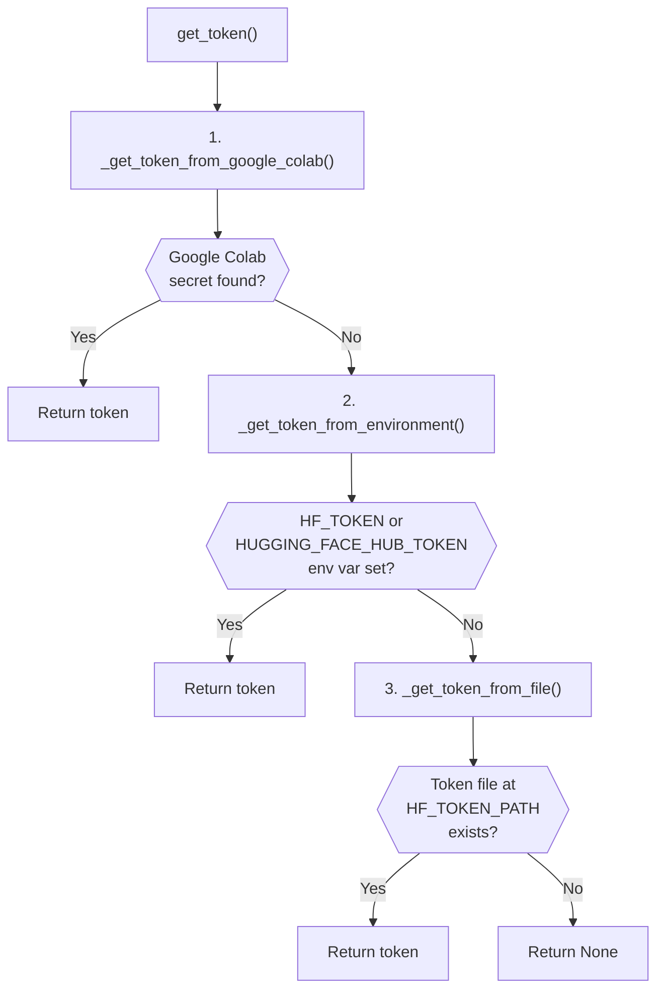
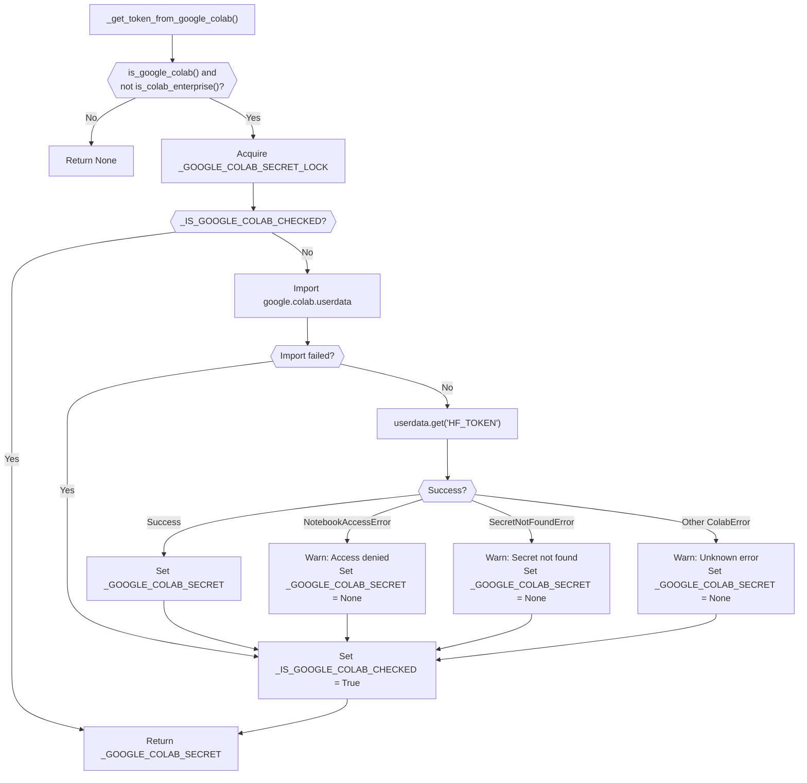
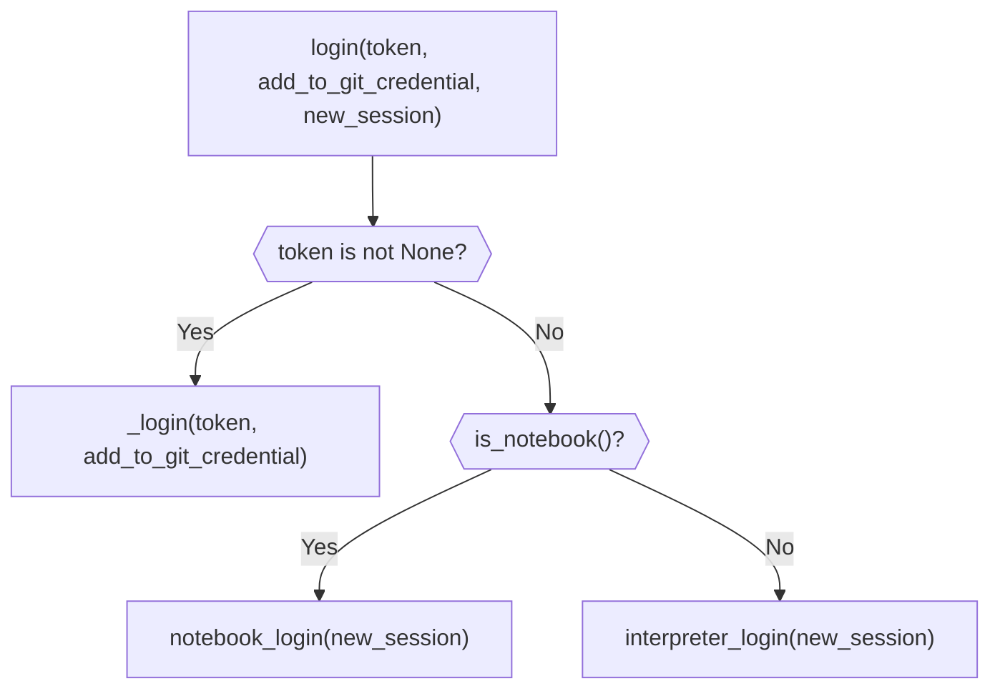
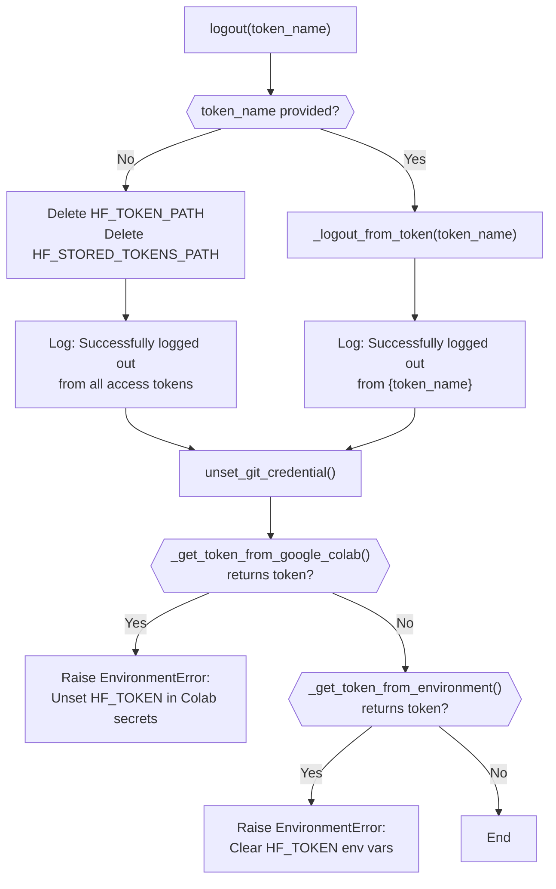
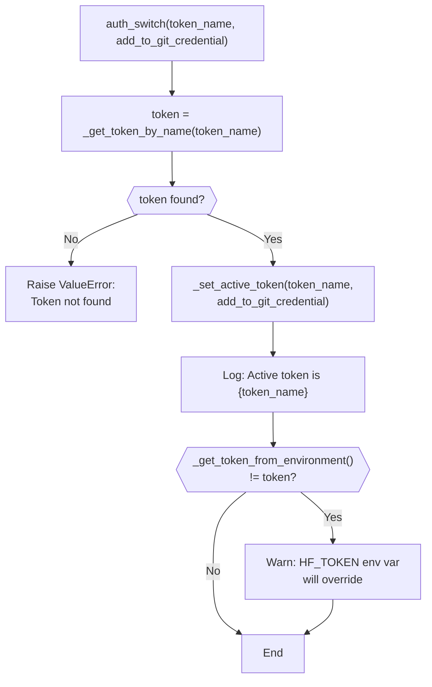
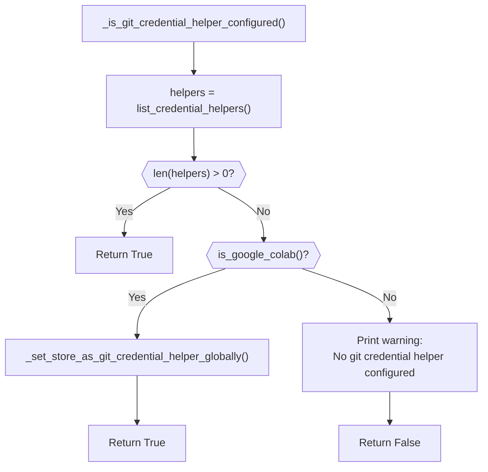
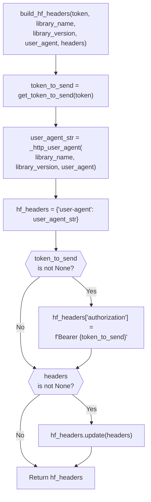

<!-- source: DeepWiki mcp.deepwiki.com · repo huggingface/huggingface_hub · page 8 Authentication and Security · fetched 2026-10-26 -->

# Authentication and Security

<details>
<summary>Relevant source files</summary>

The following files were used as context for generating this wiki page:

- [docs/source/en/guides/download.md](docs/source/en/guides/download.md)
- [docs/source/en/guides/manage-cache.md](docs/source/en/guides/manage-cache.md)
- [docs/source/en/guides/model-cards.md](docs/source/en/guides/model-cards.md)
- [docs/source/en/guides/upload.md](docs/source/en/guides/upload.md)
- [docs/source/en/package_reference/environment_variables.md](docs/source/en/package_reference/environment_variables.md)
- [docs/source/en/package_reference/file_download.md](docs/source/en/package_reference/file_download.md)
- [docs/source/en/package_reference/utilities.md](docs/source/en/package_reference/utilities.md)
- [src/huggingface_hub/_login.py](src/huggingface_hub/_login.py)
- [src/huggingface_hub/utils/_headers.py](src/huggingface_hub/utils/_headers.py)
- [src/huggingface_hub/utils/_runtime.py](src/huggingface_hub/utils/_runtime.py)
- [src/huggingface_hub/utils/_telemetry.py](src/huggingface_hub/utils/_telemetry.py)
- [src/huggingface_hub/utils/_xet.py](src/huggingface_hub/utils/_xet.py)
- [tests/test_utils_headers.py](tests/test_utils_headers.py)
- [tests/test_utils_telemetry.py](tests/test_utils_telemetry.py)
- [tests/test_xet_utils.py](tests/test_xet_utils.py)

</details>


This document covers the authentication system in `huggingface_hub`, including token management, login mechanisms, multi-account support, and git credential integration. Authentication is implemented as a cross-cutting concern that supports all Hub API operations, from file downloads to repository management.

For information about HTTP error handling and retry logic, see page [10](#10). For repository management operations that use authentication, see page [2.1](#2.1).

## Token Retrieval Priority

The library implements a four-tier fallback strategy for token retrieval, checked in the following priority order:



**Sources:** [src/huggingface_hub/utils/_auth.py:35-49]()

The priority system ensures that environment-specific tokens (Google Colab secrets) take precedence over environment variables, which in turn take precedence over the locally saved token file. This design allows users to override the default token in specific execution contexts without modifying the saved configuration.

### Google Colab Secret Integration

In Google Colab notebooks (excluding Colab Enterprise), the library automatically attempts to read the token from Google's userdata vault using `google.colab.userdata.get("HF_TOKEN")`. This access is requested only once per session and stored in the global variable `_GOOGLE_COLAB_SECRET` to avoid repeated vault access requests.



**Sources:** [src/huggingface_hub/utils/_auth.py:52-113](), [src/huggingface_hub/utils/_runtime.py:275-313]()

The implementation uses a thread lock (`_GOOGLE_COLAB_SECRET_LOCK`) because `google.colab.userdata` is not thread-safe and can deadlock when multiple threads request access simultaneously, such as during parallel file downloads in `snapshot_download()`.

### Environment Variable Tokens

The function `_get_token_from_environment()` checks two environment variables in order: `HF_TOKEN` (preferred) and `HUGGING_FACE_HUB_TOKEN` (for backward compatibility). Both variables are cleaned of trailing/leading whitespace and newlines using `_clean_token()`.

**Sources:** [src/huggingface_hub/utils/_auth.py:116-118](), [src/huggingface_hub/utils/_auth.py:207-214]()

### Token File Storage

The default token file location is `~/.cache/huggingface/token` (configurable via `HF_TOKEN_PATH` constant). The token is stored as plain text and read using `Path(constants.HF_TOKEN_PATH).read_text()`. If the file does not exist, the function returns `None`.

**Sources:** [src/huggingface_hub/utils/_auth.py:121-125]()

## Token Storage Locations

The library uses two file paths for token storage:

| File Path | Environment Variable | Purpose |
|-----------|---------------------|---------|
| `~/.cache/huggingface/token` | `HF_TOKEN_PATH` | Active token for the current session |
| `~/.cache/huggingface/stored_tokens` | `HF_STORED_TOKENS_PATH` | INI-formatted file storing multiple named tokens |

**Sources:** [src/huggingface_hub/constants.py]() (referenced via imports)

### Multi-Token Storage Format

The `stored_tokens` file uses INI format with each token stored under its display name:

```
[my-notebook-token]
hf_token = hf_***

[my-ci-token]
hf_token = hf_***
```

The `get_stored_tokens()` function parses this file using `configparser` and returns a dictionary mapping token names to token values. If parsing fails, an empty dictionary is returned and an error is logged.

**Sources:** [src/huggingface_hub/utils/_auth.py:128-147]()

The `_save_stored_tokens()` function writes the dictionary back to the INI file, creating parent directories if necessary and sorting token names for consistent ordering.

**Sources:** [src/huggingface_hub/utils/_auth.py:150-168]()

## Login and Logout Operations

### Login Flow

The `login()` function provides a unified interface that automatically detects the execution environment and delegates to the appropriate login method:



**Sources:** [src/huggingface_hub/_login.py:64-124]()

The `_login()` helper function performs the actual login process:

1. Validates that the token is not an organization token (must not start with `"api_org"`)
2. Calls `whoami(token)` to verify token validity and retrieve token metadata
3. Extracts the token's display name from the response
4. Saves the token to `stored_tokens` file using `_save_token()`
5. Sets the token as active using `_set_active_token()`

**Sources:** [src/huggingface_hub/_login.py:389-413]()

### Notebook Login

The `notebook_login()` function displays an ipywidgets-based interface for token entry:

- Password widget for secure token input
- Checkbox for git credential helper integration
- Login button that triggers the authentication flow

After successful login, the widget displays the result message. The token value is immediately cleared from the widget to prevent it from being saved in the notebook file.

**Sources:** [src/huggingface_hub/_login.py:317-381]()

### Interpreter Login

The `interpreter_login()` function provides a terminal-based login flow:

1. Displays the Hugging Face ASCII logo
2. Shows existing login status if already logged in
3. Prompts for token using `getpass()` (hidden input)
4. Asks for git credential confirmation via `_ask_for_confirmation_no_tui()`
5. Calls `_login()` with the provided credentials

**Sources:** [src/huggingface_hub/_login.py:245-284]()

### Logout Flow



**Sources:** [src/huggingface_hub/_login.py:127-166]()

The `_logout_from_token()` helper removes a specific token from `stored_tokens` and deletes the active token file if it matches.

**Sources:** [src/huggingface_hub/_login.py:416-436]()

## Multi-Token Management

The library supports managing multiple named tokens for different contexts (e.g., notebooks, CI/CD, different organizations).

### Token Switching

The `auth_switch()` function changes the active token:



**Sources:** [src/huggingface_hub/_login.py:169-195]()

The `_set_active_token()` function writes the token to `HF_TOKEN_PATH` and optionally sets it as a git credential:

**Sources:** [src/huggingface_hub/_login.py:439-465]()

### Listing Tokens

The `auth_list()` function displays all stored tokens in a formatted table:

```
  name                     | token          
--------------------------|---------------
* my-notebook-token       | hf_***1234
  my-ci-token             | hf_***5678
```

The asterisk (`*`) indicates the currently active token. If the `HF_TOKEN` environment variable is set, a warning is displayed noting that it overrides the active token.

**Sources:** [src/huggingface_hub/_login.py:198-231]()

## Git Credential Integration

The library can store tokens in git credential helpers, allowing them to be used automatically for git operations (push, pull, clone) with Hub repositories.

### Git Credential Helper Detection



**Sources:** [src/huggingface_hub/_login.py:468-496]()

In Google Colab, the library automatically configures the `store` credential helper globally using `git config --global credential.helper store` to avoid showing warnings to users.

**Sources:** [src/huggingface_hub/_login.py:499-514]()

### Setting Git Credentials

When `add_to_git_credential=True` is passed to `login()` or `auth_switch()`, the token is stored in the configured git credential helpers using `set_git_credential()`. This function is implemented in `src/huggingface_hub/utils/_git_credential.py` (not provided but referenced).

**Sources:** [src/huggingface_hub/_login.py:452-458]()

## Token Usage in HTTP Requests

### Building Authentication Headers

The `build_hf_headers()` function constructs HTTP headers for Hub API calls, including authorization and user-agent:



**Sources:** [src/huggingface_hub/utils/_headers.py:45-140]()

### Token Selection Logic

The `get_token_to_send()` function determines which token to send based on the `token` parameter:

| `token` Value | Behavior |
|---------------|----------|
| `str` (e.g., `"hf_***"`) | Use the provided token directly |
| `True` | Use cached token; raise `LocalTokenNotFoundError` if not found |
| `False` | Explicitly do not send any token |
| `None` | Use cached token unless `HF_HUB_DISABLE_IMPLICIT_TOKEN` is set |

**Sources:** [src/huggingface_hub/utils/_headers.py:143-172]()

The `HF_HUB_DISABLE_IMPLICIT_TOKEN` environment variable allows users to opt out of automatic token sending while still keeping the token saved locally for explicit use cases.

### User Agent Construction

The `_http_user_agent()` function builds a user-agent string containing:

1. Library name and version (if provided)
2. `huggingface_hub` version
3. Python version
4. Installed ML framework versions (torch, tensorflow, fastai, fastcore) if telemetry is enabled
5. Custom user-agent information (dict or string)
6. Origin tag from `HF_HUB_USER_AGENT_ORIGIN` environment variable

The function deduplicates entries to avoid redundancy when user-agent information is passed through multiple layers.

**Sources:** [src/huggingface_hub/utils/_headers.py:175-228]()

## Security Considerations

### Token Validation

The library performs several security checks during login:

1. **Organization Token Rejection**: Tokens starting with `"api_org"` are rejected. Only personal account tokens are valid for login operations.

**Sources:** [src/huggingface_hub/_login.py:395-396]()

2. **Token Verification**: The `whoami(token)` API call validates the token with the Hub server before saving it locally.

**Sources:** [src/huggingface_hub/_login.py:398-400]()

### Token Cleanup

Tokens are cleaned using `_clean_token()` to remove trailing/leading whitespace and newlines. Empty strings after cleaning are converted to `None`.

**Sources:** [src/huggingface_hub/utils/_auth.py:207-214]()

### Notebook Security

In `notebook_login()`, the token widget value is immediately cleared after login to prevent the token from being saved in the notebook file:

```python
token_widget.value = ""  # Erase token
```

**Sources:** [src/huggingface_hub/_login.py:369]()

### Environment Variable Priority

The priority system prevents accidental token exposure by allowing environment-specific overrides:

- Google Colab secrets (highest priority) ensure tokens are stored in Google's secure vault
- Environment variables allow temporary overrides in CI/CD or container environments
- File-based tokens (lowest priority) are used as the default for local development

This design ensures that more secure, context-specific tokens automatically take precedence over general-purpose saved tokens.

## Integration with Other Components

Authentication is used throughout the library:

| Component | Usage |
|-----------|-------|
| `HfApi` | All API methods call `build_hf_headers()` to include authentication |
| `Repository` | Git operations use git credential helpers configured by `set_git_credential()` |
| `InferenceClient` | Provider-specific authentication is handled separately, but HF Inference API uses standard token authentication |
| `hf_hub_download` / `upload_file` | File operations include authentication headers for LFS endpoints |
| `snapshot_download` | Parallel downloads share the same token retrieved once per session |

**Sources:** Cross-cutting concern referenced in [Diagram 5]() from architecture diagrams

## Environment Detection

The library uses several runtime detection functions to adapt authentication behavior:

| Function | Purpose |
|----------|---------|
| `is_google_colab()` | Detect Google Colab to enable secret vault integration |
| `is_colab_enterprise()` | Exclude Colab Enterprise from secret vault flow |
| `is_notebook()` | Determine whether to show widget or terminal login |

**Sources:** [src/huggingface_hub/utils/_runtime.py:286-312]()

These functions enable the library to provide appropriate authentication UX for each environment without requiring explicit configuration from users.

---

