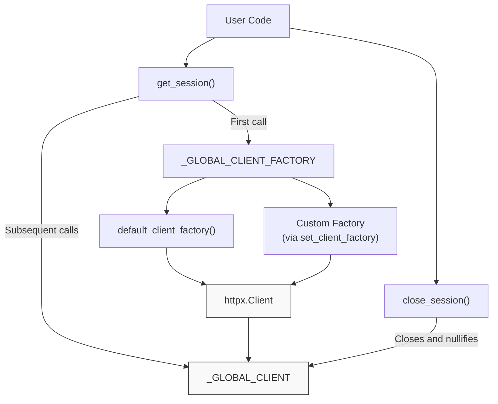
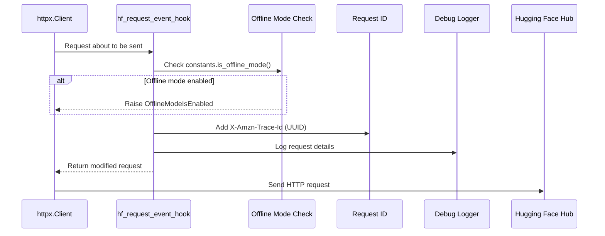
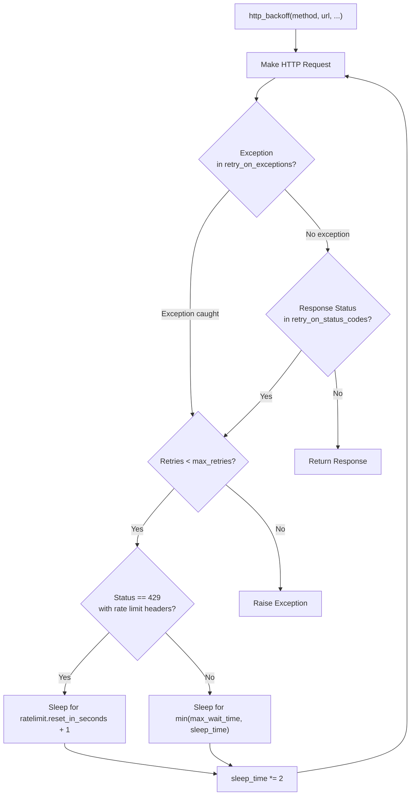
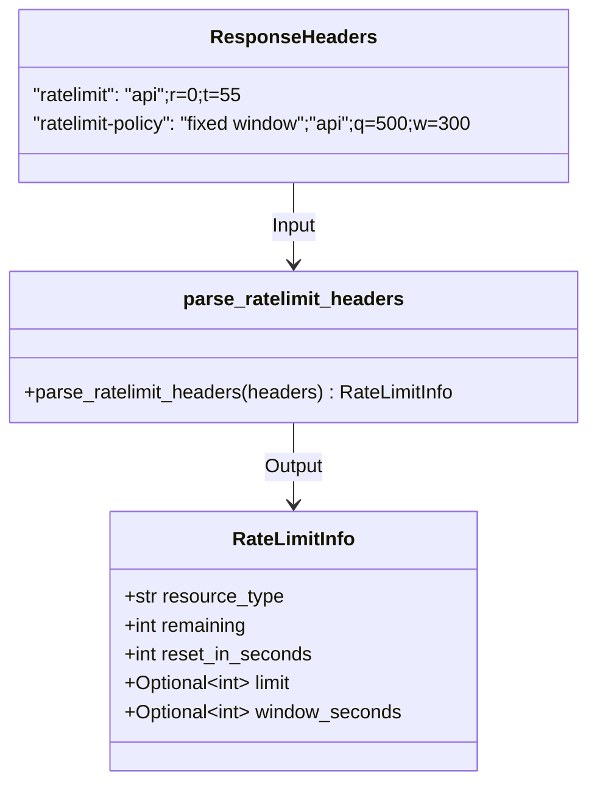
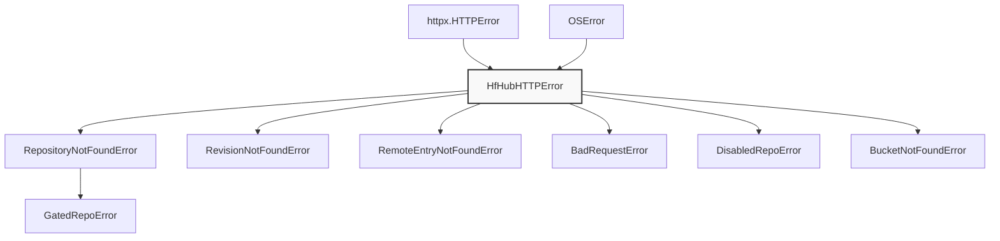
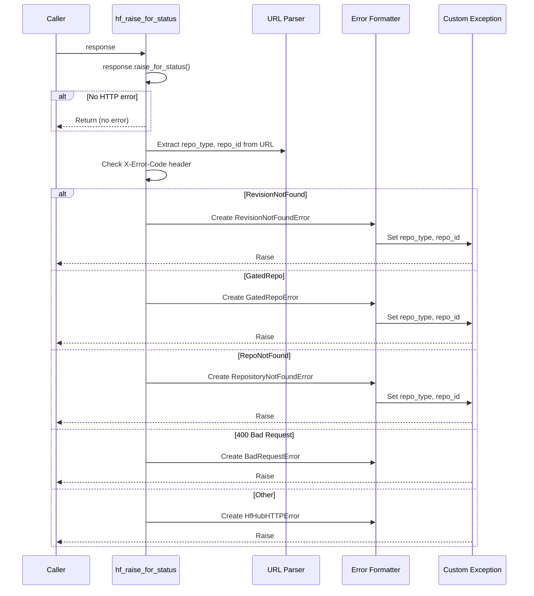
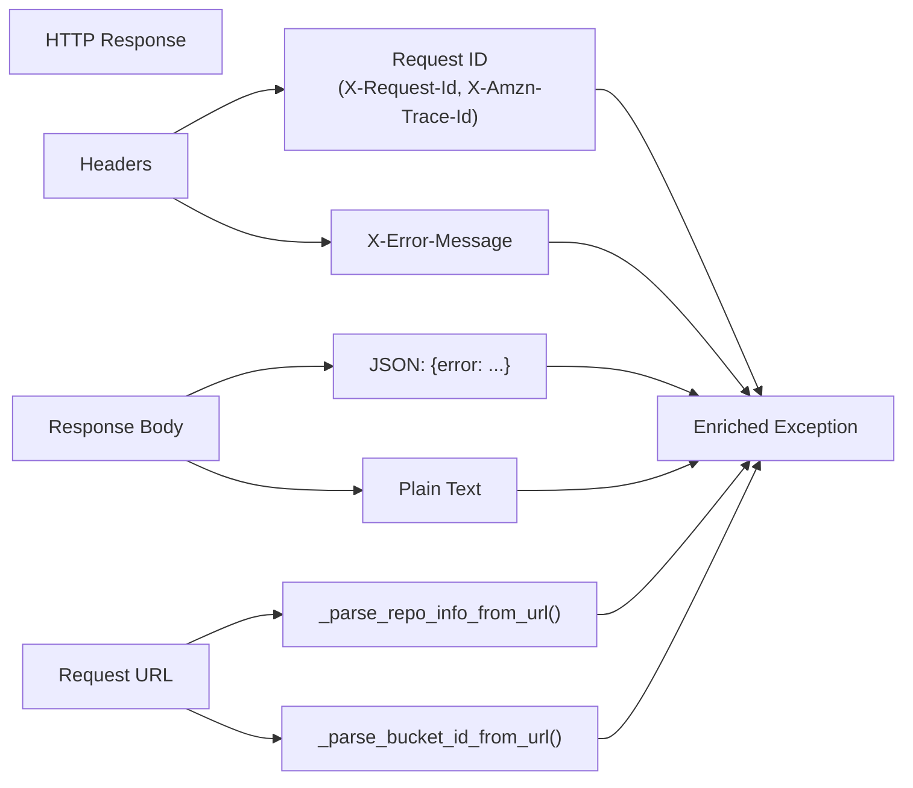
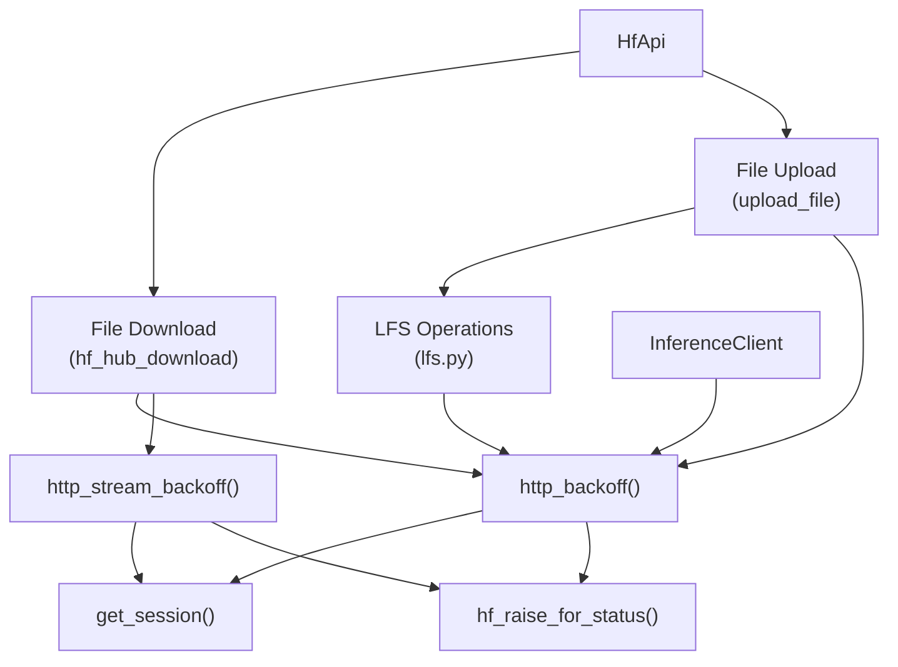

<!-- source: DeepWiki mcp.deepwiki.com · repo huggingface/huggingface_hub · page 9 HTTP Layer and Error Handling · fetched 2026-10-26 -->

# HTTP Layer and Error Handling

<details>
<summary>Relevant source files</summary>

The following files were used as context for generating this wiki page:

- [src/huggingface_hub/cli/_errors.py](src/huggingface_hub/cli/_errors.py)
- [src/huggingface_hub/errors.py](src/huggingface_hub/errors.py)
- [src/huggingface_hub/lfs.py](src/huggingface_hub/lfs.py)
- [src/huggingface_hub/utils/_http.py](src/huggingface_hub/utils/_http.py)
- [tests/test_cli_errors.py](tests/test_cli_errors.py)
- [tests/test_lfs.py](tests/test_lfs.py)
- [tests/test_utils_errors.py](tests/test_utils_errors.py)
- [tests/test_utils_http.py](tests/test_utils_http.py)

</details>


This page documents the HTTP infrastructure and error handling mechanisms used throughout `huggingface_hub`. The HTTP layer provides a robust foundation for all network communication with the Hugging Face Hub, implementing retry logic, rate limit handling, and structured error reporting.

**Scope**: This page covers HTTP client management, retry mechanisms, rate limiting, and error type hierarchy. For authentication and token management, see [Authentication and Security](#8). For repository operations that use this HTTP layer, see [Core API Client (HfApi)](#2).

---

## HTTP Client Architecture

The library uses `httpx` as its HTTP client, with a singleton pattern for the synchronous client and factory-based creation for async clients.

### Client Lifecycle



**Sources**: [src/huggingface_hub/utils/_http.py:268-391]()

The singleton client (`_GLOBAL_CLIENT`) is created on first use and shared across all synchronous operations. This design optimizes connection pooling and resource usage.

| Function | Purpose | Shared |
|----------|---------|--------|
| `get_session()` | Returns the shared synchronous `httpx.Client` | Yes |
| `get_async_session()` | Creates a new `httpx.AsyncClient` | No |
| `set_client_factory()` | Configures custom client creation logic | N/A |
| `close_session()` | Closes the global client and clears the singleton | N/A |

### Event Hooks and Request Instrumentation

Every HTTP request passes through event hooks that add instrumentation and enforce policies:



**Sources**: [src/huggingface_hub/utils/_http.py:214-252]()

**Key behaviors**:
- **Offline mode enforcement**: Blocks all requests if `HF_HUB_OFFLINE=1` is set
- **Request ID injection**: Adds unique identifier (`X-Amzn-Trace-Id`) to every request for server-side debugging
- **Debug logging**: Logs request method, URL, authentication status, and curl equivalent when `HF_DEBUG=True`

---

## Retry Logic and Exponential Backoff

All HTTP operations use automatic retry with exponential backoff to handle transient failures.

### Backoff Algorithm



**Sources**: [src/huggingface_hub/utils/_http.py:397-492]()

### Configuration Parameters

| Parameter | Default | Description |
|-----------|---------|-------------|
| `max_retries` | `5` | Maximum number of retry attempts |
| `base_wait_time` | `1.0` | Initial wait time in seconds |
| `max_wait_time` | `8.0` | Maximum wait time (plateau for exponential growth) |
| `retry_on_exceptions` | `(httpx.TimeoutException, httpx.NetworkError)` | Exception types that trigger retry |
| `retry_on_status_codes` | `(429, 500, 502, 503, 504)` | HTTP status codes that trigger retry |

### Functions

**`http_backoff(method, url, **kwargs)`**: Standard HTTP request with retry logic
- Returns: `httpx.Response`
- Used for: Single request/response operations
- Example use: [src/huggingface_hub/lfs.py:165]() - LFS batch endpoint calls

**`http_stream_backoff(method, url, **kwargs)`**: Context manager for streaming requests with retry
- Returns: Generator yielding `httpx.Response`
- Used for: Streaming downloads or uploads
- Example: Large file transfers that need to be streamed

**Sources**: [src/huggingface_hub/utils/_http.py:494-654]()

---

## Rate Limit Handling

The HTTP layer implements IETF draft-compliant rate limit handling.

### Rate Limit Headers

The library parses rate limit information from response headers following the [IETF RateLimit Fields draft](https://www.ietf.org/archive/id/draft-ietf-httpapi-ratelimit-headers-09.html):



**Sources**: [src/huggingface_hub/utils/_http.py:54-138]()

**Example headers**:
```
ratelimit: "api";r=0;t=55
ratelimit-policy: "fixed window";"api";q=500;w=300
```

Parsed into:
- `resource_type`: `"api"`
- `remaining`: `0` requests left
- `reset_in_seconds`: `55` seconds until reset
- `limit`: `500` total requests allowed
- `window_seconds`: `300` second window

### Integration with Retry Logic

When a `429 Too Many Requests` response includes rate limit headers, the retry logic:
1. Parses the headers using `parse_ratelimit_headers()`
2. Waits for `reset_in_seconds + 1` (adding 1 second buffer)
3. Logs a detailed warning with rate limit information
4. Retries the request

**Sources**: [src/huggingface_hub/utils/_http.py:454-483]()

---

## Error Handling Architecture

### Error Type Hierarchy



**Sources**: [src/huggingface_hub/errors.py:1-475]()

All HTTP errors inherit from `HfHubHTTPError`, which itself inherits from both `httpx.HTTPError` and `OSError`. This dual inheritance ensures compatibility with existing error handling code while providing rich error information.

### The `hf_raise_for_status` Function

This is the central error handling function used throughout the library. It converts raw HTTP responses into structured, informative exceptions.



**Sources**: [src/huggingface_hub/utils/_http.py:721-889]()

### Error Detection Logic

The function uses multiple signals to determine the appropriate error type:

| Error Type | Detection Method | URL Pattern Required |
|------------|------------------|----------------------|
| `RevisionNotFoundError` | `X-Error-Code: RevisionNotFound` | Any |
| `RemoteEntryNotFoundError` | `X-Error-Code: EntryNotFound` | Any |
| `GatedRepoError` | `X-Error-Code: GatedRepo` | Any |
| `DisabledRepoError` | `X-Error-Message: Access to this resource is disabled.` | Any |
| `BucketNotFoundError` | `X-Error-Code: RepoNotFound` | `/api/buckets/` |
| `RepositoryNotFoundError` | `X-Error-Code: RepoNotFound` OR `401` status | `/api/(models\|datasets\|spaces)/` |
| `BadRequestError` | `400` status code | Any |
| `HfHubHTTPError` | Any other HTTP error | Any |

**Sources**: [src/huggingface_hub/utils/_http.py:775-853]()

### Error Message Enrichment

Each error is enriched with contextual information:

1. **Request ID**: Extracted from headers (`X-Request-Id`, `X-Amzn-Trace-Id`, or `X-Amz-Cf-Id`)
2. **Server messages**: Parsed from `X-Error-Message` header and response body (JSON or plain text)
3. **Repository context**: `repo_type` and `repo_id` extracted from URL
4. **Bucket context**: `bucket_id` extracted from URL for bucket errors



**Sources**: [src/huggingface_hub/utils/_http.py:922-984]()

---

## Custom Error Types Reference

### HfHubHTTPError

Base class for all HTTP errors. Contains:
- `response`: The `httpx.Response` object
- `request_id`: Extracted from response headers
- `server_message`: Error message from server (header or body)
- `append_to_message()`: Method to add context after raising

**Sources**: [src/huggingface_hub/errors.py:40-100]()

### RepositoryNotFoundError

Raised when a repository cannot be found or accessed.

**Attributes**:
- `repo_id`: The repository identifier (e.g., `"username/reponame"`)
- `repo_type`: One of `"model"`, `"dataset"`, or `"space"`

**Common causes**:
- Repository doesn't exist
- Repository is private and user is not authenticated
- Incorrect `repo_type` specified

**Sources**: [src/huggingface_hub/errors.py:219-247]()

### GatedRepoError

Raised when accessing a gated repository without authorization. Inherits from `RepositoryNotFoundError`.

**Attributes**: Same as `RepositoryNotFoundError`

**Sources**: [src/huggingface_hub/errors.py:249-268]()

### RevisionNotFoundError

Raised when a specified revision (branch, tag, commit SHA) doesn't exist.

**Attributes**:
- `repo_id`: The repository identifier
- `repo_type`: One of `"model"`, `"dataset"`, or `"space"`

**Sources**: [src/huggingface_hub/errors.py:292-317]()

### RemoteEntryNotFoundError

Raised when a file or path doesn't exist in the repository.

**Attributes**:
- `repo_id`: The repository identifier
- `repo_type`: One of `"model"`, `"dataset"`, or `"space"`

**Sources**: [src/huggingface_hub/errors.py:338-363]()

### BucketNotFoundError

Raised when a bucket cannot be found in the buckets API.

**Attributes**:
- `bucket_id`: The bucket identifier (`"namespace/name"`)

**Sources**: [src/huggingface_hub/errors.py:191-214]()

### BadRequestError

Raised for HTTP 400 errors. Inherits from `ValueError` for backward compatibility.

**Sources**: [src/huggingface_hub/errors.py:385-397]()

### DisabledRepoError

Raised when attempting to access a repository that has been disabled.

**Sources**: [src/huggingface_hub/errors.py:271-286]()

---

## Helper Utilities

### URL Parsing and Manipulation

**`_parse_repo_info_from_url(url: str) -> tuple[Optional[str], Optional[str]]`**

Extracts repository type and ID from API URLs.

Examples:
- `"https://huggingface.co/api/models/user/repo"` → `("model", "user/repo")`
- `"https://huggingface.co/api/datasets/bert-base-cased"` → `("dataset", "bert-base-cased")`
- `"https://huggingface.co/gpt2/resolve/main/config.json"` → `("model", "gpt2")`

**Sources**: [src/huggingface_hub/utils/_http.py:183-205]()

**`_parse_bucket_id_from_url(url: str) -> Optional[str]`**

Extracts bucket ID from bucket API URLs.

Example:
- `"https://huggingface.co/api/buckets/namespace/name"` → `"namespace/name"`

**Sources**: [src/huggingface_hub/utils/_http.py:208-211]()

**`fix_hf_endpoint_in_url(url: str, endpoint: Optional[str]) -> str`**

Replaces the default HF endpoint with a custom endpoint (useful for proxies).

Example:
- URL: `"https://huggingface.co/api/models"`, endpoint: `"https://mirror.co"` → `"https://mirror.co/api/models"`

**Sources**: [src/huggingface_hub/utils/_http.py:708-718]()

### Warning Header Handling

**`_warn_on_warning_headers(response: httpx.Response)`**

Parses and logs server warnings from `X-HF-Warning` headers. Each warning has a topic, and only the first warning for each topic is shown (to avoid spam).

Header format: `X-HF-Warning: topic; message`

**Sources**: [src/huggingface_hub/utils/_http.py:895-916]()

---

## Integration Points

### Usage in File Operations

The HTTP layer is used throughout the codebase for all network operations:



**Sources**: 
- File download: [src/huggingface_hub/utils/_http.py:657-705]()
- LFS operations: [src/huggingface_hub/lfs.py:165-166](), [src/huggingface_hub/lfs.py:256-262]()
- General API calls: Used throughout `HfApi` methods

### Custom Client Configuration

Users can customize the HTTP client for specific environments (proxies, certificates):

```python
import httpx
from huggingface_hub.utils import set_client_factory

def custom_client_factory():
    return httpx.Client(
        proxies="http://proxy.example.com:8080",
        verify="/path/to/cert.pem",
        timeout=30.0
    )

set_client_factory(custom_client_factory)
```

After calling `set_client_factory()`, all subsequent HTTP operations use the custom configuration. The global client cache is cleared and recreated with the new factory.

**Sources**: [src/huggingface_hub/utils/_http.py:299-314]()

---

## Error Handling Best Practices

### Catching Specific Errors

```python
from huggingface_hub import hf_hub_download
from huggingface_hub.errors import (
    RepositoryNotFoundError,
    GatedRepoError,
    RevisionNotFoundError,
    RemoteEntryNotFoundError
)

try:
    hf_hub_download(repo_id="user/repo", filename="config.json", revision="main")
except GatedRepoError:
    # Handle gated repositories (requires approval)
    pass
except RepositoryNotFoundError as e:
    # Handle missing or private repositories
    print(f"Repository {e.repo_id} not found")
except RevisionNotFoundError as e:
    # Handle invalid revision
    print(f"Revision not found in {e.repo_id}")
except RemoteEntryNotFoundError as e:
    # Handle missing files
    print(f"File not found in {e.repo_id}")
```

### CLI Error Formatting

The CLI uses specialized error formatters to provide user-friendly messages:

**Sources**: [src/huggingface_hub/cli/_errors.py:32-114]()

| Error Type | CLI Message Pattern |
|------------|---------------------|
| `RepositoryNotFoundError` | `"Model 'user/repo' not found. If the repo is private, make sure you are authenticated."` |
| `GatedRepoError` | `"Access denied. Repository 'user/repo' requires approval."` |
| `RevisionNotFoundError` | `"Revision not found in model 'user/repo'."` |
| `RemoteEntryNotFoundError` | `"File not found in dataset 'user/repo'.\nURL: ..."` |
| `BucketNotFoundError` | `"Bucket 'ns/name' not found. If the bucket is private, make sure you are authenticated."` |

---

## Testing and Debugging

### Debug Logging

Set `HF_DEBUG=1` environment variable to enable detailed HTTP logging:

```bash
export HF_DEBUG=1
```

This logs:
- Request ID for each request
- HTTP method and URL
- Authentication status
- Equivalent curl command

**Sources**: [src/huggingface_hub/utils/_http.py:241-242]()

### Request ID Tracking

Every request includes a unique request ID (`X-Amzn-Trace-Id`), which is:
- Generated as a UUID v4 if not provided
- Included in error messages
- Logged in debug mode
- Returned by the server in response headers

This enables correlation between client-side and server-side logs for debugging.

**Sources**: [src/huggingface_hub/utils/_http.py:229-231]()

### Offline Mode

Set `HF_HUB_OFFLINE=1` to disable all HTTP requests:

```bash
export HF_HUB_OFFLINE=1
```

All network requests will immediately raise `OfflineModeIsEnabled`. This is useful for:
- Testing code that should work offline
- Ensuring no unexpected network calls
- Air-gapped environments

**Sources**: [src/huggingface_hub/utils/_http.py:223-226]()

---

