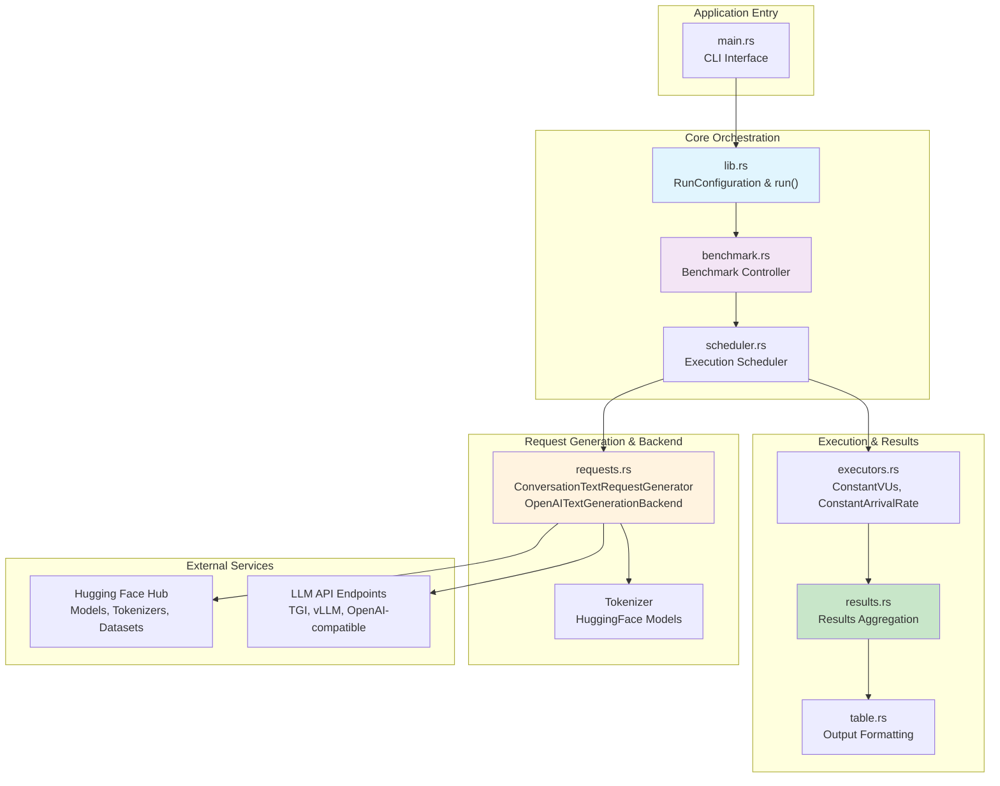
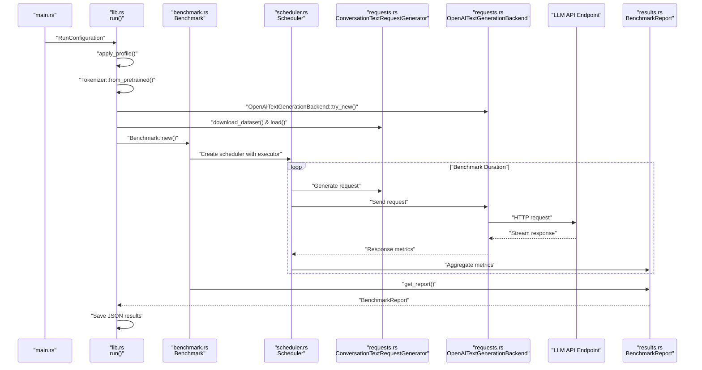

<!-- source: DeepWiki mcp.deepwiki.com · repo huggingface/inference-benchmarker · page 1 Overview · fetched 2026-10-26 -->

# Overview

Relevant source files

The following files were used as context for generating this wiki page:

- [Cargo.toml](Cargo.toml)
- [README.md](README.md)
- [src/lib.rs](src/lib.rs)

## Purpose and Scope

This document provides a high-level introduction to the **inference-benchmarker** system, its purpose, and key capabilities. The inference-benchmarker is a comprehensive tool for evaluating the performance of Large Language Model (LLM) inference servers and text generation endpoints.

For detailed installation and usage instructions, see [Getting Started](#2). For in-depth technical details about the system architecture, see [Core Architecture](#3). For information about deployment environments, see [Deployment Options](#4).

## What is Inference Benchmarker

Inference Benchmarker is a high-performance benchmarking tool built in Rust that evaluates the real-world performance of text generation models and servers. It addresses the unique challenges of benchmarking LLM inference, where performance varies significantly based on input prompts, decoding strategies, hardware specifications, and server configurations.

The system can benchmark any text generation server that exposes an OpenAI-compliant chat API, including TGI (Text Generation Inference), vLLM, and other compatible services.

**Sources:** [README.md:1-15](), [Cargo.toml:1-9]()

## Key Capabilities

The inference-benchmarker provides several core capabilities:

| Capability | Description |
|------------|-------------|
| **Broad Compatibility** | Benchmarks any OpenAI-compliant chat API endpoint |
| **Automatic Sweep Mode** | Detects maximum throughput and sweeps QPS values up to that limit |
| **Open-Loop Benchmarking** | Uses constant arrival rates to simulate real-world workloads |
| **Benchmark Profiles** | Presets for different use cases (chat, code generation, classification, fixed-length) |
| **High Performance** | Built with Rust for concurrent, high-throughput benchmarking |
| **Structured Output** | Delivers results in JSON format for analysis and visualization |

The system supports three benchmark modes through the `BenchmarkKind` enum:
- `sweep`: Runs a comprehensive throughput sweep
- `rate`: Benchmarks at fixed request rates  
- `throughput`: Tests at fixed virtual user counts

**Sources:** [README.md:16-24](), [src/lib.rs:99-104]()

## System Architecture

The following diagram shows the main architectural components and their relationships:

### Core Component Architecture

**Sources:** [src/lib.rs:23-33](), [src/lib.rs:35-55]()

## Execution Flow

The benchmark execution follows a structured pipeline from configuration to results:

### Benchmark Execution Pipeline

**Sources:** [src/lib.rs:57-232]()

## Configuration and Profiles

The system uses the `RunConfiguration` struct to define benchmark parameters and supports predefined profiles for common use cases:

### RunConfiguration Structure
The `RunConfiguration` contains key parameters including:
- `url`: Target API endpoint
- `tokenizer_name`: HuggingFace tokenizer identifier
- `profile`: Optional benchmark profile name
- `benchmark_kind`: Execution mode (sweep/rate/throughput)
- `dataset` and `dataset_file`: Data source configuration
- `prompt_options` and `decode_options`: Token generation parameters

### Available Profiles
- **`chat`**: Multi-turn conversation scenarios with conversation history
- **`code-generation`**: Code completion with large context and short outputs  
- **`classification`**: Document analysis with repeated large inputs
- **`fixed-length`**: Technical benchmark with consistent prompt lengths

**Sources:** [src/lib.rs:35-55](), [README.md:104-121]()

## Deployment Options

The inference-benchmarker supports multiple deployment environments:

| Deployment Type | Use Case | Configuration |
|----------------|----------|---------------|
| **Local Binary** | Development and small-scale testing | Direct cargo installation |
| **Docker Container** | Consistent execution environment | Pre-built images with all dependencies |
| **Kubernetes** | Scalable cloud deployment | Helm charts for cluster orchestration |
| **HPC/Slurm** | Large-scale research benchmarks | Batch job scheduling for resource management |

For detailed deployment instructions, see [Deployment Options](#4).

**Sources:** [README.md:52-221]()

## Results and Analysis

The system generates comprehensive benchmark results in multiple formats:

- **JSON Output**: Structured results saved with timestamp and model information via `BenchmarkReportWriter`
- **Console Output**: Real-time progress and summary statistics  
- **Interactive Dashboard**: Gradio web interface for result visualization and analysis

Results include performance metrics such as throughput, latency percentiles, error rates, and token generation statistics.

For details on result analysis and visualization tools, see [Results Analysis and Visualization](#5).

**Sources:** [src/lib.rs:192-230](), [README.md:222-233]()

---

