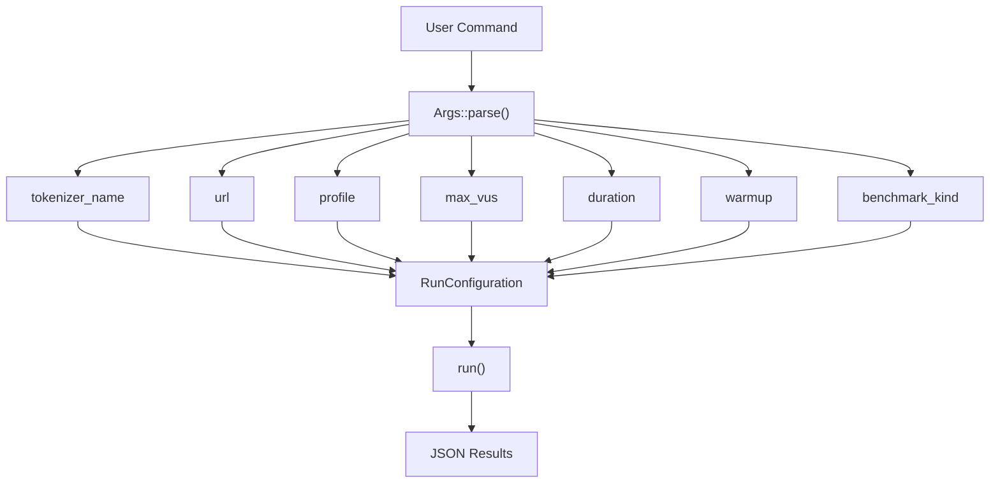
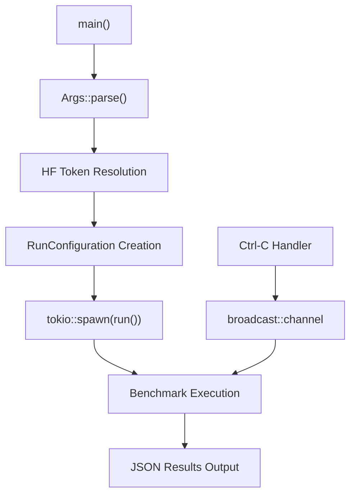

<!-- source: DeepWiki mcp.deepwiki.com · repo huggingface/inference-benchmarker · page 2 Getting Started · fetched 2026-10-26 -->

# Getting Started

<details>
<summary>Relevant source files</summary>

The following files were used as context for generating this wiki page:

- [Dockerfile](Dockerfile)
- [Makefile](Makefile)
- [README.md](README.md)
- [src/main.rs](src/main.rs)

</details>


This document provides installation instructions, basic usage examples, and a quick start guide for the inference-benchmarker system. It covers how to install the tool, set up a target inference server, run your first benchmark, and understand the basic configuration options.

For detailed information about the core architecture and internal components, see [Core Architecture](#3). For advanced deployment scenarios on Kubernetes or HPC clusters, see [Deployment Options](#4). For analyzing and visualizing results, see [Results Analysis and Visualization](#5).

## Installation

The inference-benchmarker can be installed through several methods:

### Cargo Installation

If you have [Rust and Cargo](https://rustup.rs/) installed:

```bash
cargo install --git https://github.com/huggingface/inference-benchmarker/
```

### Binary Download

Download the latest released binary from the [GitHub releases page](https://github.com/huggingface/inference-benchmarker/releases/latest).

### Docker Image

The tool is available as a Docker image and can be run without local installation:

```bash
docker run --rm ghcr.io/huggingface/inference-benchmarker:latest --help
```

Sources: [README.md:52-62](), [Dockerfile:1-14]()

## Prerequisites: Starting an Inference Server

Before benchmarking, you need a running inference server that exposes an OpenAI-compatible chat API. Here are examples for popular inference engines:

### Text Generation Inference (TGI)

```bash
MODEL=meta-llama/Llama-3.1-8B-Instruct
HF_TOKEN=<your HF READ token>

docker run --gpus all --shm-size 1g -p 8080:80 -e "HF_TOKEN=$HF_TOKEN" \
    ghcr.io/huggingface/text-generation-inference:3.2.1 --model-id $MODEL
```

### vLLM

```bash
MODEL=meta-llama/Llama-3.1-8B-Instruct
HF_TOKEN=<your HF READ token>

docker run --runtime nvidia --gpus all \
    --env "HUGGING_FACE_HUB_TOKEN=$HF_TOKEN" \
    -p 8080:8000 \
    --ipc=host \
    vllm/vllm-openai:latest \
    --model $MODEL
```

Sources: [README.md:65-88]()

## Running Your First Benchmark

### Basic Command Structure

The CLI entry point is defined in the `Args` struct and processes all configuration through the `main()` function:

```bash
inference-benchmarker \
    --tokenizer-name "meta-llama/Llama-3.1-8B-Instruct" \
    --url http://localhost:8080 \
    --profile chat
```

This command demonstrates the minimal required arguments:
- `tokenizer_name`: Specifies the tokenizer for prompt processing
- `url`: Target inference server endpoint  
- `profile`: Benchmark profile defining the use case

Sources: [README.md:91-100](), [src/main.rs:14-16](), [src/main.rs:46-48](), [src/main.rs:36-38]()

### CLI Argument Flow



Sources: [src/main.rs:10-116](), [src/main.rs:209-229]()

### Execution Flow from CLI to Results



Sources: [src/main.rs:171-240](), [src/main.rs:181-192](), [src/main.rs:230-238]()

## Key Configuration Options

### Benchmark Profiles

The `profile` argument selects predefined configurations optimized for specific use cases:

| Profile | Use Case | Description |
|---------|----------|-------------|
| `chat` | Multi-turn conversations | Simulates chat scenarios with conversation history |
| `code-generation` | Code completion | Large code snippets with short completions |
| `classification` | Document analysis | Large input documents with simple questions |
| `fixed-length` | Technical benchmarking | Fixed-length prompts to avoid tokenization variance |

### Benchmark Modes

The `benchmark_kind` parameter controls the execution strategy:

| Mode | Description | Use Case |
|------|-------------|----------|
| `sweep` | Automatic throughput detection and sweep | Default mode for comprehensive analysis |
| `rate` | Fixed request rates | Testing specific QPS values |
| `throughput` | Fixed virtual user count | Constant load testing |

### Token Configuration

Both prompt and decode token counts can be controlled with normal distribution sampling:

```bash
--prompt-options "num_tokens=200,max_tokens=220,min_tokens=180,variance=10"
--decode-options "num_tokens=50,max_tokens=60,min_tokens=40,variance=10"
```

The `parse_tokenizer_options()` function processes these comma-separated key-value pairs into `TokenizeOptions` structs.

Sources: [README.md:104-121](), [README.md:122-132](), [README.md:192-207](), [src/main.rs:140-169]()

## Advanced Configuration Example

Here's a complete example showing manual configuration instead of using profiles:

```bash
inference-benchmarker \
    --tokenizer-name "meta-llama/Llama-3.1-8B-Instruct" \
    --max-vus 800 \
    --duration 120s \
    --url http://localhost:8080 \
    --warmup 30s \
    --benchmark-kind rate \
    --rates 1.0 \
    --rates 5.0 \
    --rates 10.0 \
    --prompt-options "num_tokens=200,max_tokens=220,min_tokens=180,variance=10" \
    --decode-options "num_tokens=200,max_tokens=220,min_tokens=180,variance=10"
```

This demonstrates the argument groups system where `group_manual` conflicts with `group_profile`, requiring either profile-based or manual configuration.

Sources: [README.md:133-148](), [src/main.rs:11-12](), [src/main.rs:22-89]()

## Understanding the Output

The benchmarker generates structured JSON results containing performance metrics. Results are saved in the current directory by default and include:

- Throughput measurements
- Latency percentiles  
- Error rates
- Token generation statistics

The `run_id` parameter (auto-generated if not provided) helps identify specific benchmark runs in the results.

Sources: [README.md:100](), [src/main.rs:206-208](), [src/main.rs:114-115]()

## Next Steps

After successfully running your first benchmark:

1. **Explore Advanced Features**: Learn about the core architecture and execution system in [Core Architecture](#3)
2. **Scale Up**: Deploy on Kubernetes or HPC clusters using [Deployment Options](#4)  
3. **Analyze Results**: Use the interactive dashboard and analysis tools covered in [Results Analysis and Visualization](#5)
4. **Contribute**: Set up the development environment as described in [Development and Contributing](#6)

The inference-benchmarker provides a comprehensive foundation for evaluating LLM inference performance across different scenarios and deployment environments.

---

