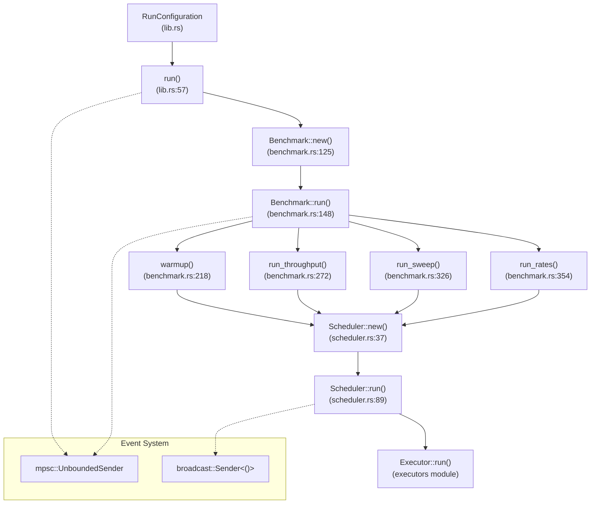
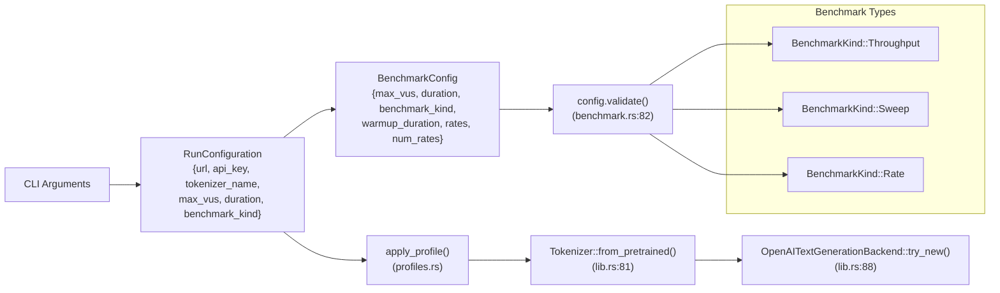
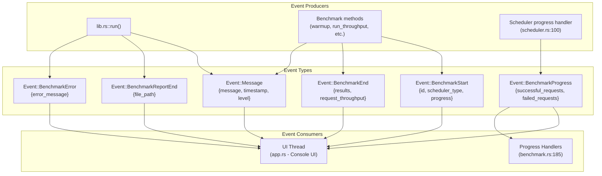
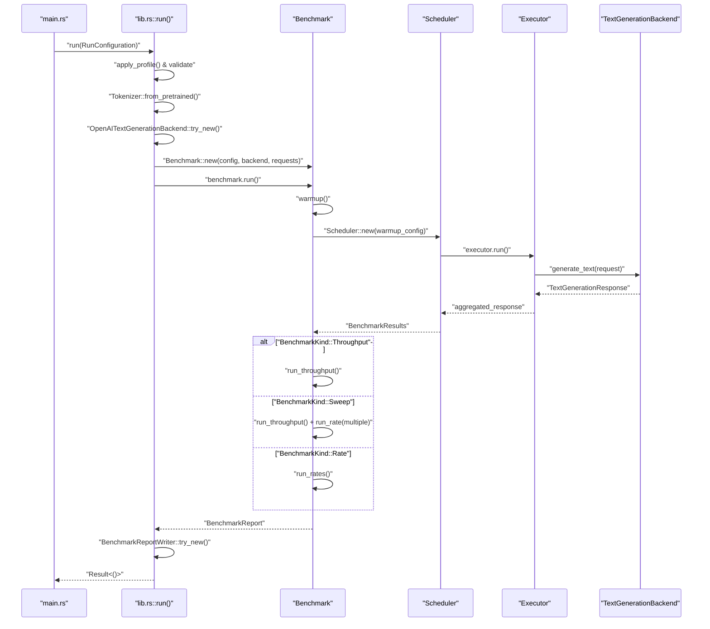
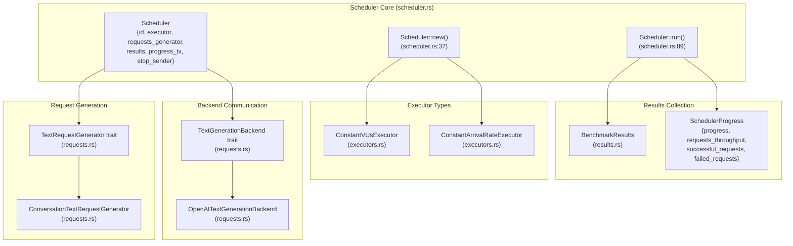
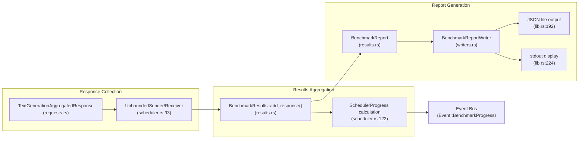

<!-- source: DeepWiki mcp.deepwiki.com · repo huggingface/inference-benchmarker · page 3 Core Architecture · fetched 2026-10-26 -->

# Core Architecture

Relevant source files

The following files were used as context for generating this wiki page:

- [src/benchmark.rs](src/benchmark.rs)
- [src/lib.rs](src/lib.rs)
- [src/scheduler.rs](src/scheduler.rs)

This document covers the internal design and implementation of the inference-benchmarker's core Rust components. It details the main architectural patterns, key data structures, and execution flow that orchestrate LLM inference benchmarking operations.

For information about command-line usage and configuration options, see [CLI Interface](#3.1). For details about deployment methods, see [Deployment Options](#4).

## Architectural Overview

The inference-benchmarker follows a modular, event-driven architecture built around three primary orchestration layers: the main coordinator in `lib.rs`, the benchmark controller in `benchmark.rs`, and the execution scheduler in `scheduler.rs`.

### Core Component Hierarchy

**Sources:** [src/lib.rs:57-232](), [src/benchmark.rs:125-414](), [src/scheduler.rs:37-152]()

## Core Data Structures and Configuration

The system's behavior is controlled through several key configuration structures that flow through the execution pipeline.

### Primary Configuration Types

| Structure | Location | Purpose |
|-----------|----------|---------|
| `RunConfiguration` | [src/lib.rs:35-55]() | Top-level execution parameters from CLI |
| `BenchmarkConfig` | [src/benchmark.rs:60-79]() | Validated benchmark execution settings |
| `ExecutorConfig` | Referenced in scheduler | Low-level executor parameters |

### Configuration Flow and Transformation

**Sources:** [src/lib.rs:35-116](), [src/benchmark.rs:60-117]()

## Event-Driven Communication System

The architecture uses an event bus pattern to coordinate between components and provide real-time progress updates.

### Event Types and Flow

**Sources:** [src/benchmark.rs:22-45](), [src/benchmark.rs:185-216](), [src/lib.rs:117-156]()

## Execution Flow Architecture

The system orchestrates benchmark execution through a hierarchical delegation pattern where each layer has specific responsibilities.

### Main Execution Pipeline

**Sources:** [src/lib.rs:57-232](), [src/benchmark.rs:148-176](), [src/scheduler.rs:89-147]()

## Scheduler and Executor Architecture

The scheduler acts as an intermediary between high-level benchmark configuration and low-level execution strategies.

### Executor Type Mapping

| Benchmark Type | Executor Type | Configuration | Purpose |
|----------------|---------------|---------------|---------|
| Warmup | `ExecutorType::ConstantVUs` | `max_vus: 1` | Server prewarming |
| Throughput | `ExecutorType::ConstantVUs` | `max_vus: config.max_vus` | Maximum capacity testing |
| Rate/Sweep | `ExecutorType::ConstantArrivalRate` | `rate: specified_rate` | Controlled load testing |

### Scheduler Component Relationships

**Sources:** [src/scheduler.rs:20-87](), [src/scheduler.rs:89-152]()

## Result Processing and Aggregation Flow

The system collects and processes benchmark results through a structured pipeline that handles real-time aggregation and final report generation.

### Results Processing Architecture

**Sources:** [src/scheduler.rs:92-131](), [src/lib.rs:188-230](), [src/benchmark.rs:254-268]()

The core architecture demonstrates a clean separation of concerns with well-defined interfaces between components, enabling flexible benchmark execution strategies while maintaining comprehensive result collection and real-time progress monitoring.

---

