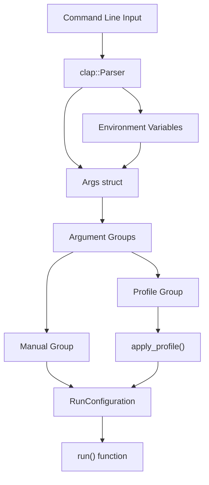
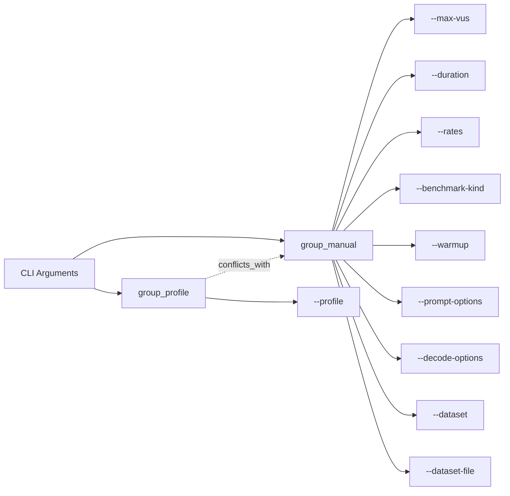
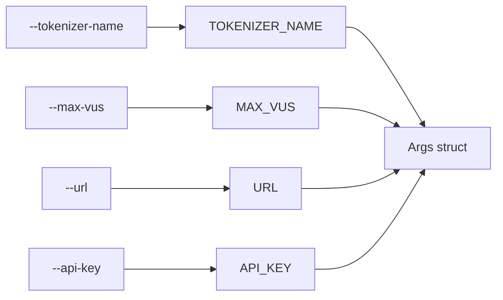
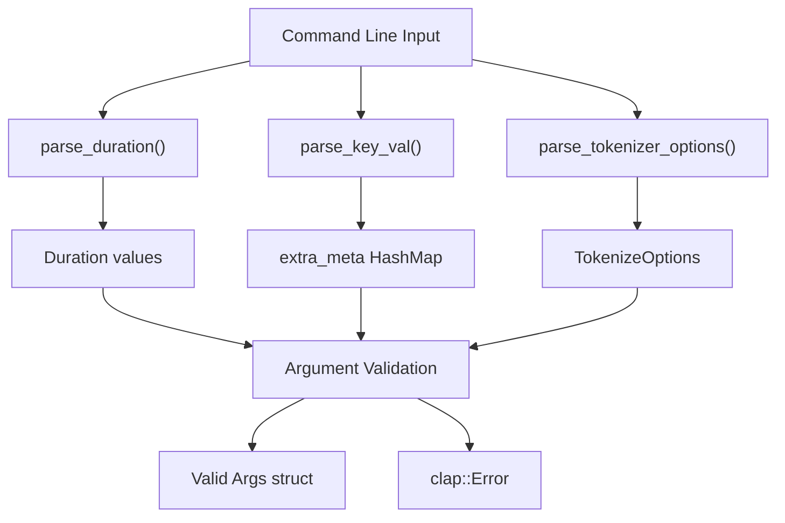
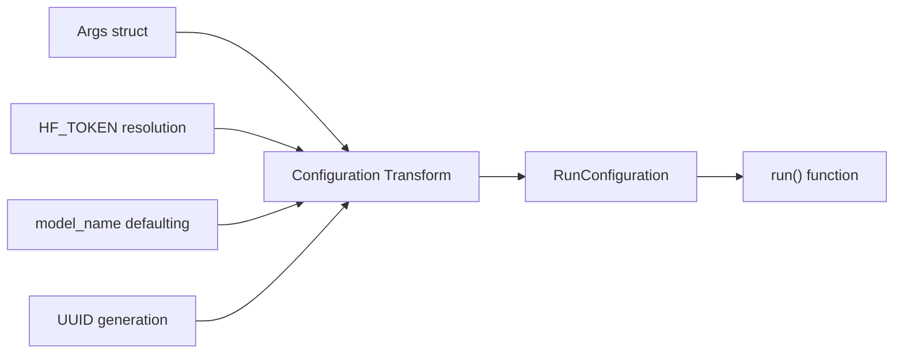

<!-- source: DeepWiki mcp.deepwiki.com · repo huggingface/inference-benchmarker · page 3.1 CLI Interface · fetched 2026-10-26 -->

# CLI Interface

<details>
<summary>Relevant source files</summary>

The following files were used as context for generating this wiki page:

- [.github/workflows/build_ci.yaml](.github/workflows/build_ci.yaml)
- [.github/workflows/rust.yaml](.github/workflows/rust.yaml)
- [src/main.rs](src/main.rs)
- [src/profiles.rs](src/profiles.rs)

</details>


This document covers the command-line interface implementation of the inference-benchmarker system, including argument parsing, configuration options, validation logic, and the transformation of CLI inputs into internal configuration structures. For information about the core execution flow and orchestration, see [Core Architecture](#3). For deployment-specific CLI usage examples, see [Deployment Options](#4).

## Command Line Arguments Overview

The CLI interface is implemented through the `Args` struct in [src/main.rs:10-116](), which uses the `clap` crate for argument parsing. The interface supports both manual configuration through individual arguments and predefined benchmark profiles.



**CLI Argument Flow from Input to Configuration**

*Sources: [src/main.rs:10-116](), [src/main.rs:172-240]()*

## Argument Groups and Validation

The CLI implements two mutually exclusive argument groups using clap's `ArgGroup` feature:

| Group | Purpose | Key Arguments |
|-------|---------|---------------|
| `group_profile` | Predefined benchmark configurations | `--profile` |
| `group_manual` | Manual configuration of all parameters | `--max-vus`, `--duration`, `--benchmark-kind`, etc. |



**Argument Group Relationships and Conflicts**

*Sources: [src/main.rs:11-12](), [src/profiles.rs:4-115]()*

## Core Configuration Options

### Required Arguments

| Argument | Type | Description | Environment Variable |
|----------|------|-------------|---------------------|
| `--tokenizer-name` | `String` | HuggingFace tokenizer identifier | `TOKENIZER_NAME` |

### Server Connection

| Argument | Type | Default | Description |
|----------|------|---------|-------------|
| `--url` | `Url` | `http://localhost:8000` | Backend server URL (OpenAI-compatible) |
| `--api-key` | `String` | `""` | Authorization header value |
| `--model-name` | `Option<String>` | Same as tokenizer | Model name for requests |

### Benchmark Configuration

| Argument | Type | Default | Description |
|----------|------|---------|-------------|
| `--max-vus` | `u64` | `128` | Maximum virtual users |
| `--duration` | `Duration` | `120s` | Benchmark step duration |
| `--warmup` | `Duration` | `30s` | Warmup phase duration |
| `--benchmark-kind` | `String` | `sweep` | Benchmark type (throughput, sweep, optimum) |
| `--rates` | `Option<Vec<f64>>` | None | Request rates for ConstantArrivalRate |
| `--num-rates` | `u64` | `10` | Number of rates for sweep benchmark |

*Sources: [src/main.rs:14-48](), [src/main.rs:22-45]()*

## Token and Dataset Configuration

### Tokenization Options

Both `--prompt-options` and `--decode-options` accept comma-separated key-value pairs:

```
--prompt-options "num_tokens=200,max_tokens=210,min_tokens=190,variance=10"
--decode-options "num_tokens=800,max_tokens=850,min_tokens=50,variance=100"
```

| Option | Description |
|--------|-------------|
| `num_tokens` | Target number of tokens |
| `min_tokens` | Minimum token count |
| `max_tokens` | Maximum token count |
| `variance` | Variance in token distribution |

### Dataset Configuration

| Argument | Default | Description |
|----------|---------|-------------|
| `--dataset` | `hlarcher/inference-benchmarker` | HuggingFace dataset repository |
| `--dataset-file` | `share_gpt_filtered_small.json` | Dataset file within repository |

*Sources: [src/main.rs:57-106](), [src/main.rs:140-169]()*

## Environment Variable Support

All CLI arguments support environment variable configuration using the same name in uppercase:



**Environment Variable to CLI Argument Mapping**

Special environment variables:
- `HF_TOKEN`: HuggingFace authentication token (handled separately in [src/main.rs:196-201]())

*Sources: [src/main.rs:15-115](), [src/main.rs:196-201]()*

## Argument Parsing Pipeline

The CLI parsing pipeline involves several custom parsing functions for complex argument types:



**Argument Parsing and Validation Pipeline**

### Custom Parsing Functions

#### `parse_duration()`
Converts human-readable duration strings using the `humantime` crate:
- Input: `"120s"`, `"2m"`, `"1h30m"`
- Output: `std::time::Duration`

#### `parse_key_val()`
Parses comma-separated key-value pairs for metadata:
- Input: `"key1=value1,key2=value2"`
- Output: `HashMap<String, String>`

#### `parse_tokenizer_options()`
Parses tokenization configuration with validation:
- Validates token count constraints (`min_tokens <= max_tokens`)
- Ensures non-zero values when `num_tokens` is specified
- Returns `clap::Error` for invalid configurations

*Sources: [src/main.rs:118-169]()*

## Configuration Transformation

The parsed `Args` struct is transformed into a `RunConfiguration` in the main function:



**Args to RunConfiguration Transformation**

Key transformations include:
- `model_name` defaults to `tokenizer_name` if not provided
- `run_id` generates a UUID if not specified
- HuggingFace token resolution from environment or cache
- Stop signal channel creation for graceful shutdown

*Sources: [src/main.rs:202-229]()*

## Error Handling and Validation

The CLI implements several validation layers:

### Clap-level Validation
- Argument type checking (URL, duration parsing)
- Required argument enforcement
- Argument group conflict detection

### Custom Validation
- TokenizeOptions constraints in `parse_tokenizer_options()`
- Key-value pair format validation in `parse_key_val()`
- Duration format validation in `parse_duration()`

### Runtime Error Handling
```rust
// Signal handling for graceful shutdown
tokio::spawn(async move {
    tokio::signal::ctrl_c().await.expect("Failed to listen for ctrl-c");
    stop_sender_clone.send(()).expect("Failed to send stop signal");
});
```

*Sources: [src/main.rs:118-169](), [src/main.rs:182-192](), [src/main.rs:230-240]()*

---

