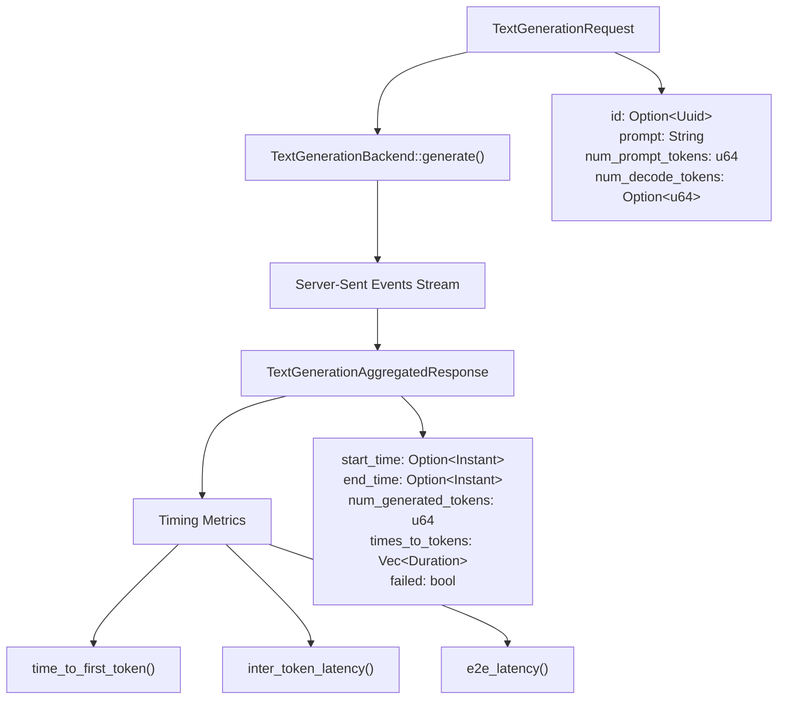
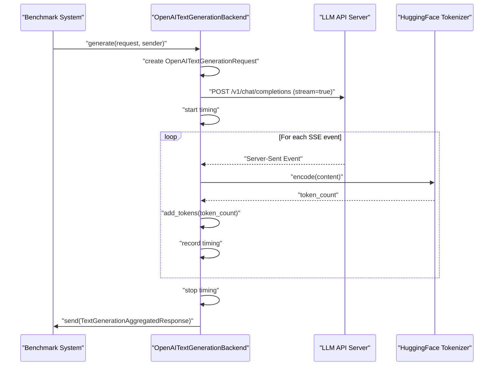
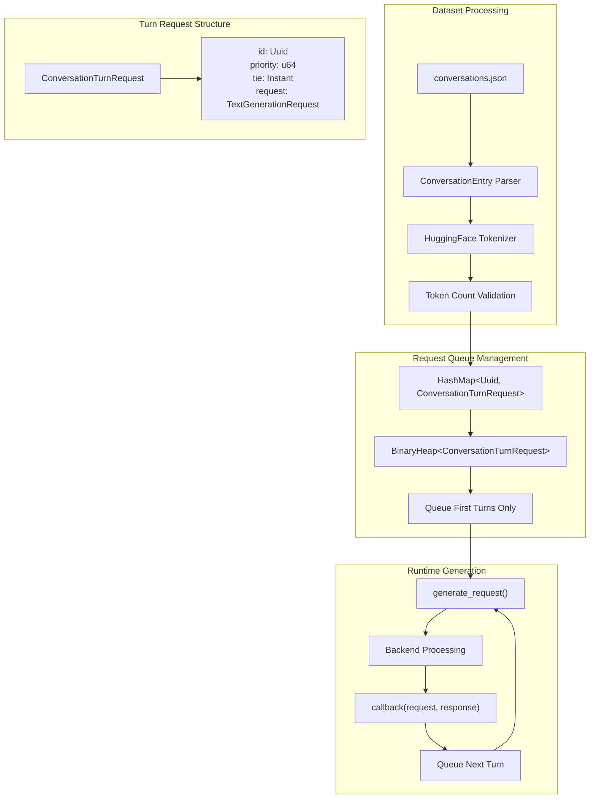
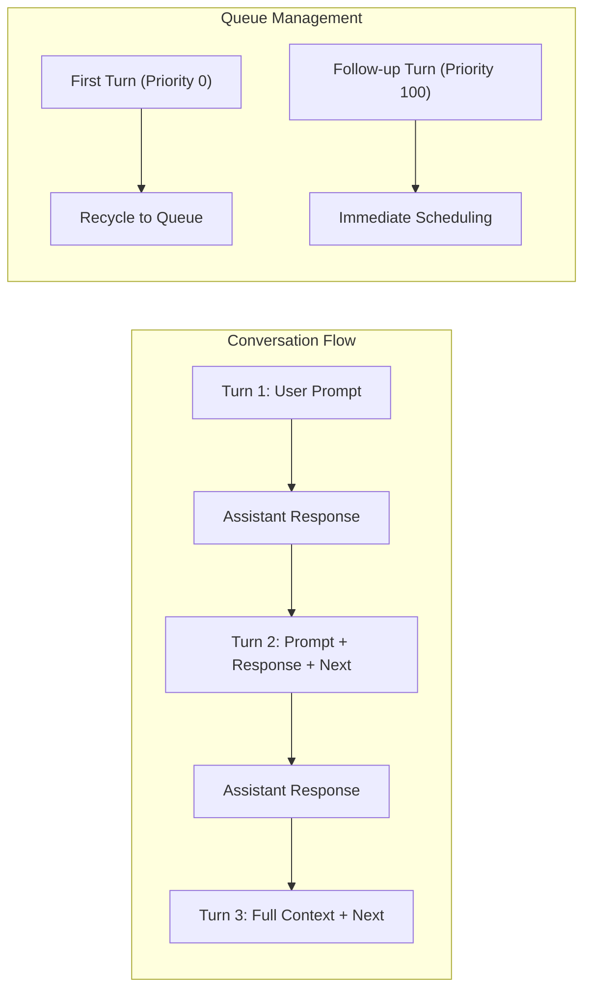

<!-- source: DeepWiki mcp.deepwiki.com · repo huggingface/inference-benchmarker · page 3.2 Request Generation and Backend Interface · fetched 2026-10-26 -->

# Request Generation and Backend Interface

<details>
<summary>Relevant source files</summary>

The following files were used as context for generating this wiki page:

- [src/requests.rs](src/requests.rs)

</details>


This document covers the request generation system and backend abstraction layer that enables the benchmarker to communicate with various LLM serving platforms. This includes the core data structures for requests and responses, the pluggable backend interface for different API protocols, and the sophisticated request generation system that supports both simple and multi-turn conversational workloads.

For information about how these requests are scheduled and executed during benchmarks, see [Benchmark Execution System](#3.3). For details on how responses are processed and aggregated into benchmark results, see [Results Processing](#3.4).

## Core Request and Response Data Structures

The system centers around two primary data structures that represent the lifecycle of a text generation request.

### TextGenerationRequest

The `TextGenerationRequest` struct encapsulates all information needed to make a single text generation API call:

| Field | Type | Purpose |
|-------|------|---------|
| `id` | `Option<Uuid>` | Links multi-turn conversation requests |
| `prompt` | `String` | Input text to be processed |
| `num_prompt_tokens` | `u64` | Pre-computed token count for prompt |
| `num_decode_tokens` | `Option<u64>` | Maximum tokens to generate |

### TextGenerationAggregatedResponse

The `TextGenerationAggregatedResponse` tracks timing metrics and status throughout the request lifecycle:

| Field | Type | Purpose |
|-------|------|---------|
| `start_time` | `Option<Instant>` | Request initiation timestamp |
| `end_time` | `Option<Instant>` | Request completion timestamp |
| `num_generated_tokens` | `u64` | Total tokens received |
| `times_to_tokens` | `Vec<Duration>` | Per-token timing measurements |
| `failed` | `bool` | Request failure indicator |



**Sources:** [src/requests.rs:23-29](), [src/requests.rs:718-808]()

## Backend Abstraction Layer

The system provides a pluggable backend interface that abstracts different LLM API protocols behind a common trait.

### TextGenerationBackend Trait

The core abstraction defines a single async method for text generation:

```rust
#[async_trait]
pub trait TextGenerationBackend: TextGenerationBackendClone {
    async fn generate(
        &self,
        request: Arc<TextGenerationRequest>,
        sender: Sender<TextGenerationAggregatedResponse>,
    );
}
```

This design enables:
- **Streaming Response Handling**: Responses are sent incrementally via the `sender` channel
- **Concurrent Execution**: Multiple requests can be processed simultaneously
- **Pluggable Implementations**: Different backends can be swapped without changing benchmark logic

### OpenAI-Compatible Backend Implementation

The `OpenAITextGenerationBackend` implements the most commonly used backend, supporting OpenAI-compatible APIs including TGI, vLLM, and actual OpenAI services:

| Component | Purpose |
|-----------|---------|
| `client` | HTTP client with configurable timeout |
| `base_url` | API endpoint URL |
| `model_name` | Target model identifier |
| `tokenizer` | Token counting for response validation |
| `api_key` | Authentication credential |



**Sources:** [src/requests.rs:31-38](), [src/requests.rs:59-123](), [src/requests.rs:125-261]()

## Request Generation System

The request generation system supports both simple and sophisticated multi-turn conversational workloads through the `TextRequestGenerator` trait.

### TextRequestGenerator Trait

The interface defines two key methods:

```rust
pub trait TextRequestGenerator: Sync {
    fn generate_request(&mut self) -> TextGenerationRequest;
    fn callback(&mut self, request: Arc<TextGenerationRequest>, response: &str);
}
```

The `callback` method enables stateful request generators to create follow-up requests based on previous responses, supporting realistic conversational benchmarks.

### Conversation Dataset Loading

The `ConversationTextRequestGenerator` implements sophisticated multi-turn conversation support:

1. **Dataset Loading**: Parses JSON conversation files with structured dialogue turns
2. **Tokenization**: Pre-processes prompts using HuggingFace tokenizers with configurable constraints
3. **Turn Linking**: Uses UUIDs to link conversation turns for proper sequencing
4. **Priority Queuing**: Manages conversation flow with a priority queue system



**Sources:** [src/requests.rs:306-310](), [src/requests.rs:386-558](), [src/requests.rs:585-647]()

## Tokenization and Request Preprocessing

The system provides flexible tokenization options through the `TokenizeOptions` configuration:

| Option | Purpose |
|--------|---------|
| `num_tokens` | Fixed token count (truncates prompts) |
| `min_tokens` | Minimum acceptable prompt length |
| `max_tokens` | Maximum acceptable prompt length |
| `variance` | Gaussian distribution for sampling token counts |

### Token Count Sampling

For realistic workload simulation, the system can sample token counts from a normal distribution:

```rust
fn sample_num_tokens(num_tokens: u64, min_tokens: u64, max_tokens: u64, variance: u64) -> u64
```

This enables benchmarks that more accurately reflect real-world prompt length distributions.

**Sources:** [src/requests.rs:324-360](), [src/requests.rs:560-570](), [src/requests.rs:675-716]()

## Multi-Turn Conversation Flow

The conversation system implements sophisticated turn management for realistic chat benchmarks:

### Priority-Based Scheduling

Conversation turns are managed using a priority system:
- **Priority 0**: First turns in conversations (continuously recycled)
- **Priority 100**: Follow-up turns (scheduled immediately for KV cache efficiency)

### Conversation Context Building

When processing multi-turn conversations, the system concatenates:
1. Original user prompt
2. Assistant response
3. Next turn prompt

This creates realistic conversational context that exercises KV cache systems in serving platforms.



**Sources:** [src/requests.rs:362-384](), [src/requests.rs:597-647]()

## Error Handling and Resilience

The backend implementations include comprehensive error handling for production reliability:

### OpenAI Backend Error Categories

| Error Type | Handling Strategy |
|------------|------------------|
| Network timeouts | Mark request as failed, close connection |
| Malformed JSON | Log error, mark request as failed |
| API errors | Parse error message, mark request as failed |
| Stream interruption | Handle partial responses gracefully |

### Response Validation

The system validates responses by:
- Counting tokens in each delta using the tokenizer
- Detecting multi-token chunks (warns about chunked prefill/speculative decoding)
- Tracking timing between token arrivals
- Handling incomplete responses due to connection issues

**Sources:** [src/requests.rs:161-261](), [src/requests.rs:219-254]()

---

