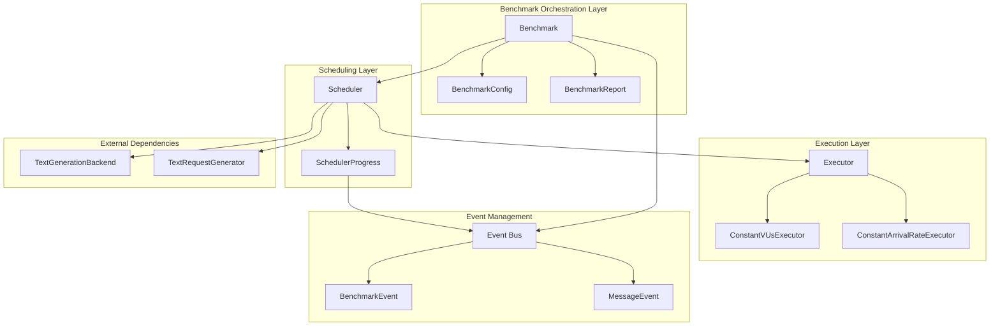
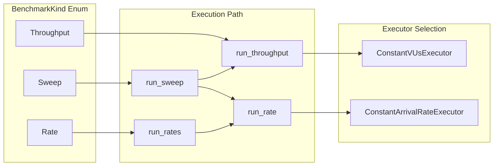
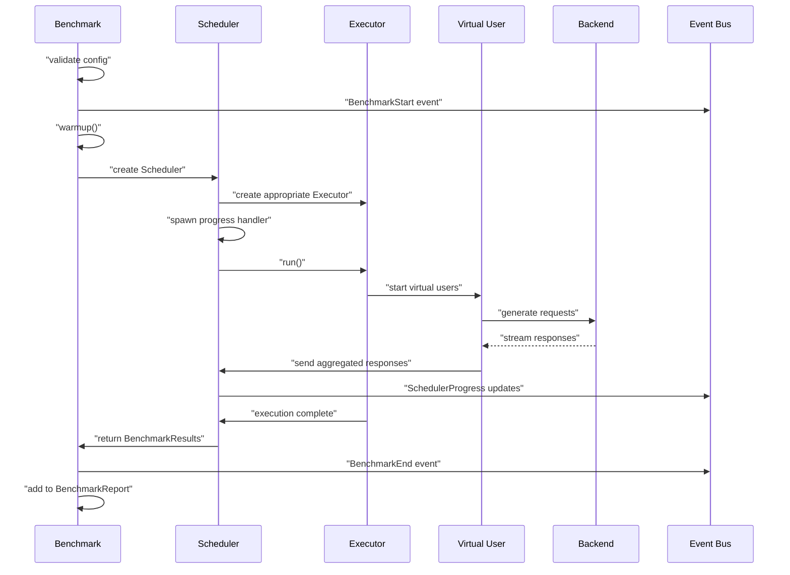
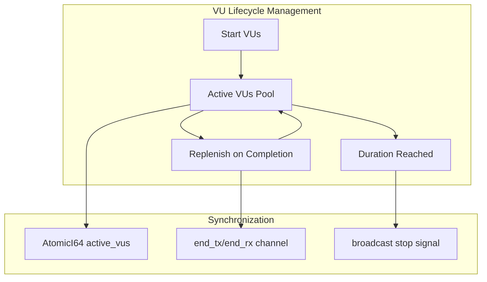
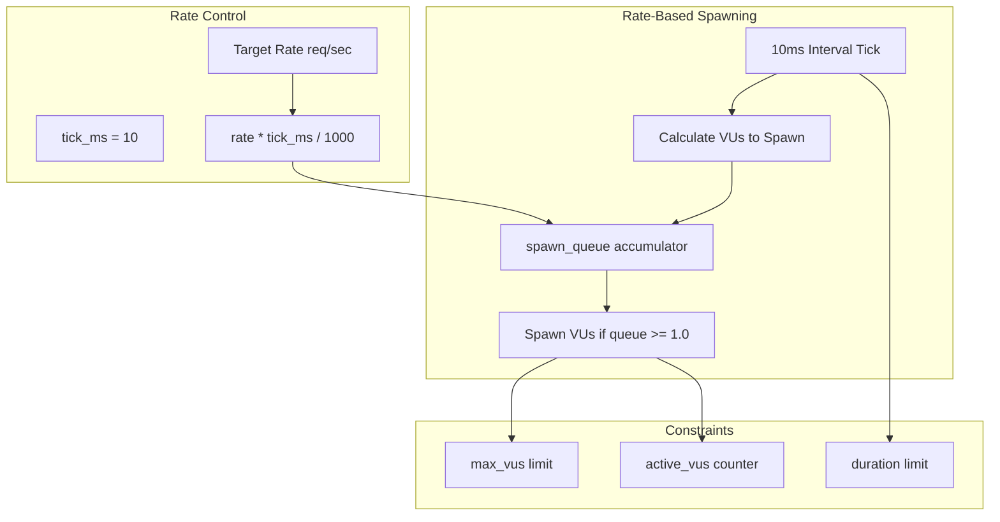
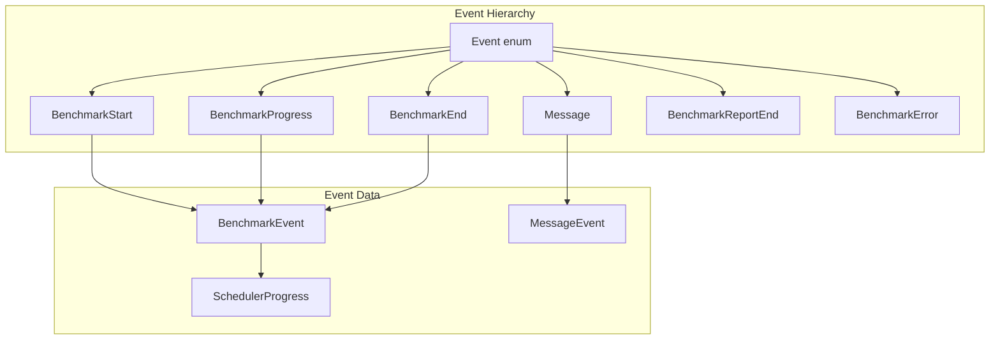
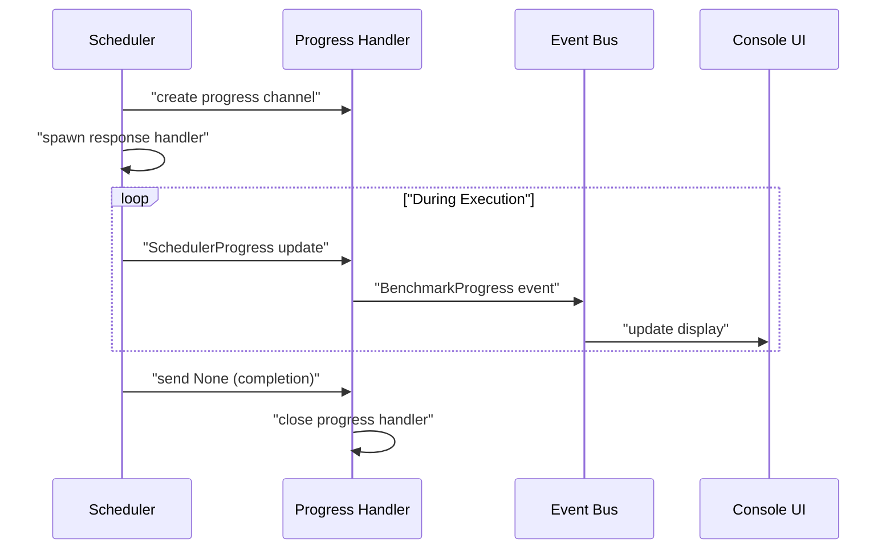
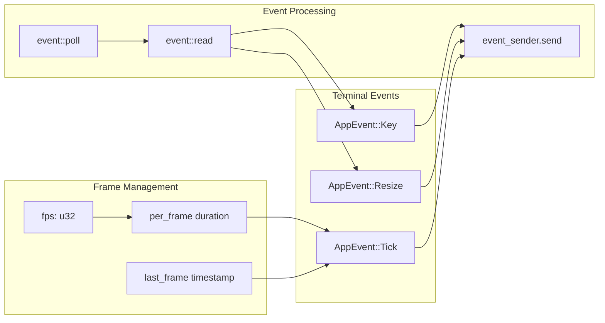

<!-- source: DeepWiki mcp.deepwiki.com · repo huggingface/inference-benchmarker · page 3.3 Benchmark Execution System · fetched 2026-10-26 -->

# Benchmark Execution System

Relevant source files

The following files were used as context for generating this wiki page:

- [src/benchmark.rs](src/benchmark.rs)
- [src/event.rs](src/event.rs)
- [src/executors.rs](src/executors.rs)
- [src/scheduler.rs](src/scheduler.rs)

This document covers the core benchmark execution engine responsible for orchestrating and managing benchmark runs. The system handles different benchmark strategies, manages virtual users (VUs), schedules request execution, and provides real-time progress tracking. For information about request generation and backend interfaces, see [Request Generation and Backend Interface](#3.2). For details on results collection and formatting, see [Results Processing](#3.4). For the terminal user interface components, see [Console UI](#3.5).

## System Architecture Overview

The benchmark execution system is built around three primary components working together to execute benchmarks efficiently:

**Sources:** [src/benchmark.rs:47-56](), [src/scheduler.rs:20-27](), [src/executors.rs:27-35]()

## Benchmark Types and Execution Strategies

The system supports three distinct benchmark types, each optimized for different performance testing scenarios:

| Benchmark Type | Description | Key Characteristics |
|---------------|-------------|-------------------|
| `Throughput` | Measures maximum throughput using constant virtual users | Uses `ConstantVUsExecutor` with `max_vus` |
| `Sweep` | Performs rate sweep from low to maximum detected throughput | Automatically determines rates based on initial throughput test |
| `Rate` | Tests specific request rates | Uses `ConstantArrivalRateExecutor` with predefined rates |

**Sources:** [src/benchmark.rs:15-20](), [src/benchmark.rs:154-164](), [src/benchmark.rs:326-352]()

## Benchmark Execution Flow

The complete execution flow orchestrates warmup, main benchmark execution, and result collection:

**Sources:** [src/benchmark.rs:148-176](), [src/scheduler.rs:89-147](), [src/executors.rs:60-113]()

## Virtual User Management

The execution system uses two distinct strategies for managing virtual users based on the benchmark type:

### ConstantVUsExecutor

Maintains a constant number of active virtual users throughout the benchmark duration:

**Sources:** [src/executors.rs:60-114](), [src/executors.rs:116-149]()

### ConstantArrivalRateExecutor  

Spawns virtual users at a specified rate to maintain consistent request arrival:

**Sources:** [src/executors.rs:175-243](), [src/executors.rs:188-228]()

## Progress Tracking and Event System

The system provides real-time progress updates through a structured event system:

### Event Types

### Progress Flow

**Sources:** [src/benchmark.rs:22-45](), [src/benchmark.rs:185-216](), [src/scheduler.rs:29-34](), [src/scheduler.rs:100-131]()

## Configuration and Validation

The `BenchmarkConfig` structure defines all benchmark parameters and includes comprehensive validation:

| Configuration Field | Purpose | Validation Rules |
|---------------------|---------|------------------|
| `max_vus` | Maximum virtual users | Must be > 0 |
| `duration` | Benchmark duration | Must be > 0 seconds |
| `warmup_duration` | Warmup phase duration | Must be > 0 seconds |
| `benchmark_kind` | Type of benchmark | Determines execution strategy |
| `rates` | Specific rates for Rate benchmarks | Required only for Rate type |
| `num_rates` | Number of rates for Sweep | Used in sweep calculations |

**Sources:** [src/benchmark.rs:58-79](), [src/benchmark.rs:81-117]()

## Terminal Event Integration

The execution system integrates with terminal events for interactive control:

**Sources:** [src/event.rs:6-11](), [src/event.rs:26-58]()

---

