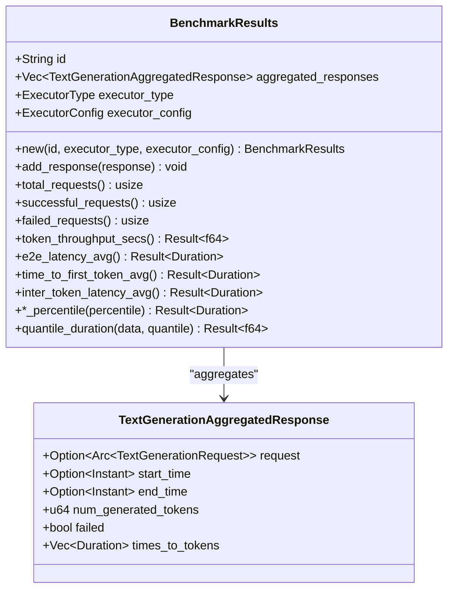
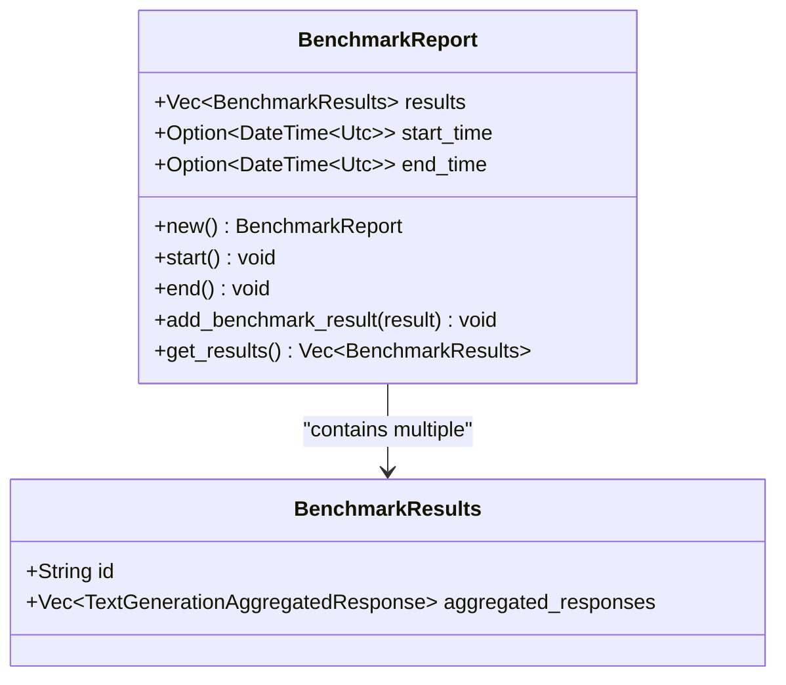
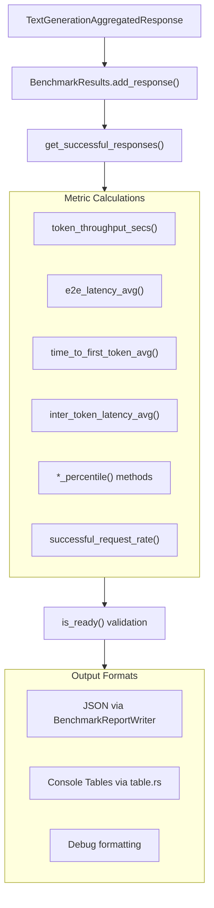
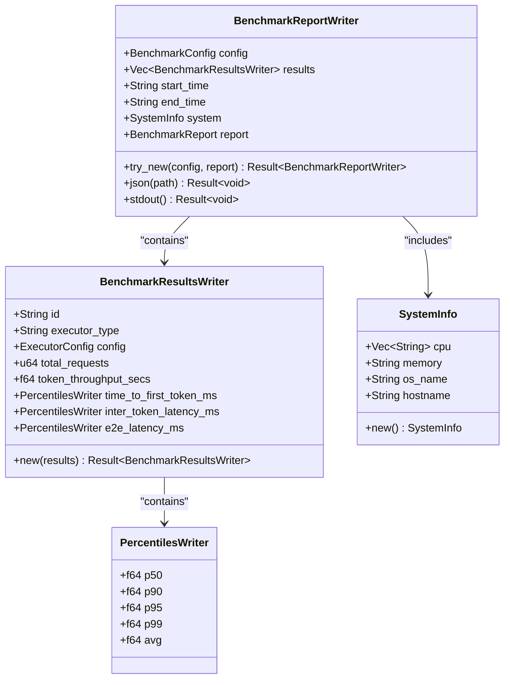
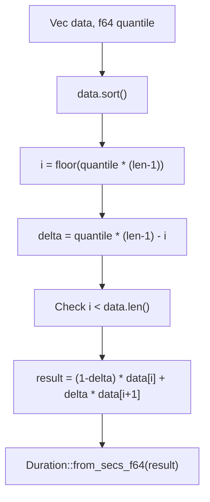

<!-- source: DeepWiki mcp.deepwiki.com · repo huggingface/inference-benchmarker · page 3.4 Results Processing · fetched 2026-10-26 -->

# Results Processing

<details>
<summary>Relevant source files</summary>

The following files were used as context for generating this wiki page:

- [src/results.rs](src/results.rs)
- [src/table.rs](src/table.rs)
- [src/writers.rs](src/writers.rs)

</details>


This document covers how benchmark results are collected, aggregated, and formatted for output in the inference-benchmarker system. The results processing pipeline transforms raw response data from individual requests into comprehensive performance metrics and reports.

For information about how benchmarks are executed and scheduled, see [Benchmark Execution System](#3.3). For details about output visualization and analysis tools, see [Results Analysis and Visualization](#5).

## Core Data Structures

The results processing system is built around two primary data structures that handle different levels of aggregation.

### BenchmarkResults

The `BenchmarkResults` struct represents metrics for a single benchmark configuration. It accumulates individual `TextGenerationAggregatedResponse` objects and computes performance statistics.



Sources: [src/results.rs:23-258]()

### BenchmarkReport

The `BenchmarkReport` struct serves as a container for multiple `BenchmarkResults`, representing the complete output of a benchmark session.



Sources: [src/results.rs:312-351]()

## Metrics Calculation Pipeline

The system calculates comprehensive performance metrics from raw response timing data through a multi-stage process.



Sources: [src/results.rs:82-257](), [src/writers.rs:38-84](), [src/table.rs:44-98]()

### Key Metrics

| Metric Type | Methods | Description |
|-------------|---------|-------------|
| **Throughput** | `token_throughput_secs()`, `successful_request_rate()` | Tokens/second and requests/second |
| **Latency Averages** | `e2e_latency_avg()`, `time_to_first_token_avg()`, `inter_token_latency_avg()` | Mean latency measurements |
| **Latency Percentiles** | `e2e_latency_percentile()`, `time_to_first_token_percentile()`, `inter_token_latency_percentile()` | P50, P90, P95, P99 latency distributions |
| **Token Counts** | `total_tokens()`, `total_prompt_tokens()`, `prompt_tokens_avg()` | Token consumption metrics |
| **Success Rates** | `successful_requests()`, `failed_requests()` | Request completion statistics |

Sources: [src/results.rs:82-220]()

## Output Generation System

The results processing system supports multiple output formats through a layered writer architecture.

### Serialization Writers



Sources: [src/writers.rs:8-179]()

### Output Format Generation

The system generates output in two primary formats through the `BenchmarkReportWriter`:

**JSON Output (`json()` method):**
- Complete serialization of all benchmark data
- Includes system information and configuration
- Preserves full precision for analysis tools
- Asynchronous file writing with directory creation

**Console Output (`stdout()` method):**
- Parameter summary table via `table::parameters_table()`
- Results summary table via `table::results_table()`
- Human-readable formatting with units

Sources: [src/writers.rs:158-178](), [src/table.rs:5-98]()

## Percentile Calculation Algorithm

The system implements a custom percentile calculation algorithm that mimics NumPy's behavior for consistent statistical analysis.



The interpolation formula ensures smooth percentile transitions:
```rust
let quantile = (1. - delta) * data[i as usize].as_secs_f64()
    + delta * data[i as usize + 1].as_secs_f64();
```

Sources: [src/results.rs:241-257]()

## Error Handling and Validation

The results processing system includes comprehensive error handling to ensure data integrity.

### Validation Mechanisms

| Validation | Method | Error Condition |
|------------|--------|----------------|
| **Data Availability** | `is_ready()` | Missing start_time or end_time |
| **Response Count** | All metric methods | Returns `BenchmarkErrors::NoResponses` |
| **Division by Zero** | Rate calculations | Checks for zero successful requests |
| **Bounds Checking** | `quantile_duration()` | Array index validation |

### Error Types

The `BenchmarkErrors` enum defines system-specific error conditions:

```rust
pub(crate) enum BenchmarkErrors {
    NoResponses,
}
```

This error is returned when the backend fails to provide valid responses, either due to connectivity issues or insufficient test duration.

Sources: [src/results.rs:9-20](), [src/results.rs:64-66](), [src/results.rs:244-256]()

---

