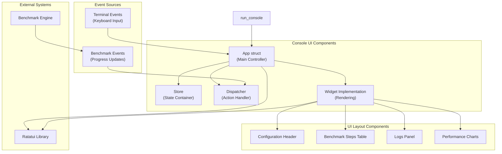
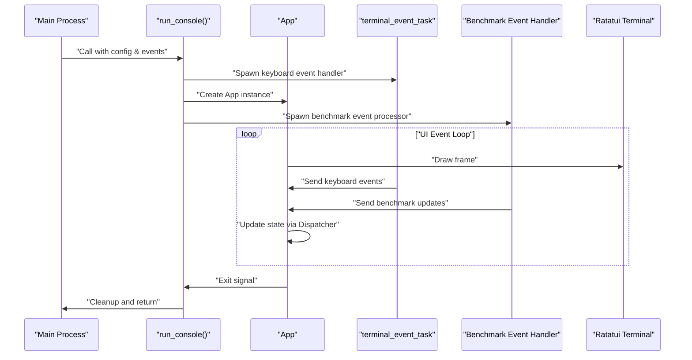
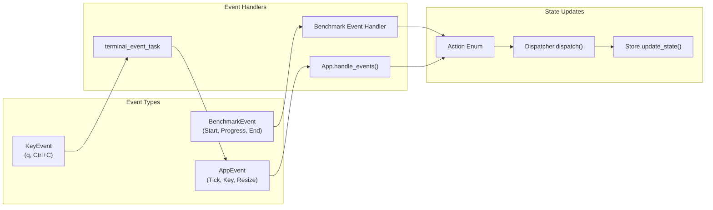
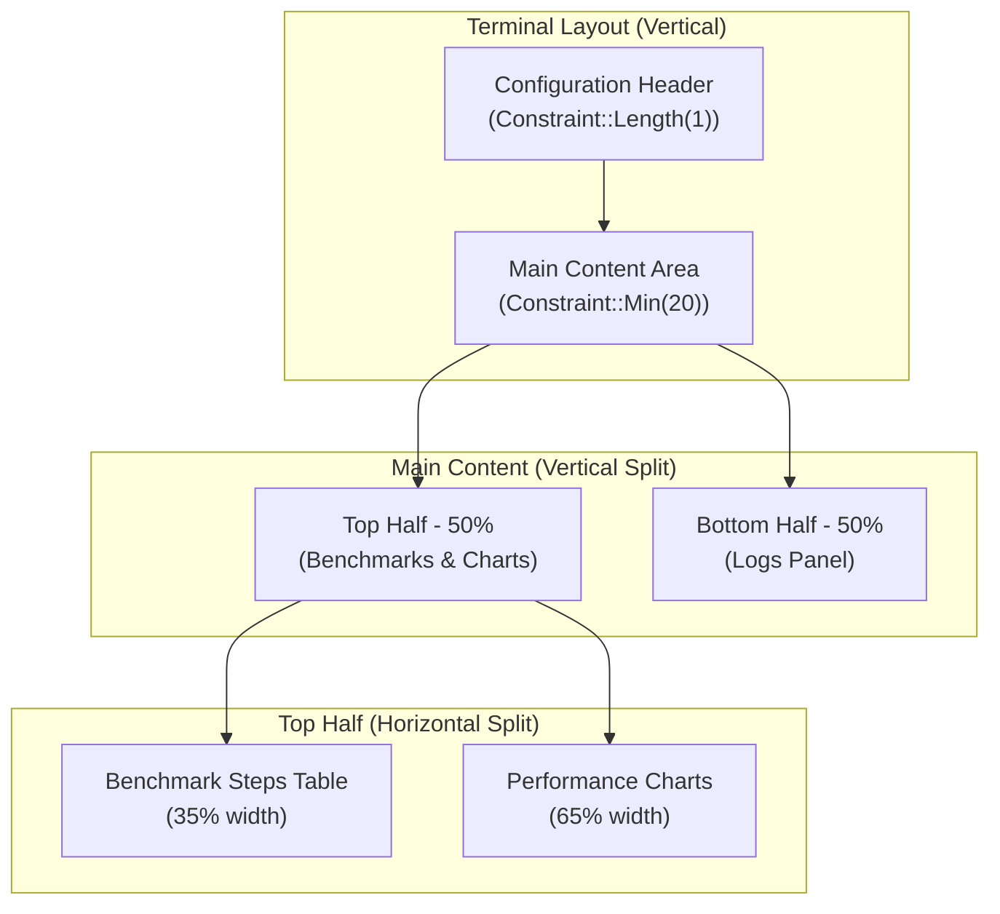
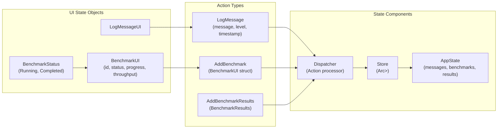
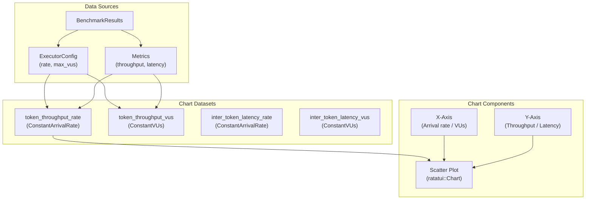

<!-- source: DeepWiki mcp.deepwiki.com · repo huggingface/inference-benchmarker · page 3.5 Console UI · fetched 2026-10-26 -->

# Console UI

Relevant source files

The following files were used as context for generating this wiki page:

- [src/app.rs](src/app.rs)

## Purpose and Scope

The Console UI provides a real-time terminal-based interface for monitoring benchmark execution and visualizing results as they are generated. This interactive interface allows users to observe benchmark progress, view logs, and see performance metrics through charts and tables directly in the terminal.

For information about the CLI interface and command-line arguments, see [CLI Interface](#3.1). For details about results processing and output formats, see [Results Processing](#3.4).

## Architecture Overview

The Console UI is built using the `ratatui` library and implements a flux-pattern architecture for state management. The system consists of several key components that work together to provide real-time monitoring capabilities.

### Console UI System Architecture

Sources: [src/app.rs:28-35](), [src/app.rs:37-41](), [src/app.rs:146-162]()

### Console UI Entry Point and Initialization

The console UI is initialized through the `run_console` function, which sets up the event handling system and spawns concurrent tasks for managing terminal events and benchmark updates.

Sources: [src/app.rs:37-144]()

## Event Handling System

The Console UI implements a sophisticated event handling system that manages both user input and benchmark updates through separate asynchronous tasks.

### Event Processing Architecture

Sources: [src/app.rs:2](), [src/app.rs:58-131](), [src/app.rs:175-200]()

### Benchmark Event Processing

The system processes various types of benchmark events and converts them into UI state updates:

| Event Type | UI Action | Description |
|------------|-----------|-------------|
| `BenchmarkStart` | `AddBenchmark` | Creates new benchmark entry with running status |
| `BenchmarkProgress` | `AddBenchmark` | Updates progress, throughput, and request counts |
| `BenchmarkEnd` | `AddBenchmark` + `AddBenchmarkResults` | Marks completion and stores results |
| `Message` | `LogMessage` | Adds informational messages to logs |
| `BenchmarkError` | `LogMessage` | Displays error messages and terminates |

Sources: [src/app.rs:63-126]()

## UI Layout and Components

The Console UI uses a structured layout divided into four main areas: configuration header, benchmark steps table, performance charts, and logs panel.

### UI Layout Structure

Sources: [src/app.rs:276-287]()

### Benchmark Steps Table

The benchmark steps table displays real-time progress for each running benchmark with the following columns:

- **Bench**: Benchmark identifier
- **Status**: Running or Completed
- **%**: Progress percentage
- **Err**: Error rate percentage (highlighted in red if > 0)
- **Throughput**: Average requests per second

Sources: [src/app.rs:346-389]()

### Logs Panel

The logs panel shows timestamped messages with color-coded log levels:
- **INFO**: Green, bold text
- **WARNING**: Yellow, bold text  
- **ERROR**: Red, bold text

The logs are displayed in reverse chronological order (newest first) using the `BottomToTop` list direction.

Sources: [src/app.rs:288-323](), [src/app.rs:444-463]()

## State Management

The Console UI uses a flux-pattern architecture with centralized state management through the `Store` and `Dispatcher` components.

### State Management Flow

Sources: [src/app.rs:28-35](), [src/app.rs:453-479]()

## Real-time Data Visualization

The Console UI provides real-time performance charts that visualize benchmark results as they are collected.

### Chart Data Processing

The system creates multiple datasets for visualization based on executor type and metrics:

Sources: [src/app.rs:205-268](), [src/app.rs:391-421]()

### Chart Rendering

The performance charts use the following visualization approach:
- **Chart Type**: Scatter plot with dot markers
- **Data Filtering**: Separates ConstantArrivalRate and ConstantVUs results
- **Dynamic Scaling**: Automatically calculates axis bounds based on data
- **Real-time Updates**: Charts update as new benchmark results are added

The chart currently displays token throughput rate, showing the relationship between arrival rate (requests/second) and achieved throughput (tokens/second).

Sources: [src/app.rs:392-421](), [src/app.rs:423-442]()

---

