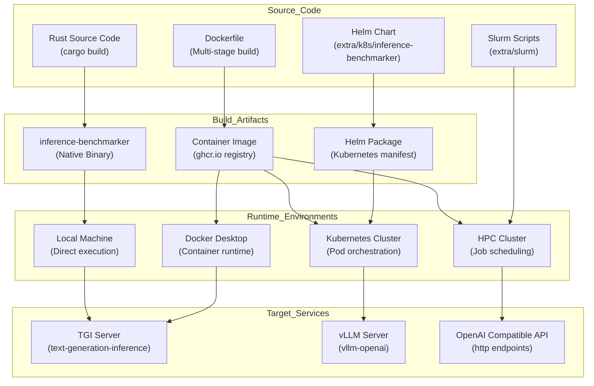
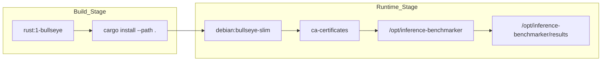
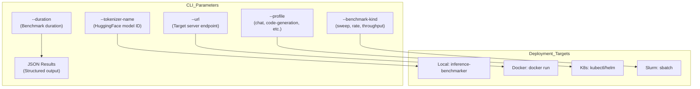
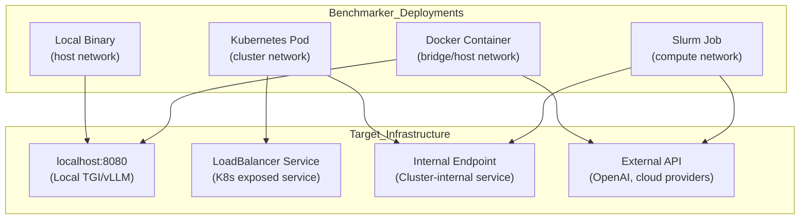
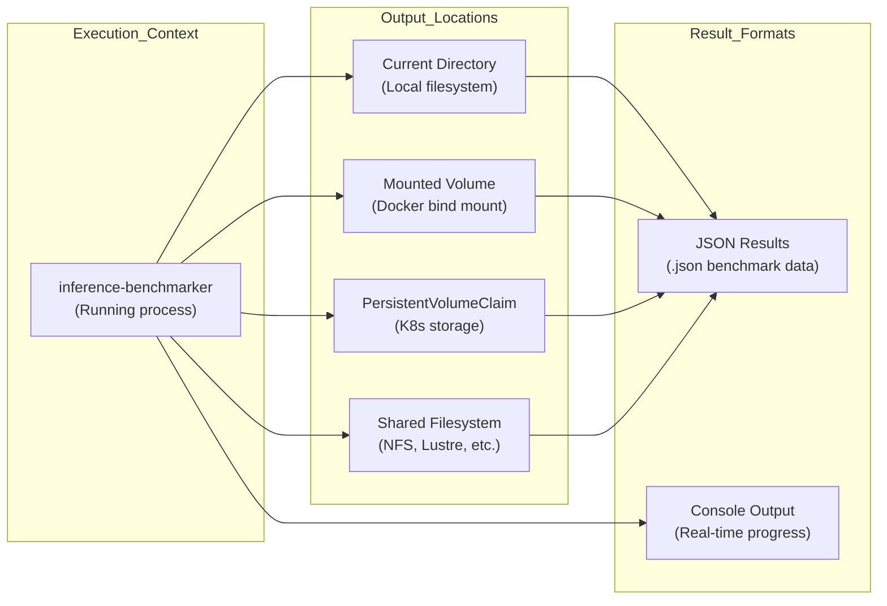

<!-- source: DeepWiki mcp.deepwiki.com · repo huggingface/inference-benchmarker · page 4 Deployment Options · fetched 2026-10-26 -->

# Deployment Options

<details>
<summary>Relevant source files</summary>

The following files were used as context for generating this wiki page:

- [Dockerfile](Dockerfile)
- [Makefile](Makefile)
- [README.md](README.md)

</details>


This page provides an overview of the different deployment methods available for the inference-benchmarker system. The benchmarker is designed to run in various environments, from local development setups to large-scale HPC clusters, enabling performance testing across different infrastructure configurations.

For detailed information about specific deployment methods, see [Docker Deployment](#4.1), [Kubernetes Deployment](#4.2), and [HPC and Slurm Deployment](#4.3). For information about analyzing results from deployed benchmarks, see [Results Analysis and Visualization](#5).

## Deployment Architecture Overview

The inference-benchmarker supports multiple deployment strategies, each optimized for different use cases and infrastructure requirements:



Sources: [README.md:50-240](), [Dockerfile:1-14]()

## Deployment Methods Comparison

| Method | Use Case | Prerequisites | Scalability | Complexity |
|--------|----------|---------------|-------------|------------|
| **Local Binary** | Development, quick testing | Rust toolchain or pre-built binary | Single machine | Low |
| **Docker** | Consistent environments, CI/CD | Docker runtime | Single machine | Low |
| **Kubernetes** | Production workloads, auto-scaling | K8s cluster, Helm | High | Medium |
| **HPC/Slurm** | Large-scale research, batch jobs | Slurm cluster access | Very High | High |

## Installation Methods

### Binary Installation

The benchmarker can be installed directly as a native binary:

```bash
# Via cargo (requires Rust toolchain)
cargo install --git https://github.com/huggingface/inference-benchmarker/

# Or download pre-built release
curl -L https://github.com/huggingface/inference-benchmarker/releases/latest
```

### Container Image

The system provides containerized deployment through a multi-stage Docker build:



Sources: [README.md:54-61](), [Dockerfile:1-14]()

## Configuration and Execution Patterns

### Command Interface Consistency

Regardless of deployment method, the benchmarker maintains a consistent CLI interface:



Sources: [README.md:93-148]()

## Resource and Networking Requirements

### Network Connectivity

All deployment methods require network access to target LLM services:



Sources: [README.md:65-88](), [README.md:93-98]()

## Output and Results Management

### Results Persistence Across Deployments

Each deployment method handles results storage differently:



Sources: [README.md:100](), [Dockerfile:11-12]()

## Scaling Considerations

### Concurrent Execution Patterns

Different deployment methods support varying levels of parallelization:

| Deployment | Concurrent Benchmarks | Resource Isolation | Job Management |
|------------|----------------------|-------------------|----------------|
| **Local** | Limited by system resources | Process-level | Manual |
| **Docker** | Container-based isolation | Container-level | Docker Compose |
| **Kubernetes** | Pod-based scaling | Namespace/Pod-level | Built-in scheduler |
| **Slurm** | Job queue management | Job-level allocation | Advanced scheduling |

The benchmarker's internal concurrency is controlled through parameters like `--max-vus` (maximum virtual users), which remains consistent across all deployment methods.

Sources: [README.md:138](), [README.md:244-252]()

## Next Steps

For implementation details of each deployment method:

- **[Docker Deployment](#4.1)**: Container configuration, volume mounting, and networking setup
- **[Kubernetes Deployment](#4.2)**: Helm chart configuration, resource management, and cluster integration  
- **[HPC and Slurm Deployment](#4.3)**: Job submission, resource allocation, and batch processing workflows

For analyzing results from any deployment method, see [Results Analysis and Visualization](#5).

Sources: [README.md:209-230]()

---

