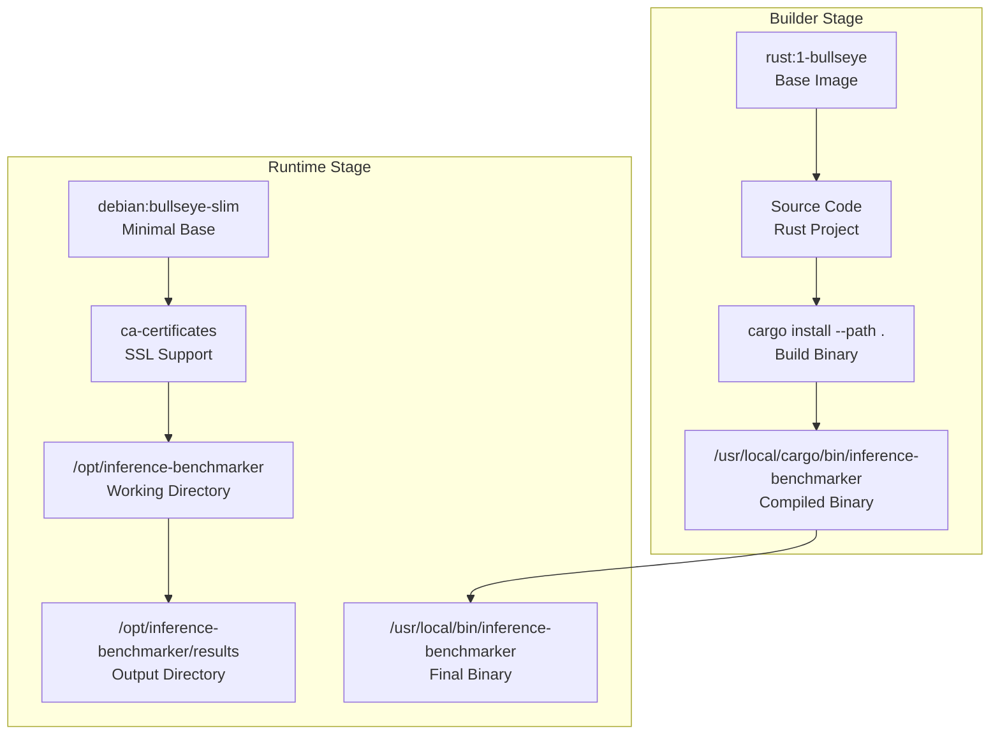
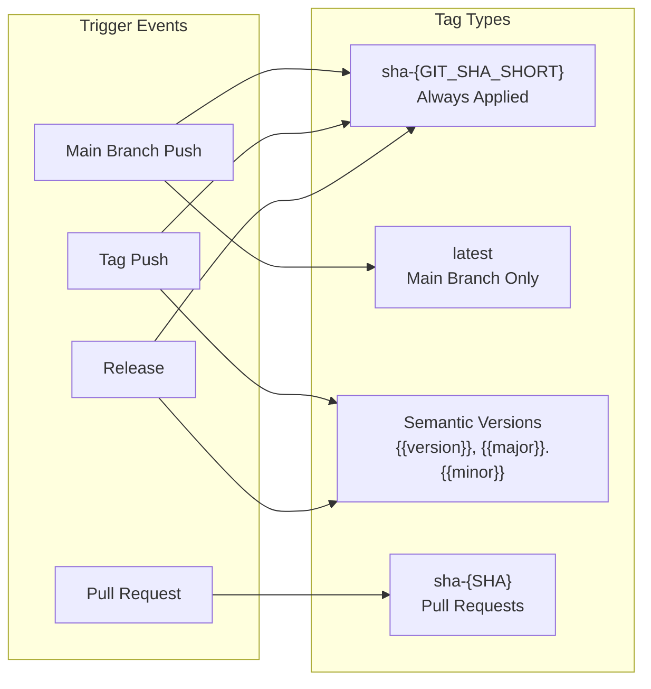
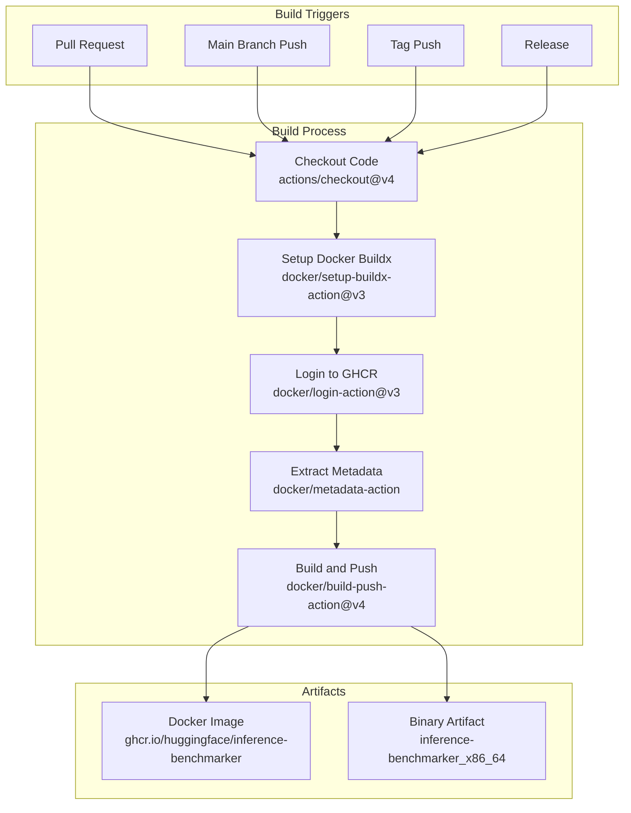

<!-- source: DeepWiki mcp.deepwiki.com · repo huggingface/inference-benchmarker · page 4.1 Docker Deployment · fetched 2026-10-26 -->

# Docker Deployment

<details>
<summary>Relevant source files</summary>

The following files were used as context for generating this wiki page:

- [.github/workflows/build.yaml](.github/workflows/build.yaml)
- [Dockerfile](Dockerfile)
- [Makefile](Makefile)

</details>


This document covers running the inference-benchmarker using Docker containers. It explains the Docker image build process, container configuration, and deployment workflows. For Kubernetes deployment using Helm charts, see [Kubernetes Deployment](#4.2). For running on HPC clusters, see [HPC and Slurm Deployment](#4.3).

## Docker Image Architecture

The inference-benchmarker uses a multi-stage Docker build to create optimized production images. The build process separates compilation from the final runtime environment.

### Multi-Stage Build Process



Sources: [Dockerfile:1-14]()

### Image Labels and Metadata

The Docker image includes OpenContainer Initiative (OCI) labels for metadata and provenance:

| Label | Value |
|-------|-------|
| `org.opencontainers.image.source` | `https://github.com/huggingface/inference-benchmarker` |
| `org.opencontainers.image.description` | `A benchmark tool for LLM inference engines` |
| `org.opencontainers.image.licenses` | `Apache-2.0` |

Sources: [Dockerfile:2-4]()

## Container Registry and Tagging

### Registry Location

Images are published to the GitHub Container Registry at `ghcr.io/huggingface/inference-benchmarker`.

### Tag Strategy

The CI/CD pipeline applies multiple tags based on the trigger event:



Sources: [.github/workflows/build.yaml:39-55]()

## Running the Container

### Basic Usage

```bash
docker run ghcr.io/huggingface/inference-benchmarker:latest --help
```

### Volume Mounts for Results

The container creates a results directory at `/opt/inference-benchmarker/results`. Mount a host directory to persist benchmark results:

```bash
docker run -v $(pwd)/results:/opt/inference-benchmarker/results \
  ghcr.io/huggingface/inference-benchmarker:latest \
  --backend openai \
  --base-url http://host.docker.internal:8080/v1 \
  --model meta-llama/Llama-2-7b-chat-hf
```

### Environment Configuration

The container runs as a non-root user with the working directory set to `/opt/inference-benchmarker`. The default command is `inference-benchmarker`, allowing direct argument passing.

Sources: [Dockerfile:10-14]()

## CI/CD Integration

### Automated Build Pipeline

The GitHub Actions workflow builds and publishes Docker images automatically:



Sources: [.github/workflows/build.yaml:16-81]()

### Platform Support

Images are built for the `linux/amd64` platform. The build process uses Docker Buildx for cross-platform capabilities.

### Binary Extraction

The CI pipeline extracts the compiled binary from the Docker image and uploads it as a build artifact:

```bash
docker create --name extract ghcr.io/huggingface/inference-benchmarker:sha-{SHA}
docker cp extract:/usr/local/bin/inference-benchmarker ./inference-benchmarker
docker rm -f extract
```

Sources: [.github/workflows/build.yaml:70-75]()

## Configuration and Runtime

### Working Directory Structure

The container establishes the following directory structure:

| Path | Purpose |
|------|---------|
| `/opt/inference-benchmarker` | Working directory |
| `/opt/inference-benchmarker/results` | Default output directory for benchmark results |
| `/usr/local/bin/inference-benchmarker` | Executable binary location |

### SSL Certificate Support

The runtime image includes `ca-certificates` package to support HTTPS connections to LLM APIs and services.

Sources: [Dockerfile:9-13]()

### Dependencies and Size Optimization

The multi-stage build reduces the final image size by:
- Using `debian:bullseye-slim` instead of the full Rust development image
- Installing only essential runtime dependencies
- Removing build tools and intermediate artifacts

Sources: [Dockerfile:1-14]()

---

