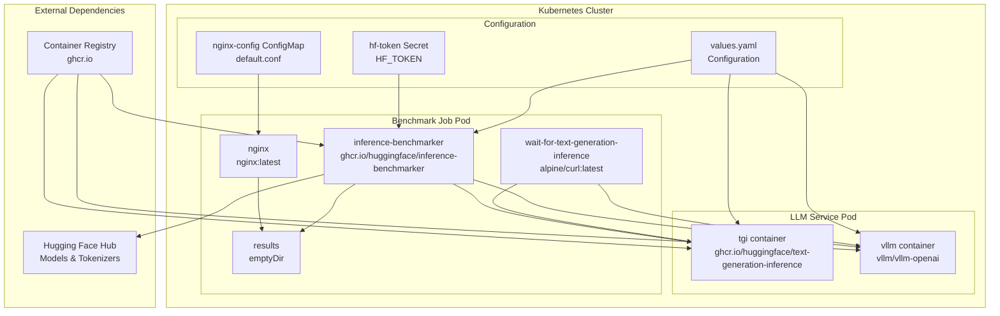
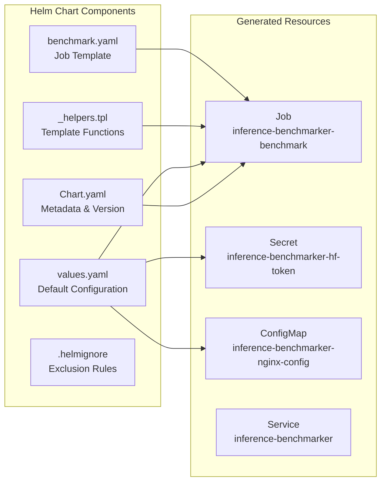
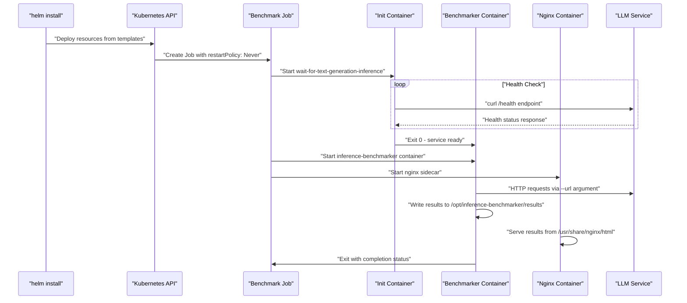
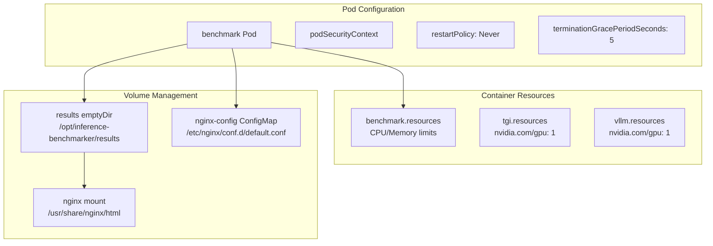

<!-- source: DeepWiki mcp.deepwiki.com · repo huggingface/inference-benchmarker · page 4.2 Kubernetes Deployment · fetched 2026-10-26 -->

# Kubernetes Deployment

<details>
<summary>Relevant source files</summary>

The following files were used as context for generating this wiki page:

- [extra/k8s/inference-benchmarker/.helmignore](extra/k8s/inference-benchmarker/.helmignore)
- [extra/k8s/inference-benchmarker/Chart.yaml](extra/k8s/inference-benchmarker/Chart.yaml)
- [extra/k8s/inference-benchmarker/templates/_helpers.tpl](extra/k8s/inference-benchmarker/templates/_helpers.tpl)
- [extra/k8s/inference-benchmarker/templates/benchmark.yaml](extra/k8s/inference-benchmarker/templates/benchmark.yaml)
- [extra/k8s/inference-benchmarker/values.yaml](extra/k8s/inference-benchmarker/values.yaml)

</details>


This document covers deploying and running the inference-benchmarker on Kubernetes clusters using Helm charts. This deployment method enables running benchmarks at scale with proper resource management and result collection. For local Docker deployment, see [Docker Deployment](#4.1). For HPC cluster deployment, see [HPC and Slurm Deployment](#4.3).

## Overview

The Kubernetes deployment provides a production-ready way to run inference benchmarks against LLM services deployed in Kubernetes environments. The deployment uses Helm charts to manage the complexity of Kubernetes manifests and provides configurable options for different LLM backends, resource allocation, and benchmark parameters.

## Deployment Architecture

The Kubernetes deployment consists of multiple components working together to provide a complete benchmarking solution:



Sources: [extra/k8s/inference-benchmarker/values.yaml:1-69](), [extra/k8s/inference-benchmarker/templates/benchmark.yaml:1-99]()

## Helm Chart Structure

The Kubernetes deployment is organized as a standard Helm chart with the following structure:



Sources: [extra/k8s/inference-benchmarker/Chart.yaml:1-7](), [extra/k8s/inference-benchmarker/templates/_helpers.tpl:1-63]()

## Configuration Options

The Helm chart provides extensive configuration options through the `values.yaml` file:

### Core Configuration

| Parameter | Default | Description |
|-----------|---------|-------------|
| `hf_token` | `""` | Hugging Face token for model access |
| `model_id` | `"meta-llama/Llama-3.1-8B-Instruct"` | Model identifier for tokenizer |
| `server` | `tgi` | Backend server type (`tgi` or `vllm`) |

### TGI Backend Configuration

The Text Generation Inference backend can be configured with the following options:

| Parameter | Default | Description |
|-----------|---------|-------------|
| `tgi.enabled` | `true` | Enable TGI deployment |
| `tgi.extra_args` | `["--max-concurrent-requests", "512"]` | Additional TGI arguments |
| `tgi.image.repository` | `ghcr.io/huggingface/text-generation-inference` | TGI container image |
| `tgi.image.tag` | `"latest"` | Image tag |
| `tgi.resources.limits."nvidia.com/gpu"` | `"1"` | GPU resource allocation |

### vLLM Backend Configuration

The vLLM backend provides an alternative high-throughput inference option:

| Parameter | Default | Description |
|-----------|---------|-------------|
| `vllm.enabled` | `false` | Enable vLLM deployment |
| `vllm.image.repository` | `vllm/vllm-openai` | vLLM container image |
| `vllm.resources.limits."nvidia.com/gpu"` | `"1"` | GPU resource allocation |

### Benchmark Configuration

The benchmark job behavior is controlled through these parameters:

| Parameter | Default | Description |
|-----------|---------|-------------|
| `benchmark.extra_args` | `["--profile", "chat", "800"]` | Additional benchmark arguments |
| `benchmark.image.repository` | `ghcr.io/huggingface/inference-benchmarker` | Benchmarker image |

Sources: [extra/k8s/inference-benchmarker/values.yaml:5-65]()

## Job Execution Flow

The benchmark execution follows a structured workflow managed by Kubernetes:



Sources: [extra/k8s/inference-benchmarker/templates/benchmark.yaml:28-64]()

## Resource and Volume Management

The deployment manages several types of Kubernetes resources for proper operation:

### Pod Security and Resources



### Environment Variables and Secrets

The benchmark container receives configuration through environment variables:

| Variable | Source | Purpose |
|----------|--------|---------|
| `HF_TOKEN` | Secret `hf-token` | Hugging Face authentication |
| `RUST_LOG` | Static value `inference_benchmarker=info` | Logging configuration |

Sources: [extra/k8s/inference-benchmarker/templates/benchmark.yaml:55-62](), [extra/k8s/inference-benchmarker/templates/benchmark.yaml:81-86]()

## Command Line Arguments

The benchmark container is executed with specific arguments constructed from the Helm values:

```yaml
args:
  - "inference-benchmarker"
  - "--url"
  - "http://{{ fullname }}.{{ namespace }}.svc.cluster.local:8080"
  - "--tokenizer-name"
  - "{{ .Values.model_id }}"
  - "--no-console"
  # Additional args from .Values.benchmark.extra_args
```

The `--no-console` flag disables the terminal UI since the job runs without an interactive terminal. The URL automatically resolves to the LLM service using Kubernetes DNS.

Sources: [extra/k8s/inference-benchmarker/templates/benchmark.yaml:47-54]()

## Deployment Commands

To deploy the inference-benchmarker using Helm:

```bash
# Install the chart with custom values
helm install my-benchmark ./extra/k8s/inference-benchmarker \
  --set hf_token="your_hf_token" \
  --set model_id="meta-llama/Llama-3.1-8B-Instruct" \
  --set tgi.enabled=true

# Check job status
kubectl get jobs
kubectl logs job/my-benchmark-inference-benchmarker-benchmark
```

The results will be available through the nginx sidecar container, which serves the benchmark output files over HTTP.

Sources: [extra/k8s/inference-benchmarker/Chart.yaml:1-7](), [extra/k8s/inference-benchmarker/templates/benchmark.yaml:68-79]()

---

