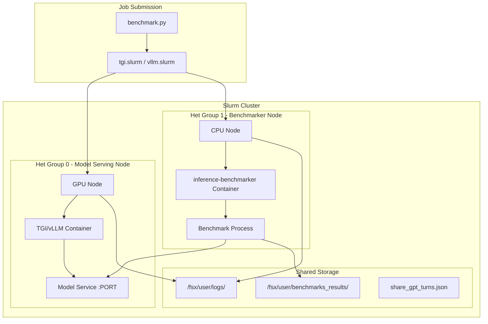
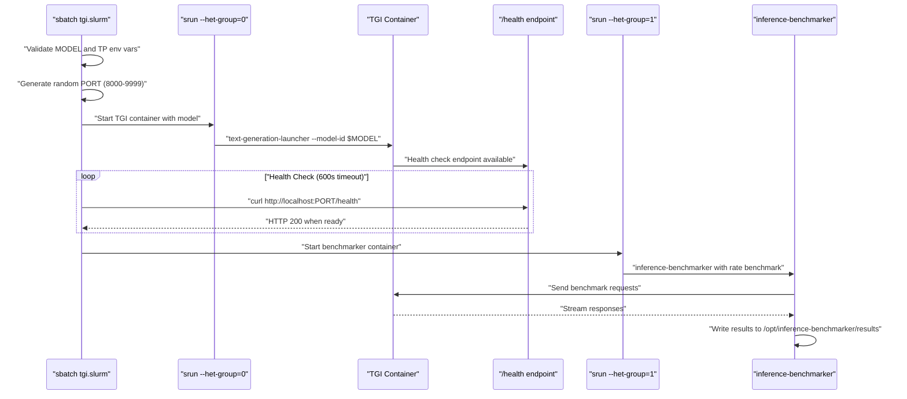
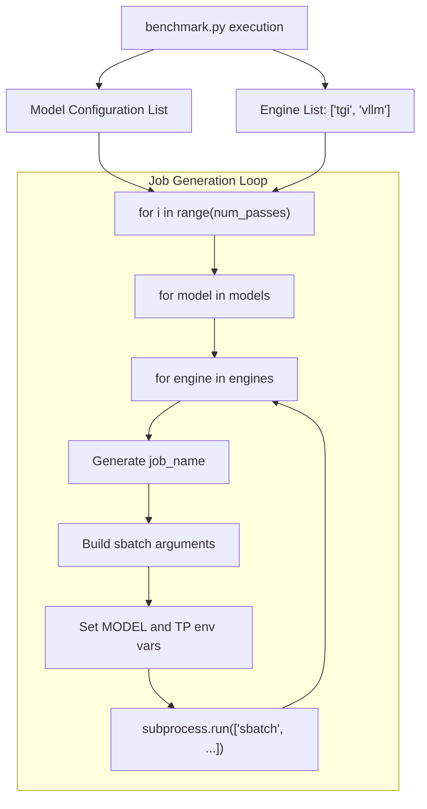

<!-- source: DeepWiki mcp.deepwiki.com · repo huggingface/inference-benchmarker · page 4.3 HPC and Slurm Deployment · fetched 2026-10-26 -->

# HPC and Slurm Deployment

<details>
<summary>Relevant source files</summary>

The following files were used as context for generating this wiki page:

- [extra/slurm/benchmark.py](extra/slurm/benchmark.py)
- [extra/slurm/tgi.slurm](extra/slurm/tgi.slurm)
- [extra/slurm/vllm.slurm](extra/slurm/vllm.slurm)

</details>


This document covers deploying and running the inference-benchmarker on High-Performance Computing (HPC) clusters using Slurm job scheduling. This approach enables large-scale benchmarking of LLM inference engines across multiple models and configurations with automated resource management and job orchestration.

For container-based deployments, see [Docker Deployment](#4.1). For Kubernetes orchestration, see [Kubernetes Deployment](#4.2).

## HPC Architecture Overview

The HPC deployment utilizes Slurm's heterogeneous job (`hetjob`) feature to run benchmarks across two separate node groups: one for the LLM inference service and another for the benchmarker client.

### Heterogeneous Job Architecture



Sources: [extra/slurm/tgi.slurm:8-9](), [extra/slurm/vllm.slurm:8-9](), [extra/slurm/tgi.slurm:34-44](), [extra/slurm/vllm.slurm:33-46]()

## Slurm Job Configuration

Both TGI and vLLM deployment scripts use identical Slurm resource allocation patterns with heterogeneous job specifications.

### Resource Allocation

| Resource | Het Group 0 (Model) | Het Group 1 (Benchmarker) |
|----------|---------------------|---------------------------|
| GPUs | Variable (1-4) | 1 |
| CPUs per task | Variable (11-80) | 11 |
| Memory per CPU | 20G | 20G |
| Nodes | 1 | 1 |
| Partition | hopper-prod | hopper-prod |
| Time limit | 1:50:00 | 1:50:00 |

The resource allocation is dynamically calculated in `benchmark.py` based on the model's tensor parallelism requirements:

```
cpus_per_task = gpus * CPUS_PER_GPU  # CPUS_PER_GPU = 20
```

Sources: [extra/slurm/tgi.slurm:7-9](), [extra/slurm/vllm.slurm:7-9](), [extra/slurm/benchmark.py:4-5](), [extra/slurm/benchmark.py:21]()

## TGI Deployment Script

The TGI deployment script ([extra/slurm/tgi.slurm]()) orchestrates Text Generation Inference service deployment and benchmarking execution.

### TGI Service Startup



Sources: [extra/slurm/tgi.slurm:11-18](), [extra/slurm/tgi.slurm:25-27](), [extra/slurm/tgi.slurm:34-44](), [extra/slurm/tgi.slurm:46-47](), [extra/slurm/tgi.slurm:57-74]()

### TGI Container Configuration

The TGI service runs with specific optimizations:

- **Container Image**: `ghcr.io#huggingface/text-generation-inference`
- **Mount Points**: `/scratch:/data` for model storage
- **Environment**: `PORT`, `PREFILL_CHUNKING=1`
- **Parameters**: `--max-concurrent-requests 1024`

Sources: [extra/slurm/tgi.slurm:37-44](), [extra/slurm/tgi.slurm:28]()

## vLLM Deployment Script

The vLLM deployment follows a similar pattern but uses different container and service configurations.

### vLLM Service Configuration

- **Container Image**: `vllm/vllm-openai:latest`
- **Mount Points**: `/scratch:/root/.cache/huggingface` for model cache
- **API Server**: `python3 -m vllm.entrypoints.openai.api_server`
- **Optimizations**: `--enable-chunked-prefill`, `--max-num-batched-tokens 512`
- **Tensor Parallelism**: `--tensor-parallel-size ${SLURM_GPUS_ON_NODE}`

Sources: [extra/slurm/vllm.slurm:36](), [extra/slurm/vllm.slurm:38](), [extra/slurm/vllm.slurm:41-46]()

### Version Detection

Both scripts extract version information for benchmark metadata:

- **TGI**: `curl -s http://node:port/info | jq -r '.sha'`
- **vLLM**: `curl -s http://node:port/version | jq -r '.version'`

Sources: [extra/slurm/tgi.slurm:56](), [extra/slurm/vllm.slurm:58]()

## Batch Job Automation

The `benchmark.py` script automates submission of multiple benchmark jobs across different models and engines.

### Automation Workflow



Sources: [extra/slurm/benchmark.py:8-52]()

### Model Configuration

The automation script defines model configurations with tensor parallelism requirements:

| Model | Tensor Parallelism | Total GPUs |
|-------|-------------------|------------|
| `meta-llama/Llama-3.1-8B-Instruct` | 1 | 1 |
| `meta-llama/Llama-3.1-70B-Instruct` | 4 | 4 |
| `meta-llama/Llama-3.1-70B-Instruct` | 2 | 2 |
| `mistralai/Mixtral-8x7B-Instruct-v0.1` | 2 | 2 |

Sources: [extra/slurm/benchmark.py:9-14]()

### Dynamic Resource Calculation

CPU allocation scales with GPU count:

```
cpus_per_task = gpus * CPUS_PER_GPU  # 20 CPUs per GPU
mem_per_cpu = MEM_PER_CPU_GB + 'G'   # 11GB per CPU
```

Sources: [extra/slurm/benchmark.py:4-5](), [extra/slurm/benchmark.py:21](), [extra/slurm/benchmark.py:32-33]()

## Benchmark Execution Parameters

Both deployment scripts use consistent benchmarking parameters optimized for large-scale evaluation.

### Rate-Based Benchmarking

The benchmarks use rate-based load testing with multiple request rates:

- **Benchmark Kind**: `rate`
- **Duration**: `120s` with `30s` warmup
- **Max Virtual Users**: `128`
- **Rate Range**: 0.8 to 24.0 requests/second (16 different rates)
- **Token Configuration**: 800 max tokens, 50 min tokens, 100 variance

Sources: [extra/slurm/tgi.slurm:67-72](), [extra/slurm/vllm.slurm:68-74]()

### Metadata Collection

Benchmark results include engine-specific metadata:

- **TGI**: `version=$VERSION,engine=TGI,tp=$TP`
- **vLLM**: `version=$VERSION,engine=vLLM,tp=$TP,max_num_batched_tokens=512`

Sources: [extra/slurm/tgi.slurm:71](), [extra/slurm/vllm.slurm:73]()

## Results Collection

Results are automatically collected and organized in the shared filesystem.

### Storage Structure

```
/fsx/$USER/
├── logs/
│   └── [job-name]-[job-id].log
└── benchmarks_results/
    ├── tgi/
    │   └── [benchmark-results.json]
    └── vllm/
        └── [benchmark-results.json]
```

The results directory is mounted into the benchmarker container at `/opt/inference-benchmarker/results` for seamless data collection.

Sources: [extra/slurm/tgi.slurm:50-51](), [extra/slurm/vllm.slurm:52-53](), [extra/slurm/tgi.slurm:61](), [extra/slurm/vllm.slurm:63]()

### Job Cleanup

Both scripts implement proper cleanup by terminating the model service after benchmark completion:

```bash
scancel --signal=TERM "$SLURM_JOB_ID+0"
```

This ensures GPU resources are released promptly after benchmarking.

Sources: [extra/slurm/tgi.slurm:78](), [extra/slurm/vllm.slurm:80]()

---

