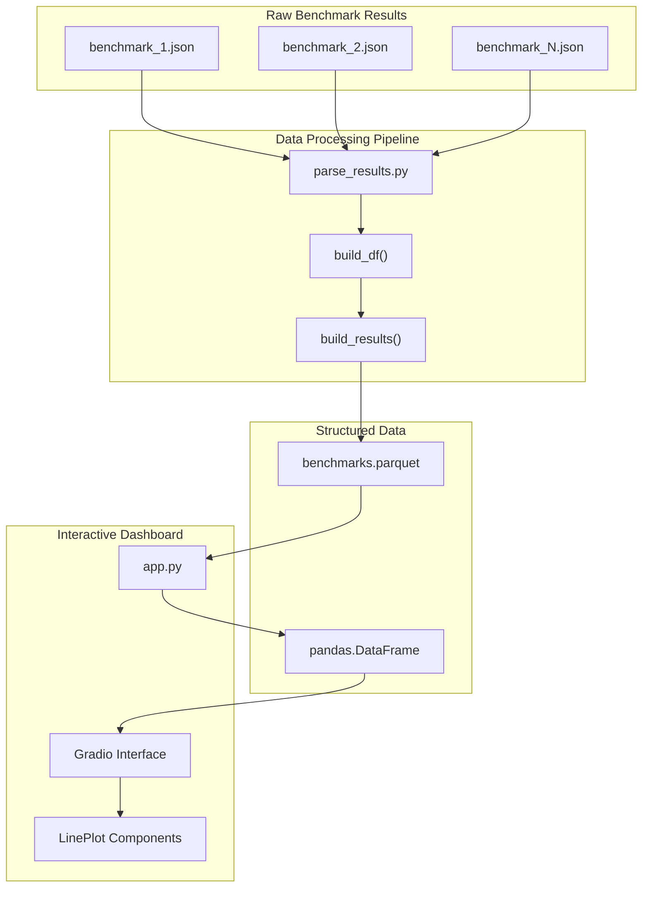
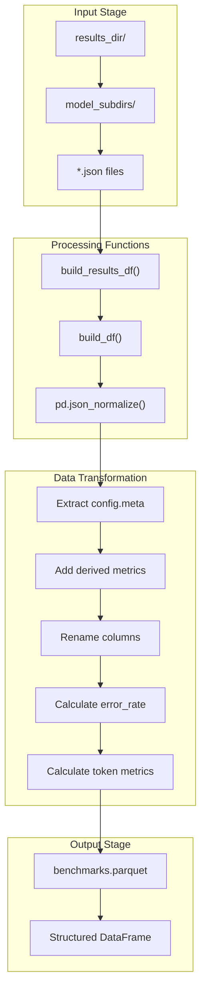
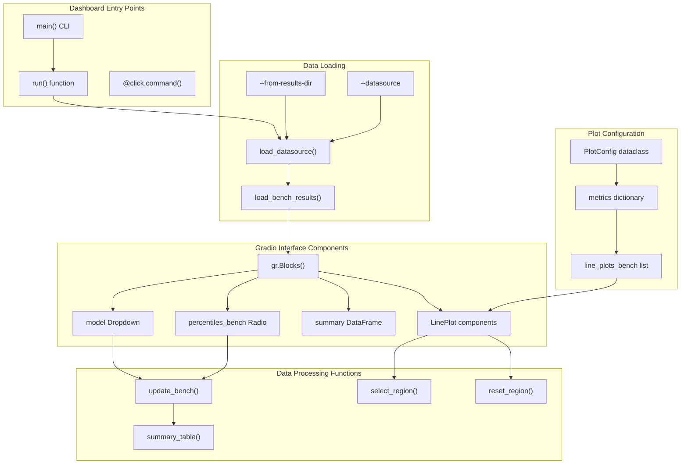
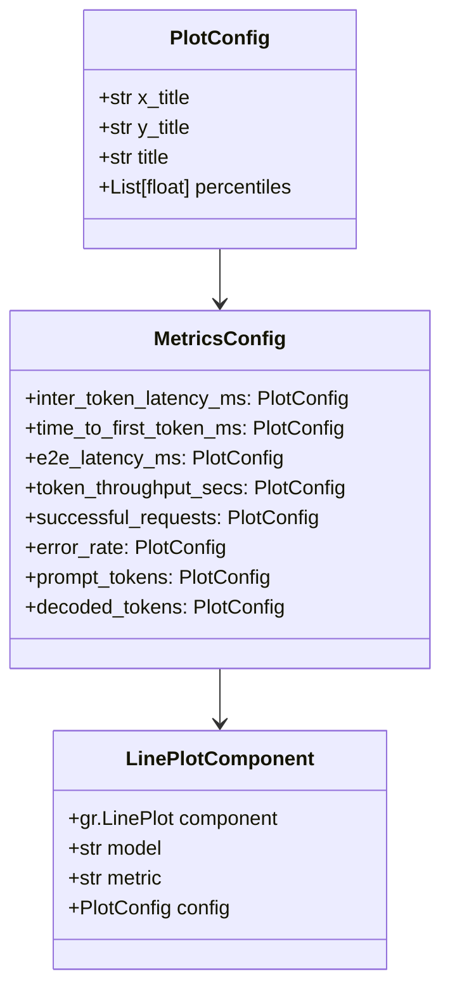
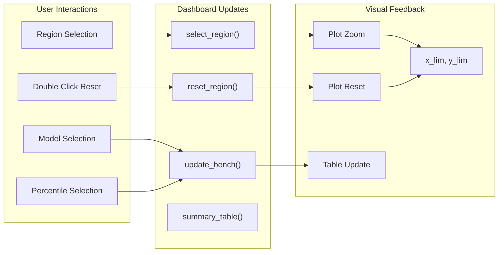

<!-- source: DeepWiki mcp.deepwiki.com · repo huggingface/inference-benchmarker · page 5 Results Analysis and Visualization · fetched 2026-10-26 -->

# Results Analysis and Visualization

Relevant source files

The following files were used as context for generating this wiki page:

- [extra/dashboard/app.py](extra/dashboard/app.py)
- [extra/dashboard/parse_results.py](extra/dashboard/parse_results.py)

This document covers the tools and processes for analyzing benchmark results generated by the inference-benchmarker system. The analysis and visualization components transform raw benchmark outputs into interactive dashboards and structured data formats for performance evaluation.

This document focuses on post-benchmark analysis tools. For information about how benchmark results are initially collected and processed during execution, see [Results Processing](#3.4). For details about the interactive web interface specifically, see [Interactive Dashboard](#5.1). For information about the data processing pipeline, see [Data Processing Pipeline](#5.2).

## Overview

The results analysis system consists of two main components that work together to process and visualize benchmark data:

- **Data Processing Pipeline**: Converts raw JSON benchmark results into structured Parquet format
- **Interactive Dashboard**: Provides a web-based interface for exploring performance metrics

**Data Flow from Benchmark Results to Visualizations**

Sources: [extra/dashboard/app.py:85-91](), [extra/dashboard/parse_results.py:38-49]()

## Data Processing Workflow

The data processing pipeline transforms raw benchmark JSON files into analysis-ready formats through several stages:

**Data Processing Pipeline Architecture**

The pipeline performs several key transformations:

| Processing Step | Function | Purpose |
|-----------------|----------|---------|
| Directory Scanning | `build_results_df()` | Discovers JSON files in results directories |
| JSON Parsing | `build_df()` | Extracts benchmark data from individual JSON files |
| Config Extraction | `pd.json_normalize()` | Flattens nested configuration metadata |
| Metric Calculation | `build_results()` | Computes derived metrics like error rates |
| Data Normalization | Column renaming | Standardizes column names for analysis |

### Key Derived Metrics

The processing pipeline calculates several derived metrics from raw benchmark data:

- **Error Rate**: `failed_requests / (failed_requests + successful_requests) * 100.0`
- **Prompt Tokens**: `total_tokens_sent / successful_requests`
- **Decoded Tokens**: `total_tokens / successful_requests`

Sources: [extra/dashboard/parse_results.py:52-59](), [extra/dashboard/parse_results.py:8-35]()

## Interactive Dashboard Architecture

The dashboard system built with Gradio provides real-time exploration of benchmark results through multiple visualization components:

**Dashboard Component Architecture**

### Plot Configuration System

The dashboard uses a structured configuration system for defining visualization parameters:

**Plot Configuration Class Relationships**

Sources: [extra/dashboard/app.py:12-18](), [extra/dashboard/app.py:125-140](), [extra/dashboard/app.py:175-184]()

## Available Metrics and Visualizations

The dashboard provides comprehensive visualization for key performance metrics:

### Core Performance Metrics

| Metric | Description | Visualization Type | Key Insight |
|--------|-------------|-------------------|-------------|
| `inter_token_latency_ms` | Time between token generations | Line plot with percentiles | User-perceived response speed |
| `time_to_first_token_ms` | Initial response latency | Line plot with percentiles | Waiting time before first output |
| `e2e_latency_ms` | Total request processing time | Line plot with percentiles | Overall system performance |
| `token_throughput_secs` | Tokens generated per second | Line plot | System capacity |
| `successful_requests` | Completed requests count | Line plot | System reliability |
| `error_rate` | Failed request percentage | Line plot | System stability |

### Percentile Analysis

The dashboard supports multiple percentile views for latency metrics:
- P50, P60, P70, P80, P90, P95, P99 percentiles
- Average (`avg`) aggregation
- Interactive percentile selection via `percentiles_bench` radio buttons

### Interactive Features

**Interactive Dashboard Feature Flow**

Sources: [extra/dashboard/app.py:59-67](), [extra/dashboard/app.py:93-104](), [extra/dashboard/app.py:187-195]()

## Data Formats and Integration

### Input Data Sources

The dashboard supports multiple data source types through the `load_datasource()` function:

- **File System**: `file://benchmarks.parquet`
- **S3 Storage**: `s3://bucket/path/benchmarks.parquet`
- **Direct Processing**: `--from-results-dir` for on-the-fly processing

### Data Schema

The processed benchmark data follows a standardized schema with the following key columns:

| Column Group | Columns | Source |
|--------------|---------|---------|
| Identifiers | `model`, `run_id`, `rate` | Configuration metadata |
| Latency Metrics | `inter_token_latency_ms_*`, `time_to_first_token_ms_*`, `e2e_latency_ms_*` | Raw benchmark results |
| Throughput | `token_throughput_secs` | Raw benchmark results |
| Request Counts | `successful_requests`, `failed_requests` | Raw benchmark results |
| Derived Metrics | `error_rate`, `prompt_tokens`, `decoded_tokens` | Calculated during processing |
| Execution Context | `executor_type`, `id` | Benchmark configuration |

### Data Filtering

The dashboard applies automatic filtering to focus on relevant benchmark data:

- Excludes warmup runs: `data['id'] != 'warmup'`
- Excludes throughput-only runs: `data['id'] != 'throughput'`
- Filters to constant rate executors: `data['executor_type'] == 'ConstantArrivalRate'`

Sources: [extra/dashboard/app.py:85-91](), [extra/dashboard/app.py:112-118](), [extra/dashboard/parse_results.py:52-59]()

---

