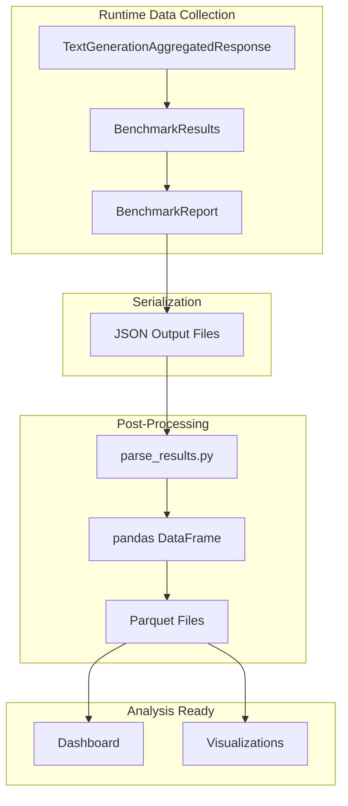
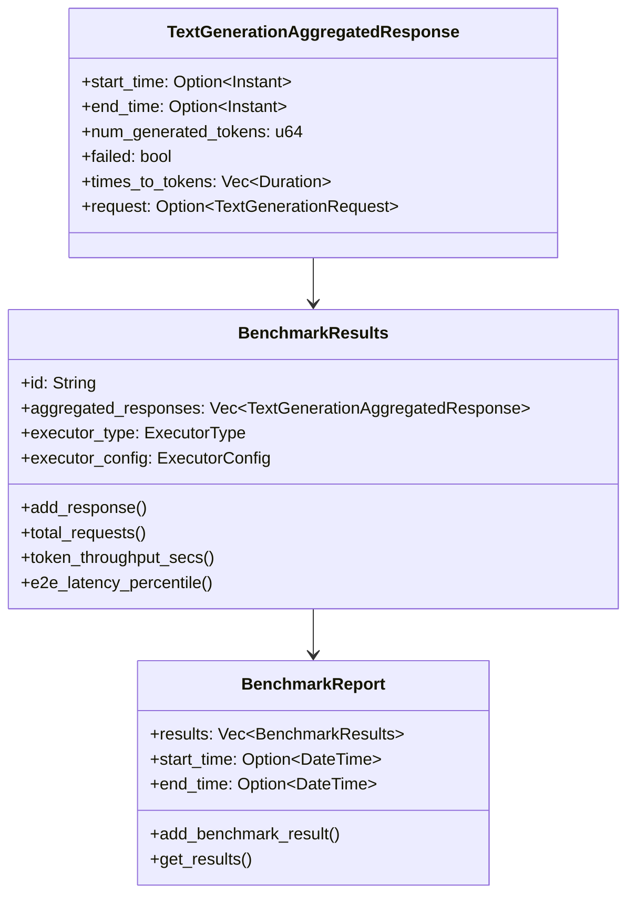
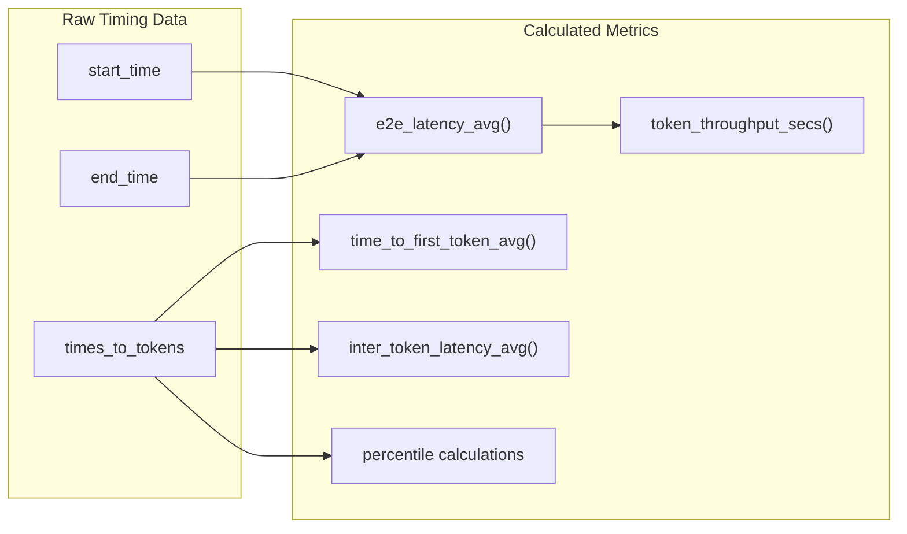
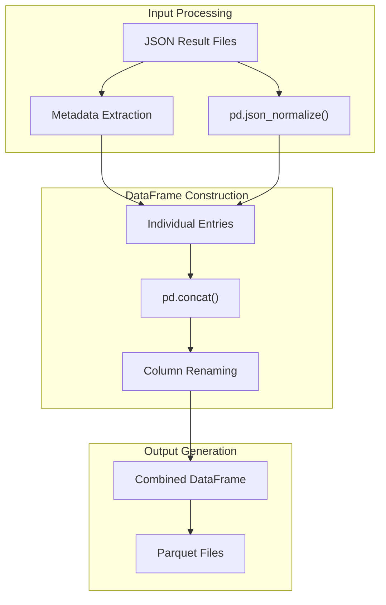
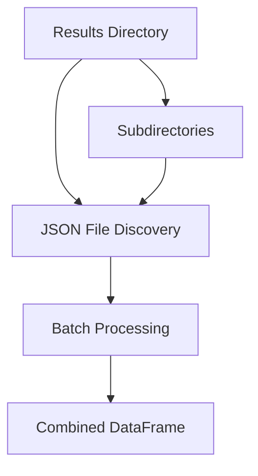

<!-- source: DeepWiki mcp.deepwiki.com · repo huggingface/inference-benchmarker · page 5.2 Data Processing Pipeline · fetched 2026-10-26 -->

# Data Processing Pipeline

<details>
<summary>Relevant source files</summary>

The following files were used as context for generating this wiki page:

- [extra/dashboard/parse_results.py](extra/dashboard/parse_results.py)
- [src/results.rs](src/results.rs)

</details>


## Purpose and Scope

The Data Processing Pipeline handles the transformation of raw benchmark execution data into analysis-ready formats for visualization and reporting. This document covers the end-to-end data flow from individual request responses through aggregated metrics calculation to final output formats.

For information about the interactive visualization of processed results, see [Interactive Dashboard](#5.1). For details about the benchmark execution that generates the raw data, see [Benchmark Execution System](#3.3).

## Pipeline Overview

The data processing pipeline operates in two main phases: real-time aggregation during benchmark execution (Rust) and post-processing for analysis (Python). Raw request/response data flows through several transformation stages to produce structured datasets suitable for analysis and visualization.



**Pipeline Data Flow and Code Entity Mapping**

Sources: [src/results.rs:1-446](), [extra/dashboard/parse_results.py:1-71]()

## Raw Data Collection and Aggregation

### Response Data Structure

Individual benchmark responses are captured in `TextGenerationAggregatedResponse` objects containing timing data, token counts, and error status. The `BenchmarkResults` class aggregates these responses and provides methods for metric calculation.



**Core Data Structures for Results Processing**

The `BenchmarkResults` struct serves as the primary aggregation unit, collecting individual response data and providing computed metrics access.

Sources: [src/results.rs:22-28](), [src/results.rs:312-317]()

### Metrics Calculation Engine

The `BenchmarkResults` class implements comprehensive metrics calculation covering throughput, latency, and success rates. Key metrics include:

| Metric Category | Methods | Purpose |
|-----------------|---------|---------|
| **Throughput** | `token_throughput_secs()`, `successful_request_rate()` | Rate-based performance measurement |
| **Latency** | `e2e_latency_avg()`, `time_to_first_token_avg()`, `inter_token_latency_avg()` | Response timing analysis |
| **Percentiles** | `e2e_latency_percentile()`, `time_to_first_token_percentile()` | Distribution analysis |
| **Token Analysis** | `total_tokens()`, `total_prompt_tokens()`, `prompt_tokens_avg()` | Token usage patterns |
| **Error Analysis** | `failed_requests()`, `successful_requests()` | Success/failure tracking |



**Metrics Calculation Data Flow**

The quantile calculation uses interpolation similar to `numpy.percentile` for consistent statistical analysis.

Sources: [src/results.rs:82-89](), [src/results.rs:141-155](), [src/results.rs:241-257]()

## Results Serialization and Output

### JSON Export Structure

`BenchmarkReport` objects are serialized to JSON format containing configuration metadata, execution results, and calculated metrics. The JSON structure preserves both raw response data and computed statistics for downstream processing.

The serialized format includes:
- **Configuration**: Executor type, benchmark parameters, model information
- **Results Array**: Individual `BenchmarkResults` with aggregated metrics
- **Metadata**: Execution timestamps, run identifiers, system information

Sources: [src/results.rs:312-351]()

## Post-Processing Pipeline

### JSON to DataFrame Conversion

The `parse_results.py` script processes benchmark JSON files into structured pandas DataFrames. The `build_df()` function normalizes nested JSON structures and extracts metadata for analysis.



**JSON to Parquet Processing Flow**

### Metadata Enhancement

The processing pipeline enriches benchmark data with additional metadata fields extracted from configuration:

| Metadata Field | Source | Purpose |
|----------------|---------|---------|
| `engine` | `config.meta.engine` | Inference engine identification |
| `tp` | `config.meta.tp` | Tensor parallelism configuration |
| `version` | `config.meta.version` | Software version tracking |
| `device` | `config.meta.device` | Hardware specification |
| `model` | `config.model_name` | Model identifier |
| `run_id` | `config.run_id` | Unique execution identifier |

The `build_df()` function processes these fields and normalizes column names for consistent analysis.

Sources: [extra/dashboard/parse_results.py:8-35]()

### Derived Metrics Calculation

Post-processing adds computed metrics for analysis:

```python
# Error rate calculation
df['error_rate'] = df['failed_requests'] / (df['failed_requests'] + df['successful_requests']) * 100.0

# Per-request token metrics  
df['prompt_tokens'] = df['total_tokens_sent'] / df['successful_requests']
df['decoded_tokens'] = df['total_tokens'] / df['successful_requests']
```

These derived metrics provide normalized values suitable for cross-benchmark comparison and visualization.

Sources: [extra/dashboard/parse_results.py:52-59]()

## Directory Processing and Batch Operations

### Multi-Directory Support

The `build_results_df()` function supports processing multiple result directories, enabling batch analysis of benchmark runs. It recursively processes directory structures and consolidates results into unified datasets.



**Multi-Directory Processing Architecture**

This approach enables comparative analysis across different benchmark configurations, model versions, and hardware setups within a single analytical workflow.

Sources: [extra/dashboard/parse_results.py:38-49]()

## Output Formats and Integration

### Parquet Format Benefits

The pipeline outputs data in Parquet format, providing:
- **Efficient Storage**: Columnar compression for large datasets
- **Schema Preservation**: Type information and metadata retention  
- **Analytics Integration**: Direct compatibility with visualization tools
- **Cross-Platform**: Accessible from multiple analysis environments

The processed Parquet files serve as the primary input for dashboard visualization and statistical analysis workflows.

Sources: [extra/dashboard/parse_results.py:59]()

---

