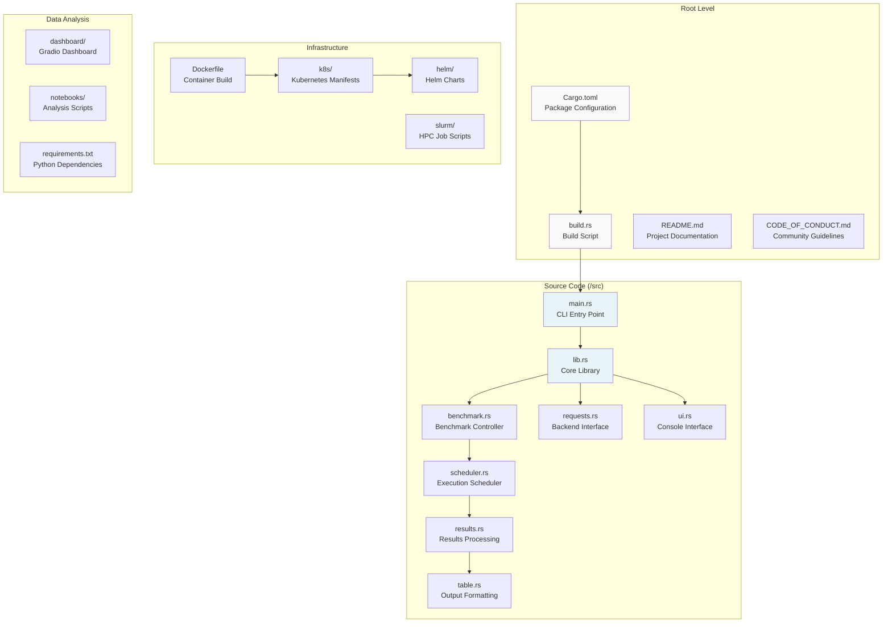
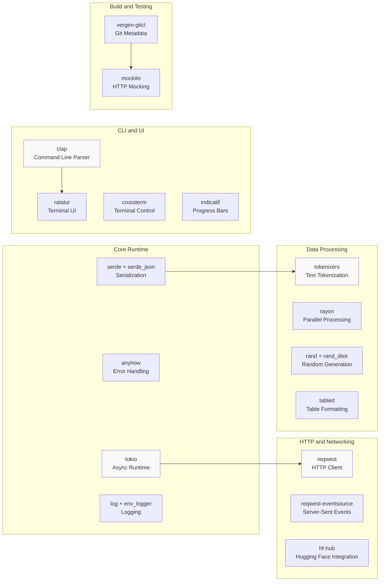

<!-- source: DeepWiki mcp.deepwiki.com · repo huggingface/inference-benchmarker · page 6 Development and Contributing · fetched 2026-10-26 -->

# Development and Contributing

<details>
<summary>Relevant source files</summary>

The following files were used as context for generating this wiki page:

- [CODE_OF_CONDUCT.md](CODE_OF_CONDUCT.md)
- [Cargo.toml](Cargo.toml)
- [build.rs](build.rs)

</details>


This page provides essential information for developers who want to contribute to the inference-benchmarker project. It covers development environment setup, project structure, build processes, and contribution workflows. For detailed information about the build system and dependencies, see [Build System and Dependencies](#6.1). For CI/CD pipeline details, see [CI/CD Pipeline](#6.2).

## Purpose and Scope

This documentation is intended for developers who want to:
- Set up a local development environment
- Understand the project structure and key components
- Contribute code, bug fixes, or improvements
- Understand the build and testing processes
- Follow proper contribution guidelines and workflows

## Development Environment Setup

The inference-benchmarker is primarily a Rust application with additional Python components for data analysis and visualization. Setting up the development environment requires both Rust and Python toolchains.

### Prerequisites

| Tool | Purpose | Required Version |
|------|---------|------------------|
| Rust | Core application development | Latest stable |
| Cargo | Rust package manager and build tool | Included with Rust |
| Git | Version control and build metadata | Any recent version |
| Python | Dashboard and analysis tools | 3.8+ |
| Docker | Containerized testing and deployment | Optional but recommended |

### Git Integration

The project uses git metadata for build versioning through the `vergen-gitcl` crate. The build script at [build.rs:1-31]() attempts to extract git SHA information during compilation, with fallback support for containerized builds via the `GIT_SHA` environment variable.

Sources: [build.rs:1-31]()

## Project Structure Overview

The following diagram shows the key development files and their relationships:

### Core Development Structure



Sources: [Cargo.toml:1-48](), [build.rs:1-31]()

## Rust Dependencies and Build System

The project uses Cargo as its primary build system. The main dependencies fall into several categories:

### Dependency Categories



Sources: [Cargo.toml:12-39]()

### Key Dependencies

| Category | Crate | Purpose | Version |
|----------|-------|---------|---------|
| Async Runtime | `tokio` | Asynchronous execution and networking | 1.40.0 |
| HTTP Client | `reqwest` | HTTP requests to LLM APIs | 0.12.7 |
| CLI Framework | `clap` | Command-line argument parsing | 4.5.17 |
| UI Framework | `ratatui` | Terminal user interface | 0.29.0 |
| Tokenization | `tokenizers` | Hugging Face tokenizers | 0.21.1 |
| Serialization | `serde` | JSON and data serialization | 1.0.209 |

## Development Workflow

### Building the Project

The standard Rust development commands apply:

```bash
# Build debug version
cargo build

# Build release version
cargo build --release

# Run with arguments
cargo run -- --help

# Run tests
cargo test

# Check code without building
cargo check
```

### Build Script Integration

The [build.rs:1-31]() script runs automatically during compilation to embed git version information. It attempts to:

1. Extract git SHA from the local repository using `GitclBuilder::all_git()`
2. Fall back to the `GIT_SHA` environment variable if git is unavailable
3. Set the `VERGEN_GIT_SHA` environment variable for use in the application

This is particularly important for containerized builds where git history may not be available.

### Code Organization

The main application binary is defined in [Cargo.toml:44-48]() with the following structure:

- **Binary name**: `inference-benchmarker`
- **Entry point**: [src/main.rs]()
- **Test exclusion**: Tests are disabled for the binary target
- **Benchmark exclusion**: Benchmarks are disabled for the binary target

## Community Guidelines

The project follows the Contributor Covenant Code of Conduct as specified in [CODE_OF_CONDUCT.md:1-129](). Key points include:

### Our Standards

- Demonstrating empathy and kindness toward other people
- Being respectful of differing opinions, viewpoints, and experiences
- Giving and gracefully accepting constructive feedback
- Focusing on what is best for the overall community

### Enforcement

Issues should be reported to `feedback@huggingface.co` as specified in [CODE_OF_CONDUCT.md:63](). The project maintainers will review and investigate all complaints promptly and fairly.

## Testing and Validation

The project includes several testing approaches:

### Unit Testing
Standard Rust unit tests using the built-in `cargo test` framework.

### Integration Testing
HTTP mocking capabilities are provided through the `mockito` crate for testing API interactions without requiring live services.

### Build Validation
The [build.rs:1-31]() script includes error handling to ensure builds succeed even when git metadata is unavailable.

## Contribution Process

1. **Fork the repository** on GitHub
2. **Create a feature branch** from the main branch
3. **Make your changes** following the coding standards
4. **Test your changes** using `cargo test` and manual testing
5. **Commit your changes** with clear, descriptive commit messages
6. **Push to your fork** and create a pull request
7. **Address review feedback** from maintainers

### Coding Standards

- Follow standard Rust formatting using `cargo fmt`
- Use `cargo clippy` to check for common issues
- Ensure all tests pass before submitting
- Add appropriate documentation for new features
- Follow the existing code structure and patterns

Sources: [Cargo.toml:1-48](), [build.rs:1-31](), [CODE_OF_CONDUCT.md:1-129]()

---

