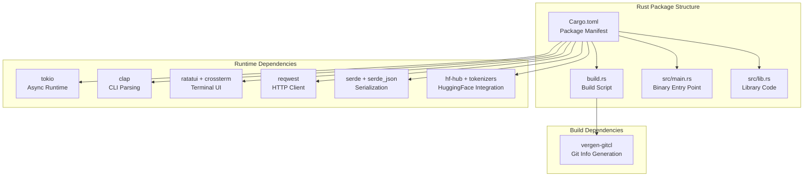
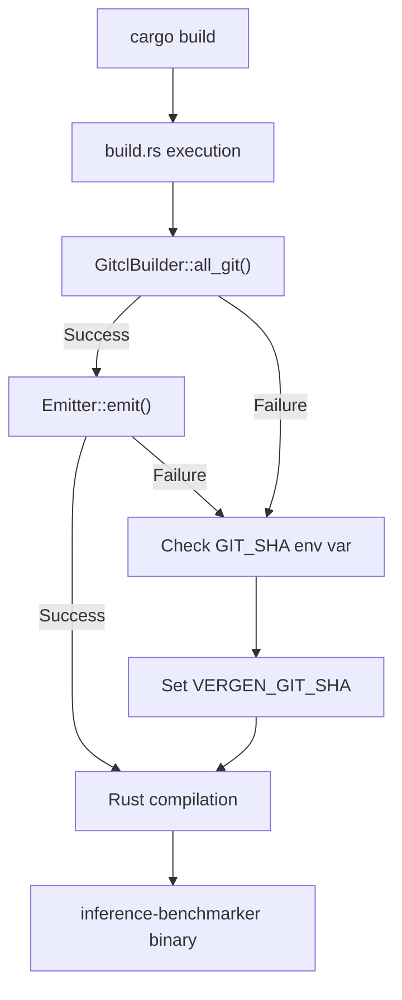
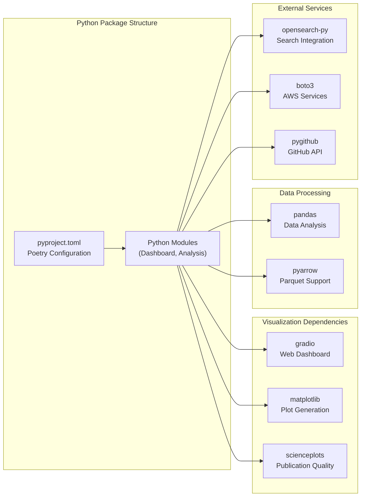
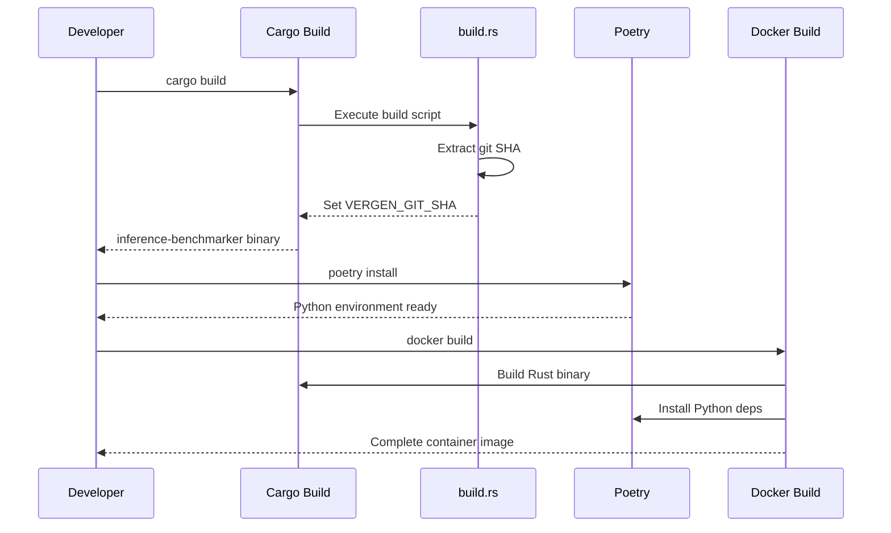

<!-- source: DeepWiki mcp.deepwiki.com · repo huggingface/inference-benchmarker · page 6.1 Build System and Dependencies · fetched 2026-10-26 -->

# Build System and Dependencies

Relevant source files

The following files were used as context for generating this wiki page:

- [Cargo.toml](Cargo.toml)
- [build.rs](build.rs)
- [poetry.lock](poetry.lock)
- [pyproject.toml](pyproject.toml)

This document covers the build systems, dependency management, and project structure for the inference-benchmarker codebase. It explains how the Rust and Python components are organized, built, and managed during development.

For information about the CI/CD pipeline and automated builds, see [CI/CD Pipeline](#6.2). For details about deployment configurations, see [Deployment Options](#4).

## Overview

The inference-benchmarker project uses a dual-language architecture with both Rust and Python components:

- **Rust**: Core benchmarking application with CLI interface
- **Python**: Analysis tools, dashboard, and data processing utilities

Each language component has its own build system and dependency management:

| Component | Build System | Package Manager | Configuration File |
|-----------|--------------|-----------------|-------------------|
| Rust Core | Cargo | Cargo | `Cargo.toml` |
| Python Tools | Poetry | Poetry | `pyproject.toml` |

## Rust Build System

### Package Configuration

The main Rust application is configured in [Cargo.toml:1-48]() as a binary package named `inference-benchmarker`:

**Build System Architecture**
Sources: [Cargo.toml:1-48](), [build.rs:1-30]()

### Key Dependencies

The Rust application uses several major dependency categories:

#### Core Runtime Dependencies
- `tokio` - Asynchronous runtime for concurrent request handling
- `anyhow` - Error handling throughout the application
- `serde` and `serde_json` - JSON serialization for API communication
- `clap` - Command-line argument parsing and configuration

#### Networking and LLM Integration  
- `reqwest` - HTTP client for API requests to LLM services
- `reqwest-eventsource` - Server-sent events for streaming responses
- `hf-hub` - Hugging Face Hub integration for model downloads
- `tokenizers` - Tokenization support for various LLM models

#### User Interface Components
- `ratatui` - Terminal-based user interface framework
- `crossterm` - Cross-platform terminal manipulation
- `indicatif` - Progress bars and spinners for CLI feedback
- `tabled` - Table formatting for results display

#### Performance and Utilities
- `rayon` - Data parallelism for processing
- `rand` and `rand_distr` - Random number generation for load patterns
- `chrono` - Date and time handling
- `uuid` - Unique identifier generation

Sources: [Cargo.toml:12-39]()

### Build Script Integration

The project uses a custom build script to inject git information at compile time:

**Build Script Process Flow**
Sources: [build.rs:4-30](), [Cargo.toml:41-42]()

The build script attempts to extract git commit information using `vergen-gitcl`, falling back to a `GIT_SHA` environment variable if git is unavailable.

## Python Build System

### Poetry Configuration

The Python components use Poetry for dependency management, configured in [pyproject.toml:1-24]():

**Python Dependency Architecture**
Sources: [pyproject.toml:8-19]()

### Python Dependencies by Function

| Category | Dependencies | Purpose |
|----------|-------------|---------|
| **Web Interface** | `gradio` | Interactive dashboard for result visualization |
| **Data Visualization** | `matplotlib`, `scienceplots` | Chart generation and publication-quality plots |
| **Data Processing** | `pandas`, `pyarrow` | DataFrame operations and Parquet file handling |
| **External APIs** | `opensearch-py`, `boto3`, `pygithub` | Integration with external services |
| **CLI Utilities** | `click` | Command-line interface for Python tools |

Sources: [pyproject.toml:10-18]()

## Build Process Integration

### Dual-Language Build Workflow

**Multi-Language Build Process**
Sources: [Cargo.toml:1-48](), [pyproject.toml:1-24](), [build.rs:1-30]()

### Development Environment Setup

For local development, both build systems must be configured:

1. **Rust Environment**:
   - Rust toolchain (specified in project)
   - Cargo for dependency management
   - Access to git repository for build script

2. **Python Environment**:
   - Python 3.11+ requirement
   - Poetry for dependency management  
   - Optional dependencies for specific features

3. **Integration Points**:
   - The Rust binary generates JSON output consumed by Python tools
   - Python dashboard reads benchmark results from Rust execution
   - Both components may be packaged together in container images

Sources: [pyproject.toml:9](), [Cargo.toml:4]()

## Binary Configuration

The main executable is configured as a binary target in [Cargo.toml:44-48]():

- **Name**: `inference-benchmarker`
- **Entry Point**: `src/main.rs`
- **Testing**: Disabled for the binary target
- **Benchmarking**: Disabled for the binary target

This configuration ensures the binary is built for production use rather than development testing, with the main CLI entry point clearly defined.

Sources: [Cargo.toml:44-48]()

---

