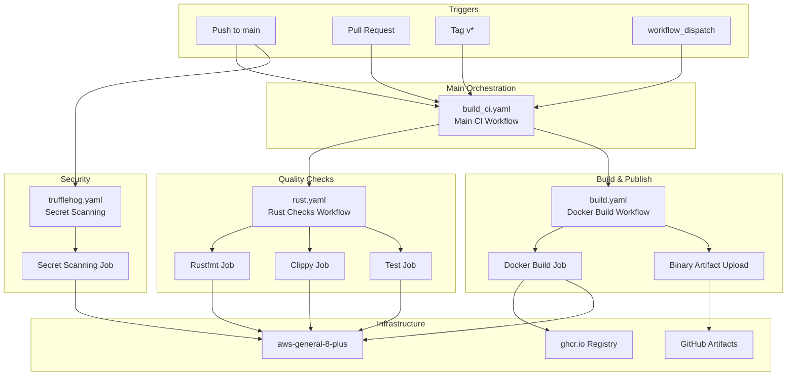
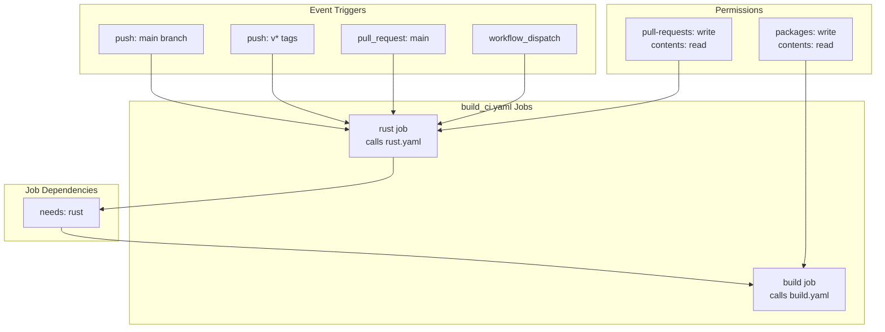
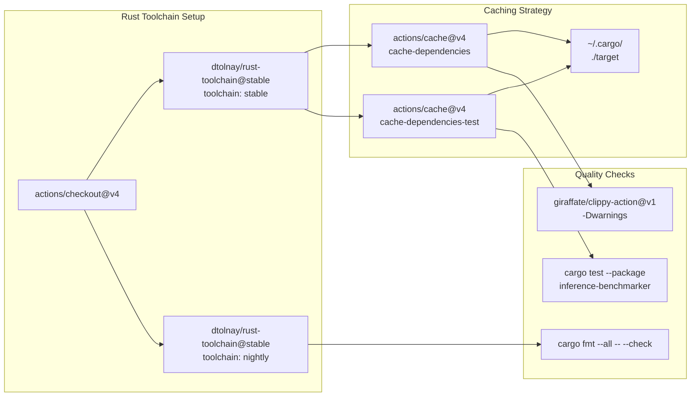
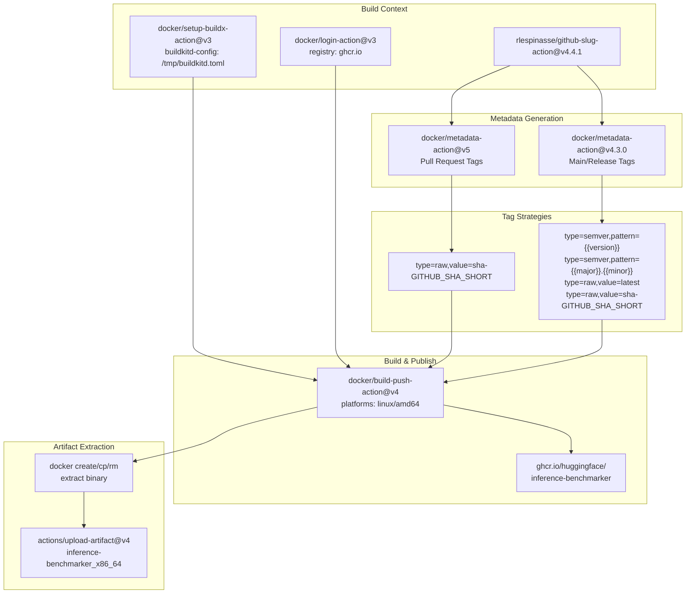
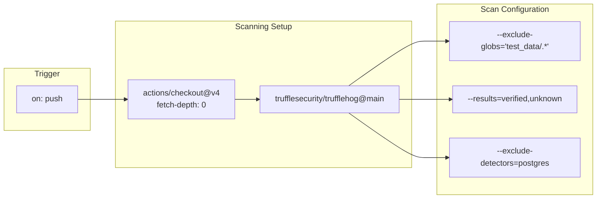

<!-- source: DeepWiki mcp.deepwiki.com · repo huggingface/inference-benchmarker · page 6.2 CI/CD Pipeline · fetched 2026-10-26 -->

# CI/CD Pipeline

<details>
<summary>Relevant source files</summary>

The following files were used as context for generating this wiki page:

- [.github/workflows/build.yaml](.github/workflows/build.yaml)
- [.github/workflows/build_ci.yaml](.github/workflows/build_ci.yaml)
- [.github/workflows/rust.yaml](.github/workflows/rust.yaml)
- [.github/workflows/trufflehog.yaml](.github/workflows/trufflehog.yaml)
- [src/profiles.rs](src/profiles.rs)

</details>


This document covers the automated testing, building, and deployment workflows for the inference-benchmarker system. The CI/CD pipeline ensures code quality, builds Docker images, performs security scanning, and prepares release artifacts through GitHub Actions workflows.

For information about the build system and local development setup, see [Build System and Dependencies](#6.1). For deployment methods using the built artifacts, see [Deployment Options](#4).

## Pipeline Overview

The CI/CD system uses GitHub Actions with multiple interconnected workflows that run on different triggers. The main orchestration happens through the `build_ci.yaml` workflow, which coordinates Rust quality checks and Docker image building.

### CI/CD Workflow Architecture



**Sources:** [.github/workflows/build_ci.yaml:1-32](), [.github/workflows/rust.yaml:1-79](), [.github/workflows/build.yaml:1-83](), [.github/workflows/trufflehog.yaml:1-19]()

## Main CI Workflow

The primary workflow orchestrates the entire CI/CD process through job dependencies and conditional execution based on event types.

### Workflow Orchestration



**Sources:** [.github/workflows/build_ci.yaml:15-32]()

## Rust Quality Checks

The `rust.yaml` workflow implements comprehensive code quality validation through three parallel jobs that run formatting, linting, and testing.

### Rust Workflow Jobs

| Job | Purpose | Key Actions | Cache Strategy |
|-----|---------|-------------|----------------|
| `fmt` | Code formatting validation | `cargo fmt --all -- --check` with nightly toolchain | No caching |
| `clippy` | Static analysis and linting | `clippy-action` with `-Dwarnings` | Cargo cache with dependency hash key |
| `test` | Unit test execution | `cargo test --package inference-benchmarker` | Separate test cache |

### Rust Pipeline Details



**Sources:** [.github/workflows/rust.yaml:11-79]()

## Docker Build and Registry

The `build.yaml` workflow handles Docker image creation, tagging, and publishing to GitHub Container Registry with conditional behavior based on event type.

### Docker Build Strategy



**Sources:** [.github/workflows/build.yaml:15-82]()

### Image Tagging Strategy

The workflow applies different tagging strategies based on the triggering event:

| Event Type | Tags Applied | Registry Behavior |
|------------|--------------|-------------------|
| Pull Request | `sha-{SHORT_SHA}` | Single SHA-based tag |
| Main Branch | `latest`, `sha-{SHORT_SHA}` | Latest tag + SHA tag |
| Semantic Version Tag | `{version}`, `{major}.{minor}`, `latest`, `sha-{SHORT_SHA}` | Full semver tagging |

**Sources:** [.github/workflows/build.yaml:32-55]()

## Security Scanning

The `trufflehog.yaml` workflow provides automated secret detection using TruffleHog to prevent credential leaks in the codebase.

### Secret Scanning Configuration



**Sources:** [.github/workflows/trufflehog.yaml:3-18]()

## Concurrency and Resource Management

All workflows implement concurrency controls and use dedicated AWS runner groups to manage resource allocation efficiently.

### Concurrency Strategy

| Workflow | Concurrency Group | Cancel Behavior |
|----------|-------------------|-----------------|
| `build_ci.yaml` | `${{ github.workflow }}-${{ github.ref }}` | `cancel-in-progress: true` |
| `build.yaml` | `${{ github.workflow }}-${{ github.ref }}-build` | `cancel-in-progress: true` |
| `rust.yaml` | No explicit concurrency group | Default behavior |
| `trufflehog.yaml` | No explicit concurrency group | Default behavior |

### Runner Configuration

All jobs use the `aws-general-8-plus` runner group, providing consistent execution environment across the pipeline.

**Sources:** [.github/workflows/build_ci.yaml:15-17](), [.github/workflows/build.yaml:5-7](), [.github/workflows/rust.yaml:13-14](), [.github/workflows/trufflehog.yaml:8-9]()

## Artifact Management

The pipeline generates two main types of artifacts for downstream consumption:

### Artifact Types

1. **Docker Images**: Published to `ghcr.io/huggingface/inference-benchmarker` with event-specific tags
2. **Binary Artifacts**: Extracted `inference-benchmarker` executable uploaded as `inference-benchmarker_x86_64`

### Binary Extraction Process

The workflow extracts the compiled binary from the Docker image for standalone distribution:

```bash
docker create --name extract ghcr.io/huggingface/inference-benchmarker:sha-{SHORT_SHA}
docker cp extract:/usr/local/bin/inference-benchmarker ./inference-benchmarker
docker rm -f extract
```

**Sources:** [.github/workflows/build.yaml:70-81]()

## Integration with Deployment Systems

The CI/CD pipeline outputs are consumed by various deployment methods documented in other sections:

- Docker images are used by [Docker Deployment](#4.1)
- Kubernetes deployments reference the registry images in [Kubernetes Deployment](#4.2)  
- HPC systems can use either Docker images or binary artifacts in [HPC and Slurm Deployment](#4.3)

The pipeline ensures that all deployment targets receive tested, properly tagged artifacts through the coordinated workflow execution.