# Page: Overview

# Overview

<details>
<summary>Relevant source files</summary>

The following files were used as context for generating this wiki page:

- [Cargo.toml](Cargo.toml)
- [README.md](README.md)
- [src/lib.rs](src/lib.rs)

</details>


## Purpose and Scope

This document provides a high-level introduction to the **inference-benchmarker** system, its purpose, and key capabilities. The inference-benchmarker is a comprehensive tool for evaluating the performance of Large Language Model (LLM) inference servers and text generation endpoints.

For detailed installation and usage instructions, see [Getting Started](#2). For in-depth technical details about the system architecture, see [Core Architecture](#3). For information about deployment environments, see [Deployment Options](#4).

## What is Inference Benchmarker

Inference Benchmarker is a high-performance benchmarking tool built in Rust that evaluates the real-world performance of text generation models and servers. It addresses the unique challenges of benchmarking LLM inference, where performance varies significantly based on input prompts, decoding strategies, hardware specifications, and server configurations.

The system can benchmark any text generation server that exposes an OpenAI-compliant chat API, including TGI (Text Generation Inference), vLLM, and other compatible services.

**Sources:** [README.md:1-15](), [Cargo.toml:1-9]()

## Key Capabilities

The inference-benchmarker provides several core capabilities:

| Capability | Description |
|------------|-------------|
| **Broad Compatibility** | Benchmarks any OpenAI-compliant chat API endpoint |
| **Automatic Sweep Mode** | Detects maximum throughput and sweeps QPS values up to that limit |
| **Open-Loop Benchmarking** | Uses constant arrival rates to simulate real-world workloads |
| **Benchmark Profiles** | Presets for different use cases (chat, code generation, classification, fixed-length) |
| **High Performance** | Built with Rust for concurrent, high-throughput benchmarking |
| **Structured Output** | Delivers results in JSON format for analysis and visualization |

The system supports three benchmark modes through the `BenchmarkKind` enum:
- `sweep`: Runs a comprehensive throughput sweep
- `rate`: Benchmarks at fixed request rates  
- `throughput`: Tests at fixed virtual user counts

**Sources:** [README.md:16-24](), [src/lib.rs:99-104]()

## System Architecture

The following diagram shows the main architectural components and their relationships:

### Core Component Architecture

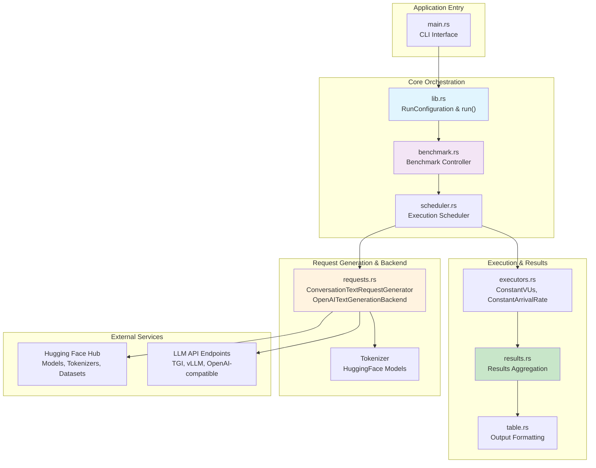

**Sources:** [src/lib.rs:23-33](), [src/lib.rs:35-55]()

## Execution Flow

The benchmark execution follows a structured pipeline from configuration to results:

### Benchmark Execution Pipeline

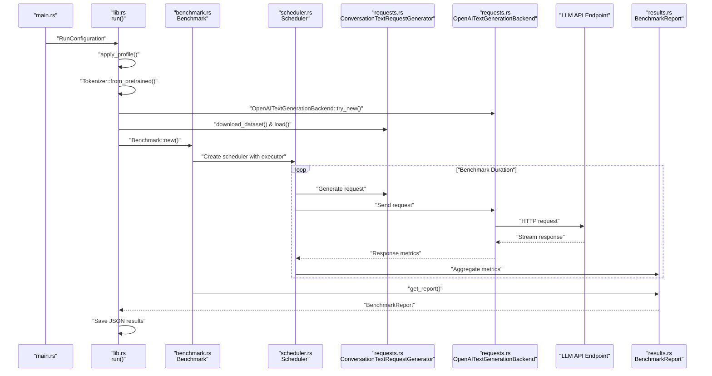

**Sources:** [src/lib.rs:57-232]()

## Configuration and Profiles

The system uses the `RunConfiguration` struct to define benchmark parameters and supports predefined profiles for common use cases:

### RunConfiguration Structure
The `RunConfiguration` contains key parameters including:
- `url`: Target API endpoint
- `tokenizer_name`: HuggingFace tokenizer identifier
- `profile`: Optional benchmark profile name
- `benchmark_kind`: Execution mode (sweep/rate/throughput)
- `dataset` and `dataset_file`: Data source configuration
- `prompt_options` and `decode_options`: Token generation parameters

### Available Profiles
- **`chat`**: Multi-turn conversation scenarios with conversation history
- **`code-generation`**: Code completion with large context and short outputs  
- **`classification`**: Document analysis with repeated large inputs
- **`fixed-length`**: Technical benchmark with consistent prompt lengths

**Sources:** [src/lib.rs:35-55](), [README.md:104-121]()

## Deployment Options

The inference-benchmarker supports multiple deployment environments:

| Deployment Type | Use Case | Configuration |
|----------------|----------|---------------|
| **Local Binary** | Development and small-scale testing | Direct cargo installation |
| **Docker Container** | Consistent execution environment | Pre-built images with all dependencies |
| **Kubernetes** | Scalable cloud deployment | Helm charts for cluster orchestration |
| **HPC/Slurm** | Large-scale research benchmarks | Batch job scheduling for resource management |

For detailed deployment instructions, see [Deployment Options](#4).

**Sources:** [README.md:52-221]()

## Results and Analysis

The system generates comprehensive benchmark results in multiple formats:

- **JSON Output**: Structured results saved with timestamp and model information via `BenchmarkReportWriter`
- **Console Output**: Real-time progress and summary statistics  
- **Interactive Dashboard**: Gradio web interface for result visualization and analysis

Results include performance metrics such as throughput, latency percentiles, error rates, and token generation statistics.

For details on result analysis and visualization tools, see [Results Analysis and Visualization](#5).

**Sources:** [src/lib.rs:192-230](), [README.md:222-233]()

---

# Page: Getting Started

# Getting Started

<details>
<summary>Relevant source files</summary>

The following files were used as context for generating this wiki page:

- [Dockerfile](Dockerfile)
- [Makefile](Makefile)
- [README.md](README.md)
- [src/main.rs](src/main.rs)

</details>


This document provides installation instructions, basic usage examples, and a quick start guide for the inference-benchmarker system. It covers how to install the tool, set up a target inference server, run your first benchmark, and understand the basic configuration options.

For detailed information about the core architecture and internal components, see [Core Architecture](#3). For advanced deployment scenarios on Kubernetes or HPC clusters, see [Deployment Options](#4). For analyzing and visualizing results, see [Results Analysis and Visualization](#5).

## Installation

The inference-benchmarker can be installed through several methods:

### Cargo Installation

If you have [Rust and Cargo](https://rustup.rs/) installed:

```bash
cargo install --git https://github.com/huggingface/inference-benchmarker/
```

### Binary Download

Download the latest released binary from the [GitHub releases page](https://github.com/huggingface/inference-benchmarker/releases/latest).

### Docker Image

The tool is available as a Docker image and can be run without local installation:

```bash
docker run --rm ghcr.io/huggingface/inference-benchmarker:latest --help
```

Sources: [README.md:52-62](), [Dockerfile:1-14]()

## Prerequisites: Starting an Inference Server

Before benchmarking, you need a running inference server that exposes an OpenAI-compatible chat API. Here are examples for popular inference engines:

### Text Generation Inference (TGI)

```bash
MODEL=meta-llama/Llama-3.1-8B-Instruct
HF_TOKEN=<your HF READ token>

docker run --gpus all --shm-size 1g -p 8080:80 -e "HF_TOKEN=$HF_TOKEN" \
    ghcr.io/huggingface/text-generation-inference:3.2.1 --model-id $MODEL
```

### vLLM

```bash
MODEL=meta-llama/Llama-3.1-8B-Instruct
HF_TOKEN=<your HF READ token>

docker run --runtime nvidia --gpus all \
    --env "HUGGING_FACE_HUB_TOKEN=$HF_TOKEN" \
    -p 8080:8000 \
    --ipc=host \
    vllm/vllm-openai:latest \
    --model $MODEL
```

Sources: [README.md:65-88]()

## Running Your First Benchmark

### Basic Command Structure

The CLI entry point is defined in the `Args` struct and processes all configuration through the `main()` function:

```bash
inference-benchmarker \
    --tokenizer-name "meta-llama/Llama-3.1-8B-Instruct" \
    --url http://localhost:8080 \
    --profile chat
```

This command demonstrates the minimal required arguments:
- `tokenizer_name`: Specifies the tokenizer for prompt processing
- `url`: Target inference server endpoint  
- `profile`: Benchmark profile defining the use case

Sources: [README.md:91-100](), [src/main.rs:14-16](), [src/main.rs:46-48](), [src/main.rs:36-38]()

### CLI Argument Flow

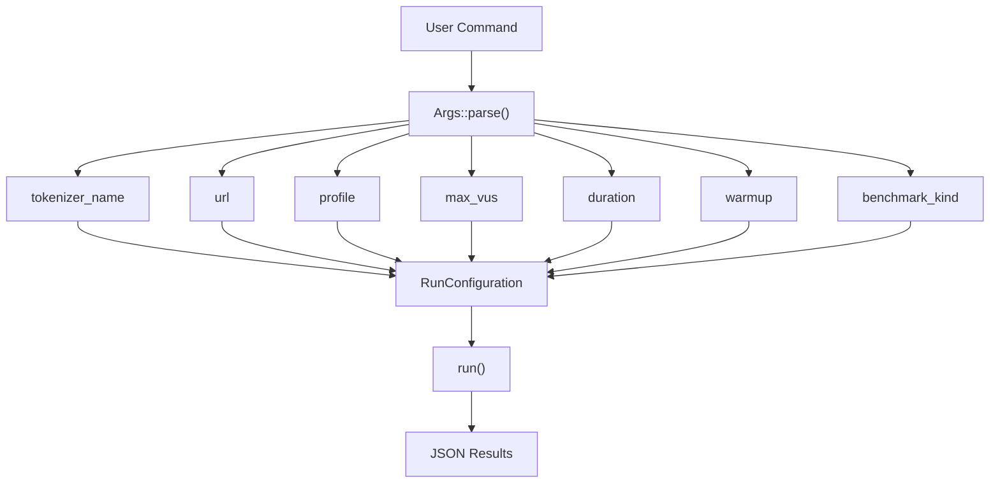

Sources: [src/main.rs:10-116](), [src/main.rs:209-229]()

### Execution Flow from CLI to Results

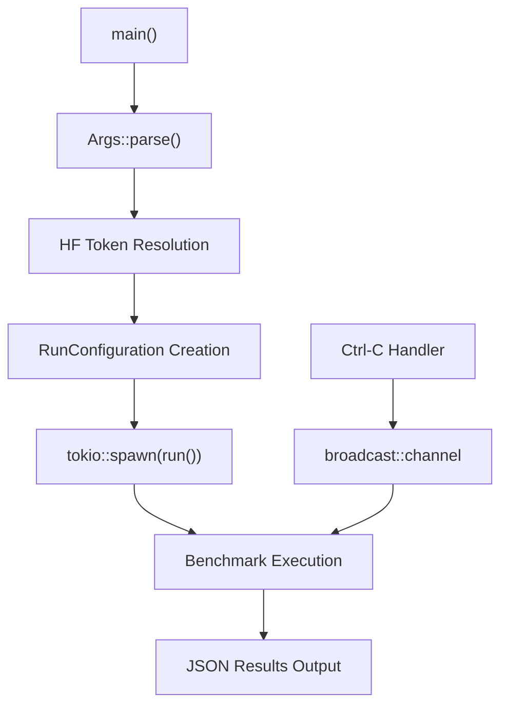

Sources: [src/main.rs:171-240](), [src/main.rs:181-192](), [src/main.rs:230-238]()

## Key Configuration Options

### Benchmark Profiles

The `profile` argument selects predefined configurations optimized for specific use cases:

| Profile | Use Case | Description |
|---------|----------|-------------|
| `chat` | Multi-turn conversations | Simulates chat scenarios with conversation history |
| `code-generation` | Code completion | Large code snippets with short completions |
| `classification` | Document analysis | Large input documents with simple questions |
| `fixed-length` | Technical benchmarking | Fixed-length prompts to avoid tokenization variance |

### Benchmark Modes

The `benchmark_kind` parameter controls the execution strategy:

| Mode | Description | Use Case |
|------|-------------|----------|
| `sweep` | Automatic throughput detection and sweep | Default mode for comprehensive analysis |
| `rate` | Fixed request rates | Testing specific QPS values |
| `throughput` | Fixed virtual user count | Constant load testing |

### Token Configuration

Both prompt and decode token counts can be controlled with normal distribution sampling:

```bash
--prompt-options "num_tokens=200,max_tokens=220,min_tokens=180,variance=10"
--decode-options "num_tokens=50,max_tokens=60,min_tokens=40,variance=10"
```

The `parse_tokenizer_options()` function processes these comma-separated key-value pairs into `TokenizeOptions` structs.

Sources: [README.md:104-121](), [README.md:122-132](), [README.md:192-207](), [src/main.rs:140-169]()

## Advanced Configuration Example

Here's a complete example showing manual configuration instead of using profiles:

```bash
inference-benchmarker \
    --tokenizer-name "meta-llama/Llama-3.1-8B-Instruct" \
    --max-vus 800 \
    --duration 120s \
    --url http://localhost:8080 \
    --warmup 30s \
    --benchmark-kind rate \
    --rates 1.0 \
    --rates 5.0 \
    --rates 10.0 \
    --prompt-options "num_tokens=200,max_tokens=220,min_tokens=180,variance=10" \
    --decode-options "num_tokens=200,max_tokens=220,min_tokens=180,variance=10"
```

This demonstrates the argument groups system where `group_manual` conflicts with `group_profile`, requiring either profile-based or manual configuration.

Sources: [README.md:133-148](), [src/main.rs:11-12](), [src/main.rs:22-89]()

## Understanding the Output

The benchmarker generates structured JSON results containing performance metrics. Results are saved in the current directory by default and include:

- Throughput measurements
- Latency percentiles  
- Error rates
- Token generation statistics

The `run_id` parameter (auto-generated if not provided) helps identify specific benchmark runs in the results.

Sources: [README.md:100](), [src/main.rs:206-208](), [src/main.rs:114-115]()

## Next Steps

After successfully running your first benchmark:

1. **Explore Advanced Features**: Learn about the core architecture and execution system in [Core Architecture](#3)
2. **Scale Up**: Deploy on Kubernetes or HPC clusters using [Deployment Options](#4)  
3. **Analyze Results**: Use the interactive dashboard and analysis tools covered in [Results Analysis and Visualization](#5)
4. **Contribute**: Set up the development environment as described in [Development and Contributing](#6)

The inference-benchmarker provides a comprehensive foundation for evaluating LLM inference performance across different scenarios and deployment environments.

---

# Page: Core Architecture

# Core Architecture

<details>
<summary>Relevant source files</summary>

The following files were used as context for generating this wiki page:

- [src/benchmark.rs](src/benchmark.rs)
- [src/lib.rs](src/lib.rs)
- [src/scheduler.rs](src/scheduler.rs)

</details>


This document covers the internal design and implementation of the inference-benchmarker's core Rust components. It details the main architectural patterns, key data structures, and execution flow that orchestrate LLM inference benchmarking operations.

For information about command-line usage and configuration options, see [CLI Interface](#3.1). For details about deployment methods, see [Deployment Options](#4).

## Architectural Overview

The inference-benchmarker follows a modular, event-driven architecture built around three primary orchestration layers: the main coordinator in `lib.rs`, the benchmark controller in `benchmark.rs`, and the execution scheduler in `scheduler.rs`.

### Core Component Hierarchy

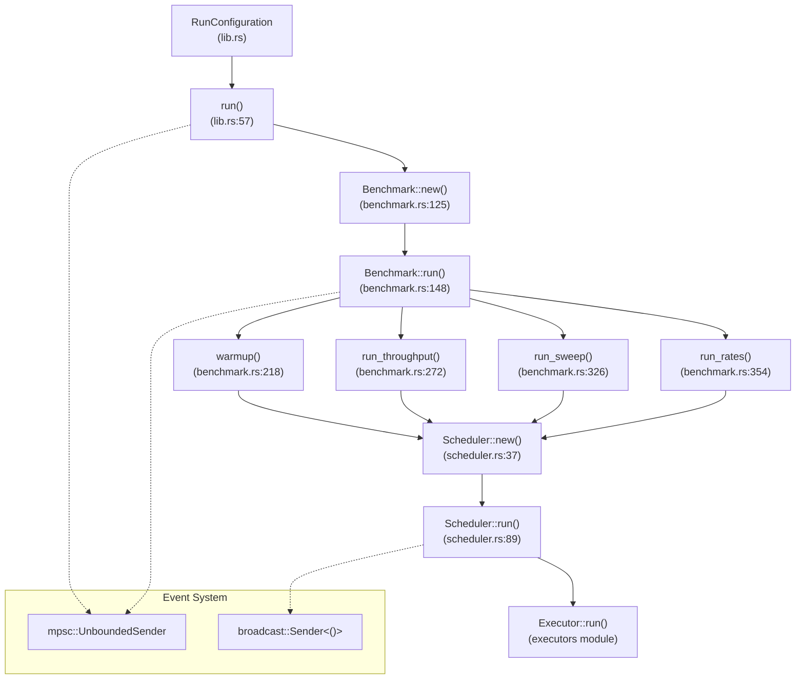

**Sources:** [src/lib.rs:57-232](), [src/benchmark.rs:125-414](), [src/scheduler.rs:37-152]()

## Core Data Structures and Configuration

The system's behavior is controlled through several key configuration structures that flow through the execution pipeline.

### Primary Configuration Types

| Structure | Location | Purpose |
|-----------|----------|---------|
| `RunConfiguration` | [src/lib.rs:35-55]() | Top-level execution parameters from CLI |
| `BenchmarkConfig` | [src/benchmark.rs:60-79]() | Validated benchmark execution settings |
| `ExecutorConfig` | Referenced in scheduler | Low-level executor parameters |

### Configuration Flow and Transformation

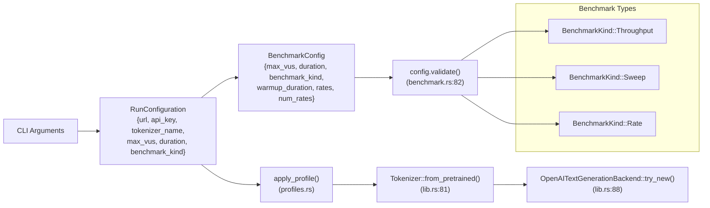

**Sources:** [src/lib.rs:35-116](), [src/benchmark.rs:60-117]()

## Event-Driven Communication System

The architecture uses an event bus pattern to coordinate between components and provide real-time progress updates.

### Event Types and Flow

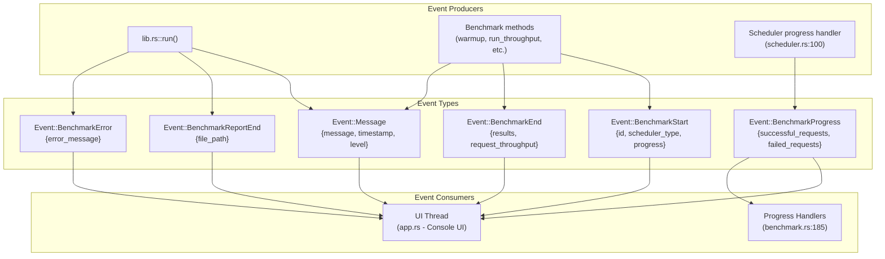

**Sources:** [src/benchmark.rs:22-45](), [src/benchmark.rs:185-216](), [src/lib.rs:117-156]()

## Execution Flow Architecture

The system orchestrates benchmark execution through a hierarchical delegation pattern where each layer has specific responsibilities.

### Main Execution Pipeline

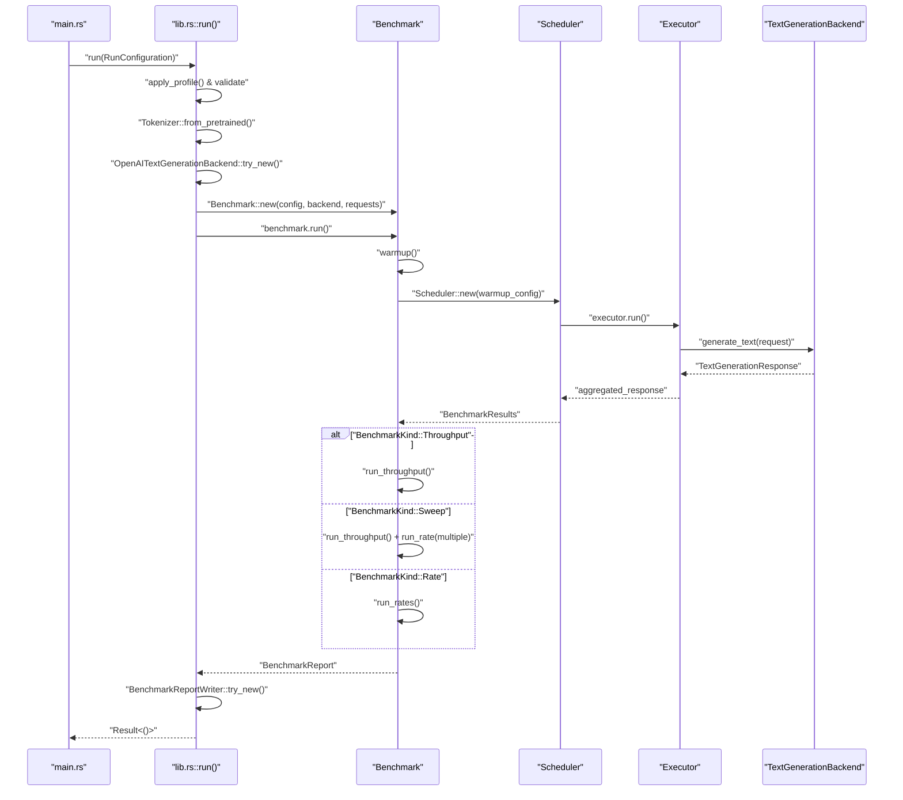

**Sources:** [src/lib.rs:57-232](), [src/benchmark.rs:148-176](), [src/scheduler.rs:89-147]()

## Scheduler and Executor Architecture

The scheduler acts as an intermediary between high-level benchmark configuration and low-level execution strategies.

### Executor Type Mapping

| Benchmark Type | Executor Type | Configuration | Purpose |
|----------------|---------------|---------------|---------|
| Warmup | `ExecutorType::ConstantVUs` | `max_vus: 1` | Server prewarming |
| Throughput | `ExecutorType::ConstantVUs` | `max_vus: config.max_vus` | Maximum capacity testing |
| Rate/Sweep | `ExecutorType::ConstantArrivalRate` | `rate: specified_rate` | Controlled load testing |

### Scheduler Component Relationships

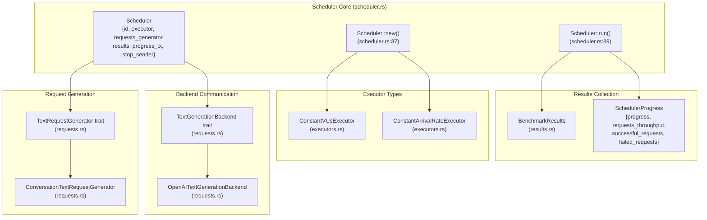

**Sources:** [src/scheduler.rs:20-87](), [src/scheduler.rs:89-152]()

## Result Processing and Aggregation Flow

The system collects and processes benchmark results through a structured pipeline that handles real-time aggregation and final report generation.

### Results Processing Architecture

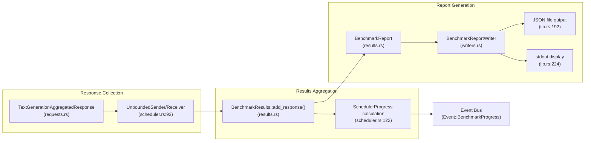

**Sources:** [src/scheduler.rs:92-131](), [src/lib.rs:188-230](), [src/benchmark.rs:254-268]()

The core architecture demonstrates a clean separation of concerns with well-defined interfaces between components, enabling flexible benchmark execution strategies while maintaining comprehensive result collection and real-time progress monitoring.

---

# Page: CLI Interface

# CLI Interface

<details>
<summary>Relevant source files</summary>

The following files were used as context for generating this wiki page:

- [.github/workflows/build_ci.yaml](.github/workflows/build_ci.yaml)
- [.github/workflows/rust.yaml](.github/workflows/rust.yaml)
- [src/main.rs](src/main.rs)
- [src/profiles.rs](src/profiles.rs)

</details>


This document covers the command-line interface implementation of the inference-benchmarker system, including argument parsing, configuration options, validation logic, and the transformation of CLI inputs into internal configuration structures. For information about the core execution flow and orchestration, see [Core Architecture](#3). For deployment-specific CLI usage examples, see [Deployment Options](#4).

## Command Line Arguments Overview

The CLI interface is implemented through the `Args` struct in [src/main.rs:10-116](), which uses the `clap` crate for argument parsing. The interface supports both manual configuration through individual arguments and predefined benchmark profiles.

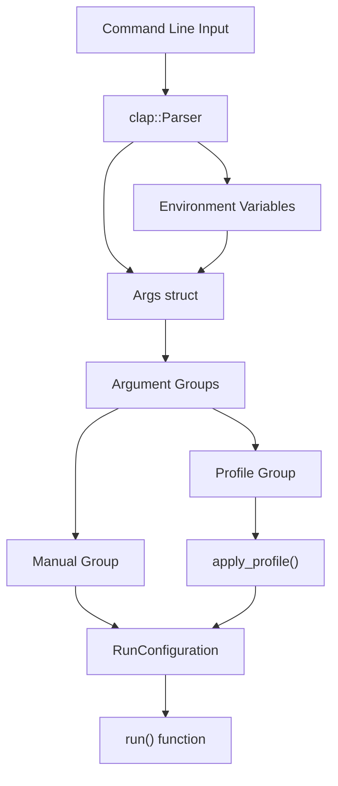

**CLI Argument Flow from Input to Configuration**

*Sources: [src/main.rs:10-116](), [src/main.rs:172-240]()*

## Argument Groups and Validation

The CLI implements two mutually exclusive argument groups using clap's `ArgGroup` feature:

| Group | Purpose | Key Arguments |
|-------|---------|---------------|
| `group_profile` | Predefined benchmark configurations | `--profile` |
| `group_manual` | Manual configuration of all parameters | `--max-vus`, `--duration`, `--benchmark-kind`, etc. |

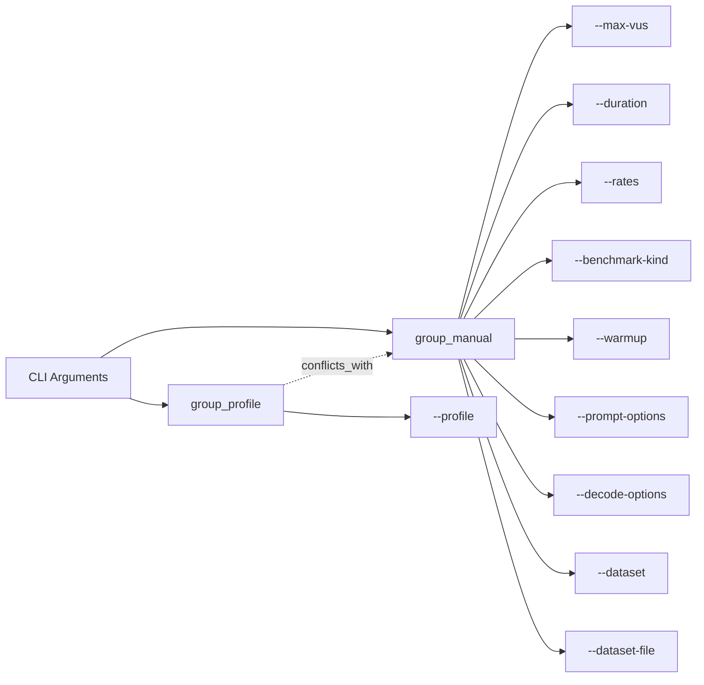

**Argument Group Relationships and Conflicts**

*Sources: [src/main.rs:11-12](), [src/profiles.rs:4-115]()*

## Core Configuration Options

### Required Arguments

| Argument | Type | Description | Environment Variable |
|----------|------|-------------|---------------------|
| `--tokenizer-name` | `String` | HuggingFace tokenizer identifier | `TOKENIZER_NAME` |

### Server Connection

| Argument | Type | Default | Description |
|----------|------|---------|-------------|
| `--url` | `Url` | `http://localhost:8000` | Backend server URL (OpenAI-compatible) |
| `--api-key` | `String` | `""` | Authorization header value |
| `--model-name` | `Option<String>` | Same as tokenizer | Model name for requests |

### Benchmark Configuration

| Argument | Type | Default | Description |
|----------|------|---------|-------------|
| `--max-vus` | `u64` | `128` | Maximum virtual users |
| `--duration` | `Duration` | `120s` | Benchmark step duration |
| `--warmup` | `Duration` | `30s` | Warmup phase duration |
| `--benchmark-kind` | `String` | `sweep` | Benchmark type (throughput, sweep, optimum) |
| `--rates` | `Option<Vec<f64>>` | None | Request rates for ConstantArrivalRate |
| `--num-rates` | `u64` | `10` | Number of rates for sweep benchmark |

*Sources: [src/main.rs:14-48](), [src/main.rs:22-45]()*

## Token and Dataset Configuration

### Tokenization Options

Both `--prompt-options` and `--decode-options` accept comma-separated key-value pairs:

```
--prompt-options "num_tokens=200,max_tokens=210,min_tokens=190,variance=10"
--decode-options "num_tokens=800,max_tokens=850,min_tokens=50,variance=100"
```

| Option | Description |
|--------|-------------|
| `num_tokens` | Target number of tokens |
| `min_tokens` | Minimum token count |
| `max_tokens` | Maximum token count |
| `variance` | Variance in token distribution |

### Dataset Configuration

| Argument | Default | Description |
|----------|---------|-------------|
| `--dataset` | `hlarcher/inference-benchmarker` | HuggingFace dataset repository |
| `--dataset-file` | `share_gpt_filtered_small.json` | Dataset file within repository |

*Sources: [src/main.rs:57-106](), [src/main.rs:140-169]()*

## Environment Variable Support

All CLI arguments support environment variable configuration using the same name in uppercase:

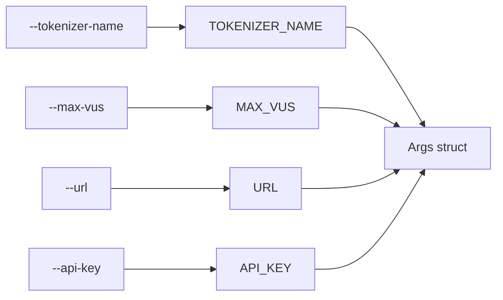

**Environment Variable to CLI Argument Mapping**

Special environment variables:
- `HF_TOKEN`: HuggingFace authentication token (handled separately in [src/main.rs:196-201]())

*Sources: [src/main.rs:15-115](), [src/main.rs:196-201]()*

## Argument Parsing Pipeline

The CLI parsing pipeline involves several custom parsing functions for complex argument types:

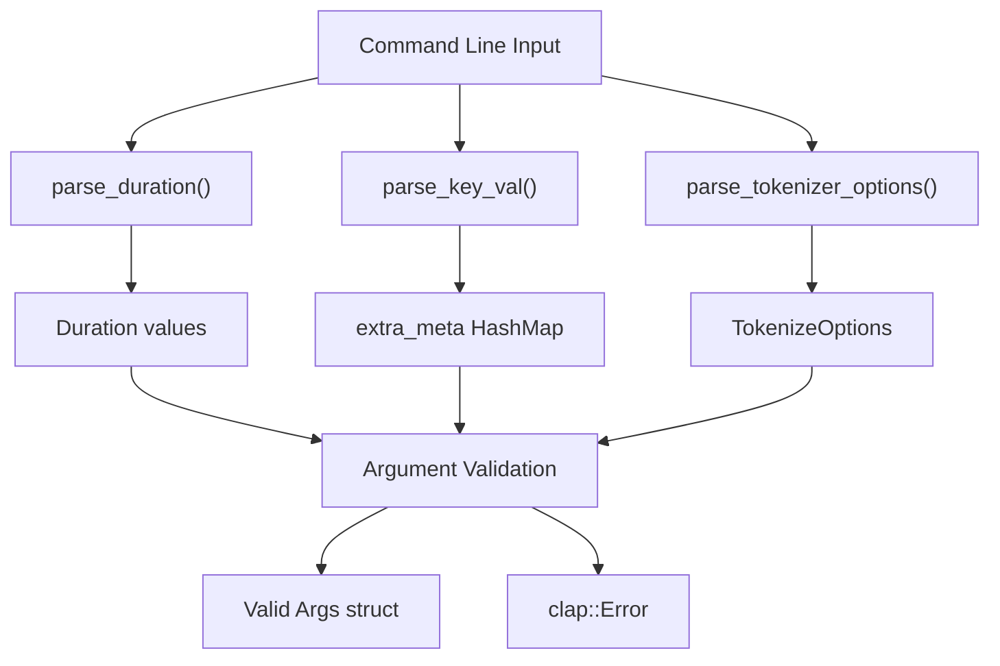

**Argument Parsing and Validation Pipeline**

### Custom Parsing Functions

#### `parse_duration()`
Converts human-readable duration strings using the `humantime` crate:
- Input: `"120s"`, `"2m"`, `"1h30m"`
- Output: `std::time::Duration`

#### `parse_key_val()`
Parses comma-separated key-value pairs for metadata:
- Input: `"key1=value1,key2=value2"`
- Output: `HashMap<String, String>`

#### `parse_tokenizer_options()`
Parses tokenization configuration with validation:
- Validates token count constraints (`min_tokens <= max_tokens`)
- Ensures non-zero values when `num_tokens` is specified
- Returns `clap::Error` for invalid configurations

*Sources: [src/main.rs:118-169]()*

## Configuration Transformation

The parsed `Args` struct is transformed into a `RunConfiguration` in the main function:

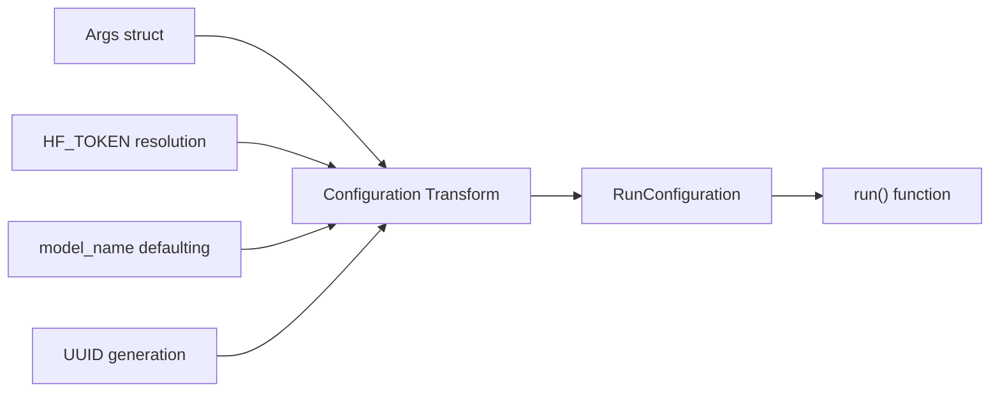

**Args to RunConfiguration Transformation**

Key transformations include:
- `model_name` defaults to `tokenizer_name` if not provided
- `run_id` generates a UUID if not specified
- HuggingFace token resolution from environment or cache
- Stop signal channel creation for graceful shutdown

*Sources: [src/main.rs:202-229]()*

## Error Handling and Validation

The CLI implements several validation layers:

### Clap-level Validation
- Argument type checking (URL, duration parsing)
- Required argument enforcement
- Argument group conflict detection

### Custom Validation
- TokenizeOptions constraints in `parse_tokenizer_options()`
- Key-value pair format validation in `parse_key_val()`
- Duration format validation in `parse_duration()`

### Runtime Error Handling
```rust
// Signal handling for graceful shutdown
tokio::spawn(async move {
    tokio::signal::ctrl_c().await.expect("Failed to listen for ctrl-c");
    stop_sender_clone.send(()).expect("Failed to send stop signal");
});
```

*Sources: [src/main.rs:118-169](), [src/main.rs:182-192](), [src/main.rs:230-240]()*

---

# Page: Request Generation and Backend Interface

# Request Generation and Backend Interface

<details>
<summary>Relevant source files</summary>

The following files were used as context for generating this wiki page:

- [src/requests.rs](src/requests.rs)

</details>


This document covers the request generation system and backend abstraction layer that enables the benchmarker to communicate with various LLM serving platforms. This includes the core data structures for requests and responses, the pluggable backend interface for different API protocols, and the sophisticated request generation system that supports both simple and multi-turn conversational workloads.

For information about how these requests are scheduled and executed during benchmarks, see [Benchmark Execution System](#3.3). For details on how responses are processed and aggregated into benchmark results, see [Results Processing](#3.4).

## Core Request and Response Data Structures

The system centers around two primary data structures that represent the lifecycle of a text generation request.

### TextGenerationRequest

The `TextGenerationRequest` struct encapsulates all information needed to make a single text generation API call:

| Field | Type | Purpose |
|-------|------|---------|
| `id` | `Option<Uuid>` | Links multi-turn conversation requests |
| `prompt` | `String` | Input text to be processed |
| `num_prompt_tokens` | `u64` | Pre-computed token count for prompt |
| `num_decode_tokens` | `Option<u64>` | Maximum tokens to generate |

### TextGenerationAggregatedResponse

The `TextGenerationAggregatedResponse` tracks timing metrics and status throughout the request lifecycle:

| Field | Type | Purpose |
|-------|------|---------|
| `start_time` | `Option<Instant>` | Request initiation timestamp |
| `end_time` | `Option<Instant>` | Request completion timestamp |
| `num_generated_tokens` | `u64` | Total tokens received |
| `times_to_tokens` | `Vec<Duration>` | Per-token timing measurements |
| `failed` | `bool` | Request failure indicator |

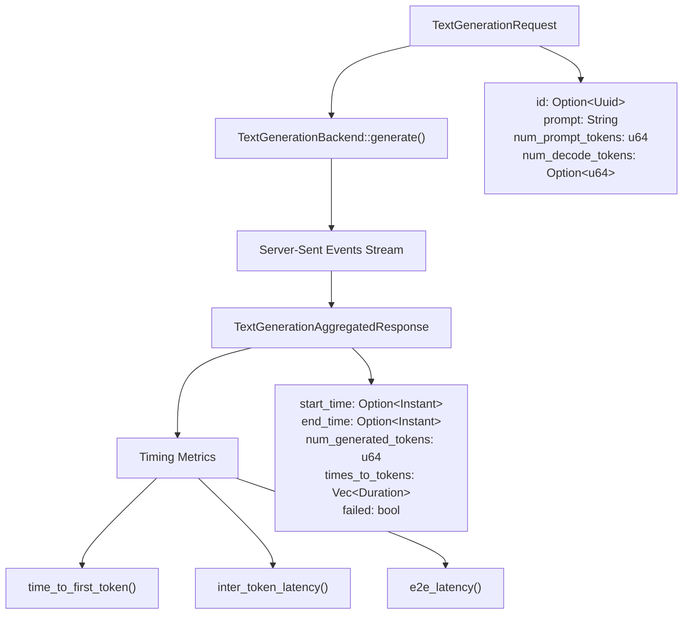

**Sources:** [src/requests.rs:23-29](), [src/requests.rs:718-808]()

## Backend Abstraction Layer

The system provides a pluggable backend interface that abstracts different LLM API protocols behind a common trait.

### TextGenerationBackend Trait

The core abstraction defines a single async method for text generation:

```rust
#[async_trait]
pub trait TextGenerationBackend: TextGenerationBackendClone {
    async fn generate(
        &self,
        request: Arc<TextGenerationRequest>,
        sender: Sender<TextGenerationAggregatedResponse>,
    );
}
```

This design enables:
- **Streaming Response Handling**: Responses are sent incrementally via the `sender` channel
- **Concurrent Execution**: Multiple requests can be processed simultaneously
- **Pluggable Implementations**: Different backends can be swapped without changing benchmark logic

### OpenAI-Compatible Backend Implementation

The `OpenAITextGenerationBackend` implements the most commonly used backend, supporting OpenAI-compatible APIs including TGI, vLLM, and actual OpenAI services:

| Component | Purpose |
|-----------|---------|
| `client` | HTTP client with configurable timeout |
| `base_url` | API endpoint URL |
| `model_name` | Target model identifier |
| `tokenizer` | Token counting for response validation |
| `api_key` | Authentication credential |

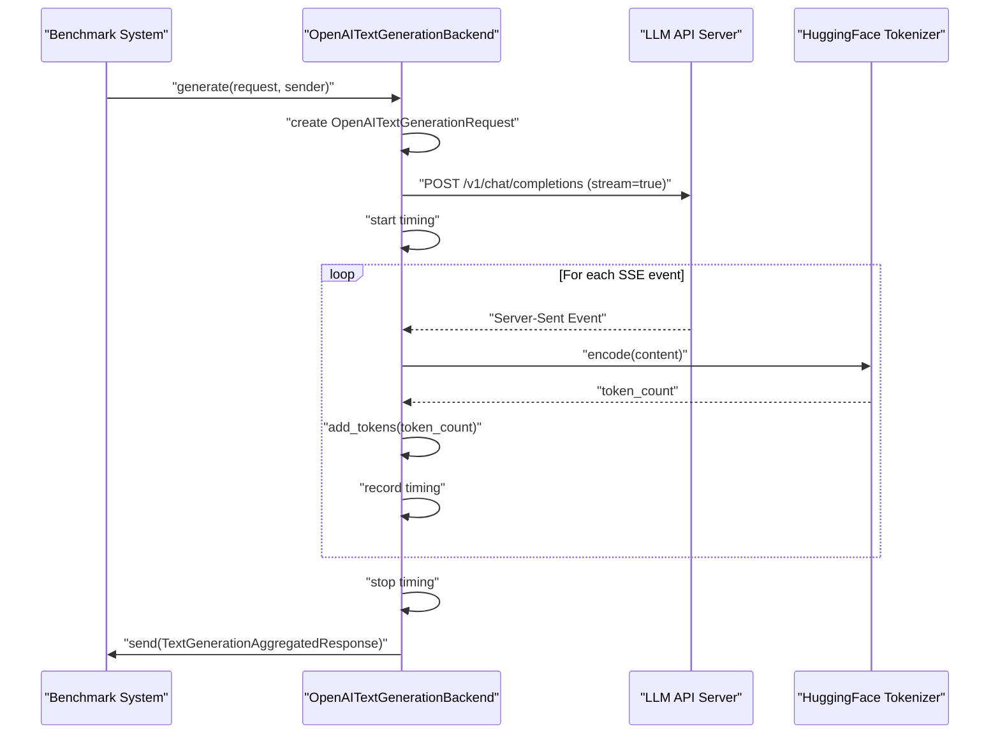

**Sources:** [src/requests.rs:31-38](), [src/requests.rs:59-123](), [src/requests.rs:125-261]()

## Request Generation System

The request generation system supports both simple and sophisticated multi-turn conversational workloads through the `TextRequestGenerator` trait.

### TextRequestGenerator Trait

The interface defines two key methods:

```rust
pub trait TextRequestGenerator: Sync {
    fn generate_request(&mut self) -> TextGenerationRequest;
    fn callback(&mut self, request: Arc<TextGenerationRequest>, response: &str);
}
```

The `callback` method enables stateful request generators to create follow-up requests based on previous responses, supporting realistic conversational benchmarks.

### Conversation Dataset Loading

The `ConversationTextRequestGenerator` implements sophisticated multi-turn conversation support:

1. **Dataset Loading**: Parses JSON conversation files with structured dialogue turns
2. **Tokenization**: Pre-processes prompts using HuggingFace tokenizers with configurable constraints
3. **Turn Linking**: Uses UUIDs to link conversation turns for proper sequencing
4. **Priority Queuing**: Manages conversation flow with a priority queue system

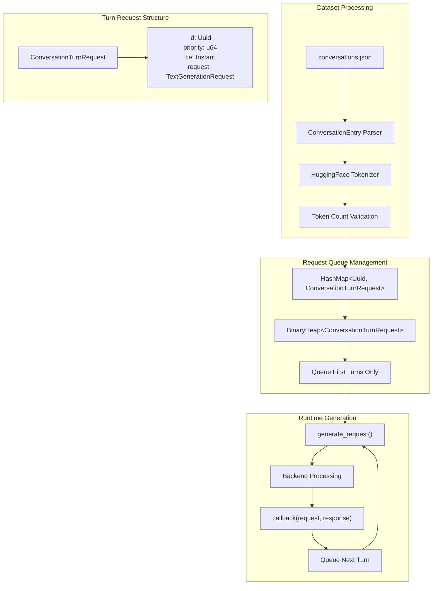

**Sources:** [src/requests.rs:306-310](), [src/requests.rs:386-558](), [src/requests.rs:585-647]()

## Tokenization and Request Preprocessing

The system provides flexible tokenization options through the `TokenizeOptions` configuration:

| Option | Purpose |
|--------|---------|
| `num_tokens` | Fixed token count (truncates prompts) |
| `min_tokens` | Minimum acceptable prompt length |
| `max_tokens` | Maximum acceptable prompt length |
| `variance` | Gaussian distribution for sampling token counts |

### Token Count Sampling

For realistic workload simulation, the system can sample token counts from a normal distribution:

```rust
fn sample_num_tokens(num_tokens: u64, min_tokens: u64, max_tokens: u64, variance: u64) -> u64
```

This enables benchmarks that more accurately reflect real-world prompt length distributions.

**Sources:** [src/requests.rs:324-360](), [src/requests.rs:560-570](), [src/requests.rs:675-716]()

## Multi-Turn Conversation Flow

The conversation system implements sophisticated turn management for realistic chat benchmarks:

### Priority-Based Scheduling

Conversation turns are managed using a priority system:
- **Priority 0**: First turns in conversations (continuously recycled)
- **Priority 100**: Follow-up turns (scheduled immediately for KV cache efficiency)

### Conversation Context Building

When processing multi-turn conversations, the system concatenates:
1. Original user prompt
2. Assistant response
3. Next turn prompt

This creates realistic conversational context that exercises KV cache systems in serving platforms.

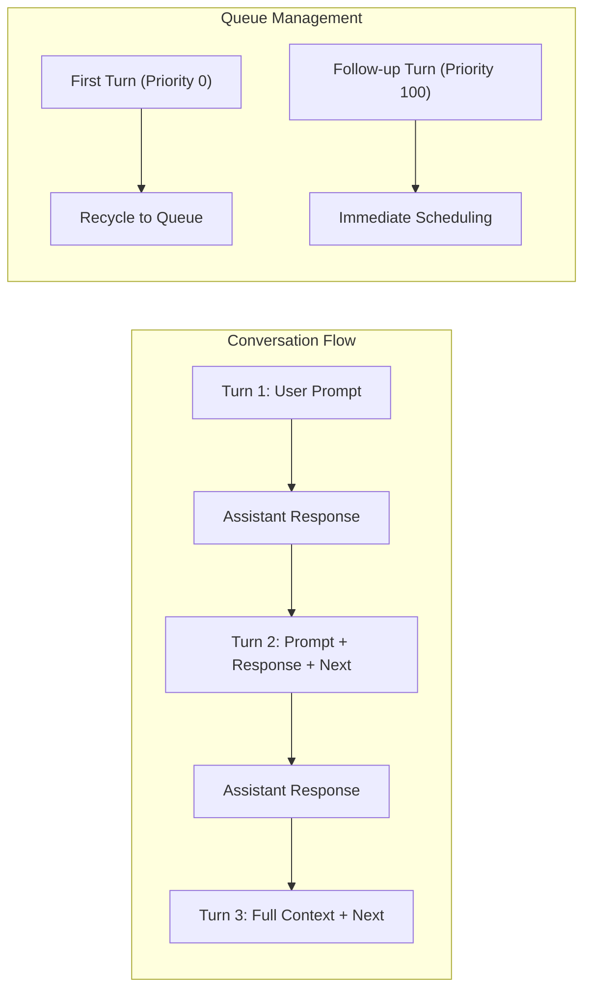

**Sources:** [src/requests.rs:362-384](), [src/requests.rs:597-647]()

## Error Handling and Resilience

The backend implementations include comprehensive error handling for production reliability:

### OpenAI Backend Error Categories

| Error Type | Handling Strategy |
|------------|------------------|
| Network timeouts | Mark request as failed, close connection |
| Malformed JSON | Log error, mark request as failed |
| API errors | Parse error message, mark request as failed |
| Stream interruption | Handle partial responses gracefully |

### Response Validation

The system validates responses by:
- Counting tokens in each delta using the tokenizer
- Detecting multi-token chunks (warns about chunked prefill/speculative decoding)
- Tracking timing between token arrivals
- Handling incomplete responses due to connection issues

**Sources:** [src/requests.rs:161-261](), [src/requests.rs:219-254]()

---

# Page: Benchmark Execution System

# Benchmark Execution System

<details>
<summary>Relevant source files</summary>

The following files were used as context for generating this wiki page:

- [src/benchmark.rs](src/benchmark.rs)
- [src/event.rs](src/event.rs)
- [src/executors.rs](src/executors.rs)
- [src/scheduler.rs](src/scheduler.rs)

</details>


This document covers the core benchmark execution engine responsible for orchestrating and managing benchmark runs. The system handles different benchmark strategies, manages virtual users (VUs), schedules request execution, and provides real-time progress tracking. For information about request generation and backend interfaces, see [Request Generation and Backend Interface](#3.2). For details on results collection and formatting, see [Results Processing](#3.4). For the terminal user interface components, see [Console UI](#3.5).

## System Architecture Overview

The benchmark execution system is built around three primary components working together to execute benchmarks efficiently:

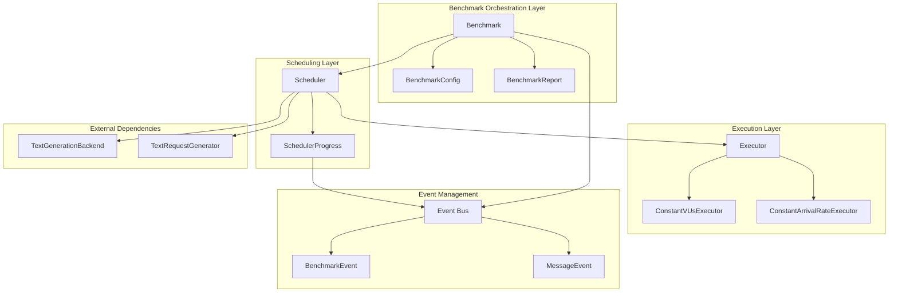

**Sources:** [src/benchmark.rs:47-56](), [src/scheduler.rs:20-27](), [src/executors.rs:27-35]()

## Benchmark Types and Execution Strategies

The system supports three distinct benchmark types, each optimized for different performance testing scenarios:

| Benchmark Type | Description | Key Characteristics |
|---------------|-------------|-------------------|
| `Throughput` | Measures maximum throughput using constant virtual users | Uses `ConstantVUsExecutor` with `max_vus` |
| `Sweep` | Performs rate sweep from low to maximum detected throughput | Automatically determines rates based on initial throughput test |
| `Rate` | Tests specific request rates | Uses `ConstantArrivalRateExecutor` with predefined rates |

```mermaid
graph LR
    subgraph "BenchmarkKind Enum"
        THROUGHPUT[Throughput]
        SWEEP[Sweep] 
        RATE[Rate]
    end
    
    subgraph "Execution Path"
        RUN_THROUGHPUT[run_throughput]
        RUN_SWEEP[run_sweep]
        RUN_RATES[run_rates]
        RUN_RATE[run_rate]
    end
    
    subgraph "Executor Selection"
        CONSTANT_VUS[ConstantVUsExecutor]
        CONSTANT_ARRIVAL[ConstantArrivalRateExecutor]
    end
    
    THROUGHPUT --> RUN_THROUGHPUT
    SWEEP --> RUN_SWEEP
    RATE --> RUN_RATES
    
    RUN_THROUGHPUT --> CONSTANT_VUS
    RUN_SWEEP --> RUN_THROUGHPUT
    RUN_SWEEP --> RUN_RATE
    RUN_RATES --> RUN_RATE
    RUN_RATE --> CONSTANT_ARRIVAL
```

**Sources:** [src/benchmark.rs:15-20](), [src/benchmark.rs:154-164](), [src/benchmark.rs:326-352]()

## Benchmark Execution Flow

The complete execution flow orchestrates warmup, main benchmark execution, and result collection:

```mermaid
sequenceDiagram
    participant B as Benchmark
    participant S as Scheduler  
    participant E as Executor
    participant VU as Virtual User
    participant BE as Backend
    participant EB as Event Bus
    
    B->>B: "validate config"
    B->>EB: "BenchmarkStart event"
    B->>B: "warmup()"
    B->>S: "create Scheduler"
    
    S->>E: "create appropriate Executor"
    S->>S: "spawn progress handler"
    S->>E: "run()"
    
    E->>VU: "start virtual users"
    VU->>BE: "generate requests"
    BE-->>VU: "stream responses"
    VU->>S: "send aggregated responses"
    
    S->>EB: "SchedulerProgress updates"
    
    E->>S: "execution complete"
    S->>B: "return BenchmarkResults"
    B->>EB: "BenchmarkEnd event"
    B->>B: "add to BenchmarkReport"
```

**Sources:** [src/benchmark.rs:148-176](), [src/scheduler.rs:89-147](), [src/executors.rs:60-113]()

## Virtual User Management

The execution system uses two distinct strategies for managing virtual users based on the benchmark type:

### ConstantVUsExecutor

Maintains a constant number of active virtual users throughout the benchmark duration:

```mermaid
graph TB
    subgraph "VU Lifecycle Management"
        START[Start VUs]
        ACTIVE[Active VUs Pool]
        REPLENISH[Replenish on Completion]
        END[Duration Reached]
    end
    
    subgraph "Synchronization"
        ATOMIC_COUNTER[AtomicI64 active_vus]
        END_CHANNEL[end_tx/end_rx channel]
        STOP_SIGNAL[broadcast stop signal]
    end
    
    START --> ACTIVE
    ACTIVE --> REPLENISH
    REPLENISH --> ACTIVE
    ACTIVE --> END
    
    ACTIVE --> ATOMIC_COUNTER
    REPLENISH --> END_CHANNEL
    END --> STOP_SIGNAL
```

**Sources:** [src/executors.rs:60-114](), [src/executors.rs:116-149]()

### ConstantArrivalRateExecutor  

Spawns virtual users at a specified rate to maintain consistent request arrival:

```mermaid
graph TB
    subgraph "Rate-Based Spawning"
        TICK[10ms Interval Tick]
        CALCULATE[Calculate VUs to Spawn]
        SPAWN_QUEUE[spawn_queue accumulator]
        SPAWN[Spawn VUs if queue >= 1.0]
    end
    
    subgraph "Rate Control"
        RATE[Target Rate req/sec]
        TICK_MS[tick_ms = 10]
        FORMULA["rate * tick_ms / 1000"]
    end
    
    subgraph "Constraints"
        MAX_VUS[max_vus limit]
        DURATION[duration limit]
        ACTIVE[active_vus counter]
    end
    
    TICK --> CALCULATE
    RATE --> FORMULA
    FORMULA --> SPAWN_QUEUE
    CALCULATE --> SPAWN_QUEUE
    SPAWN_QUEUE --> SPAWN
    
    SPAWN --> MAX_VUS
    SPAWN --> ACTIVE
    TICK --> DURATION
```

**Sources:** [src/executors.rs:175-243](), [src/executors.rs:188-228]()

## Progress Tracking and Event System

The system provides real-time progress updates through a structured event system:

### Event Types

```mermaid
graph TB
    subgraph "Event Hierarchy"
        EVENT[Event enum]
        BENCH_START[BenchmarkStart]
        BENCH_PROGRESS[BenchmarkProgress] 
        BENCH_END[BenchmarkEnd]
        MESSAGE[Message]
        REPORT_END[BenchmarkReportEnd]
        ERROR[BenchmarkError]
    end
    
    subgraph "Event Data"
        BENCH_EVENT[BenchmarkEvent]
        MSG_EVENT[MessageEvent]
        SCHED_PROGRESS[SchedulerProgress]
    end
    
    EVENT --> BENCH_START
    EVENT --> BENCH_PROGRESS
    EVENT --> BENCH_END
    EVENT --> MESSAGE
    EVENT --> REPORT_END
    EVENT --> ERROR
    
    BENCH_START --> BENCH_EVENT
    BENCH_PROGRESS --> BENCH_EVENT
    BENCH_END --> BENCH_EVENT
    MESSAGE --> MSG_EVENT
    
    BENCH_EVENT --> SCHED_PROGRESS
```

### Progress Flow

```mermaid
sequenceDiagram
    participant S as Scheduler
    participant P as Progress Handler
    participant EB as Event Bus
    participant UI as Console UI
    
    S->>P: "create progress channel"
    S->>S: "spawn response handler"
    
    loop "During Execution"
        S->>P: "SchedulerProgress update"
        P->>EB: "BenchmarkProgress event"
        EB->>UI: "update display"
    end
    
    S->>P: "send None (completion)"
    P->>P: "close progress handler"
```

**Sources:** [src/benchmark.rs:22-45](), [src/benchmark.rs:185-216](), [src/scheduler.rs:29-34](), [src/scheduler.rs:100-131]()

## Configuration and Validation

The `BenchmarkConfig` structure defines all benchmark parameters and includes comprehensive validation:

| Configuration Field | Purpose | Validation Rules |
|---------------------|---------|------------------|
| `max_vus` | Maximum virtual users | Must be > 0 |
| `duration` | Benchmark duration | Must be > 0 seconds |
| `warmup_duration` | Warmup phase duration | Must be > 0 seconds |
| `benchmark_kind` | Type of benchmark | Determines execution strategy |
| `rates` | Specific rates for Rate benchmarks | Required only for Rate type |
| `num_rates` | Number of rates for Sweep | Used in sweep calculations |

**Sources:** [src/benchmark.rs:58-79](), [src/benchmark.rs:81-117]()

## Terminal Event Integration

The execution system integrates with terminal events for interactive control:

```mermaid
graph LR
    subgraph "Terminal Events"
        TICK[AppEvent::Tick]
        KEY[AppEvent::Key]
        RESIZE[AppEvent::Resize]
    end
    
    subgraph "Event Processing"
        POLL[event::poll]
        READ[event::read]
        SEND[event_sender.send]
    end
    
    subgraph "Frame Management"
        FPS[fps: u32]
        BUDGET[per_frame duration]
        LAST[last_frame timestamp]
    end
    
    POLL --> READ
    READ --> KEY
    READ --> RESIZE
    FPS --> BUDGET
    BUDGET --> TICK
    LAST --> TICK
    
    TICK --> SEND
    KEY --> SEND
    RESIZE --> SEND
```

**Sources:** [src/event.rs:6-11](), [src/event.rs:26-58]()

---

# Page: Results Processing

# Results Processing

<details>
<summary>Relevant source files</summary>

The following files were used as context for generating this wiki page:

- [src/results.rs](src/results.rs)
- [src/table.rs](src/table.rs)
- [src/writers.rs](src/writers.rs)

</details>


This document covers how benchmark results are collected, aggregated, and formatted for output in the inference-benchmarker system. The results processing pipeline transforms raw response data from individual requests into comprehensive performance metrics and reports.

For information about how benchmarks are executed and scheduled, see [Benchmark Execution System](#3.3). For details about output visualization and analysis tools, see [Results Analysis and Visualization](#5).

## Core Data Structures

The results processing system is built around two primary data structures that handle different levels of aggregation.

### BenchmarkResults

The `BenchmarkResults` struct represents metrics for a single benchmark configuration. It accumulates individual `TextGenerationAggregatedResponse` objects and computes performance statistics.

```mermaid
classDiagram
    class BenchmarkResults {
        +String id
        +Vec~TextGenerationAggregatedResponse~ aggregated_responses
        +ExecutorType executor_type
        +ExecutorConfig executor_config
        +new(id, executor_type, executor_config) BenchmarkResults
        +add_response(response) void
        +total_requests() usize
        +successful_requests() usize
        +failed_requests() usize
        +token_throughput_secs() Result~f64~
        +e2e_latency_avg() Result~Duration~
        +time_to_first_token_avg() Result~Duration~
        +inter_token_latency_avg() Result~Duration~
        +*_percentile(percentile) Result~Duration~
        +quantile_duration(data, quantile) Result~f64~
    }
    
    class TextGenerationAggregatedResponse {
        +Option~Arc~TextGenerationRequest~~ request
        +Option~Instant~ start_time
        +Option~Instant~ end_time
        +u64 num_generated_tokens
        +bool failed
        +Vec~Duration~ times_to_tokens
    }
    
    BenchmarkResults --> TextGenerationAggregatedResponse : "aggregates"
```

Sources: [src/results.rs:23-258]()

### BenchmarkReport

The `BenchmarkReport` struct serves as a container for multiple `BenchmarkResults`, representing the complete output of a benchmark session.

```mermaid
classDiagram
    class BenchmarkReport {
        +Vec~BenchmarkResults~ results
        +Option~DateTime~Utc~~ start_time
        +Option~DateTime~Utc~~ end_time
        +new() BenchmarkReport
        +start() void
        +end() void
        +add_benchmark_result(result) void
        +get_results() Vec~BenchmarkResults~
    }
    
    class BenchmarkResults {
        +String id
        +Vec~TextGenerationAggregatedResponse~ aggregated_responses
    }
    
    BenchmarkReport --> BenchmarkResults : "contains multiple"
```

Sources: [src/results.rs:312-351]()

## Metrics Calculation Pipeline

The system calculates comprehensive performance metrics from raw response timing data through a multi-stage process.

```mermaid
flowchart TD
    Raw["TextGenerationAggregatedResponse"] --> Collect["BenchmarkResults.add_response()"]
    Collect --> Filter["get_successful_responses()"]
    Filter --> Calc["Metric Calculations"]
    
    subgraph Calc ["Metric Calculations"]
        TokenCalc["token_throughput_secs()"]
        LatencyCalc["e2e_latency_avg()"]
        TTFTCalc["time_to_first_token_avg()"]
        ITLCalc["inter_token_latency_avg()"]
        PercentileCalc["*_percentile() methods"]
        RateCalc["successful_request_rate()"]
    end
    
    Calc --> Validation["is_ready() validation"]
    Validation --> Output["Formatted Output"]
    
    subgraph Output ["Output Formats"]
        JSON["JSON via BenchmarkReportWriter"]
        Console["Console Tables via table.rs"]
        Debug["Debug formatting"]
    end
```

Sources: [src/results.rs:82-257](), [src/writers.rs:38-84](), [src/table.rs:44-98]()

### Key Metrics

| Metric Type | Methods | Description |
|-------------|---------|-------------|
| **Throughput** | `token_throughput_secs()`, `successful_request_rate()` | Tokens/second and requests/second |
| **Latency Averages** | `e2e_latency_avg()`, `time_to_first_token_avg()`, `inter_token_latency_avg()` | Mean latency measurements |
| **Latency Percentiles** | `e2e_latency_percentile()`, `time_to_first_token_percentile()`, `inter_token_latency_percentile()` | P50, P90, P95, P99 latency distributions |
| **Token Counts** | `total_tokens()`, `total_prompt_tokens()`, `prompt_tokens_avg()` | Token consumption metrics |
| **Success Rates** | `successful_requests()`, `failed_requests()` | Request completion statistics |

Sources: [src/results.rs:82-220]()

## Output Generation System

The results processing system supports multiple output formats through a layered writer architecture.

### Serialization Writers

```mermaid
classDiagram
    class BenchmarkReportWriter {
        +BenchmarkConfig config
        +Vec~BenchmarkResultsWriter~ results
        +String start_time
        +String end_time
        +SystemInfo system
        +BenchmarkReport report
        +try_new(config, report) Result~BenchmarkReportWriter~
        +json(path) Result~void~
        +stdout() Result~void~
    }
    
    class BenchmarkResultsWriter {
        +String id
        +String executor_type
        +ExecutorConfig config
        +u64 total_requests
        +f64 token_throughput_secs
        +PercentilesWriter time_to_first_token_ms
        +PercentilesWriter inter_token_latency_ms
        +PercentilesWriter e2e_latency_ms
        +new(results) Result~BenchmarkResultsWriter~
    }
    
    class PercentilesWriter {
        +f64 p50
        +f64 p90
        +f64 p95
        +f64 p99
        +f64 avg
    }
    
    class SystemInfo {
        +Vec~String~ cpu
        +String memory
        +String os_name
        +String hostname
        +new() SystemInfo
    }
    
    BenchmarkReportWriter --> BenchmarkResultsWriter : "contains"
    BenchmarkResultsWriter --> PercentilesWriter : "contains"
    BenchmarkReportWriter --> SystemInfo : "includes"
```

Sources: [src/writers.rs:8-179]()

### Output Format Generation

The system generates output in two primary formats through the `BenchmarkReportWriter`:

**JSON Output (`json()` method):**
- Complete serialization of all benchmark data
- Includes system information and configuration
- Preserves full precision for analysis tools
- Asynchronous file writing with directory creation

**Console Output (`stdout()` method):**
- Parameter summary table via `table::parameters_table()`
- Results summary table via `table::results_table()`
- Human-readable formatting with units

Sources: [src/writers.rs:158-178](), [src/table.rs:5-98]()

## Percentile Calculation Algorithm

The system implements a custom percentile calculation algorithm that mimics NumPy's behavior for consistent statistical analysis.

```mermaid
flowchart TD
    Input["Vec<Duration> data, f64 quantile"] --> Sort["data.sort()"]
    Sort --> Index["i = floor(quantile * (len-1))"]
    Index --> Delta["delta = quantile * (len-1) - i"]
    Delta --> Bounds["Check i < data.len()"]
    Bounds --> Interpolate["result = (1-delta) * data[i] + delta * data[i+1]"]
    Interpolate --> Return["Duration::from_secs_f64(result)"]
```

The interpolation formula ensures smooth percentile transitions:
```rust
let quantile = (1. - delta) * data[i as usize].as_secs_f64()
    + delta * data[i as usize + 1].as_secs_f64();
```

Sources: [src/results.rs:241-257]()

## Error Handling and Validation

The results processing system includes comprehensive error handling to ensure data integrity.

### Validation Mechanisms

| Validation | Method | Error Condition |
|------------|--------|----------------|
| **Data Availability** | `is_ready()` | Missing start_time or end_time |
| **Response Count** | All metric methods | Returns `BenchmarkErrors::NoResponses` |
| **Division by Zero** | Rate calculations | Checks for zero successful requests |
| **Bounds Checking** | `quantile_duration()` | Array index validation |

### Error Types

The `BenchmarkErrors` enum defines system-specific error conditions:

```rust
pub(crate) enum BenchmarkErrors {
    NoResponses,
}
```

This error is returned when the backend fails to provide valid responses, either due to connectivity issues or insufficient test duration.

Sources: [src/results.rs:9-20](), [src/results.rs:64-66](), [src/results.rs:244-256]()

---

# Page: Console UI

# Console UI

<details>
<summary>Relevant source files</summary>

The following files were used as context for generating this wiki page:

- [src/app.rs](src/app.rs)

</details>


## Purpose and Scope

The Console UI provides a real-time terminal-based interface for monitoring benchmark execution and visualizing results as they are generated. This interactive interface allows users to observe benchmark progress, view logs, and see performance metrics through charts and tables directly in the terminal.

For information about the CLI interface and command-line arguments, see [CLI Interface](#3.1). For details about results processing and output formats, see [Results Processing](#3.4).

## Architecture Overview

The Console UI is built using the `ratatui` library and implements a flux-pattern architecture for state management. The system consists of several key components that work together to provide real-time monitoring capabilities.

### Console UI System Architecture

```mermaid
graph TB
    subgraph "Console UI Components"
        App["App struct<br/>(Main Controller)"]
        Store["Store<br/>(State Container)"]
        Dispatcher["Dispatcher<br/>(Action Handler)"]
        Widget["Widget Implementation<br/>(Rendering)"]
    end
    
    subgraph "Event Sources"
        TerminalEvents["Terminal Events<br/>(Keyboard Input)"]
        BenchmarkEvents["Benchmark Events<br/>(Progress Updates)"]
    end
    
    subgraph "UI Layout Components"
        ConfigHeader["Configuration Header"]
        BenchmarkTable["Benchmark Steps Table"]
        LogsPanel["Logs Panel"]
        ChartsPanel["Performance Charts"]
    end
    
    subgraph "External Systems"
        BenchmarkEngine["Benchmark Engine"]
        RatatuiLib["Ratatui Library"]
    end
    
    run_console --> App
    App --> Store
    App --> Dispatcher
    App --> Widget
    
    TerminalEvents --> App
    BenchmarkEngine --> BenchmarkEvents
    BenchmarkEvents --> Dispatcher
    
    Widget --> ConfigHeader
    Widget --> BenchmarkTable
    Widget --> LogsPanel
    Widget --> ChartsPanel
    
    App --> RatatuiLib
    Widget --> RatatuiLib
```

Sources: [src/app.rs:28-35](), [src/app.rs:37-41](), [src/app.rs:146-162]()

### Console UI Entry Point and Initialization

The console UI is initialized through the `run_console` function, which sets up the event handling system and spawns concurrent tasks for managing terminal events and benchmark updates.

```mermaid
sequenceDiagram
    participant Main as "Main Process"
    participant Console as "run_console()"
    participant App as "App"
    participant EventTask as "terminal_event_task"
    participant BenchmarkTask as "Benchmark Event Handler"
    participant Terminal as "Ratatui Terminal"
    
    Main->>Console: "Call with config & events"
    Console->>EventTask: "Spawn keyboard event handler"
    Console->>App: "Create App instance"
    Console->>BenchmarkTask: "Spawn benchmark event processor"
    
    loop "UI Event Loop"
        App->>Terminal: "Draw frame"
        EventTask->>App: "Send keyboard events"
        BenchmarkTask->>App: "Send benchmark updates"
        App->>App: "Update state via Dispatcher"
    end
    
    App->>Console: "Exit signal"
    Console->>Main: "Cleanup and return"
```

Sources: [src/app.rs:37-144]()

## Event Handling System

The Console UI implements a sophisticated event handling system that manages both user input and benchmark updates through separate asynchronous tasks.

### Event Processing Architecture

```mermaid
graph LR
    subgraph "Event Types"
        KeyEvents["KeyEvent<br/>(q, Ctrl+C)"]
        AppEvents["AppEvent<br/>(Tick, Key, Resize)"]
        BenchmarkEvents["BenchmarkEvent<br/>(Start, Progress, End)"]
    end
    
    subgraph "Event Handlers"
        TerminalEventTask["terminal_event_task"]
        BenchmarkEventHandler["Benchmark Event Handler"]
        AppEventHandler["App.handle_events()"]
    end
    
    subgraph "State Updates"
        Actions["Action Enum"]
        Dispatcher["Dispatcher.dispatch()"]
        Store["Store.update_state()"]
    end
    
    KeyEvents --> TerminalEventTask
    TerminalEventTask --> AppEvents
    AppEvents --> AppEventHandler
    
    BenchmarkEvents --> BenchmarkEventHandler
    BenchmarkEventHandler --> Actions
    AppEventHandler --> Actions
    
    Actions --> Dispatcher
    Dispatcher --> Store
```

Sources: [src/app.rs:2](), [src/app.rs:58-131](), [src/app.rs:175-200]()

### Benchmark Event Processing

The system processes various types of benchmark events and converts them into UI state updates:

| Event Type | UI Action | Description |
|------------|-----------|-------------|
| `BenchmarkStart` | `AddBenchmark` | Creates new benchmark entry with running status |
| `BenchmarkProgress` | `AddBenchmark` | Updates progress, throughput, and request counts |
| `BenchmarkEnd` | `AddBenchmark` + `AddBenchmarkResults` | Marks completion and stores results |
| `Message` | `LogMessage` | Adds informational messages to logs |
| `BenchmarkError` | `LogMessage` | Displays error messages and terminates |

Sources: [src/app.rs:63-126]()

## UI Layout and Components

The Console UI uses a structured layout divided into four main areas: configuration header, benchmark steps table, performance charts, and logs panel.

### UI Layout Structure

```mermaid
graph TB
    subgraph "Terminal Layout (Vertical)"
        ConfigArea["Configuration Header<br/>(Constraint::Length(1))"]
        MainArea["Main Content Area<br/>(Constraint::Min(20))"]
    end
    
    subgraph "Main Content (Vertical Split)"
        TopHalf["Top Half - 50%<br/>(Benchmarks & Charts)"]
        BottomHalf["Bottom Half - 50%<br/>(Logs Panel)"]
    end
    
    subgraph "Top Half (Horizontal Split)"
        BenchmarkSteps["Benchmark Steps Table<br/>(35% width)"]
        PerformanceCharts["Performance Charts<br/>(65% width)"]
    end
    
    ConfigArea --> MainArea
    MainArea --> TopHalf
    MainArea --> BottomHalf
    TopHalf --> BenchmarkSteps
    TopHalf --> PerformanceCharts
```

Sources: [src/app.rs:276-287]()

### Benchmark Steps Table

The benchmark steps table displays real-time progress for each running benchmark with the following columns:

- **Bench**: Benchmark identifier
- **Status**: Running or Completed
- **%**: Progress percentage
- **Err**: Error rate percentage (highlighted in red if > 0)
- **Throughput**: Average requests per second

Sources: [src/app.rs:346-389]()

### Logs Panel

The logs panel shows timestamped messages with color-coded log levels:
- **INFO**: Green, bold text
- **WARNING**: Yellow, bold text  
- **ERROR**: Red, bold text

The logs are displayed in reverse chronological order (newest first) using the `BottomToTop` list direction.

Sources: [src/app.rs:288-323](), [src/app.rs:444-463]()

## State Management

The Console UI uses a flux-pattern architecture with centralized state management through the `Store` and `Dispatcher` components.

### State Management Flow

```mermaid
graph LR
    subgraph "State Components"
        AppState["AppState<br/>(messages, benchmarks, results)"]
        Store["Store<br/>(Arc<Mutex<AppState>>)"]
        Dispatcher["Dispatcher<br/>(Action processor)"]
    end
    
    subgraph "Action Types"
        LogMessage["LogMessage<br/>(message, level, timestamp)"]
        AddBenchmark["AddBenchmark<br/>(BenchmarkUI struct)"]
        AddBenchmarkResults["AddBenchmarkResults<br/>(BenchmarkResults)"]
    end
    
    subgraph "UI State Objects"
        LogMessageUI["LogMessageUI"]
        BenchmarkUI["BenchmarkUI<br/>(id, status, progress, throughput)"]
        BenchmarkStatus["BenchmarkStatus<br/>(Running, Completed)"]
    end
    
    LogMessage --> Dispatcher
    AddBenchmark --> Dispatcher
    AddBenchmarkResults --> Dispatcher
    
    Dispatcher --> Store
    Store --> AppState
    
    LogMessageUI --> LogMessage
    BenchmarkUI --> AddBenchmark
    BenchmarkStatus --> BenchmarkUI
```

Sources: [src/app.rs:28-35](), [src/app.rs:453-479]()

## Real-time Data Visualization

The Console UI provides real-time performance charts that visualize benchmark results as they are collected.

### Chart Data Processing

The system creates multiple datasets for visualization based on executor type and metrics:

```mermaid
graph TB
    subgraph "Chart Datasets"
        TokenThroughputRate["token_throughput_rate<br/>(ConstantArrivalRate)"]
        TokenThroughputVUs["token_throughput_vus<br/>(ConstantVUs)"]
        InterTokenLatencyRate["inter_token_latency_rate<br/>(ConstantArrivalRate)"]
        InterTokenLatencyVUs["inter_token_latency_vus<br/>(ConstantVUs)"]
    end
    
    subgraph "Data Sources"
        BenchmarkResults["BenchmarkResults"]
        ExecutorConfig["ExecutorConfig<br/>(rate, max_vus)"]
        Metrics["Metrics<br/>(throughput, latency)"]
    end
    
    subgraph "Chart Components"
        ScatterPlot["Scatter Plot<br/>(ratatui::Chart)"]
        XAxis["X-Axis<br/>(Arrival rate / VUs)"]
        YAxis["Y-Axis<br/>(Throughput / Latency)"]
    end
    
    BenchmarkResults --> ExecutorConfig
    BenchmarkResults --> Metrics
    ExecutorConfig --> TokenThroughputRate
    ExecutorConfig --> TokenThroughputVUs
    Metrics --> TokenThroughputRate
    Metrics --> TokenThroughputVUs
    
    TokenThroughputRate --> ScatterPlot
    XAxis --> ScatterPlot
    YAxis --> ScatterPlot
```

Sources: [src/app.rs:205-268](), [src/app.rs:391-421]()

### Chart Rendering

The performance charts use the following visualization approach:
- **Chart Type**: Scatter plot with dot markers
- **Data Filtering**: Separates ConstantArrivalRate and ConstantVUs results
- **Dynamic Scaling**: Automatically calculates axis bounds based on data
- **Real-time Updates**: Charts update as new benchmark results are added

The chart currently displays token throughput rate, showing the relationship between arrival rate (requests/second) and achieved throughput (tokens/second).

Sources: [src/app.rs:392-421](), [src/app.rs:423-442]()

---

# Page: Deployment Options

# Deployment Options

<details>
<summary>Relevant source files</summary>

The following files were used as context for generating this wiki page:

- [Dockerfile](Dockerfile)
- [Makefile](Makefile)
- [README.md](README.md)

</details>


This page provides an overview of the different deployment methods available for the inference-benchmarker system. The benchmarker is designed to run in various environments, from local development setups to large-scale HPC clusters, enabling performance testing across different infrastructure configurations.

For detailed information about specific deployment methods, see [Docker Deployment](#4.1), [Kubernetes Deployment](#4.2), and [HPC and Slurm Deployment](#4.3). For information about analyzing results from deployed benchmarks, see [Results Analysis and Visualization](#5).

## Deployment Architecture Overview

The inference-benchmarker supports multiple deployment strategies, each optimized for different use cases and infrastructure requirements:

```mermaid
graph TB
    subgraph "Source_Code"
        RUST_SRC["Rust Source Code<br/>(cargo build)"]
        DOCKERFILE["Dockerfile<br/>(Multi-stage build)"]
        HELM_CHART["Helm Chart<br/>(extra/k8s/inference-benchmarker)"]
        SLURM_SCRIPTS["Slurm Scripts<br/>(extra/slurm)"]
    end
    
    subgraph "Build_Artifacts"
        BINARY["inference-benchmarker<br/>(Native Binary)"]
        CONTAINER["Container Image<br/>(ghcr.io registry)"]
        HELM_PACKAGE["Helm Package<br/>(Kubernetes manifest)"]
    end
    
    subgraph "Runtime_Environments"
        LOCAL["Local Machine<br/>(Direct execution)"]
        DOCKER_LOCAL["Docker Desktop<br/>(Container runtime)"]
        K8S_CLUSTER["Kubernetes Cluster<br/>(Pod orchestration)"]
        SLURM_CLUSTER["HPC Cluster<br/>(Job scheduling)"]
    end
    
    subgraph "Target_Services"
        TGI_SERVER["TGI Server<br/>(text-generation-inference)"]
        VLLM_SERVER["vLLM Server<br/>(vllm-openai)"]
        OPENAI_API["OpenAI Compatible API<br/>(http endpoints)"]
    end
    
    RUST_SRC --> BINARY
    DOCKERFILE --> CONTAINER
    HELM_CHART --> HELM_PACKAGE
    
    BINARY --> LOCAL
    CONTAINER --> DOCKER_LOCAL
    CONTAINER --> K8S_CLUSTER
    CONTAINER --> SLURM_CLUSTER
    HELM_PACKAGE --> K8S_CLUSTER
    SLURM_SCRIPTS --> SLURM_CLUSTER
    
    LOCAL --> TGI_SERVER
    DOCKER_LOCAL --> TGI_SERVER
    K8S_CLUSTER --> VLLM_SERVER
    SLURM_CLUSTER --> OPENAI_API
```

Sources: [README.md:50-240](), [Dockerfile:1-14]()

## Deployment Methods Comparison

| Method | Use Case | Prerequisites | Scalability | Complexity |
|--------|----------|---------------|-------------|------------|
| **Local Binary** | Development, quick testing | Rust toolchain or pre-built binary | Single machine | Low |
| **Docker** | Consistent environments, CI/CD | Docker runtime | Single machine | Low |
| **Kubernetes** | Production workloads, auto-scaling | K8s cluster, Helm | High | Medium |
| **HPC/Slurm** | Large-scale research, batch jobs | Slurm cluster access | Very High | High |

## Installation Methods

### Binary Installation

The benchmarker can be installed directly as a native binary:

```bash
# Via cargo (requires Rust toolchain)
cargo install --git https://github.com/huggingface/inference-benchmarker/

# Or download pre-built release
curl -L https://github.com/huggingface/inference-benchmarker/releases/latest
```

### Container Image

The system provides containerized deployment through a multi-stage Docker build:

```mermaid
graph LR
    subgraph "Build_Stage"
        RUST_BASE["rust:1-bullseye"]
        CARGO_INSTALL["cargo install --path ."]
    end
    
    subgraph "Runtime_Stage"
        DEBIAN_BASE["debian:bullseye-slim"]
        CA_CERTS["ca-certificates"]
        WORKDIR["/opt/inference-benchmarker"]
        RESULTS_DIR["/opt/inference-benchmarker/results"]
    end
    
    RUST_BASE --> CARGO_INSTALL
    CARGO_INSTALL --> DEBIAN_BASE
    DEBIAN_BASE --> CA_CERTS
    CA_CERTS --> WORKDIR
    WORKDIR --> RESULTS_DIR
```

Sources: [README.md:54-61](), [Dockerfile:1-14]()

## Configuration and Execution Patterns

### Command Interface Consistency

Regardless of deployment method, the benchmarker maintains a consistent CLI interface:

```mermaid
graph TD
    subgraph "CLI_Parameters"
        TOKENIZER["--tokenizer-name<br/>(HuggingFace model ID)"]
        URL["--url<br/>(Target server endpoint)"]
        PROFILE["--profile<br/>(chat, code-generation, etc.)"]
        BENCHMARK_KIND["--benchmark-kind<br/>(sweep, rate, throughput)"]
        DURATION["--duration<br/>(Benchmark duration)"]
        OUTPUT["JSON Results<br/>(Structured output)"]
    end
    
    subgraph "Deployment_Targets"
        LOCAL_EXEC["Local: inference-benchmarker"]
        DOCKER_EXEC["Docker: docker run <image>"]
        K8S_EXEC["K8s: kubectl/helm"]
        SLURM_EXEC["Slurm: sbatch"]
    end
    
    TOKENIZER --> LOCAL_EXEC
    URL --> DOCKER_EXEC
    PROFILE --> K8S_EXEC
    BENCHMARK_KIND --> SLURM_EXEC
    DURATION --> OUTPUT
```

Sources: [README.md:93-148]()

## Resource and Networking Requirements

### Network Connectivity

All deployment methods require network access to target LLM services:

```mermaid
graph TB
    subgraph "Benchmarker_Deployments"
        LOCAL_BENCH["Local Binary<br/>(host network)"]
        DOCKER_BENCH["Docker Container<br/>(bridge/host network)"]
        K8S_BENCH["Kubernetes Pod<br/>(cluster network)"]
        SLURM_BENCH["Slurm Job<br/>(compute network)"]
    end
    
    subgraph "Target_Infrastructure"
        LOCAL_TGI["localhost:8080<br/>(Local TGI/vLLM)"]
        CLUSTER_LB["LoadBalancer Service<br/>(K8s exposed service)"]
        INTERNAL_EP["Internal Endpoint<br/>(Cluster-internal service)"]
        EXTERNAL_API["External API<br/>(OpenAI, cloud providers)"]
    end
    
    LOCAL_BENCH --> LOCAL_TGI
    DOCKER_BENCH --> LOCAL_TGI
    DOCKER_BENCH --> EXTERNAL_API
    K8S_BENCH --> CLUSTER_LB
    K8S_BENCH --> INTERNAL_EP
    SLURM_BENCH --> INTERNAL_EP
    SLURM_BENCH --> EXTERNAL_API
```

Sources: [README.md:65-88](), [README.md:93-98]()

## Output and Results Management

### Results Persistence Across Deployments

Each deployment method handles results storage differently:

```mermaid
graph LR
    subgraph "Execution_Context"
        BENCH_PROCESS["inference-benchmarker<br/>(Running process)"]
    end
    
    subgraph "Output_Locations"
        LOCAL_CWD["Current Directory<br/>(Local filesystem)"]
        CONTAINER_VOL["Mounted Volume<br/>(Docker bind mount)"]
        K8S_PVC["PersistentVolumeClaim<br/>(K8s storage)"]
        SLURM_SHARED["Shared Filesystem<br/>(NFS, Lustre, etc.)"]
    end
    
    subgraph "Result_Formats"
        JSON_FILES["JSON Results<br/>(.json benchmark data)"]
        STDOUT_LOGS["Console Output<br/>(Real-time progress)"]
    end
    
    BENCH_PROCESS --> LOCAL_CWD
    BENCH_PROCESS --> CONTAINER_VOL
    BENCH_PROCESS --> K8S_PVC
    BENCH_PROCESS --> SLURM_SHARED
    
    LOCAL_CWD --> JSON_FILES
    CONTAINER_VOL --> JSON_FILES
    K8S_PVC --> JSON_FILES
    SLURM_SHARED --> JSON_FILES
    
    BENCH_PROCESS --> STDOUT_LOGS
```

Sources: [README.md:100](), [Dockerfile:11-12]()

## Scaling Considerations

### Concurrent Execution Patterns

Different deployment methods support varying levels of parallelization:

| Deployment | Concurrent Benchmarks | Resource Isolation | Job Management |
|------------|----------------------|-------------------|----------------|
| **Local** | Limited by system resources | Process-level | Manual |
| **Docker** | Container-based isolation | Container-level | Docker Compose |
| **Kubernetes** | Pod-based scaling | Namespace/Pod-level | Built-in scheduler |
| **Slurm** | Job queue management | Job-level allocation | Advanced scheduling |

The benchmarker's internal concurrency is controlled through parameters like `--max-vus` (maximum virtual users), which remains consistent across all deployment methods.

Sources: [README.md:138](), [README.md:244-252]()

## Next Steps

For implementation details of each deployment method:

- **[Docker Deployment](#4.1)**: Container configuration, volume mounting, and networking setup
- **[Kubernetes Deployment](#4.2)**: Helm chart configuration, resource management, and cluster integration  
- **[HPC and Slurm Deployment](#4.3)**: Job submission, resource allocation, and batch processing workflows

For analyzing results from any deployment method, see [Results Analysis and Visualization](#5).

Sources: [README.md:209-230]()

---

# Page: Docker Deployment

# Docker Deployment

<details>
<summary>Relevant source files</summary>

The following files were used as context for generating this wiki page:

- [.github/workflows/build.yaml](.github/workflows/build.yaml)
- [Dockerfile](Dockerfile)
- [Makefile](Makefile)

</details>


This document covers running the inference-benchmarker using Docker containers. It explains the Docker image build process, container configuration, and deployment workflows. For Kubernetes deployment using Helm charts, see [Kubernetes Deployment](#4.2). For running on HPC clusters, see [HPC and Slurm Deployment](#4.3).

## Docker Image Architecture

The inference-benchmarker uses a multi-stage Docker build to create optimized production images. The build process separates compilation from the final runtime environment.

### Multi-Stage Build Process

```mermaid
graph TB
    subgraph "Builder Stage"
        SRC["Source Code<br/>Rust Project"]
        RUST_BASE["rust:1-bullseye<br/>Base Image"]
        CARGO_INSTALL["cargo install --path .<br/>Build Binary"]
        BINARY["/usr/local/cargo/bin/inference-benchmarker<br/>Compiled Binary"]
    end
    
    subgraph "Runtime Stage"
        DEBIAN_BASE["debian:bullseye-slim<br/>Minimal Base"]
        CA_CERTS["ca-certificates<br/>SSL Support"]
        WORKDIR["/opt/inference-benchmarker<br/>Working Directory"]
        RESULTS_DIR["/opt/inference-benchmarker/results<br/>Output Directory"]
        FINAL_BINARY["/usr/local/bin/inference-benchmarker<br/>Final Binary"]
    end
    
    RUST_BASE --> SRC
    SRC --> CARGO_INSTALL
    CARGO_INSTALL --> BINARY
    
    DEBIAN_BASE --> CA_CERTS
    CA_CERTS --> WORKDIR
    WORKDIR --> RESULTS_DIR
    BINARY --> FINAL_BINARY
```

Sources: [Dockerfile:1-14]()

### Image Labels and Metadata

The Docker image includes OpenContainer Initiative (OCI) labels for metadata and provenance:

| Label | Value |
|-------|-------|
| `org.opencontainers.image.source` | `https://github.com/huggingface/inference-benchmarker` |
| `org.opencontainers.image.description` | `A benchmark tool for LLM inference engines` |
| `org.opencontainers.image.licenses` | `Apache-2.0` |

Sources: [Dockerfile:2-4]()

## Container Registry and Tagging

### Registry Location

Images are published to the GitHub Container Registry at `ghcr.io/huggingface/inference-benchmarker`.

### Tag Strategy

The CI/CD pipeline applies multiple tags based on the trigger event:

```mermaid
graph LR
    subgraph "Tag Types"
        SHA["sha-{GIT_SHA_SHORT}<br/>Always Applied"]
        LATEST["latest<br/>Main Branch Only"]
        SEMVER["Semantic Versions<br/>{{version}}, {{major}}.{{minor}}"]
        PR["sha-{SHA}<br/>Pull Requests"]
    end
    
    subgraph "Trigger Events"
        MAIN_BRANCH["Main Branch Push"]
        TAG_PUSH["Tag Push"]
        PULL_REQUEST["Pull Request"]
        RELEASE["Release"]
    end
    
    MAIN_BRANCH --> SHA
    MAIN_BRANCH --> LATEST
    
    TAG_PUSH --> SHA
    TAG_PUSH --> SEMVER
    
    PULL_REQUEST --> PR
    
    RELEASE --> SHA
    RELEASE --> SEMVER
```

Sources: [.github/workflows/build.yaml:39-55]()

## Running the Container

### Basic Usage

```bash
docker run ghcr.io/huggingface/inference-benchmarker:latest --help
```

### Volume Mounts for Results

The container creates a results directory at `/opt/inference-benchmarker/results`. Mount a host directory to persist benchmark results:

```bash
docker run -v $(pwd)/results:/opt/inference-benchmarker/results \
  ghcr.io/huggingface/inference-benchmarker:latest \
  --backend openai \
  --base-url http://host.docker.internal:8080/v1 \
  --model meta-llama/Llama-2-7b-chat-hf
```

### Environment Configuration

The container runs as a non-root user with the working directory set to `/opt/inference-benchmarker`. The default command is `inference-benchmarker`, allowing direct argument passing.

Sources: [Dockerfile:10-14]()

## CI/CD Integration

### Automated Build Pipeline

The GitHub Actions workflow builds and publishes Docker images automatically:

```mermaid
graph TB
    subgraph "Build Triggers"
        PR["Pull Request"]
        MAIN_PUSH["Main Branch Push"]
        TAG_PUSH["Tag Push"]
        RELEASE_EVENT["Release"]
    end
    
    subgraph "Build Process"
        CHECKOUT["Checkout Code<br/>actions/checkout@v4"]
        BUILDX["Setup Docker Buildx<br/>docker/setup-buildx-action@v3"]
        LOGIN["Login to GHCR<br/>docker/login-action@v3"]
        METADATA["Extract Metadata<br/>docker/metadata-action"]
        BUILD["Build and Push<br/>docker/build-push-action@v4"]
    end
    
    subgraph "Artifacts"
        DOCKER_IMAGE["Docker Image<br/>ghcr.io/huggingface/inference-benchmarker"]
        BINARY_ARTIFACT["Binary Artifact<br/>inference-benchmarker_x86_64"]
    end
    
    PR --> CHECKOUT
    MAIN_PUSH --> CHECKOUT
    TAG_PUSH --> CHECKOUT
    RELEASE_EVENT --> CHECKOUT
    
    CHECKOUT --> BUILDX
    BUILDX --> LOGIN
    LOGIN --> METADATA
    METADATA --> BUILD
    
    BUILD --> DOCKER_IMAGE
    BUILD --> BINARY_ARTIFACT
```

Sources: [.github/workflows/build.yaml:16-81]()

### Platform Support

Images are built for the `linux/amd64` platform. The build process uses Docker Buildx for cross-platform capabilities.

### Binary Extraction

The CI pipeline extracts the compiled binary from the Docker image and uploads it as a build artifact:

```bash
docker create --name extract ghcr.io/huggingface/inference-benchmarker:sha-{SHA}
docker cp extract:/usr/local/bin/inference-benchmarker ./inference-benchmarker
docker rm -f extract
```

Sources: [.github/workflows/build.yaml:70-75]()

## Configuration and Runtime

### Working Directory Structure

The container establishes the following directory structure:

| Path | Purpose |
|------|---------|
| `/opt/inference-benchmarker` | Working directory |
| `/opt/inference-benchmarker/results` | Default output directory for benchmark results |
| `/usr/local/bin/inference-benchmarker` | Executable binary location |

### SSL Certificate Support

The runtime image includes `ca-certificates` package to support HTTPS connections to LLM APIs and services.

Sources: [Dockerfile:9-13]()

### Dependencies and Size Optimization

The multi-stage build reduces the final image size by:
- Using `debian:bullseye-slim` instead of the full Rust development image
- Installing only essential runtime dependencies
- Removing build tools and intermediate artifacts

Sources: [Dockerfile:1-14]()

---

# Page: Kubernetes Deployment

# Kubernetes Deployment

<details>
<summary>Relevant source files</summary>

The following files were used as context for generating this wiki page:

- [extra/k8s/inference-benchmarker/.helmignore](extra/k8s/inference-benchmarker/.helmignore)
- [extra/k8s/inference-benchmarker/Chart.yaml](extra/k8s/inference-benchmarker/Chart.yaml)
- [extra/k8s/inference-benchmarker/templates/_helpers.tpl](extra/k8s/inference-benchmarker/templates/_helpers.tpl)
- [extra/k8s/inference-benchmarker/templates/benchmark.yaml](extra/k8s/inference-benchmarker/templates/benchmark.yaml)
- [extra/k8s/inference-benchmarker/values.yaml](extra/k8s/inference-benchmarker/values.yaml)

</details>


This document covers deploying and running the inference-benchmarker on Kubernetes clusters using Helm charts. This deployment method enables running benchmarks at scale with proper resource management and result collection. For local Docker deployment, see [Docker Deployment](#4.1). For HPC cluster deployment, see [HPC and Slurm Deployment](#4.3).

## Overview

The Kubernetes deployment provides a production-ready way to run inference benchmarks against LLM services deployed in Kubernetes environments. The deployment uses Helm charts to manage the complexity of Kubernetes manifests and provides configurable options for different LLM backends, resource allocation, and benchmark parameters.

## Deployment Architecture

The Kubernetes deployment consists of multiple components working together to provide a complete benchmarking solution:

```mermaid
graph TB
    subgraph "Kubernetes Cluster"
        subgraph "LLM Service Pod"
            TGI["tgi container<br/>ghcr.io/huggingface/text-generation-inference"]
            VLLM["vllm container<br/>vllm/vllm-openai"]
        end
        
        subgraph "Benchmark Job Pod"
            INIT["wait-for-text-generation-inference<br/>alpine/curl:latest"]
            BENCH["inference-benchmarker<br/>ghcr.io/huggingface/inference-benchmarker"]
            NGINX["nginx<br/>nginx:latest"]
            VOLUME["results<br/>emptyDir"]
        end
        
        subgraph "Configuration"
            SECRET["hf-token Secret<br/>HF_TOKEN"]
            CONFIGMAP["nginx-config ConfigMap<br/>default.conf"]
            VALUES["values.yaml<br/>Configuration"]
        end
    end
    
    subgraph "External Dependencies"
        HFHUB["Hugging Face Hub<br/>Models & Tokenizers"]
        REGISTRY["Container Registry<br/>ghcr.io"]
    end
    
    VALUES --> TGI
    VALUES --> VLLM
    VALUES --> BENCH
    SECRET --> BENCH
    CONFIGMAP --> NGINX
    
    INIT --> TGI
    INIT --> VLLM
    BENCH --> TGI
    BENCH --> VLLM
    BENCH --> VOLUME
    NGINX --> VOLUME
    
    BENCH --> HFHUB
    REGISTRY --> TGI
    REGISTRY --> VLLM
    REGISTRY --> BENCH
```

Sources: [extra/k8s/inference-benchmarker/values.yaml:1-69](), [extra/k8s/inference-benchmarker/templates/benchmark.yaml:1-99]()

## Helm Chart Structure

The Kubernetes deployment is organized as a standard Helm chart with the following structure:

```mermaid
graph LR
    subgraph "Helm Chart Components"
        CHART["Chart.yaml<br/>Metadata & Version"]
        VALUES["values.yaml<br/>Default Configuration"]
        HELPERS["_helpers.tpl<br/>Template Functions"]
        BENCHMARK["benchmark.yaml<br/>Job Template"]
        HELMIGNORE[".helmignore<br/>Exclusion Rules"]
    end
    
    subgraph "Generated Resources"
        JOB["Job<br/>inference-benchmarker-benchmark"]
        SECRET_RES["Secret<br/>inference-benchmarker-hf-token"]
        CONFIGMAP_RES["ConfigMap<br/>inference-benchmarker-nginx-config"]
        SVC["Service<br/>inference-benchmarker"]
    end
    
    CHART --> JOB
    VALUES --> JOB
    VALUES --> SECRET_RES
    VALUES --> CONFIGMAP_RES
    HELPERS --> JOB
    BENCHMARK --> JOB
```

Sources: [extra/k8s/inference-benchmarker/Chart.yaml:1-7](), [extra/k8s/inference-benchmarker/templates/_helpers.tpl:1-63]()

## Configuration Options

The Helm chart provides extensive configuration options through the `values.yaml` file:

### Core Configuration

| Parameter | Default | Description |
|-----------|---------|-------------|
| `hf_token` | `""` | Hugging Face token for model access |
| `model_id` | `"meta-llama/Llama-3.1-8B-Instruct"` | Model identifier for tokenizer |
| `server` | `tgi` | Backend server type (`tgi` or `vllm`) |

### TGI Backend Configuration

The Text Generation Inference backend can be configured with the following options:

| Parameter | Default | Description |
|-----------|---------|-------------|
| `tgi.enabled` | `true` | Enable TGI deployment |
| `tgi.extra_args` | `["--max-concurrent-requests", "512"]` | Additional TGI arguments |
| `tgi.image.repository` | `ghcr.io/huggingface/text-generation-inference` | TGI container image |
| `tgi.image.tag` | `"latest"` | Image tag |
| `tgi.resources.limits."nvidia.com/gpu"` | `"1"` | GPU resource allocation |

### vLLM Backend Configuration

The vLLM backend provides an alternative high-throughput inference option:

| Parameter | Default | Description |
|-----------|---------|-------------|
| `vllm.enabled` | `false` | Enable vLLM deployment |
| `vllm.image.repository` | `vllm/vllm-openai` | vLLM container image |
| `vllm.resources.limits."nvidia.com/gpu"` | `"1"` | GPU resource allocation |

### Benchmark Configuration

The benchmark job behavior is controlled through these parameters:

| Parameter | Default | Description |
|-----------|---------|-------------|
| `benchmark.extra_args` | `["--profile", "chat", "800"]` | Additional benchmark arguments |
| `benchmark.image.repository` | `ghcr.io/huggingface/inference-benchmarker` | Benchmarker image |

Sources: [extra/k8s/inference-benchmarker/values.yaml:5-65]()

## Job Execution Flow

The benchmark execution follows a structured workflow managed by Kubernetes:

```mermaid
sequenceDiagram
    participant Helm as "helm install"
    participant K8s as "Kubernetes API"
    participant Job as "Benchmark Job"
    participant Init as "Init Container"
    participant Bench as "Benchmarker Container"
    participant Nginx as "Nginx Container"
    participant LLM as "LLM Service"
    
    Helm->>K8s: "Deploy resources from templates"
    K8s->>Job: "Create Job with restartPolicy: Never"
    Job->>Init: "Start wait-for-text-generation-inference"
    
    loop "Health Check"
        Init->>LLM: "curl /health endpoint"
        LLM-->>Init: "Health status response"
    end
    
    Init->>Bench: "Exit 0 - service ready"
    Job->>Bench: "Start inference-benchmarker container"
    Job->>Nginx: "Start nginx sidecar"
    
    Bench->>LLM: "HTTP requests via --url argument"
    Bench->>Bench: "Write results to /opt/inference-benchmarker/results"
    Nginx->>Nginx: "Serve results from /usr/share/nginx/html"
    
    Bench->>Job: "Exit with completion status"
```

Sources: [extra/k8s/inference-benchmarker/templates/benchmark.yaml:28-64]()

## Resource and Volume Management

The deployment manages several types of Kubernetes resources for proper operation:

### Pod Security and Resources

```mermaid
graph TB
    subgraph "Pod Configuration"
        POD["benchmark Pod"]
        SECURITY["podSecurityContext"]
        RESTART["restartPolicy: Never"]
        GRACE["terminationGracePeriodSeconds: 5"]
    end
    
    subgraph "Container Resources"
        BENCH_RES["benchmark.resources<br/>CPU/Memory limits"]
        TGI_RES["tgi.resources<br/>nvidia.com/gpu: 1"]
        VLLM_RES["vllm.resources<br/>nvidia.com/gpu: 1"]
    end
    
    subgraph "Volume Management"
        RESULTS_VOL["results emptyDir<br/>/opt/inference-benchmarker/results"]
        CONFIG_VOL["nginx-config ConfigMap<br/>/etc/nginx/conf.d/default.conf"]
        RESULTS_MOUNT["nginx mount<br/>/usr/share/nginx/html"]
    end
    
    POD --> BENCH_RES
    POD --> RESULTS_VOL
    POD --> CONFIG_VOL
    RESULTS_VOL --> RESULTS_MOUNT
```

### Environment Variables and Secrets

The benchmark container receives configuration through environment variables:

| Variable | Source | Purpose |
|----------|--------|---------|
| `HF_TOKEN` | Secret `hf-token` | Hugging Face authentication |
| `RUST_LOG` | Static value `inference_benchmarker=info` | Logging configuration |

Sources: [extra/k8s/inference-benchmarker/templates/benchmark.yaml:55-62](), [extra/k8s/inference-benchmarker/templates/benchmark.yaml:81-86]()

## Command Line Arguments

The benchmark container is executed with specific arguments constructed from the Helm values:

```yaml
args:
  - "inference-benchmarker"
  - "--url"
  - "http://{{ fullname }}.{{ namespace }}.svc.cluster.local:8080"
  - "--tokenizer-name"
  - "{{ .Values.model_id }}"
  - "--no-console"
  # Additional args from .Values.benchmark.extra_args
```

The `--no-console` flag disables the terminal UI since the job runs without an interactive terminal. The URL automatically resolves to the LLM service using Kubernetes DNS.

Sources: [extra/k8s/inference-benchmarker/templates/benchmark.yaml:47-54]()

## Deployment Commands

To deploy the inference-benchmarker using Helm:

```bash
# Install the chart with custom values
helm install my-benchmark ./extra/k8s/inference-benchmarker \
  --set hf_token="your_hf_token" \
  --set model_id="meta-llama/Llama-3.1-8B-Instruct" \
  --set tgi.enabled=true

# Check job status
kubectl get jobs
kubectl logs job/my-benchmark-inference-benchmarker-benchmark
```

The results will be available through the nginx sidecar container, which serves the benchmark output files over HTTP.

Sources: [extra/k8s/inference-benchmarker/Chart.yaml:1-7](), [extra/k8s/inference-benchmarker/templates/benchmark.yaml:68-79]()

---

# Page: HPC and Slurm Deployment

# HPC and Slurm Deployment

<details>
<summary>Relevant source files</summary>

The following files were used as context for generating this wiki page:

- [extra/slurm/benchmark.py](extra/slurm/benchmark.py)
- [extra/slurm/tgi.slurm](extra/slurm/tgi.slurm)
- [extra/slurm/vllm.slurm](extra/slurm/vllm.slurm)

</details>


This document covers deploying and running the inference-benchmarker on High-Performance Computing (HPC) clusters using Slurm job scheduling. This approach enables large-scale benchmarking of LLM inference engines across multiple models and configurations with automated resource management and job orchestration.

For container-based deployments, see [Docker Deployment](#4.1). For Kubernetes orchestration, see [Kubernetes Deployment](#4.2).

## HPC Architecture Overview

The HPC deployment utilizes Slurm's heterogeneous job (`hetjob`) feature to run benchmarks across two separate node groups: one for the LLM inference service and another for the benchmarker client.

### Heterogeneous Job Architecture

```mermaid
graph TB
    subgraph "Slurm Cluster"
        subgraph "Het Group 0 - Model Serving Node"
            NODE0["GPU Node"]
            TGI_CONTAINER["TGI/vLLM Container"]
            MODEL_SERVICE["Model Service :PORT"]
        end
        
        subgraph "Het Group 1 - Benchmarker Node"
            NODE1["CPU Node"]
            BENCH_CONTAINER["inference-benchmarker Container"]
            BENCH_PROCESS["Benchmark Process"]
        end
        
        subgraph "Shared Storage"
            FSX["/fsx/user/benchmarks_results/"]
            LOGS["/fsx/user/logs/"]
            DATASETS["share_gpt_turns.json"]
        end
    end
    
    subgraph "Job Submission"
        PYTHON_SCRIPT["benchmark.py"]
        SLURM_SCRIPTS["tgi.slurm / vllm.slurm"]
    end
    
    PYTHON_SCRIPT --> SLURM_SCRIPTS
    SLURM_SCRIPTS --> NODE0
    SLURM_SCRIPTS --> NODE1
    
    NODE0 --> TGI_CONTAINER
    TGI_CONTAINER --> MODEL_SERVICE
    
    NODE1 --> BENCH_CONTAINER
    BENCH_CONTAINER --> BENCH_PROCESS
    
    BENCH_PROCESS --> MODEL_SERVICE
    BENCH_PROCESS --> FSX
    
    NODE0 --> LOGS
    NODE1 --> LOGS
```

Sources: [extra/slurm/tgi.slurm:8-9](), [extra/slurm/vllm.slurm:8-9](), [extra/slurm/tgi.slurm:34-44](), [extra/slurm/vllm.slurm:33-46]()

## Slurm Job Configuration

Both TGI and vLLM deployment scripts use identical Slurm resource allocation patterns with heterogeneous job specifications.

### Resource Allocation

| Resource | Het Group 0 (Model) | Het Group 1 (Benchmarker) |
|----------|---------------------|---------------------------|
| GPUs | Variable (1-4) | 1 |
| CPUs per task | Variable (11-80) | 11 |
| Memory per CPU | 20G | 20G |
| Nodes | 1 | 1 |
| Partition | hopper-prod | hopper-prod |
| Time limit | 1:50:00 | 1:50:00 |

The resource allocation is dynamically calculated in `benchmark.py` based on the model's tensor parallelism requirements:

```
cpus_per_task = gpus * CPUS_PER_GPU  # CPUS_PER_GPU = 20
```

Sources: [extra/slurm/tgi.slurm:7-9](), [extra/slurm/vllm.slurm:7-9](), [extra/slurm/benchmark.py:4-5](), [extra/slurm/benchmark.py:21]()

## TGI Deployment Script

The TGI deployment script ([extra/slurm/tgi.slurm]()) orchestrates Text Generation Inference service deployment and benchmarking execution.

### TGI Service Startup

```mermaid
sequenceDiagram
    participant SBATCH as "sbatch tgi.slurm"
    participant HET0 as "srun --het-group=0"
    participant TGI as "TGI Container"
    participant HEALTH as "/health endpoint"
    participant HET1 as "srun --het-group=1"
    participant BENCH as "inference-benchmarker"
    
    SBATCH->>SBATCH: "Validate MODEL and TP env vars"
    SBATCH->>SBATCH: "Generate random PORT (8000-9999)"
    SBATCH->>HET0: "Start TGI container with model"
    HET0->>TGI: "text-generation-launcher --model-id $MODEL"
    TGI->>HEALTH: "Health check endpoint available"
    
    loop "Health Check (600s timeout)"
        SBATCH->>HEALTH: "curl http://localhost:PORT/health"
        HEALTH-->>SBATCH: "HTTP 200 when ready"
    end
    
    SBATCH->>HET1: "Start benchmarker container"
    HET1->>BENCH: "inference-benchmarker with rate benchmark"
    BENCH->>TGI: "Send benchmark requests"
    TGI-->>BENCH: "Stream responses"
    BENCH->>BENCH: "Write results to /opt/inference-benchmarker/results"
```

Sources: [extra/slurm/tgi.slurm:11-18](), [extra/slurm/tgi.slurm:25-27](), [extra/slurm/tgi.slurm:34-44](), [extra/slurm/tgi.slurm:46-47](), [extra/slurm/tgi.slurm:57-74]()

### TGI Container Configuration

The TGI service runs with specific optimizations:

- **Container Image**: `ghcr.io#huggingface/text-generation-inference`
- **Mount Points**: `/scratch:/data` for model storage
- **Environment**: `PORT`, `PREFILL_CHUNKING=1`
- **Parameters**: `--max-concurrent-requests 1024`

Sources: [extra/slurm/tgi.slurm:37-44](), [extra/slurm/tgi.slurm:28]()

## vLLM Deployment Script

The vLLM deployment follows a similar pattern but uses different container and service configurations.

### vLLM Service Configuration

- **Container Image**: `vllm/vllm-openai:latest`
- **Mount Points**: `/scratch:/root/.cache/huggingface` for model cache
- **API Server**: `python3 -m vllm.entrypoints.openai.api_server`
- **Optimizations**: `--enable-chunked-prefill`, `--max-num-batched-tokens 512`
- **Tensor Parallelism**: `--tensor-parallel-size ${SLURM_GPUS_ON_NODE}`

Sources: [extra/slurm/vllm.slurm:36](), [extra/slurm/vllm.slurm:38](), [extra/slurm/vllm.slurm:41-46]()

### Version Detection

Both scripts extract version information for benchmark metadata:

- **TGI**: `curl -s http://node:port/info | jq -r '.sha'`
- **vLLM**: `curl -s http://node:port/version | jq -r '.version'`

Sources: [extra/slurm/tgi.slurm:56](), [extra/slurm/vllm.slurm:58]()

## Batch Job Automation

The `benchmark.py` script automates submission of multiple benchmark jobs across different models and engines.

### Automation Workflow

```mermaid
graph TD
    START["benchmark.py execution"]
    MODELS["Model Configuration List"]
    ENGINES["Engine List: ['tgi', 'vllm']"]
    
    subgraph "Job Generation Loop"
        PASSES["for i in range(num_passes)"]
        MODEL_ITER["for model in models"]
        ENGINE_ITER["for engine in engines"]
        JOB_NAME["Generate job_name"]
        SBATCH_ARGS["Build sbatch arguments"]
        ENV_VARS["Set MODEL and TP env vars"]
        SUBMIT["subprocess.run(['sbatch', ...])"]
    end
    
    START --> MODELS
    START --> ENGINES
    MODELS --> PASSES
    ENGINES --> PASSES
    PASSES --> MODEL_ITER
    MODEL_ITER --> ENGINE_ITER
    ENGINE_ITER --> JOB_NAME
    JOB_NAME --> SBATCH_ARGS
    SBATCH_ARGS --> ENV_VARS
    ENV_VARS --> SUBMIT
    SUBMIT --> ENGINE_ITER
```

Sources: [extra/slurm/benchmark.py:8-52]()

### Model Configuration

The automation script defines model configurations with tensor parallelism requirements:

| Model | Tensor Parallelism | Total GPUs |
|-------|-------------------|------------|
| `meta-llama/Llama-3.1-8B-Instruct` | 1 | 1 |
| `meta-llama/Llama-3.1-70B-Instruct` | 4 | 4 |
| `meta-llama/Llama-3.1-70B-Instruct` | 2 | 2 |
| `mistralai/Mixtral-8x7B-Instruct-v0.1` | 2 | 2 |

Sources: [extra/slurm/benchmark.py:9-14]()

### Dynamic Resource Calculation

CPU allocation scales with GPU count:

```
cpus_per_task = gpus * CPUS_PER_GPU  # 20 CPUs per GPU
mem_per_cpu = MEM_PER_CPU_GB + 'G'   # 11GB per CPU
```

Sources: [extra/slurm/benchmark.py:4-5](), [extra/slurm/benchmark.py:21](), [extra/slurm/benchmark.py:32-33]()

## Benchmark Execution Parameters

Both deployment scripts use consistent benchmarking parameters optimized for large-scale evaluation.

### Rate-Based Benchmarking

The benchmarks use rate-based load testing with multiple request rates:

- **Benchmark Kind**: `rate`
- **Duration**: `120s` with `30s` warmup
- **Max Virtual Users**: `128`
- **Rate Range**: 0.8 to 24.0 requests/second (16 different rates)
- **Token Configuration**: 800 max tokens, 50 min tokens, 100 variance

Sources: [extra/slurm/tgi.slurm:67-72](), [extra/slurm/vllm.slurm:68-74]()

### Metadata Collection

Benchmark results include engine-specific metadata:

- **TGI**: `version=$VERSION,engine=TGI,tp=$TP`
- **vLLM**: `version=$VERSION,engine=vLLM,tp=$TP,max_num_batched_tokens=512`

Sources: [extra/slurm/tgi.slurm:71](), [extra/slurm/vllm.slurm:73]()

## Results Collection

Results are automatically collected and organized in the shared filesystem.

### Storage Structure

```
/fsx/$USER/
├── logs/
│   └── [job-name]-[job-id].log
└── benchmarks_results/
    ├── tgi/
    │   └── [benchmark-results.json]
    └── vllm/
        └── [benchmark-results.json]
```

The results directory is mounted into the benchmarker container at `/opt/inference-benchmarker/results` for seamless data collection.

Sources: [extra/slurm/tgi.slurm:50-51](), [extra/slurm/vllm.slurm:52-53](), [extra/slurm/tgi.slurm:61](), [extra/slurm/vllm.slurm:63]()

### Job Cleanup

Both scripts implement proper cleanup by terminating the model service after benchmark completion:

```bash
scancel --signal=TERM "$SLURM_JOB_ID+0"
```

This ensures GPU resources are released promptly after benchmarking.

Sources: [extra/slurm/tgi.slurm:78](), [extra/slurm/vllm.slurm:80]()

---

# Page: Results Analysis and Visualization

# Results Analysis and Visualization

<details>
<summary>Relevant source files</summary>

The following files were used as context for generating this wiki page:

- [extra/dashboard/app.py](extra/dashboard/app.py)
- [extra/dashboard/parse_results.py](extra/dashboard/parse_results.py)

</details>


This document covers the tools and processes for analyzing benchmark results generated by the inference-benchmarker system. The analysis and visualization components transform raw benchmark outputs into interactive dashboards and structured data formats for performance evaluation.

This document focuses on post-benchmark analysis tools. For information about how benchmark results are initially collected and processed during execution, see [Results Processing](#3.4). For details about the interactive web interface specifically, see [Interactive Dashboard](#5.1). For information about the data processing pipeline, see [Data Processing Pipeline](#5.2).

## Overview

The results analysis system consists of two main components that work together to process and visualize benchmark data:

- **Data Processing Pipeline**: Converts raw JSON benchmark results into structured Parquet format
- **Interactive Dashboard**: Provides a web-based interface for exploring performance metrics

```mermaid
graph TD
    subgraph "Raw Benchmark Results"
        JSON1["benchmark_1.json"]
        JSON2["benchmark_2.json"]
        JSON3["benchmark_N.json"]
    end
    
    subgraph "Data Processing Pipeline"
        PARSER["parse_results.py"]
        BUILD_DF["build_df()"]
        BUILD_RESULTS["build_results()"]
    end
    
    subgraph "Structured Data"
        PARQUET["benchmarks.parquet"]
        DATAFRAME["pandas.DataFrame"]
    end
    
    subgraph "Interactive Dashboard"
        APP["app.py"]
        GRADIO["Gradio Interface"]
        PLOTS["LinePlot Components"]
    end
    
    JSON1 --> PARSER
    JSON2 --> PARSER
    JSON3 --> PARSER
    
    PARSER --> BUILD_DF
    BUILD_DF --> BUILD_RESULTS
    BUILD_RESULTS --> PARQUET
    
    PARQUET --> APP
    APP --> DATAFRAME
    DATAFRAME --> GRADIO
    GRADIO --> PLOTS
```

**Data Flow from Benchmark Results to Visualizations**

Sources: [extra/dashboard/app.py:85-91](), [extra/dashboard/parse_results.py:38-49]()

## Data Processing Workflow

The data processing pipeline transforms raw benchmark JSON files into analysis-ready formats through several stages:

```mermaid
flowchart TD
    subgraph "Input Stage"
        RESULTS_DIR["results_dir/"]
        SUBDIRS["model_subdirs/"]
        JSON_FILES["*.json files"]
    end
    
    subgraph "Processing Functions"
        BUILD_RESULTS_DF["build_results_df()"]
        BUILD_DF["build_df()"]
        JSON_NORMALIZE["pd.json_normalize()"]
    end
    
    subgraph "Data Transformation"
        EXTRACT_CONFIG["Extract config.meta"]
        ADD_METRICS["Add derived metrics"]
        COLUMN_RENAME["Rename columns"]
        ERROR_RATE["Calculate error_rate"]
        TOKEN_METRICS["Calculate token metrics"]
    end
    
    subgraph "Output Stage"
        PARQUET_FILE["benchmarks.parquet"]
        STRUCTURED_DF["Structured DataFrame"]
    end
    
    RESULTS_DIR --> SUBDIRS
    SUBDIRS --> JSON_FILES
    JSON_FILES --> BUILD_RESULTS_DF
    BUILD_RESULTS_DF --> BUILD_DF
    BUILD_DF --> JSON_NORMALIZE
    
    JSON_NORMALIZE --> EXTRACT_CONFIG
    EXTRACT_CONFIG --> ADD_METRICS
    ADD_METRICS --> COLUMN_RENAME
    COLUMN_RENAME --> ERROR_RATE
    ERROR_RATE --> TOKEN_METRICS
    
    TOKEN_METRICS --> PARQUET_FILE
    PARQUET_FILE --> STRUCTURED_DF
```

**Data Processing Pipeline Architecture**

The pipeline performs several key transformations:

| Processing Step | Function | Purpose |
|-----------------|----------|---------|
| Directory Scanning | `build_results_df()` | Discovers JSON files in results directories |
| JSON Parsing | `build_df()` | Extracts benchmark data from individual JSON files |
| Config Extraction | `pd.json_normalize()` | Flattens nested configuration metadata |
| Metric Calculation | `build_results()` | Computes derived metrics like error rates |
| Data Normalization | Column renaming | Standardizes column names for analysis |

### Key Derived Metrics

The processing pipeline calculates several derived metrics from raw benchmark data:

- **Error Rate**: `failed_requests / (failed_requests + successful_requests) * 100.0`
- **Prompt Tokens**: `total_tokens_sent / successful_requests`
- **Decoded Tokens**: `total_tokens / successful_requests`

Sources: [extra/dashboard/parse_results.py:52-59](), [extra/dashboard/parse_results.py:8-35]()

## Interactive Dashboard Architecture

The dashboard system built with Gradio provides real-time exploration of benchmark results through multiple visualization components:

```mermaid
graph TD
    subgraph "Dashboard Entry Points"
        MAIN_CLI["main() CLI"]
        RUN_FUNC["run() function"]
        CLICK_OPTIONS["@click.command()"]
    end
    
    subgraph "Data Loading"
        LOAD_DATASOURCE["load_datasource()"]
        LOAD_BENCH_RESULTS["load_bench_results()"]
        FROM_RESULTS_DIR["--from-results-dir"]
        DATASOURCE["--datasource"]
    end
    
    subgraph "Gradio Interface Components"
        BLOCKS["gr.Blocks()"]
        DROPDOWN["model Dropdown"]
        RADIO["percentiles_bench Radio"]
        DATAFRAME["summary DataFrame"]
        LINE_PLOTS["LinePlot components"]
    end
    
    subgraph "Data Processing Functions"
        UPDATE_BENCH["update_bench()"]
        SUMMARY_TABLE["summary_table()"]
        SELECT_REGION["select_region()"]
        RESET_REGION["reset_region()"]
    end
    
    subgraph "Plot Configuration"
        PLOT_CONFIG["PlotConfig dataclass"]
        METRICS_DICT["metrics dictionary"]
        LINE_PLOTS_BENCH["line_plots_bench list"]
    end
    
    MAIN_CLI --> RUN_FUNC
    RUN_FUNC --> LOAD_DATASOURCE
    LOAD_DATASOURCE --> LOAD_BENCH_RESULTS
    
    FROM_RESULTS_DIR --> LOAD_DATASOURCE
    DATASOURCE --> LOAD_DATASOURCE
    
    LOAD_BENCH_RESULTS --> BLOCKS
    BLOCKS --> DROPDOWN
    BLOCKS --> RADIO
    BLOCKS --> DATAFRAME
    BLOCKS --> LINE_PLOTS
    
    DROPDOWN --> UPDATE_BENCH
    RADIO --> UPDATE_BENCH
    UPDATE_BENCH --> SUMMARY_TABLE
    
    LINE_PLOTS --> SELECT_REGION
    LINE_PLOTS --> RESET_REGION
    
    PLOT_CONFIG --> METRICS_DICT
    METRICS_DICT --> LINE_PLOTS_BENCH
    LINE_PLOTS_BENCH --> LINE_PLOTS
```

**Dashboard Component Architecture**

### Plot Configuration System

The dashboard uses a structured configuration system for defining visualization parameters:

```mermaid
classDiagram
    class PlotConfig {
        +str x_title
        +str y_title
        +str title
        +List[float] percentiles
    }
    
    class MetricsConfig {
        +inter_token_latency_ms: PlotConfig
        +time_to_first_token_ms: PlotConfig
        +e2e_latency_ms: PlotConfig
        +token_throughput_secs: PlotConfig
        +successful_requests: PlotConfig
        +error_rate: PlotConfig
        +prompt_tokens: PlotConfig
        +decoded_tokens: PlotConfig
    }
    
    class LinePlotComponent {
        +gr.LinePlot component
        +str model
        +str metric
        +PlotConfig config
    }
    
    PlotConfig --> MetricsConfig
    MetricsConfig --> LinePlotComponent
```

**Plot Configuration Class Relationships**

Sources: [extra/dashboard/app.py:12-18](), [extra/dashboard/app.py:125-140](), [extra/dashboard/app.py:175-184]()

## Available Metrics and Visualizations

The dashboard provides comprehensive visualization for key performance metrics:

### Core Performance Metrics

| Metric | Description | Visualization Type | Key Insight |
|--------|-------------|-------------------|-------------|
| `inter_token_latency_ms` | Time between token generations | Line plot with percentiles | User-perceived response speed |
| `time_to_first_token_ms` | Initial response latency | Line plot with percentiles | Waiting time before first output |
| `e2e_latency_ms` | Total request processing time | Line plot with percentiles | Overall system performance |
| `token_throughput_secs` | Tokens generated per second | Line plot | System capacity |
| `successful_requests` | Completed requests count | Line plot | System reliability |
| `error_rate` | Failed request percentage | Line plot | System stability |

### Percentile Analysis

The dashboard supports multiple percentile views for latency metrics:
- P50, P60, P70, P80, P90, P95, P99 percentiles
- Average (`avg`) aggregation
- Interactive percentile selection via `percentiles_bench` radio buttons

### Interactive Features

```mermaid
graph LR
    subgraph "User Interactions"
        MODEL_SELECT["Model Selection"]
        PERCENTILE_SELECT["Percentile Selection"]
        REGION_SELECT["Region Selection"]
        DOUBLE_CLICK["Double Click Reset"]
    end
    
    subgraph "Dashboard Updates"
        UPDATE_BENCH_FUNC["update_bench()"]
        SELECT_REGION_FUNC["select_region()"]
        RESET_REGION_FUNC["reset_region()"]
        SUMMARY_UPDATE["summary_table()"]
    end
    
    subgraph "Visual Feedback"
        PLOT_ZOOM["Plot Zoom"]
        PLOT_RESET["Plot Reset"]
        TABLE_UPDATE["Table Update"]
        AXIS_LIMITS["x_lim, y_lim"]
    end
    
    MODEL_SELECT --> UPDATE_BENCH_FUNC
    PERCENTILE_SELECT --> UPDATE_BENCH_FUNC
    REGION_SELECT --> SELECT_REGION_FUNC
    DOUBLE_CLICK --> RESET_REGION_FUNC
    
    UPDATE_BENCH_FUNC --> TABLE_UPDATE
    SELECT_REGION_FUNC --> PLOT_ZOOM
    RESET_REGION_FUNC --> PLOT_RESET
    
    PLOT_ZOOM --> AXIS_LIMITS
    PLOT_RESET --> AXIS_LIMITS
```

**Interactive Dashboard Feature Flow**

Sources: [extra/dashboard/app.py:59-67](), [extra/dashboard/app.py:93-104](), [extra/dashboard/app.py:187-195]()

## Data Formats and Integration

### Input Data Sources

The dashboard supports multiple data source types through the `load_datasource()` function:

- **File System**: `file://benchmarks.parquet`
- **S3 Storage**: `s3://bucket/path/benchmarks.parquet`
- **Direct Processing**: `--from-results-dir` for on-the-fly processing

### Data Schema

The processed benchmark data follows a standardized schema with the following key columns:

| Column Group | Columns | Source |
|--------------|---------|---------|
| Identifiers | `model`, `run_id`, `rate` | Configuration metadata |
| Latency Metrics | `inter_token_latency_ms_*`, `time_to_first_token_ms_*`, `e2e_latency_ms_*` | Raw benchmark results |
| Throughput | `token_throughput_secs` | Raw benchmark results |
| Request Counts | `successful_requests`, `failed_requests` | Raw benchmark results |
| Derived Metrics | `error_rate`, `prompt_tokens`, `decoded_tokens` | Calculated during processing |
| Execution Context | `executor_type`, `id` | Benchmark configuration |

### Data Filtering

The dashboard applies automatic filtering to focus on relevant benchmark data:

- Excludes warmup runs: `data['id'] != 'warmup'`
- Excludes throughput-only runs: `data['id'] != 'throughput'`
- Filters to constant rate executors: `data['executor_type'] == 'ConstantArrivalRate'`

Sources: [extra/dashboard/app.py:85-91](), [extra/dashboard/app.py:112-118](), [extra/dashboard/parse_results.py:52-59]()

---

# Page: Interactive Dashboard

# Interactive Dashboard

<details>
<summary>Relevant source files</summary>

The following files were used as context for generating this wiki page:

- [extra/dashboard/app.py](extra/dashboard/app.py)

</details>


## Purpose and Scope

This page covers the Gradio-based web dashboard that provides interactive visualization and analysis of benchmark results generated by the inference-benchmarker system. The dashboard allows users to explore performance metrics, compare different models and configurations, and analyze benchmark data through an intuitive web interface.

For information about processing raw benchmark results into analysis-ready formats, see [Data Processing Pipeline](#5.2). For details about the core benchmark execution system that generates the data visualized by this dashboard, see [Benchmark Execution System](#3.3).

## Dashboard Architecture

The interactive dashboard is implemented as a standalone Python application using the Gradio framework. It operates independently from the core Rust benchmarking system, consuming processed benchmark results to provide visualization capabilities.

### Core Dashboard Components

```mermaid
graph TD
    CLI["click.command main()"] --> Run["run() function"]
    Run --> DataLoader["load_datasource()"]
    Run --> UI["Gradio Interface"]
    
    DataLoader --> ParquetLoader["load_bench_results()"]
    DataLoader --> S3Support["S3 datasource support"]
    DataLoader --> FileSupport["file:// datasource support"]
    
    UI --> SummaryTable["summary_table()"]
    UI --> LineComponents["line_plots_bench[]"]
    UI --> Controls["model/percentiles dropdowns"]
    
    ParquetLoader --> DataFrameProcessing["df_bench DataFrame"]
    DataFrameProcessing --> MetricsConfig["metrics PlotConfig"]
    
    Controls --> UpdateFunction["update_bench()"]
    UpdateFunction --> SummaryTable
    UpdateFunction --> LineComponents
    
    InteractionHandlers["select_region()/reset_region()"] --> LineComponents
    
    style CLI fill:#f9f9f9
    style Run fill:#f9f9f9
    style UI fill:#e6f3ff
    style DataFrameProcessing fill:#fff2e6
```

Sources: [extra/dashboard/app.py:1-210]()

## Data Loading and Processing

The dashboard supports multiple data sources and processes benchmark results into visualization-ready formats.

### Data Source Configuration

| Data Source Type | Format | Description |
|------------------|---------|-------------|
| `file://` | Parquet file | Local parquet file containing processed benchmark results |
| `s3://` | S3 URI | S3-hosted parquet file for distributed access |
| Results directory | Raw JSON | Directory containing raw benchmark JSON files (processed via `build_results`) |

The `load_datasource()` function handles different source types through a simple protocol-based routing mechanism:

```mermaid
graph LR
    Input["Datasource URI"] --> Router["load_datasource()"]
    Router --> FileHandler["file:// handler"]
    Router --> S3Handler["s3:// handler"] 
    Router --> ErrorHandler["ValueError for unknown protocols"]
    
    FileHandler --> ParquetReader["load_bench_results()"]
    S3Handler --> ParquetReader
    
    ParquetReader --> DataFilter["Filter operations"]
    DataFilter --> WarmupFilter["Remove warmup data"]
    DataFilter --> ExecutorFilter["Keep only ConstantArrivalRate"]
    DataFilter --> DataFrame["Final df_bench DataFrame"]
    
    style Router fill:#f9f9f9
    style DataFilter fill:#fff2e6
```

Sources: [extra/dashboard/app.py:112-123](), [extra/dashboard/app.py:85-91]()

## User Interface Components

The dashboard interface is built using Gradio components organized into logical sections for data exploration and visualization.

### Interface Layout Structure

```mermaid
graph TD
    GradioBlocks["gr.Blocks(css=css)"] --> Header["Title and Description"]
    GradioBlocks --> SummarySection["Summary Table Section"]
    GradioBlocks --> DetailsSection["Details Section"]
    
    Header --> TitleMarkdown["Inference-benchmarker heading"]
    Header --> SummaryDesc["Metrics explanation markdown"]
    
    SummarySection --> SummaryTable["gr.DataFrame summary table"]
    
    DetailsSection --> ModelDropdown["gr.Dropdown for model selection"]
    DetailsSection --> PercentilesRadio["gr.Radio for percentile selection"]
    DetailsSection --> MetricsPlots["Dynamic gr.LinePlot components"]
    
    MetricsPlots --> LinePlotLoop["ExitStack loop creating plots"]
    LinePlotLoop --> PlotComponents["line_plots_bench list"]
    
    EventHandlers["change/select/double_click handlers"] --> UpdateBench["update_bench()"]
    EventHandlers --> SelectRegion["select_region()"]
    EventHandlers --> ResetRegion["reset_region()"]
    
    style GradioBlocks fill:#e6f3ff
    style EventHandlers fill:#fff2e6
```

The interface includes interactive controls for:
- **Model Selection**: Dropdown populated from unique model names in the dataset ([extra/dashboard/app.py:166]())
- **Percentile Selection**: Radio buttons for different statistical percentiles ([extra/dashboard/app.py:168]())
- **Regional Selection**: Click-and-drag on charts to zoom into specific data ranges ([extra/dashboard/app.py:93-104]())

Sources: [extra/dashboard/app.py:153-196](), [extra/dashboard/app.py:166-168]()

## Metrics and Visualizations

The dashboard provides comprehensive visualization of key performance metrics through configurable plot components and summary tables.

### Metrics Configuration System

```mermaid
graph TD
    MetricsDict["metrics dictionary"] --> LatencyMetrics["Latency-based metrics"]
    MetricsDict --> ThroughputMetrics["Throughput metrics"]
    MetricsDict --> ErrorMetrics["Error and success metrics"]
    MetricsDict --> TokenMetrics["Token count metrics"]
    
    LatencyMetrics --> ITL["inter_token_latency_ms PlotConfig"]
    LatencyMetrics --> TTFT["time_to_first_token_ms PlotConfig"]
    LatencyMetrics --> E2E["e2e_latency_ms PlotConfig"]
    
    ThroughputMetrics --> TokenThroughput["token_throughput_secs PlotConfig"]
    
    ErrorMetrics --> SuccessfulReqs["successful_requests PlotConfig"]
    ErrorMetrics --> ErrorRate["error_rate PlotConfig"]
    
    TokenMetrics --> PromptTokens["prompt_tokens PlotConfig"]
    TokenMetrics --> DecodedTokens["decoded_tokens PlotConfig"]
    
    PlotConfigClass["PlotConfig dataclass"] --> ConfigFields["x_title, y_title, title, percentiles"]
    ITL --> PlotConfigClass
    TTFT --> PlotConfigClass
    E2E --> PlotConfigClass
    
    LinePlotGeneration["ExitStack loop"] --> PlotComponents["gr.LinePlot components"]
    MetricsDict --> LinePlotGeneration
    
    style MetricsDict fill:#f9f9f9
    style PlotConfigClass fill:#fff2e6
```

### Core Performance Metrics

| Metric | Purpose | Target Range |
|--------|---------|--------------|
| `inter_token_latency_ms` | Time between output tokens, user-perceived speed | < 150ms (300 words/min reading speed) |
| `time_to_first_token_ms` | Initial response latency for interactive feel | Lower for real-time, flexible for batch |
| `e2e_latency_ms` | Total request processing time | Varies by use case |
| `token_throughput_secs` | System-wide token generation rate | Higher is better |
| `successful_requests` | Completed requests count | Higher is better |
| `error_rate` | Failed request percentage | Lower is better |

Sources: [extra/dashboard/app.py:126-140](), [extra/dashboard/app.py:29-43]()

## Interactive Features

The dashboard provides several interactive capabilities for detailed data exploration beyond static visualization.

### Region Selection and Zooming

The dashboard implements coordinate-based selection allowing users to focus on specific data ranges:

```mermaid
graph LR
    UserSelection["User chart selection"] --> SelectData["gr.SelectData event"]
    SelectData --> SelectRegion["select_region() handler"]
    
    SelectRegion --> IndexExtraction["min_w, max_w = selection.index"]
    IndexExtraction --> DataFiltering["Filter df_bench by rate range"]
    DataFiltering --> YLimCalculation["Calculate y_min, y_max for metric"]
    YLimCalculation --> PlotUpdate["Update gr.LinePlot with new limits"]
    
    DoubleClick["Double-click event"] --> ResetRegion["reset_region() handler"]
    ResetRegion --> LimitReset["Set x_lim=None, y_lim=None"]
    
    style UserSelection fill:#e6f3ff
    style PlotUpdate fill:#fff2e6
```

### Dynamic Data Updates

The `update_bench()` function handles real-time updates when users change model or percentile selections:

- **Model Filtering**: Filters `df_bench` DataFrame by selected model ([extra/dashboard/app.py:65]())
- **Percentile Mapping**: Maps percentile selection to appropriate column names ([extra/dashboard/app.py:62-64]())
- **Component Updates**: Returns updated data for all plot components and summary table ([extra/dashboard/app.py:67]())

Sources: [extra/dashboard/app.py:93-110](), [extra/dashboard/app.py:59-67](), [extra/dashboard/app.py:187-195]()

## Launch and Configuration

The dashboard provides flexible configuration options for different deployment scenarios through command-line arguments and environment variable support.

### Configuration Options

| Parameter | Default | Purpose |
|-----------|---------|---------|
| `--from-results-dir` | None | Process raw benchmark JSON files from directory |
| `--datasource` | `file://benchmarks.parquet` | Specify parquet data source (file:// or s3://) |
| `--port` | 7860 | HTTP server port for dashboard access |

### Launch Process

```mermaid
graph TD
    ClickCommand["@click.command main()"] --> ArgParsing["Parse CLI arguments"]
    ArgParsing --> RunFunction["run() function call"]
    
    RunFunction --> ConditionalBuild["if from_results_dir: build_results()"]
    RunFunction --> DataLoading["load_datasource(datasource)"]
    RunFunction --> InterfaceSetup["Gradio interface creation"]
    RunFunction --> ServerLaunch["demo.launch()"]
    
    ConditionalBuild --> ParseResults["parse_results.build_results()"]
    ParseResults --> ParquetGeneration["Generate benchmarks.parquet"]
    
    ServerLaunch --> NetworkBinding["server_name='0.0.0.0'"]
    ServerLaunch --> PortBinding["server_port=port"]
    
    EnvVarSupport["auto_envvar_prefix='DASHBOARD'"] --> ClickCommand
    
    style ClickCommand fill:#f9f9f9
    style ServerLaunch fill:#e6f3ff
```

The dashboard supports environment variable configuration with the `DASHBOARD_` prefix, allowing deployment-time configuration without command-line modification.

Sources: [extra/dashboard/app.py:200-209](), [extra/dashboard/app.py:20-21](), [extra/dashboard/app.py:120-123](), [extra/dashboard/app.py:197]()

---

# Page: Data Processing Pipeline

# Data Processing Pipeline

<details>
<summary>Relevant source files</summary>

The following files were used as context for generating this wiki page:

- [extra/dashboard/parse_results.py](extra/dashboard/parse_results.py)
- [src/results.rs](src/results.rs)

</details>


## Purpose and Scope

The Data Processing Pipeline handles the transformation of raw benchmark execution data into analysis-ready formats for visualization and reporting. This document covers the end-to-end data flow from individual request responses through aggregated metrics calculation to final output formats.

For information about the interactive visualization of processed results, see [Interactive Dashboard](#5.1). For details about the benchmark execution that generates the raw data, see [Benchmark Execution System](#3.3).

## Pipeline Overview

The data processing pipeline operates in two main phases: real-time aggregation during benchmark execution (Rust) and post-processing for analysis (Python). Raw request/response data flows through several transformation stages to produce structured datasets suitable for analysis and visualization.

```mermaid
flowchart TD
    subgraph "Runtime Data Collection"
        TGR["TextGenerationAggregatedResponse"]
        BR["BenchmarkResults"]
        BRP["BenchmarkReport"]
    end
    
    subgraph "Serialization"
        JSON["JSON Output Files"]
    end
    
    subgraph "Post-Processing"
        PY["parse_results.py"]
        DF["pandas DataFrame"]
        PQ["Parquet Files"]
    end
    
    subgraph "Analysis Ready"
        DASH["Dashboard"]
        VIZ["Visualizations"]
    end
    
    TGR --> BR
    BR --> BRP
    BRP --> JSON
    JSON --> PY
    PY --> DF
    DF --> PQ
    PQ --> DASH
    PQ --> VIZ
```

**Pipeline Data Flow and Code Entity Mapping**

Sources: [src/results.rs:1-446](), [extra/dashboard/parse_results.py:1-71]()

## Raw Data Collection and Aggregation

### Response Data Structure

Individual benchmark responses are captured in `TextGenerationAggregatedResponse` objects containing timing data, token counts, and error status. The `BenchmarkResults` class aggregates these responses and provides methods for metric calculation.

```mermaid
classDiagram
    class TextGenerationAggregatedResponse {
        +start_time: Option~Instant~
        +end_time: Option~Instant~
        +num_generated_tokens: u64
        +failed: bool
        +times_to_tokens: Vec~Duration~
        +request: Option~TextGenerationRequest~
    }
    
    class BenchmarkResults {
        +id: String
        +aggregated_responses: Vec~TextGenerationAggregatedResponse~
        +executor_type: ExecutorType
        +executor_config: ExecutorConfig
        +add_response()
        +total_requests()
        +token_throughput_secs()
        +e2e_latency_percentile()
    }
    
    class BenchmarkReport {
        +results: Vec~BenchmarkResults~
        +start_time: Option~DateTime~
        +end_time: Option~DateTime~
        +add_benchmark_result()
        +get_results()
    }
    
    TextGenerationAggregatedResponse --> BenchmarkResults
    BenchmarkResults --> BenchmarkReport
```

**Core Data Structures for Results Processing**

The `BenchmarkResults` struct serves as the primary aggregation unit, collecting individual response data and providing computed metrics access.

Sources: [src/results.rs:22-28](), [src/results.rs:312-317]()

### Metrics Calculation Engine

The `BenchmarkResults` class implements comprehensive metrics calculation covering throughput, latency, and success rates. Key metrics include:

| Metric Category | Methods | Purpose |
|-----------------|---------|---------|
| **Throughput** | `token_throughput_secs()`, `successful_request_rate()` | Rate-based performance measurement |
| **Latency** | `e2e_latency_avg()`, `time_to_first_token_avg()`, `inter_token_latency_avg()` | Response timing analysis |
| **Percentiles** | `e2e_latency_percentile()`, `time_to_first_token_percentile()` | Distribution analysis |
| **Token Analysis** | `total_tokens()`, `total_prompt_tokens()`, `prompt_tokens_avg()` | Token usage patterns |
| **Error Analysis** | `failed_requests()`, `successful_requests()` | Success/failure tracking |

```mermaid
flowchart LR
    subgraph "Raw Timing Data"
        ST["start_time"]
        ET["end_time"] 
        TTT["times_to_tokens"]
    end
    
    subgraph "Calculated Metrics"
        E2E["e2e_latency_avg()"]
        TTFT["time_to_first_token_avg()"]
        ITL["inter_token_latency_avg()"]
        TP["token_throughput_secs()"]
        PERC["percentile calculations"]
    end
    
    ST --> E2E
    ET --> E2E
    TTT --> TTFT
    TTT --> ITL
    E2E --> TP
    TTT --> PERC
```

**Metrics Calculation Data Flow**

The quantile calculation uses interpolation similar to `numpy.percentile` for consistent statistical analysis.

Sources: [src/results.rs:82-89](), [src/results.rs:141-155](), [src/results.rs:241-257]()

## Results Serialization and Output

### JSON Export Structure

`BenchmarkReport` objects are serialized to JSON format containing configuration metadata, execution results, and calculated metrics. The JSON structure preserves both raw response data and computed statistics for downstream processing.

The serialized format includes:
- **Configuration**: Executor type, benchmark parameters, model information
- **Results Array**: Individual `BenchmarkResults` with aggregated metrics
- **Metadata**: Execution timestamps, run identifiers, system information

Sources: [src/results.rs:312-351]()

## Post-Processing Pipeline

### JSON to DataFrame Conversion

The `parse_results.py` script processes benchmark JSON files into structured pandas DataFrames. The `build_df()` function normalizes nested JSON structures and extracts metadata for analysis.

```mermaid
flowchart TD
    subgraph "Input Processing"
        JSON_FILES["JSON Result Files"]
        META["Metadata Extraction"]
        NORM["pd.json_normalize()"]
    end
    
    subgraph "DataFrame Construction"
        ENTRIES["Individual Entries"]
        CONCAT["pd.concat()"]
        COLS["Column Renaming"]
    end
    
    subgraph "Output Generation"
        DF["Combined DataFrame"]
        PARQUET["Parquet Files"]
    end
    
    JSON_FILES --> META
    JSON_FILES --> NORM
    META --> ENTRIES
    NORM --> ENTRIES
    ENTRIES --> CONCAT
    CONCAT --> COLS
    COLS --> DF
    DF --> PARQUET
```

**JSON to Parquet Processing Flow**

### Metadata Enhancement

The processing pipeline enriches benchmark data with additional metadata fields extracted from configuration:

| Metadata Field | Source | Purpose |
|----------------|---------|---------|
| `engine` | `config.meta.engine` | Inference engine identification |
| `tp` | `config.meta.tp` | Tensor parallelism configuration |
| `version` | `config.meta.version` | Software version tracking |
| `device` | `config.meta.device` | Hardware specification |
| `model` | `config.model_name` | Model identifier |
| `run_id` | `config.run_id` | Unique execution identifier |

The `build_df()` function processes these fields and normalizes column names for consistent analysis.

Sources: [extra/dashboard/parse_results.py:8-35]()

### Derived Metrics Calculation

Post-processing adds computed metrics for analysis:

```python
# Error rate calculation
df['error_rate'] = df['failed_requests'] / (df['failed_requests'] + df['successful_requests']) * 100.0

# Per-request token metrics  
df['prompt_tokens'] = df['total_tokens_sent'] / df['successful_requests']
df['decoded_tokens'] = df['total_tokens'] / df['successful_requests']
```

These derived metrics provide normalized values suitable for cross-benchmark comparison and visualization.

Sources: [extra/dashboard/parse_results.py:52-59]()

## Directory Processing and Batch Operations

### Multi-Directory Support

The `build_results_df()` function supports processing multiple result directories, enabling batch analysis of benchmark runs. It recursively processes directory structures and consolidates results into unified datasets.

```mermaid
graph TD
    RESULTS_DIR["Results Directory"]
    SUBDIRS["Subdirectories"]
    JSON_SCAN["JSON File Discovery"]
    BATCH_PROC["Batch Processing"]
    COMBINED_DF["Combined DataFrame"]
    
    RESULTS_DIR --> SUBDIRS
    RESULTS_DIR --> JSON_SCAN
    SUBDIRS --> JSON_SCAN
    JSON_SCAN --> BATCH_PROC
    BATCH_PROC --> COMBINED_DF
```

**Multi-Directory Processing Architecture**

This approach enables comparative analysis across different benchmark configurations, model versions, and hardware setups within a single analytical workflow.

Sources: [extra/dashboard/parse_results.py:38-49]()

## Output Formats and Integration

### Parquet Format Benefits

The pipeline outputs data in Parquet format, providing:
- **Efficient Storage**: Columnar compression for large datasets
- **Schema Preservation**: Type information and metadata retention  
- **Analytics Integration**: Direct compatibility with visualization tools
- **Cross-Platform**: Accessible from multiple analysis environments

The processed Parquet files serve as the primary input for dashboard visualization and statistical analysis workflows.

Sources: [extra/dashboard/parse_results.py:59]()

---

# Page: Development and Contributing

# Development and Contributing

<details>
<summary>Relevant source files</summary>

The following files were used as context for generating this wiki page:

- [CODE_OF_CONDUCT.md](CODE_OF_CONDUCT.md)
- [Cargo.toml](Cargo.toml)
- [build.rs](build.rs)

</details>


This page provides essential information for developers who want to contribute to the inference-benchmarker project. It covers development environment setup, project structure, build processes, and contribution workflows. For detailed information about the build system and dependencies, see [Build System and Dependencies](#6.1). For CI/CD pipeline details, see [CI/CD Pipeline](#6.2).

## Purpose and Scope

This documentation is intended for developers who want to:
- Set up a local development environment
- Understand the project structure and key components
- Contribute code, bug fixes, or improvements
- Understand the build and testing processes
- Follow proper contribution guidelines and workflows

## Development Environment Setup

The inference-benchmarker is primarily a Rust application with additional Python components for data analysis and visualization. Setting up the development environment requires both Rust and Python toolchains.

### Prerequisites

| Tool | Purpose | Required Version |
|------|---------|------------------|
| Rust | Core application development | Latest stable |
| Cargo | Rust package manager and build tool | Included with Rust |
| Git | Version control and build metadata | Any recent version |
| Python | Dashboard and analysis tools | 3.8+ |
| Docker | Containerized testing and deployment | Optional but recommended |

### Git Integration

The project uses git metadata for build versioning through the `vergen-gitcl` crate. The build script at [build.rs:1-31]() attempts to extract git SHA information during compilation, with fallback support for containerized builds via the `GIT_SHA` environment variable.

Sources: [build.rs:1-31]()

## Project Structure Overview

The following diagram shows the key development files and their relationships:

### Core Development Structure

```mermaid
graph TB
    subgraph "Root Level"
        CARGO["Cargo.toml<br/>Package Configuration"]
        BUILD["build.rs<br/>Build Script"]
        README["README.md<br/>Project Documentation"]
        COC["CODE_OF_CONDUCT.md<br/>Community Guidelines"]
    end
    
    subgraph "Source Code (/src)"
        MAIN["main.rs<br/>CLI Entry Point"]
        LIB["lib.rs<br/>Core Library"]
        BENCH["benchmark.rs<br/>Benchmark Controller"]
        REQ["requests.rs<br/>Backend Interface"]
        SCHED["scheduler.rs<br/>Execution Scheduler"]
        RESULTS["results.rs<br/>Results Processing"]
        TABLE["table.rs<br/>Output Formatting"]
        UI["ui.rs<br/>Console Interface"]
    end
    
    subgraph "Infrastructure"
        DOCKER["Dockerfile<br/>Container Build"]
        K8S["k8s/<br/>Kubernetes Manifests"]
        HELM["helm/<br/>Helm Charts"]
        SLURM["slurm/<br/>HPC Job Scripts"]
    end
    
    subgraph "Data Analysis"
        DASHBOARD["dashboard/<br/>Gradio Dashboard"]
        NOTEBOOKS["notebooks/<br/>Analysis Scripts"]
        PYTHON["requirements.txt<br/>Python Dependencies"]
    end
    
    CARGO --> BUILD
    BUILD --> MAIN
    MAIN --> LIB
    LIB --> BENCH
    LIB --> REQ
    BENCH --> SCHED
    SCHED --> RESULTS
    RESULTS --> TABLE
    LIB --> UI
    
    DOCKER --> K8S
    K8S --> HELM
    
    style CARGO fill:#f9f9f9
    style BUILD fill:#f9f9f9
    style MAIN fill:#e8f4f8
    style LIB fill:#e8f4f8
```

Sources: [Cargo.toml:1-48](), [build.rs:1-31]()

## Rust Dependencies and Build System

The project uses Cargo as its primary build system. The main dependencies fall into several categories:

### Dependency Categories

```mermaid
graph LR
    subgraph "Core Runtime"
        TOKIO["tokio<br/>Async Runtime"]
        ANYHOW["anyhow<br/>Error Handling"]
        SERDE["serde + serde_json<br/>Serialization"]
        LOG["log + env_logger<br/>Logging"]
    end
    
    subgraph "HTTP and Networking"
        REQWEST["reqwest<br/>HTTP Client"]
        EVENTSOURCE["reqwest-eventsource<br/>Server-Sent Events"]
        HF_HUB["hf-hub<br/>Hugging Face Integration"]
    end
    
    subgraph "CLI and UI"
        CLAP["clap<br/>Command Line Parser"]
        RATATUI["ratatui<br/>Terminal UI"]
        CROSSTERM["crossterm<br/>Terminal Control"]
        INDICATIF["indicatif<br/>Progress Bars"]
    end
    
    subgraph "Data Processing"
        TOKENIZERS["tokenizers<br/>Text Tokenization"]
        RAYON["rayon<br/>Parallel Processing"]
        RAND["rand + rand_distr<br/>Random Generation"]
        TABLED["tabled<br/>Table Formatting"]
    end
    
    subgraph "Build and Testing"
        VERGEN["vergen-gitcl<br/>Git Metadata"]
        MOCKITO["mockito<br/>HTTP Mocking"]
    end
    
    TOKIO --> REQWEST
    CLAP --> RATATUI
    SERDE --> TOKENIZERS
    VERGEN --> MOCKITO
    
    style TOKIO fill:#f9f9f9
    style REQWEST fill:#f9f9f9
    style CLAP fill:#f9f9f9
    style TOKENIZERS fill:#f9f9f9
```

Sources: [Cargo.toml:12-39]()

### Key Dependencies

| Category | Crate | Purpose | Version |
|----------|-------|---------|---------|
| Async Runtime | `tokio` | Asynchronous execution and networking | 1.40.0 |
| HTTP Client | `reqwest` | HTTP requests to LLM APIs | 0.12.7 |
| CLI Framework | `clap` | Command-line argument parsing | 4.5.17 |
| UI Framework | `ratatui` | Terminal user interface | 0.29.0 |
| Tokenization | `tokenizers` | Hugging Face tokenizers | 0.21.1 |
| Serialization | `serde` | JSON and data serialization | 1.0.209 |

## Development Workflow

### Building the Project

The standard Rust development commands apply:

```bash
# Build debug version
cargo build

# Build release version
cargo build --release

# Run with arguments
cargo run -- --help

# Run tests
cargo test

# Check code without building
cargo check
```

### Build Script Integration

The [build.rs:1-31]() script runs automatically during compilation to embed git version information. It attempts to:

1. Extract git SHA from the local repository using `GitclBuilder::all_git()`
2. Fall back to the `GIT_SHA` environment variable if git is unavailable
3. Set the `VERGEN_GIT_SHA` environment variable for use in the application

This is particularly important for containerized builds where git history may not be available.

### Code Organization

The main application binary is defined in [Cargo.toml:44-48]() with the following structure:

- **Binary name**: `inference-benchmarker`
- **Entry point**: [src/main.rs]()
- **Test exclusion**: Tests are disabled for the binary target
- **Benchmark exclusion**: Benchmarks are disabled for the binary target

## Community Guidelines

The project follows the Contributor Covenant Code of Conduct as specified in [CODE_OF_CONDUCT.md:1-129](). Key points include:

### Our Standards

- Demonstrating empathy and kindness toward other people
- Being respectful of differing opinions, viewpoints, and experiences
- Giving and gracefully accepting constructive feedback
- Focusing on what is best for the overall community

### Enforcement

Issues should be reported to `feedback@huggingface.co` as specified in [CODE_OF_CONDUCT.md:63](). The project maintainers will review and investigate all complaints promptly and fairly.

## Testing and Validation

The project includes several testing approaches:

### Unit Testing
Standard Rust unit tests using the built-in `cargo test` framework.

### Integration Testing
HTTP mocking capabilities are provided through the `mockito` crate for testing API interactions without requiring live services.

### Build Validation
The [build.rs:1-31]() script includes error handling to ensure builds succeed even when git metadata is unavailable.

## Contribution Process

1. **Fork the repository** on GitHub
2. **Create a feature branch** from the main branch
3. **Make your changes** following the coding standards
4. **Test your changes** using `cargo test` and manual testing
5. **Commit your changes** with clear, descriptive commit messages
6. **Push to your fork** and create a pull request
7. **Address review feedback** from maintainers

### Coding Standards

- Follow standard Rust formatting using `cargo fmt`
- Use `cargo clippy` to check for common issues
- Ensure all tests pass before submitting
- Add appropriate documentation for new features
- Follow the existing code structure and patterns

Sources: [Cargo.toml:1-48](), [build.rs:1-31](), [CODE_OF_CONDUCT.md:1-129]()

---

# Page: Build System and Dependencies

# Build System and Dependencies

<details>
<summary>Relevant source files</summary>

The following files were used as context for generating this wiki page:

- [Cargo.toml](Cargo.toml)
- [build.rs](build.rs)
- [poetry.lock](poetry.lock)
- [pyproject.toml](pyproject.toml)

</details>


This document covers the build systems, dependency management, and project structure for the inference-benchmarker codebase. It explains how the Rust and Python components are organized, built, and managed during development.

For information about the CI/CD pipeline and automated builds, see [CI/CD Pipeline](#6.2). For details about deployment configurations, see [Deployment Options](#4).

## Overview

The inference-benchmarker project uses a dual-language architecture with both Rust and Python components:

- **Rust**: Core benchmarking application with CLI interface
- **Python**: Analysis tools, dashboard, and data processing utilities

Each language component has its own build system and dependency management:

| Component | Build System | Package Manager | Configuration File |
|-----------|--------------|-----------------|-------------------|
| Rust Core | Cargo | Cargo | `Cargo.toml` |
| Python Tools | Poetry | Poetry | `pyproject.toml` |

## Rust Build System

### Package Configuration

The main Rust application is configured in [Cargo.toml:1-48]() as a binary package named `inference-benchmarker`:

```mermaid
graph TB
    subgraph "Rust Package Structure"
        MANIFEST["Cargo.toml<br/>Package Manifest"]
        BUILD_SCRIPT["build.rs<br/>Build Script"]
        MAIN_BIN["src/main.rs<br/>Binary Entry Point"]
        LIB_CODE["src/lib.rs<br/>Library Code"]
    end
    
    subgraph "Build Dependencies"
        VERGEN["vergen-gitcl<br/>Git Info Generation"]
    end
    
    subgraph "Runtime Dependencies"
        ASYNC["tokio<br/>Async Runtime"]
        CLI["clap<br/>CLI Parsing"]
        UI["ratatui + crossterm<br/>Terminal UI"]
        HTTP["reqwest<br/>HTTP Client"]
        SERDE["serde + serde_json<br/>Serialization"]
        HF["hf-hub + tokenizers<br/>HuggingFace Integration"]
    end
    
    MANIFEST --> BUILD_SCRIPT
    MANIFEST --> MAIN_BIN
    MANIFEST --> LIB_CODE
    BUILD_SCRIPT --> VERGEN
    MANIFEST --> ASYNC
    MANIFEST --> CLI
    MANIFEST --> UI
    MANIFEST --> HTTP
    MANIFEST --> SERDE
    MANIFEST --> HF
```

**Build System Architecture**
Sources: [Cargo.toml:1-48](), [build.rs:1-30]()

### Key Dependencies

The Rust application uses several major dependency categories:

#### Core Runtime Dependencies
- `tokio` - Asynchronous runtime for concurrent request handling
- `anyhow` - Error handling throughout the application
- `serde` and `serde_json` - JSON serialization for API communication
- `clap` - Command-line argument parsing and configuration

#### Networking and LLM Integration  
- `reqwest` - HTTP client for API requests to LLM services
- `reqwest-eventsource` - Server-sent events for streaming responses
- `hf-hub` - Hugging Face Hub integration for model downloads
- `tokenizers` - Tokenization support for various LLM models

#### User Interface Components
- `ratatui` - Terminal-based user interface framework
- `crossterm` - Cross-platform terminal manipulation
- `indicatif` - Progress bars and spinners for CLI feedback
- `tabled` - Table formatting for results display

#### Performance and Utilities
- `rayon` - Data parallelism for processing
- `rand` and `rand_distr` - Random number generation for load patterns
- `chrono` - Date and time handling
- `uuid` - Unique identifier generation

Sources: [Cargo.toml:12-39]()

### Build Script Integration

The project uses a custom build script to inject git information at compile time:

```mermaid
flowchart TD
    START["cargo build"]
    BUILD_RS["build.rs execution"]
    GIT_CHECK["GitclBuilder::all_git()"]
    EMIT_SUCCESS["Emitter::emit()"]
    ENV_FALLBACK["Check GIT_SHA env var"]
    SET_VAR["Set VERGEN_GIT_SHA"]
    COMPILE["Rust compilation"]
    BINARY["inference-benchmarker binary"]
    
    START --> BUILD_RS
    BUILD_RS --> GIT_CHECK
    GIT_CHECK -->|Success| EMIT_SUCCESS
    GIT_CHECK -->|Failure| ENV_FALLBACK
    EMIT_SUCCESS -->|Success| COMPILE
    EMIT_SUCCESS -->|Failure| ENV_FALLBACK
    ENV_FALLBACK --> SET_VAR
    SET_VAR --> COMPILE
    COMPILE --> BINARY
```

**Build Script Process Flow**
Sources: [build.rs:4-30](), [Cargo.toml:41-42]()

The build script attempts to extract git commit information using `vergen-gitcl`, falling back to a `GIT_SHA` environment variable if git is unavailable.

## Python Build System

### Poetry Configuration

The Python components use Poetry for dependency management, configured in [pyproject.toml:1-24]():

```mermaid
graph LR
    subgraph "Python Package Structure"
        PYPROJECT["pyproject.toml<br/>Poetry Configuration"]
        PY_MODULES["Python Modules<br/>(Dashboard, Analysis)"]
    end
    
    subgraph "Visualization Dependencies"
        GRADIO["gradio<br/>Web Dashboard"]
        MATPLOTLIB["matplotlib<br/>Plot Generation"]
        SCIENCEPLOTS["scienceplots<br/>Publication Quality"]
    end
    
    subgraph "Data Processing"
        PANDAS["pandas<br/>Data Analysis"]
        PYARROW["pyarrow<br/>Parquet Support"]
    end
    
    subgraph "External Services"
        OPENSEARCH["opensearch-py<br/>Search Integration"]
        BOTO3["boto3<br/>AWS Services"]
        PYGITHUB["pygithub<br/>GitHub API"]
    end
    
    PYPROJECT --> PY_MODULES
    PY_MODULES --> GRADIO
    PY_MODULES --> MATPLOTLIB
    PY_MODULES --> SCIENCEPLOTS
    PY_MODULES --> PANDAS
    PY_MODULES --> PYARROW
    PY_MODULES --> OPENSEARCH
    PY_MODULES --> BOTO3
    PY_MODULES --> PYGITHUB
```

**Python Dependency Architecture**
Sources: [pyproject.toml:8-19]()

### Python Dependencies by Function

| Category | Dependencies | Purpose |
|----------|-------------|---------|
| **Web Interface** | `gradio` | Interactive dashboard for result visualization |
| **Data Visualization** | `matplotlib`, `scienceplots` | Chart generation and publication-quality plots |
| **Data Processing** | `pandas`, `pyarrow` | DataFrame operations and Parquet file handling |
| **External APIs** | `opensearch-py`, `boto3`, `pygithub` | Integration with external services |
| **CLI Utilities** | `click` | Command-line interface for Python tools |

Sources: [pyproject.toml:10-18]()

## Build Process Integration

### Dual-Language Build Workflow

```mermaid
sequenceDiagram
    participant DEV as Developer
    participant CARGO as Cargo Build
    participant BUILD_RS as build.rs
    participant POETRY as Poetry
    participant CONTAINER as Docker Build
    
    DEV->>CARGO: cargo build
    CARGO->>BUILD_RS: Execute build script
    BUILD_RS->>BUILD_RS: Extract git SHA
    BUILD_RS-->>CARGO: Set VERGEN_GIT_SHA
    CARGO-->>DEV: inference-benchmarker binary
    
    DEV->>POETRY: poetry install
    POETRY-->>DEV: Python environment ready
    
    DEV->>CONTAINER: docker build
    CONTAINER->>CARGO: Build Rust binary
    CONTAINER->>POETRY: Install Python deps
    CONTAINER-->>DEV: Complete container image
```

**Multi-Language Build Process**
Sources: [Cargo.toml:1-48](), [pyproject.toml:1-24](), [build.rs:1-30]()

### Development Environment Setup

For local development, both build systems must be configured:

1. **Rust Environment**:
   - Rust toolchain (specified in project)
   - Cargo for dependency management
   - Access to git repository for build script

2. **Python Environment**:
   - Python 3.11+ requirement
   - Poetry for dependency management  
   - Optional dependencies for specific features

3. **Integration Points**:
   - The Rust binary generates JSON output consumed by Python tools
   - Python dashboard reads benchmark results from Rust execution
   - Both components may be packaged together in container images

Sources: [pyproject.toml:9](), [Cargo.toml:4]()

## Binary Configuration

The main executable is configured as a binary target in [Cargo.toml:44-48]():

- **Name**: `inference-benchmarker`
- **Entry Point**: `src/main.rs`
- **Testing**: Disabled for the binary target
- **Benchmarking**: Disabled for the binary target

This configuration ensures the binary is built for production use rather than development testing, with the main CLI entry point clearly defined.

Sources: [Cargo.toml:44-48]()

---

# Page: CI/CD Pipeline

# CI/CD Pipeline

<details>
<summary>Relevant source files</summary>

The following files were used as context for generating this wiki page:

- [.github/workflows/build.yaml](.github/workflows/build.yaml)
- [.github/workflows/build_ci.yaml](.github/workflows/build_ci.yaml)
- [.github/workflows/rust.yaml](.github/workflows/rust.yaml)
- [.github/workflows/trufflehog.yaml](.github/workflows/trufflehog.yaml)
- [src/profiles.rs](src/profiles.rs)

</details>


This document covers the automated testing, building, and deployment workflows for the inference-benchmarker system. The CI/CD pipeline ensures code quality, builds Docker images, performs security scanning, and prepares release artifacts through GitHub Actions workflows.

For information about the build system and local development setup, see [Build System and Dependencies](#6.1). For deployment methods using the built artifacts, see [Deployment Options](#4).

## Pipeline Overview

The CI/CD system uses GitHub Actions with multiple interconnected workflows that run on different triggers. The main orchestration happens through the `build_ci.yaml` workflow, which coordinates Rust quality checks and Docker image building.

### CI/CD Workflow Architecture

```mermaid
graph TB
    subgraph "Triggers"
        PUSH["Push to main"]
        PR["Pull Request"]
        TAG["Tag v*"]
        MANUAL["workflow_dispatch"]
    end
    
    subgraph "Main Orchestration"
        BUILD_CI["build_ci.yaml<br/>Main CI Workflow"]
    end
    
    subgraph "Quality Checks"
        RUST_WF["rust.yaml<br/>Rust Checks Workflow"]
        FMT["Rustfmt Job"]
        CLIPPY["Clippy Job"] 
        TEST["Test Job"]
    end
    
    subgraph "Security"
        TRUFFLEHOG_WF["trufflehog.yaml<br/>Secret Scanning"]
        SECRET_SCAN["Secret Scanning Job"]
    end
    
    subgraph "Build & Publish"
        BUILD_WF["build.yaml<br/>Docker Build Workflow"]
        DOCKER_BUILD["Docker Build Job"]
        ARTIFACT_UPLOAD["Binary Artifact Upload"]
    end
    
    subgraph "Infrastructure"
        GHCR["ghcr.io Registry"]
        ARTIFACTS["GitHub Artifacts"]
        RUNNERS["aws-general-8-plus"]
    end
    
    PUSH --> BUILD_CI
    PR --> BUILD_CI
    TAG --> BUILD_CI
    MANUAL --> BUILD_CI
    PUSH --> TRUFFLEHOG_WF
    
    BUILD_CI --> RUST_WF
    BUILD_CI --> BUILD_WF
    
    RUST_WF --> FMT
    RUST_WF --> CLIPPY
    RUST_WF --> TEST
    
    TRUFFLEHOG_WF --> SECRET_SCAN
    
    BUILD_WF --> DOCKER_BUILD
    BUILD_WF --> ARTIFACT_UPLOAD
    
    DOCKER_BUILD --> GHCR
    ARTIFACT_UPLOAD --> ARTIFACTS
    
    FMT --> RUNNERS
    CLIPPY --> RUNNERS
    TEST --> RUNNERS
    SECRET_SCAN --> RUNNERS
    DOCKER_BUILD --> RUNNERS
```

**Sources:** [.github/workflows/build_ci.yaml:1-32](), [.github/workflows/rust.yaml:1-79](), [.github/workflows/build.yaml:1-83](), [.github/workflows/trufflehog.yaml:1-19]()

## Main CI Workflow

The primary workflow orchestrates the entire CI/CD process through job dependencies and conditional execution based on event types.

### Workflow Orchestration

```mermaid
flowchart TD
    subgraph "Event Triggers"
        PUSH_MAIN["push: main branch"]
        PUSH_TAG["push: v* tags"]
        PULL_REQ["pull_request: main"]
        DISPATCH["workflow_dispatch"]
    end
    
    subgraph "build_ci.yaml Jobs"
        RUST_JOB["rust job<br/>calls rust.yaml"]
        BUILD_JOB["build job<br/>calls build.yaml"]
    end
    
    subgraph "Job Dependencies"
        NEEDS["needs: rust"]
    end
    
    subgraph "Permissions"
        RUST_PERMS["pull-requests: write<br/>contents: read"]
        BUILD_PERMS["packages: write<br/>contents: read"]
    end
    
    PUSH_MAIN --> RUST_JOB
    PUSH_TAG --> RUST_JOB
    PULL_REQ --> RUST_JOB
    DISPATCH --> RUST_JOB
    
    RUST_JOB --> NEEDS
    NEEDS --> BUILD_JOB
    
    RUST_PERMS --> RUST_JOB
    BUILD_PERMS --> BUILD_JOB
```

**Sources:** [.github/workflows/build_ci.yaml:15-32]()

## Rust Quality Checks

The `rust.yaml` workflow implements comprehensive code quality validation through three parallel jobs that run formatting, linting, and testing.

### Rust Workflow Jobs

| Job | Purpose | Key Actions | Cache Strategy |
|-----|---------|-------------|----------------|
| `fmt` | Code formatting validation | `cargo fmt --all -- --check` with nightly toolchain | No caching |
| `clippy` | Static analysis and linting | `clippy-action` with `-Dwarnings` | Cargo cache with dependency hash key |
| `test` | Unit test execution | `cargo test --package inference-benchmarker` | Separate test cache |

### Rust Pipeline Details

```mermaid
graph LR
    subgraph "Rust Toolchain Setup"
        CHECKOUT["actions/checkout@v4"]
        TOOLCHAIN_STABLE["dtolnay/rust-toolchain@stable<br/>toolchain: stable"]
        TOOLCHAIN_NIGHTLY["dtolnay/rust-toolchain@stable<br/>toolchain: nightly"]
    end
    
    subgraph "Caching Strategy"
        CACHE_CLIPPY["actions/cache@v4<br/>cache-dependencies"]
        CACHE_TEST["actions/cache@v4<br/>cache-dependencies-test"] 
        CACHE_PATHS["~/.cargo/<br/>./target"]
    end
    
    subgraph "Quality Checks"
        FMT_CHECK["cargo fmt --all -- --check"]
        CLIPPY_ACTION["giraffate/clippy-action@v1<br/>-Dwarnings"]
        UNIT_TESTS["cargo test --package<br/>inference-benchmarker"]
    end
    
    CHECKOUT --> TOOLCHAIN_STABLE
    CHECKOUT --> TOOLCHAIN_NIGHTLY
    
    TOOLCHAIN_STABLE --> CACHE_CLIPPY
    TOOLCHAIN_STABLE --> CACHE_TEST
    CACHE_CLIPPY --> CACHE_PATHS
    CACHE_TEST --> CACHE_PATHS
    
    TOOLCHAIN_NIGHTLY --> FMT_CHECK
    CACHE_CLIPPY --> CLIPPY_ACTION
    CACHE_TEST --> UNIT_TESTS
```

**Sources:** [.github/workflows/rust.yaml:11-79]()

## Docker Build and Registry

The `build.yaml` workflow handles Docker image creation, tagging, and publishing to GitHub Container Registry with conditional behavior based on event type.

### Docker Build Strategy

```mermaid
graph TB
    subgraph "Build Context"
        BUILDX_SETUP["docker/setup-buildx-action@v3<br/>buildkitd-config: /tmp/buildkitd.toml"]
        GHCR_LOGIN["docker/login-action@v3<br/>registry: ghcr.io"]
        SLUG_INJECT["rlespinasse/github-slug-action@v4.4.1"]
    end
    
    subgraph "Metadata Generation"
        META_PR["docker/metadata-action@v5<br/>Pull Request Tags"]
        META_MAIN["docker/metadata-action@v4.3.0<br/>Main/Release Tags"]
    end
    
    subgraph "Tag Strategies"
        PR_TAGS["type=raw,value=sha-GITHUB_SHA_SHORT"]
        MAIN_TAGS["type=semver,pattern={{version}}<br/>type=semver,pattern={{major}}.{{minor}}<br/>type=raw,value=latest<br/>type=raw,value=sha-GITHUB_SHA_SHORT"]
    end
    
    subgraph "Build & Publish"
        DOCKER_BUILD["docker/build-push-action@v4<br/>platforms: linux/amd64"]
        IMAGE_REGISTRY["ghcr.io/huggingface/<br/>inference-benchmarker"]
    end
    
    subgraph "Artifact Extraction"
        EXTRACT_BINARY["docker create/cp/rm<br/>extract binary"]
        UPLOAD_ARTIFACT["actions/upload-artifact@v4<br/>inference-benchmarker_x86_64"]
    end
    
    BUILDX_SETUP --> DOCKER_BUILD
    GHCR_LOGIN --> DOCKER_BUILD
    SLUG_INJECT --> META_PR
    SLUG_INJECT --> META_MAIN
    
    META_PR --> PR_TAGS
    META_MAIN --> MAIN_TAGS
    
    PR_TAGS --> DOCKER_BUILD
    MAIN_TAGS --> DOCKER_BUILD
    
    DOCKER_BUILD --> IMAGE_REGISTRY
    DOCKER_BUILD --> EXTRACT_BINARY
    EXTRACT_BINARY --> UPLOAD_ARTIFACT
```

**Sources:** [.github/workflows/build.yaml:15-82]()

### Image Tagging Strategy

The workflow applies different tagging strategies based on the triggering event:

| Event Type | Tags Applied | Registry Behavior |
|------------|--------------|-------------------|
| Pull Request | `sha-{SHORT_SHA}` | Single SHA-based tag |
| Main Branch | `latest`, `sha-{SHORT_SHA}` | Latest tag + SHA tag |
| Semantic Version Tag | `{version}`, `{major}.{minor}`, `latest`, `sha-{SHORT_SHA}` | Full semver tagging |

**Sources:** [.github/workflows/build.yaml:32-55]()

## Security Scanning

The `trufflehog.yaml` workflow provides automated secret detection using TruffleHog to prevent credential leaks in the codebase.

### Secret Scanning Configuration

```mermaid
graph LR
    subgraph "Trigger"
        PUSH_EVENT["on: push"]
    end
    
    subgraph "Scanning Setup"
        FULL_CHECKOUT["actions/checkout@v4<br/>fetch-depth: 0"]
        TRUFFLEHOG["trufflesecurity/trufflehog@main"]
    end
    
    subgraph "Scan Configuration"
        EXCLUSIONS["--exclude-globs='test_data/.*'"]
        RESULTS_FILTER["--results=verified,unknown"]
        DETECTOR_EXCLUSIONS["--exclude-detectors=postgres"]
    end
    
    PUSH_EVENT --> FULL_CHECKOUT
    FULL_CHECKOUT --> TRUFFLEHOG
    TRUFFLEHOG --> EXCLUSIONS
    TRUFFLEHOG --> RESULTS_FILTER
    TRUFFLEHOG --> DETECTOR_EXCLUSIONS
```

**Sources:** [.github/workflows/trufflehog.yaml:3-18]()

## Concurrency and Resource Management

All workflows implement concurrency controls and use dedicated AWS runner groups to manage resource allocation efficiently.

### Concurrency Strategy

| Workflow | Concurrency Group | Cancel Behavior |
|----------|-------------------|-----------------|
| `build_ci.yaml` | `${{ github.workflow }}-${{ github.ref }}` | `cancel-in-progress: true` |
| `build.yaml` | `${{ github.workflow }}-${{ github.ref }}-build` | `cancel-in-progress: true` |
| `rust.yaml` | No explicit concurrency group | Default behavior |
| `trufflehog.yaml` | No explicit concurrency group | Default behavior |

### Runner Configuration

All jobs use the `aws-general-8-plus` runner group, providing consistent execution environment across the pipeline.

**Sources:** [.github/workflows/build_ci.yaml:15-17](), [.github/workflows/build.yaml:5-7](), [.github/workflows/rust.yaml:13-14](), [.github/workflows/trufflehog.yaml:8-9]()

## Artifact Management

The pipeline generates two main types of artifacts for downstream consumption:

### Artifact Types

1. **Docker Images**: Published to `ghcr.io/huggingface/inference-benchmarker` with event-specific tags
2. **Binary Artifacts**: Extracted `inference-benchmarker` executable uploaded as `inference-benchmarker_x86_64`

### Binary Extraction Process

The workflow extracts the compiled binary from the Docker image for standalone distribution:

```bash
docker create --name extract ghcr.io/huggingface/inference-benchmarker:sha-{SHORT_SHA}
docker cp extract:/usr/local/bin/inference-benchmarker ./inference-benchmarker
docker rm -f extract
```

**Sources:** [.github/workflows/build.yaml:70-81]()

## Integration with Deployment Systems

The CI/CD pipeline outputs are consumed by various deployment methods documented in other sections:

- Docker images are used by [Docker Deployment](#4.1)
- Kubernetes deployments reference the registry images in [Kubernetes Deployment](#4.2)  
- HPC systems can use either Docker images or binary artifacts in [HPC and Slurm Deployment](#4.3)

The pipeline ensures that all deployment targets receive tested, properly tagged artifacts through the coordinated workflow execution.