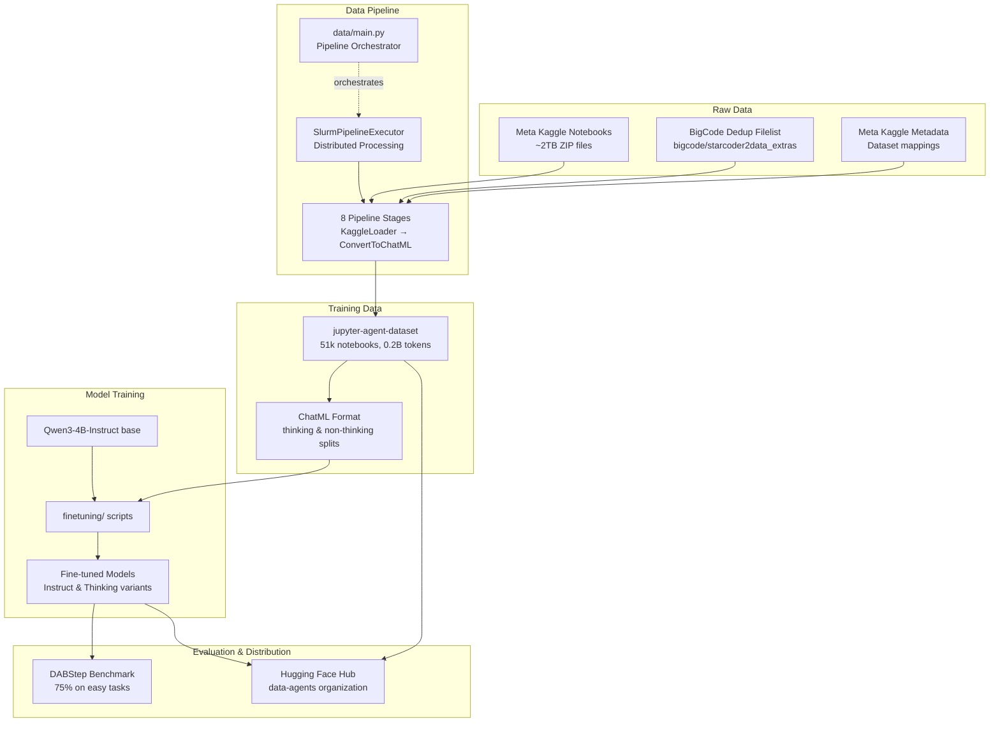
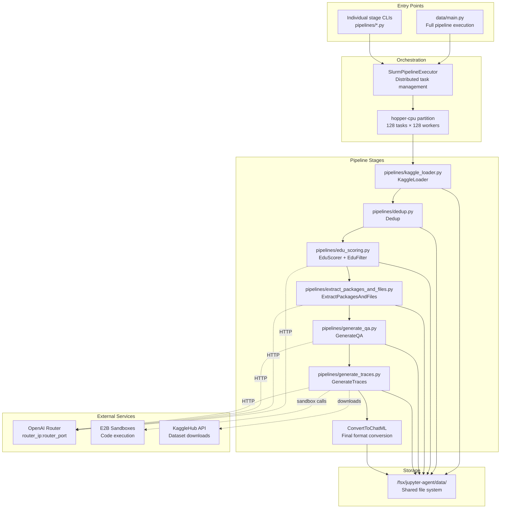
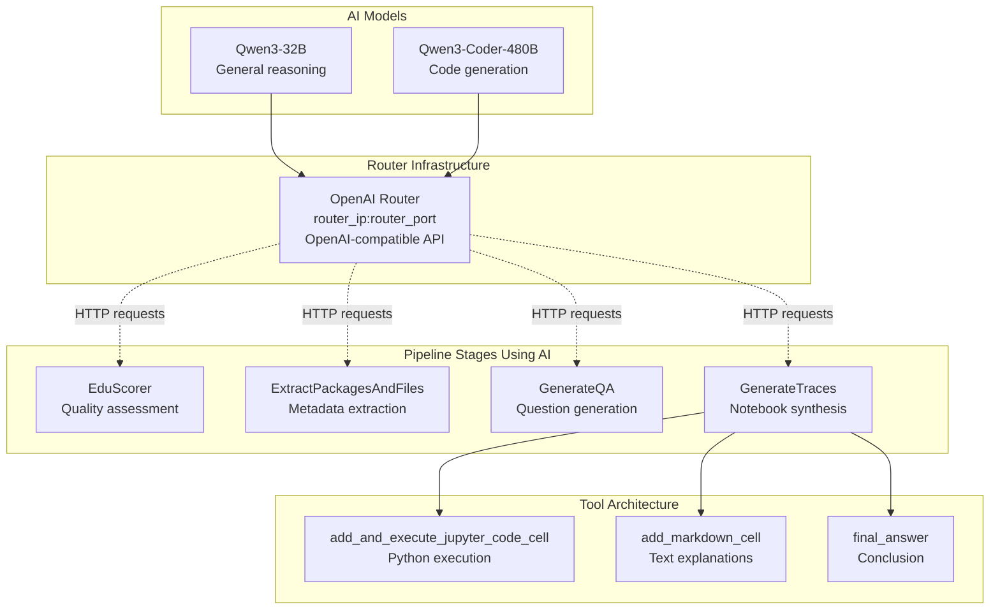
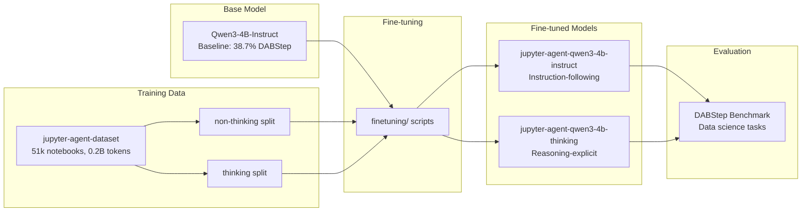

<!-- source: DeepWiki mcp.deepwiki.com · repo huggingface/jupyter-agent · page 1 Jupyter Agent Overview · fetched 2026-10-26 -->

# Jupyter Agent Overview

<details>
<summary>Relevant source files</summary>

The following files were used as context for generating this wiki page:

- [README.md](README.md)
- [data/README.md](data/README.md)

</details>


## Purpose and Scope

This document provides a high-level overview of the Jupyter Agent project, explaining what it is, what it does, and how its components fit together. It covers the end-to-end lifecycle from raw Kaggle notebooks (2TB) to trained data science agents capable of executing Python code within Jupyter environments.

For detailed information about specific subsystems:
- **Pipeline architecture and execution**: See [Data Generation Pipeline](#2)
- **Infrastructure configuration and setup**: See [Development Guide](#5)
- **AI model integration details**: See [AI Model Integration](#3)
- **Model performance and usage**: See [Models and Evaluation](#4)

---

## What is Jupyter Agent?

Jupyter Agent is an open-source data science agent designed to operate within Jupyter notebook environments. It combines language understanding with code execution capabilities to assist with data analysis workflows.

**Core capabilities:**
- Read notebook and dataset context
- Execute Python code (`pandas`, `numpy`, `matplotlib`, etc.)
- Generate step-by-step reasoning traces with intermediate computations
- Produce data-grounded answers to analysis questions

**Released artifacts:**
- **Dataset**: [jupyter-agent-dataset](https://huggingface.co/datasets/data-agents/jupyter-agent-dataset) - 51k synthetic notebooks, ~0.2B tokens
- **Models**: 
  - [jupyter-agent-qwen3-4b-instruct](https://huggingface.co/data-agents/jupyter-agent-qwen3-4b-instruct)
  - [jupyter-agent-qwen3-4b-thinking](https://huggingface.co/data-agents/jupyter-agent-qwen3-4b-thinking)
- **Pipeline**: Data generation code and fine-tuning scripts

**Sources:** [README.md:1-27]()

---

## System Architecture

The Jupyter Agent project consists of three major subsystems that transform raw notebooks into production-ready data science agents.

### High-Level System Components



The system implements a three-phase pipeline:

1. **Data Generation** ([data/](https://github.com/huggingface/jupyter-agent/tree/main/data)): Processes 2TB of raw Kaggle notebooks through 8 stages of filtering, scoring, enrichment, and trace generation
2. **Model Training** ([finetuning/](https://github.com/huggingface/jupyter-agent/tree/main/finetuning)): Fine-tunes Qwen3-4B-Instruct on the curated dataset
3. **Distribution**: Publishes dataset and models to Hugging Face Hub for community use

**Sources:** [README.md:34-46](), [data/README.md:1-28]()

---

## Pipeline Entry Points and Orchestration

The data generation pipeline can be executed as a complete workflow or as individual stages for debugging and development.



The pipeline supports two execution modes:

| Execution Mode | Command | Use Case |
|----------------|---------|----------|
| Full Pipeline | `uv run data/main.py -r <ROUTER_IP:PORT>` | Production runs |
| Individual Stage | `uv run pipelines/dedup.py` | Testing, debugging |

Each stage reads from and writes to the shared file system at `/fsx/jupyter-agent/data/`, enabling resumable execution and intermediate inspection.

**Sources:** [data/README.md:112-135](), [data/main.py:1-119]()

---

## Data Generation Pipeline Overview

The pipeline implements an aggressive filtering funnel that transforms 2TB of raw notebooks into 51k high-quality training examples.

### Pipeline Stages and Data Flow

```mermaid
graph LR
    subgraph "Stage 1-2: Ingestion"
        A1["KaggleLoader<br/>Extract from 191 folders"]
        A2["Dedup<br/>BigCode filelist"]
    end
    
    subgraph "Stage 3-4: Quality"
        B1["AddMarkdownToNotebook<br/>nbconvert + Jinja2"]
        B2["EduScorer<br/>Score 0-5"]
        B3["EduFilter<br/>Keep ≥ 4"]
    end
    
    subgraph "Stage 5: Metadata"
        C1["ExtractPackagesAndFiles<br/>LLM extraction"]
        C2["RemoveNoFilesUsed<br/>Data-focused filter"]
    end
    
    subgraph "Stage 6: QA"
        D1["GenerateQA<br/>Multi-step Q&A"]
    end
    
    subgraph "Stage 7: Datasets"
        E1["KaggleDatasetMapper<br/>Match datasets"]
        E2["DataSourceMapper<br/>Classify sources"]
        E3["DatasetMapFilter<br/>Filter by type"]
        E4["KaggleDatasetDownloader<br/>Download data"]
    end
    
    subgraph "Stage 8: Traces"
        F1["GenerateTraces<br/>Qwen3-Coder-480B"]
        F2["ConvertToChatML<br/>Training format"]
    end
    
    A1 --> A2
    A2 --> B1
    B1 --> B2
    B2 --> B3
    B3 --> C1
    C1 --> C2
    C2 --> D1
    D1 --> E1
    E1 --> E2
    E2 --> E3
    E3 --> E4
    E4 --> F1
    F1 --> F2
```



**Filtering funnel statistics:**

| Stage | Operation | Data Reduction |
|-------|-----------|----------------|
| 1 | Raw notebooks | 2TB (~millions of notebooks) |
| 2 | Deduplication | 90% removed |
| 4 | Quality scoring (score ≥ 4) | Additional filtering |
| 5 | Requires data files | Removes code-only notebooks |
| 8 | Final dataset | 51k notebooks, 0.2B tokens |

The pipeline reduces raw data by ~99.5% while preserving high-quality, data-focused notebooks suitable for training data science agents.

**Sources:** [data/README.md:34-89](), [README.md:36-45]()

---

## AI Model Integration

The pipeline relies on external language models accessed via an OpenAI-compatible router for multiple stages.

### LLM Dependencies by Stage



**Model usage:**
- **Qwen3-32B**: Used in stages 4, 5, and 6 for scoring, metadata extraction, and QA generation
- **Qwen3-Coder-480B**: Used in stage 8 for synthetic notebook generation with code execution traces

The router endpoint must be configured via the `-r <ROUTER_IP:PORT>` CLI argument when running pipeline stages that require LLM access.

**Sources:** [data/README.md:108-135]()

---

## Dataset Format and Structure

The final dataset is produced in ChatML format, a conversation-style structure compatible with modern instruction-tuning frameworks.

### Data Splits

| Split | Description | Size | Use Case |
|-------|-------------|------|----------|
| `non-thinking` | Direct instruction-following traces | ~0.1B tokens | Standard agent fine-tuning |
| `thinking` | Explicit reasoning traces | ~0.1B tokens | Chain-of-thought training |

Both splits contain the same 51k notebooks but with different formatting:
- **Non-thinking**: Tool calls without explicit reasoning steps
- **Thinking**: Includes LLM-generated reasoning before each action

### Document Structure

Each document in the dataset contains:
- **question**: Multi-step analysis question
- **answer**: Factual answer from notebook outputs
- **files_used**: List of dataset files referenced
- **packages_used**: Python libraries used
- **kaggle_dataset_path**: Path to original Kaggle dataset
- **messages**: ChatML conversation array with tool calls and responses

**Sources:** [data/README.md:88-89](), [README.md:62-67]()

---

## Model Training and Evaluation

### Fine-tuning Process

The pipeline fine-tunes Qwen3-4B-Instruct on the generated dataset to produce two model variants:



### Performance Results

| Model | DABStep Easy | Improvement |
|-------|-------------|-------------|
| Qwen3-4B-Instruct (base) | 38.7% | Baseline |
| With scaffolding | 52.8% | +36.4% |
| **After fine-tuning** | **75.0%** | **+93.8%** |

The fine-tuned model achieves state-of-the-art performance for its size on the DABStep benchmark, demonstrating nearly 2x improvement over the base model.

**Sources:** [README.md:79-87]()

---

## Distribution and Usage

### Hugging Face Hub

All artifacts are publicly available under the `data-agents` organization:

- **Dataset**: `data-agents/jupyter-agent-dataset`
- **Models**: 
  - `data-agents/jupyter-agent-qwen3-4b-instruct`
  - `data-agents/jupyter-agent-qwen3-4b-thinking`

### Loading the Dataset

```python
from datasets import load_dataset
ds = load_dataset("data-agents/jupyter-agent-dataset", split="non-thinking")
```

### Loading a Fine-tuned Model

```python
from transformers import AutoModelForCausalLM, AutoTokenizer

model_name = "data-agents/jupyter-agent-qwen3-4b-instruct"
tokenizer = AutoTokenizer.from_pretrained(model_name)
model = AutoModelForCausalLM.from_pretrained(
    model_name, 
    torch_dtype="auto", 
    device_map="auto"
)
```

**Sources:** [README.md:62-77](), [README.md:89-94]()

---

## Key Technologies and Dependencies

| Component | Technology | Purpose |
|-----------|-----------|---------|
| Pipeline orchestration | Slurm | Distributed processing across 128 tasks |
| Notebook conversion | `nbconvert`, Jinja2 | Jupyter → Markdown transformation |
| LLM integration | OpenAI-compatible API | Scoring, extraction, QA, traces |
| Code execution | E2B sandboxes | Safe Python code execution |
| Dataset downloads | KaggleHub API | Original dataset retrieval |
| Model training | Transformers, PEFT | Fine-tuning infrastructure |
| Storage | Shared FSX filesystem | `/fsx/jupyter-agent/data/` |

The system is designed for large-scale batch processing with substantial computational resources (512 CPUs, 8TB RAM across 128 tasks).

**Sources:** [data/README.md:92-107](), [data/README.md:112-135]()

---

## Related Resources

- **Blog post**: [Jupyter Agent: Building Data Science Agents](https://huggingface.co/blog/jupyter-agent-2)
- **Live demo**: [Jupyter Agent Demo Space](https://huggingface.co/spaces/lvwerra/jupyter-agent-2)
- **DABStep Benchmark**: [Evaluation benchmark for data agents](https://huggingface.co/spaces/adyen/DABstep)
- **Model collection**: [All Jupyter Agent models](https://huggingface.co/collections/data-agents/jupyter-agent-66f43f63b3d87c9ac69039eb)

**Sources:** [README.md:89-94](), [README.md:14]()

---

