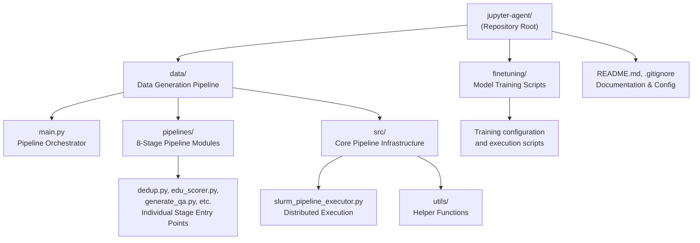
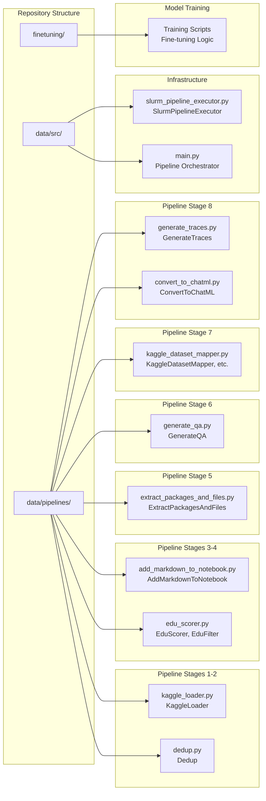
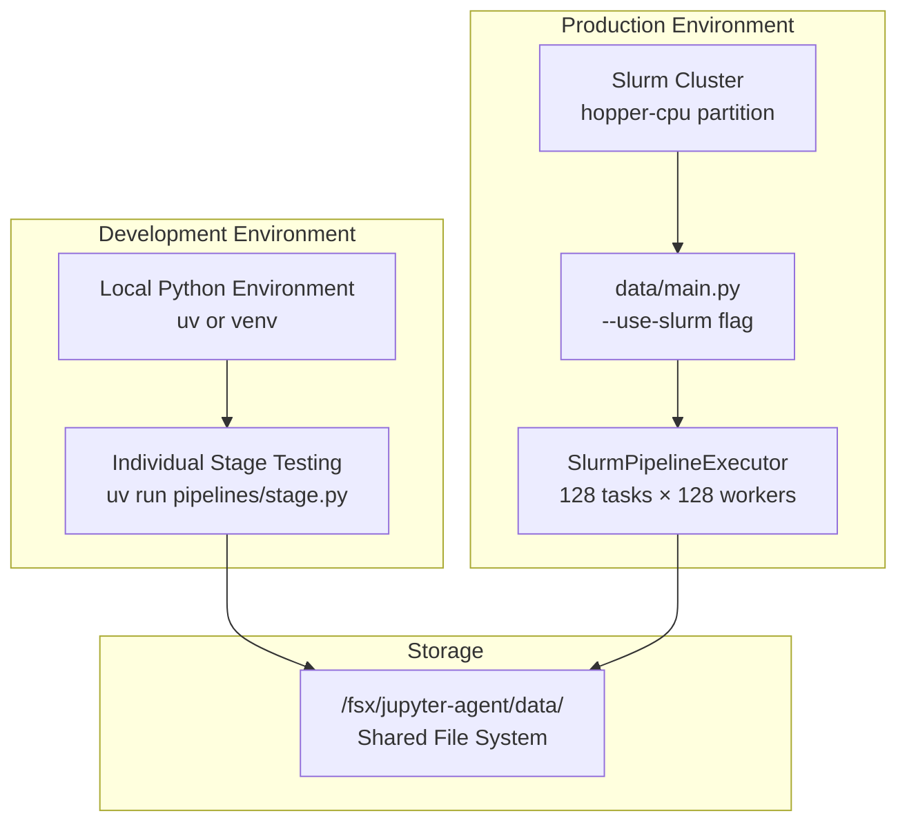

<!-- source: DeepWiki mcp.deepwiki.com · repo huggingface/jupyter-agent · page 1.1 Repository Structure · fetched 2026-10-26 -->

# Repository Structure

Relevant source files

The following files were used as context for generating this wiki page:

- [.gitignore](.gitignore)
- [README.md](README.md)
- [data/__init__.py](data/__init__.py)
- [data/pipelines/utils/__init__.py](data/pipelines/utils/__init__.py)

## Purpose and Scope

This document provides an overview of the Jupyter Agent repository's directory structure and organization. It describes the role of each major directory and how they relate to the overall system architecture. For detailed information about running the pipeline, see [Running the Pipeline](#5.2). For file system storage paths and data locations, see [Data Storage and Paths](#5.3).

## High-Level Directory Layout

The repository is organized around two primary workflows: data generation and model training. The following diagram shows the main directory structure and their functional purposes:

**Sources:** [README.md:1-104](), [.gitignore:1-202](), [data/__init__.py:1-1]()

## Core Directories

### data/ - Data Generation Pipeline

The `data/` directory contains the complete 8-stage pipeline that transforms raw Kaggle notebooks into training data. This is the primary codebase for data processing.

| Component | Purpose | Key Files |
|-----------|---------|-----------|
| `main.py` | Entry point for running the full pipeline or individual stages | Pipeline orchestrator with CLI |
| `pipelines/` | Individual stage implementations | `dedup.py`, `edu_scorer.py`, `generate_qa.py`, `generate_traces.py`, etc. |
| `src/` | Core infrastructure and utilities | `slurm_pipeline_executor.py`, `document.py`, utilities |
| `src/utils/` | Shared helper functions | File processing, LLM clients, metadata handling |

Each pipeline stage can be executed independently via its module file (e.g., `uv run pipelines/dedup.py`) or as part of the full orchestrated pipeline via `main.py`.

**Sources:** [README.md:59-60](), [data/__init__.py:1-1](), [data/pipelines/utils/__init__.py:1-1]()

### finetuning/ - Model Training

The `finetuning/` directory contains scripts and configurations for fine-tuning Qwen3-4B base models on the generated dataset. This produces the two model variants:

- **Jupyter-Agent-Qwen3-4B-Instruct**: Standard instruction-following model
- **Jupyter-Agent-Qwen3-4B-Thinking**: Model with explicit reasoning traces

The training process takes ChatML-formatted data from the pipeline output and fine-tunes the base models using the configurations in this directory.

**Sources:** [README.md:60-61](), [README.md:23-26]()

### Configuration and Documentation Files

| File | Purpose |
|------|---------|
| `README.md` | Project overview, quick start guide, usage examples |
| `.gitignore` | Excludes build artifacts, data files (`.jsonl`, `.parquet`), logs, models, workspace directories |
| `pyproject.toml` (implied) | Python package configuration for dependency management |

**Sources:** [README.md:1-104](), [.gitignore:1-202]()

## Directory-to-Pipeline Mapping

The following diagram maps repository directories to the pipeline stages and system components they implement:

**Sources:** [README.md:36-45](), Diagrams 2, 3, and 6 from high-level architecture

## File Organization Patterns

### Python Package Structure

The codebase follows standard Python package conventions:

- **`__init__.py` files**: Mark directories as packages (`data/__init__.py`, `data/pipelines/utils/__init__.py`)
- **Module-level entry points**: Each pipeline stage has a corresponding `.py` file in `pipelines/` with CLI capability
- **Shared utilities**: Common code in `src/` and `src/utils/` for reuse across stages

### Data File Conventions

Based on the `.gitignore` patterns, the repository handles several data file types:

| File Type | Purpose | Excluded from Git |
|-----------|---------|-------------------|
| `.jsonl`, `.jsonl.gz` | Pipeline outputs, training data | Yes |
| `.parquet` | Intermediate data storage | Yes |
| Notebooks (`.ipynb`) | Checkpoints, development notebooks | Yes (`.ipynb_checkpoints`) |

### Output Directories

The following directories are generated during execution and excluded from version control:

- **`logs/`**: Pipeline execution logs
- **`eval_results/`, `evaluation_results*`**: Model evaluation outputs
- **`models/`**: Trained model checkpoints
- **`training-data/`**: Processed training datasets
- **`workspace/`, `debug-data/`**: Development and debugging artifacts
- **`wandb/`, `runs/`**: Experiment tracking data

**Sources:** [.gitignore:174-201]()

## Execution Environment Patterns

The repository is designed for distributed execution on HPC infrastructure:

The `data/main.py` orchestrator supports two execution modes:
1. **Local execution**: For development and single-stage testing
2. **Slurm execution**: For full pipeline runs with distributed processing (`--use-slurm` flag)

**Sources:** [README.md:52-61](), Diagram 3 from high-level architecture

## External Dependencies

The repository integrates with external services and datasets:

| Dependency | Purpose | Configuration |
|------------|---------|---------------|
| Kaggle Hub API | Download source datasets | `KAGGLEHUB_CACHE` environment variable |
| OpenAI-compatible Router | LLM inference (Qwen3-32B, Qwen3-Coder-480B) | `router_ip:router_port` configuration |
| E2B Sandboxes | Safe code execution during trace generation | API credentials |
| Hugging Face Hub | Dataset and model distribution | Standard authentication |

These dependencies are configured through environment variables and are required for different pipeline stages. For setup details, see [Environment Setup](#5.1).

**Sources:** Diagrams 3 and 4 from high-level architecture, [README.md:19-26]()

---

