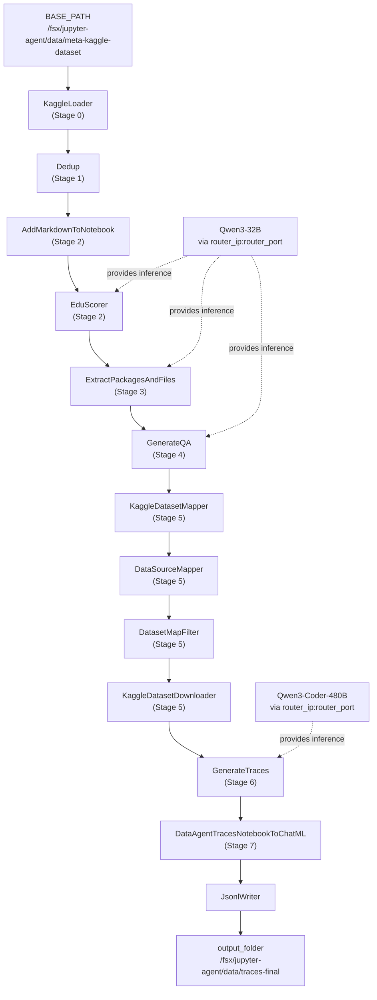
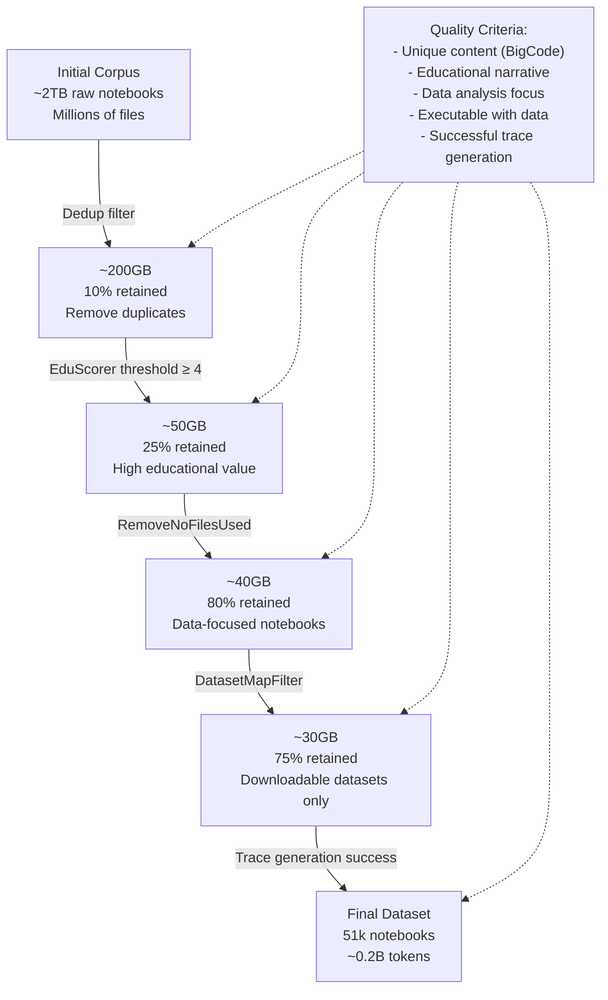
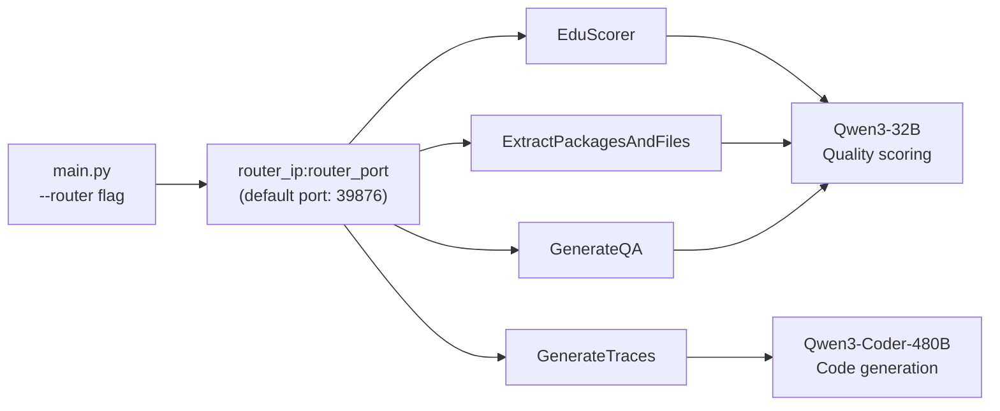
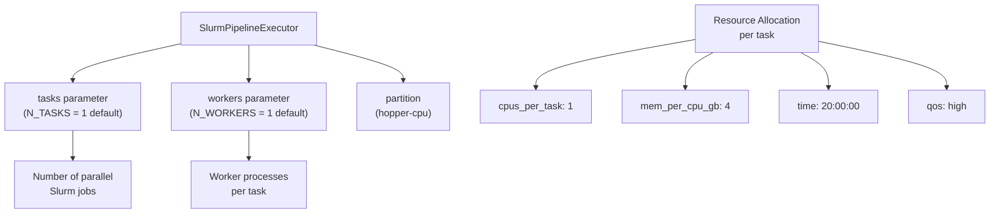

<!-- source: DeepWiki mcp.deepwiki.com · repo huggingface/jupyter-agent · page 2 Data Generation Pipeline · fetched 2026-10-26 -->

# Data Generation Pipeline

<details>
<summary>Relevant source files</summary>

The following files were used as context for generating this wiki page:

- [data/README.md](data/README.md)
- [data/main.py](data/main.py)

</details>


## Purpose and Scope

This document provides a comprehensive overview of the 8-stage data generation pipeline that transforms raw Kaggle notebooks (~2TB) into curated training data for Jupyter Agent models. The pipeline implements an aggressive filtering strategy, reducing the dataset from millions of notebooks to 51,000 high-quality examples (~0.2B tokens) suitable for fine-tuning.

**Related Pages:**
- For details on pipeline orchestration and execution infrastructure, see [Pipeline Orchestration](#2.1)
- For individual stage implementations, see sections [2.2](#2.2) through [2.8](#2.8)
- For environment setup and execution instructions, see [Development Guide](#5)
- For model training using pipeline outputs, see [Models and Evaluation](#4)

## Pipeline Architecture

The pipeline is defined in [data/main.py:58-84]() as a sequence of transformations applied to notebook documents. Each stage is implemented as a `datatrove` pipeline component that processes documents in a distributed manner.

### Stage Components and Data Flow



**Sources:** [data/main.py:1-101](), [data/README.md:1-135]()

### Stage Summary Table

| Stage | Components | Input Volume | Output Volume | Key Operations |
|-------|-----------|--------------|---------------|----------------|
| 0 | `KaggleLoader` | ~2TB ZIP files (191 folders) | ~2TB raw notebooks | Extract `.ipynb` from archives |
| 1 | `Dedup` | ~2TB | ~200GB (90% reduction) | Filter using BigCode filelist |
| 2 | `AddMarkdownToNotebook`<br/>`EduScorer` | ~200GB | ~50GB (score ≥ 4) | Convert to markdown, LLM scoring |
| 3 | `ExtractPackagesAndFiles` | ~50GB | ~40GB (data-focused) | Extract metadata, filter no-files |
| 4 | `GenerateQA` | ~40GB | ~40GB (1 QA per doc) | Generate multi-step questions |
| 5 | `KaggleDatasetMapper`<br/>`DataSourceMapper`<br/>`DatasetMapFilter`<br/>`KaggleDatasetDownloader` | ~40GB | ~30GB (downloadable only) | Link to original datasets |
| 6 | `GenerateTraces` | ~30GB | 51k notebooks | Generate synthetic execution traces |
| 7 | `DataAgentTracesNotebookToChatML` | 51k notebooks | ~0.2B tokens | Convert to training format |

**Sources:** [data/README.md:34-89]()

## Document Flow and Transformations

The pipeline maintains a `Document` object abstraction throughout all stages. Each stage reads documents, performs transformations, and passes enriched documents to the next stage.

### Document Metadata Evolution

```mermaid
graph LR
    A["Raw Document<br/>text: ipynb JSON<br/>metadata: {}"] --> B["After Dedup<br/>+ file_path<br/>+ is_duplicate"]
    B --> C["After AddMarkdown<br/>+ markdown_text"]
    C --> D["After EduScorer<br/>+ edu_score (0-5)<br/>+ score_reasoning"]
    D --> E["After Extract<br/>+ files_used[]<br/>+ packages_used[]"]
    E --> F["After GenerateQA<br/>+ question<br/>+ answer"]
    F --> G["After DatasetMap<br/>+ kaggle_dataset_path<br/>+ data_source_type"]
    G --> H["After GenerateTraces<br/>+ trace_messages[]<br/>+ tool_calls[]"]
    H --> I["ChatML Format<br/>messages: [{role, content}]"]
```



**Sources:** [data/main.py:58-84](), [data/README.md:3-28]()

### Key Transformation Points

1. **Format Conversion** ([data/main.py:66]()):
   - `AddMarkdownToNotebook` converts `.ipynb` JSON to structured markdown using `nbconvert` with custom Jinja2 templates
   - Enables LLM processing of notebook structure

2. **Metadata Enrichment** ([data/main.py:67-70]()):
   - `EduScorer` adds quality scores (0-5) using Qwen3-32B
   - `ExtractPackagesAndFiles` adds dependency metadata using LLM extraction

3. **Content Generation** ([data/main.py:73-80]()):
   - `GenerateQA` creates complex questions with extractable answers
   - `GenerateTraces` synthesizes agent interaction traces with code execution

4. **Format Standardization** ([data/main.py:81]()):
   - `DataAgentTracesNotebookToChatML` converts to training-ready ChatML format with `role` and `content` fields

**Sources:** [data/main.py:4-21]()

## Filtering Strategy

The pipeline implements a funnel architecture with aggressive filtering at multiple stages to ensure high-quality training data.

### Filtering Stages and Rationale



**Sources:** [data/README.md:43-46](), [data/README.md:54-63]()

### Filtering Rationale Table

| Filter Component | Location | Threshold | Purpose |
|-----------------|----------|-----------|---------|
| `Dedup` | [data/main.py:62]() | BigCode filelist match | Remove duplicate content from raw corpus |
| `EduFilter` (commented) | [data/main.py:68]() | `edu_score >= 4` | Keep only high-quality educational notebooks |
| `RemoveNoFilesUsed` (commented) | [data/main.py:71]() | `len(files_used) > 0` | Focus on data analysis notebooks |
| `DatasetMapFilter` | [data/main.py:77]() | `data_source_type` valid | Keep only notebooks with accessible datasets |

**Note:** Filters marked as commented in [data/main.py]() are implemented but may be conditionally enabled. The implicit filtering occurs through stage-specific logic (e.g., `EduScorer` only passes documents meeting criteria forward).

**Sources:** [data/main.py:58-84]()

## Architectural Decisions

### LLM Service Integration

The pipeline relies on external LLM services accessed through an OpenAI-compatible router endpoint. This design decision enables:

1. **Model Flexibility:** Different stages can use different models (Qwen3-32B for scoring/extraction, Qwen3-Coder-480B for code generation)
2. **Resource Efficiency:** Delegates compute-intensive inference to specialized services
3. **Scalability:** Multiple pipeline workers share the same model endpoints

**Router Configuration:**



**Configuration in code:** [data/main.py:28-45]()

**Sources:** [data/main.py:25-46](), [data/README.md:110-116]()

### Distributed Processing Model

The pipeline uses `SlurmPipelineExecutor` for distributed execution on HPC clusters:



**Default configuration:** [data/main.py:47-49]()

**Executor configuration:** [data/main.py:57-95]()

**Key Parameters:**
- `tasks`: Number of parallel Slurm jobs (default: 1)
- `workers`: Worker processes per task (default: 1)
- `cpus_per_task`: CPU cores per task (default: 1)
- `mem_per_cpu_gb`: Memory per CPU in GB (default: 4)
- `partition`: Slurm partition name (`hopper-cpu`)
- `skip_completed`: Resume from last completed stage (default: `False`)

**Sources:** [data/main.py:47-95]()

## Pipeline Configuration

### Entry Point and Execution

The main entry point is [data/main.py:25-101](), which accepts command-line arguments for router configuration:

```bash
# Minimal execution (single task, single worker)
uv run main.py --router <ROUTER_IP:PORT>

# With explicit port
uv run main.py --router 192.168.1.100:39876
```

**Argument parsing:** [data/main.py:28-45]()

### Critical Path Configuration

| Parameter | Location | Default Value | Purpose |
|-----------|----------|---------------|---------|
| `BASE_PATH` | [data/main.py:51]() | `/fsx/jupyter-agent/data/meta-kaggle-dataset` | Input data location |
| `output_folder` | [data/main.py:53]() | `/fsx/jupyter-agent/data/traces-final` | Final dataset output |
| `logs_file` | [data/main.py:55]() | `logs/jupyter-agent-data-pipeline` | Execution logs |
| `LIMIT` | [data/main.py:49]() | `-1` (unlimited) | Document limit for testing |
| `max_file_size` | [data/main.py:83]() | `10^9` (1GB) | JSONL chunk size |

**Sources:** [data/main.py:47-84]()

### Stage-by-Stage Pipeline Definition

The complete pipeline is defined as a Python list in [data/main.py:58-84]():

```python
pipeline=[
    KaggleLoader(base_path=BASE_PATH, limit=LIMIT),              # Stage 0
    Dedup(),                                                      # Stage 1
    AddMarkdownToNotebook(),                                      # Stage 2
    EduScorer(router_ip=router_ip, router_port=router_port),    # Stage 2
    ExtractPackagesAndFiles(router_ip=router_ip, router_port=router_port),  # Stage 3
    GenerateQA(router_ip=router_ip, router_port=int(router_port)),          # Stage 4
    KaggleDatasetMapper(),                                        # Stage 5
    DataSourceMapper(),                                           # Stage 5
    DatasetMapFilter(),                                           # Stage 5
    KaggleDatasetDownloader(),                                    # Stage 5
    GenerateTraces(router_ip=router_ip, router_port=router_port),           # Stage 6
    DataAgentTracesNotebookToChatML(),                           # Stage 7
    JsonlWriter(output_folder=output_folder, max_file_size=int(10**9)),
]
```

Each component is instantiated with specific configuration and added to the pipeline sequence. Components requiring LLM access receive `router_ip` and `router_port` parameters.

**Sources:** [data/main.py:1-101]()

## Pipeline Outputs

The pipeline produces two primary outputs:

1. **Intermediate Data:** Each stage writes processed documents to the shared file system, enabling debugging and stage-by-stage inspection
2. **Final Dataset:** Structured JSONL files in ChatML format, chunked into 1GB files for distributed training

**Output structure:**
```
/fsx/jupyter-agent/data/traces-final/
├── 00000.jsonl  (≤1GB)
├── 00001.jsonl  (≤1GB)
└── ...
```

Each JSONL file contains documents with:
- `messages`: Array of `{role, content}` objects
- Original notebook metadata
- Generated QA pairs and execution traces

**Writer configuration:** [data/main.py:83]()

**Sources:** [data/main.py:53-84](), [data/README.md:17]()

---

