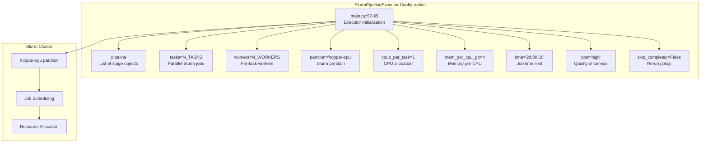
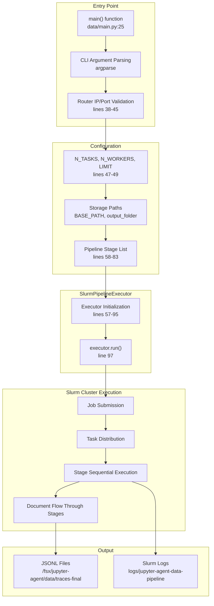
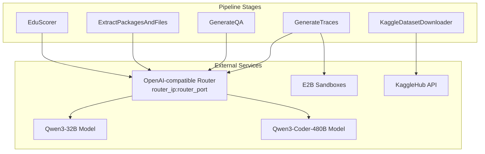
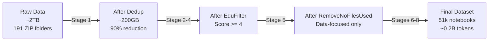

<!-- source: DeepWiki mcp.deepwiki.com · repo huggingface/jupyter-agent · page 2.1 Pipeline Orchestration · fetched 2026-10-26 -->

# Pipeline Orchestration

<details>
<summary>Relevant source files</summary>

The following files were used as context for generating this wiki page:

- [data/README.md](data/README.md)
- [data/main.py](data/main.py)

</details>


This document explains how the Jupyter Agent data generation pipeline is orchestrated and executed. It covers the central orchestration mechanism in `data/main.py`, the distributed execution architecture using `SlurmPipelineExecutor`, resource allocation strategies, and execution modes. For details about individual pipeline stages, see sections [2.2](#2.2) through [2.8](#2.8). For environment setup and running instructions, see [5.1](#5.1) and [5.2](#5.2).

## Overview

The pipeline orchestration system coordinates the execution of eight sequential data processing stages that transform raw Kaggle notebooks (2TB) into training-ready ChatML format. The orchestrator uses the `SlurmPipelineExecutor` from the datatrove library to manage distributed execution across a Slurm cluster, handling task scheduling, resource allocation, and data flow between stages.

**Sources:** [data/main.py:1-101](), [data/README.md:1-135]()

## Main Orchestration Entry Point

### The `data/main.py` Script

The `main()` function in [data/main.py:25-101]() serves as the primary entry point for pipeline execution. It accepts router configuration via CLI arguments and constructs the complete pipeline with all stages.

**CLI Arguments:**

| Argument | Short | Required | Description | Default |
|----------|-------|----------|-------------|---------|
| `--router` | `-r` | Yes | Router address for LLM services | None |
| Format | | | `IP:PORT` or `IP` only | Port 39876 if omitted |

**Example Usage:**
```bash
cd data
uv run main.py -r 192.168.1.100:39876
```

The router configuration is parsed at [data/main.py:38-42]() and validated to ensure both IP and port are available for downstream stages.

**Sources:** [data/main.py:25-46]()

### Configuration Parameters

The orchestrator defines several key configuration parameters at [data/main.py:47-53]():

```python
N_TASKS = 1
N_WORKERS = 1
LIMIT = -1
BASE_PATH = "/fsx/jupyter-agent/data/meta-kaggle-dataset"
output_folder = "/fsx/jupyter-agent/data/traces-final"
logs_file = "logs/jupyter-agent-data-pipeline"
```

| Parameter | Purpose | Value |
|-----------|---------|-------|
| `N_TASKS` | Number of parallel Slurm tasks | 1 (configurable) |
| `N_WORKERS` | Workers per task for multiprocessing | 1 (configurable) |
| `LIMIT` | Maximum documents to process (-1 = unlimited) | -1 |
| `BASE_PATH` | Input directory for raw Kaggle data | `/fsx/jupyter-agent/data/meta-kaggle-dataset` |
| `output_folder` | Final output directory for ChatML data | `/fsx/jupyter-agent/data/traces-final` |
| `logs_file` | Slurm job logs directory | `logs/jupyter-agent-data-pipeline` |

**Sources:** [data/main.py:47-55]()

## SlurmPipelineExecutor Architecture

### Executor Configuration

The `SlurmPipelineExecutor` is instantiated at [data/main.py:57-95]() with comprehensive configuration for distributed execution:



**Sources:** [data/main.py:57-95]()

### Resource Allocation Strategy

The executor allocates resources per task as configured at [data/main.py:90-92]():

| Resource | Per Task | Total (N_TASKS=128) |
|----------|----------|---------------------|
| CPUs | 1 | 128 |
| Memory | 4 GB | 512 GB |
| Workers | 1 | 128 |
| Time Limit | 20 hours | 20 hours |
| Partition | `hopper-cpu` | `hopper-cpu` |
| QoS | `high` | `high` |

The configuration in the provided code shows minimal resource allocation (1 task, 1 worker, 1 CPU, 4GB). In production, these parameters are typically scaled up significantly (e.g., 128 tasks × 128 workers as mentioned in Diagram 3 of the high-level architecture).

**Sources:** [data/main.py:85-92]()

### Skip Completed Mechanism

The `skip_completed=False` parameter at [data/main.py:93]() controls whether the executor reruns stages that have already completed. When set to `False`, all stages are re-executed even if intermediate outputs exist. This ensures reproducibility but increases compute costs.

**Sources:** [data/main.py:93]()

## Pipeline Stage Sequence

### Stage Declaration and Flow

The pipeline is defined as a list of stage objects at [data/main.py:58-83](). Each stage is a class instance that implements the datatrove pipeline interface:

```mermaid
graph LR
    Stage0["KaggleLoader<br/>Stage 0"]
    Stage1["Dedup<br/>Stage 1"]
    Stage2A["AddMarkdownToNotebook<br/>Stage 2"]
    Stage2B["EduScorer<br/>Stage 2"]
    Stage3A["ExtractPackagesAndFiles<br/>Stage 3"]
    Stage4["GenerateQA<br/>Stage 4"]
    Stage5A["KaggleDatasetMapper<br/>Stage 5"]
    Stage5B["DataSourceMapper<br/>Stage 5"]
    Stage5C["DatasetMapFilter<br/>Stage 5"]
    Stage5D["KaggleDatasetDownloader<br/>Stage 5"]
    Stage6["GenerateTraces<br/>Stage 6"]
    Stage7["DataAgentTracesNotebookToChatML<br/>Stage 7"]
    Writer["JsonlWriter<br/>Final Output"]
    
    Stage0 --> Stage1
    Stage1 --> Stage2A
    Stage2A --> Stage2B
    Stage2B --> Stage3A
    Stage3A --> Stage4
    Stage4 --> Stage5A
    Stage5A --> Stage5B
    Stage5B --> Stage5C
    Stage5C --> Stage5D
    Stage5D --> Stage6
    Stage6 --> Stage7
    Stage7 --> Writer
```



**Sources:** [data/main.py:58-83]()

### Stage Initialization Parameters

Each stage receives initialization parameters that configure its behavior:

**Stage 0 - KaggleLoader** [data/main.py:60]()
- `base_path`: Input directory path
- `limit`: Maximum documents to load

**Stage 2 - EduScorer** [data/main.py:67]()
- `router_ip`: LLM service IP address
- `router_port`: LLM service port

**Stage 3 - ExtractPackagesAndFiles** [data/main.py:70]()
- `router_ip`: LLM service IP address
- `router_port`: LLM service port

**Stage 4 - GenerateQA** [data/main.py:73]()
- `router_ip`: LLM service IP address
- `router_port`: LLM service port (cast to int)

**Stage 6 - GenerateTraces** [data/main.py:80]()
- `router_ip`: LLM service IP address
- `router_port`: LLM service port

**Final Writer - JsonlWriter** [data/main.py:83]()
- `output_folder`: Output directory path
- `max_file_size`: Maximum file size in bytes (1GB)

**Sources:** [data/main.py:60-83]()

### Commented and Debugging Stages

The pipeline includes commented-out stages at [data/main.py:64]() and [data/main.py:68-71]():

- **JsonlReader** [data/main.py:64](): Allows resuming from S3 intermediate outputs for debugging
- **EduFilter** [data/main.py:68](): Filters by educational score threshold (≥4)
- **RemoveNoFilesUsed** [data/main.py:71](): Filters notebooks without file usage

These stages can be uncommented to enable filtering or resume from intermediate checkpoints.

**Sources:** [data/main.py:64-71]()

## Execution Flow Architecture

The following diagram shows how the orchestrator coordinates execution:



**Sources:** [data/main.py:25-101]()

## Individual Stage Execution

### Standalone Stage Invocation

Each pipeline stage can be executed independently using its own CLI script. The README documents this at [data/README.md:120-135]():

```bash
# Load and deduplicate Kaggle notebooks  
uv run pipelines/kaggle_loader.py
uv run pipelines/dedup.py

# Educational scoring (requires model endpoint)
uv run pipelines/edu_scoring.py -r <ROUTER_IP:PORT>

# Metadata + QA generation (requires model endpoint)  
uv run pipelines/extract_packages_and_files.py -r <ROUTER_IP:PORT>
uv run pipelines/generate_qa.py -r <ROUTER_IP:PORT>
```

This allows for:
- **Debugging**: Test individual stages in isolation
- **Development**: Iterate on single stage implementations
- **Recovery**: Rerun failed stages without full pipeline re-execution
- **Testing**: Validate stage outputs before full pipeline runs

**Sources:** [data/README.md:120-135]()

### Stage Independence vs. Dependencies

While stages can run independently, they have data dependencies:

| Stage | Input Dependency | Can Run Standalone |
|-------|------------------|-------------------|
| KaggleLoader | Raw ZIP files | ✅ Yes |
| Dedup | KaggleLoader output | ❌ No |
| AddMarkdownToNotebook | Dedup output | ❌ No |
| EduScorer | AddMarkdownToNotebook output | ❌ No |
| ExtractPackagesAndFiles | EduScorer output | ❌ No |
| GenerateQA | ExtractPackagesAndFiles output | ❌ No |
| KaggleDatasetMapper | GenerateQA output | ❌ No |
| GenerateTraces | KaggleDatasetDownloader output | ❌ No |
| DataAgentTracesNotebookToChatML | GenerateTraces output | ❌ No |

**Sources:** [data/README.md:120-135](), [data/main.py:58-83]()

## Router Configuration and External Dependencies

### Router IP/Port Management

The orchestrator handles router configuration parsing at [data/main.py:38-45]():

```python
if ":" in args.router:
    router_ip, router_port = args.router.split(":")
else:
    router_ip = args.router
    router_port = "39876"

assert router_ip is not None, "router_ip is required"
assert router_port is not None, "router_port is required"
```

The router address is distributed to four LLM-dependent stages:
- `EduScorer`
- `ExtractPackagesAndFiles`
- `GenerateQA`
- `GenerateTraces`

**Sources:** [data/main.py:38-45](), [data/main.py:67-80]()

### External Service Dependencies

The pipeline requires access to external services:



**Sources:** [data/main.py:67-80](), [data/README.md:19-27]()

## Storage and Data Flow

### File System Layout

The orchestrator manages data flow through the shared file system:

| Path | Purpose | Stage |
|------|---------|-------|
| `/fsx/jupyter-agent/data/meta-kaggle-dataset` | Raw input data | Stage 0 input |
| `/fsx/jupyter-agent/data/traces-final` | Final ChatML output | Final writer output |
| `logs/jupyter-agent-data-pipeline` | Slurm execution logs | All stages |

Intermediate stage outputs are managed by the datatrove framework and stored in task-specific directories within the Slurm job workspace.

**Sources:** [data/main.py:51-55]()

### Data Volume Transformation

The pipeline progressively reduces data volume through filtering:



**Sources:** [data/README.md:36-46](), [data/README.md:1-30]()

## Job Submission and Monitoring

### Slurm Job Lifecycle

When `executor.run()` is called at [data/main.py:97](), the following occurs:

1. **Job Creation**: SlurmPipelineExecutor generates Slurm batch scripts
2. **Submission**: Jobs are submitted to the `hopper-cpu` partition
3. **Scheduling**: Slurm scheduler allocates resources based on QoS and availability
4. **Execution**: Each task runs the pipeline stages sequentially
5. **Logging**: Output and errors are written to `logs/jupyter-agent-data-pipeline`
6. **Completion**: Final outputs are written to `output_folder`

**Sources:** [data/main.py:88-97]()

### Execution Parameters Summary

| Parameter | Value | Purpose |
|-----------|-------|---------|
| `tasks` | `N_TASKS` | Parallel Slurm jobs |
| `workers` | `N_WORKERS` | Multiprocessing workers per task |
| `time` | `"20:00:00"` | Maximum job runtime (20 hours) |
| `partition` | `"hopper-cpu"` | Target Slurm partition |
| `logging_dir` | `logs_file` | Log output directory |
| `cpus_per_task` | `1` | CPUs allocated per task |
| `mem_per_cpu_gb` | `4` | Memory (GB) per CPU |
| `qos` | `"high"` | Priority queue |
| `skip_completed` | `False` | Rerun all stages |
| `job_name` | `"jupyter-agent-data-pipeline"` | Slurm job identifier |

**Sources:** [data/main.py:85-94]()

---

