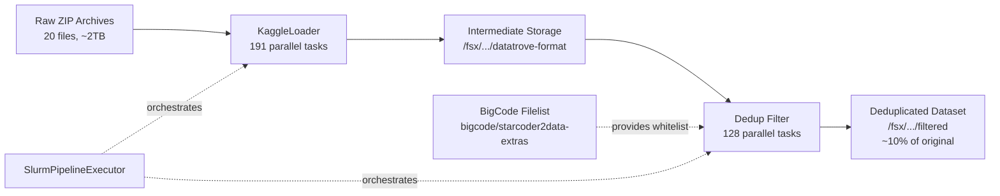
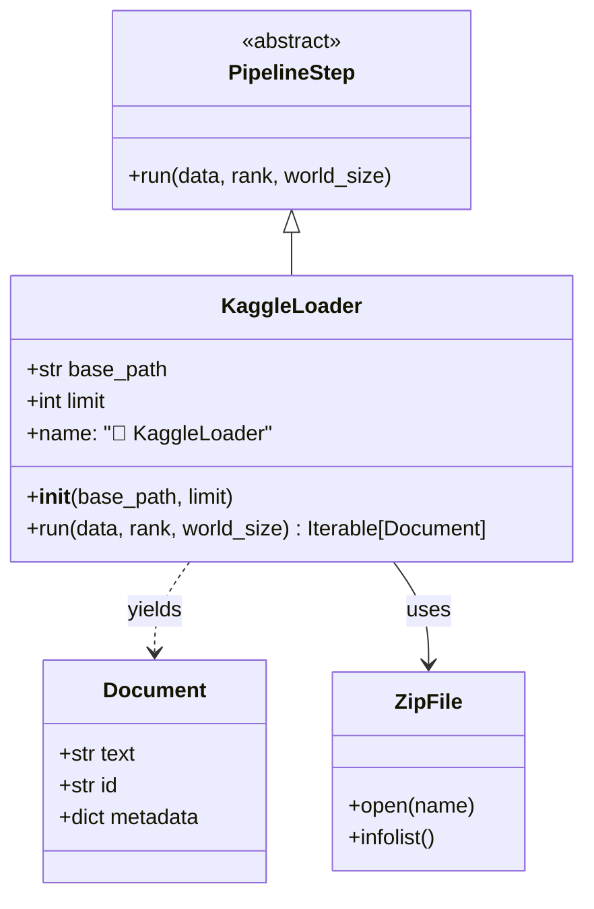
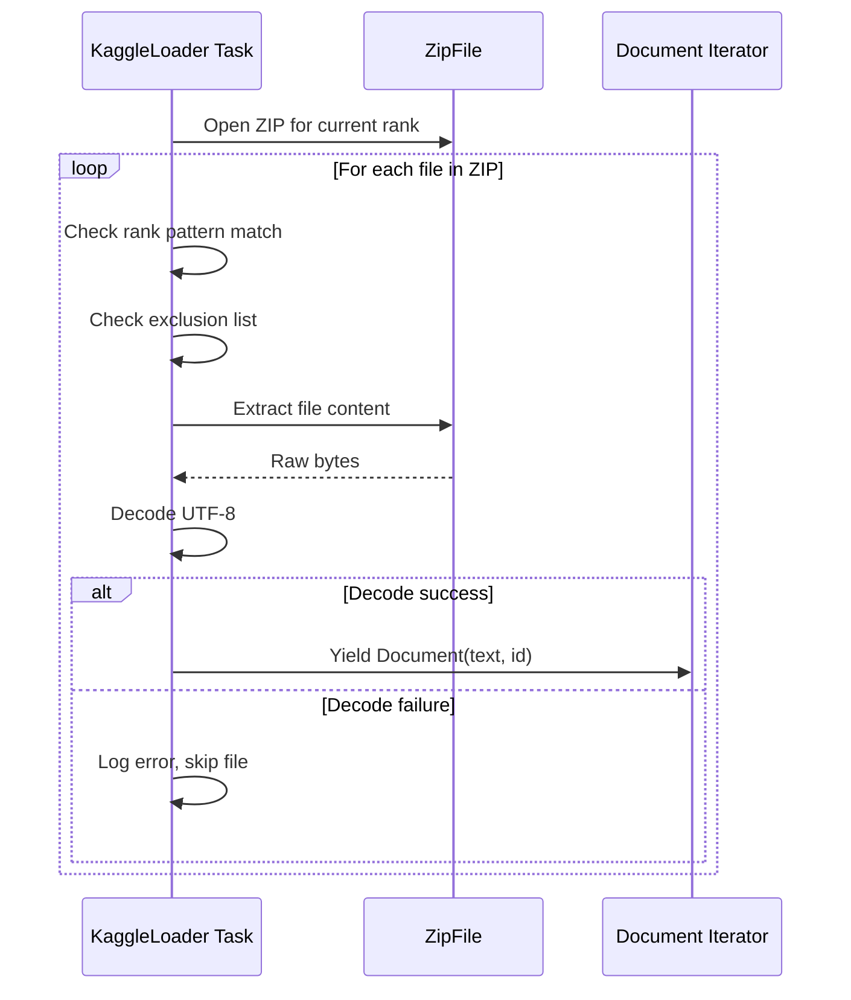
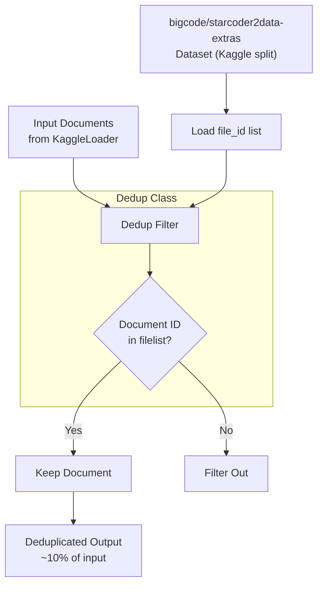
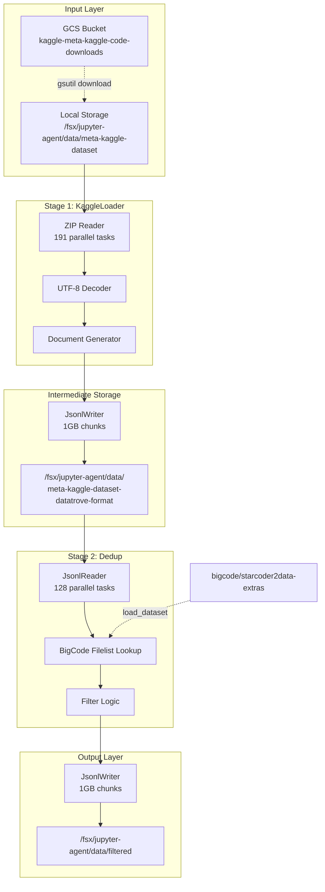

<!-- source: DeepWiki mcp.deepwiki.com · repo huggingface/jupyter-agent · page 2.2 Stage 1-2: Data Ingestion and Deduplication · fetched 2026-10-26 -->

# Stage 1-2: Data Ingestion and Deduplication

<details>
<summary>Relevant source files</summary>

The following files were used as context for generating this wiki page:

- [data/README.md](data/README.md)
- [data/pipelines/dedup.py](data/pipelines/dedup.py)
- [data/pipelines/kaggle_loader.py](data/pipelines/kaggle_loader.py)

</details>


## Purpose and Scope

This document describes the first two stages of the data generation pipeline, which transform raw Kaggle notebook archives into a deduplicated dataset ready for quality assessment. These stages reduce the initial ~2TB of raw data by approximately 90% while preserving high-quality unique notebooks.

**Scope**: This page covers the `KaggleLoader` and `Dedup` pipeline components. For information about subsequent quality scoring, see [Stage 3-4: Quality Assessment](#2.3). For overall pipeline orchestration, see [Pipeline Orchestration](#2.1).

## Stage Overview

The ingestion and deduplication process consists of two sequential stages:

1. **Stage 1 - KaggleLoader**: Extracts `.ipynb` notebook files from 20 ZIP archives (~2TB total) containing the Meta Kaggle dataset, distributing extraction across 191 parallel tasks.

2. **Stage 2 - Deduplication**: Filters the extracted notebooks using BigCode's curated filelist from the StarCoder2 project, removing approximately 90% of the raw data as duplicates.

Both stages use the datatrove framework with `SlurmPipelineExecutor` for distributed processing on a Slurm cluster. The output from Stage 1 becomes the input to Stage 2, with intermediate storage on a shared file system.



**Diagram: Data Flow Through Ingestion and Deduplication Stages**

Sources: [data/pipelines/kaggle_loader.py](), [data/pipelines/dedup.py](), [data/README.md:36-46]()

## Stage 1: KaggleLoader

### Purpose and Implementation

The `KaggleLoader` class extracts Jupyter notebook files from the Meta Kaggle dataset ZIP archives. It implements the datatrove `PipelineStep` interface to integrate with the pipeline framework.

**Class Definition**: [data/pipelines/kaggle_loader.py:8-60]()



**Diagram: KaggleLoader Class Structure**

Sources: [data/pipelines/kaggle_loader.py:8-14]()

### ZIP Archive Structure and Distribution

The Meta Kaggle dataset is organized as 20 ZIP files, each containing 10 subfolders except the last file which contains only 1 subfolder, totaling 191 folders. The `KaggleLoader` distributes these 191 folders across parallel Slurm tasks using rank-based assignment.

**Distribution Logic**: [data/pipelines/kaggle_loader.py:26-43]()

Each task with rank `i` processes:
- ZIP file: `metakaggle_code_with_outputs_{rank // 10}.zip`
- Subfolder: Files matching pattern `{rank}.zfill(4)/`

| Component | Value |
|-----------|-------|
| Total ZIP Files | 20 |
| Total Subfolders | 191 |
| Notebooks per ZIP | ~100GB |
| File Path Template | `{base_path}/metakaggle_code_with_outputs_{XXX}.zip` |
| Subfolder Pattern | `{XXXX}/*.ipynb` (4-digit zero-padded) |

**Example**: Task with rank 47 processes:
- ZIP: `metakaggle_code_with_outputs_004.zip`
- Subfolder: `0047/*.ipynb`

Sources: [data/pipelines/kaggle_loader.py:26-27](), [data/README.md:38]()

### Extraction and Document Creation

The loader performs the following operations for each notebook:

1. **File Selection**: Filters files matching the current rank's subfolder pattern
2. **Exclusion Check**: Skips files in the hardcoded exclusion list [data/pipelines/kaggle_loader.py:22-24]()
3. **Content Extraction**: Reads file content from ZIP archive
4. **UTF-8 Decoding**: Attempts to decode as UTF-8 with error handling [data/pipelines/kaggle_loader.py:51-55]()
5. **Document Creation**: Yields `Document` object with raw notebook JSON as text and file path as ID [data/pipelines/kaggle_loader.py:57]()



**Diagram: Document Extraction Sequence**

Sources: [data/pipelines/kaggle_loader.py:40-59]()

### Error Handling

The loader implements defensive programming practices:

- **File Exclusion List**: Hardcoded list of problematic files that consistently cause crashes [data/pipelines/kaggle_loader.py:22-24]()
  ```python
  file_exclusion_list = [
      "0132/087/132087938.ipynb"  # file that always caused a crash
  ]
  ```

- **Decoding Errors**: UTF-8 decoding failures are caught, logged, and the file is skipped [data/pipelines/kaggle_loader.py:51-55]()
- **Limit Parameter**: Optional `limit` parameter for testing with subset of data [data/pipelines/kaggle_loader.py:34-38]()

Sources: [data/pipelines/kaggle_loader.py:22-55]()

### Execution Configuration

The `KaggleLoader` stage is executed via `SlurmPipelineExecutor` with the following configuration:

| Parameter | Value | Purpose |
|-----------|-------|---------|
| `tasks` | 191 | One task per subfolder in ZIP archives |
| `workers` | 191 | One worker per task for parallel processing |
| `partition` | `hopper-cpu` | CPU-only Slurm partition |
| `cpus_per_task` | 4 | CPU cores per task |
| `mem_per_cpu_gb` | 4 | Memory per CPU (16GB total per task) |
| `time` | `20:00:00` | Maximum wall time (20 hours) |
| `qos` | `high` | Quality of service level |
| `job_name` | `kaggle-loader` | Slurm job identifier |

**Configuration**: [data/pipelines/kaggle_loader.py:62-88]()

**Total Resources**: 764 CPUs, 3TB RAM across all tasks

The output is written to `/fsx/jupyter-agent/data/meta-kaggle-dataset-datatrove-format` using `JsonlWriter` with 1GB maximum file size [data/pipelines/kaggle_loader.py:74]().

Sources: [data/pipelines/kaggle_loader.py:62-88]()

## Stage 2: Deduplication Filter

### Purpose and BigCode Integration

The `Dedup` filter removes duplicate notebooks using a curated filelist from BigCode's StarCoder2 project. This filelist was created through extensive deduplication analysis of the Meta Kaggle dataset and identifies unique, high-quality notebooks.

**Class Definition**: [data/pipelines/dedup.py:12-35]()

The filter inherits from datatrove's `BaseFilter` and implements a whitelist-based approach: only notebooks whose IDs appear in the BigCode filelist are retained.



**Diagram: Deduplication Logic Flow**

Sources: [data/pipelines/dedup.py:12-35](), [data/README.md:42-46]()

### Filelist Loading

The deduplication filelist is loaded from Hugging Face Hub at initialization time:

**Loading Logic**: [data/pipelines/dedup.py:25-26]()
```python
ds = load_dataset("bigcode/starcoder2data-extras", "kaggle", split="train")
self.filelist = list(ds["file_id"])
```

This dataset contains the `file_id` column with identifiers of notebooks that passed BigCode's deduplication process. The filelist is stored in memory for efficient lookup during filtering.

| Dataset Component | Value |
|------------------|-------|
| Dataset Repository | `bigcode/starcoder2data-extras` |
| Configuration | `kaggle` |
| Split | `train` |
| Column Used | `file_id` |
| Purpose | Whitelist of unique notebooks |

Sources: [data/pipelines/dedup.py:25-26](), [data/README.md:44-45]()

### Filtering Logic

The `filter` method implements the core deduplication logic by extracting the notebook identifier from the document ID and checking membership in the filelist:

**Filter Implementation**: [data/pipelines/dedup.py:28-35]()

```python
def filter(self, doc: Document) -> bool:
    return doc.id.split("/")[-1].split(".")[0] in self.filelist
```

**ID Extraction Process**:
1. Document ID format: `{folder}/{subfolder}/{notebook_id}.ipynb`
2. Split by `/` and take last component: `{notebook_id}.ipynb`
3. Split by `.` and take first component: `{notebook_id}`
4. Check if `{notebook_id}` exists in `self.filelist`

**Example**:
- Input ID: `"0047/123/456789.ipynb"`
- Extracted ID: `"456789"`
- Filter result: `True` if `"456789"` in filelist, else `False`

Sources: [data/pipelines/dedup.py:28-35]()

### Execution Configuration

The `Dedup` stage runs with reduced parallelism compared to `KaggleLoader` since it's a simpler filtering operation:

| Parameter | Value | Purpose |
|-----------|-------|---------|
| `tasks` | 128 | Parallel filtering tasks |
| `workers` | 128 | One worker per task |
| `partition` | `hopper-cpu` | CPU-only Slurm partition |
| `cpus_per_task` | 4 | CPU cores per task |
| `mem_per_cpu_gb` | 16 | Memory per CPU (64GB total per task) |
| `time` | `20:00:00` | Maximum wall time (20 hours) |
| `qos` | `high` | Quality of service level |
| `job_name` | `dedup` | Slurm job identifier |

**Configuration**: [data/pipelines/dedup.py:38-65]()

**Total Resources**: 512 CPUs, 8TB RAM across all tasks

Higher memory per task (16GB vs 4GB) accommodates the in-memory filelist and document processing. The output is written to `/fsx/jupyter-agent/data/filtered` using `JsonlWriter` with 1GB maximum file size [data/pipelines/dedup.py:51]().

Sources: [data/pipelines/dedup.py:38-65]()

### Data Reduction

The deduplication stage achieves approximately **90% data reduction**, as indicated in the documentation [data/README.md:45]():

| Metric | Before Dedup | After Dedup | Reduction |
|--------|-------------|-------------|-----------|
| Data Volume | ~2TB | ~200GB | 90% |
| Unique Notebooks | Raw dataset | BigCode curated | High duplicates removed |

This aggressive filtering is justified because the Meta Kaggle dataset contains many duplicate or near-duplicate notebooks from forked competitions and copied code.

Sources: [data/README.md:42-46]()

## Data Flow and Storage Architecture



**Diagram: Complete Data Flow Through Both Stages**

Sources: [data/pipelines/kaggle_loader.py:66-74](), [data/pipelines/dedup.py:42-51]()

### File System Paths

| Path | Purpose | Stage | Format |
|------|---------|-------|--------|
| `/fsx/jupyter-agent/data/meta-kaggle-dataset` | Raw ZIP archives from GCS | Input | ZIP |
| `/fsx/jupyter-agent/data/meta-kaggle-dataset-datatrove-format` | Extracted notebooks | Stage 1 output | JSONL |
| `/fsx/jupyter-agent/data/filtered` | Deduplicated notebooks | Stage 2 output | JSONL |

All paths use a shared FSX file system accessible across Slurm nodes, enabling distributed processing without data transfer overhead.

Sources: [data/pipelines/kaggle_loader.py:66-69](), [data/pipelines/dedup.py:42-43]()

## Output Document Format

After both stages, documents have the following structure:

| Field | Type | Description | Source |
|-------|------|-------------|--------|
| `text` | str | Raw notebook JSON content (`.ipynb` format) | Extracted from ZIP |
| `id` | str | Original file path (e.g., `"0047/123/456789.ipynb"`) | ZIP archive path |
| `metadata` | dict | Empty at this stage | Populated in later stages |

The `text` field contains the complete notebook JSON, including:
- Cell contents (code and markdown)
- Cell outputs
- Notebook metadata
- Execution counts

This raw format is preserved through Stage 2, with subsequent stages ([Stage 3-4: Quality Assessment](#2.3)) performing format conversions and enrichment.

Sources: [data/pipelines/kaggle_loader.py:57]()

## Execution Instructions

### Running Individual Stages

```bash
# Stage 1: Load notebooks from ZIP archives
cd data
uv run pipelines/kaggle_loader.py

# Stage 2: Deduplicate using BigCode filelist
uv run pipelines/dedup.py
```

### Running Both Stages via Main Pipeline

```bash
cd data
uv run main.py -r <ROUTER_IP:PORT>
```

The main pipeline orchestrator ([Pipeline Orchestration](#2.1)) will execute both stages in sequence automatically.

Sources: [data/README.md:125-127]()

### Prerequisites

1. **Data Download**: Raw Kaggle dataset must be downloaded from GCS bucket [data/README.md:92-106]()
2. **Slurm Access**: Must have access to `hopper-cpu` partition with sufficient resources
3. **File System**: Shared FSX mount at `/fsx/jupyter-agent/data/` with sufficient space (~2.5TB)
4. **Python Environment**: datatrove, datasets, and dependencies installed via `uv`

Sources: [data/README.md:92-106](), [data/pipelines/kaggle_loader.py:79](), [data/pipelines/dedup.py:56]()

---

