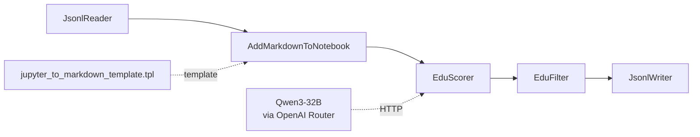
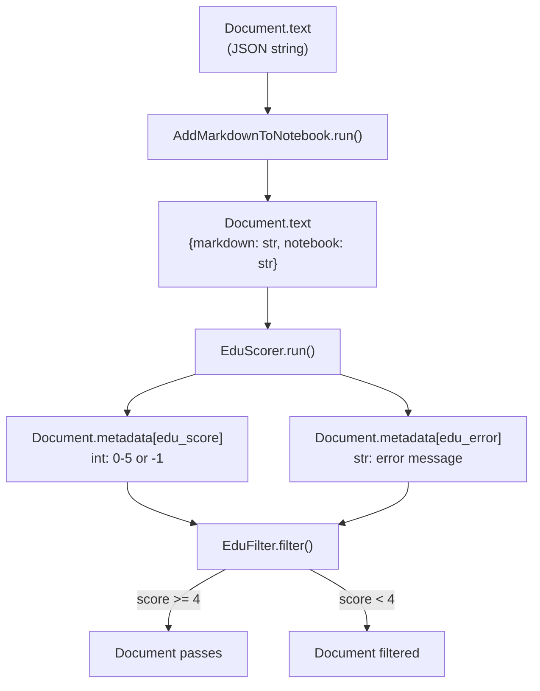
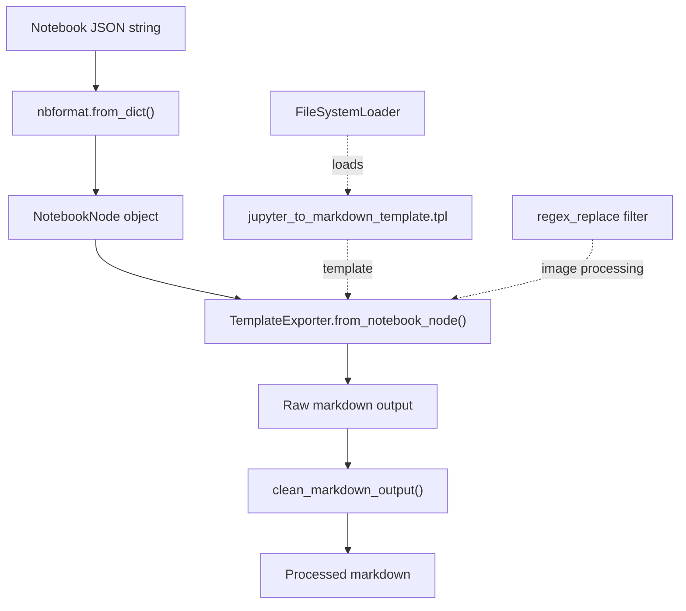
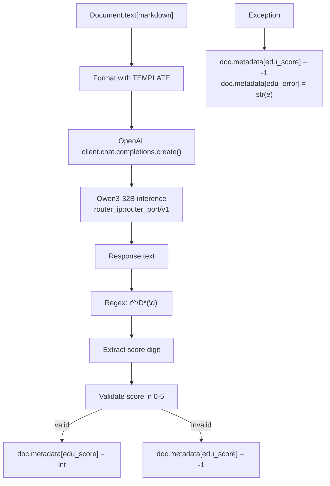
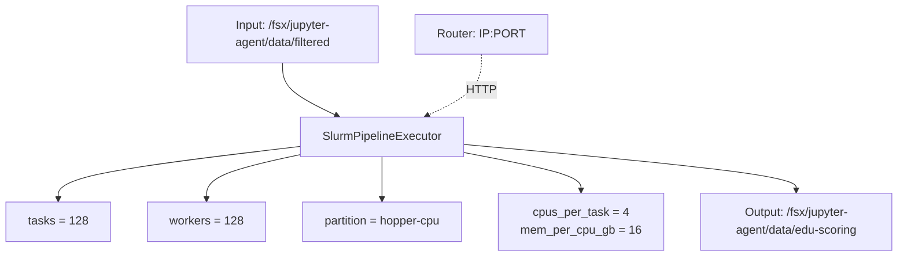
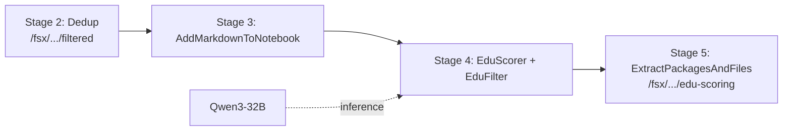

<!-- source: DeepWiki mcp.deepwiki.com · repo huggingface/jupyter-agent · page 2.3 Stage 3-4: Quality Assessment · fetched 2026-10-26 -->

# Stage 3-4: Quality Assessment

<details>
<summary>Relevant source files</summary>

The following files were used as context for generating this wiki page:

- [data/README.md](data/README.md)
- [data/pipelines/add_markdown_to_notebook/add_markdown_to_notebook.py](data/pipelines/add_markdown_to_notebook/add_markdown_to_notebook.py)
- [data/pipelines/add_markdown_to_notebook/jupyter_to_markdown_template.tpl](data/pipelines/add_markdown_to_notebook/jupyter_to_markdown_template.tpl)
- [data/pipelines/edu_scoring.py](data/pipelines/edu_scoring.py)

</details>


## Purpose and Scope

This document covers Stages 3-4 of the data generation pipeline, which transforms raw deduplicated notebooks into quality-assessed, markdown-enriched documents. These stages serve as the primary quality gate in the pipeline, filtering the dataset from hundreds of thousands of notebooks down to those with high educational and analytical value.

Stage 3 converts Jupyter notebook JSON into structured markdown using custom templates. Stage 4 applies LLM-based quality assessment to score notebooks on a 5-point rubric, retaining only those scoring ≥4. Together, these stages reduce the dataset to approximately 10% of the input volume while ensuring high educational quality.

For detailed implementation of markdown conversion, see [2.3.1](#2.3.1). For scoring mechanism details, see [2.3.2](#2.3.2). For the preceding deduplication stage, see [2.2](#2.2). For subsequent metadata extraction, see [2.4](#2.4).

## Pipeline Architecture

The quality assessment phase consists of three sequential pipeline components executed by `SlurmPipelineExecutor`:



**Diagram: Stage 3-4 Component Flow**

Sources: [data/pipelines/edu_scoring.py:177-187]()

### Component Descriptions

| Component | Class | Purpose | External Dependencies |
|-----------|-------|---------|----------------------|
| Markdown Converter | `AddMarkdownToNotebook` | Transform `.ipynb` JSON to structured markdown with cell tags | `nbconvert`, Jinja2 |
| Quality Scorer | `EduScorer` | LLM-based evaluation on 5-point rubric | Qwen3-32B via OpenAI-compatible endpoint |
| Quality Filter | `EduFilter` | Remove notebooks with `edu_score < 4` | None |

Sources: [data/pipelines/add_markdown_to_notebook/add_markdown_to_notebook.py:12-13](), [data/pipelines/edu_scoring.py:65-66](), [data/pipelines/edu_scoring.py:120-121]()

## Data Transformation Flow

The `Document` object undergoes the following transformations:



**Diagram: Document Transformation Through Quality Assessment**

The original notebook JSON is preserved in `doc.text["notebook"]` while the markdown representation is stored in `doc.text["markdown"]`. This dual-storage approach allows downstream stages to access both representations.

Sources: [data/pipelines/add_markdown_to_notebook/add_markdown_to_notebook.py:128-129](), [data/pipelines/edu_scoring.py:110-111](), [data/pipelines/edu_scoring.py:138-146]()

## Stage 3: Markdown Conversion

The `AddMarkdownToNotebook` class converts Jupyter notebook JSON to a custom markdown format with explicit cell type tags. This structured format enables LLM processing while preserving notebook semantics.

### Template-Based Conversion

The conversion uses `nbconvert.TemplateExporter` with a custom Jinja2 template at [data/pipelines/add_markdown_to_notebook/jupyter_to_markdown_template.tpl](). The template defines three cell types:

| Cell Type | Tag Syntax | Content |
|-----------|-----------|---------|
| Markdown | `<markdown_cell>...<id:cell_N>...content...</markdown_cell>` | Raw markdown text with images replaced by `[IMAGE_PLACEHOLDER]` |
| Code | `<python_cell>...<id:cell_N>...content...</python_cell>` | Python source code |
| Output | `<output_cell>...<id:cell_N>...content...</output_cell>` | Execution results (truncated at 5000 characters) |

Sources: [data/pipelines/add_markdown_to_notebook/jupyter_to_markdown_template.tpl:1-53]()

### Conversion Process



**Diagram: Markdown Conversion Implementation**

The `convert_jupyter_to_markdown()` method [data/pipelines/add_markdown_to_notebook/add_markdown_to_notebook.py:21-75]() orchestrates this process, applying post-processing via `clean_markdown_output()` to remove empty cells and normalize whitespace.

Sources: [data/pipelines/add_markdown_to_notebook/add_markdown_to_notebook.py:21-135]()

## Stage 4: Educational Quality Scoring

The `EduScorer` class implements LLM-based quality assessment using Qwen3-32B. Each notebook receives a score from 0-5 based on a structured rubric.

### Scoring Rubric

The rubric is additive and sequential—failure at any criterion prevents earning subsequent points:

| Points | Criterion | Description |
|--------|-----------|-------------|
| 1 | Valid Python Code | Syntactically correct, executable Python |
| 1 | Data Loading | Successfully loads dataset with visible output confirming load |
| 1 | Data Analysis | Meaningful analysis beyond loading (statistics, transformations, visualizations) |
| 1 | Educational Narrative | Majority of code cells have markdown explanations interpreting results |
| 1 | Exceptional Quality | Advanced analysis with multiple interconnected steps, annotated visualizations, clear problem-solving progression |

**Automatic 0-point exclusions**: Non-English text, non-Python code, no data analysis component, only text OR only code cells, broken/incomplete code.

Sources: [data/pipelines/edu_scoring.py:34-47]()

### Scoring Implementation



**Diagram: EduScorer Execution Flow**

The scorer sends a prompt to Qwen3-32B at the configured router endpoint, parses the numerical score from the response, and stores it in document metadata. Error handling sets `edu_score = -1` for failed evaluations.

Sources: [data/pipelines/edu_scoring.py:74-117]()

### LLM Integration

The `EduScorer` constructor requires router configuration:

```python
def __init__(self, router_ip: str, router_port: str)
```

It initializes an OpenAI client pointing to the router:

```python
client = OpenAI(
    api_key="token-abc123",
    base_url=f"http://{self.router_ip}:{self.router_port}/v1",
)
```

The model identifier `"Qwen/Qwen3-32B"` is hardcoded in the completion request with `max_completion_tokens=1000`.

Sources: [data/pipelines/edu_scoring.py:68-71](), [data/pipelines/edu_scoring.py:80-83](), [data/pipelines/edu_scoring.py:90-94]()

## Filtering Strategy

The `EduFilter` class implements threshold-based filtering with configurable parameters:

| Parameter | Default | Purpose |
|-----------|---------|---------|
| `threshold` | 4 | Minimum `edu_score` to retain document |
| `exclusion_writer` | None | Optional writer for filtered-out documents |
| `batch_size` | 1 | Number of documents to batch process |

The `filter()` method implements a simple boolean check:

```python
def filter(self, doc: Document) -> bool:
    return doc.metadata["edu_score"] >= self.threshold
```

Documents with `edu_score < 4` (including error cases with `-1`) are removed from the pipeline.

Sources: [data/pipelines/edu_scoring.py:120-146]()

## Execution Configuration

The quality assessment pipeline is executed via `SlurmPipelineExecutor` with the following resource allocation:



**Diagram: Slurm Execution Environment**

Total resources: 512 CPUs, 8TB RAM. The job timeout is set to 4 days (`time="4-00:00:00"`).

Sources: [data/pipelines/edu_scoring.py:149-200]()

### Command-Line Interface

The pipeline is invoked with:

```bash
uv run pipelines/edu_scoring.py -r <ROUTER_IP:PORT>
```

The router argument is required and accepts formats:
- `IP:PORT` - explicitly specified port
- `IP` - defaults to port 39876

Sources: [data/pipelines/edu_scoring.py:157-175](), [data/README.md:130]()

## Output Characteristics

After quality assessment, documents have the following properties:

**Text Structure**:
```python
doc.text = {
    "markdown": "<markdown_cell>...</markdown_cell>...",
    "notebook": "{...}"  # original JSON
}
```

**Metadata Fields**:
- `edu_score`: Integer 0-5 (or -1 for errors)
- `edu_error`: String error message (empty if no error)

**Filtering Impact**: Approximately 90% of notebooks are filtered out, retaining only highest-quality educational content with score ≥4.

Sources: [data/pipelines/add_markdown_to_notebook/add_markdown_to_notebook.py:128-129](), [data/pipelines/edu_scoring.py:110-115](), [data/README.md:64]()

## Integration with Pipeline

Quality assessment sits between deduplication and metadata extraction:



**Diagram: Pipeline Integration Context**

The output of this stage serves as input to metadata extraction [2.4](#2.4), where the markdown representation is used for LLM-based identification of packages and data files.

Sources: [data/README.md:5-28](), [data/pipelines/edu_scoring.py:154-155]()

---

