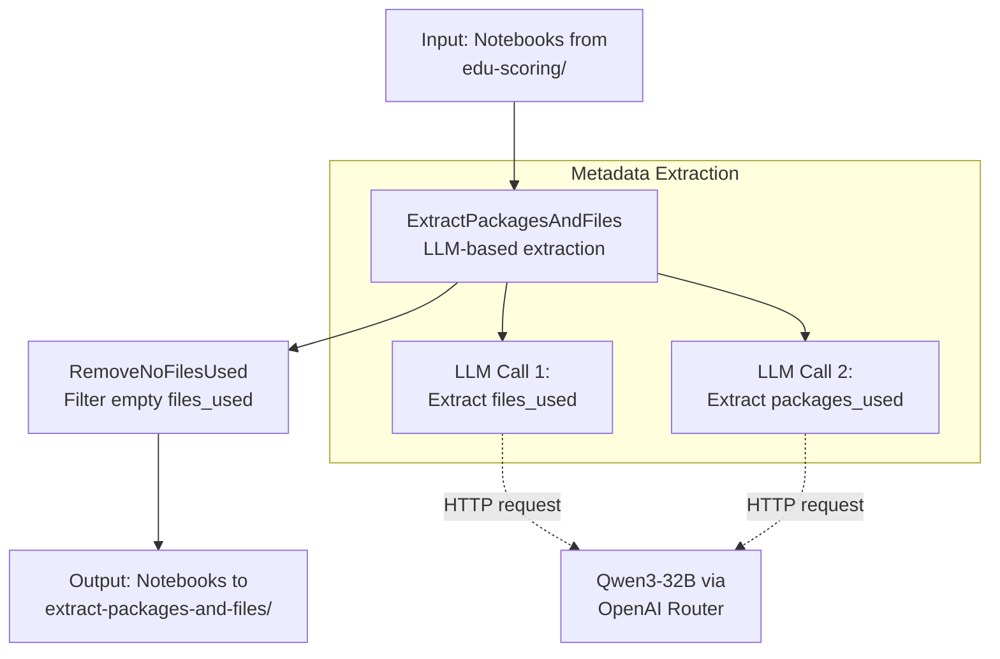
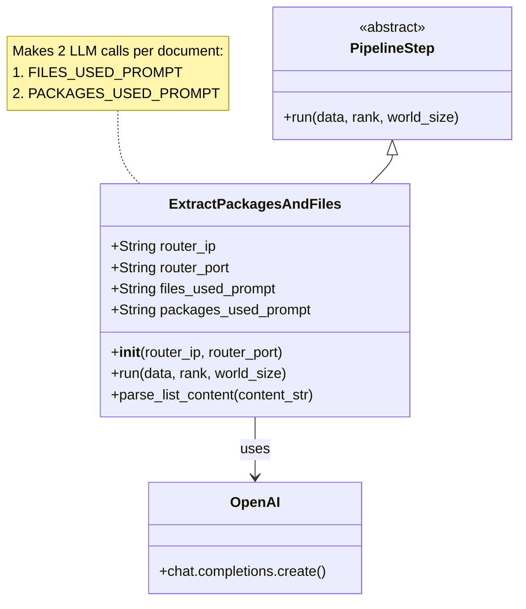
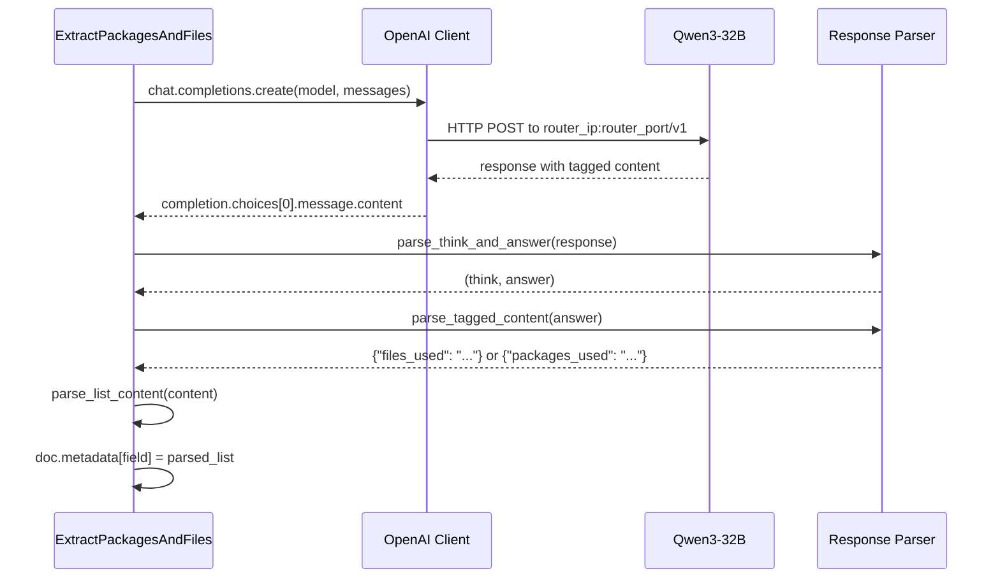
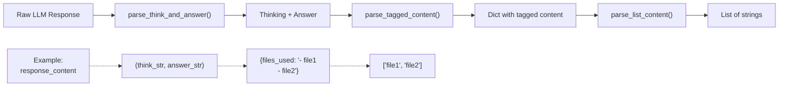
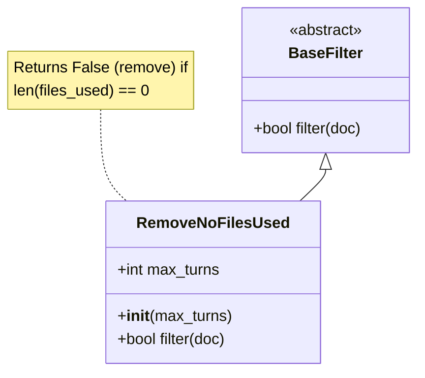
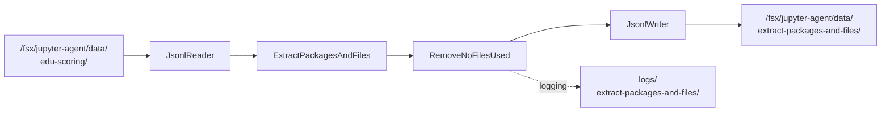

<!-- source: DeepWiki mcp.deepwiki.com · repo huggingface/jupyter-agent · page 2.4 Stage 5: Metadata Extraction · fetched 2026-10-26 -->

# Stage 5: Metadata Extraction

<details>
<summary>Relevant source files</summary>

The following files were used as context for generating this wiki page:

- [data/README.md](data/README.md)
- [data/pipelines/extract_packages_and_files.py](data/pipelines/extract_packages_and_files.py)

</details>


## Purpose and Scope

Stage 5 performs LLM-based metadata extraction to identify the data files and Python packages used in each notebook. This stage enriches documents with structured metadata about their dependencies and applies filtering to retain only data-focused notebooks that reference external data files.

This stage follows [Stage 3-4: Quality Assessment](#2.3) and precedes [Stage 6: QA Pair Generation](#2.5). For information about the AI models used across the pipeline, see [AI Model Integration](#3).

**Input**: Educational-quality notebooks (score ≥ 4) with markdown representations  
**Output**: Metadata-enriched notebooks that reference at least one data file  
**Primary Implementation**: [data/pipelines/extract_packages_and_files.py]()

---

## Process Overview

Stage 5 consists of two sequential substages that extract metadata and filter based on data usage:



**Diagram: Stage 5 processing flow with LLM dependencies**

Sources: [data/pipelines/extract_packages_and_files.py:1-312](), [data/README.md:65-69]()

---

## ExtractPackagesAndFiles Implementation

The `ExtractPackagesAndFiles` class performs dual LLM-based metadata extraction, making separate API calls to identify files and packages referenced in each notebook.

### Class Structure



**Diagram: ExtractPackagesAndFiles class hierarchy and dependencies**

The class extends `PipelineStep` from the datatrove framework and operates on individual `Document` objects in parallel across multiple workers.

Sources: [data/pipelines/extract_packages_and_files.py:135-232]()

### Two-Stage Extraction Process

For each notebook, the extraction follows this sequence:

| Step | LLM Prompt | Model | Output Field | Purpose |
|------|------------|-------|--------------|---------|
| 1 | `FILES_USED_PROMPT` | Qwen3-32B | `files_used` | Identify CSV files, datasets, APIs referenced |
| 2 | `PACKAGES_USED_PROMPT` | Qwen3-32B | `packages_used` | Extract Python library imports |

Both calls use identical processing logic:



**Diagram: LLM interaction sequence for metadata extraction**

Sources: [data/pipelines/extract_packages_and_files.py:164-232]()

### Implementation Details

The `run()` method processes documents with the following workflow:

1. **Client Initialization**: Creates OpenAI client with hardcoded API key `"token-abc123"` pointing to the router endpoint [data/pipelines/extract_packages_and_files.py:169-174]()

2. **Notebook Content Extraction**: Retrieves markdown representation from `doc.text["markdown"]` [data/pipelines/extract_packages_and_files.py:184]()

3. **Files Extraction**:
   - LLM call with `FILES_USED_PROMPT` as system message [data/pipelines/extract_packages_and_files.py:187-194]()
   - Max completion tokens: 1000
   - Model: `"Qwen/Qwen3-32B"`

4. **Packages Extraction**:
   - LLM call with `PACKAGES_USED_PROMPT` as system message [data/pipelines/extract_packages_and_files.py:205-212]()
   - Same token limit and model

5. **Metadata Assignment**: Updates `doc.metadata` with parsed lists [data/pipelines/extract_packages_and_files.py:223-224]()

6. **Error Handling**: Returns `None` on exception, logging the error [data/pipelines/extract_packages_and_files.py:226-230]()

Sources: [data/pipelines/extract_packages_and_files.py:164-232]()

---

## Prompt Engineering

### FILES_USED_PROMPT Structure

The files extraction prompt instructs the LLM to identify data sources referenced in notebooks:

**Prompt Components** ([data/pipelines/extract_packages_and_files.py:10-67]()):
- **Role Definition**: "You are a helpful coding agent"
- **Task**: "write down a list of files that are used in the notebook"
- **Notebook Format Specification**: Describes custom markdown cell format with `<markdown_cell>`, `<python_cell>`, `<output_cell>` tags
- **Example Notebook**: Shows hello world example with cell structure
- **Output Format**: Requires `<files_used>` XML-style tags with bullet list

**Expected Output Format**:
```
<files_used>
- ../data/train.csv
- test.csv
- sample_submission.csv
</files_used>
```

### PACKAGES_USED_PROMPT Structure

The packages extraction prompt follows identical structure but focuses on Python library identification:

**Prompt Components** ([data/pipelines/extract_packages_and_files.py:69-132]()):
- Same role definition and format specification as files prompt
- **Task**: "write down a list of packages that are used in the notebook"
- **Output Format**: Requires `<packages_used>` tags

**Expected Output Format**:
```
<packages_used>
- pandas
- numpy
- matplotlib
- seaborn
- scikit-learn
- scipy
- statsmodels
- xgboost
- lightgbm
</packages_used>
```

Sources: [data/pipelines/extract_packages_and_files.py:10-132]()

---

## Response Parsing

The extraction pipeline uses three parsing functions to convert LLM responses into structured data:



**Diagram: Response parsing pipeline flow**

### parse_think_and_answer()

Imported from `utils.qwen3_formatter_utils`, this function separates reasoning traces from final answers in Qwen3 responses. Returns tuple `(think: str, answer: str)`.

Sources: [data/pipelines/extract_packages_and_files.py:176-179]()

### parse_tagged_content()

Also from `qwen3_formatter_utils`, extracts content between XML-style tags like `<files_used>` and `<packages_used>`. Returns dictionary mapping tag names to content strings.

Sources: [data/pipelines/extract_packages_and_files.py:176-179](), [data/pipelines/extract_packages_and_files.py:199](), [data/pipelines/extract_packages_and_files.py:217]()

### parse_list_content()

Custom method in `ExtractPackagesAndFiles` that converts bullet-list strings into Python lists:

**Processing Steps** ([data/pipelines/extract_packages_and_files.py:145-162]()):
1. Split by newlines
2. Strip whitespace from each line
3. Remove leading markers: dashes (`-`), bullets (`*`, `•`), numbers (`1.`, `2.`, etc.)
4. Filter empty lines
5. Return cleaned list of strings

**Example Transformation**:
```
Input:  "- pandas\n- numpy\n- matplotlib"
Output: ["pandas", "numpy", "matplotlib"]
```

Sources: [data/pipelines/extract_packages_and_files.py:145-162]()

---

## Data-Focused Filtering

### RemoveNoFilesUsed Class

The `RemoveNoFilesUsed` filter ensures only notebooks that reference external data files are retained for downstream processing.



**Diagram: RemoveNoFilesUsed filter class structure**

Sources: [data/pipelines/extract_packages_and_files.py:235-255]()

### Filtering Logic

The filter implements a simple boolean check:

**Filter Criteria** ([data/pipelines/extract_packages_and_files.py:242-255]()):
- **Input**: Document with `metadata["files_used"]` field
- **Condition**: `len(files_used) == 0`
- **Action**: 
  - If empty: Return `False` (remove document), print "Removing document with no files used"
  - If non-empty: Return `True` (keep document)

This filtering step is critical for ensuring the dataset focuses on data analysis workflows rather than pure computational notebooks.

**Rationale**: Notebooks without external data files typically focus on:
- Algorithm implementations without real data
- Tutorial/educational code demonstrations
- Mathematical computations
- Software engineering examples

These are less relevant for training a data science agent that should work with datasets.

Sources: [data/pipelines/extract_packages_and_files.py:235-255](), [data/README.md:69]()

---

## Pipeline Execution Configuration

### Slurm Execution Parameters

The `main()` function configures distributed execution on a Slurm cluster:

| Parameter | Value | Purpose |
|-----------|-------|---------|
| **Tasks** | 128 | Number of parallel processing units |
| **Workers** | 128 | Workers per task (total: 16,384 workers) |
| **Time Limit** | 20:00:00 | Maximum 20 hours execution |
| **Partition** | `hopper-cpu` | CPU-only compute nodes |
| **CPUs per Task** | 4 | Processor allocation |
| **Memory** | 16 GB per CPU | Total: 8,192 GB available |
| **QoS** | `normal` | Standard priority queue |
| **Job Name** | `metadata-generation` | Identifier in Slurm logs |

Sources: [data/pipelines/extract_packages_and_files.py:279-306]()

### Data Flow Paths



**Diagram: Data paths and pipeline component flow**

**Input Directory**: `/fsx/jupyter-agent/data/edu-scoring` [data/pipelines/extract_packages_and_files.py:283]()  
**Output Directory**: `/fsx/jupyter-agent/data/extract-packages-and-files` [data/pipelines/extract_packages_and_files.py:284]()  
**Logs Directory**: `logs/extract-packages-and-files` [data/pipelines/extract_packages_and-files.py:285]()

The pipeline uses `JsonlWriter` with `max_file_size=int(10**9)` (1 GB) to chunk outputs into manageable files [data/pipelines/extract_packages_and_files.py:294]().

Sources: [data/pipelines/extract_packages_and_files.py:283-306]()

### Command-Line Interface

The script accepts router configuration via command-line arguments:

```bash
# Run with default port (39876)
uv run pipelines/extract_packages_and_files.py -r 192.168.1.100

# Run with explicit port
uv run pipelines/extract_packages_and_files.py -r 192.168.1.100:8080
```

**Argument Parsing** ([data/pipelines/extract_packages_and_files.py:258-277]()):
- `-r` or `--router`: Required, format `IP` or `IP:PORT`
- Default port: `39876` if not specified
- Port and IP extracted via string split on `:`

Sources: [data/pipelines/extract_packages_and_files.py:258-277]()

---

## Output Metadata Schema

After Stage 5 processing, each `Document` object has enriched metadata:

| Field | Type | Description | Example |
|-------|------|-------------|---------|
| `files_used` | `List[str]` | Data files referenced in notebook | `["train.csv", "test.csv", "sample_submission.csv"]` |
| `packages_used` | `List[str]` | Python packages imported | `["pandas", "numpy", "matplotlib", "scikit-learn"]` |

These fields are consumed by downstream stages:
- **Stage 6 (QA Generation)**: May use package information for question complexity assessment
- **Stage 7 (Dataset Integration)**: Uses `files_used` to identify Kaggle datasets for downloading
- **Stage 8 (Trace Generation)**: Uses both fields to inform code generation and execution

Sources: [data/pipelines/extract_packages_and_files.py:223-224]()

---

