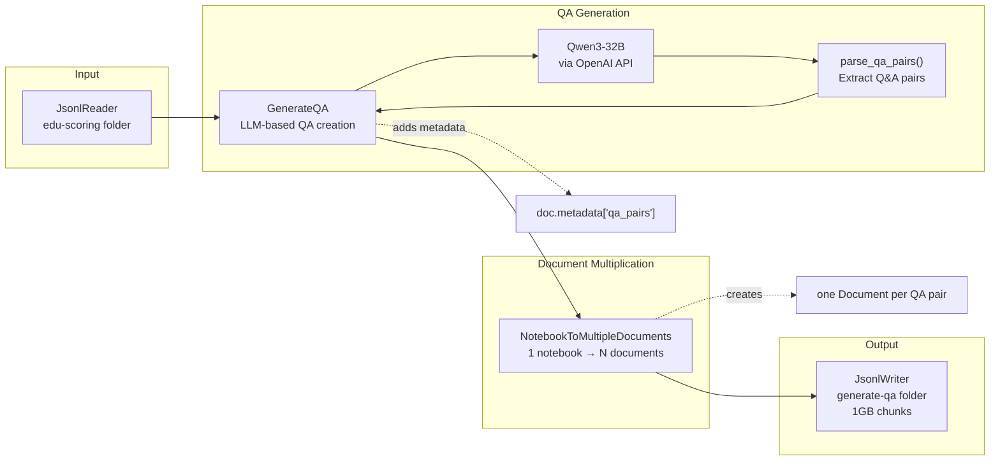
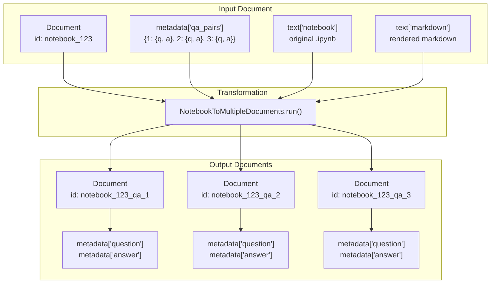
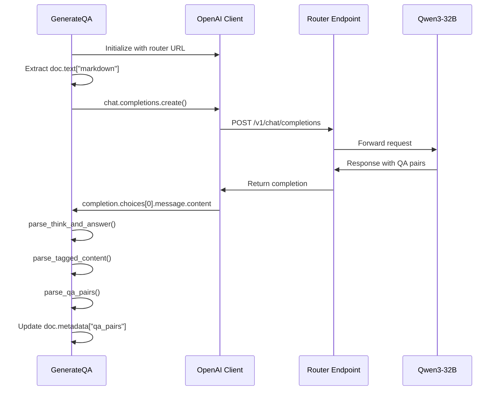

<!-- source: DeepWiki mcp.deepwiki.com · repo huggingface/jupyter-agent · page 2.5 Stage 6: QA Pair Generation · fetched 2026-10-26 -->

# Stage 6: QA Pair Generation

<details>
<summary>Relevant source files</summary>

The following files were used as context for generating this wiki page:

- [data/README.md](data/README.md)
- [data/pipelines/generate_qa.py](data/pipelines/generate_qa.py)

</details>


## Purpose and Scope

This document describes Stage 6 of the data generation pipeline, which generates complex multi-step question-answer pairs from filtered notebooks. The `GenerateQA` pipeline step uses Qwen3-32B to create data analysis questions that require multiple code execution steps to answer, then multiplies each notebook document into multiple documents (one per QA pair) for downstream trace generation.

This stage receives notebooks that have passed quality filtering and metadata extraction (see [Stage 3-4: Quality Assessment](#2.3) and [Stage 5: Metadata Extraction](#2.4)). The output feeds into [Stage 7: Dataset Integration](#2.6) and ultimately [Stage 8: Trace Generation](#2.7).

**Sources:** [data/README.md:71-80](), [data/pipelines/generate_qa.py:1-335]()

---

## Stage Overview

Stage 6 performs two critical transformations:

1. **QA Generation**: Uses LLM prompting to generate up to 5 complex, multi-step questions per notebook that can be answered from the notebook's execution outputs
2. **Document Multiplication**: Transforms each notebook into N separate documents (one per QA pair) to enable parallel trace generation in Stage 8

The stage enforces strict quality requirements: questions must be complex enough to require multiple code execution steps, answers must be explicitly present in notebook outputs (no hallucination), and questions must focus on data analysis rather than machine learning methodology.



**Sources:** [data/pipelines/generate_qa.py:162-231](), [data/pipelines/generate_qa.py:233-276](), [data/pipelines/generate_qa.py:308-314]()

---

## Pipeline Components

### GenerateQA Class

The `GenerateQA` class is the primary pipeline step that orchestrates QA generation. It inherits from `datatrove.pipeline.base.PipelineStep` and implements the standard `run()` method for parallel execution.

| Attribute | Type | Purpose |
|-----------|------|---------|
| `name` | str | Display name: "❓ Generate QA Pairs" |
| `router_ip` | str | IP address of OpenAI-compatible API endpoint |
| `router_port` | int | Port number for API endpoint |
| `generate_qa_prompt` | str | Complete system prompt for QA generation |

**Key Methods:**

- `__init__(router_ip, router_port)`: Initializes router configuration and loads the QA generation prompt
- `run(data, rank, world_size)`: Processes documents in parallel, generating QA pairs for each
- `parse_qa_pairs(parsed_content)`: Extracts question-answer pairs from LLM response

**Sources:** [data/pipelines/generate_qa.py:162-231]()

### NotebookToMultipleDocuments Class

The `NotebookToMultipleDocuments` class performs document multiplication, creating one new `Document` object per QA pair. This transformation is essential for parallel trace generation in Stage 8.



**Sources:** [data/pipelines/generate_qa.py:233-276]()

---

## QA Generation Process

### LLM Interaction Flow

The QA generation process follows a structured request-response pattern using the OpenAI chat completions API:



**Request Structure:**
- **Model**: `"Qwen/Qwen3-32B"`
- **Messages**: System prompt + notebook markdown content
- **max_completion_tokens**: 5000
- **API Base URL**: `http://{router_ip}:{router_port}/v1`

**Sources:** [data/pipelines/generate_qa.py:195-222]()

### Prompt Engineering

The `GENERATE_QA_PROMPT` constant ([data/pipelines/generate_qa.py:9-159]()) is a comprehensive 150-line prompt that defines strict requirements for QA generation. Key sections include:

| Section | Purpose | Line Range |
|---------|---------|------------|
| Instructions | Overall goal and context | 9-12 |
| Question Requirements | Criteria for question quality | 14-22 |
| Answer Requirements | Format and specificity constraints | 23-28 |
| Complexity Requirements | Multi-step analysis criteria | 30-37 |
| Forbidden Question Types | What not to include | 39-46 |
| Required Question Types | Preferred question categories | 48-57 |
| Quality Control | Fallback handling | 59-69 |
| Answer Verification | Mandate for explicit output presence | 71-72 |
| Notebook Format | Input structure explanation | 74-110 |
| Output Format | Response template | 112-130 |
| Examples | Good QA pair samples | 132-159 |

**Question Complexity Criteria:**

Questions must require **multiple turns of code execution** involving:
- Multi-step data analysis with preprocessing and transformation
- Complex aggregations with grouping, filtering, and joining
- Comparative analysis across multiple dimensions
- Statistical inference on data (correlation, hypothesis testing)
- Derived insights that cannot be answered by simple retrieval

**Forbidden Topics:**
- Machine learning methods, training techniques, algorithms
- Model performance metrics (accuracy, loss, validation scores)
- Technical implementation details
- Simple data retrieval operations
- Questions without explicit answers in outputs

**Sources:** [data/pipelines/generate_qa.py:9-159]()

---

## Response Parsing

### Multi-Stage Parsing Pipeline

The LLM response undergoes three parsing stages to extract structured QA pairs:

```mermaid
graph LR
    subgraph "Raw Response"
        A["completion.choices[0]<br/>.message.content"]
    end
    
    subgraph "Stage 1: Think/Answer Split"
        B["parse_think_and_answer()"]
        C["Returns: (think, answer)"]
    end
    
    subgraph "Stage 2: Tag Extraction"
        D["parse_tagged_content()"]
        E["Extracts: <question_1>, <answer_1>, etc."]
    end
    
    subgraph "Stage 3: QA Pairing"
        F["parse_qa_pairs()"]
        G["Returns: dict with question-answer pairs"]
    end
    
    subgraph "Output"
        H["doc.metadata['qa_pairs']<br/>{1: {question, answer}, ...}"]
    end
    
    A --> B --> C --> D --> E --> F --> G --> H
```



**Sources:** [data/pipelines/generate_qa.py:190-224]()

### parse_qa_pairs() Implementation

The `parse_qa_pairs()` method matches question tags with their corresponding answer tags:

**Input:** Parsed content dictionary with keys like `question_1`, `answer_1`, `question_2`, `answer_2`, etc.

**Algorithm:**
1. Iterate through all keys in parsed content
2. For keys starting with `"question_"`, extract the question number
3. Look for corresponding `"answer_{num}"` key
4. If both exist, create QA pair in output dictionary
5. Return dictionary keyed by question number

**Output Format:**
```python
{
    "1": {"question": "What is...", "answer": "72.3%"},
    "2": {"question": "Which sales...", "answer": "Sarah Johnson"},
    ...
}
```

**Sources:** [data/pipelines/generate_qa.py:171-184]()

---

## Document Multiplication

### Transformation Logic

The `NotebookToMultipleDocuments` step transforms the document structure from one document with multiple QA pairs to multiple documents each with a single QA pair:

**Input Document Structure:**
```python
Document(
    id="notebook_xyz",
    text={"notebook": {...}, "markdown": "..."},
    metadata={
        "files_used": [...],
        "packages_used": [...],
        "qa_pairs": {
            "1": {"question": "...", "answer": "..."},
            "2": {"question": "...", "answer": "..."}
        }
    }
)
```

**Output Document Structure (per QA pair):**
```python
Document(
    id="notebook_xyz_qa_1",
    text=json.dumps({
        "original_notebook": {...},
        "original_markdown": "..."
    }),
    metadata={
        "files_used": [...],
        "packages_used": [...],
        "question": "...",
        "answer": "...",
        "original_document_id": "notebook_xyz"
        # qa_pairs removed
    }
)
```

**Sources:** [data/pipelines/generate_qa.py:244-274]()

### Metadata Preservation

The transformation preserves all original metadata fields and adds new ones:

| Metadata Field | Source | Purpose |
|----------------|--------|---------|
| `files_used` | Copied from original | Dataset files for Stage 7 |
| `packages_used` | Copied from original | Python dependencies |
| `question` | Extracted from QA pair | Single question for trace generation |
| `answer` | Extracted from QA pair | Expected answer for validation |
| `original_document_id` | Original doc.id | Traceability to source notebook |
| `qa_pairs` | Removed | No longer needed after split |

**Sources:** [data/pipelines/generate_qa.py:246-262]()

---

## Pipeline Execution Configuration

### Slurm Configuration

The stage is executed using `SlurmPipelineExecutor` with the following resource allocation:

```python
SlurmPipelineExecutor(
    pipeline=[JsonlReader, GenerateQA, NotebookToMultipleDocuments, JsonlWriter],
    tasks=128,                    # Parallel tasks
    workers=128,                  # Workers per task
    time="20:00:00",             # 20 hour time limit
    partition="hopper-prod",     # Slurm partition
    cpus_per_task=4,             # 4 CPUs per task
    mem_per_cpu_gb=16,           # 16GB RAM per CPU (64GB total per task)
    qos="high",                  # High priority queue
    skip_completed=False,        # Reprocess all documents
    job_name="qa-generation"
)
```

**Total Resources:**
- **CPUs**: 128 tasks × 4 CPUs = 512 cores
- **Memory**: 128 tasks × 64GB = 8TB RAM
- **Parallelism**: 128 tasks × 128 workers = 16,384 concurrent document processors

**Sources:** [data/pipelines/generate_qa.py:316-329]()

### Input/Output Paths

| Path Type | Location | Description |
|-----------|----------|-------------|
| Input | `/fsx/data-agents/data/edu-scoring` | Notebooks from Stage 4 |
| Output | `/fsx/data-agents/data/generate-qa` | Multiplied documents with QA pairs |
| Logs | `logs/generate-qa` | Execution logs and error tracking |
| Max File Size | 1GB (10^9 bytes) | Output JSONL chunk size |

**Sources:** [data/pipelines/generate_qa.py:303-306](), [data/pipelines/generate_qa.py:313]()

---

## Error Handling

### Exception Handling Strategy

The `GenerateQA.run()` method implements try-catch error handling around the LLM interaction:

```python
try:
    notebook_markdown_content = doc.text["markdown"]
    completion = client.chat.completions.create(...)
    response_content = completion.choices[0].message.content
    assert response_content is not None, "response_content is None"
    think, answer = parse_think_and_answer(response_content)
    parsed_content = parse_tagged_content(answer)
    generated_qa_pairs = self.parse_qa_pairs(parsed_content)
    doc.metadata["qa_pairs"] = generated_qa_pairs
except Exception as e:
    print(f"Error generating QA pairs for document {doc.id}: {e}")
    return None  # Skip document on error
```

**Error Scenarios:**
- Missing markdown content in document
- LLM API timeout or connection failure
- Empty or malformed LLM response
- Parsing failures in response content
- Missing question/answer tags

**Handling Strategy:** Failed documents are logged and skipped (`return None`), allowing the pipeline to continue processing remaining documents.

**Sources:** [data/pipelines/generate_qa.py:204-228]()

---

## Command-Line Interface

### CLI Arguments

The stage can be executed standalone via command-line:

```bash
uv run pipelines/generate_qa.py -r <ROUTER_IP:PORT>
```

**Arguments:**

| Flag | Required | Format | Default | Description |
|------|----------|--------|---------|-------------|
| `-r, --router` | Yes | `IP` or `IP:PORT` | None | Router endpoint address |
| Port (implicit) | No | Integer | 39876 | Used if not specified in router |

**Argument Parsing:**
```python
if ":" in args.router:
    router_ip, router_port = args.router.split(":")
else:
    router_ip = args.router
    router_port = "39876"  # Default port
```

**Sources:** [data/pipelines/generate_qa.py:278-297]()

---

## QA Quality Examples

### Good QA Pair Examples

The prompt provides explicit examples of well-structured QA pairs that meet complexity and directness requirements:

**Example 1: Numerical Analysis**
```
Question: What is the highest profit margin percentage achieved by any 
          product category in the dataset?
Answer:   72.3%
```
- Requires: Data filtering, grouping by category, margin calculation, max aggregation
- Answer format: Specific percentage value

**Example 2: Categorical Analysis**
```
Question: Which sales representative achieved the highest quarterly 
          revenue based on the sales data?
Answer:   Sarah Johnson
```
- Requires: Time-based grouping, revenue aggregation, ranking, top-1 selection
- Answer format: Specific person name

**Example 3: Boolean Statistical Test**
```
Question: Is the correlation between marketing spend and sales revenue 
          in the dataset statistically significant?
Answer:   Yes
```
- Requires: Feature extraction, correlation computation, statistical testing
- Answer format: Boolean yes/no

These examples demonstrate questions requiring **multiple code execution steps** but resulting in **direct, concise answers** explicitly shown in notebook outputs.

**Sources:** [data/pipelines/generate_qa.py:132-159]()

---

