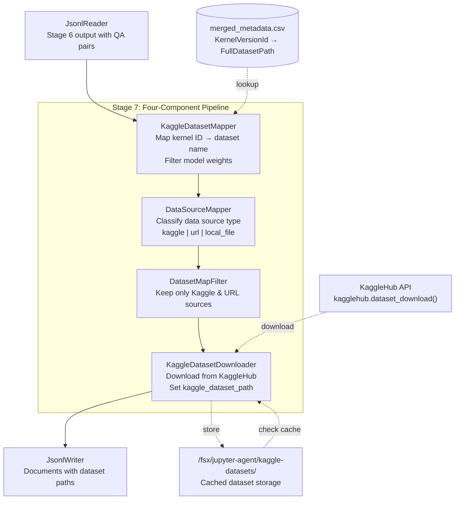
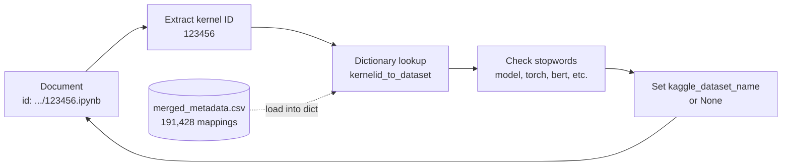
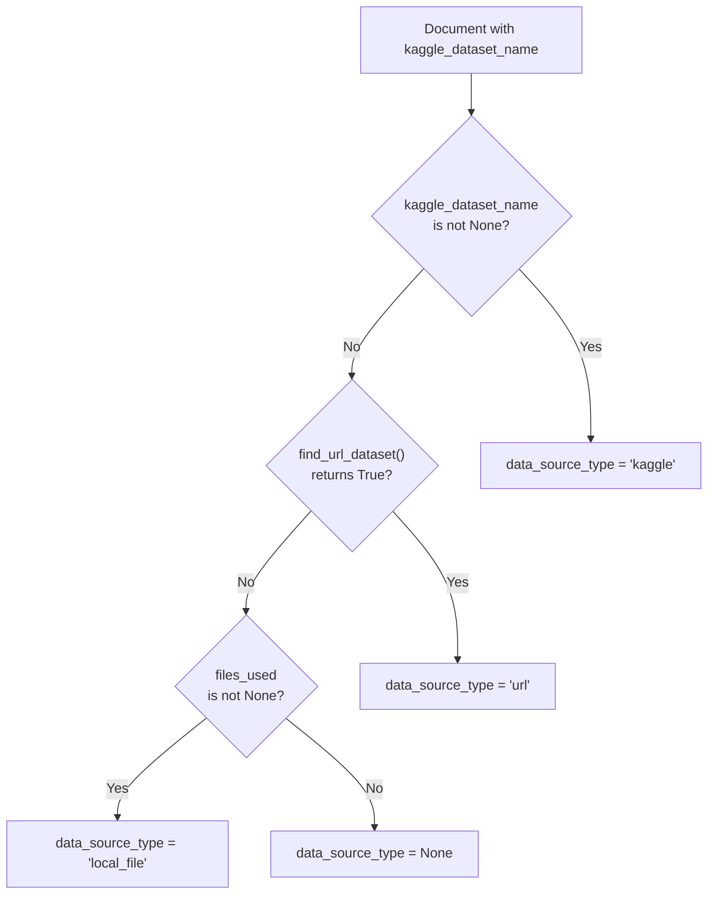
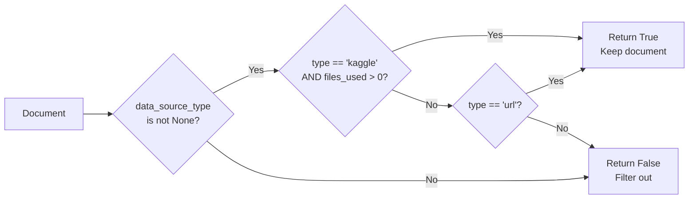
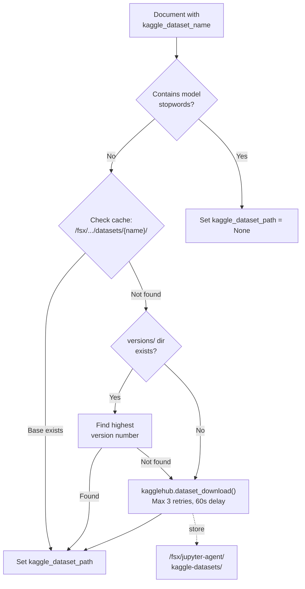
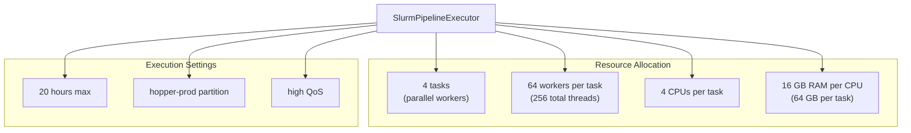
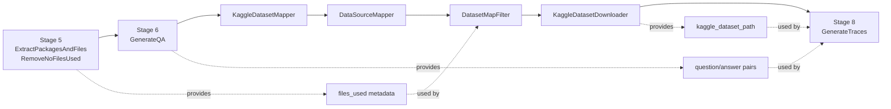

<!-- source: DeepWiki mcp.deepwiki.com · repo huggingface/jupyter-agent · page 2.6 Stage 7: Dataset Integration · fetched 2026-10-26 -->

# Stage 7: Dataset Integration

<details>
<summary>Relevant source files</summary>

The following files were used as context for generating this wiki page:

- [data/README.md](data/README.md)
- [data/pipelines/kaggle_data_mapping.py](data/pipelines/kaggle_data_mapping.py)
- [data/pipelines/kaggle_sourcing/README.md](data/pipelines/kaggle_sourcing/README.md)
- [data/pipelines/kaggle_sourcing/merge_meta_sources.py](data/pipelines/kaggle_sourcing/merge_meta_sources.py)
- [data/pipelines/kaggle_sourcing/run_merge.slurm](data/pipelines/kaggle_sourcing/run_merge.slurm)

</details>


## Purpose and Scope

Stage 7 links notebooks to their original data sources and downloads Kaggle datasets for use in code execution. This stage identifies which Kaggle dataset was used in each notebook, classifies the data source type (Kaggle, URL, or local file), filters notebooks by data availability, and downloads the original datasets from KaggleHub.

This stage is part of the 8-stage data generation pipeline (see [Data Generation Pipeline](#2)). It follows Stage 6 (QA Generation, see [Stage 6: QA Pair Generation](#2.5)) and precedes Stage 8 (Trace Generation, see [Stage 8: Trace Generation](#2.7)). For details on the metadata merging utilities used in this stage, see [Kaggle Sourcing Utilities](#2.6.2).

**Sources:** [data/README.md:81-85](), [data/pipelines/kaggle_data_mapping.py:1-283]()

## Overview

Dataset integration enables the pipeline to execute LLM-generated code on real data rather than simulated outputs. By downloading original Kaggle datasets and linking them to notebooks, Stage 7 provides the foundation for non-hallucinated code execution in E2B sandboxes during trace generation.

The stage processes notebooks that have been scored, filtered, enriched with metadata, and augmented with QA pairs. It adds three critical metadata fields:
- `kaggle_dataset_name`: The full path to the Kaggle dataset (e.g., `"username/dataset-name"`)
- `data_source_type`: Classification as `"kaggle"`, `"url"`, or `"local_file"`
- `kaggle_dataset_path`: Local file system path where the dataset is stored

**Sources:** [data/README.md:81-85](), [data/pipelines/kaggle_data_mapping.py:20-242]()

## Processing Architecture



**Diagram: Four-Component Dataset Integration Pipeline**

The pipeline implements a sequential four-step process where each component enriches the document metadata. `KaggleDatasetMapper` consults a pre-built CSV mapping to associate kernel IDs with dataset names. `DataSourceMapper` analyzes notebook cells to classify the data source type. `DatasetMapFilter` retains only documents with Kaggle or URL data sources. `KaggleDatasetDownloader` fetches datasets from KaggleHub and caches them on the shared file system.

**Sources:** [data/pipelines/kaggle_data_mapping.py:244-279]()

## Component Details

### KaggleDatasetMapper

The `KaggleDatasetMapper` class maps notebook kernel IDs to their associated Kaggle datasets using a pre-computed metadata CSV. It filters out model weight datasets that are not suitable for data analysis tasks.



**Diagram: KaggleDatasetMapper Logic Flow**

**Implementation Details:**

| Aspect | Implementation |
|--------|----------------|
| Input CSV | `/fsx/jupyter-agent/data/kaggle-sourcing/merged_metadata.csv` |
| Key Column | `KernelVersionId` (converted to string) |
| Value Column | `FullDatasetPath` (format: `"author/dataset-slug"`) |
| ID Extraction | Parse from `doc.id`, split by `/` and `.ipynb` |
| Stopword Filter | 54 keywords for model weights (vit, resnet, bert, llama, etc.) |
| Output Field | `doc.metadata["kaggle_dataset_name"]` (string or None) |

The stopword list at [data/pipelines/kaggle_data_mapping.py:31-54]() excludes datasets containing pre-trained models, as these are not suitable for data analysis demonstrations. Examples include `"model"`, `"vit-"`, `"resnet"`, `"torch"`, `"keras"`, `"tensorflow"`, `"gemma"`, `"llama"`, `"mistral"`, `"bert"`, and dimension indicators like `"2b-"`, `"7b-"`, `"8b-"`.

**Sources:** [data/pipelines/kaggle_data_mapping.py:20-72]()

### DataSourceMapper

The `DataSourceMapper` classifies each notebook's data source into one of three categories: Kaggle datasets, URL downloads, or local files. This classification determines how the trace generation stage will handle data access.



**Diagram: DataSourceMapper Decision Tree**

**URL Detection Logic:**

The `find_url_dataset()` method at [data/pipelines/kaggle_data_mapping.py:81-108]() scans notebook code cells for URL-based data downloads. It uses a two-step filter:

1. **Download Keyword Filter**: Only examines cells containing download-related functions:
   - `wget`, `curl`, `requests.get`, `urllib.request`, `download`
   - `pd.read_csv`, `pd.read_json`, `read_csv`, `read_json`

2. **URL Pattern Match**: Uses regex `r"https?://\S+"` to find HTTP/HTTPS URLs in those cells

This approach reduces false positives by requiring both a download operation and a URL to be present in the same code cell.

**Classification Priority:**

| Priority | Source Type | Condition |
|----------|-------------|-----------|
| 1 | `"kaggle"` | `kaggle_dataset_name` is not None |
| 2 | `"url"` | URL found with download keyword |
| 3 | `"local_file"` | `files_used` metadata exists |
| 4 | `None` | No data source identified |

**Sources:** [data/pipelines/kaggle_data_mapping.py:75-124]()

### DatasetMapFilter

The `DatasetMapFilter` implements a `BaseFilter` that retains only notebooks with accessible data sources. This filter is critical for ensuring trace generation has executable notebooks.



**Diagram: DatasetMapFilter Decision Logic**

**Filter Rules:**

The filter at [data/pipelines/kaggle_data_mapping.py:141-159]() implements the following logic:

- **Kaggle Sources**: Must have `data_source_type == "kaggle"` AND `len(files_used) > 0`
  - The `files_used` check ensures the notebook actually uses data files (from Stage 5 metadata extraction)
  - Comment at line 153 indicates this is used for the QA dataset
  - Line 154 shows an alternative (commented) version that doesn't require metadata

- **URL Sources**: Only requires `data_source_type == "url"`
  - No additional validation; assumes URL-based downloads are valid

- **Rejected**: Local files without Kaggle/URL sources, or notebooks with no data source

This aggressive filtering ensures only notebooks with downloadable, executable data proceed to trace generation.

**Sources:** [data/pipelines/kaggle_data_mapping.py:127-159]()

### KaggleDatasetDownloader

The `KaggleDatasetDownloader` downloads Kaggle datasets and manages a local cache to avoid redundant downloads. It uses the `kagglehub` library to fetch datasets and stores them in a shared file system.



**Diagram: KaggleDatasetDownloader Cache and Download Logic**

**Cache Strategy:**

The downloader implements a three-tier cache check at [data/pipelines/kaggle_data_mapping.py:199-223]():

1. **Versioned Path**: `/fsx/jupyter-agent/kaggle-datasets/datasets/{author}/{slug}/versions/{N}/`
   - Searches for numeric version folders, selects the highest version number
   - Most specific cache hit

2. **Base Path**: `/fsx/jupyter-agent/kaggle-datasets/datasets/{author}/{slug}/`
   - Fallback if no versions directory exists
   - Used for datasets without version structure

3. **Download**: `kagglehub.dataset_download(dataset_name)`
   - Only triggered if both cache checks fail
   - Returns path, which is stored in metadata

**Error Handling:**

The download process at [data/pipelines/kaggle_data_mapping.py:225-237]() implements retry logic:
- Maximum 3 attempts per dataset
- 60-second sleep between retries
- Sets `kaggle_dataset_path = None` on failure
- Prints error message but does not crash the pipeline

**Stopword Filtering:**

The downloader applies the same model weight filter as `KaggleDatasetMapper` at [data/pipelines/kaggle_data_mapping.py:175-198](). This redundant check prevents download attempts for datasets that were incorrectly classified earlier.

**Sources:** [data/pipelines/kaggle_data_mapping.py:162-241]()

## Environment Configuration

Stage 7 requires specific environment variables and credentials for dataset access:

| Variable | Purpose | Example Value |
|----------|---------|---------------|
| `KAGGLEHUB_CACHE` | Local cache directory for datasets | `/fsx/jupyter-agent/kaggle-datasets` |
| `KAGGLE_USERNAME` | Kaggle API username (optional) | `"your_username"` |
| `KAGGLE_KEY` | Kaggle API key (optional) | `"abc123..."` |

**Configuration in Code:**

The environment variables are set at [data/pipelines/kaggle_data_mapping.py:15-17]():

```python
os.environ["KAGGLEHUB_CACHE"] = "/fsx/jupyter-agent/kaggle-datasets"
os.environ["KAGGLE_USERNAME"] = "<optional>"
os.environ["KAGGLE_KEY"] = "<optional>"
```

**Kaggle API Credentials:**

While credentials are marked as optional, setting them may provide higher rate limits. Credentials can be obtained from the [Kaggle Settings page](https://www.kaggle.com/settings). The exact rate limits are not documented by Kaggle, but are estimated around 1,000 downloads per day (see [data/pipelines/kaggle_sourcing/README.md:10-14]()).

**Cache Structure:**

The cache directory uses the following structure:
```
/fsx/jupyter-agent/kaggle-datasets/
└── datasets/
    └── {author}/
        └── {slug}/
            ├── versions/
            │   ├── 1/
            │   ├── 2/
            │   └── N/
            └── [dataset files]
```

**Sources:** [data/pipelines/kaggle_data_mapping.py:15-17](), [data/pipelines/kaggle_sourcing/README.md:6-14]()

## Execution Parameters

The main execution configuration is defined in the `main()` function at [data/pipelines/kaggle_data_mapping.py:244-279]().

### SLURM Configuration



**Diagram: SLURM Execution Configuration**

### Parameter Details

| Parameter | Value | Purpose |
|-----------|-------|---------|
| `N_TASKS` | 4 | Number of parallel SLURM tasks |
| `N_WORKERS` | 64 | Worker threads per task (256 total) |
| `LIMIT` | -1 | No limit on documents processed |
| `time` | `"20:00:00"` | 20-hour maximum runtime |
| `partition` | `"hopper-prod"` | Production cluster partition |
| `cpus_per_task` | 4 | CPU cores per task |
| `mem_per_cpu_gb` | 16 | RAM per CPU (64GB per task) |
| `qos` | `"high"` | High priority queue |
| `skip_completed` | False | Reprocess all files |
| `max_file_size` | 1,000,000,000 | 1GB chunks for output JSONL |

### Directory Paths

| Path Type | Location | Description |
|-----------|----------|-------------|
| Input | `/fsx/jupyter-agent/data/generate-qa` | Stage 6 output with QA pairs |
| Output | `/fsx/jupyter-agent/data/kaggle-mapped-test` | Stage 7 output with dataset paths |
| Logs | `logs/kaggle-data-sourcing` | Pipeline execution logs |
| Metadata | `/fsx/jupyter-agent/data/kaggle-sourcing/merged_metadata.csv` | Kernel-to-dataset mapping |

The configuration at [data/pipelines/kaggle_data_mapping.py:245-256]() uses production defaults suitable for large-scale processing. The high worker count (256 total) is necessary because dataset downloads involve significant I/O wait time.

**Sources:** [data/pipelines/kaggle_data_mapping.py:244-279]()

## Pipeline Integration

Stage 7 integrates into the full data generation pipeline as a sequential processing stage between QA generation and trace generation.



**Diagram: Stage 7 in Pipeline Context**

### Input Requirements

Stage 7 expects documents with the following metadata fields from earlier stages:
- `files_used` (from Stage 5): List of data files referenced in the notebook
- `question` and `answer` (from Stage 6): QA pair for trace generation
- Original notebook JSON in `doc.text` (from Stage 3): Used for URL detection

### Output Guarantees

Documents passing through Stage 7 are enriched with:
- `kaggle_dataset_name`: Kaggle dataset identifier or None
- `data_source_type`: One of `"kaggle"`, `"url"`, `"local_file"`, or None
- `kaggle_dataset_path`: Local file path to downloaded dataset or None

### Filtering Impact

The `DatasetMapFilter` significantly reduces the document count. Only notebooks with:
- Kaggle datasets AND non-empty `files_used`, OR
- URL-based data sources

are passed to Stage 8. This ensures trace generation has access to executable data sources.

**Sources:** [data/README.md:1-135](), [data/pipelines/kaggle_data_mapping.py:244-279]()

## Usage Examples

### Running the Full Stage

To execute Stage 7 as part of the complete pipeline:

```bash
cd data
uv run main.py -r <ROUTER_IP:PORT>
```

Stage 7 does not require LLM access, so the router parameter is unused in this stage.

### Running Stage 7 Independently

To run only the dataset integration stage:

```bash
uv run pipelines/kaggle_data_mapping.py
```

This executes the four-component pipeline with the default configuration defined in `main()`.

### Custom Configuration

To modify execution parameters, edit [data/pipelines/kaggle_data_mapping.py:245-256]():

```python
N_TASKS = 4  # Adjust parallel tasks
N_WORKERS = 64  # Adjust workers per task
data_folder = "/path/to/input"  # Change input directory
output_folder = "/path/to/output"  # Change output directory
```

Then run:

```bash
uv run pipelines/kaggle_data_mapping.py
```

### Checking Output

Verify the output contains dataset paths:

```bash
head -n 1 /fsx/jupyter-agent/data/kaggle-mapped-test/*.jsonl | jq '.metadata | {kaggle_dataset_name, data_source_type, kaggle_dataset_path}'
```

Expected output structure:
```json
{
  "kaggle_dataset_name": "author/dataset-slug",
  "data_source_type": "kaggle",
  "kaggle_dataset_path": "/fsx/jupyter-agent/kaggle-datasets/datasets/author/dataset-slug/versions/1"
}
```

**Sources:** [data/README.md:112-135](), [data/pipelines/kaggle_data_mapping.py:244-283]()

---

