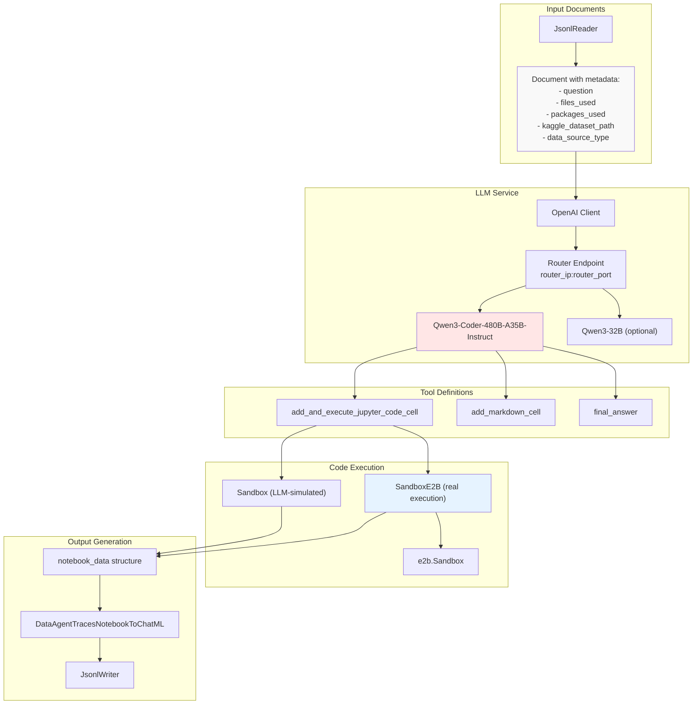
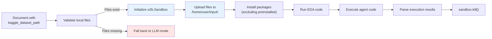
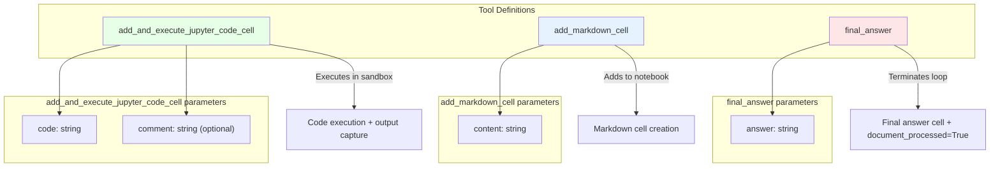
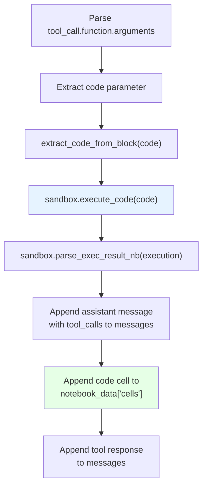
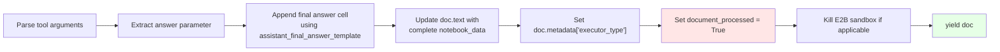
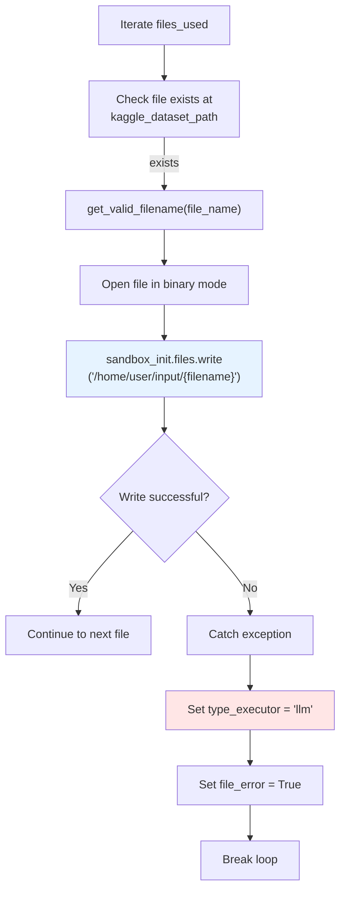
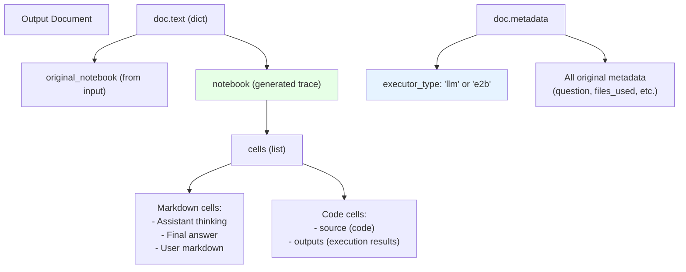

<!-- source: DeepWiki mcp.deepwiki.com · repo huggingface/jupyter-agent · page 2.7 Stage 8: Trace Generation · fetched 2026-10-26 -->

# Stage 8: Trace Generation

<details>
<summary>Relevant source files</summary>

The following files were used as context for generating this wiki page:

- [data/README.md](data/README.md)
- [data/pipelines/generate_traces.py](data/pipelines/generate_traces.py)

</details>


## Purpose and Scope

Stage 8 is the final transformation stage in the data generation pipeline. It consumes notebooks enriched with QA pairs and dataset mappings from Stage 7, and generates synthetic agent traces showing step-by-step problem-solving workflows. The `GenerateTraces` pipeline step orchestrates an LLM agent that uses tool calling to create realistic Jupyter notebook interactions, executing code either in simulated (LLM-based) or real (E2B sandbox) environments depending on data availability.

For information about the ChatML format conversion that occurs after trace generation, see [2.8](#2.8). For details about the Kaggle dataset sourcing that precedes this stage, see [2.6](#2.6).

**Sources:** [data/README.md:87-89](), [data/pipelines/generate_traces.py:1-665]()

---

## Architecture Overview

The trace generation system employs a multi-component architecture combining LLM inference, tool calling, and code execution environments.

### System Components



**Diagram: GenerateTraces Component Architecture**

The system uses an `OpenAI` client to communicate with a router endpoint serving `Qwen3-Coder-480B-A35B-Instruct` (or `Qwen3-32B` for thinking variants). The LLM generates tool calls that are executed in either a `Sandbox` (simulated) or `SandboxE2B` (real E2B cloud sandbox) environment. Results are accumulated in a `notebook_data` structure and converted to ChatML format.

**Sources:** [data/pipelines/generate_traces.py:14-47](), [data/pipelines/generate_traces.py:66-82](), [data/pipelines/generate_traces.py:403-408]()

---

## Execution Modes

The trace generation system operates in two distinct execution modes, selected automatically based on data source availability.

### Execution Mode Selection Logic

| Condition | Executor Type | Sandbox Class | Description |
|-----------|---------------|---------------|-------------|
| `data_source_type == "kaggle"` AND files exist locally | `e2b` | `SandboxE2B` | Real code execution in E2B cloud sandbox with actual datasets |
| `data_source_type == "url"` | `e2b` | `SandboxE2B` | Real code execution for URL-based data sources |
| `data_source_type == "kaggle"` BUT files missing | `llm` | `Sandbox` | LLM simulates execution based on original notebook |
| Other data source types | `llm` | `Sandbox` | LLM simulates execution without real data |

**Sources:** [data/pipelines/generate_traces.py:91-113]()

### E2B Execution Mode



**Diagram: E2B Execution Mode Workflow**

E2B mode initializes a cloud sandbox [data/pipelines/generate_traces.py:278-287](), uploads dataset files to `/home/user/input/` [data/pipelines/generate_traces.py:289-324](), installs required packages [data/pipelines/generate_traces.py:176-182](), and executes code with real output. The sandbox is killed after processing [data/pipelines/generate_traces.py:577-578]().

**Sources:** [data/pipelines/generate_traces.py:91-113](), [data/pipelines/generate_traces.py:211-396](), [data/pipelines/generate_traces.py:399-401]()

### LLM Execution Mode

In LLM mode, the `Sandbox` class (not `SandboxE2B`) simulates code execution by using the LLM to predict outputs based on the original notebook content [data/pipelines/generate_traces.py:403-408](). This mode is used when real data is unavailable but still generates realistic-looking traces for training.

**Sources:** [data/pipelines/generate_traces.py:403-408]()

---

## Tool Calling Architecture

The agent uses OpenAI-compatible tool calling to interact with the notebook environment through three defined tools.

### Tool Definitions



**Diagram: Tool Calling Interface**

The tools are defined in `tools_thinking` and `tools_non_thinking` from `pipelines.utils.qwen3_formatter_utils` [data/pipelines/generate_traces.py:25-28](), [data/pipelines/generate_traces.py:75-81](). The agent must call `final_answer` to complete processing [data/pipelines/generate_traces.py:555-579]().

**Sources:** [data/pipelines/generate_traces.py:25-28](), [data/pipelines/generate_traces.py:75-81](), [data/pipelines/generate_traces.py:479-586]()

### Model-Specific System Prompts

Different models require different prompting strategies:

- **Qwen3-Coder models**: Use explicit step-by-step planning prompt requiring "Ok here's the plan:" prefix and wrapping thinking in `'"]
    E{"message.content exists?"}
    F["full_response = ''"]
    G["full_response = ''"]
    H["full_response = message.content"]
    
    A --> B
    B -->|Yes| C
    C -->|Yes| D
    C -->|No| E
    E -->|Yes| F
    E -->|No| G
    B -->|No| H
    
    style D fill:#e6ffe6
    style F fill:#e6ffe6
    style H fill:#e6f3ff
```

**Diagram: Response Formatting Logic**

This logic ensures consistent thinking tag formatting for Coder models [data/pipelines/generate_traces.py:448-466]() while preserving raw content for base models.

**Sources:** [data/pipelines/generate_traces.py:448-466]()

---

## Tool Execution

Each tool type has specific execution logic that updates both the notebook structure and message history.

### add_and_execute_jupyter_code_cell Tool



**Diagram: Code Execution Tool Flow**

This tool extracts code from the tool arguments [data/pipelines/generate_traces.py:503-513](), executes it in the sandbox [data/pipelines/generate_traces.py:515-521](), parses outputs [data/pipelines/generate_traces.py:523](), appends the code cell [data/pipelines/generate_traces.py:526-534](), and adds the execution result to message history [data/pipelines/generate_traces.py:537-543]().

**Sources:** [data/pipelines/generate_traces.py:499-543]()

### add_markdown_cell Tool

This tool simply appends a markdown cell to the notebook without any execution:

```python
tool_args = json.loads(tool_call.function.arguments)
notebook_data["cells"].append({
    "cell_type": "markdown",
    "metadata": {},
    "source": tool_args["content"],
})
```

**Sources:** [data/pipelines/generate_traces.py:545-553]()

### final_answer Tool

The `final_answer` tool terminates the generation loop:



**Diagram: Final Answer Tool Flow**

Calling `final_answer` appends a formatted final cell [data/pipelines/generate_traces.py:556-565](), updates the document with the complete notebook [data/pipelines/generate_traces.py:567-575](), sets the processed flag [data/pipelines/generate_traces.py:575](), kills the sandbox [data/pipelines/generate_traces.py:577-578](), and yields the document [data/pipelines/generate_traces.py:579]().

**Sources:** [data/pipelines/generate_traces.py:555-579]()

---

## Package and File Management

### Package Installation Logic

The system manages Python package dependencies with special handling for E2B's preinstalled packages.

```python
preinstalled_e2b_packages = [
    "aiohttp", "beautifulsoup4", "bokeh", "gensim", "imageio",
    "joblib", "librosa", "matplotlib", "nltk", "numpy",
    "opencv-python", "openpyxl", "pandas", "plotly", "pytest",
    # ... more packages
]

packages_used = []
for package in packages_original:
    if "." in package and "mpl" not in package:
        packages_used.append(package.split(".")[0])  # Extract base package
    elif "mpl" in package:
        packages_used.append("mpl-tools")  # Fix metadata bug
    elif package == "os":
        continue  # Skip os (not in pip)
    else:
        packages_used.append(package)

# Add commonly used packages
packages_used.append("tabulate")
packages_used.append("statsmodels")

# Remove preinstalled packages for E2B
if type_executor == "e2b":
    packages_used = [pkg for pkg in packages_used 
                     if pkg not in preinstalled_e2b_packages]
```

**Sources:** [data/pipelines/generate_traces.py:123-187]()

### File Upload to E2B Sandbox

Files are uploaded to the E2B sandbox at `/home/user/input/`:



**Diagram: File Upload Process**

The system validates file existence [data/pipelines/generate_traces.py:291-296](), writes files to the sandbox [data/pipelines/generate_traces.py:298-306](), and falls back to LLM mode on write errors [data/pipelines/generate_traces.py:307-324]().

**Sources:** [data/pipelines/generate_traces.py:289-324]()

---

## Error Handling and Retry Logic

The trace generation system implements comprehensive error handling at multiple levels.

### Error Recovery Strategies

| Error Type | Location | Recovery Strategy |
|------------|----------|-------------------|
| Missing question | Document validation | Skip document, print message, return None |
| Tool call without arguments | Main loop | Retry up to 5 times, increment `tool_no_call_count` |
| LLM API call failure | Main loop | Catch exception, continue to retry |
| E2B sandbox initialization | EDA phase | Retry with random delay (1-5s), sleep 10s on failure |
| File upload failure | E2B setup | Fall back to LLM executor mode |
| Code execution failure | Tool execution | Print error, return None |
| Max turns reached | Main loop | Print warning, kill sandbox, return None |
| General exception | Document processing | Catch exception, print error, return None |

**Sources:** [data/pipelines/generate_traces.py:52-56](), [data/pipelines/generate_traces.py:418-428](), [data/pipelines/generate_traces.py:436-438](), [data/pipelines/generate_traces.py:278-287](), [data/pipelines/generate_traces.py:307-324](), [data/pipelines/generate_traces.py:515-521](), [data/pipelines/generate_traces.py:589-595](), [data/pipelines/generate_traces.py:597-599]()

### Sandbox Cleanup

E2B sandboxes are explicitly killed to prevent resource leaks:

```python
if type_executor == "e2b":
    sandbox.sandbox.kill()
```

This occurs on successful completion [data/pipelines/generate_traces.py:577-578](), max turns timeout [data/pipelines/generate_traces.py:593-594](), and tool call failures [data/pipelines/generate_traces.py:426-428](), [data/pipelines/generate_traces.py:584-586]().

**Sources:** [data/pipelines/generate_traces.py:426-428](), [data/pipelines/generate_traces.py:577-578](), [data/pipelines/generate_traces.py:584-586](), [data/pipelines/generate_traces.py:593-594]()

---

## Output Format

The trace generation stage produces documents containing complete synthetic notebooks with execution traces.

### Document Structure



**Diagram: Output Document Structure**

The output document preserves the original notebook and metadata while adding a new `notebook` field containing the generated trace [data/pipelines/generate_traces.py:567-575](). The `executor_type` metadata indicates whether real or simulated execution was used [data/pipelines/generate_traces.py:573]().

**Sources:** [data/pipelines/generate_traces.py:567-575]()

### Example Notebook Cell Structure

Each cell in the generated notebook follows the Jupyter notebook format:

**Markdown Cell (Assistant Thinking):**
```json
{
    "cell_type": "markdown",
    "metadata": {},
    "source": "**Assistant:** "
}
```

**Code Cell with Execution:**
```json
{
    "cell_type": "code",
    "execution_count": null,
    "metadata": {},
    "source": "import pandas as pd\ndf = pd.read_csv('data.csv')",
    "outputs": [...]
}
```

**Markdown Cell (Final Answer):**
```json
{
    "cell_type": "markdown",
    "metadata": {},
    "source": "**Final Answer:** The highest profit margin is 72.3%"
}
```

**Sources:** [data/pipelines/generate_traces.py:469-477](), [data/pipelines/generate_traces.py:526-534](), [data/pipelines/generate_traces.py:556-565]()

---

## Pipeline Execution Configuration

The `main()` function demonstrates how to execute the trace generation pipeline with SLURM.

### Example Configuration

```python
N_TASKS = 1
N_WORKERS = 1
data_folder = "/fsx/jupyter-agent/data/kaggle-mapped"
output_folder = "/fsx/jupyter-agent/data/generate-traces"

pipeline = [
    JsonlReader(data_folder=data_folder, limit=LIMIT),
    GenerateTraces(router_ip=router_ip, router_port=router_port),
    DataAgentTracesNotebookToChatML(),
    JsonlWriter(output_folder=output_folder, max_file_size=int(10**9)),
]

executor = SlurmPipelineExecutor(
    pipeline=pipeline,
    tasks=N_TASKS,
    workers=N_WORKERS,
    time="48:00:00",
    partition="hopper-prod",
    cpus_per_task=4,
    mem_per_cpu_gb=32,
    qos="high",
)
```

The pipeline reads from Stage 7 output (`kaggle-mapped`), generates traces, converts to ChatML format, and writes to `generate-traces` folder in 1GB chunks [data/pipelines/generate_traces.py:628-660]().

**Sources:** [data/pipelines/generate_traces.py:604-661]()

---

