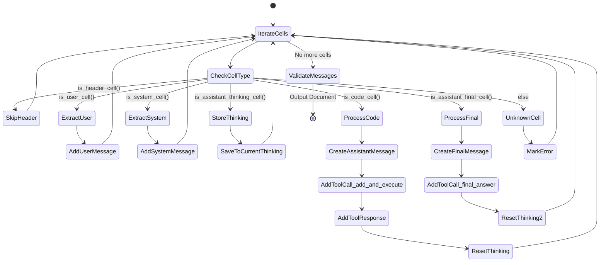
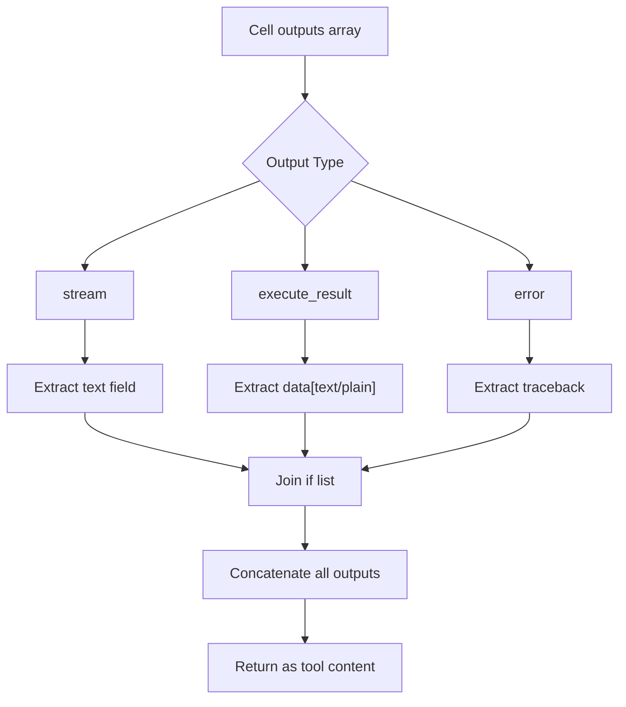
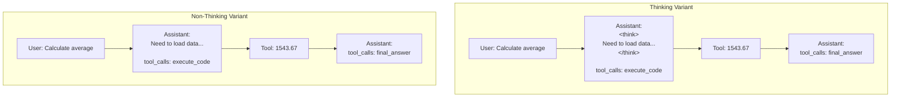
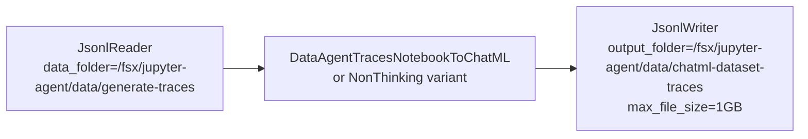

<!-- source: DeepWiki mcp.deepwiki.com · repo huggingface/jupyter-agent · page 2.8 ChatML Format Conversion · fetched 2026-10-26 -->

# ChatML Format Conversion

<details>
<summary>Relevant source files</summary>

The following files were used as context for generating this wiki page:

- [data/README.md](data/README.md)
- [data/pipelines/convert_to_chatml_format.py](data/pipelines/convert_to_chatml_format.py)

</details>


## Purpose and Scope

This page documents the final conversion step in Stage 8 of the data generation pipeline that transforms synthetic notebook traces into ChatML format for LLM training. The conversion process takes notebook JSON structures produced by `GenerateTraces` (see [2.7](#2.7)) and reformats them into a messages array format compatible with modern LLM fine-tuning frameworks. Two converter variants are provided: one that preserves explicit reasoning traces using `\n\n",
      "tool_calls": [
        {
          "function": {
            "name": "add_and_execute_jupyter_code_cell",
            "arguments": {
              "code": "import pandas as pd\ndf = pd.read_csv('sales.csv')\ndf['sales'].mean()"
            }
          }
        }
      ]
    },
    {
      "role": "tool",
      "content": "1543.67"
    },
    {
      "role": "assistant",
      "content": "",
      "tool_calls": [
        {
          "function": {
            "name": "final_answer",
            "arguments": {
              "answer": "The average sales value is 1543.67"
            }
          }
        }
      ]
    }
  ],
  "tools": [...]
}
```

Sources: [data/pipelines/convert_to_chatml_format.py:324-328](), [data/pipelines/convert_to_chatml_format.py:692-697]()

---

## Converter Classes

### DataAgentTracesNotebookToChatML

The `DataAgentTracesNotebookToChatML` class converts notebook traces to ChatML format while preserving explicit reasoning in `` tags and placed in the assistant message's `content` field before the tool call. This allows the model to learn to generate explicit reasoning before executing code or providing answers.

**Key Methods:**
- `extract_content_from_html_template()` - Extracts content from HTML alert divs [data/pipelines/convert_to_chatml_format.py:17-61]()
- `is_assistant_thinking_cell()` - Identifies thinking cells [data/pipelines/convert_to_chatml_format.py:84-91]()
- `run()` - Main conversion loop [data/pipelines/convert_to_chatml_format.py:132-333]()

Sources: [data/pipelines/convert_to_chatml_format.py:9-333]()

### DataAgentTracesNotebookToNonThinkingChatML

The `DataAgentTracesNotebookToNonThinkingChatML` class produces instruction-following examples without explicit reasoning markup. All `` tags throughout the conversion pipeline:
- During HTML content extraction [data/pipelines/convert_to_chatml_format.py:538-540]()
- When constructing assistant messages [data/pipelines/convert_to_chatml_format.py:585-590]()
- In final answers [data/pipelines/convert_to_chatml_format.py:626-628]()
- In a final pass over all messages [data/pipelines/convert_to_chatml_format.py:683-690]()

This aggressive approach ensures no reasoning markup leaks into the training data for the direct instruction-following variant.

Sources: [data/pipelines/convert_to_chatml_format.py:336-705]()

**Comparison Table**

| Aspect | DataAgentTracesNotebookToChatML | DataAgentTracesNotebookToNonThinkingChatML |
|--------|--------------------------------|-------------------------------------------|
| Thinking tags | Preserved in `` | Completely stripped |
| Assistant content | `"\n\n"` | Plain text without tags |
| Training goal | Explicit reasoning traces | Direct instruction-following |
| Use case | Jupyter-Agent-Qwen3-4B-Thinking | Jupyter-Agent-Qwen3-4B-Instruct |

---

## Conversion Process

The conversion process iterates through notebook cells sequentially, identifying cell types and constructing corresponding ChatML messages. The state machine tracks `current_thinking` to associate reasoning with subsequent code execution or final answers.

**Cell Processing State Machine**



Sources: [data/pipelines/convert_to_chatml_format.py:174-333]()

### HTML Template Extraction

The `extract_content_from_html_template()` method uses regular expressions to parse HTML alert divs and extract their content. Different template types require different extraction patterns.

**Extraction Patterns**

| Template Type | Regex Pattern | Example |
|---------------|---------------|---------|
| `user` | `r"<b>User:</b>\s*(.*?)</div>"` | Extracts user query |
| `assistant_thinking` | `r"<b>Assistant:</b>\s*(.*?)</div>"` then `r"&lt;think&gt;(.*?)&lt;/think&gt;"` | Extracts reasoning content |
| `assistant_final` | `r"<b>Assistant:</b>\s*Final answer:\s*(.*?)</div>"` | Extracts final answer |

For user content, `<br>` tags are replaced with newlines for proper formatting [data/pipelines/convert_to_chatml_format.py:28-29]().

Sources: [data/pipelines/convert_to_chatml_format.py:17-61](), [data/pipelines/convert_to_chatml_format.py:344-388]()

### Code Execution Output Extraction

The `extract_code_execution_output()` method processes the `outputs` array from code cells to reconstruct execution results. Multiple output types are supported:

**Output Type Handling**



Lists in text fields are joined using `"".join(text)` to produce a single string [data/pipelines/convert_to_chatml_format.py:114-116](), [data/pipelines/convert_to_chatml_format.py:120-122]().

Sources: [data/pipelines/convert_to_chatml_format.py:104-130](), [data/pipelines/convert_to_chatml_format.py:431-457]()

---

## Tool Definitions

The converter includes two tool definitions in every ChatML document, enabling the model to interact with Jupyter notebook environments through function calling.

**Tool: add_and_execute_jupyter_code_cell**

```json
{
  "type": "function",
  "function": {
    "name": "add_and_execute_jupyter_code_cell",
    "description": "A Python code execution environment that runs code in a Jupyter notebook interface. This is stateful - variables and imports persist between executions.",
    "parameters": {
      "type": "object",
      "properties": {
        "code": {
          "type": "string",
          "description": "The Python code to execute."
        }
      },
      "required": ["code"]
    }
  }
}
```

This tool allows the model to execute Python code in a stateful environment. The statefulness is critical for data science workflows where variables, dataframes, and imports persist across multiple code cells.

**Tool: final_answer**

```json
{
  "type": "function",
  "function": {
    "name": "final_answer",
    "description": "Use this tool to provide the final answer to the user's question.",
    "parameters": {
      "type": "object",
      "properties": {
        "answer": {
          "type": "string",
          "description": "The final answer to the user's question."
        }
      },
      "required": ["answer"]
    }
  }
}
```

This tool signals completion of the task and provides the conclusive answer to the user's query.

Sources: [data/pipelines/convert_to_chatml_format.py:137-172](), [data/pipelines/convert_to_chatml_format.py:464-499]()

**Tool Call Message Structure**

When the assistant invokes a tool, the message structure includes both optional content (for thinking) and a `tool_calls` array:

```python
{
    "role": "assistant",
    "content": "\n\n",  # or "" for non-thinking
    "tool_calls": [
        {
            "function": {
                "name": "add_and_execute_jupyter_code_cell",
                "arguments": {"code": code_source}
            }
        }
    ]
}
```

The tool's response is represented as a separate message with `role: "tool"` and the execution output as content [data/pipelines/convert_to_chatml_format.py:262-266]().

Sources: [data/pipelines/convert_to_chatml_format.py:247-266](), [data/pipelines/convert_to_chatml_format.py:592-615]()

---

## Thinking vs Non-Thinking Variants

The two converter variants produce training data for different model behaviors. The thinking variant trains models to generate explicit reasoning traces, while the non-thinking variant produces more concise instruction-following examples.

**Training Data Comparison**



**Selection in Execution Pipeline**

The `main()` function includes a `thinking` boolean flag that selects which converter to use:

```python
thinking = True

if thinking:
    chatml_step = DataAgentTracesNotebookToChatML()
else:
    chatml_step = DataAgentTracesNotebookToNonThinkingChatML()
```

This flag is set at [data/pipelines/convert_to_chatml_format.py:741]() and determines which training data variant is produced.

Sources: [data/pipelines/convert_to_chatml_format.py:741-746](), [data/README.md:87-89]()

---

## Error Handling and Validation

The converter implements several validation checks to ensure output quality:

**Validation Checks**

| Check | Location | Action |
|-------|----------|--------|
| Unknown cell type | [data/pipelines/convert_to_chatml_format.py:301-307]() | Mark error, print cell details |
| Double thinking | [data/pipelines/convert_to_chatml_format.py:226-230]() | Assert failure with diagnostic |
| Unknown cells found | [data/pipelines/convert_to_chatml_format.py:309-316]() | Skip document, print full notebook |
| Insufficient messages | [data/pipelines/convert_to_chatml_format.py:318-321]() | Skip document |
| Missing question | [data/pipelines/convert_to_chatml_format.py:179-180]() | Skip document |

When unknown cell types are encountered, the converter prints diagnostic information including the cell content and skips the document rather than producing malformed ChatML output. This ensures training data quality.

Sources: [data/pipelines/convert_to_chatml_format.py:174-333]()

---

## Execution Configuration

The conversion pipeline is executed using `SlurmPipelineExecutor` with minimal resource requirements since the processing is primarily string manipulation without LLM inference.

**Pipeline Configuration**



**Resource Allocation**

| Parameter | Value | Purpose |
|-----------|-------|---------|
| `tasks` | 1 | Single-task processing |
| `workers` | 1 | Single worker per task |
| `time` | "20:00:00" | 20-hour time limit |
| `partition` | "hopper-prod" | Production partition |
| `cpus_per_task` | 4 | CPU cores |
| `mem_per_cpu_gb` | 16 | 16 GB RAM per CPU (64 GB total) |
| `qos` | "high" | High priority queue |

The output is written in 1GB chunks via `JsonlWriter` with `max_file_size=int(10**9)` [data/pipelines/convert_to_chatml_format.py:751](), making the data suitable for distributed training.

Sources: [data/pipelines/convert_to_chatml_format.py:708-767]()

**Command Line Execution**

The script requires a router argument for consistency with other pipeline stages, though it is not used during ChatML conversion:

```bash
uv run pipelines/convert_to_chatml_format.py -r <ROUTER_IP:PORT>
```

The router parsing logic is at [data/pipelines/convert_to_chatml_format.py:714-730]() but the parsed values are not utilized in the conversion process itself.

Sources: [data/pipelines/convert_to_chatml_format.py:708-771]()

---

