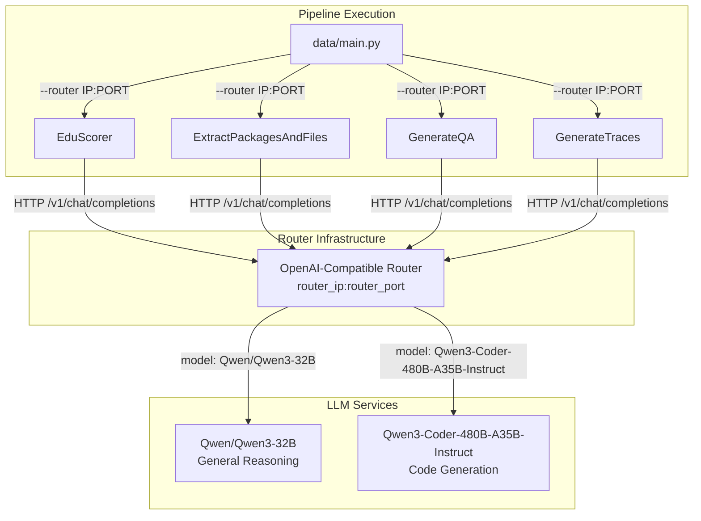
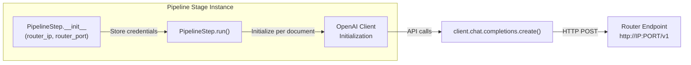
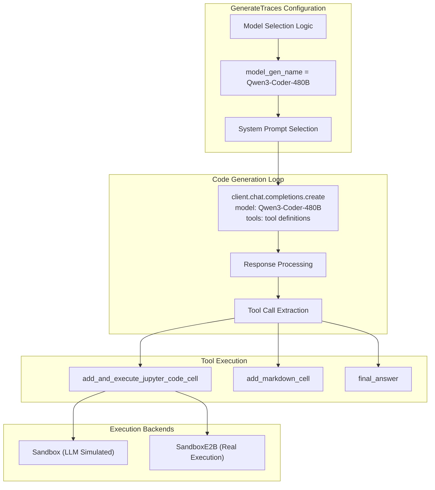
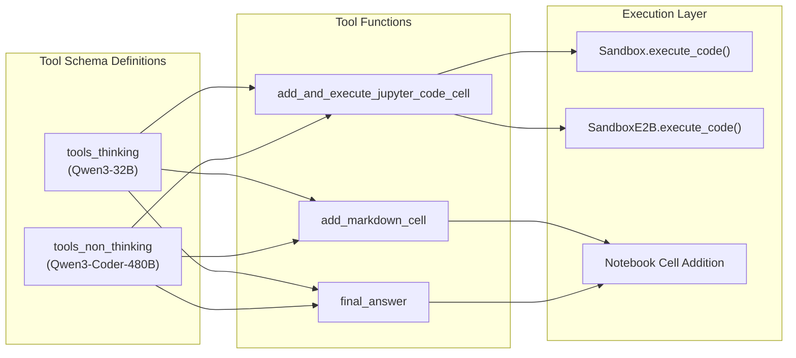
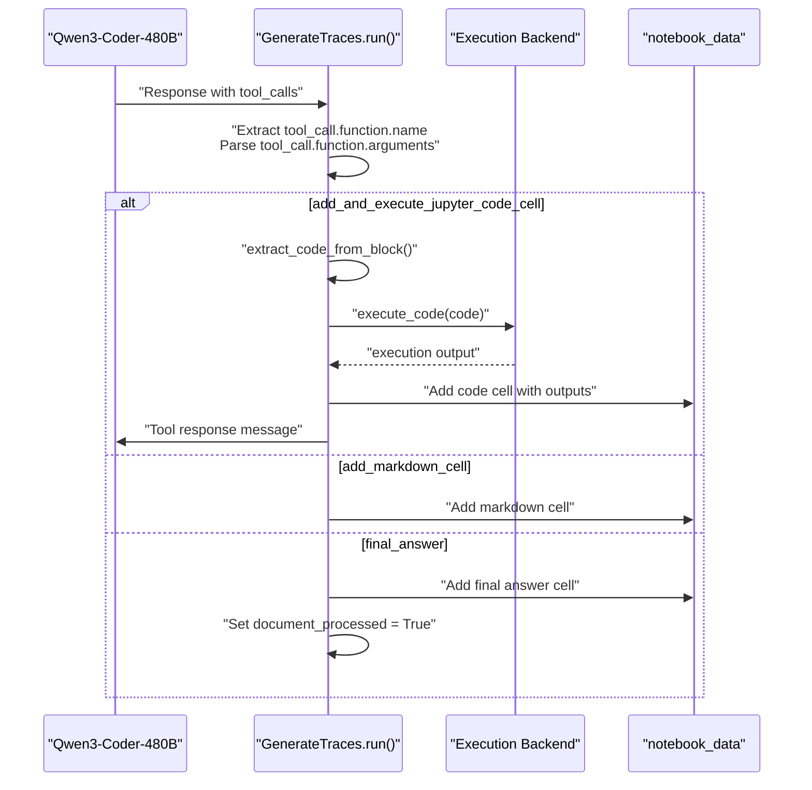
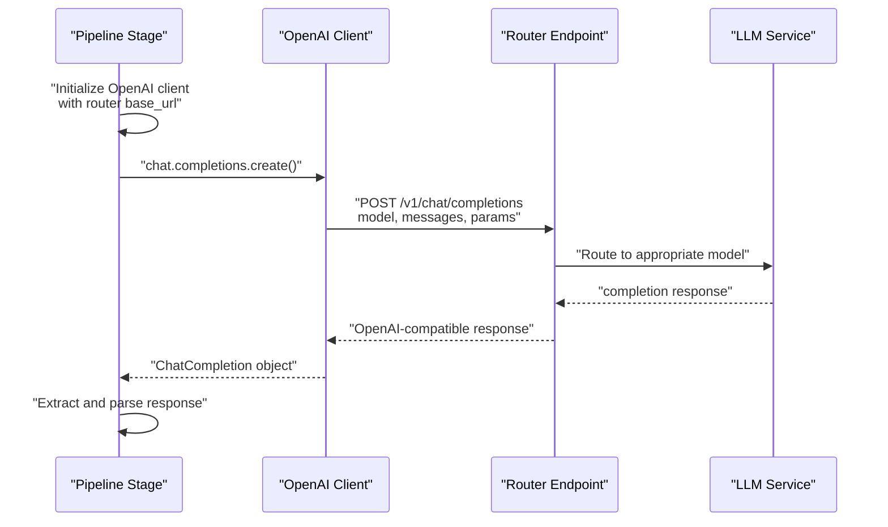

<!-- source: DeepWiki mcp.deepwiki.com · repo huggingface/jupyter-agent · page 3 AI Model Integration · fetched 2026-10-26 -->

# AI Model Integration

<details>
<summary>Relevant source files</summary>

The following files were used as context for generating this wiki page:

- [data/main.py](data/main.py)
- [data/pipelines/edu_scoring.py](data/pipelines/edu_scoring.py)
- [data/pipelines/extract_packages_and_files.py](data/pipelines/extract_packages_and_files.py)
- [data/pipelines/generate_qa.py](data/pipelines/generate_qa.py)
- [data/pipelines/generate_traces.py](data/pipelines/generate_traces.py)

</details>


## Purpose and Scope

This document describes the external AI model dependencies used throughout the data generation pipeline, the router architecture that provides access to these models, and the integration patterns used by different pipeline stages. The system relies on two primary large language models accessed via an OpenAI-compatible router: Qwen3-32B for general reasoning tasks and Qwen3-Coder-480B for code generation.

For information about individual pipeline stages that use these models, see [Data Generation Pipeline](#2). For model training and evaluation of the final Jupyter Agent models, see [Models and Evaluation](#4). For configuration and setup of the router endpoint, see [Environment Setup](#5.1).

---

## Router Architecture

The pipeline accesses external LLM services through an OpenAI-compatible router endpoint. This architecture provides a unified interface for multiple models while allowing flexible deployment configurations.



**Router Endpoint Configuration**

The router address is configured via command-line argument when executing the pipeline. The system accepts either an IP address or IP:PORT format, defaulting to port 39876 if not specified:

```
python data/main.py --router 192.168.1.100:39876
```

**Sources:** [data/main.py:25-45]()

---

## Model Usage Across Pipeline Stages

Different pipeline stages use different models based on their task requirements. The following table shows the model assignment strategy:

| Pipeline Stage | Model Used | Rationale | File Reference |
|---------------|------------|-----------|----------------|
| **EduScorer** | Qwen/Qwen3-32B | Educational quality assessment requires general reasoning and evaluation capabilities | [pipelines/edu_scoring.py:92]() |
| **ExtractPackagesAndFiles** | Qwen/Qwen3-32B | Metadata extraction requires understanding of notebook structure and dependency identification | [pipelines/extract_packages_and_files.py:188,206]() |
| **GenerateQA** | Qwen/Qwen3-32B | Question generation requires analytical reasoning about notebook content and data insights | [pipelines/generate_qa.py:209]() |
| **GenerateTraces** | Qwen3-Coder-480B-A35B-Instruct | Synthetic code generation requires specialized code generation capabilities and tool use | [pipelines/generate_traces.py:68]() |

**Model Selection Rationale**

Qwen3-32B serves as the general-purpose reasoning model for tasks involving text analysis, evaluation, and metadata extraction. Its 32B parameter size provides sufficient capability for understanding notebook content while maintaining reasonable inference costs.

Qwen3-Coder-480B-A35B-Instruct is deployed exclusively for the trace generation stage where high-quality code generation is critical. This specialized code model provides superior performance on code synthesis tasks with tool calling support.

**Sources:** [pipelines/edu_scoring.py:92](), [pipelines/extract_packages_and_files.py:188](), [pipelines/generate_qa.py:209](), [pipelines/generate_traces.py:68]()

---

## Client Integration Pattern

All pipeline stages that require LLM access follow a consistent integration pattern using the OpenAI Python client library configured to point at the router endpoint.



**Client Initialization Code Pattern**

Each pipeline stage that uses LLM services receives router configuration in its constructor and initializes the OpenAI client in its `run` method:

```python
class PipelineStage(PipelineStep):
    def __init__(self, router_ip: str, router_port: str):
        super().__init__()
        self.router_ip = router_ip
        self.router_port = router_port
    
    def run(self, data: Iterable[Document], rank: int = 0, world_size: int = 1):
        from openai import OpenAI
        
        client = OpenAI(
            api_key="token-abc123",
            base_url=f"http://{self.router_ip}:{self.router_port}/v1"
        )
```

The API key `"token-abc123"` is a placeholder token; the router handles actual authentication and model routing based on the `model` parameter in requests.

**Sources:** [pipelines/edu_scoring.py:68-83](), [pipelines/extract_packages_and_files.py:138-174](), [pipelines/generate_qa.py:165-200](), [pipelines/generate_traces.py:14-47]()

---

## Qwen3-32B Integration

Qwen3-32B serves as the general-purpose reasoning model for three critical pipeline stages: educational scoring, metadata extraction, and QA pair generation.

```mermaid
graph TB
    subgraph "EduScorer Stage"
        A["TEMPLATE prompt<br/>5-point scoring rubric"]
        B["doc.text['markdown']"]
        C["chat.completions.create<br/>model: Qwen/Qwen3-32B"]
        D["Response parsing<br/>regex for score"]
        E["doc.metadata['edu_score']"]
    end
    
    subgraph "ExtractPackagesAndFiles Stage"
        F["FILES_USED_PROMPT"]
        G["PACKAGES_USED_PROMPT"]
        H["notebook_markdown_content"]
        I["Two separate API calls<br/>model: Qwen/Qwen3-32B"]
        J["parse_list_content()"]
        K["doc.metadata['files_used']<br/>doc.metadata['packages_used']"]
    end
    
    subgraph "GenerateQA Stage"
        L["GENERATE_QA_PROMPT<br/>Complex multi-step questions"]
        M["notebook_markdown_content"]
        N["chat.completions.create<br/>model: Qwen/Qwen3-32B"]
        O["parse_qa_pairs()"]
        P["doc.metadata['qa_pairs']"]
    end
    
    A --> B --> C --> D --> E
    F --> H
    G --> H
    H --> I --> J --> K
    L --> M --> N --> O --> P
```



### Educational Scoring

The `EduScorer` class uses Qwen3-32B to evaluate notebook quality on a 5-point scale. The model receives notebooks in a custom markdown format with cell tags and must assess them against specific criteria.

**Prompt Structure:**
- 5-point additive scoring system
- Criteria: Valid Python, Data Loading, Data Analysis, Educational Narrative, Exceptional Quality
- Exclusion rules for automatic zero scores
- Output format specifying justification and numerical score

**API Configuration:**
- Model: `"Qwen/Qwen3-32B"`
- Max completion tokens: 1000
- Response parsing via regex to extract score from structured output

**Sources:** [pipelines/edu_scoring.py:14-118]()

### Metadata Extraction

The `ExtractPackagesAndFiles` class performs two separate LLM calls to extract dependency information from notebooks.

**Two-Stage Extraction:**

1. **Files Used Extraction:** Identifies data files referenced in the notebook (e.g., `train.csv`, `test.csv`)
2. **Packages Used Extraction:** Identifies Python packages imported or used (e.g., `pandas`, `numpy`, `scikit-learn`)

Each extraction uses a dedicated prompt with specific output format instructions. The responses are parsed using `parse_list_content()` to convert LLM-generated list format into Python lists.

**Sources:** [pipelines/extract_packages_and_files.py:10-232]()

### QA Pair Generation

The `GenerateQA` class generates complex, multi-step questions about notebook content that require multiple computational steps to answer.

**Question Requirements:**
- Complex enough to require multiple analytical steps
- Answerable with concrete values from notebook outputs
- Focus on data analysis (not ML methodology)
- Up to 5 questions per notebook

The model uses Qwen3-32B's reasoning capabilities to identify the most significant analytical insights in each notebook and formulate questions that test understanding of these insights.

**Sources:** [pipelines/generate_qa.py:9-231]()

---

## Qwen3-Coder-480B Integration

Qwen3-Coder-480B-A35B-Instruct is used exclusively in the `GenerateTraces` stage for synthetic notebook generation with code execution. This model specializes in generating executable Python code with appropriate analysis steps.



### Model Configuration

The trace generation stage conditionally selects between Qwen3-32B and Qwen3-Coder-480B based on a configuration variable. For production use, Qwen3-Coder-480B is selected for its superior code generation capabilities:

**Model Selection:**
```python
# model_gen_name = "Qwen/Qwen3-32B"  # Commented out
model_gen_name = "Qwen3-Coder-480B-A35B-Instruct"
```

**System Prompt Adaptation:**

When using Qwen3-Coder-480B ("Coder" in model name), a specialized system prompt is used:

- Requires explicit step-by-step planning with "Ok here's the plan:" prefix
- Mandates at least 5 sentences of observation and next-step description
- Enforces thought process documentation for each code action
- Separates thinking content from code content
- Prevents repetitive code generation loops

**Sources:** [pipelines/generate_traces.py:68-82]()

### Tool Calling Architecture

Qwen3-Coder-480B uses function calling to interact with the notebook environment through three defined tools.

**Tool Definitions:**

There are two variants of tool definitions depending on whether thinking traces are desired:

1. **`tools_non_thinking`**: Used with Qwen3-Coder-480B, includes a `comment` parameter for thinking
2. **`tools_thinking`**: Used with Qwen3-32B when generating thinking traces natively

All tools include:
- `add_and_execute_jupyter_code_cell`: Execute Python code and return results
- `add_markdown_cell`: Add explanatory markdown content
- `final_answer`: Provide final answer to the question and terminate generation

**Sources:** [pipelines/generate_traces.py:70-81](), [pipelines/utils/qwen3_formatter_utils.py]()

### Response Processing Pattern

When using Qwen3-Coder-480B, the system wraps reasoning content in `"
    elif response.choices[0].message.content and len(response.choices[0].message.content) > 0:
        full_response = ""
    else:
        full_response = ""
```

This normalization ensures consistent thinking trace format regardless of model architecture differences.

**Sources:** [pipelines/generate_traces.py:448-467]()

---

## Tool Definitions and Architecture

The trace generation system implements a tool-calling architecture that enables the LLM to interact with Jupyter notebook environments programmatically.



### Tool Schema Structure

Each tool is defined as an OpenAI function-calling schema with name, description, and parameter specifications.

**`add_and_execute_jupyter_code_cell` Tool:**
- **Purpose:** Execute Python code in the notebook environment
- **Parameters:**
  - `code` (string, required): Python code to execute
  - `comment` (string, optional): Thinking/reasoning content (non-thinking tools only)
- **Returns:** Execution output including stdout, stderr, and display data

**`add_markdown_cell` Tool:**
- **Purpose:** Add explanatory markdown content to the notebook
- **Parameters:**
  - `content` (string, required): Markdown content to add

**`final_answer` Tool:**
- **Purpose:** Provide the final answer and terminate trace generation
- **Parameters:**
  - `answer` (string, required): Final answer to the original question

**Sources:** [pipelines/utils/qwen3_formatter_utils.py]()

### Tool Call Processing Flow



**Tool Call Handling Logic:**

The main generation loop iterates up to `max_turns` (25) and processes each tool call:

1. **API Request:** Call `client.chat.completions.create()` with tool definitions
2. **Response Extraction:** Extract `tool_calls` from response
3. **Tool Dispatch:** Route to appropriate handler based on `tool_call.function.name`
4. **Execution:** Execute tool action (code execution, cell addition, etc.)
5. **Response Formatting:** Format execution results as tool response message
6. **Loop Continuation:** Add response to message history and continue or terminate

**Sources:** [pipelines/generate_traces.py:413-595]()

### Error Handling and Retry Logic

The tool calling system implements several error handling mechanisms:

**Tool Call Validation:**
- Counts consecutive API calls without valid tool calls
- Terminates after 5 consecutive failures to prevent infinite loops

**Code Extraction:**
- `extract_code_from_block()` removes markdown code fences from generated code
- Prevents syntax errors from LLM including ```python markers

**Execution Error Handling:**
- Sandbox execution errors are caught and logged
- Document processing returns `None` on execution failure
- E2B sandbox cleanup (`sandbox.kill()`) ensures resource cleanup

**Sources:** [pipelines/generate_traces.py:418-428,505-522](), [pipelines/utils/jupyter_utils.py]()

---

## API Communication Patterns

All LLM-using pipeline stages follow consistent patterns for API communication, error handling, and response processing.

### Request/Response Flow



### Standard Request Parameters

All API calls share common parameters:

| Parameter | Type | Usage | Example Values |
|-----------|------|-------|----------------|
| `messages` | List[Dict] | Conversation history with roles | `[{"role": "user", "content": "..."}]` |
| `model` | String | Model identifier for router | `"Qwen/Qwen3-32B"`, `"Qwen3-Coder-480B-A35B-Instruct"` |
| `max_completion_tokens` | Integer | Maximum response length | 1000 (scoring), 5000 (QA), unlimited (traces) |
| `tools` | List[Dict] (optional) | Function calling schemas | Tool definitions for trace generation |

**Sources:** [pipelines/edu_scoring.py:90-94](), [pipelines/extract_packages_and_files.py:187-194](), [pipelines/generate_qa.py:208-214](), [pipelines/generate_traces.py:431-435]()

### Error Handling Patterns

Each pipeline stage implements error handling with document-level granularity:

**Try-Catch Wrapper:**
```python
for doc in data:
    with self.track_time():
        try:
            # API calls and processing
            completion = client.chat.completions.create(...)
            # Response parsing
            doc.metadata["field"] = parsed_result
        except Exception as e:
            # Error logging and metadata
            doc.metadata["error_field"] = str(e)
            print(f"Error processing document {doc.id}: {e}")
            return None  # or continue to next document
    
    yield doc
```

**Error Recording Strategies:**

- **EduScorer:** Sets `edu_score = -1` and records error in `edu_error` metadata field
- **ExtractPackagesAndFiles:** Returns `None` to drop document from pipeline
- **GenerateQA:** Returns `None` to drop document from pipeline
- **GenerateTraces:** Returns `None` and performs sandbox cleanup

**Sources:** [pipelines/edu_scoring.py:86-117](), [pipelines/extract_packages_and_files.py:182-232](), [pipelines/generate_qa.py:203-230](), [pipelines/generate_traces.py:49-601]()

### Response Parsing Utilities

The system provides common utilities for parsing structured LLM outputs:

**Qwen3 Format Utilities:**

- `parse_think_and_answer()`: Separates thinking traces from final answers
- `parse_tagged_content()`: Extracts content from XML-style tags (e.g., `<question_1>...</question_1>`)

These utilities handle the structured output formats enforced by prompts, enabling reliable extraction of specific information fields from free-form LLM responses.

**Sources:** [pipelines/utils/qwen3_formatter_utils.py](), [pipelines/edu_scoring.py:100-103](), [pipelines/extract_packages_and_files.py:198-220](), [pipelines/generate_qa.py:219-221]()

---

## Configuration and Deployment Considerations

### Router Endpoint Requirements

The system requires an OpenAI-compatible router that supports:

- **Chat Completions API:** `/v1/chat/completions` endpoint
- **Model Routing:** Route requests to different models based on `model` parameter
- **Function Calling:** Support for tools/function calling in requests
- **Concurrent Connections:** Handle parallel requests from distributed Slurm workers

### Model Access Configuration

Models must be accessible through the router with the following identifiers:

- `"Qwen/Qwen3-32B"` for general reasoning tasks
- `"Qwen3-Coder-480B-A35B-Instruct"` for code generation

The router handles authentication, rate limiting, and load balancing across model instances.

### Resource Planning

LLM API calls represent a significant component of pipeline execution time:

- **EduScorer:** 1 API call per document
- **ExtractPackagesAndFiles:** 2 API calls per document
- **GenerateQA:** 1 API call per document
- **GenerateTraces:** 5-25 API calls per document (iterative generation)

For a pipeline processing 51,000 notebooks with distributed execution across 128 tasks, the router must support sustained throughput of hundreds of requests per minute.

**Sources:** [data/main.py:25-97]()

---

