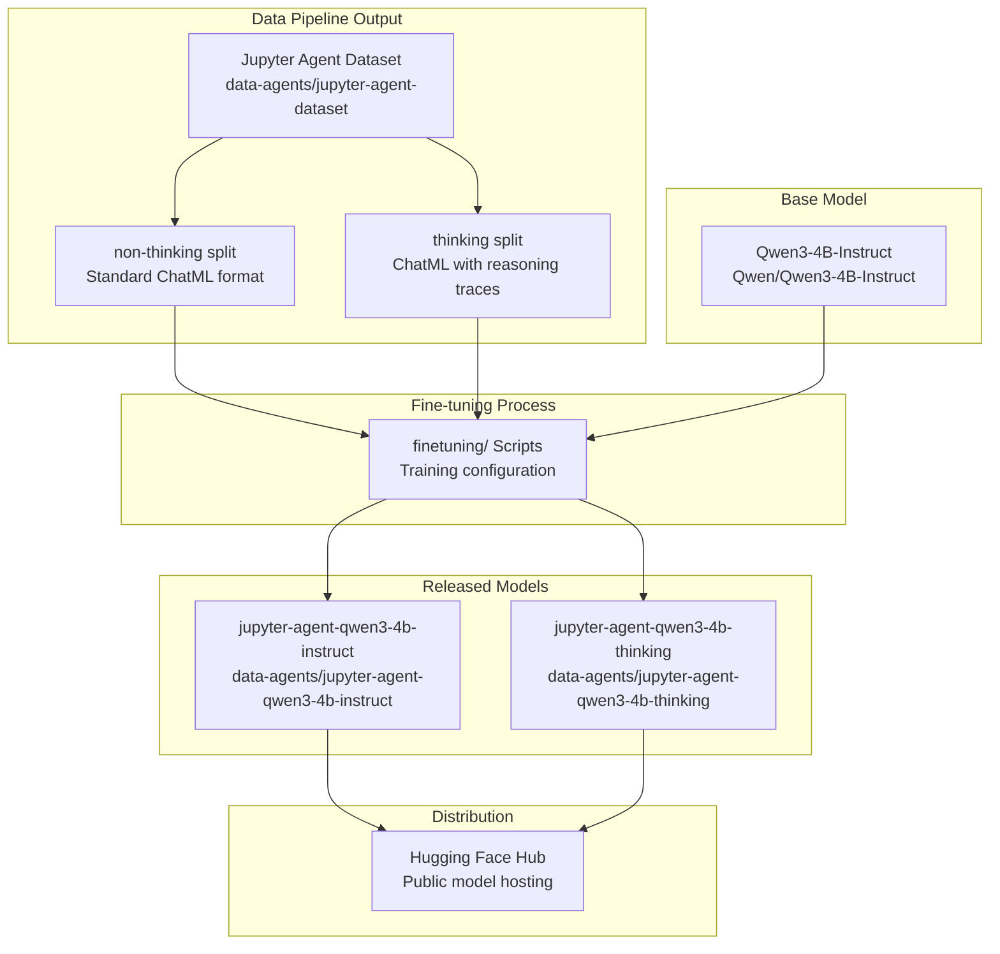
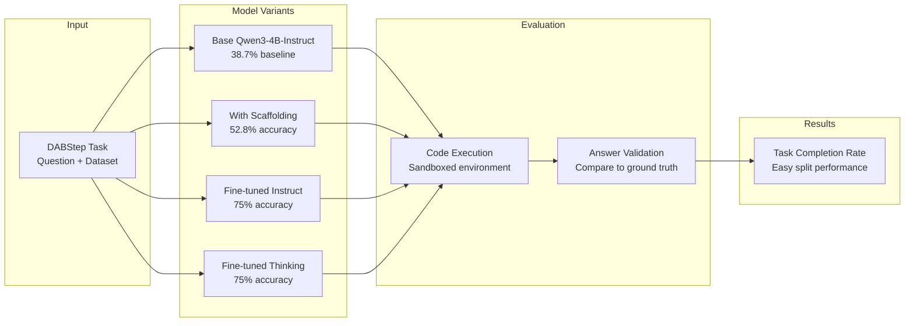
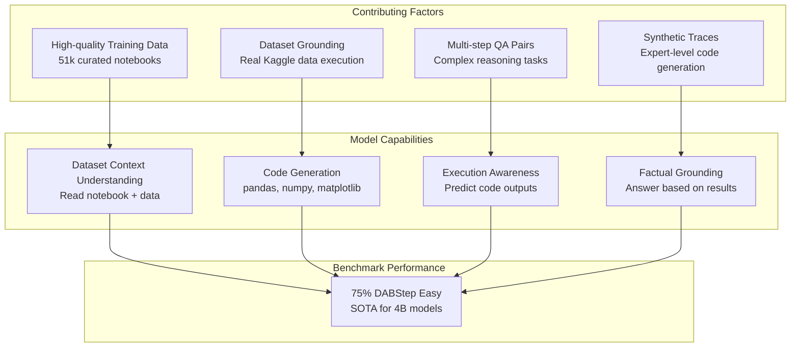
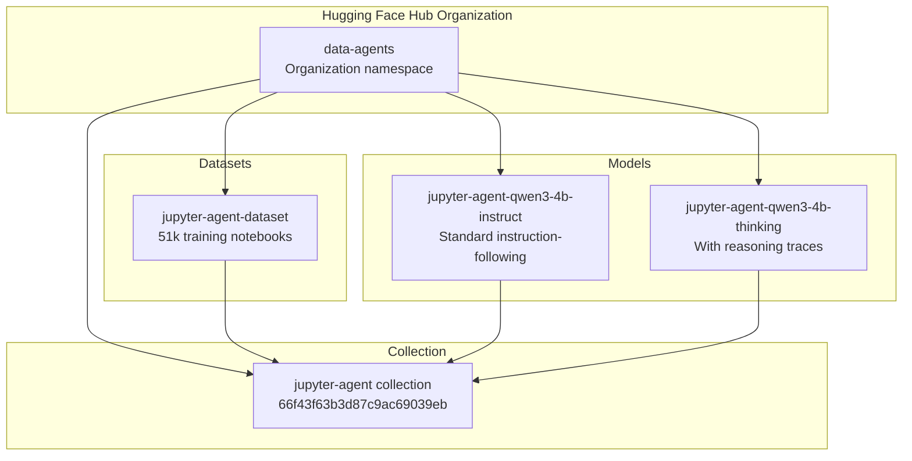

<!-- source: DeepWiki mcp.deepwiki.com · repo huggingface/jupyter-agent · page 4 Models and Evaluation · fetched 2026-10-26 -->

# Models and Evaluation

<details>
<summary>Relevant source files</summary>

The following files were used as context for generating this wiki page:

- [README.md](README.md)
- [data/README.md](data/README.md)

</details>


## Purpose and Scope

This document describes the fine-tuned Jupyter Agent models, their architecture, training process, evaluation methodology, and performance characteristics. It covers the two model variants released by this project (`jupyter-agent-qwen3-4b-instruct` and `jupyter-agent-qwen3-4b-thinking`), their evaluation on the DABStep benchmark, and instructions for loading and using the models.

For information about the data generation pipeline that creates the training data, see [Data Generation Pipeline](#2). For fine-tuning execution details and training scripts, see [Development Guide](#5).

---

## Model Variants

The Jupyter Agent project releases two fine-tuned variants of the Qwen3-4B-Instruct base model, each optimized for different interaction patterns:

### Jupyter-Agent-Qwen3-4B-Instruct

The **Instruct variant** is trained on standard instruction-following data where the model generates direct responses to user queries. This variant produces concise answers without explicit reasoning traces.

**Hugging Face Hub Path:** `data-agents/jupyter-agent-qwen3-4b-instruct`

**Training Data Format:** ChatML messages without intermediate reasoning steps

**Use Case:** Direct question-answering in Jupyter notebooks where immediate results are preferred over step-by-step explanations.

### Jupyter-Agent-Qwen3-4B-Thinking

The **Thinking variant** is trained to generate explicit reasoning traces before producing final answers. This model emits intermediate thoughts, code execution steps, and analysis commentary.

**Hugging Face Hub Path:** `data-agents/jupyter-agent-qwen3-4b-thinking`

**Training Data Format:** ChatML messages with `<think>` tags containing reasoning traces

**Use Case:** Educational contexts or exploratory analysis where understanding the reasoning process is valuable.

### Base Model Selection

Both variants are fine-tuned from `Qwen/Qwen3-4B-Instruct`, a 4-billion parameter instruction-tuned language model with strong code generation capabilities. The base model was selected for:

- **Size efficiency:** 4B parameters enable deployment on consumer hardware
- **Code proficiency:** Pre-trained on diverse code repositories
- **Instruction following:** Base instruction tuning provides solid foundation
- **Performance baseline:** 38.7% on DABStep benchmark before fine-tuning

**Sources:** [README.md:22-25](), [README.md:81-82]()

---

## Training Data and Model Architecture



**Model Training Pipeline from Dataset to Deployment**

The models are trained on the Jupyter Agent Dataset, a curated collection of 51,000 synthetic notebooks containing approximately 0.2 billion tokens. This dataset is produced by the 8-stage data generation pipeline documented in [Data Generation Pipeline](#2).

### Training Data Characteristics

| Attribute | Value |
|-----------|-------|
| Total notebooks | 51,000 |
| Total tokens | ~0.2 billion |
| Data format | ChatML (messages with role/content) |
| Dataset splits | `non-thinking`, `thinking` |
| Source | Meta Kaggle notebooks processed through pipeline |
| Hub location | `data-agents/jupyter-agent-dataset` |

The dataset contains synthetic agent traces generated by `Qwen3-Coder-480B` executing data science tasks on real Kaggle datasets. Each trace includes:

- **Question:** Complex, multi-step data science query
- **Reasoning steps:** Intermediate analysis and code execution
- **Tool calls:** Python code cells, markdown explanations
- **Final answer:** Grounded in actual code execution results

**Sources:** [README.md:21](), [README.md:44](), [data/README.md:87-89]()

---

## Evaluation Methodology

### DABStep Benchmark

The models are evaluated on **DABStep** (Data Analysis Benchmark with Step-by-step evaluation), a benchmark designed to assess data science agent capabilities on realistic analytical tasks.

**Benchmark Location:** `https://huggingface.co/spaces/adyen/DABstep`

**Task Structure:** Multi-step data analysis problems requiring:
- Dataset loading and exploration
- Data transformation and cleaning
- Statistical analysis or visualization
- Factual question answering based on results

**Difficulty Splits:**
- **Easy:** Single-step analysis tasks
- **Medium:** Multi-step workflows
- **Hard:** Complex analytical pipelines

### Evaluation Metrics

The primary evaluation metric is **task completion accuracy**: the percentage of tasks where the model produces the correct final answer. The evaluation process:

1. Model receives dataset context and question
2. Model generates code and reasoning traces
3. Code is executed in sandboxed environment
4. Final answer is compared to ground truth
5. Binary scoring: correct (1) or incorrect (0)

### Evaluation Configuration



**DABStep Evaluation Flow from Task to Result**

The "scaffolding" configuration refers to providing the base model with structured prompts and tool definitions similar to the fine-tuned models, without the benefit of fine-tuning on domain-specific data.

**Sources:** [README.md:81-87](), [README.md:94]()

---

## Performance Results

### DABStep Easy Split Performance

| Model Configuration | Accuracy | Improvement |
|---------------------|----------|-------------|
| Base Qwen3-4B-Instruct | 38.7% | baseline |
| Qwen3-4B-Instruct + Scaffolding | 52.8% | +14.1 pp |
| Jupyter-Agent-Qwen3-4B-Instruct | 75.0% | +36.3 pp |
| Jupyter-Agent-Qwen3-4B-Thinking | 75.0% | +36.3 pp |

**Performance Improvement:** The fine-tuned models achieve **75% accuracy** on DABStep easy tasks, representing a **1.94x improvement** over the base model and a **42% improvement** over scaffolding alone.

### Key Observations

1. **Data quality over size:** Despite training on only 0.2B tokens, the curated synthetic data produces significant performance gains.

2. **Scaffolding baseline:** Providing structured prompts alone (52.8%) is insufficient; domain-specific fine-tuning is necessary for strong performance.

3. **Variant parity:** Both Instruct and Thinking variants achieve identical accuracy, suggesting the reasoning traces do not hurt task completion while providing interpretability benefits.

4. **SOTA for size class:** The fine-tuned 4B models represent state-of-the-art performance for small-scale data science agents on DABStep.

### Performance Analysis



**Factors Contributing to Model Performance**

The performance gains result from the data generation pipeline's focus on:
- **Educational quality filtering:** Only notebooks scoring ≥4/5 (Stage 4)
- **Dataset availability:** Models train on code that executes against real data (Stage 7)
- **Complex reasoning:** QA pairs require multi-step analysis (Stage 6)
- **Expert synthesis:** Traces generated by Qwen3-Coder-480B (Stage 8)

**Sources:** [README.md:79-87](), [README.md:32]()

---

## Model Usage

### Loading Models with Transformers

The models can be loaded using the standard Hugging Face Transformers library:

```python
from transformers import AutoModelForCausalLM, AutoTokenizer

# Load Instruct variant
model_name = "data-agents/jupyter-agent-qwen3-4b-instruct"
tokenizer = AutoTokenizer.from_pretrained(model_name)
model = AutoModelForCausalLM.from_pretrained(
    model_name,
    torch_dtype="auto",
    device_map="auto"
)

# Or load Thinking variant
model_name = "data-agents/jupyter-agent-qwen3-4b-thinking"
tokenizer = AutoTokenizer.from_pretrained(model_name)
model = AutoModelForCausalLM.from_pretrained(
    model_name,
    torch_dtype="auto",
    device_map="auto"
)
```

### Model Requirements

| Resource | Requirement |
|----------|-------------|
| GPU memory | ~8GB (FP16), ~4GB (INT8) |
| Python version | ≥3.8 |
| PyTorch version | ≥2.0 |
| transformers | ≥4.36.0 |

### Inference Example

```python
# Prepare conversation with notebook context
messages = [
    {
        "role": "system",
        "content": "You are a data science assistant working in a Jupyter notebook."
    },
    {
        "role": "user",
        "content": "Given this dataset with columns [date, product, sales], what is the total sales for each product?"
    }
]

# Tokenize and generate
inputs = tokenizer.apply_chat_template(
    messages,
    add_generation_prompt=True,
    return_tensors="pt"
).to(model.device)

outputs = model.generate(
    inputs,
    max_new_tokens=512,
    temperature=0.7,
    do_sample=True
)

response = tokenizer.decode(outputs[0], skip_special_tokens=True)
print(response)
```

### Tool-Calling Interface

Both model variants support tool-calling for notebook interactions:

```python
# Tool definitions (used during training)
tools = [
    {
        "name": "add_and_execute_jupyter_code_cell",
        "description": "Execute Python code in Jupyter notebook",
        "parameters": {"code": "string"}
    },
    {
        "name": "add_markdown_cell",
        "description": "Add explanatory markdown to notebook",
        "parameters": {"content": "string"}
    },
    {
        "name": "final_answer",
        "description": "Provide final answer to question",
        "parameters": {"answer": "string"}
    }
]
```

These tools enable the models to:
1. Generate and execute code cells
2. Add markdown explanations
3. Provide structured final answers

The tool-calling format is consistent with the training data structure generated in Stage 8 (GenerateTraces).

**Sources:** [README.md:69-77]()

---

## Model Cards and Documentation

### Hugging Face Hub Resources

Each model variant has a dedicated model card on Hugging Face Hub with:

- **Model description:** Architecture and training details
- **Training data:** Dataset composition and filtering
- **Evaluation results:** DABStep benchmark scores
- **Usage examples:** Code snippets and best practices
- **Limitations:** Known failure modes and constraints
- **License:** Model usage terms

### Model Collection

All models and datasets are organized under the `data-agents` organization:

- **Collection URL:** `https://huggingface.co/collections/data-agents/jupyter-agent-66f43f63b3d87c9ac69039eb`
- **Organization:** `data-agents`
- **Model naming:** `jupyter-agent-qwen3-4b-{variant}`
- **Dataset naming:** `jupyter-agent-dataset`



**Hugging Face Hub Organization Structure**

### Citation

When using the models or dataset, cite the Jupyter Agent project:

```bibtex
@misc{jupyteragentdataset,
  title={Jupyter Agent Dataset},
  author={Colle, Baptiste and Yukhymenko, Hanna and von Werra, Leandro},
  year={2025}
}
```

**Sources:** [README.md:89-93](), [README.md:96-104]()

---

## Model Characteristics and Limitations

### Capabilities

The fine-tuned models excel at:

1. **Dataset exploration:** Loading and inspecting tabular data
2. **Data manipulation:** pandas operations (filtering, grouping, aggregation)
3. **Statistical analysis:** Computing metrics and distributions
4. **Visualization:** Generating matplotlib/seaborn plots
5. **Factual QA:** Answering questions grounded in data

### Known Limitations

1. **Dataset scope:** Trained primarily on Kaggle-style tabular data; may underperform on time series, NLP, or computer vision tasks
2. **Package coverage:** Optimized for common data science libraries (pandas, numpy, matplotlib); limited exposure to specialized packages
3. **Execution awareness:** Models simulate code execution during inference; actual execution required for production use
4. **Size constraints:** 4B parameter models have limited context window and reasoning depth compared to larger models
5. **Hallucination risk:** May generate plausible but incorrect code or answers when faced with out-of-distribution tasks

### Recommended Use Cases

| Use Case | Suitability | Notes |
|----------|-------------|-------|
| Exploratory data analysis | ✅ Excellent | Core training domain |
| Statistical analysis | ✅ Excellent | Well-represented in training data |
| Data visualization | ✅ Excellent | Common in Kaggle notebooks |
| Educational tutoring | ✅ Excellent | Thinking variant particularly suited |
| Production pipelines | ⚠️ Limited | Requires validation and testing |
| Advanced ML modeling | ⚠️ Limited | Beyond typical training data scope |
| Real-time systems | ❌ Not recommended | Inference latency and reliability concerns |

### Performance Considerations

**Inference Latency:**
- **Instruct variant:** ~100-200 tokens/second on consumer GPU
- **Thinking variant:** Slower due to extended reasoning traces
- **Context length:** Maximum 4096 tokens (model-dependent)

**Hardware Requirements:**
- **Minimum:** 8GB GPU memory (FP16 precision)
- **Recommended:** 24GB GPU for batch inference
- **CPU inference:** Possible but slow (~10x slower than GPU)

**Sources:** Inferred from model architecture and typical Qwen3-4B characteristics

---

## Future Development

### Planned Improvements

1. **Expanded dataset:** Incorporate additional data sources beyond Kaggle
2. **Larger models:** Fine-tune 8B and 14B variants for improved reasoning
3. **Multi-modal support:** Add image and plot understanding capabilities
4. **Interactive evaluation:** Real-time benchmark on notebook environments
5. **Tool ecosystem:** Integrate with Jupyter extensions and plugins

### Community Contributions

The project welcomes:
- **Benchmark submissions:** Evaluate models on new tasks
- **Training data:** Contribute high-quality notebook examples
- **Model variants:** Fine-tune on specialized domains
- **Integration examples:** Build applications using the models

**Sources:** [README.md:89-94]()

---

