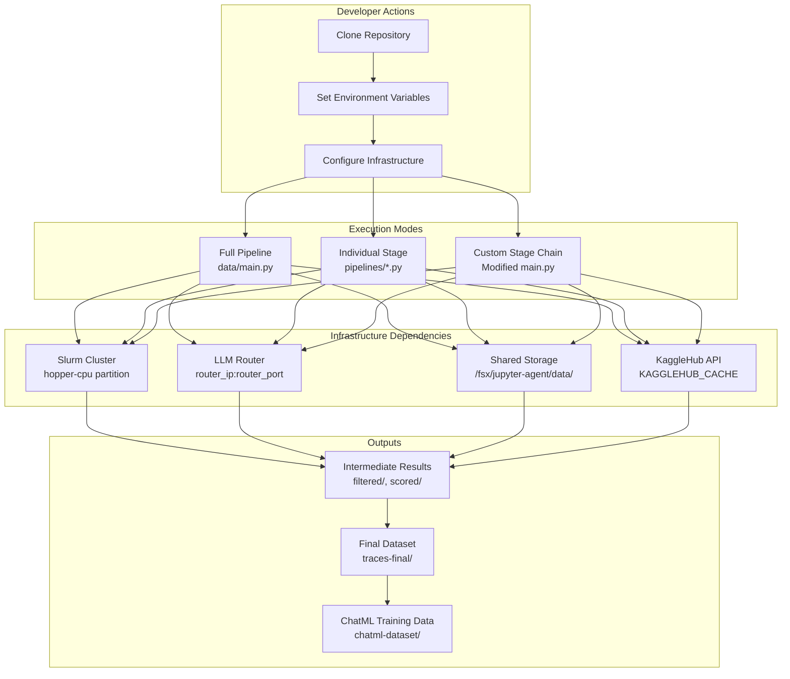
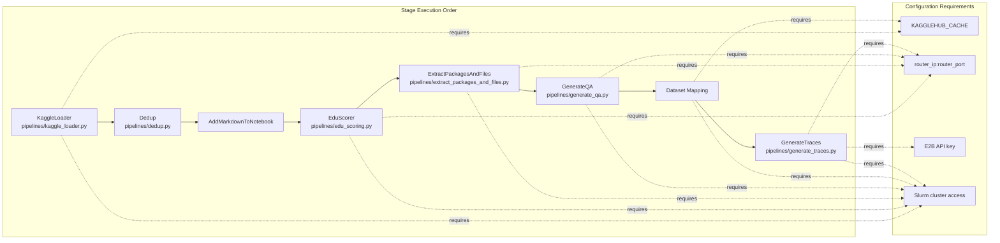
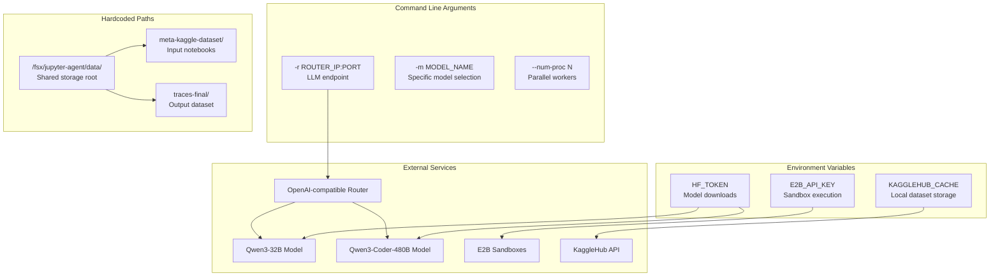

<!-- source: DeepWiki mcp.deepwiki.com · repo huggingface/jupyter-agent · page 5 Development Guide · fetched 2026-10-26 -->

# Development Guide

Relevant source files

The following files were used as context for generating this wiki page:

- [.gitignore](.gitignore)
- [README.md](README.md)
- [data/README.md](data/README.md)

This guide provides practical instructions for developers working with the Jupyter Agent codebase. It covers environment setup, pipeline execution, configuration requirements, and common development workflows. For detailed information about the data generation pipeline architecture, see [Data Generation Pipeline](#2). For model training procedures, see [Models and Evaluation](#4).

## Overview

The Jupyter Agent repository is organized around two primary workflows:

1. **Data Generation**: Processing raw Kaggle notebooks through an 8-stage pipeline to produce training data
2. **Model Training**: Fine-tuning base models using the generated dataset

Development primarily involves running and modifying the data generation pipeline, which requires access to distributed computing infrastructure (Slurm cluster), external LLM services, and substantial storage capacity.

## Development Workflow

**Sources:** [data/README.md:1-135](), [README.md:1-104]()

## Key Entry Points and Commands

The codebase provides multiple entry points depending on the development task:

| Entry Point | Purpose | Command Example |
|------------|---------|-----------------|
| `data/main.py` | Full pipeline orchestration | `uv run main.py -r <ROUTER_IP:PORT>` |
| `pipelines/kaggle_loader.py` | Stage 1: Load raw notebooks | `uv run pipelines/kaggle_loader.py` |
| `pipelines/dedup.py` | Stage 2: Deduplication | `uv run pipelines/dedup.py` |
| `pipelines/edu_scoring.py` | Stage 4: Quality assessment | `uv run pipelines/edu_scoring.py -r <ROUTER_IP:PORT>` |
| `pipelines/extract_packages_and_files.py` | Stage 5: Metadata extraction | `uv run pipelines/extract_packages_and_files.py -r <ROUTER_IP:PORT>` |
| `pipelines/generate_qa.py` | Stage 6: QA generation | `uv run pipelines/generate_qa.py -r <ROUTER_IP:PORT>` |
| `pipelines/generate_traces.py` | Stage 8: Trace generation | `uv run pipelines/generate_traces.py -r <ROUTER_IP:PORT>` |

**Sources:** [data/README.md:112-135]()

## Pipeline Stage Dependencies

**Sources:** [data/README.md:6-28](), [data/README.md:112-135]()

## Configuration Architecture

The system relies on several environment-level configurations that must be established before pipeline execution:

**Sources:** [data/README.md:91-106](), [data/README.md:110-135]()

## Code Organization for Development

The repository follows a modular structure separating data generation from model training:

| Directory | Purpose | Key Files |
|-----------|---------|-----------|
| `data/` | Pipeline orchestration | `main.py` - Entry point with `SlurmPipelineExecutor` |
| `data/pipelines/` | Individual pipeline stages | `kaggle_loader.py`, `dedup.py`, `edu_scoring.py`, etc. |
| `data/filters/` | Data filtering components | Used by pipeline stages for document filtering |
| `data/mappers/` | Data transformation components | Used by pipeline stages for document mapping |
| `finetuning/` | Model training scripts | Training configuration and execution scripts |
| `workspace/` | Temporary development files | Ignored by git [.gitignore:194]() |
| `debug-data/` | Debug output storage | Ignored by git [.gitignore:178]() |
| `logs/` | Execution logs | Ignored by git [.gitignore:175]() |

**Sources:** [.gitignore:1-202](), [README.md:59-61]()

## Development Dependencies

The project uses `uv` as the Python package manager. All pipeline commands are executed with the `uv run` prefix, which manages the virtual environment automatically. The `.gitignore` file shows that multiple virtual environment patterns are excluded (`.venv`, `.venv*`, `venv/`, etc.), indicating flexibility in environment setup approaches.

Key dependency categories:
- **Data Processing**: Libraries for notebook manipulation, markdown conversion
- **LLM Integration**: OpenAI-compatible API clients for model inference
- **Distributed Computing**: Slurm integration for cluster execution
- **Sandbox Execution**: E2B API for isolated code execution
- **Dataset Management**: KaggleHub for dataset downloads

**Sources:** [.gitignore:130-138](), [.gitignore:185]()

## Resource Requirements

Based on the infrastructure diagrams and configuration:

| Resource Type | Requirement | Usage |
|--------------|-------------|-------|
| Storage | Multiple TB | Raw notebooks (~2TB), intermediate data, final dataset |
| Compute | 128 tasks × 4 CPUs | Slurm cluster: `hopper-cpu` partition |
| Memory | 16GB per task | Total: ~2TB across all parallel tasks |
| Network | High bandwidth | LLM API calls, dataset downloads |

The pipeline generates substantial intermediate data that must be preserved between stages. The `.gitignore` explicitly excludes large data artifacts (`*.parquet`, `*.jsonl`, `*.jsonl.gz`, `training-data/`, `models/`) to prevent accidental commits.

**Sources:** [.gitignore:183-201]()

## Common Development Tasks

### Inspecting Pipeline Outputs

Each stage writes to a specific subdirectory under `/fsx/jupyter-agent/data/`. Developers can inspect intermediate results by examining these directories without re-running expensive stages.

### Debugging Individual Stages

Individual pipeline stages can be executed independently using their respective CLI scripts in `data/pipelines/`. This allows testing stage modifications without running the full pipeline.

### Modifying Pipeline Configuration

The `data/main.py` file contains the pipeline definition using `SlurmPipelineExecutor`. Developers can modify stage order, add new stages, or adjust resource allocation by editing this orchestration script.

### Working with Temporary Data

The `.gitignore` configuration protects developers from accidentally committing large artifacts. Debug outputs go to `debug-data/`, temporary notebooks to `workspace/`, and logs to `logs/` - all ignored directories.

**Sources:** [.gitignore:174-201](), [data/README.md:112-135]()

## Next Steps

For detailed instructions on environment setup, see [Environment Setup](#5.1). For step-by-step pipeline execution procedures, see [Running the Pipeline](#5.2). For information about data storage organization, see [Data Storage and Paths](#5.3).

---

