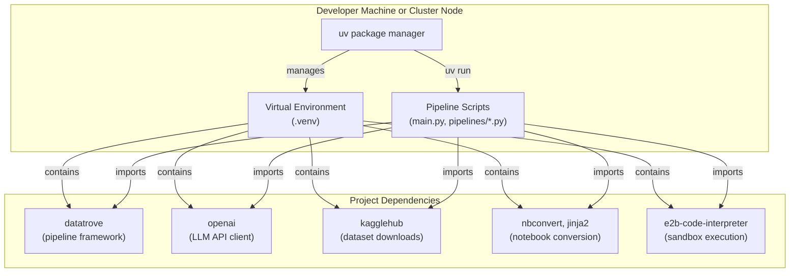
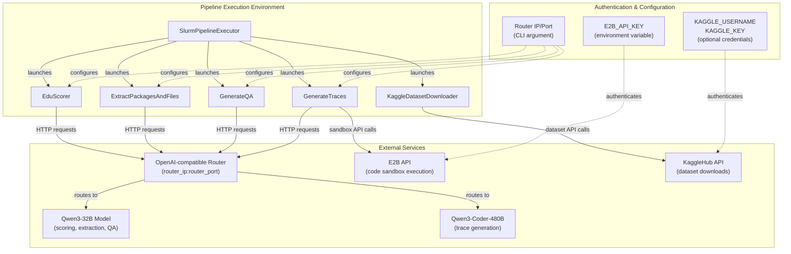

<!-- source: DeepWiki mcp.deepwiki.com · repo huggingface/jupyter-agent · page 5.1 Environment Setup · fetched 2026-10-26 -->

# Environment Setup

<details>
<summary>Relevant source files</summary>

The following files were used as context for generating this wiki page:

- [.gitignore](.gitignore)
- [data/README.md](data/README.md)
- [data/main.py](data/main.py)
- [data/pipelines/kaggle_sourcing/README.md](data/pipelines/kaggle_sourcing/README.md)

</details>


This document covers the prerequisites and configuration required to run the Jupyter Agent data generation pipeline. It includes Python environment setup, environment variable configuration, external service dependencies, and Slurm cluster access requirements. For instructions on executing the pipeline itself, see [Running the Pipeline](#5.2). For details on storage paths and data organization, see [Data Storage and Paths](#5.3).

---

## Prerequisites Overview

The Jupyter Agent pipeline has several categories of dependencies that must be configured before execution:

| Category | Components | Purpose |
|----------|-----------|---------|
| **Python Runtime** | Python 3.x, `uv` package manager | Execute pipeline scripts |
| **Environment Variables** | `KAGGLEHUB_CACHE`, router config, optional Kaggle credentials | Configure data paths and API endpoints |
| **External Services** | OpenAI-compatible router, LLM models, E2B API, KaggleHub API | AI inference, code execution, dataset downloads |
| **Infrastructure** | Slurm cluster access, shared file system | Distributed processing and data storage |
| **Data Download Tools** | Google Cloud CLI (`gcloud`, `gsutil`) | Download raw Kaggle notebook archive (~2TB) |

Sources: [data/README.md:92-106](), [data/main.py:25-46](), [data/pipelines/kaggle_sourcing/README.md:1-15]()

---

## Python Environment Setup

### Package Manager Installation

The project uses `uv` as the package manager for dependency management and script execution. All pipeline stages are invoked using `uv run` commands.

```bash
# Install uv (if not already installed)
curl -LsSf https://astral.sh/uv/install.sh | sh

# Verify installation
uv --version
```

### Dependency Installation

The project's dependencies are managed through `uv`'s configuration files. When you run any `uv run` command, dependencies are automatically resolved and installed into an isolated environment.

```bash
# Navigate to the data directory
cd data

# Dependencies will be auto-installed on first uv run command
uv run main.py --help
```

**Python Environment Diagram: Execution Model**



Sources: [data/README.md:113-135](), [data/main.py:1-22]()

### Virtual Environment Isolation

The `.gitignore` file shows that virtual environments (`.venv`, `venv/`, `.venv*`) are excluded from version control. The `uv` tool manages these automatically, but you can also create manual virtual environments if needed:

```bash
# Manual virtual environment (optional, not recommended)
python -m venv .venv
source .venv/bin/activate  # On Unix/macOS
# .venv\Scripts\activate  # On Windows
```

However, using `uv run` is the recommended approach as it handles environment isolation automatically.

Sources: [.gitignore:130-137]()

---

## Environment Variables Configuration

### Required: KAGGLEHUB_CACHE

The `KAGGLEHUB_CACHE` environment variable specifies where KaggleHub stores downloaded datasets. This must be set to a location with sufficient storage capacity (potentially hundreds of GB for all datasets).

```bash
# Set in your shell profile (~/.bashrc, ~/.zshrc, etc.)
export KAGGLEHUB_CACHE="/fsx/jupyter-agent/kaggle-datasets"

# Or set temporarily for a single session
KAGGLEHUB_CACHE="/path/to/cache" uv run pipelines/kaggle_data_mapping.py
```

**Default Recommendation**: Use `/fsx/jupyter-agent/kaggle-datasets` on the Slurm cluster's shared file system to enable dataset sharing across tasks.

Sources: [data/pipelines/kaggle_sourcing/README.md:6-9]()

### Optional: Kaggle API Credentials

While optional, setting Kaggle API credentials may provide higher rate limits for dataset downloads. Credentials can be obtained from the [Kaggle Settings page](https://www.kaggle.com/settings).

```bash
# Add to shell profile or set before running pipeline
export KAGGLE_USERNAME="your_username"
export KAGGLE_KEY="your_api_key"
```

**Rate Limits**: Not officially documented, but estimated at approximately 1,000 requests per day.

Sources: [data/pipelines/kaggle_sourcing/README.md:10-15]()

### Router Configuration (Required for LLM Stages)

Several pipeline stages require access to an OpenAI-compatible API endpoint serving LLM models. This is configured via command-line arguments rather than environment variables.

**Configuration Format**:
- IP only: `<ROUTER_IP>` (assumes default port 39876)
- IP with port: `<ROUTER_IP>:<ROUTER_PORT>`

The [data/main.py:38-42]() script parses this argument and extracts `router_ip` and `router_port` values, which are passed to pipeline stages like `EduScorer`, `ExtractPackagesAndFiles`, `GenerateQA`, and `GenerateTraces`.

```bash
# Example: Router at 10.0.0.1 on default port 39876
uv run main.py -r 10.0.0.1

# Example: Router at 10.0.0.1 on custom port 8080
uv run main.py -r 10.0.0.1:8080
```

Sources: [data/main.py:27-45](), [data/README.md:110-116]()

---

## External Service Dependencies

**Service Dependency Architecture**



Sources: [data/main.py:67-80]()

### OpenAI-Compatible Router

**Purpose**: Serves as the unified endpoint for all LLM inference requests. Routes requests to appropriate models (Qwen3-32B or Qwen3-Coder-480B) based on the request.

**Requirements**:
- Must implement OpenAI-compatible API (compatible with `openai` Python client)
- Must serve both Qwen3-32B and Qwen3-Coder-480B models
- Should have sufficient capacity to handle parallel requests from multiple Slurm tasks

**Used By**:
- [EduScorer](data/pipelines/edu_scoring.py) - Educational quality assessment
- [ExtractPackagesAndFiles](data/pipelines/extract_packages_and_files.py) - Metadata extraction
- [GenerateQA](data/pipelines/generate_qa.py) - Question-answer pair generation
- [GenerateTraces](data/pipelines/generate_traces.py) - Synthetic notebook generation

Sources: [data/README.md:110-111](), [data/main.py:67-80]()

### E2B Sandboxes

**Purpose**: Provides isolated code execution environments for running generated notebook code with real datasets.

**Requirements**:
- E2B API key (set as environment variable `E2B_API_KEY`)
- Account with sufficient credits/quota for sandbox creation and execution
- Used specifically in the `GenerateTraces` stage

```bash
# Set E2B API key
export E2B_API_KEY="your_e2b_api_key"
```

Sources: High-level diagram references

### KaggleHub API

**Purpose**: Downloads original Kaggle datasets referenced in notebooks for code execution with real data.

**Requirements**:
- Internet connectivity to KaggleHub servers
- Optional: Kaggle API credentials for higher rate limits (see Environment Variables section)
- Used by the `KaggleDatasetDownloader` pipeline stage

Sources: [data/pipelines/kaggle_sourcing/README.md:1-15]()

### Google Cloud CLI (Raw Data Download)

**Purpose**: Downloads the raw Meta Kaggle dataset (~2TB) from Google Cloud Storage bucket.

**Installation**:
```bash
# Install Google Cloud CLI
# See: https://cloud.google.com/sdk/docs/install-sdk

# Authenticate with GCP account
gcloud auth login

# Download raw Kaggle notebooks (~2TB)
gsutil -u <GCP_PROJECT> -m cp -r gs://kaggle-meta-kaggle-code-downloads <TARGET_FOLDER>
```

**Requirements**:
- Google Cloud project for billing
- Sufficient storage space (~2TB) for raw data
- Only required once for initial data download

Sources: [data/README.md:92-106]()

---

## Storage and File System Setup

### Base Data Path

The pipeline expects a shared file system for intermediate and final outputs. The default base path is hardcoded in [data/main.py:51]():

```python
BASE_PATH = "/fsx/jupyter-agent/data/meta-kaggle-dataset"
```

This path should contain the raw Kaggle notebook ZIP files downloaded via `gsutil`.

### Output Directory

Final pipeline outputs are written to [data/main.py:53]():

```python
output_folder = "/fsx/jupyter-agent/data/traces-final"
```

### Kaggle Dataset Cache

As configured via `KAGGLEHUB_CACHE`, downloaded datasets are stored in:

```bash
/fsx/jupyter-agent/kaggle-datasets
```

### Directory Structure Requirements

```
/fsx/jupyter-agent/
├── data/
│   ├── meta-kaggle-dataset/     # Input: Raw Kaggle notebooks (~2TB)
│   │   ├── folder-0/
│   │   ├── folder-1/
│   │   └── ...
│   └── traces-final/            # Output: Final processed dataset
│       └── *.jsonl              # JSONL chunks (max 1GB each)
└── kaggle-datasets/             # KAGGLEHUB_CACHE location
    └── datasets/                # Downloaded Kaggle datasets
        └── <owner>/<dataset>/
```

**Storage Requirements**:
- **Input (raw notebooks)**: ~2TB
- **Intermediate processing**: ~200GB (after deduplication)
- **Final dataset**: ~50GB (51k notebooks, 0.2B tokens)
- **Kaggle dataset cache**: Variable (depends on notebooks processed)

Sources: [data/main.py:51-53](), [data/pipelines/kaggle_sourcing/README.md:6-9]()

---

## Slurm Cluster Access

### Cluster Configuration

The pipeline is designed for execution on a Slurm cluster. The default configuration in [data/main.py:57-95]() uses the `SlurmPipelineExecutor`:

**Default Parameters**:

| Parameter | Value | Purpose |
|-----------|-------|---------|
| `partition` | `"hopper-cpu"` | CPU-only nodes for data processing |
| `tasks` | `1` (configurable) | Number of parallel Slurm jobs |
| `workers` | `1` (configurable) | Workers per task |
| `cpus_per_task` | `1` | CPU cores per task |
| `mem_per_cpu_gb` | `4` | Memory (GB) per CPU core |
| `time` | `"20:00:00"` | Maximum runtime (20 hours) |
| `qos` | `"high"` | Quality of service tier |
| `job_name` | `"jupyter-agent-data-pipeline"` | Slurm job identifier |

**Scaling Example**: For production runs, these values can be increased:
```python
N_TASKS = 128  # 128 parallel Slurm jobs
N_WORKERS = 128  # 128 workers per task
# Total: 16,384 parallel workers
# Total CPUs: 16,384
# Total Memory: 65,536 GB (64 TB)
```

Sources: [data/main.py:47-95]()

### Slurm Access Requirements

**Prerequisites**:
1. Valid Slurm cluster account with access to `hopper-cpu` partition
2. Sufficient resource allocation/quota for requested CPUs and memory
3. Access to shared file system (`/fsx/`) from all cluster nodes
4. Network connectivity to external services (router, E2B, KaggleHub)

**Submitting Jobs**:

The `SlurmPipelineExecutor` handles job submission automatically when `main.py` is executed. Jobs are submitted with the configuration specified in the executor initialization.

**Monitoring Jobs**:
```bash
# View job status
squeue -u $USER

# View job details
scontrol show job <JOB_ID>

# View logs (generated by SlurmPipelineExecutor)
tail -f logs/jupyter-agent-data-pipeline/<task_id>/log.out
```

Sources: [data/main.py:57-97]()

---

## Verification Checklist

Before running the pipeline, verify the following:

- [ ] `uv` package manager installed and accessible
- [ ] `KAGGLEHUB_CACHE` environment variable set to valid path with sufficient storage
- [ ] Optional: `KAGGLE_USERNAME` and `KAGGLE_KEY` set for higher rate limits
- [ ] OpenAI-compatible router accessible at configured IP:port
- [ ] Router serves both Qwen3-32B and Qwen3-Coder-480B models
- [ ] `E2B_API_KEY` environment variable set (if using real code execution)
- [ ] Raw Kaggle dataset downloaded to `/fsx/jupyter-agent/data/meta-kaggle-dataset/`
- [ ] Shared file system (`/fsx/`) accessible with sufficient space
- [ ] Slurm cluster account active with access to `hopper-cpu` partition
- [ ] Network connectivity to all external services verified

**Test Command**:
```bash
# Test basic pipeline setup (will fail if dependencies missing)
cd data
uv run main.py --help
```

Sources: [data/README.md:113-135](), [data/pipelines/kaggle_sourcing/README.md:6-14]()

---

