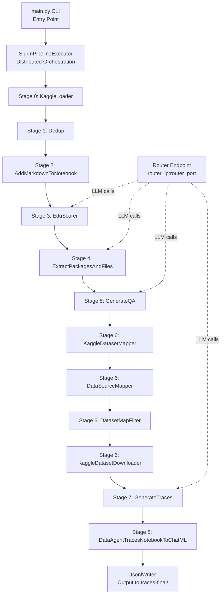
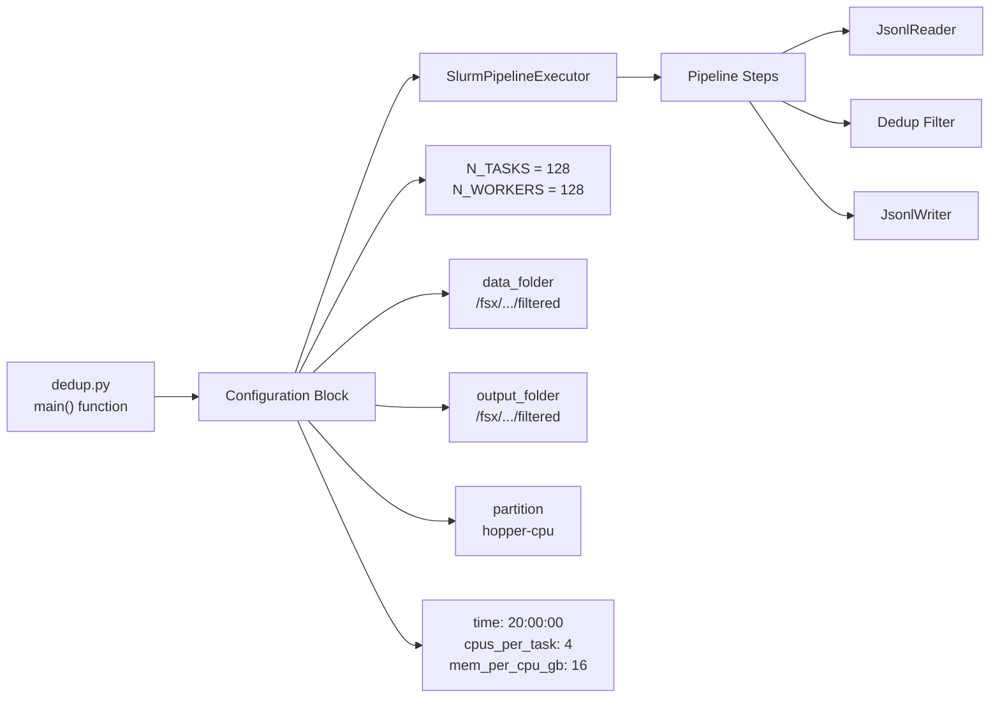
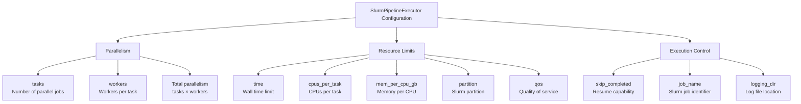
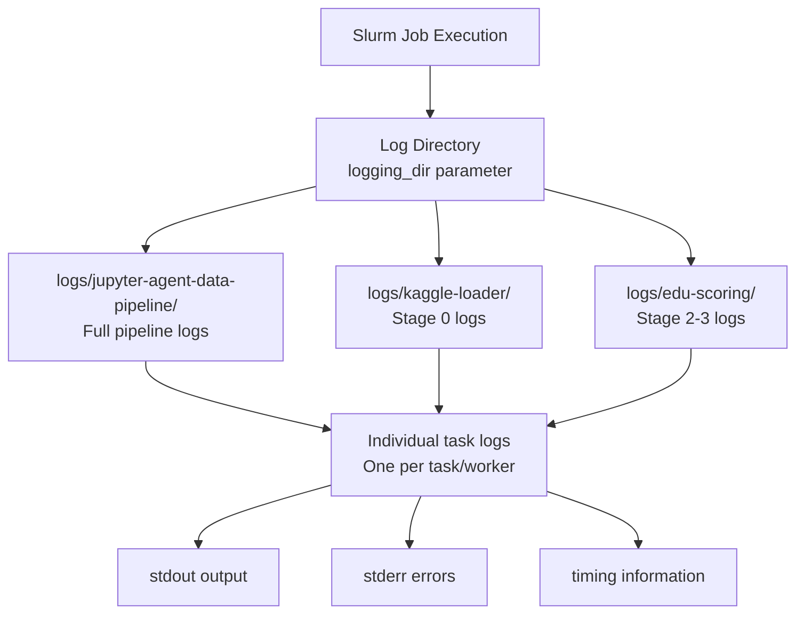
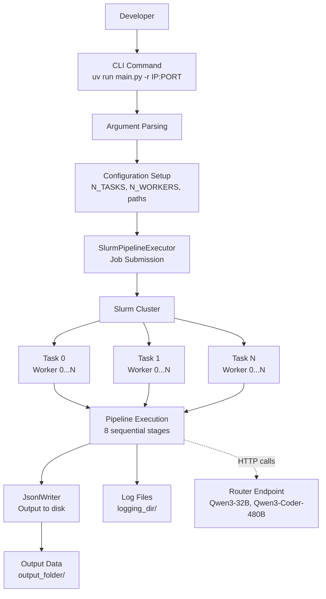

<!-- source: DeepWiki mcp.deepwiki.com · repo huggingface/jupyter-agent · page 5.2 Running the Pipeline · fetched 2026-10-26 -->

# Running the Pipeline

<details>
<summary>Relevant source files</summary>

The following files were used as context for generating this wiki page:

- [data/README.md](data/README.md)
- [data/main.py](data/main.py)
- [data/pipelines/dedup.py](data/pipelines/dedup.py)
- [data/pipelines/edu_scoring.py](data/pipelines/edu_scoring.py)
- [data/pipelines/kaggle_loader.py](data/pipelines/kaggle_loader.py)

</details>


## Purpose and Scope

This page provides practical instructions for executing the Jupyter Agent data generation pipeline, either as a complete end-to-end workflow or as individual stages. It covers command-line invocation, configuration parameters, resource allocation, and execution modes.

For environment setup and dependencies, see [Environment Setup](#5.1). For details on the pipeline orchestration architecture, see [Pipeline Orchestration](#2.1). For information about file system paths and data storage, see [Data Storage and Paths](#5.3).

---

## Full Pipeline Execution

### Basic Invocation

The complete 8-stage pipeline is orchestrated through [data/main.py](). This script requires an OpenAI-compatible LLM router endpoint for stages that use AI models (EduScorer, ExtractPackagesAndFiles, GenerateQA, GenerateTraces).

**Command:**
```bash
cd data
uv run main.py -r <ROUTER_IP:PORT>
```

**Example:**
```bash
uv run main.py -r 192.168.1.100:39876
```

The router argument can be specified as:
- Full address with port: `192.168.1.100:39876`
- IP only (defaults to port 39876): `192.168.1.100`

Sources: [data/main.py:25-46](), [data/README.md:112-119]()

### Pipeline Configuration

The full pipeline configuration is defined in [data/main.py:47-98](). Key parameters control execution scale and resource allocation:

| Parameter | Default Value | Purpose |
|-----------|---------------|---------|
| `N_TASKS` | 1 | Number of parallel Slurm tasks (shards of data) |
| `N_WORKERS` | 1 | Number of workers per task |
| `LIMIT` | -1 | Max documents per task (-1 = no limit) |
| `BASE_PATH` | `/fsx/jupyter-agent/data/meta-kaggle-dataset` | Input data location |
| `output_folder` | `/fsx/jupyter-agent/data/traces-final` | Final output location |
| `partition` | `hopper-cpu` | Slurm partition name |
| `time` | `20:00:00` | Wall time limit |
| `cpus_per_task` | 1 | CPUs allocated per task |
| `mem_per_cpu_gb` | 4 | Memory (GB) per CPU |

**Note:** Production runs typically use much higher values for `N_TASKS` and `N_WORKERS` (e.g., 128/128) to process the full dataset efficiently. The defaults shown are for testing.

Sources: [data/main.py:47-95]()

### Pipeline Stages Executed

When running the full pipeline, the following stages execute sequentially on each data shard:



**Full Pipeline Execution Flow**

Sources: [data/main.py:58-84]()

---

## Individual Stage Execution

Each pipeline stage can be executed independently for debugging, testing, or resuming interrupted runs. Individual stage scripts include their own `main()` functions and Slurm configuration.

### Running Individual Stages

Individual stages are invoked directly from their module paths:

```bash
# Stage 0: Load raw Kaggle notebooks from ZIPs
uv run pipelines/kaggle_loader.py

# Stage 1: Deduplicate using BigCode filelist
uv run pipelines/dedup.py

# Stage 2-3: Add markdown and score quality (requires router)
uv run pipelines/edu_scoring.py -r <ROUTER_IP:PORT>

# Stage 4: Extract metadata (requires router)
uv run pipelines/extract_packages_and_files.py -r <ROUTER_IP:PORT>

# Stage 5: Generate QA pairs (requires router)
uv run pipelines/generate_qa.py -r <ROUTER_IP:PORT>
```

Sources: [data/README.md:120-135]()

### Individual Stage Configuration

Each stage has its own configuration in its `main()` function. For example, the deduplication stage:



**Dedup Stage Configuration and Execution**

Sources: [data/pipelines/dedup.py:38-70]()

### Common Stage Patterns

All individual stage scripts follow a consistent pattern:

| Component | Location | Purpose |
|-----------|----------|---------|
| Class Definition | Top of file | Implements stage logic (extends `PipelineStep` or `BaseFilter`) |
| `main()` function | Bottom of file | Configures Slurm execution |
| Configuration Block | Inside `main()` | Sets `N_TASKS`, `N_WORKERS`, paths |
| Pipeline List | Inside `SlurmPipelineExecutor` | Defines input reader, stage(s), output writer |

**Example from KaggleLoader:**

The `KaggleLoader` class [data/pipelines/kaggle_loader.py:8-60]() implements the stage logic, while the `main()` function [data/pipelines/kaggle_loader.py:62-92]() configures distributed execution with 191 tasks across 191 workers to process all ZIP file subfolders in parallel.

Sources: [data/pipelines/kaggle_loader.py:1-93](), [data/pipelines/dedup.py:1-70](), [data/pipelines/edu_scoring.py:1-205]()

---

## Command-Line Arguments

### Router Configuration

Stages requiring LLM inference accept a `--router` or `-r` argument:

```bash
-r, --router <IP:PORT>
```

**Argument parsing logic:**
- If port specified: Uses provided IP and port
- If port omitted: Uses provided IP with default port 39876
- Validation ensures both IP and port are set before execution

The parsed values are passed to stage constructors:

```python
EduScorer(router_ip=router_ip, router_port=router_port)
ExtractPackagesAndFiles(router_ip=router_ip, router_port=router_port)
GenerateQA(router_ip=router_ip, router_port=int(router_port))
GenerateTraces(router_ip=router_ip, router_port=router_port)
```

Sources: [data/main.py:27-45](), [data/pipelines/edu_scoring.py:157-176]()

### Environment Variables

Required environment variables must be set before execution (see [Environment Setup](#5.1)):

- `KAGGLEHUB_CACHE`: Directory for downloaded Kaggle datasets
- `E2B_API_KEY`: (if using E2B sandboxes) API key for code execution

Sources: [data/README.md:95-106]()

---

## Resource Allocation

### Slurm Configuration Parameters

The `SlurmPipelineExecutor` accepts the following resource parameters:



**SlurmPipelineExecutor Resource Configuration**

Sources: [data/main.py:57-96]()

### Example Configurations

Different stages use different resource profiles based on their computational requirements:

| Stage | Tasks | Workers | CPUs/Task | Memory/CPU | Notes |
|-------|-------|---------|-----------|------------|-------|
| KaggleLoader | 191 | 191 | 4 | 4 GB | One task per ZIP subfolder |
| Dedup | 128 | 128 | 4 | 16 GB | Higher memory for filelist loading |
| EduScoring | 128 | 128 | 4 | 16 GB | LLM calls require moderate resources |
| Full Pipeline (testing) | 1 | 1 | 1 | 4 GB | Minimal for quick validation |
| Full Pipeline (production) | 128 | 128 | 4 | 16 GB | High parallelism for full dataset |

**Resource Scaling Strategy:**
- Test with `N_TASKS=1, N_WORKERS=1` to validate pipeline logic
- Scale to `N_TASKS=128, N_WORKERS=128` for production runs
- Adjust `LIMIT` parameter to process partial datasets during development

Sources: [data/pipelines/kaggle_loader.py:63-88](), [data/pipelines/dedup.py:39-65](), [data/pipelines/edu_scoring.py:149-200]()

---

## Execution Modes

### Production vs Testing Mode

**Testing Configuration (Fast Validation):**
```python
N_TASKS = 1
N_WORKERS = 1
LIMIT = 100  # Process only 100 documents per task
```

**Production Configuration (Full Dataset):**
```python
N_TASKS = 128
N_WORKERS = 128
LIMIT = -1  # No limit, process all documents
```

The `LIMIT` parameter in `KaggleLoader` [data/pipelines/kaggle_loader.py:14]() controls how many documents each task processes. Set to `-1` for unlimited processing or a positive integer for testing.

Sources: [data/main.py:47-50]()

### Skip Completed Functionality

The `skip_completed` parameter controls whether Slurm resubmits already-completed tasks:

```python
skip_completed=False  # Re-run all tasks
skip_completed=True   # Skip tasks with existing output
```

This is useful for:
- **Resuming interrupted runs**: Set to `True` to skip completed shards
- **Re-processing entire dataset**: Set to `False` to overwrite existing outputs
- **Debugging**: Set to `False` to ensure fresh execution

Sources: [data/main.py:93](), [data/pipelines/dedup.py:61]()

### Slurm Partition Selection

The `partition` parameter determines which cluster resources are used:

```python
partition="hopper-cpu"  # Standard CPU partition
partition="hopper-gpu"  # GPU-enabled partition (if needed)
```

Quality of Service (QoS) controls priority:

```python
qos="high"    # Higher priority, used for critical stages
qos="normal"  # Standard priority
```

Sources: [data/main.py:88-92](), [data/pipelines/edu_scoring.py:195]()

---

## Monitoring and Troubleshooting

### Log File Locations

Each execution writes logs to a directory specified by `logging_dir`:



**Log File Organization**

Sources: [data/main.py:55](), [data/pipelines/kaggle_loader.py:68](), [data/pipelines/edu_scoring.py:153]()

### Common Issues and Solutions

**Issue: Router Connection Failed**
```
Error: Connection refused to router_ip:router_port
```
**Solution:** Verify router endpoint is running and accessible. Check IP and port are correct.

**Issue: Out of Memory**
```
Slurm job killed: OOM (Out of Memory)
```
**Solution:** Increase `mem_per_cpu_gb` or reduce `N_WORKERS` per task.

**Issue: Missing Input Data**
```
FileNotFoundError: data_folder does not exist
```
**Solution:** Ensure previous stage completed successfully. Check paths match expected locations (see [Data Storage and Paths](#5.3)).

**Issue: Deduplication Filter Failure**
```
Error loading bigcode/starcoder2data-extras dataset
```
**Solution:** Verify internet connectivity. The `Dedup` filter loads the BigCode filelist from Hugging Face Hub at runtime [data/pipelines/dedup.py:25-26]().

Sources: [data/pipelines/dedup.py:12-36](), [data/pipelines/edu_scoring.py:65-118]()

### Debugging Individual Stages

To debug a specific stage without running the full pipeline:

1. **Locate the stage script** in `data/pipelines/`
2. **Configure input/output paths** in the `main()` function
3. **Reduce parallelism** to `N_TASKS=1, N_WORKERS=1`
4. **Set a document limit** (e.g., `LIMIT=10`)
5. **Run the stage directly**: `uv run pipelines/stage_name.py`

**Example: Debugging EduScorer**

```python
# In data/pipelines/edu_scoring.py main()
N_TASKS = 1
N_WORKERS = 1
LIMIT = 10  # Process only 10 documents
data_folder = "/fsx/jupyter-agent/data/filtered"
output_folder = "/fsx/jupyter-agent/data/edu-scoring-debug"
```

This processes only 10 documents from the filtered dataset, writing output to a separate debug folder.

Sources: [data/pipelines/edu_scoring.py:149-200]()

### Monitoring Progress

The `track_time()` context manager in pipeline stages logs processing time per document. Monitor logs to check:
- **Throughput**: Documents processed per hour
- **Bottlenecks**: Stages with slow processing times
- **Errors**: Failed documents with error messages in metadata

The `print()` statements in `KaggleLoader` [data/pipelines/kaggle_loader.py:47]() show which files are being processed, useful for tracking progress through large ZIP archives.

Sources: [data/pipelines/kaggle_loader.py:16-60](), [data/pipelines/edu_scoring.py:74-117]()

---

## Execution Flow Summary



**Complete Execution Flow from CLI to Output**

Sources: [data/main.py:25-101]()

---

