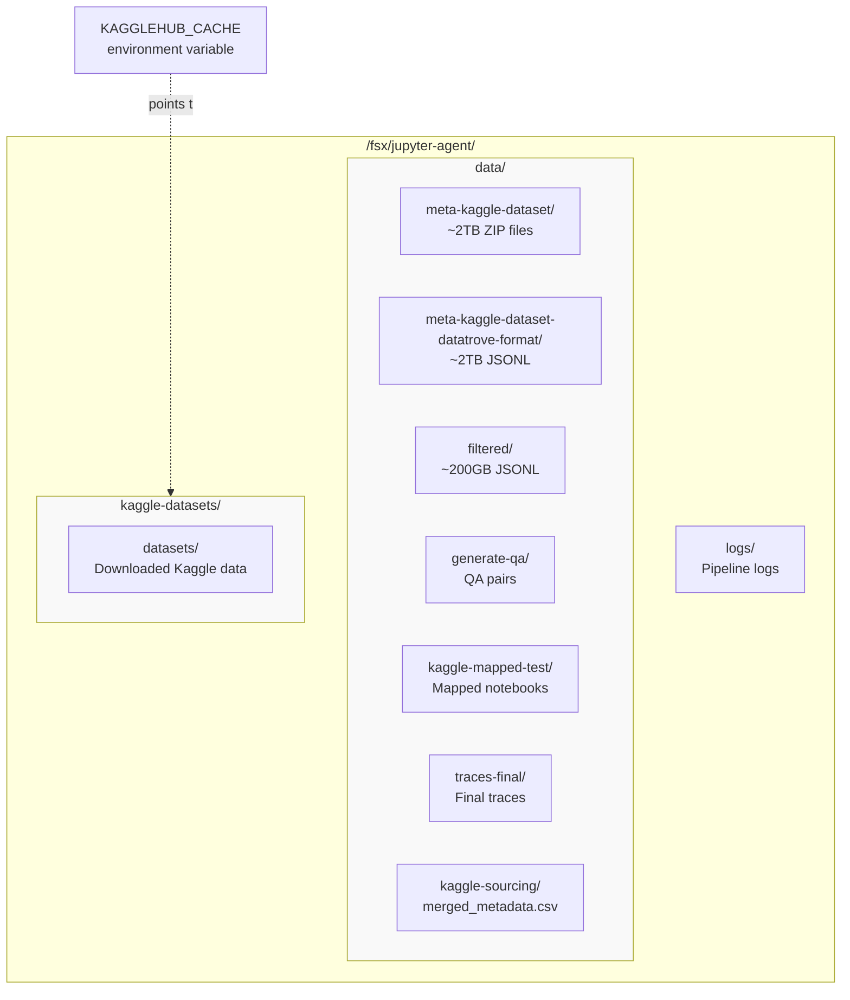
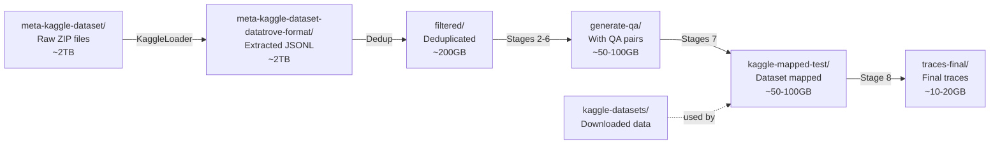
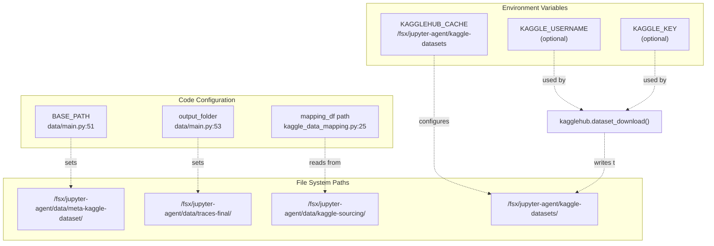

<!-- source: DeepWiki mcp.deepwiki.com · repo huggingface/jupyter-agent · page 5.3 Data Storage and Paths · fetched 2026-10-26 -->

# Data Storage and Paths

<details>
<summary>Relevant source files</summary>

The following files were used as context for generating this wiki page:

- [data/main.py](data/main.py)
- [data/pipelines/dedup.py](data/pipelines/dedup.py)
- [data/pipelines/kaggle_data_mapping.py](data/pipelines/kaggle_data_mapping.py)
- [data/pipelines/kaggle_loader.py](data/pipelines/kaggle_loader.py)

</details>


This document describes the file system layout, storage directories, and data paths used throughout the Jupyter Agent data pipeline. It covers input data locations, intermediate stage outputs, final dataset outputs, cache directories, and storage requirements.

For information about configuring environment variables and setting up the development environment, see [Environment Setup](#5.1). For details on executing the pipeline and stage-specific processing, see [Running the Pipeline](#5.2).

## Purpose and Scope

The Jupyter Agent pipeline processes approximately 2TB of raw Kaggle notebooks through 8 stages, producing intermediate outputs at each stage and maintaining a shared file system for distributed processing. This document maps out the complete storage architecture, including:

- Base directory structure on the shared file system
- Input and output paths for each pipeline stage
- Environment variable configurations for cache directories
- Storage size requirements and data reduction through stages
- Log file locations for debugging and monitoring

## Base Directory Structure

All pipeline data resides under the shared file system path `/fsx/jupyter-agent/`. This directory is accessible to all Slurm worker nodes and organized into distinct subdirectories for raw data, processed outputs, cached datasets, and metadata.

### Root Directory Layout

```
/fsx/jupyter-agent/
├── data/                          # Pipeline data directories
│   ├── meta-kaggle-dataset/       # Raw Kaggle notebooks (input)
│   ├── meta-kaggle-dataset-datatrove-format/  # Stage 0 output
│   ├── filtered/                  # Stage 1 deduplication output
│   ├── generate-qa/               # Stage 6 QA generation output
│   ├── kaggle-mapped-test/        # Stage 7 mapping output
│   ├── traces-final/              # Stage 8 final traces output
│   └── kaggle-sourcing/           # Metadata files
├── kaggle-datasets/               # Downloaded Kaggle datasets cache
│   └── datasets/                  # Individual dataset directories
└── logs/                          # Execution logs (may be local)
```

**Sources:** [data/main.py:51-55](), [data/pipelines/dedup.py:42-43](), [data/pipelines/kaggle_data_mapping.py:15-25](), [data/pipelines/kaggle_loader.py:66-69]()

### Directory Structure Diagram



**Sources:** [data/main.py:51-53](), [data/pipelines/kaggle_data_mapping.py:15]()

## Input Data Locations

### Raw Kaggle Notebooks

The pipeline starts with raw Meta Kaggle notebooks stored as ZIP archives in `/fsx/jupyter-agent/data/meta-kaggle-dataset/`. This directory contains 20 ZIP files with approximately 2TB of compressed notebook data.

**Path:** `/fsx/jupyter-agent/data/meta-kaggle-dataset/`

**File Pattern:** `metakaggle_code_with_outputs_{nnn}.zip` where `{nnn}` is a zero-padded three-digit number (000-019)

**Structure:** Each ZIP file contains 10 subdirectories (except the last which contains 1), totaling 191 folders distributed across worker tasks. Files within each folder follow the pattern: `{rank_id}/{subdir_id}/{kernel_id}.ipynb`

**Sources:** [data/main.py:51](), [data/pipelines/kaggle_loader.py:27-43]()

### Metadata Files

Metadata files supporting dataset mapping and sourcing are stored in `/fsx/jupyter-agent/data/kaggle-sourcing/`.

**Key File:** `merged_metadata.csv` - Maps kernel version IDs to Kaggle dataset paths, used by `KaggleDatasetMapper`

**Path:** `/fsx/jupyter-agent/data/kaggle-sourcing/merged_metadata.csv`

**Usage:** Loaded by `KaggleDatasetMapper` to link notebooks to their original data sources

**Sources:** [data/pipelines/kaggle_data_mapping.py:25]()

### BigCode Deduplication List

The deduplication stage relies on an external dataset from Hugging Face Hub rather than local storage:

**Dataset:** `bigcode/starcoder2data-extras`, subset `kaggle`, split `train`

**Field Used:** `file_id` - List of deduplicated file identifiers

**Sources:** [data/pipelines/dedup.py:25-26]()

## Pipeline Stage Data Paths

Each pipeline stage reads from an input directory and writes to an output directory. The following table maps stages to their data paths:

| Stage | Pipeline Step | Input Path | Output Path | Size Reduction |
|-------|---------------|------------|-------------|----------------|
| 0 | `KaggleLoader` | `/fsx/jupyter-agent/data/meta-kaggle-dataset/` | `/fsx/jupyter-agent/data/meta-kaggle-dataset-datatrove-format/` | ~2TB → ~2TB |
| 1 | `Dedup` | `/fsx/jupyter-agent/data/meta-kaggle-dataset-datatrove-format/` | `/fsx/jupyter-agent/data/filtered/` | ~2TB → ~200GB (90% reduction) |
| 2-5 | Quality, Extraction, QA | `/fsx/jupyter-agent/data/filtered/` | Intermediate (not persisted in standalone runs) | Progressive filtering |
| 6 | `GenerateQA` output | Various | `/fsx/jupyter-agent/data/generate-qa/` | QA-augmented notebooks |
| 7 | Dataset Mapping | `/fsx/jupyter-agent/data/generate-qa/` | `/fsx/jupyter-agent/data/kaggle-mapped-test/` | Notebooks with dataset paths |
| 8 | Final Traces | Previous stage | `/fsx/jupyter-agent/data/traces-final/` | Final training data |

**Note:** When running the full pipeline via `data/main.py`, intermediate stages do not write to disk between pipeline steps. Only the final output is persisted.

**Sources:** [data/main.py:51-53](), [data/pipelines/dedup.py:42-43](), [data/pipelines/kaggle_loader.py:66-69](), [data/pipelines/kaggle_data_mapping.py:254-255]()

### Data Flow Through Storage



**Sources:** [data/main.py:51-83](), [data/pipelines/dedup.py:42-43]()

## Output File Formats

### JSONL Files

All pipeline stages write output in JSONL (JSON Lines) format using `JsonlWriter`. Each file contains newline-delimited JSON objects representing `Document` instances.

**Maximum File Size:** 1GB (10^9 bytes) per file, enforced by `max_file_size` parameter

**File Naming:** Sequential numbering: `0000.jsonl.gz`, `0001.jsonl.gz`, etc.

**Compression:** Files are gzip-compressed

**Sources:** [data/main.py:83](), [data/pipelines/dedup.py:51](), [data/pipelines/kaggle_data_mapping.py:266](), [data/pipelines/kaggle_loader.py:74]()

### Document Schema

Each JSONL record represents a `Document` object with the following structure:

```json
{
  "text": "<notebook content or trace>",
  "id": "<kernel_id or file_path>",
  "metadata": {
    "edu_score": 4.5,
    "files_used": ["file1.csv", "file2.json"],
    "packages_used": ["pandas", "numpy"],
    "kaggle_dataset_name": "username/dataset-name",
    "kaggle_dataset_path": "/fsx/jupyter-agent/kaggle-datasets/datasets/...",
    "data_source_type": "kaggle"
  }
}
```

Progressive enrichment adds metadata fields at each stage while preserving the original `text` and `id`.

## Environment Variables

### KAGGLEHUB_CACHE

The `KAGGLEHUB_CACHE` environment variable controls where downloaded Kaggle datasets are cached.

**Variable:** `KAGGLEHUB_CACHE`

**Value:** `/fsx/jupyter-agent/kaggle-datasets`

**Usage:** Used by `kagglehub.dataset_download()` to store downloaded datasets

**Set in:** [data/pipelines/kaggle_data_mapping.py:15]()

### Dataset Download Path Structure

Downloaded Kaggle datasets follow this directory structure:

```
/fsx/jupyter-agent/kaggle-datasets/
└── datasets/
    └── {username}/
        └── {dataset-name}/
            └── versions/
                └── {version_number}/
                    └── [dataset files]
```

**Example:** For dataset `john-doe/sample-data`, the path would be:
`/fsx/jupyter-agent/kaggle-datasets/datasets/john-doe/sample-data/versions/1/`

The `KaggleDatasetDownloader` checks for existing downloads before attempting to fetch, first looking for versioned paths (`versions/{highest_number}/`), then falling back to the base dataset directory.

**Sources:** [data/pipelines/kaggle_data_mapping.py:199-223]()

### Kaggle Credentials

Optional environment variables for Kaggle API authentication:

**Variables:**
- `KAGGLE_USERNAME`: Kaggle username
- `KAGGLE_KEY`: Kaggle API key

**Note:** These are marked as `<optional>` in the code and may not be required if datasets are already cached or accessible without authentication.

**Sources:** [data/pipelines/kaggle_data_mapping.py:16-17]()

## Log File Locations

Pipeline execution logs are stored in a `logs/` directory, with subdirectories per stage or execution run.

### Log Directory Structure

```
logs/
├── jupyter-agent-data-pipeline/    # Full pipeline logs
├── kaggle-loader/                  # Stage 0 logs
├── kaggle-filter/                  # Stage 1 logs
├── kaggle-data-sourcing/           # Stage 7 logs
└── dataset-downloading/            # Dataset download logs with timestamps
    └── {dd-mm-yyyy_HH:MM:SS}/
```

### Log Configuration

Each pipeline execution specifies a `logging_dir` parameter to `SlurmPipelineExecutor`:

| Pipeline | Logging Directory |
|----------|------------------|
| Full pipeline (`data/main.py`) | `logs/jupyter-agent-data-pipeline` |
| `KaggleLoader` | `logs/kaggle-loader` |
| `Dedup` | `logs/kaggle-filter` |
| Dataset mapping | `logs/kaggle-data-sourcing` |

**Sources:** [data/main.py:55](), [data/pipelines/dedup.py:41](), [data/pipelines/kaggle_data_mapping.py:253-257](), [data/pipelines/kaggle_loader.py:68]()

## Storage Requirements

### Initial Input Storage

- **Raw ZIP files:** ~2TB compressed
- **Location:** `/fsx/jupyter-agent/data/meta-kaggle-dataset/`
- **Format:** 20 ZIP archives

### Intermediate Storage Requirements

Progressive filtering reduces storage requirements through the pipeline:

| Stage | Storage Size | Cumulative |
|-------|--------------|------------|
| Stage 0 (Extracted) | ~2TB | ~4TB |
| Stage 1 (Deduplicated) | ~200GB | ~4.2TB |
| Stage 2-5 (Filtered) | ~50-100GB | ~4.3TB |
| Stage 6 (QA) | ~50-100GB | ~4.4TB |
| Stage 7 (Mapped) | ~50-100GB | ~4.5TB |
| Stage 8 (Traces) | ~10-20GB | ~4.6TB |

### Kaggle Dataset Cache

Downloaded Kaggle datasets consume additional storage:

- **Location:** `/fsx/jupyter-agent/kaggle-datasets/`
- **Size:** Variable, depends on dataset sizes (estimated 100GB-1TB)
- **Note:** Shared across runs, grows over time as new datasets are downloaded

### Total Storage Estimate

**Minimum Required:** ~5-6TB for complete pipeline execution with all intermediate outputs

**Recommended:** 8-10TB to accommodate dataset downloads and log files

**Sources:** Inferred from data flow and documentation in high-level diagrams

## Path Configuration in Code

### Main Pipeline Configuration

The full pipeline in `data/main.py` uses these key path variables:

```python
BASE_PATH = "/fsx/jupyter-agent/data/meta-kaggle-dataset"
output_folder = "/fsx/jupyter-agent/data/traces-final"
logs_file = "logs/jupyter-agent-data-pipeline"
```

**Sources:** [data/main.py:51-55]()

### Individual Stage Configuration

Each stage can be run independently with its own path configuration:

**KaggleLoader:**
```python
BASE_PATH = "/fsx/jupyter-agent/data/meta-kaggle-dataset"
output_folder = "/fsx/jupyter-agent/data/meta-kaggle-dataset-datatrove-format"
```
**Sources:** [data/pipelines/kaggle_loader.py:66-69]()

**Dedup:**
```python
data_folder = "/fsx/jupyter-agent/data/meta-kaggle-dataset-datatrove-format"
output_folder = "/fsx/jupyter-agent/data/filtered"
```
**Sources:** [data/pipelines/dedup.py:42-43]()

**KaggleDatasetMapper:**
```python
data_folder = "/fsx/jupyter-agent/data/generate-qa"
output_folder = "/fsx/jupyter-agent/data/kaggle-mapped-test"
```
**Sources:** [data/pipelines/kaggle_data_mapping.py:254-255]()

### Dataset Download Path Logic

The `KaggleDatasetDownloader` implements a multi-level path resolution strategy:

1. **Versioned path:** `/fsx/jupyter-agent/kaggle-datasets/datasets/{dataset_name}/versions/{highest_version}/`
2. **Base path:** `/fsx/jupyter-agent/kaggle-datasets/datasets/{dataset_name}/`
3. **Download path:** Returned by `kagglehub.dataset_download(dataset_name)`

The downloader checks each path in order and uses the first existing location, or downloads if none exist.

**Sources:** [data/pipelines/kaggle_data_mapping.py:199-223]()

## Environment and Path Mapping



**Sources:** [data/main.py:51-53](), [data/pipelines/kaggle_data_mapping.py:15-25]()

## Data Persistence Strategy

### Full Pipeline Mode

When executing via `data/main.py`, the pipeline uses in-memory data flow between stages:

- Documents flow through all 8 stages without intermediate disk writes
- Only final output is persisted to `/fsx/jupyter-agent/data/traces-final/`
- Reduces I/O overhead and storage requirements

**Sources:** [data/main.py:58-84]()

### Individual Stage Mode

When running stages independently for debugging:

- Each stage reads from and writes to its designated directory
- Allows inspection of intermediate outputs
- Enables resuming from specific stages

**Sources:** [data/pipelines/dedup.py:38-66](), [data/pipelines/kaggle_loader.py:62-88](), [data/pipelines/kaggle_data_mapping.py:244-279]()

### Skip Completed Behavior

The `SlurmPipelineExecutor` includes a `skip_completed` parameter:

**Setting:** `skip_completed=False` (default in all pipeline configurations)

**Behavior:** Re-processes all data even if output files exist

**Note:** For production runs, set to `True` to avoid reprocessing when resuming interrupted executions.

**Sources:** [data/main.py:93](), [data/pipelines/dedup.py:61](), [data/pipelines/kaggle_data_mapping.py:276]()