# Page: Jupyter Agent Overview

# Jupyter Agent Overview

<details>
<summary>Relevant source files</summary>

The following files were used as context for generating this wiki page:

- [README.md](README.md)
- [data/README.md](data/README.md)

</details>


## Purpose and Scope

This document provides a high-level overview of the Jupyter Agent project, explaining what it is, what it does, and how its components fit together. It covers the end-to-end lifecycle from raw Kaggle notebooks (2TB) to trained data science agents capable of executing Python code within Jupyter environments.

For detailed information about specific subsystems:
- **Pipeline architecture and execution**: See [Data Generation Pipeline](#2)
- **Infrastructure configuration and setup**: See [Development Guide](#5)
- **AI model integration details**: See [AI Model Integration](#3)
- **Model performance and usage**: See [Models and Evaluation](#4)

---

## What is Jupyter Agent?

Jupyter Agent is an open-source data science agent designed to operate within Jupyter notebook environments. It combines language understanding with code execution capabilities to assist with data analysis workflows.

**Core capabilities:**
- Read notebook and dataset context
- Execute Python code (`pandas`, `numpy`, `matplotlib`, etc.)
- Generate step-by-step reasoning traces with intermediate computations
- Produce data-grounded answers to analysis questions

**Released artifacts:**
- **Dataset**: [jupyter-agent-dataset](https://huggingface.co/datasets/data-agents/jupyter-agent-dataset) - 51k synthetic notebooks, ~0.2B tokens
- **Models**: 
  - [jupyter-agent-qwen3-4b-instruct](https://huggingface.co/data-agents/jupyter-agent-qwen3-4b-instruct)
  - [jupyter-agent-qwen3-4b-thinking](https://huggingface.co/data-agents/jupyter-agent-qwen3-4b-thinking)
- **Pipeline**: Data generation code and fine-tuning scripts

**Sources:** [README.md:1-27]()

---

## System Architecture

The Jupyter Agent project consists of three major subsystems that transform raw notebooks into production-ready data science agents.

### High-Level System Components

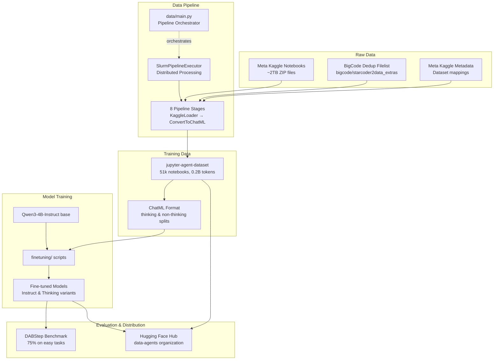

The system implements a three-phase pipeline:

1. **Data Generation** ([data/](https://github.com/huggingface/jupyter-agent/tree/main/data)): Processes 2TB of raw Kaggle notebooks through 8 stages of filtering, scoring, enrichment, and trace generation
2. **Model Training** ([finetuning/](https://github.com/huggingface/jupyter-agent/tree/main/finetuning)): Fine-tunes Qwen3-4B-Instruct on the curated dataset
3. **Distribution**: Publishes dataset and models to Hugging Face Hub for community use

**Sources:** [README.md:34-46](), [data/README.md:1-28]()

---

## Pipeline Entry Points and Orchestration

The data generation pipeline can be executed as a complete workflow or as individual stages for debugging and development.

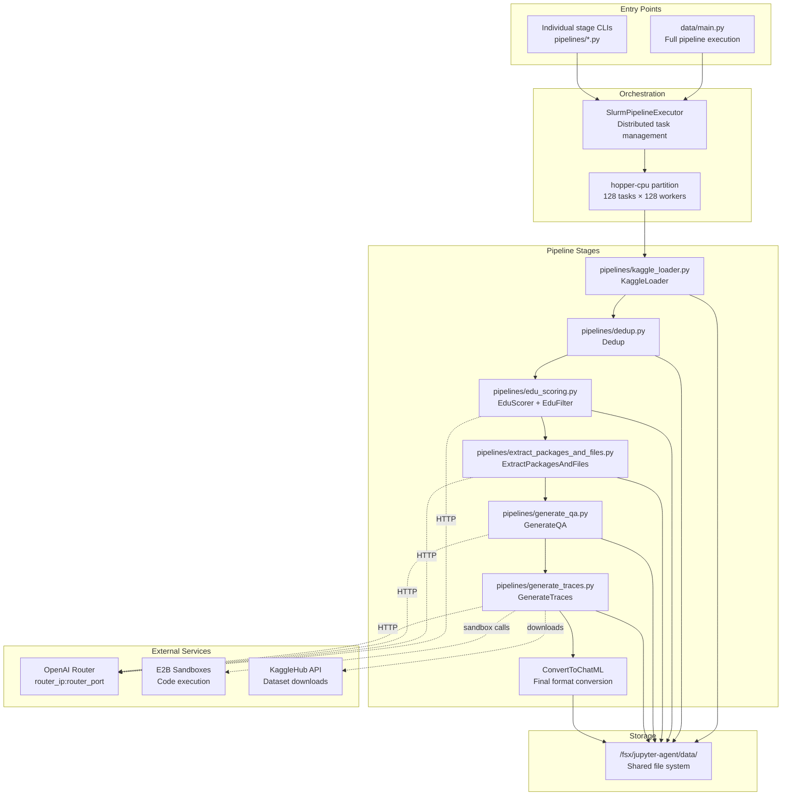

The pipeline supports two execution modes:

| Execution Mode | Command | Use Case |
|----------------|---------|----------|
| Full Pipeline | `uv run data/main.py -r <ROUTER_IP:PORT>` | Production runs |
| Individual Stage | `uv run pipelines/dedup.py` | Testing, debugging |

Each stage reads from and writes to the shared file system at `/fsx/jupyter-agent/data/`, enabling resumable execution and intermediate inspection.

**Sources:** [data/README.md:112-135](), [data/main.py:1-119]()

---

## Data Generation Pipeline Overview

The pipeline implements an aggressive filtering funnel that transforms 2TB of raw notebooks into 51k high-quality training examples.

### Pipeline Stages and Data Flow

```mermaid
graph LR
    subgraph "Stage 1-2: Ingestion"
        A1["KaggleLoader<br/>Extract from 191 folders"]
        A2["Dedup<br/>BigCode filelist"]
    end
    
    subgraph "Stage 3-4: Quality"
        B1["AddMarkdownToNotebook<br/>nbconvert + Jinja2"]
        B2["EduScorer<br/>Score 0-5"]
        B3["EduFilter<br/>Keep ≥ 4"]
    end
    
    subgraph "Stage 5: Metadata"
        C1["ExtractPackagesAndFiles<br/>LLM extraction"]
        C2["RemoveNoFilesUsed<br/>Data-focused filter"]
    end
    
    subgraph "Stage 6: QA"
        D1["GenerateQA<br/>Multi-step Q&A"]
    end
    
    subgraph "Stage 7: Datasets"
        E1["KaggleDatasetMapper<br/>Match datasets"]
        E2["DataSourceMapper<br/>Classify sources"]
        E3["DatasetMapFilter<br/>Filter by type"]
        E4["KaggleDatasetDownloader<br/>Download data"]
    end
    
    subgraph "Stage 8: Traces"
        F1["GenerateTraces<br/>Qwen3-Coder-480B"]
        F2["ConvertToChatML<br/>Training format"]
    end
    
    A1 --> A2
    A2 --> B1
    B1 --> B2
    B2 --> B3
    B3 --> C1
    C1 --> C2
    C2 --> D1
    D1 --> E1
    E1 --> E2
    E2 --> E3
    E3 --> E4
    E4 --> F1
    F1 --> F2
```

**Filtering funnel statistics:**

| Stage | Operation | Data Reduction |
|-------|-----------|----------------|
| 1 | Raw notebooks | 2TB (~millions of notebooks) |
| 2 | Deduplication | 90% removed |
| 4 | Quality scoring (score ≥ 4) | Additional filtering |
| 5 | Requires data files | Removes code-only notebooks |
| 8 | Final dataset | 51k notebooks, 0.2B tokens |

The pipeline reduces raw data by ~99.5% while preserving high-quality, data-focused notebooks suitable for training data science agents.

**Sources:** [data/README.md:34-89](), [README.md:36-45]()

---

## AI Model Integration

The pipeline relies on external language models accessed via an OpenAI-compatible router for multiple stages.

### LLM Dependencies by Stage

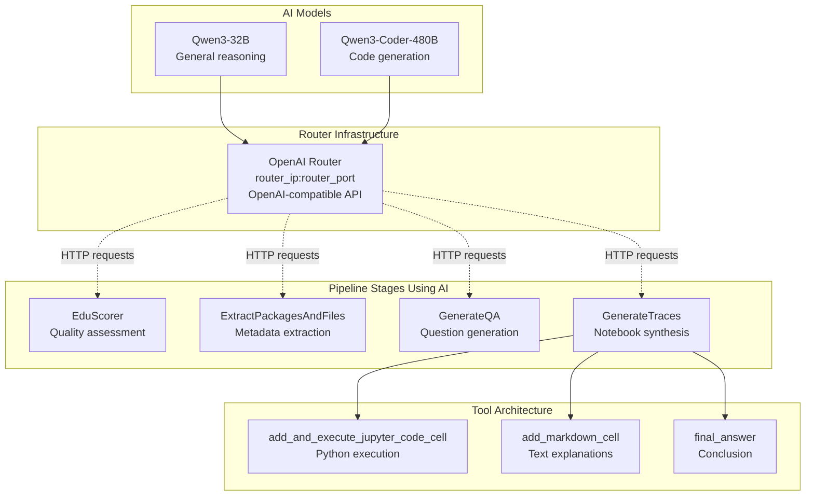

**Model usage:**
- **Qwen3-32B**: Used in stages 4, 5, and 6 for scoring, metadata extraction, and QA generation
- **Qwen3-Coder-480B**: Used in stage 8 for synthetic notebook generation with code execution traces

The router endpoint must be configured via the `-r <ROUTER_IP:PORT>` CLI argument when running pipeline stages that require LLM access.

**Sources:** [data/README.md:108-135]()

---

## Dataset Format and Structure

The final dataset is produced in ChatML format, a conversation-style structure compatible with modern instruction-tuning frameworks.

### Data Splits

| Split | Description | Size | Use Case |
|-------|-------------|------|----------|
| `non-thinking` | Direct instruction-following traces | ~0.1B tokens | Standard agent fine-tuning |
| `thinking` | Explicit reasoning traces | ~0.1B tokens | Chain-of-thought training |

Both splits contain the same 51k notebooks but with different formatting:
- **Non-thinking**: Tool calls without explicit reasoning steps
- **Thinking**: Includes LLM-generated reasoning before each action

### Document Structure

Each document in the dataset contains:
- **question**: Multi-step analysis question
- **answer**: Factual answer from notebook outputs
- **files_used**: List of dataset files referenced
- **packages_used**: Python libraries used
- **kaggle_dataset_path**: Path to original Kaggle dataset
- **messages**: ChatML conversation array with tool calls and responses

**Sources:** [data/README.md:88-89](), [README.md:62-67]()

---

## Model Training and Evaluation

### Fine-tuning Process

The pipeline fine-tunes Qwen3-4B-Instruct on the generated dataset to produce two model variants:

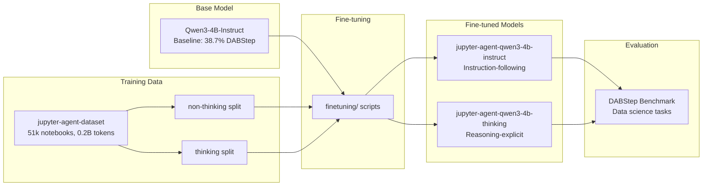

### Performance Results

| Model | DABStep Easy | Improvement |
|-------|-------------|-------------|
| Qwen3-4B-Instruct (base) | 38.7% | Baseline |
| With scaffolding | 52.8% | +36.4% |
| **After fine-tuning** | **75.0%** | **+93.8%** |

The fine-tuned model achieves state-of-the-art performance for its size on the DABStep benchmark, demonstrating nearly 2x improvement over the base model.

**Sources:** [README.md:79-87]()

---

## Distribution and Usage

### Hugging Face Hub

All artifacts are publicly available under the `data-agents` organization:

- **Dataset**: `data-agents/jupyter-agent-dataset`
- **Models**: 
  - `data-agents/jupyter-agent-qwen3-4b-instruct`
  - `data-agents/jupyter-agent-qwen3-4b-thinking`

### Loading the Dataset

```python
from datasets import load_dataset
ds = load_dataset("data-agents/jupyter-agent-dataset", split="non-thinking")
```

### Loading a Fine-tuned Model

```python
from transformers import AutoModelForCausalLM, AutoTokenizer

model_name = "data-agents/jupyter-agent-qwen3-4b-instruct"
tokenizer = AutoTokenizer.from_pretrained(model_name)
model = AutoModelForCausalLM.from_pretrained(
    model_name, 
    torch_dtype="auto", 
    device_map="auto"
)
```

**Sources:** [README.md:62-77](), [README.md:89-94]()

---

## Key Technologies and Dependencies

| Component | Technology | Purpose |
|-----------|-----------|---------|
| Pipeline orchestration | Slurm | Distributed processing across 128 tasks |
| Notebook conversion | `nbconvert`, Jinja2 | Jupyter → Markdown transformation |
| LLM integration | OpenAI-compatible API | Scoring, extraction, QA, traces |
| Code execution | E2B sandboxes | Safe Python code execution |
| Dataset downloads | KaggleHub API | Original dataset retrieval |
| Model training | Transformers, PEFT | Fine-tuning infrastructure |
| Storage | Shared FSX filesystem | `/fsx/jupyter-agent/data/` |

The system is designed for large-scale batch processing with substantial computational resources (512 CPUs, 8TB RAM across 128 tasks).

**Sources:** [data/README.md:92-107](), [data/README.md:112-135]()

---

## Related Resources

- **Blog post**: [Jupyter Agent: Building Data Science Agents](https://huggingface.co/blog/jupyter-agent-2)
- **Live demo**: [Jupyter Agent Demo Space](https://huggingface.co/spaces/lvwerra/jupyter-agent-2)
- **DABStep Benchmark**: [Evaluation benchmark for data agents](https://huggingface.co/spaces/adyen/DABstep)
- **Model collection**: [All Jupyter Agent models](https://huggingface.co/collections/data-agents/jupyter-agent-66f43f63b3d87c9ac69039eb)

**Sources:** [README.md:89-94](), [README.md:14]()

---

# Page: Repository Structure

# Repository Structure

<details>
<summary>Relevant source files</summary>

The following files were used as context for generating this wiki page:

- [.gitignore](.gitignore)
- [README.md](README.md)
- [data/__init__.py](data/__init__.py)
- [data/pipelines/utils/__init__.py](data/pipelines/utils/__init__.py)

</details>


## Purpose and Scope

This document provides an overview of the Jupyter Agent repository's directory structure and organization. It describes the role of each major directory and how they relate to the overall system architecture. For detailed information about running the pipeline, see [Running the Pipeline](#5.2). For file system storage paths and data locations, see [Data Storage and Paths](#5.3).

## High-Level Directory Layout

The repository is organized around two primary workflows: data generation and model training. The following diagram shows the main directory structure and their functional purposes:

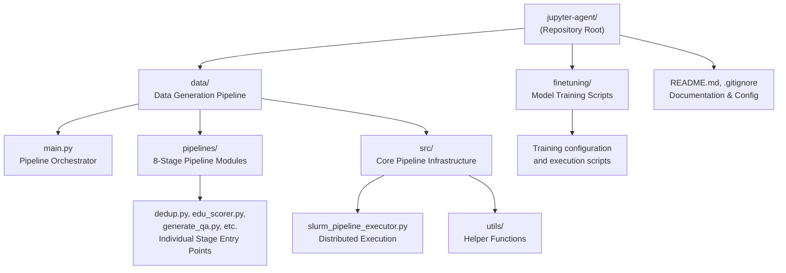

**Sources:** [README.md:1-104](), [.gitignore:1-202](), [data/__init__.py:1-1]()

## Core Directories

### data/ - Data Generation Pipeline

The `data/` directory contains the complete 8-stage pipeline that transforms raw Kaggle notebooks into training data. This is the primary codebase for data processing.

| Component | Purpose | Key Files |
|-----------|---------|-----------|
| `main.py` | Entry point for running the full pipeline or individual stages | Pipeline orchestrator with CLI |
| `pipelines/` | Individual stage implementations | `dedup.py`, `edu_scorer.py`, `generate_qa.py`, `generate_traces.py`, etc. |
| `src/` | Core infrastructure and utilities | `slurm_pipeline_executor.py`, `document.py`, utilities |
| `src/utils/` | Shared helper functions | File processing, LLM clients, metadata handling |

Each pipeline stage can be executed independently via its module file (e.g., `uv run pipelines/dedup.py`) or as part of the full orchestrated pipeline via `main.py`.

**Sources:** [README.md:59-60](), [data/__init__.py:1-1](), [data/pipelines/utils/__init__.py:1-1]()

### finetuning/ - Model Training

The `finetuning/` directory contains scripts and configurations for fine-tuning Qwen3-4B base models on the generated dataset. This produces the two model variants:

- **Jupyter-Agent-Qwen3-4B-Instruct**: Standard instruction-following model
- **Jupyter-Agent-Qwen3-4B-Thinking**: Model with explicit reasoning traces

The training process takes ChatML-formatted data from the pipeline output and fine-tunes the base models using the configurations in this directory.

**Sources:** [README.md:60-61](), [README.md:23-26]()

### Configuration and Documentation Files

| File | Purpose |
|------|---------|
| `README.md` | Project overview, quick start guide, usage examples |
| `.gitignore` | Excludes build artifacts, data files (`.jsonl`, `.parquet`), logs, models, workspace directories |
| `pyproject.toml` (implied) | Python package configuration for dependency management |

**Sources:** [README.md:1-104](), [.gitignore:1-202]()

## Directory-to-Pipeline Mapping

The following diagram maps repository directories to the pipeline stages and system components they implement:

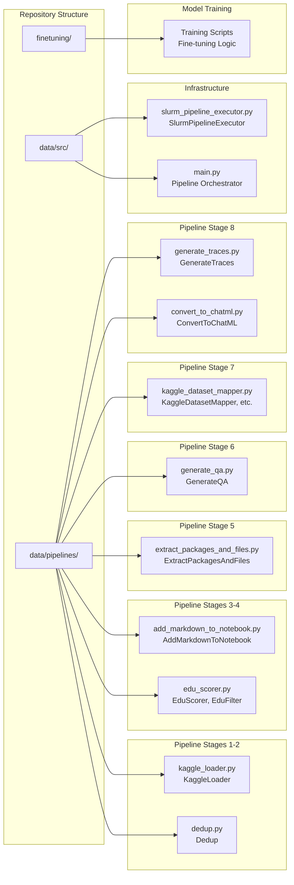

**Sources:** [README.md:36-45](), Diagrams 2, 3, and 6 from high-level architecture

## File Organization Patterns

### Python Package Structure

The codebase follows standard Python package conventions:

- **`__init__.py` files**: Mark directories as packages (`data/__init__.py`, `data/pipelines/utils/__init__.py`)
- **Module-level entry points**: Each pipeline stage has a corresponding `.py` file in `pipelines/` with CLI capability
- **Shared utilities**: Common code in `src/` and `src/utils/` for reuse across stages

### Data File Conventions

Based on the `.gitignore` patterns, the repository handles several data file types:

| File Type | Purpose | Excluded from Git |
|-----------|---------|-------------------|
| `.jsonl`, `.jsonl.gz` | Pipeline outputs, training data | Yes |
| `.parquet` | Intermediate data storage | Yes |
| Notebooks (`.ipynb`) | Checkpoints, development notebooks | Yes (`.ipynb_checkpoints`) |

### Output Directories

The following directories are generated during execution and excluded from version control:

- **`logs/`**: Pipeline execution logs
- **`eval_results/`, `evaluation_results*`**: Model evaluation outputs
- **`models/`**: Trained model checkpoints
- **`training-data/`**: Processed training datasets
- **`workspace/`, `debug-data/`**: Development and debugging artifacts
- **`wandb/`, `runs/`**: Experiment tracking data

**Sources:** [.gitignore:174-201]()

## Execution Environment Patterns

The repository is designed for distributed execution on HPC infrastructure:

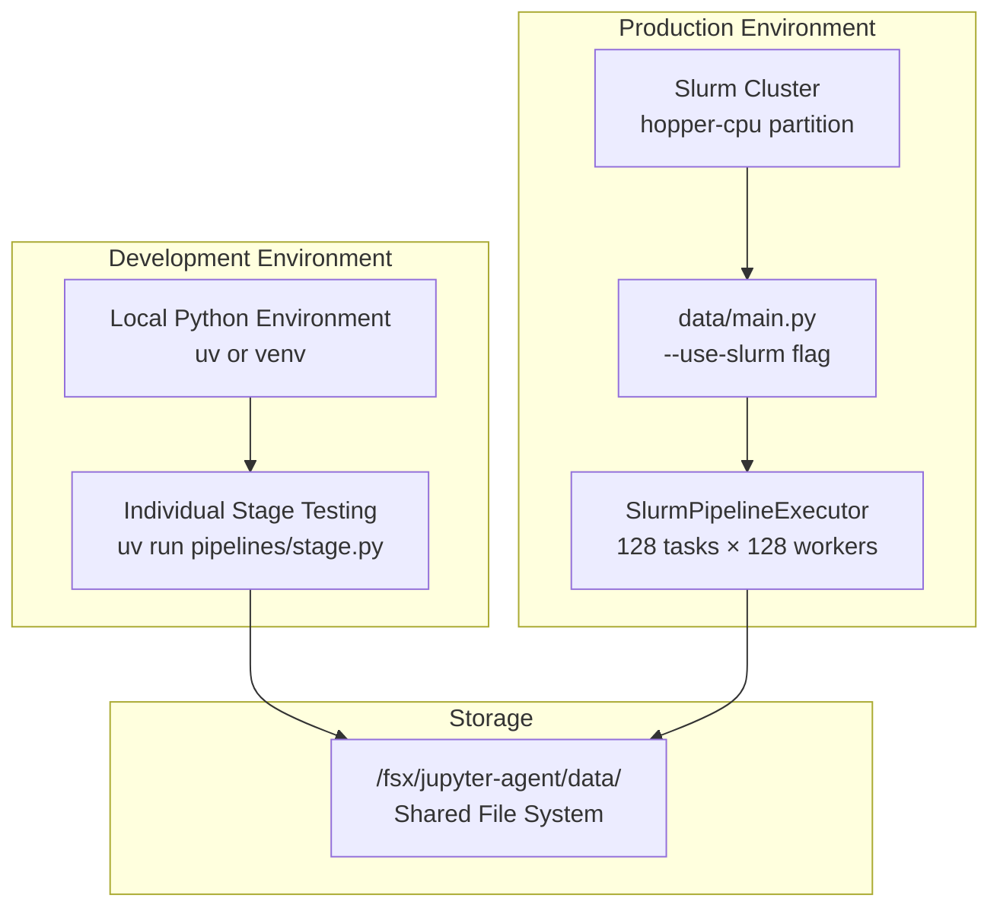

The `data/main.py` orchestrator supports two execution modes:
1. **Local execution**: For development and single-stage testing
2. **Slurm execution**: For full pipeline runs with distributed processing (`--use-slurm` flag)

**Sources:** [README.md:52-61](), Diagram 3 from high-level architecture

## External Dependencies

The repository integrates with external services and datasets:

| Dependency | Purpose | Configuration |
|------------|---------|---------------|
| Kaggle Hub API | Download source datasets | `KAGGLEHUB_CACHE` environment variable |
| OpenAI-compatible Router | LLM inference (Qwen3-32B, Qwen3-Coder-480B) | `router_ip:router_port` configuration |
| E2B Sandboxes | Safe code execution during trace generation | API credentials |
| Hugging Face Hub | Dataset and model distribution | Standard authentication |

These dependencies are configured through environment variables and are required for different pipeline stages. For setup details, see [Environment Setup](#5.1).

**Sources:** Diagrams 3 and 4 from high-level architecture, [README.md:19-26]()

---

# Page: Data Generation Pipeline

# Data Generation Pipeline

<details>
<summary>Relevant source files</summary>

The following files were used as context for generating this wiki page:

- [data/README.md](data/README.md)
- [data/main.py](data/main.py)

</details>


## Purpose and Scope

This document provides a comprehensive overview of the 8-stage data generation pipeline that transforms raw Kaggle notebooks (~2TB) into curated training data for Jupyter Agent models. The pipeline implements an aggressive filtering strategy, reducing the dataset from millions of notebooks to 51,000 high-quality examples (~0.2B tokens) suitable for fine-tuning.

**Related Pages:**
- For details on pipeline orchestration and execution infrastructure, see [Pipeline Orchestration](#2.1)
- For individual stage implementations, see sections [2.2](#2.2) through [2.8](#2.8)
- For environment setup and execution instructions, see [Development Guide](#5)
- For model training using pipeline outputs, see [Models and Evaluation](#4)

## Pipeline Architecture

The pipeline is defined in [data/main.py:58-84]() as a sequence of transformations applied to notebook documents. Each stage is implemented as a `datatrove` pipeline component that processes documents in a distributed manner.

### Stage Components and Data Flow

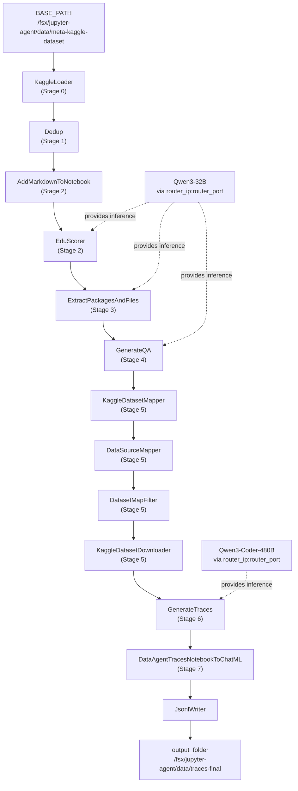

**Sources:** [data/main.py:1-101](), [data/README.md:1-135]()

### Stage Summary Table

| Stage | Components | Input Volume | Output Volume | Key Operations |
|-------|-----------|--------------|---------------|----------------|
| 0 | `KaggleLoader` | ~2TB ZIP files (191 folders) | ~2TB raw notebooks | Extract `.ipynb` from archives |
| 1 | `Dedup` | ~2TB | ~200GB (90% reduction) | Filter using BigCode filelist |
| 2 | `AddMarkdownToNotebook`<br/>`EduScorer` | ~200GB | ~50GB (score ≥ 4) | Convert to markdown, LLM scoring |
| 3 | `ExtractPackagesAndFiles` | ~50GB | ~40GB (data-focused) | Extract metadata, filter no-files |
| 4 | `GenerateQA` | ~40GB | ~40GB (1 QA per doc) | Generate multi-step questions |
| 5 | `KaggleDatasetMapper`<br/>`DataSourceMapper`<br/>`DatasetMapFilter`<br/>`KaggleDatasetDownloader` | ~40GB | ~30GB (downloadable only) | Link to original datasets |
| 6 | `GenerateTraces` | ~30GB | 51k notebooks | Generate synthetic execution traces |
| 7 | `DataAgentTracesNotebookToChatML` | 51k notebooks | ~0.2B tokens | Convert to training format |

**Sources:** [data/README.md:34-89]()

## Document Flow and Transformations

The pipeline maintains a `Document` object abstraction throughout all stages. Each stage reads documents, performs transformations, and passes enriched documents to the next stage.

### Document Metadata Evolution

```mermaid
graph LR
    A["Raw Document<br/>text: ipynb JSON<br/>metadata: {}"] --> B["After Dedup<br/>+ file_path<br/>+ is_duplicate"]
    B --> C["After AddMarkdown<br/>+ markdown_text"]
    C --> D["After EduScorer<br/>+ edu_score (0-5)<br/>+ score_reasoning"]
    D --> E["After Extract<br/>+ files_used[]<br/>+ packages_used[]"]
    E --> F["After GenerateQA<br/>+ question<br/>+ answer"]
    F --> G["After DatasetMap<br/>+ kaggle_dataset_path<br/>+ data_source_type"]
    G --> H["After GenerateTraces<br/>+ trace_messages[]<br/>+ tool_calls[]"]
    H --> I["ChatML Format<br/>messages: [{role, content}]"]
```

**Sources:** [data/main.py:58-84](), [data/README.md:3-28]()

### Key Transformation Points

1. **Format Conversion** ([data/main.py:66]()):
   - `AddMarkdownToNotebook` converts `.ipynb` JSON to structured markdown using `nbconvert` with custom Jinja2 templates
   - Enables LLM processing of notebook structure

2. **Metadata Enrichment** ([data/main.py:67-70]()):
   - `EduScorer` adds quality scores (0-5) using Qwen3-32B
   - `ExtractPackagesAndFiles` adds dependency metadata using LLM extraction

3. **Content Generation** ([data/main.py:73-80]()):
   - `GenerateQA` creates complex questions with extractable answers
   - `GenerateTraces` synthesizes agent interaction traces with code execution

4. **Format Standardization** ([data/main.py:81]()):
   - `DataAgentTracesNotebookToChatML` converts to training-ready ChatML format with `role` and `content` fields

**Sources:** [data/main.py:4-21]()

## Filtering Strategy

The pipeline implements a funnel architecture with aggressive filtering at multiple stages to ensure high-quality training data.

### Filtering Stages and Rationale

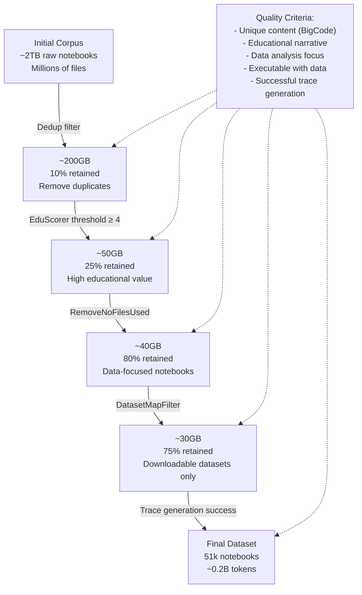

**Sources:** [data/README.md:43-46](), [data/README.md:54-63]()

### Filtering Rationale Table

| Filter Component | Location | Threshold | Purpose |
|-----------------|----------|-----------|---------|
| `Dedup` | [data/main.py:62]() | BigCode filelist match | Remove duplicate content from raw corpus |
| `EduFilter` (commented) | [data/main.py:68]() | `edu_score >= 4` | Keep only high-quality educational notebooks |
| `RemoveNoFilesUsed` (commented) | [data/main.py:71]() | `len(files_used) > 0` | Focus on data analysis notebooks |
| `DatasetMapFilter` | [data/main.py:77]() | `data_source_type` valid | Keep only notebooks with accessible datasets |

**Note:** Filters marked as commented in [data/main.py]() are implemented but may be conditionally enabled. The implicit filtering occurs through stage-specific logic (e.g., `EduScorer` only passes documents meeting criteria forward).

**Sources:** [data/main.py:58-84]()

## Architectural Decisions

### LLM Service Integration

The pipeline relies on external LLM services accessed through an OpenAI-compatible router endpoint. This design decision enables:

1. **Model Flexibility:** Different stages can use different models (Qwen3-32B for scoring/extraction, Qwen3-Coder-480B for code generation)
2. **Resource Efficiency:** Delegates compute-intensive inference to specialized services
3. **Scalability:** Multiple pipeline workers share the same model endpoints

**Router Configuration:**

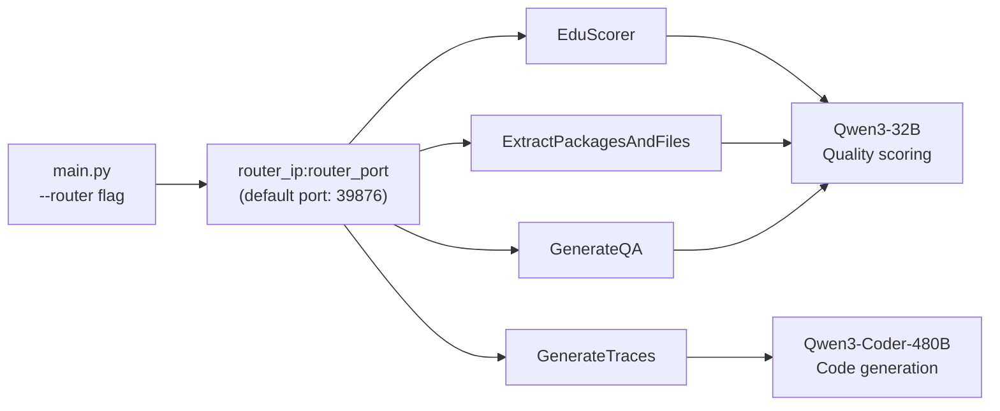

**Configuration in code:** [data/main.py:28-45]()

**Sources:** [data/main.py:25-46](), [data/README.md:110-116]()

### Distributed Processing Model

The pipeline uses `SlurmPipelineExecutor` for distributed execution on HPC clusters:

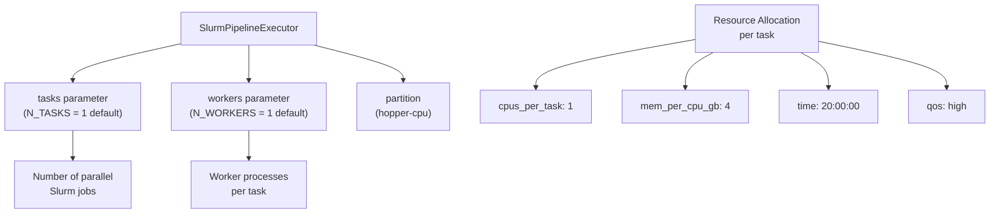

**Default configuration:** [data/main.py:47-49]()

**Executor configuration:** [data/main.py:57-95]()

**Key Parameters:**
- `tasks`: Number of parallel Slurm jobs (default: 1)
- `workers`: Worker processes per task (default: 1)
- `cpus_per_task`: CPU cores per task (default: 1)
- `mem_per_cpu_gb`: Memory per CPU in GB (default: 4)
- `partition`: Slurm partition name (`hopper-cpu`)
- `skip_completed`: Resume from last completed stage (default: `False`)

**Sources:** [data/main.py:47-95]()

## Pipeline Configuration

### Entry Point and Execution

The main entry point is [data/main.py:25-101](), which accepts command-line arguments for router configuration:

```bash
# Minimal execution (single task, single worker)
uv run main.py --router <ROUTER_IP:PORT>

# With explicit port
uv run main.py --router 192.168.1.100:39876
```

**Argument parsing:** [data/main.py:28-45]()

### Critical Path Configuration

| Parameter | Location | Default Value | Purpose |
|-----------|----------|---------------|---------|
| `BASE_PATH` | [data/main.py:51]() | `/fsx/jupyter-agent/data/meta-kaggle-dataset` | Input data location |
| `output_folder` | [data/main.py:53]() | `/fsx/jupyter-agent/data/traces-final` | Final dataset output |
| `logs_file` | [data/main.py:55]() | `logs/jupyter-agent-data-pipeline` | Execution logs |
| `LIMIT` | [data/main.py:49]() | `-1` (unlimited) | Document limit for testing |
| `max_file_size` | [data/main.py:83]() | `10^9` (1GB) | JSONL chunk size |

**Sources:** [data/main.py:47-84]()

### Stage-by-Stage Pipeline Definition

The complete pipeline is defined as a Python list in [data/main.py:58-84]():

```python
pipeline=[
    KaggleLoader(base_path=BASE_PATH, limit=LIMIT),              # Stage 0
    Dedup(),                                                      # Stage 1
    AddMarkdownToNotebook(),                                      # Stage 2
    EduScorer(router_ip=router_ip, router_port=router_port),    # Stage 2
    ExtractPackagesAndFiles(router_ip=router_ip, router_port=router_port),  # Stage 3
    GenerateQA(router_ip=router_ip, router_port=int(router_port)),          # Stage 4
    KaggleDatasetMapper(),                                        # Stage 5
    DataSourceMapper(),                                           # Stage 5
    DatasetMapFilter(),                                           # Stage 5
    KaggleDatasetDownloader(),                                    # Stage 5
    GenerateTraces(router_ip=router_ip, router_port=router_port),           # Stage 6
    DataAgentTracesNotebookToChatML(),                           # Stage 7
    JsonlWriter(output_folder=output_folder, max_file_size=int(10**9)),
]
```

Each component is instantiated with specific configuration and added to the pipeline sequence. Components requiring LLM access receive `router_ip` and `router_port` parameters.

**Sources:** [data/main.py:1-101]()

## Pipeline Outputs

The pipeline produces two primary outputs:

1. **Intermediate Data:** Each stage writes processed documents to the shared file system, enabling debugging and stage-by-stage inspection
2. **Final Dataset:** Structured JSONL files in ChatML format, chunked into 1GB files for distributed training

**Output structure:**
```
/fsx/jupyter-agent/data/traces-final/
├── 00000.jsonl  (≤1GB)
├── 00001.jsonl  (≤1GB)
└── ...
```

Each JSONL file contains documents with:
- `messages`: Array of `{role, content}` objects
- Original notebook metadata
- Generated QA pairs and execution traces

**Writer configuration:** [data/main.py:83]()

**Sources:** [data/main.py:53-84](), [data/README.md:17]()

---

# Page: Pipeline Orchestration

# Pipeline Orchestration

<details>
<summary>Relevant source files</summary>

The following files were used as context for generating this wiki page:

- [data/README.md](data/README.md)
- [data/main.py](data/main.py)

</details>


This document explains how the Jupyter Agent data generation pipeline is orchestrated and executed. It covers the central orchestration mechanism in `data/main.py`, the distributed execution architecture using `SlurmPipelineExecutor`, resource allocation strategies, and execution modes. For details about individual pipeline stages, see sections [2.2](#2.2) through [2.8](#2.8). For environment setup and running instructions, see [5.1](#5.1) and [5.2](#5.2).

## Overview

The pipeline orchestration system coordinates the execution of eight sequential data processing stages that transform raw Kaggle notebooks (2TB) into training-ready ChatML format. The orchestrator uses the `SlurmPipelineExecutor` from the datatrove library to manage distributed execution across a Slurm cluster, handling task scheduling, resource allocation, and data flow between stages.

**Sources:** [data/main.py:1-101](), [data/README.md:1-135]()

## Main Orchestration Entry Point

### The `data/main.py` Script

The `main()` function in [data/main.py:25-101]() serves as the primary entry point for pipeline execution. It accepts router configuration via CLI arguments and constructs the complete pipeline with all stages.

**CLI Arguments:**

| Argument | Short | Required | Description | Default |
|----------|-------|----------|-------------|---------|
| `--router` | `-r` | Yes | Router address for LLM services | None |
| Format | | | `IP:PORT` or `IP` only | Port 39876 if omitted |

**Example Usage:**
```bash
cd data
uv run main.py -r 192.168.1.100:39876
```

The router configuration is parsed at [data/main.py:38-42]() and validated to ensure both IP and port are available for downstream stages.

**Sources:** [data/main.py:25-46]()

### Configuration Parameters

The orchestrator defines several key configuration parameters at [data/main.py:47-53]():

```python
N_TASKS = 1
N_WORKERS = 1
LIMIT = -1
BASE_PATH = "/fsx/jupyter-agent/data/meta-kaggle-dataset"
output_folder = "/fsx/jupyter-agent/data/traces-final"
logs_file = "logs/jupyter-agent-data-pipeline"
```

| Parameter | Purpose | Value |
|-----------|---------|-------|
| `N_TASKS` | Number of parallel Slurm tasks | 1 (configurable) |
| `N_WORKERS` | Workers per task for multiprocessing | 1 (configurable) |
| `LIMIT` | Maximum documents to process (-1 = unlimited) | -1 |
| `BASE_PATH` | Input directory for raw Kaggle data | `/fsx/jupyter-agent/data/meta-kaggle-dataset` |
| `output_folder` | Final output directory for ChatML data | `/fsx/jupyter-agent/data/traces-final` |
| `logs_file` | Slurm job logs directory | `logs/jupyter-agent-data-pipeline` |

**Sources:** [data/main.py:47-55]()

## SlurmPipelineExecutor Architecture

### Executor Configuration

The `SlurmPipelineExecutor` is instantiated at [data/main.py:57-95]() with comprehensive configuration for distributed execution:

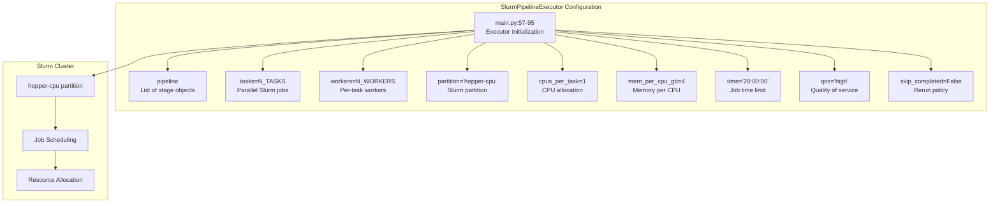

**Sources:** [data/main.py:57-95]()

### Resource Allocation Strategy

The executor allocates resources per task as configured at [data/main.py:90-92]():

| Resource | Per Task | Total (N_TASKS=128) |
|----------|----------|---------------------|
| CPUs | 1 | 128 |
| Memory | 4 GB | 512 GB |
| Workers | 1 | 128 |
| Time Limit | 20 hours | 20 hours |
| Partition | `hopper-cpu` | `hopper-cpu` |
| QoS | `high` | `high` |

The configuration in the provided code shows minimal resource allocation (1 task, 1 worker, 1 CPU, 4GB). In production, these parameters are typically scaled up significantly (e.g., 128 tasks × 128 workers as mentioned in Diagram 3 of the high-level architecture).

**Sources:** [data/main.py:85-92]()

### Skip Completed Mechanism

The `skip_completed=False` parameter at [data/main.py:93]() controls whether the executor reruns stages that have already completed. When set to `False`, all stages are re-executed even if intermediate outputs exist. This ensures reproducibility but increases compute costs.

**Sources:** [data/main.py:93]()

## Pipeline Stage Sequence

### Stage Declaration and Flow

The pipeline is defined as a list of stage objects at [data/main.py:58-83](). Each stage is a class instance that implements the datatrove pipeline interface:

```mermaid
graph LR
    Stage0["KaggleLoader<br/>Stage 0"]
    Stage1["Dedup<br/>Stage 1"]
    Stage2A["AddMarkdownToNotebook<br/>Stage 2"]
    Stage2B["EduScorer<br/>Stage 2"]
    Stage3A["ExtractPackagesAndFiles<br/>Stage 3"]
    Stage4["GenerateQA<br/>Stage 4"]
    Stage5A["KaggleDatasetMapper<br/>Stage 5"]
    Stage5B["DataSourceMapper<br/>Stage 5"]
    Stage5C["DatasetMapFilter<br/>Stage 5"]
    Stage5D["KaggleDatasetDownloader<br/>Stage 5"]
    Stage6["GenerateTraces<br/>Stage 6"]
    Stage7["DataAgentTracesNotebookToChatML<br/>Stage 7"]
    Writer["JsonlWriter<br/>Final Output"]
    
    Stage0 --> Stage1
    Stage1 --> Stage2A
    Stage2A --> Stage2B
    Stage2B --> Stage3A
    Stage3A --> Stage4
    Stage4 --> Stage5A
    Stage5A --> Stage5B
    Stage5B --> Stage5C
    Stage5C --> Stage5D
    Stage5D --> Stage6
    Stage6 --> Stage7
    Stage7 --> Writer
```

**Sources:** [data/main.py:58-83]()

### Stage Initialization Parameters

Each stage receives initialization parameters that configure its behavior:

**Stage 0 - KaggleLoader** [data/main.py:60]()
- `base_path`: Input directory path
- `limit`: Maximum documents to load

**Stage 2 - EduScorer** [data/main.py:67]()
- `router_ip`: LLM service IP address
- `router_port`: LLM service port

**Stage 3 - ExtractPackagesAndFiles** [data/main.py:70]()
- `router_ip`: LLM service IP address
- `router_port`: LLM service port

**Stage 4 - GenerateQA** [data/main.py:73]()
- `router_ip`: LLM service IP address
- `router_port`: LLM service port (cast to int)

**Stage 6 - GenerateTraces** [data/main.py:80]()
- `router_ip`: LLM service IP address
- `router_port`: LLM service port

**Final Writer - JsonlWriter** [data/main.py:83]()
- `output_folder`: Output directory path
- `max_file_size`: Maximum file size in bytes (1GB)

**Sources:** [data/main.py:60-83]()

### Commented and Debugging Stages

The pipeline includes commented-out stages at [data/main.py:64]() and [data/main.py:68-71]():

- **JsonlReader** [data/main.py:64](): Allows resuming from S3 intermediate outputs for debugging
- **EduFilter** [data/main.py:68](): Filters by educational score threshold (≥4)
- **RemoveNoFilesUsed** [data/main.py:71](): Filters notebooks without file usage

These stages can be uncommented to enable filtering or resume from intermediate checkpoints.

**Sources:** [data/main.py:64-71]()

## Execution Flow Architecture

The following diagram shows how the orchestrator coordinates execution:

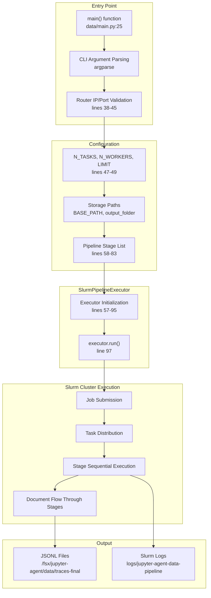

**Sources:** [data/main.py:25-101]()

## Individual Stage Execution

### Standalone Stage Invocation

Each pipeline stage can be executed independently using its own CLI script. The README documents this at [data/README.md:120-135]():

```bash
# Load and deduplicate Kaggle notebooks  
uv run pipelines/kaggle_loader.py
uv run pipelines/dedup.py

# Educational scoring (requires model endpoint)
uv run pipelines/edu_scoring.py -r <ROUTER_IP:PORT>

# Metadata + QA generation (requires model endpoint)  
uv run pipelines/extract_packages_and_files.py -r <ROUTER_IP:PORT>
uv run pipelines/generate_qa.py -r <ROUTER_IP:PORT>
```

This allows for:
- **Debugging**: Test individual stages in isolation
- **Development**: Iterate on single stage implementations
- **Recovery**: Rerun failed stages without full pipeline re-execution
- **Testing**: Validate stage outputs before full pipeline runs

**Sources:** [data/README.md:120-135]()

### Stage Independence vs. Dependencies

While stages can run independently, they have data dependencies:

| Stage | Input Dependency | Can Run Standalone |
|-------|------------------|-------------------|
| KaggleLoader | Raw ZIP files | ✅ Yes |
| Dedup | KaggleLoader output | ❌ No |
| AddMarkdownToNotebook | Dedup output | ❌ No |
| EduScorer | AddMarkdownToNotebook output | ❌ No |
| ExtractPackagesAndFiles | EduScorer output | ❌ No |
| GenerateQA | ExtractPackagesAndFiles output | ❌ No |
| KaggleDatasetMapper | GenerateQA output | ❌ No |
| GenerateTraces | KaggleDatasetDownloader output | ❌ No |
| DataAgentTracesNotebookToChatML | GenerateTraces output | ❌ No |

**Sources:** [data/README.md:120-135](), [data/main.py:58-83]()

## Router Configuration and External Dependencies

### Router IP/Port Management

The orchestrator handles router configuration parsing at [data/main.py:38-45]():

```python
if ":" in args.router:
    router_ip, router_port = args.router.split(":")
else:
    router_ip = args.router
    router_port = "39876"

assert router_ip is not None, "router_ip is required"
assert router_port is not None, "router_port is required"
```

The router address is distributed to four LLM-dependent stages:
- `EduScorer`
- `ExtractPackagesAndFiles`
- `GenerateQA`
- `GenerateTraces`

**Sources:** [data/main.py:38-45](), [data/main.py:67-80]()

### External Service Dependencies

The pipeline requires access to external services:

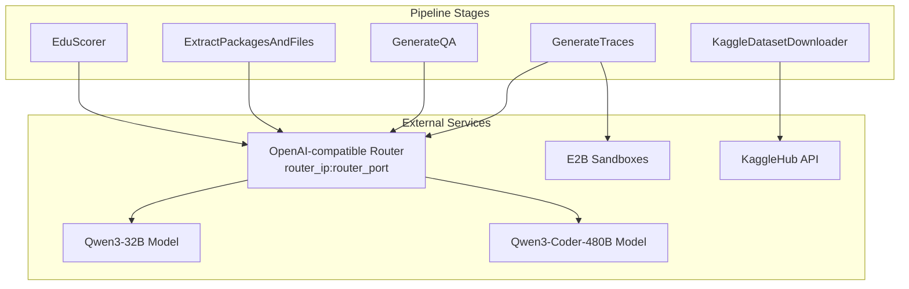

**Sources:** [data/main.py:67-80](), [data/README.md:19-27]()

## Storage and Data Flow

### File System Layout

The orchestrator manages data flow through the shared file system:

| Path | Purpose | Stage |
|------|---------|-------|
| `/fsx/jupyter-agent/data/meta-kaggle-dataset` | Raw input data | Stage 0 input |
| `/fsx/jupyter-agent/data/traces-final` | Final ChatML output | Final writer output |
| `logs/jupyter-agent-data-pipeline` | Slurm execution logs | All stages |

Intermediate stage outputs are managed by the datatrove framework and stored in task-specific directories within the Slurm job workspace.

**Sources:** [data/main.py:51-55]()

### Data Volume Transformation

The pipeline progressively reduces data volume through filtering:

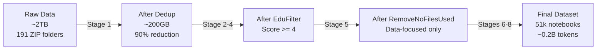

**Sources:** [data/README.md:36-46](), [data/README.md:1-30]()

## Job Submission and Monitoring

### Slurm Job Lifecycle

When `executor.run()` is called at [data/main.py:97](), the following occurs:

1. **Job Creation**: SlurmPipelineExecutor generates Slurm batch scripts
2. **Submission**: Jobs are submitted to the `hopper-cpu` partition
3. **Scheduling**: Slurm scheduler allocates resources based on QoS and availability
4. **Execution**: Each task runs the pipeline stages sequentially
5. **Logging**: Output and errors are written to `logs/jupyter-agent-data-pipeline`
6. **Completion**: Final outputs are written to `output_folder`

**Sources:** [data/main.py:88-97]()

### Execution Parameters Summary

| Parameter | Value | Purpose |
|-----------|-------|---------|
| `tasks` | `N_TASKS` | Parallel Slurm jobs |
| `workers` | `N_WORKERS` | Multiprocessing workers per task |
| `time` | `"20:00:00"` | Maximum job runtime (20 hours) |
| `partition` | `"hopper-cpu"` | Target Slurm partition |
| `logging_dir` | `logs_file` | Log output directory |
| `cpus_per_task` | `1` | CPUs allocated per task |
| `mem_per_cpu_gb` | `4` | Memory (GB) per CPU |
| `qos` | `"high"` | Priority queue |
| `skip_completed` | `False` | Rerun all stages |
| `job_name` | `"jupyter-agent-data-pipeline"` | Slurm job identifier |

**Sources:** [data/main.py:85-94]()

---

# Page: Stage 1-2: Data Ingestion and Deduplication

# Stage 1-2: Data Ingestion and Deduplication

<details>
<summary>Relevant source files</summary>

The following files were used as context for generating this wiki page:

- [data/README.md](data/README.md)
- [data/pipelines/dedup.py](data/pipelines/dedup.py)
- [data/pipelines/kaggle_loader.py](data/pipelines/kaggle_loader.py)

</details>


## Purpose and Scope

This document describes the first two stages of the data generation pipeline, which transform raw Kaggle notebook archives into a deduplicated dataset ready for quality assessment. These stages reduce the initial ~2TB of raw data by approximately 90% while preserving high-quality unique notebooks.

**Scope**: This page covers the `KaggleLoader` and `Dedup` pipeline components. For information about subsequent quality scoring, see [Stage 3-4: Quality Assessment](#2.3). For overall pipeline orchestration, see [Pipeline Orchestration](#2.1).

## Stage Overview

The ingestion and deduplication process consists of two sequential stages:

1. **Stage 1 - KaggleLoader**: Extracts `.ipynb` notebook files from 20 ZIP archives (~2TB total) containing the Meta Kaggle dataset, distributing extraction across 191 parallel tasks.

2. **Stage 2 - Deduplication**: Filters the extracted notebooks using BigCode's curated filelist from the StarCoder2 project, removing approximately 90% of the raw data as duplicates.

Both stages use the datatrove framework with `SlurmPipelineExecutor` for distributed processing on a Slurm cluster. The output from Stage 1 becomes the input to Stage 2, with intermediate storage on a shared file system.

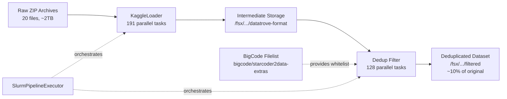

**Diagram: Data Flow Through Ingestion and Deduplication Stages**

Sources: [data/pipelines/kaggle_loader.py](), [data/pipelines/dedup.py](), [data/README.md:36-46]()

## Stage 1: KaggleLoader

### Purpose and Implementation

The `KaggleLoader` class extracts Jupyter notebook files from the Meta Kaggle dataset ZIP archives. It implements the datatrove `PipelineStep` interface to integrate with the pipeline framework.

**Class Definition**: [data/pipelines/kaggle_loader.py:8-60]()

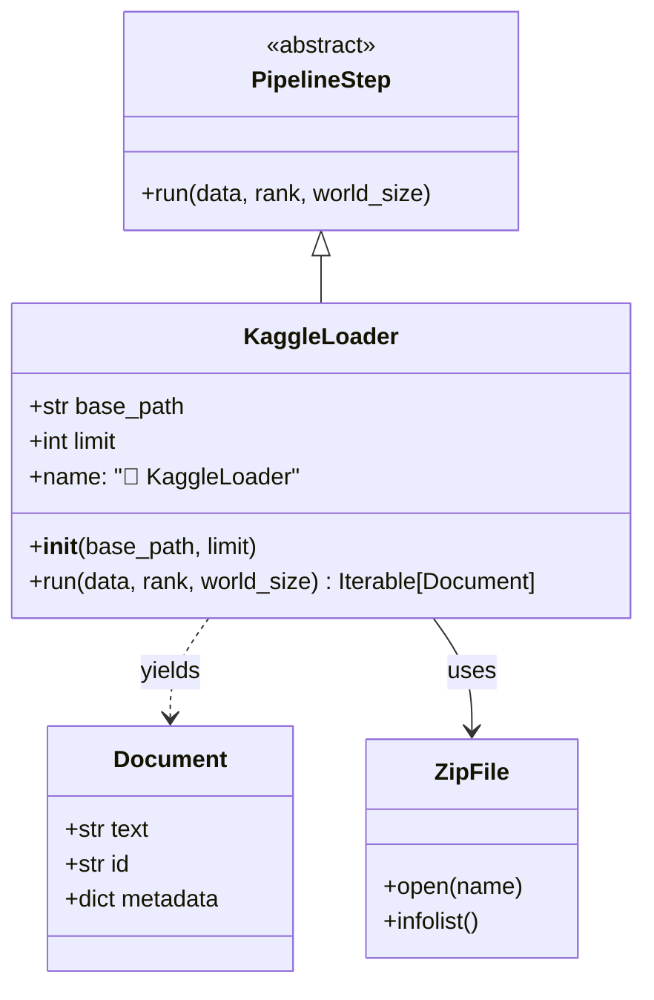

**Diagram: KaggleLoader Class Structure**

Sources: [data/pipelines/kaggle_loader.py:8-14]()

### ZIP Archive Structure and Distribution

The Meta Kaggle dataset is organized as 20 ZIP files, each containing 10 subfolders except the last file which contains only 1 subfolder, totaling 191 folders. The `KaggleLoader` distributes these 191 folders across parallel Slurm tasks using rank-based assignment.

**Distribution Logic**: [data/pipelines/kaggle_loader.py:26-43]()

Each task with rank `i` processes:
- ZIP file: `metakaggle_code_with_outputs_{rank // 10}.zip`
- Subfolder: Files matching pattern `{rank}.zfill(4)/`

| Component | Value |
|-----------|-------|
| Total ZIP Files | 20 |
| Total Subfolders | 191 |
| Notebooks per ZIP | ~100GB |
| File Path Template | `{base_path}/metakaggle_code_with_outputs_{XXX}.zip` |
| Subfolder Pattern | `{XXXX}/*.ipynb` (4-digit zero-padded) |

**Example**: Task with rank 47 processes:
- ZIP: `metakaggle_code_with_outputs_004.zip`
- Subfolder: `0047/*.ipynb`

Sources: [data/pipelines/kaggle_loader.py:26-27](), [data/README.md:38]()

### Extraction and Document Creation

The loader performs the following operations for each notebook:

1. **File Selection**: Filters files matching the current rank's subfolder pattern
2. **Exclusion Check**: Skips files in the hardcoded exclusion list [data/pipelines/kaggle_loader.py:22-24]()
3. **Content Extraction**: Reads file content from ZIP archive
4. **UTF-8 Decoding**: Attempts to decode as UTF-8 with error handling [data/pipelines/kaggle_loader.py:51-55]()
5. **Document Creation**: Yields `Document` object with raw notebook JSON as text and file path as ID [data/pipelines/kaggle_loader.py:57]()

```mermaid
sequenceDiagram
    participant Task as KaggleLoader Task
    participant ZIP as ZipFile
    participant Doc as Document Iterator
    
    Task->>ZIP: Open ZIP for current rank
    loop For each file in ZIP
        Task->>Task: Check rank pattern match
        Task->>Task: Check exclusion list
        Task->>ZIP: Extract file content
        ZIP-->>Task: Raw bytes
        Task->>Task: Decode UTF-8
        alt Decode success
            Task->>Doc: Yield Document(text, id)
        else Decode failure
            Task->>Task: Log error, skip file
        end
    end
```

**Diagram: Document Extraction Sequence**

Sources: [data/pipelines/kaggle_loader.py:40-59]()

### Error Handling

The loader implements defensive programming practices:

- **File Exclusion List**: Hardcoded list of problematic files that consistently cause crashes [data/pipelines/kaggle_loader.py:22-24]()
  ```python
  file_exclusion_list = [
      "0132/087/132087938.ipynb"  # file that always caused a crash
  ]
  ```

- **Decoding Errors**: UTF-8 decoding failures are caught, logged, and the file is skipped [data/pipelines/kaggle_loader.py:51-55]()
- **Limit Parameter**: Optional `limit` parameter for testing with subset of data [data/pipelines/kaggle_loader.py:34-38]()

Sources: [data/pipelines/kaggle_loader.py:22-55]()

### Execution Configuration

The `KaggleLoader` stage is executed via `SlurmPipelineExecutor` with the following configuration:

| Parameter | Value | Purpose |
|-----------|-------|---------|
| `tasks` | 191 | One task per subfolder in ZIP archives |
| `workers` | 191 | One worker per task for parallel processing |
| `partition` | `hopper-cpu` | CPU-only Slurm partition |
| `cpus_per_task` | 4 | CPU cores per task |
| `mem_per_cpu_gb` | 4 | Memory per CPU (16GB total per task) |
| `time` | `20:00:00` | Maximum wall time (20 hours) |
| `qos` | `high` | Quality of service level |
| `job_name` | `kaggle-loader` | Slurm job identifier |

**Configuration**: [data/pipelines/kaggle_loader.py:62-88]()

**Total Resources**: 764 CPUs, 3TB RAM across all tasks

The output is written to `/fsx/jupyter-agent/data/meta-kaggle-dataset-datatrove-format` using `JsonlWriter` with 1GB maximum file size [data/pipelines/kaggle_loader.py:74]().

Sources: [data/pipelines/kaggle_loader.py:62-88]()

## Stage 2: Deduplication Filter

### Purpose and BigCode Integration

The `Dedup` filter removes duplicate notebooks using a curated filelist from BigCode's StarCoder2 project. This filelist was created through extensive deduplication analysis of the Meta Kaggle dataset and identifies unique, high-quality notebooks.

**Class Definition**: [data/pipelines/dedup.py:12-35]()

The filter inherits from datatrove's `BaseFilter` and implements a whitelist-based approach: only notebooks whose IDs appear in the BigCode filelist are retained.

```mermaid
graph TB
    A["Input Documents<br/>from KaggleLoader"] --> B["Dedup Filter"]
    C["bigcode/starcoder2data-extras<br/>Dataset (Kaggle split)"] --> D["Load file_id list"]
    D --> B
    
    B --> E{"Document ID<br/>in filelist?"}
    E -->|Yes| F["Keep Document"]
    E -->|No| G["Filter Out"]
    
    F --> H["Deduplicated Output<br/>~10% of input"]
    
    subgraph "Dedup Class"
        B
        E
    end
```

**Diagram: Deduplication Logic Flow**

Sources: [data/pipelines/dedup.py:12-35](), [data/README.md:42-46]()

### Filelist Loading

The deduplication filelist is loaded from Hugging Face Hub at initialization time:

**Loading Logic**: [data/pipelines/dedup.py:25-26]()
```python
ds = load_dataset("bigcode/starcoder2data-extras", "kaggle", split="train")
self.filelist = list(ds["file_id"])
```

This dataset contains the `file_id` column with identifiers of notebooks that passed BigCode's deduplication process. The filelist is stored in memory for efficient lookup during filtering.

| Dataset Component | Value |
|------------------|-------|
| Dataset Repository | `bigcode/starcoder2data-extras` |
| Configuration | `kaggle` |
| Split | `train` |
| Column Used | `file_id` |
| Purpose | Whitelist of unique notebooks |

Sources: [data/pipelines/dedup.py:25-26](), [data/README.md:44-45]()

### Filtering Logic

The `filter` method implements the core deduplication logic by extracting the notebook identifier from the document ID and checking membership in the filelist:

**Filter Implementation**: [data/pipelines/dedup.py:28-35]()

```python
def filter(self, doc: Document) -> bool:
    return doc.id.split("/")[-1].split(".")[0] in self.filelist
```

**ID Extraction Process**:
1. Document ID format: `{folder}/{subfolder}/{notebook_id}.ipynb`
2. Split by `/` and take last component: `{notebook_id}.ipynb`
3. Split by `.` and take first component: `{notebook_id}`
4. Check if `{notebook_id}` exists in `self.filelist`

**Example**:
- Input ID: `"0047/123/456789.ipynb"`
- Extracted ID: `"456789"`
- Filter result: `True` if `"456789"` in filelist, else `False`

Sources: [data/pipelines/dedup.py:28-35]()

### Execution Configuration

The `Dedup` stage runs with reduced parallelism compared to `KaggleLoader` since it's a simpler filtering operation:

| Parameter | Value | Purpose |
|-----------|-------|---------|
| `tasks` | 128 | Parallel filtering tasks |
| `workers` | 128 | One worker per task |
| `partition` | `hopper-cpu` | CPU-only Slurm partition |
| `cpus_per_task` | 4 | CPU cores per task |
| `mem_per_cpu_gb` | 16 | Memory per CPU (64GB total per task) |
| `time` | `20:00:00` | Maximum wall time (20 hours) |
| `qos` | `high` | Quality of service level |
| `job_name` | `dedup` | Slurm job identifier |

**Configuration**: [data/pipelines/dedup.py:38-65]()

**Total Resources**: 512 CPUs, 8TB RAM across all tasks

Higher memory per task (16GB vs 4GB) accommodates the in-memory filelist and document processing. The output is written to `/fsx/jupyter-agent/data/filtered` using `JsonlWriter` with 1GB maximum file size [data/pipelines/dedup.py:51]().

Sources: [data/pipelines/dedup.py:38-65]()

### Data Reduction

The deduplication stage achieves approximately **90% data reduction**, as indicated in the documentation [data/README.md:45]():

| Metric | Before Dedup | After Dedup | Reduction |
|--------|-------------|-------------|-----------|
| Data Volume | ~2TB | ~200GB | 90% |
| Unique Notebooks | Raw dataset | BigCode curated | High duplicates removed |

This aggressive filtering is justified because the Meta Kaggle dataset contains many duplicate or near-duplicate notebooks from forked competitions and copied code.

Sources: [data/README.md:42-46]()

## Data Flow and Storage Architecture

```mermaid
graph TB
    subgraph "Input Layer"
        A["GCS Bucket<br/>kaggle-meta-kaggle-code-downloads"]
        B["Local Storage<br/>/fsx/jupyter-agent/data/meta-kaggle-dataset"]
    end
    
    subgraph "Stage 1: KaggleLoader"
        C["ZIP Reader<br/>191 parallel tasks"]
        D["UTF-8 Decoder"]
        E["Document Generator"]
    end
    
    subgraph "Intermediate Storage"
        F["JsonlWriter<br/>1GB chunks"]
        G["/fsx/jupyter-agent/data/<br/>meta-kaggle-dataset-datatrove-format"]
    end
    
    subgraph "Stage 2: Dedup"
        H["JsonlReader<br/>128 parallel tasks"]
        I["BigCode Filelist Lookup"]
        J["Filter Logic"]
    end
    
    subgraph "Output Layer"
        K["JsonlWriter<br/>1GB chunks"]
        L["/fsx/jupyter-agent/data/filtered"]
    end
    
    A -.->|"gsutil download"| B
    B --> C
    C --> D --> E --> F --> G
    G --> H --> I --> J --> K --> L
    
    M["bigcode/starcoder2data-extras"] -.->|"load_dataset"| I
```

**Diagram: Complete Data Flow Through Both Stages**

Sources: [data/pipelines/kaggle_loader.py:66-74](), [data/pipelines/dedup.py:42-51]()

### File System Paths

| Path | Purpose | Stage | Format |
|------|---------|-------|--------|
| `/fsx/jupyter-agent/data/meta-kaggle-dataset` | Raw ZIP archives from GCS | Input | ZIP |
| `/fsx/jupyter-agent/data/meta-kaggle-dataset-datatrove-format` | Extracted notebooks | Stage 1 output | JSONL |
| `/fsx/jupyter-agent/data/filtered` | Deduplicated notebooks | Stage 2 output | JSONL |

All paths use a shared FSX file system accessible across Slurm nodes, enabling distributed processing without data transfer overhead.

Sources: [data/pipelines/kaggle_loader.py:66-69](), [data/pipelines/dedup.py:42-43]()

## Output Document Format

After both stages, documents have the following structure:

| Field | Type | Description | Source |
|-------|------|-------------|--------|
| `text` | str | Raw notebook JSON content (`.ipynb` format) | Extracted from ZIP |
| `id` | str | Original file path (e.g., `"0047/123/456789.ipynb"`) | ZIP archive path |
| `metadata` | dict | Empty at this stage | Populated in later stages |

The `text` field contains the complete notebook JSON, including:
- Cell contents (code and markdown)
- Cell outputs
- Notebook metadata
- Execution counts

This raw format is preserved through Stage 2, with subsequent stages ([Stage 3-4: Quality Assessment](#2.3)) performing format conversions and enrichment.

Sources: [data/pipelines/kaggle_loader.py:57]()

## Execution Instructions

### Running Individual Stages

```bash
# Stage 1: Load notebooks from ZIP archives
cd data
uv run pipelines/kaggle_loader.py

# Stage 2: Deduplicate using BigCode filelist
uv run pipelines/dedup.py
```

### Running Both Stages via Main Pipeline

```bash
cd data
uv run main.py -r <ROUTER_IP:PORT>
```

The main pipeline orchestrator ([Pipeline Orchestration](#2.1)) will execute both stages in sequence automatically.

Sources: [data/README.md:125-127]()

### Prerequisites

1. **Data Download**: Raw Kaggle dataset must be downloaded from GCS bucket [data/README.md:92-106]()
2. **Slurm Access**: Must have access to `hopper-cpu` partition with sufficient resources
3. **File System**: Shared FSX mount at `/fsx/jupyter-agent/data/` with sufficient space (~2.5TB)
4. **Python Environment**: datatrove, datasets, and dependencies installed via `uv`

Sources: [data/README.md:92-106](), [data/pipelines/kaggle_loader.py:79](), [data/pipelines/dedup.py:56]()

---

# Page: Kaggle Loader

# Kaggle Loader

<details>
<summary>Relevant source files</summary>

The following files were used as context for generating this wiki page:

- [data/pipelines/kaggle_loader.py](data/pipelines/kaggle_loader.py)

</details>


## Purpose and Scope

The Kaggle Loader is the first stage of the data generation pipeline, responsible for extracting and loading raw Jupyter notebooks from the Meta Kaggle dataset ZIP archives. It implements distributed parallel processing to handle approximately 2TB of compressed notebook data across 191 tasks.

This document covers the `KaggleLoader` class implementation, its integration with the Slurm execution framework, and the distribution strategy for processing large-scale ZIP archives. For the subsequent deduplication stage that processes the loaded notebooks, see [Deduplication Filter](#2.2.2). For overall pipeline orchestration, see [Pipeline Orchestration](#2.1).

**Sources:** [data/pipelines/kaggle_loader.py:1-93]()

## System Architecture

The Kaggle Loader implements a distributed extraction pattern where 191 parallel tasks each process a specific subset of notebooks from ZIP archives. Each task extracts notebooks from its assigned subfolder, converts them to `Document` objects, and writes them to JSONL format.

```mermaid
graph TB
    subgraph "Input Data Structure"
        A["20 ZIP Files<br/>metakaggle_code_with_outputs_000.zip<br/>to metakaggle_code_with_outputs_019.zip"]
        B["191 Subfolders<br/>0000/, 0001/, ..., 0190/"]
        C["~2TB Raw Notebooks<br/>.ipynb files"]
    end
    
    subgraph "KaggleLoader Processing"
        D["KaggleLoader<br/>PipelineStep"]
        E["191 Parallel Tasks<br/>rank 0 to 190"]
        F["ZipFile Extraction"]
        G["Document Creation"]
        H["UTF-8 Decoding"]
    end
    
    subgraph "Output Generation"
        I["JsonlWriter"]
        J["1GB Max File Size"]
        K["JSONL Output Files"]
    end
    
    subgraph "Error Handling"
        L["File Exclusion List"]
        M["Decoding Error Catch"]
        N["Skip Broken Files"]
    end
    
    A --> B
    B --> C
    C --> D
    D --> E
    E --> F
    F --> L
    F --> M
    L --> N
    M --> N
    F --> H
    H --> G
    G --> I
    I --> J
    J --> K
```

**Diagram: KaggleLoader Data Flow and Error Handling**

The loader maps each rank to a specific subfolder within a ZIP archive. The distribution strategy ensures that each of the 191 tasks processes exactly one subfolder, avoiding overlap and enabling efficient parallel processing.

**Sources:** [data/pipelines/kaggle_loader.py:8-60]()

## Class Structure and Implementation

### KaggleLoader Class

The `KaggleLoader` class extends `PipelineStep` from the datatrove library, implementing the standard pipeline interface for distributed document processing.

```mermaid
classDiagram
    class PipelineStep {
        <<interface>>
        +run(data, rank, world_size) Iterable~Document~
    }
    
    class KaggleLoader {
        +str name = "🏁 KaggleLoader"
        +str base_path
        +int limit
        +__init__(base_path, limit=-1)
        +run(data, rank, world_size) Iterable~Document~
    }
    
    class Document {
        +str text
        +str id
        +dict metadata
    }
    
    class JsonlWriter {
        +str output_folder
        +int max_file_size
    }
    
    class SlurmPipelineExecutor {
        +list pipeline
        +int tasks
        +int workers
        +str partition
        +run()
    }
    
    PipelineStep <|-- KaggleLoader
    KaggleLoader --> Document : yields
    KaggleLoader --> JsonlWriter : pipes to
    SlurmPipelineExecutor --> KaggleLoader : executes
```

**Diagram: KaggleLoader Class Relationships**

**Key Parameters:**
- `base_path`: Root directory containing the ZIP archives (default: `/fsx/jupyter-agent/data/meta-kaggle-dataset`)
- `limit`: Optional limit on number of documents to process per task (default: -1, meaning no limit)

**Sources:** [data/pipelines/kaggle_loader.py:8-14]()

## Distribution Strategy

The loader implements a two-level distribution scheme that maps 191 tasks to 20 ZIP files containing 191 subfolders.

### ZIP Archive and Subfolder Mapping

```mermaid
graph LR
    subgraph "Rank to ZIP Mapping"
        A["rank // 10"]
        B["ZIP Index 000-019"]
    end
    
    subgraph "Rank to Subfolder Mapping"
        C["rank % 10000"]
        D["Subfolder 0000-0190"]
    end
    
    subgraph "Example Mappings"
        E["Rank 0<br/>→ ZIP 000<br/>→ Folder 0000/"]
        F["Rank 15<br/>→ ZIP 001<br/>→ Folder 0015/"]
        G["Rank 190<br/>→ ZIP 019<br/>→ Folder 0190/"]
    end
    
    A --> B
    C --> D
    B --> E
    D --> E
    B --> F
    D --> F
    B --> G
    D --> G
```

**Diagram: Rank-to-Archive Distribution Logic**

The filepath computation formula:
```
filepath = f"{base_path}/metakaggle_code_with_outputs_{str(rank // 10).zfill(3)}.zip"
```

Each task filters files within the ZIP based on the subfolder pattern:
```
file_info.filename.split("/")[0] == str(rank).zfill(4)
```

This ensures that:
- **ZIP 000-018**: Each contains 10 subfolders (ranks 0-9, 10-19, ..., 180-189)
- **ZIP 019**: Contains only 1 subfolder (rank 190)
- **Total**: 191 tasks processing 191 unique subfolders

**Sources:** [data/pipelines/kaggle_loader.py:26-43]()

## Document Processing Pipeline

Each task follows a sequential processing workflow for files in its assigned subfolder:

| Step | Operation | Implementation |
|------|-----------|----------------|
| 1. ZIP Access | Open ZIP archive in read mode | `zipfile.ZipFile(filepath, "r")` |
| 2. File Filtering | Check file belongs to current rank | `filename.split("/")[0] == str(rank).zfill(4)` |
| 3. Exclusion Check | Skip known problematic files | Check against `file_exclusion_list` |
| 4. File Extraction | Read file from ZIP | `zip_ref.open(file_info.filename)` |
| 5. UTF-8 Decoding | Decode bytes to string | `file.read().decode("utf-8")` |
| 6. Document Creation | Create Document object | `Document(text=content, id=filename)` |
| 7. Output | Yield document to writer | `yield document` |

**Sources:** [data/pipelines/kaggle_loader.py:31-59]()

## Error Handling and Robustness

### File Exclusion List

The loader maintains a hardcoded exclusion list for files that consistently cause crashes:

```python
file_exclusion_list = [
    "0132/087/132087938.ipynb"
]
```

Files in this list are skipped during processing with a log message.

**Sources:** [data/pipelines/kaggle_loader.py:22-24]()

### Decoding Error Handling

UTF-8 decoding errors are caught and logged without crashing the entire task:

```python
try:
    content = file.read().decode("utf-8")
except Exception as e:
    print(f"Error decoding: {file_info.filename}: {e}")
    continue
```

This ensures that a single corrupted file doesn't prevent processing of the remaining notebooks in the subfolder.

**Sources:** [data/pipelines/kaggle_loader.py:51-55]()

### Document Limit

An optional `limit` parameter enables processing a subset of documents for testing:

```python
if self.limit != -1 and documents_processed >= self.limit:
    print(f"Reached limit of {self.limit} documents. Stopping processing.")
    break
```

**Sources:** [data/pipelines/kaggle_loader.py:34-38]()

## Slurm Execution Configuration

The `main()` function configures distributed execution using `SlurmPipelineExecutor`:

```mermaid
graph TB
    subgraph "Execution Configuration"
        A["N_TASKS = 191<br/>N_WORKERS = 191"]
        B["PARTITION = hopper-cpu"]
        C["TIME = 20:00:00"]
        D["CPUS_PER_TASK = 4"]
        E["MEM_PER_CPU_GB = 4"]
    end
    
    subgraph "Resource Allocation"
        F["Total CPUs: 764"]
        G["Total Memory: 3056 GB"]
        H["Total Walltime: 20 hours"]
    end
    
    subgraph "Pipeline Components"
        I["KaggleLoader"]
        J["JsonlWriter<br/>max_file_size=1GB"]
    end
    
    A --> F
    D --> F
    A --> G
    E --> G
    C --> H
    I --> J
```

**Diagram: Slurm Resource Allocation**

### Configuration Parameters

| Parameter | Value | Purpose |
|-----------|-------|---------|
| `tasks` | 191 | Number of parallel tasks (one per subfolder) |
| `workers` | 191 | Number of workers (1:1 with tasks) |
| `time` | "20:00:00" | Maximum walltime (20 hours) |
| `partition` | "hopper-cpu" | Slurm partition for CPU-only jobs |
| `cpus_per_task` | 4 | CPU cores per task |
| `mem_per_cpu_gb` | 4 | Memory per CPU core (16GB total per task) |
| `qos` | "high" | Quality of service level |
| `skip_completed` | False | Reprocess all data (no resumption) |

**Sources:** [data/pipelines/kaggle_loader.py:62-88]()

## Input and Output Locations

### Input Configuration

```python
BASE_PATH = "/fsx/jupyter-agent/data/meta-kaggle-dataset"
```

Expected ZIP files:
- `metakaggle_code_with_outputs_000.zip` through `metakaggle_code_with_outputs_019.zip`
- Each ZIP contains `.ipynb` files organized in zero-padded subfolders (e.g., `0000/`, `0001/`)

### Output Configuration

```python
output_folder = "/fsx/jupyter-agent/data/meta-kaggle-dataset-datatrove-format"
logs_file = "logs/kaggle-loader"
```

Output characteristics:
- **Format**: JSONL (JSON Lines)
- **Max file size**: 1GB per file
- **Content**: One JSON document per line with `text` (notebook content) and `id` (filename)

**Sources:** [data/pipelines/kaggle_loader.py:66-69]()

## Document Structure

Each processed notebook is converted to a `Document` object with the following structure:

| Field | Type | Content | Example |
|-------|------|---------|---------|
| `text` | str | Raw `.ipynb` JSON content as UTF-8 string | `{"cells": [...]...}` |
| `id` | str | Original file path within ZIP | `"0042/123/42123456.ipynb"` |
| `metadata` | dict | (Initially empty, enriched by downstream stages) | `{}` |

The `text` field contains the complete notebook JSON, which will be parsed and transformed by subsequent pipeline stages.

**Sources:** [data/pipelines/kaggle_loader.py:57]()

## Execution

### Standalone Execution

To run the Kaggle Loader independently:

```bash
uv run data/pipelines/kaggle_loader.py
```

This submits a Slurm job array with 191 tasks to the `hopper-cpu` partition.

### Integration with Full Pipeline

The Kaggle Loader is automatically invoked as Stage 1 when running the complete pipeline via `data/main.py`. For details on full pipeline execution, see [Pipeline Orchestration](#2.1).

**Sources:** [data/pipelines/kaggle_loader.py:91-92]()

## Performance Characteristics

Based on the configuration and data volume:

| Metric | Value | Calculation |
|--------|-------|-------------|
| Input data size | ~2TB | Meta Kaggle dataset ZIP archives |
| Parallelization | 191 tasks | One task per subfolder |
| CPU allocation | 764 cores | 191 tasks × 4 CPUs/task |
| Memory allocation | 3056 GB | 191 tasks × 16 GB/task |
| Max execution time | 20 hours | Configured walltime limit |
| Output file size | 1GB chunks | Controlled by `JsonlWriter.max_file_size` |

The loader's throughput depends primarily on ZIP extraction I/O performance and UTF-8 decoding speed. The distributed design ensures that all subfolders are processed in parallel, maximizing resource utilization on the Slurm cluster.

**Sources:** [data/pipelines/kaggle_loader.py:63-82]()

---

# Page: Deduplication Filter

# Deduplication Filter

<details>
<summary>Relevant source files</summary>

The following files were used as context for generating this wiki page:

- [data/pipelines/dedup.py](data/pipelines/dedup.py)

</details>


## Purpose and Scope

This document describes the deduplication filter implementation in the Jupyter Agent pipeline. The filter removes duplicate notebooks from the raw Kaggle dataset using a pre-computed filelist from the BigCode project, achieving approximately 90% data reduction in Stage 2 of the data generation pipeline.

For information about how notebooks are initially loaded from ZIP archives, see [Kaggle Loader](#2.2.1). For the overall pipeline orchestration, see [Pipeline Orchestration](#2.1).

**Sources:** [data/pipelines/dedup.py:1-70]()

---

## Overview of Deduplication Strategy

The deduplication filter relies on external work performed by the BigCode project, which identified duplicate notebooks across the Kaggle dataset. Rather than implementing its own deduplication algorithm, the pipeline leverages BigCode's `starcoder2data-extras` dataset, specifically the "kaggle" split, which contains a list of unique file IDs.

The deduplication process occurs in two conceptual phases:
1. **Filelist Loading**: The `bigcode/starcoder2data-extras` dataset is loaded once during filter initialization
2. **Document Filtering**: Each document is checked against the filelist; only documents with IDs present in the filelist are retained

This approach is efficient because the duplicate detection work has already been performed, and the filter only needs to perform membership checks against a pre-computed set.

**Sources:** [data/pipelines/dedup.py:25-26](), [data/pipelines/dedup.py:48-49]()

---

## Dedup Filter Class Architecture

```mermaid
graph TB
    subgraph "Dedup Filter Implementation"
        A["Dedup<br/>(BaseFilter subclass)"]
        B["__init__()<br/>Constructor"]
        C["filter()<br/>Document filter method"]
    end
    
    subgraph "Dependencies"
        D["load_dataset()<br/>from datasets library"]
        E["bigcode/starcoder2data-extras<br/>kaggle split"]
        F["BaseFilter<br/>from datatrove"]
    end
    
    subgraph "Data Structures"
        G["self.filelist<br/>list of file_id strings"]
        H["Document<br/>input document object"]
        I["bool<br/>filter decision"]
    end
    
    F -->|"inherits from"| A
    A --> B
    A --> C
    B --> D
    D --> E
    E -->|"provides file_id column"| G
    G -->|"used by"| C
    H -->|"input to"| C
    C -->|"returns"| I
```

**Figure 1: Dedup Class Structure and Dependencies**

The `Dedup` class is implemented as a subclass of `datatrove.pipeline.filters.base_filter.BaseFilter`, following the datatrove pipeline pattern. The class has two primary methods:

| Method | Purpose | Key Operations |
|--------|---------|----------------|
| `__init__` | Initialize the filter with BigCode filelist | Load dataset, extract file IDs, store in `self.filelist` |
| `filter` | Determine if a document should be kept | Extract document ID, check membership in filelist, return boolean |

The constructor accepts an optional `exclusion_writer` parameter (inherited from `BaseFilter`) that can be used to write filtered-out documents to a separate location, though this is not used in the current implementation.

**Sources:** [data/pipelines/dedup.py:12-26]()

---

## Filtering Logic and Document ID Processing

```mermaid
graph LR
    subgraph "Document ID Structure"
        A["Document.id<br/>full path"]
        B["split('/')<br/>get path components"]
        C["[-1]<br/>filename"]
        D["split('.')<br/>remove extension"]
        E["[0]<br/>base file ID"]
    end
    
    subgraph "Membership Check"
        F["self.filelist<br/>BigCode file IDs"]
        G["in operator<br/>membership test"]
        H["bool result<br/>True=keep, False=filter"]
    end
    
    A --> B
    B --> C
    C --> D
    D --> E
    E --> G
    F --> G
    G --> H
```

**Figure 2: Document ID Extraction and Filtering Decision Flow**

The `filter` method implements a simple but critical transformation and lookup operation. The filtering logic consists of three steps:

1. **Path Extraction**: The document ID is split by `/` and the last component is taken using `[-1]`
2. **Extension Removal**: The filename is split by `.` and the first component `[0]` is taken
3. **Membership Check**: The resulting base ID is checked for presence in `self.filelist`

The method returns `True` if the document should be kept (ID is in the filelist) and `False` if it should be filtered out. The implementation is:

```python
def filter(self, doc: Document) -> bool:
    return doc.id.split("/")[-1].split(".")[0] in self.filelist
```

This one-line implementation efficiently processes each document by extracting the base file ID from the full path and checking membership in the pre-loaded filelist. The use of Python's `in` operator on a list provides O(n) lookup time, which is acceptable given the filelist is loaded once and used many times across distributed workers.

**Sources:** [data/pipelines/dedup.py:28-35]()

---

## Pipeline Integration and Execution Configuration

The deduplication filter is executed as part of a multi-stage datatrove pipeline orchestrated by `SlurmPipelineExecutor`. The pipeline configuration demonstrates the filter's integration with the broader processing workflow.

### Pipeline Components

```mermaid
graph LR
    subgraph "Pipeline Stages"
        A["JsonlReader<br/>data_folder"]
        B["Dedup<br/>filter"]
        C["JsonlWriter<br/>output_folder"]
    end
    
    subgraph "Execution Environment"
        D["SlurmPipelineExecutor<br/>orchestrator"]
        E["128 tasks<br/>parallel execution"]
        F["128 workers<br/>per task"]
    end
    
    subgraph "File System Paths"
        G["/fsx/jupyter-agent/data/<br/>meta-kaggle-dataset-<br/>datatrove-format"]
        H["/fsx/jupyter-agent/data/<br/>filtered"]
    end
    
    G -->|"reads from"| A
    A --> B
    B --> C
    C -->|"writes to"| H
    D -->|"manages"| E
    E -->|"spawns"| F
    F -->|"executes"| A
```

**Figure 3: Deduplication Pipeline Execution Architecture**

The pipeline is configured in the `main` function with the following stages:

1. **JsonlReader**: Reads documents from `/fsx/jupyter-agent/data/meta-kaggle-dataset-datatrove-format`
2. **Dedup**: Applies the deduplication filter
3. **JsonlWriter**: Writes surviving documents to `/fsx/jupyter-agent/data/filtered` with max file size of 1GB

**Sources:** [data/pipelines/dedup.py:38-65]()

### Execution Parameters

The deduplication stage runs with substantial computational resources to process the large dataset efficiently:

| Parameter | Value | Purpose |
|-----------|-------|---------|
| `tasks` | 128 | Number of parallel Slurm tasks |
| `workers` | 128 | Number of worker threads per task |
| `time` | 20:00:00 | Maximum wall time (20 hours) |
| `partition` | hopper-cpu | Slurm partition (CPU-only nodes) |
| `cpus_per_task` | 4 | CPU cores per task |
| `mem_per_cpu_gb` | 16 | Memory per CPU core (64GB total per task) |
| `qos` | high | Quality of service (high priority) |
| `max_file_size` | 10^9 (1GB) | Maximum output file size |

This configuration allocates a total of 512 CPU cores (128 tasks × 4 CPUs) and approximately 8TB of memory (128 tasks × 64GB) to parallelize the deduplication process across the entire dataset. The 20-hour time limit provides sufficient runtime for processing while maintaining efficient cluster utilization.

**Sources:** [data/pipelines/dedup.py:39-63]()

---

## Data Reduction Impact and Performance

The deduplication filter achieves approximately 90% data reduction, as referenced in the high-level system diagrams. This dramatic reduction occurs because:

1. **BigCode Pre-Processing**: The BigCode project performed comprehensive duplicate detection across the entire Kaggle notebook corpus
2. **Filelist Selectivity**: Only unique notebooks (approximately 10% of the raw dataset) have their file IDs included in the `bigcode/starcoder2data-extras` dataset
3. **Conservative Filtering**: Any notebook not explicitly listed in the BigCode filelist is excluded, ensuring only verified unique content proceeds to subsequent pipeline stages

### Data Flow Summary

```mermaid
graph TB
    subgraph "Input"
        A["Raw Kaggle Notebooks<br/>~2TB in ZIP archives<br/>100% volume"]
    end
    
    subgraph "BigCode Reference"
        B["bigcode/starcoder2data-extras<br/>kaggle split<br/>unique file_id list"]
    end
    
    subgraph "Dedup Processing"
        C["Dedup.filter()<br/>membership check"]
        D["Excluded: ~90%<br/>duplicate notebooks"]
        E["Retained: ~10%<br/>unique notebooks"]
    end
    
    subgraph "Output"
        F["Filtered Dataset<br/>~200GB<br/>unique content only"]
    end
    
    A -->|"documents"| C
    B -->|"provides filelist"| C
    C --> D
    C --> E
    E --> F
```

**Figure 4: Data Reduction Flow Through Deduplication Stage**

The aggressive filtering at this early stage is intentional and beneficial:

- **Storage Efficiency**: Reduces downstream processing volume by 90%, saving computational resources in later stages
- **Quality Improvement**: Eliminates redundant content that would not contribute additional training value
- **Processing Speed**: Fewer documents to score, enrich, and transform in subsequent pipeline stages

The deduplication stage completes before any LLM-based processing occurs, ensuring that expensive operations (educational scoring, metadata extraction, QA generation) only run on unique notebooks.

**Sources:** [data/pipelines/dedup.py:48-49]()

---

## Command-Line Execution

The deduplication stage can be executed independently or as part of the full pipeline. To run it as a standalone process:

```bash
uv run data/pipelines/dedup.py
```

This command will:
1. Load the BigCode filelist from Hugging Face Hub
2. Initialize the Slurm executor with the configured parameters
3. Submit 128 parallel jobs to the `hopper-cpu` partition
4. Read documents from the meta-kaggle-dataset-datatrove-format directory
5. Apply the deduplication filter
6. Write surviving documents to the filtered directory

Logs will be written to `logs/kaggle-filter` for monitoring and debugging purposes.

**Sources:** [data/pipelines/dedup.py:41](), [data/pipelines/dedup.py:68-69]()

---

# Page: Stage 3-4: Quality Assessment

# Stage 3-4: Quality Assessment

<details>
<summary>Relevant source files</summary>

The following files were used as context for generating this wiki page:

- [data/README.md](data/README.md)
- [data/pipelines/add_markdown_to_notebook/add_markdown_to_notebook.py](data/pipelines/add_markdown_to_notebook/add_markdown_to_notebook.py)
- [data/pipelines/add_markdown_to_notebook/jupyter_to_markdown_template.tpl](data/pipelines/add_markdown_to_notebook/jupyter_to_markdown_template.tpl)
- [data/pipelines/edu_scoring.py](data/pipelines/edu_scoring.py)

</details>


## Purpose and Scope

This document covers Stages 3-4 of the data generation pipeline, which transforms raw deduplicated notebooks into quality-assessed, markdown-enriched documents. These stages serve as the primary quality gate in the pipeline, filtering the dataset from hundreds of thousands of notebooks down to those with high educational and analytical value.

Stage 3 converts Jupyter notebook JSON into structured markdown using custom templates. Stage 4 applies LLM-based quality assessment to score notebooks on a 5-point rubric, retaining only those scoring ≥4. Together, these stages reduce the dataset to approximately 10% of the input volume while ensuring high educational quality.

For detailed implementation of markdown conversion, see [2.3.1](#2.3.1). For scoring mechanism details, see [2.3.2](#2.3.2). For the preceding deduplication stage, see [2.2](#2.2). For subsequent metadata extraction, see [2.4](#2.4).

## Pipeline Architecture

The quality assessment phase consists of three sequential pipeline components executed by `SlurmPipelineExecutor`:

```mermaid
graph LR
    A["JsonlReader"] --> B["AddMarkdownToNotebook"]
    B --> C["EduScorer"]
    C --> D["EduFilter"]
    D --> E["JsonlWriter"]
    
    F["Qwen3-32B<br/>via OpenAI Router"] -.HTTP.-> C
    
    G["jupyter_to_markdown_template.tpl"] -.template.-> B
```

**Diagram: Stage 3-4 Component Flow**

Sources: [data/pipelines/edu_scoring.py:177-187]()

### Component Descriptions

| Component | Class | Purpose | External Dependencies |
|-----------|-------|---------|----------------------|
| Markdown Converter | `AddMarkdownToNotebook` | Transform `.ipynb` JSON to structured markdown with cell tags | `nbconvert`, Jinja2 |
| Quality Scorer | `EduScorer` | LLM-based evaluation on 5-point rubric | Qwen3-32B via OpenAI-compatible endpoint |
| Quality Filter | `EduFilter` | Remove notebooks with `edu_score < 4` | None |

Sources: [data/pipelines/add_markdown_to_notebook/add_markdown_to_notebook.py:12-13](), [data/pipelines/edu_scoring.py:65-66](), [data/pipelines/edu_scoring.py:120-121]()

## Data Transformation Flow

The `Document` object undergoes the following transformations:

```mermaid
graph TD
    A["Document.text<br/>(JSON string)"] --> B["AddMarkdownToNotebook.run()"]
    B --> C["Document.text<br/>{markdown: str, notebook: str}"]
    C --> D["EduScorer.run()"]
    D --> E["Document.metadata[edu_score]<br/>int: 0-5 or -1"]
    D --> F["Document.metadata[edu_error]<br/>str: error message"]
    E --> G["EduFilter.filter()"]
    F --> G
    G -->|"score >= 4"| H["Document passes"]
    G -->|"score < 4"| I["Document filtered"]
```

**Diagram: Document Transformation Through Quality Assessment**

The original notebook JSON is preserved in `doc.text["notebook"]` while the markdown representation is stored in `doc.text["markdown"]`. This dual-storage approach allows downstream stages to access both representations.

Sources: [data/pipelines/add_markdown_to_notebook/add_markdown_to_notebook.py:128-129](), [data/pipelines/edu_scoring.py:110-111](), [data/pipelines/edu_scoring.py:138-146]()

## Stage 3: Markdown Conversion

The `AddMarkdownToNotebook` class converts Jupyter notebook JSON to a custom markdown format with explicit cell type tags. This structured format enables LLM processing while preserving notebook semantics.

### Template-Based Conversion

The conversion uses `nbconvert.TemplateExporter` with a custom Jinja2 template at [data/pipelines/add_markdown_to_notebook/jupyter_to_markdown_template.tpl](). The template defines three cell types:

| Cell Type | Tag Syntax | Content |
|-----------|-----------|---------|
| Markdown | `<markdown_cell>...<id:cell_N>...content...</markdown_cell>` | Raw markdown text with images replaced by `[IMAGE_PLACEHOLDER]` |
| Code | `<python_cell>...<id:cell_N>...content...</python_cell>` | Python source code |
| Output | `<output_cell>...<id:cell_N>...content...</output_cell>` | Execution results (truncated at 5000 characters) |

Sources: [data/pipelines/add_markdown_to_notebook/jupyter_to_markdown_template.tpl:1-53]()

### Conversion Process

```mermaid
graph TB
    A["Notebook JSON string"] --> B["nbformat.from_dict()"]
    B --> C["NotebookNode object"]
    C --> D["TemplateExporter.from_notebook_node()"]
    D --> E["Raw markdown output"]
    E --> F["clean_markdown_output()"]
    F --> G["Processed markdown"]
    
    H["jupyter_to_markdown_template.tpl"] -.template.-> D
    I["FileSystemLoader"] -.loads.-> H
    J["regex_replace filter"] -.image processing.-> D
```

**Diagram: Markdown Conversion Implementation**

The `convert_jupyter_to_markdown()` method [data/pipelines/add_markdown_to_notebook/add_markdown_to_notebook.py:21-75]() orchestrates this process, applying post-processing via `clean_markdown_output()` to remove empty cells and normalize whitespace.

Sources: [data/pipelines/add_markdown_to_notebook/add_markdown_to_notebook.py:21-135]()

## Stage 4: Educational Quality Scoring

The `EduScorer` class implements LLM-based quality assessment using Qwen3-32B. Each notebook receives a score from 0-5 based on a structured rubric.

### Scoring Rubric

The rubric is additive and sequential—failure at any criterion prevents earning subsequent points:

| Points | Criterion | Description |
|--------|-----------|-------------|
| 1 | Valid Python Code | Syntactically correct, executable Python |
| 1 | Data Loading | Successfully loads dataset with visible output confirming load |
| 1 | Data Analysis | Meaningful analysis beyond loading (statistics, transformations, visualizations) |
| 1 | Educational Narrative | Majority of code cells have markdown explanations interpreting results |
| 1 | Exceptional Quality | Advanced analysis with multiple interconnected steps, annotated visualizations, clear problem-solving progression |

**Automatic 0-point exclusions**: Non-English text, non-Python code, no data analysis component, only text OR only code cells, broken/incomplete code.

Sources: [data/pipelines/edu_scoring.py:34-47]()

### Scoring Implementation

```mermaid
graph TB
    A["Document.text[markdown]"] --> B["Format with TEMPLATE"]
    B --> C["OpenAI client.chat.completions.create()"]
    C --> D["Qwen3-32B inference<br/>router_ip:router_port/v1"]
    D --> E["Response text"]
    E --> F["Regex: r'^\D*(\d)'"]
    F --> G["Extract score digit"]
    G --> H["Validate score in 0-5"]
    H -->|valid| I["doc.metadata[edu_score] = int"]
    H -->|invalid| J["doc.metadata[edu_score] = -1"]
    
    K["Exception"] --> L["doc.metadata[edu_score] = -1<br/>doc.metadata[edu_error] = str(e)"]
```

**Diagram: EduScorer Execution Flow**

The scorer sends a prompt to Qwen3-32B at the configured router endpoint, parses the numerical score from the response, and stores it in document metadata. Error handling sets `edu_score = -1` for failed evaluations.

Sources: [data/pipelines/edu_scoring.py:74-117]()

### LLM Integration

The `EduScorer` constructor requires router configuration:

```python
def __init__(self, router_ip: str, router_port: str)
```

It initializes an OpenAI client pointing to the router:

```python
client = OpenAI(
    api_key="token-abc123",
    base_url=f"http://{self.router_ip}:{self.router_port}/v1",
)
```

The model identifier `"Qwen/Qwen3-32B"` is hardcoded in the completion request with `max_completion_tokens=1000`.

Sources: [data/pipelines/edu_scoring.py:68-71](), [data/pipelines/edu_scoring.py:80-83](), [data/pipelines/edu_scoring.py:90-94]()

## Filtering Strategy

The `EduFilter` class implements threshold-based filtering with configurable parameters:

| Parameter | Default | Purpose |
|-----------|---------|---------|
| `threshold` | 4 | Minimum `edu_score` to retain document |
| `exclusion_writer` | None | Optional writer for filtered-out documents |
| `batch_size` | 1 | Number of documents to batch process |

The `filter()` method implements a simple boolean check:

```python
def filter(self, doc: Document) -> bool:
    return doc.metadata["edu_score"] >= self.threshold
```

Documents with `edu_score < 4` (including error cases with `-1`) are removed from the pipeline.

Sources: [data/pipelines/edu_scoring.py:120-146]()

## Execution Configuration

The quality assessment pipeline is executed via `SlurmPipelineExecutor` with the following resource allocation:

```mermaid
graph TB
    A["SlurmPipelineExecutor"] --> B["tasks = 128"]
    A --> C["workers = 128"]
    A --> D["partition = hopper-cpu"]
    A --> E["cpus_per_task = 4<br/>mem_per_cpu_gb = 16"]
    
    F["Input: /fsx/jupyter-agent/data/filtered"] --> A
    A --> G["Output: /fsx/jupyter-agent/data/edu-scoring"]
    
    H["Router: IP:PORT"] -.HTTP.-> A
```

**Diagram: Slurm Execution Environment**

Total resources: 512 CPUs, 8TB RAM. The job timeout is set to 4 days (`time="4-00:00:00"`).

Sources: [data/pipelines/edu_scoring.py:149-200]()

### Command-Line Interface

The pipeline is invoked with:

```bash
uv run pipelines/edu_scoring.py -r <ROUTER_IP:PORT>
```

The router argument is required and accepts formats:
- `IP:PORT` - explicitly specified port
- `IP` - defaults to port 39876

Sources: [data/pipelines/edu_scoring.py:157-175](), [data/README.md:130]()

## Output Characteristics

After quality assessment, documents have the following properties:

**Text Structure**:
```python
doc.text = {
    "markdown": "<markdown_cell>...</markdown_cell>...",
    "notebook": "{...}"  # original JSON
}
```

**Metadata Fields**:
- `edu_score`: Integer 0-5 (or -1 for errors)
- `edu_error`: String error message (empty if no error)

**Filtering Impact**: Approximately 90% of notebooks are filtered out, retaining only highest-quality educational content with score ≥4.

Sources: [data/pipelines/add_markdown_to_notebook/add_markdown_to_notebook.py:128-129](), [data/pipelines/edu_scoring.py:110-115](), [data/README.md:64]()

## Integration with Pipeline

Quality assessment sits between deduplication and metadata extraction:

```mermaid
graph LR
    A["Stage 2: Dedup<br/>/fsx/.../filtered"] --> B["Stage 3: AddMarkdownToNotebook"]
    B --> C["Stage 4: EduScorer + EduFilter"]
    C --> D["Stage 5: ExtractPackagesAndFiles<br/>/fsx/.../edu-scoring"]
    
    E["Qwen3-32B"] -.inference.-> C
```

**Diagram: Pipeline Integration Context**

The output of this stage serves as input to metadata extraction [2.4](#2.4), where the markdown representation is used for LLM-based identification of packages and data files.

Sources: [data/README.md:5-28](), [data/pipelines/edu_scoring.py:154-155]()

---

# Page: Markdown Conversion

# Markdown Conversion

<details>
<summary>Relevant source files</summary>

The following files were used as context for generating this wiki page:

- [data/pipelines/add_markdown_to_notebook/add_markdown_to_notebook.py](data/pipelines/add_markdown_to_notebook/add_markdown_to_notebook.py)
- [data/pipelines/add_markdown_to_notebook/jupyter_to_markdown_template.tpl](data/pipelines/add_markdown_to_notebook/jupyter_to_markdown_template.tpl)

</details>


## Purpose and Scope

This page documents the markdown conversion process in Stage 3 of the data generation pipeline. The `AddMarkdownToNotebook` pipeline step transforms raw Jupyter notebook JSON into a structured markdown format with custom cell tags and identifiers. This conversion enables subsequent LLM-based processing stages to work with a more readable text representation while preserving notebook structure.

For information about the quality scoring that follows this conversion, see [Educational Scoring](#2.3.2). For the overall quality assessment stage architecture, see [Stage 3-4: Quality Assessment](#2.3).

---

## Architecture Overview

The markdown conversion system uses the `nbconvert` library with a custom Jinja2 template to transform notebook JSON into structured markdown. The process adds semantic cell tags, assigns unique identifiers, and applies content normalization.

### Conversion Flow

```mermaid
graph TB
    Input["Document with<br/>notebook JSON text"]
    Parser["nbformat.from_dict()<br/>Parse JSON to NotebookNode"]
    Exporter["TemplateExporter<br/>Apply Jinja2 template"]
    Template["jupyter_to_markdown_template.tpl<br/>Custom cell formatting"]
    Cleaner["clean_markdown_output()<br/>Remove empty cells,<br/>normalize whitespace"]
    Output["Document with<br/>markdown + notebook"]
    
    Input --> Parser
    Parser --> Exporter
    Template -.template loaded by.-> Exporter
    Exporter --> Cleaner
    Cleaner --> Output
    
    subgraph "AddMarkdownToNotebook.convert_jupyter_to_markdown()"
        Parser
        Exporter
        Cleaner
    end
```

**Diagram: Markdown Conversion Pipeline**

The conversion operates within the `convert_jupyter_to_markdown()` method, which orchestrates parsing, template application, and output cleaning.

**Sources:** [data/pipelines/add_markdown_to_notebook/add_markdown_to_notebook.py:21-75]()

---

## Component Mapping

```mermaid
graph LR
    subgraph "Code Entities"
        A["AddMarkdownToNotebook<br/>PipelineStep subclass"]
        B["convert_jupyter_to_markdown()<br/>Main conversion method"]
        C["clean_markdown_output()<br/>Post-processing"]
        D["jupyter_to_markdown_template.tpl<br/>Jinja2 template file"]
    end
    
    subgraph "nbconvert Components"
        E["TemplateExporter"]
        F["FileSystemLoader"]
        G["ExtractOutputPreprocessor"]
    end
    
    subgraph "Processing Flow"
        H["notebook JSON string"]
        I["NotebookNode object"]
        J["Raw markdown output"]
        K["Cleaned markdown"]
    end
    
    A --> B
    B --> C
    B --> E
    E --> D
    E --> F
    E --> G
    
    H --> B
    B --> I
    I --> E
    E --> J
    J --> C
    C --> K
```

**Diagram: Code Entity Relationships**

**Sources:** [data/pipelines/add_markdown_to_notebook/add_markdown_to_notebook.py:12-134]()

---

## Template Configuration

The `AddMarkdownToNotebook` class initializes the `TemplateExporter` with custom configuration to enable specialized markdown generation.

### Initialization

| Component | Configuration | Purpose |
|-----------|--------------|---------|
| Template File | `./pipelines/add_markdown_to_notebook/jupyter_to_markdown_template.tpl` | Custom Jinja2 template defining output format |
| Template Loader | `FileSystemLoader` | Loads template from file system |
| Preprocessor | `ExtractOutputPreprocessor` | Extracts output data from notebook cells |
| Custom Filter | `regex_replace` | Replaces image data URLs with placeholders |

The template loader is configured to find the template in the same directory as the pipeline step [data/pipelines/add_markdown_to_notebook/add_markdown_to_notebook.py:44-45](), and a custom regex filter enables image placeholder replacement [data/pipelines/add_markdown_to_notebook/add_markdown_to_notebook.py:48-52]().

**Sources:** [data/pipelines/add_markdown_to_notebook/add_markdown_to_notebook.py:15-62]()

---

## Custom Cell Tags and Structure

The Jinja2 template transforms notebook cells into a structured format with semantic tags and unique identifiers.

### Cell Type Mapping

```mermaid
graph TD
    NB["Jupyter Notebook"]
    
    subgraph "Cell Types"
        MD["Markdown Cell"]
        CODE["Code Cell"]
        OUT["Cell Outputs"]
    end
    
    subgraph "Markdown Output"
        MDTag["&lt;markdown_cell&gt;<br/>&lt;id:cell_N&gt;<br/>content<br/>&lt;/markdown_cell&gt;"]
        CodeTag["&lt;python_cell&gt;<br/>&lt;id:cell_N&gt;<br/>source code<br/>&lt;/python_cell&gt;"]
        OutTag["&lt;output_cell&gt;<br/>&lt;id:cell_N&gt;<br/>execution output<br/>&lt;/output_cell&gt;"]
    end
    
    NB --> MD
    NB --> CODE
    CODE --> OUT
    
    MD --> MDTag
    CODE --> CodeTag
    OUT --> OutTag
```

**Diagram: Cell Type to Tag Mapping**

### Template Structure

The template iterates through notebook cells and generates tagged output based on cell type [data/pipelines/add_markdown_to_notebook/jupyter_to_markdown_template.tpl:2-52]():

| Cell Type | Tag Format | Content Source |
|-----------|-----------|----------------|
| Markdown | `<markdown_cell>` | `cell.source` joined, images replaced with `[IMAGE_PLACEHOLDER]` |
| Code | `<python_cell>` | `cell.source` joined |
| Output | `<output_cell>` | Extracted from `cell.outputs` |

Each cell receives a unique identifier in the format `<id:cell_N>` where N is the 1-based loop index [data/pipelines/add_markdown_to_notebook/jupyter_to_markdown_template.tpl:5]().

**Sources:** [data/pipelines/add_markdown_to_notebook/jupyter_to_markdown_template.tpl:1-53]()

---

## Output Processing

The template handles different output types with specific formatting rules:

### Output Type Handling

```mermaid
graph LR
    subgraph "cell.outputs iteration"
        A["stream output"]
        B["execute_result output"]
        C["display_data output"]
        D["error output"]
    end
    
    subgraph "Rendering Logic"
        E["output.text<br/>joined"]
        F["output.data['text/plain']<br/>joined"]
        G["output.data['text/plain']<br/>joined"]
        H["output.traceback<br/>newline-joined"]
    end
    
    subgraph "Truncation"
        I["Check length > 5000"]
        J["Truncate + append<br/>'[Output truncated at 5000 characters]'"]
    end
    
    A --> E
    B --> F
    C --> G
    D --> H
    
    E --> I
    F --> I
    G --> I
    I --> J
```

**Diagram: Output Processing Logic**

The template extracts `text/plain` representations from outputs and truncates them at 5000 characters if they exceed this limit [data/pipelines/add_markdown_to_notebook/jupyter_to_markdown_template.tpl:21-44](). Error outputs render the full traceback without truncation [data/pipelines/add_markdown_to_notebook/jupyter_to_markdown_template.tpl:45-46]().

**Sources:** [data/pipelines/add_markdown_to_notebook/jupyter_to_markdown_template.tpl:15-50]()

---

## Markdown Cleaning

After template rendering, the `clean_markdown_output()` method normalizes the output by removing empty cells and excess whitespace.

### Cleaning Process

```mermaid
graph TB
    Input["Raw markdown from template"]
    
    subgraph "Regex Processing"
        Pattern["cell_pattern regex<br/>Match cell tags with content"]
        Process["process_cell() function<br/>Strip content, check emptiness"]
        Empty{"Content empty?"}
        Remove["Return empty string"]
        Keep["Format with newlines"]
    end
    
    Normalize["Remove multiple newlines<br/>Strip trailing whitespace"]
    Output["Cleaned markdown"]
    
    Input --> Pattern
    Pattern --> Process
    Process --> Empty
    Empty -->|Yes| Remove
    Empty -->|No| Keep
    Remove --> Normalize
    Keep --> Normalize
    Normalize --> Output
```

**Diagram: Markdown Cleaning Flow**

The cleaning logic:

1. **Cell Pattern Matching**: Regex captures cell tags and content [data/pipelines/add_markdown_to_notebook/add_markdown_to_notebook.py:88-90]()
2. **Empty Cell Removal**: Empty cells return empty string, completely removing them [data/pipelines/add_markdown_to_notebook/add_markdown_to_notebook.py:102-103]()
3. **Whitespace Normalization**: Multiple newlines collapsed to single newlines [data/pipelines/add_markdown_to_notebook/add_markdown_to_notebook.py:114-118]()

**Sources:** [data/pipelines/add_markdown_to_notebook/add_markdown_to_notebook.py:77-120]()

---

## Pipeline Integration

The `AddMarkdownToNotebook` step extends `PipelineStep` and processes documents in the standard datatrove pipeline pattern.

### Document Transformation

```mermaid
graph LR
    subgraph "Input Document"
        A["doc.text = notebook JSON string"]
        B["doc.metadata"]
    end
    
    subgraph "AddMarkdownToNotebook.run()"
        C["Iterate documents"]
        D["convert_jupyter_to_markdown()"]
        E{"Conversion<br/>successful?"}
    end
    
    subgraph "Output Document"
        F["doc.text = dict<br/>markdown: str<br/>notebook: str"]
        G["doc.metadata<br/>unchanged"]
    end
    
    Error["Print error,<br/>skip document"]
    
    A --> C
    B --> C
    C --> D
    D --> E
    E -->|Yes| F
    E -->|No| Error
    B --> G
```

**Diagram: Document Processing Flow**

The `run()` method transforms each document's text field from a JSON string to a dictionary containing both the markdown representation and the original notebook [data/pipelines/add_markdown_to_notebook/add_markdown_to_notebook.py:129](). Documents that fail conversion are skipped with an error message [data/pipelines/add_markdown_to_notebook/add_markdown_to_notebook.py:130-132]().

### Performance Tracking

Each conversion is wrapped in `self.track_time()` context manager [data/pipelines/add_markdown_to_notebook/add_markdown_to_notebook.py:126](), which records timing metrics for pipeline monitoring.

**Sources:** [data/pipelines/add_markdown_to_notebook/add_markdown_to_notebook.py:122-134]()

---

## Example Output Format

A typical converted notebook produces structured markdown like:

```
<markdown_cell>
<id:cell_1>
# Data Analysis Example
This notebook demonstrates basic data analysis.
</markdown_cell>

<python_cell>
<id:cell_2>
import pandas as pd
df = pd.read_csv('data.csv')
df.head()
</python_cell>

<output_cell>
<id:cell_2>
   col1  col2
0     1     2
1     3     4
</output_cell>

<markdown_cell>
<id:cell_3>
## Conclusion
The data shows interesting patterns.
</markdown_cell>
```

This format preserves notebook structure while providing a readable text representation suitable for LLM processing in subsequent pipeline stages.

**Sources:** [data/pipelines/add_markdown_to_notebook/jupyter_to_markdown_template.tpl:1-53](), [data/pipelines/add_markdown_to_notebook/add_markdown_to_notebook.py:21-134]()

---

# Page: Educational Scoring

# Educational Scoring

<details>
<summary>Relevant source files</summary>

The following files were used as context for generating this wiki page:

- [data/pipelines/edu_scoring.py](data/pipelines/edu_scoring.py)

</details>


## Purpose and Scope

This document describes the educational scoring system that evaluates Jupyter notebooks for their pedagogical and analytical value. The `EduScorer` pipeline step uses LLM-based assessment to assign quality scores from 0-5, followed by the `EduFilter` that retains only high-quality notebooks (score ≥ 4) for downstream processing.

This is part of Stage 3-4 of the data generation pipeline. For the markdown conversion that precedes scoring, see [Markdown Conversion](#2.3.1). For the metadata extraction that follows quality filtering, see [Stage 5: Metadata Extraction](#2.4).

Sources: [data/pipelines/edu_scoring.py:1-204]()

## Scoring System Architecture

The educational scoring system consists of three sequential components that transform raw notebooks into quality-assessed documents:

```mermaid
graph LR
    A["AddMarkdownToNotebook"] --> B["EduScorer"]
    B --> C["EduFilter"]
    
    subgraph "External Dependencies"
    D["OpenAI-compatible Router<br/>router_ip:router_port"]
    E["Qwen/Qwen3-32B<br/>LLM Model"]
    end
    
    B -.HTTP request.-> D
    D --> E
    
    subgraph "Document Flow"
    F["Document.text['markdown']<br/>Input"] --> B
    B --> G["Document.metadata['edu_score']<br/>0-5 or -1"]
    G --> C
    C --> H["Filtered Documents<br/>score >= 4"]
    end
```

**Educational Scoring Pipeline Flow**

The `AddMarkdownToNotebook` step converts notebooks to markdown format (see [Markdown Conversion](#2.3.1)), then `EduScorer` sends this markdown to an LLM for quality assessment, and finally `EduFilter` applies a threshold to retain only high-quality notebooks.

Sources: [data/pipelines/edu_scoring.py:65-147]()

## Scoring Rubric

The system uses a 5-point additive scoring rubric where each criterion builds on the previous one. A notebook must satisfy all preceding criteria to earn higher scores:

| Score | Criterion | Description |
|-------|-----------|-------------|
| 1 | Valid Python Code | Contains syntactically correct Python code that could execute without errors |
| 2 | Data Loading | Successfully loads and displays a dataset (CSV, JSON, API, etc.) with visible output confirming the load |
| 3 | Data Analysis | Performs meaningful analysis beyond basic loading - statistics, transformations, filtering, or visualizations with appropriate outputs |
| 4 | Educational Narrative | Majority of code cells are accompanied by markdown explanations that interpret results, explain methodology, or provide insights (not just code comments) |
| 5 | Exceptional Quality | Demonstrates advanced analysis with multiple interconnected analytical steps, well-designed annotated visualizations, clear problem-solving progression, and actionable insights or conclusions |

**Automatic Exclusions (score = 0):**
- Non-English text
- Non-Python code
- No data analysis component
- Only text cells OR only code cells
- Broken/incomplete code blocks

The scoring system notes that only exceptional notebooks meeting all 5 criteria receive full points, and they should be "above the level of student exercises or introductory material on sample datasets."

Sources: [data/pipelines/edu_scoring.py:14-62]()

## EduScorer Implementation

### Class Architecture

```mermaid
graph TB
    subgraph "EduScorer Class"
    A["EduScorer<br/>(PipelineStep)"]
    B["__init__(router_ip, router_port)"]
    C["run(data, rank, world_size)"]
    end
    
    subgraph "Dependencies"
    D["openai.OpenAI<br/>client"]
    E["re module<br/>score extraction"]
    end
    
    subgraph "Processing Loop"
    F["Document iterator"]
    G["Format prompt<br/>TEMPLATE.format()"]
    H["LLM API call<br/>chat.completions.create()"]
    I["Response parsing<br/>regex extraction"]
    J["Metadata assignment<br/>edu_score, edu_error"]
    end
    
    A --> B
    A --> C
    C --> F
    F --> G
    G --> H
    H --> I
    I --> J
    J --> F
    
    C -.creates.-> D
    C -.uses.-> E
```

**EduScorer Class Structure**

The `EduScorer` class inherits from `PipelineStep` and implements an `__init__` method to store router configuration and a `run` method that processes documents through LLM-based scoring.

Sources: [data/pipelines/edu_scoring.py:65-117]()

### LLM Integration

The scorer integrates with the Qwen3-32B model through an OpenAI-compatible router endpoint:

```mermaid
graph LR
    A["EduScorer.run()"] --> B["OpenAI client<br/>initialization"]
    B --> C["API call params"]
    
    subgraph "API Configuration"
    D["base_url:<br/>http://router_ip:router_port/v1"]
    E["model:<br/>Qwen/Qwen3-32B"]
    F["max_completion_tokens:<br/>1000"]
    end
    
    C --> D
    C --> E
    C --> F
    
    subgraph "Request/Response"
    G["messages:<br/>[{role: 'user', content: prompt}]"]
    H["chat_completion.choices[0]<br/>.message.content"]
    end
    
    C --> G
    G --> H
```

**LLM API Integration Flow**

The implementation creates an OpenAI client instance with a custom base URL pointing to the router, then makes completion requests using the Qwen3-32B model identifier.

**Client Initialization:**
```python
client = OpenAI(
    api_key="token-abc123",
    base_url=f"http://{self.router_ip}:{self.router_port}/v1",
)
```

**API Request:**
```python
chat_completion = client.chat.completions.create(
    messages=[{"role": "user", "content": prompt}],
    model="Qwen/Qwen3-32B",
    max_completion_tokens=1000,
)
```

Sources: [data/pipelines/edu_scoring.py:78-96]()

### Score Extraction Logic

The system extracts numerical scores from LLM responses using regular expressions:

```mermaid
graph TD
    A["LLM response text"] --> B["Split on<br/>'Educational score:'"]
    B --> C["Get last element<br/>.strip()"]
    C --> D["Regex pattern<br/>r'^\\D*(\\d)'"]
    D --> E["Extract first digit"]
    
    subgraph "Validation"
    F["Score in<br/>['0','1','2','3','4','5']?"]
    G["label = int(score)"]
    H["label = -1"]
    end
    
    E --> F
    F -->|Yes| G
    F -->|No| H
    
    G --> I["doc.metadata['edu_score']"]
    H --> I
```

**Score Extraction Process**

The extraction logic searches for "Educational score:" in the response, then uses regex to find the first digit after that marker. Invalid scores are assigned -1.

**Implementation:**
```python
match = re.search(
    r"^\D*(\d)", response.split("Educational score:")[-1].strip()
)
score = match.group(1) if match else "no match"

label = (
    int(score) if score in ["0", "1", "2", "3", "4", "5"] else -1
)

doc.metadata["edu_score"] = label
```

Sources: [data/pipelines/edu_scoring.py:100-110]()

### Error Handling

The scorer implements exception handling to ensure pipeline continuity:

| Error Scenario | Behavior | Metadata Assignment |
|----------------|----------|---------------------|
| Successful scoring | Normal flow | `edu_score`: 0-5, `edu_error`: "" |
| API failure | Catch exception | `edu_score`: -1, `edu_error`: exception string |
| Parsing failure | Catch exception | `edu_score`: -1, `edu_error`: exception string |
| Invalid response | Regex returns None | `edu_score`: -1, `edu_error`: "" |

**Error Handling Implementation:**
```python
try:
    # ... scoring logic ...
    doc.metadata["edu_score"] = label
    doc.metadata["edu_error"] = ""
except Exception as e:
    doc.metadata["edu_score"] = -1
    doc.metadata["edu_error"] = str(e)
```

This ensures that documents with scoring errors continue through the pipeline but are flagged with `edu_score = -1` for potential debugging and are later filtered out by `EduFilter`.

Sources: [data/pipelines/edu_scoring.py:86-116]()

## EduFilter Implementation

The `EduFilter` class applies a threshold-based filter to retain only high-quality notebooks:

```mermaid
graph LR
    A["EduFilter<br/>(BaseFilter)"] --> B["__init__()"]
    A --> C["filter()"]
    
    subgraph "Configuration"
    D["threshold: int = 4"]
    E["exclusion_writer:<br/>Optional[DiskWriter]"]
    F["batch_size: int = 1"]
    end
    
    B --> D
    B --> E
    B --> F
    
    subgraph "Filter Logic"
    G["doc.metadata['edu_score']"] --> H["Compare to threshold"]
    H -->|">= threshold"| I["Return True<br/>(keep document)"]
    H -->|"< threshold"| J["Return False<br/>(discard document)"]
    end
    
    C --> G
```

**EduFilter Class Structure**

The filter extends `BaseFilter` and implements a simple comparison against the configured threshold (default: 4).

**Filter Implementation:**
```python
def filter(self, doc: Document) -> bool:
    return doc.metadata["edu_score"] >= self.threshold
```

This means notebooks with scores of 4 or 5 pass through to subsequent pipeline stages, while scores 0-3 and -1 (errors) are excluded.

Sources: [data/pipelines/edu_scoring.py:120-146]()

## Execution Configuration

The educational scoring stage is configured for distributed execution on a Slurm cluster:

### Resource Allocation

| Parameter | Value | Description |
|-----------|-------|-------------|
| `N_TASKS` | 128 | Number of parallel Slurm tasks |
| `N_WORKERS` | 128 | Workers per task |
| `cpus_per_task` | 4 | CPU cores per task |
| `mem_per_cpu_gb` | 16 | Memory per CPU in GB |
| `partition` | "hopper-cpu" | Slurm partition name |
| `time` | "4-00:00:00" | Max execution time (4 days) |

**Total Resources:** 512 CPUs, 8TB RAM

### Pipeline Configuration

The `main()` function orchestrates a complete pipeline:

```mermaid
graph TD
    A["JsonlReader<br/>data_folder=/fsx/jupyter-agent/data/filtered"] --> B["AddMarkdownToNotebook"]
    B --> C["EduScorer<br/>router_ip, router_port"]
    C --> D["EduFilter<br/>threshold=4"]
    D --> E["JsonlWriter<br/>output_folder=/fsx/jupyter-agent/data/edu-scoring<br/>max_file_size=1GB"]
    
    F["CLI arguments"] --> G["--router IP:PORT"]
    G --> C
```

**Complete Scoring Pipeline Configuration**

The pipeline reads filtered notebooks, adds markdown representation, scores them, filters by threshold, and writes results to JSONL files.

**Command-Line Execution:**
```bash
uv run data/pipelines/edu_scoring.py --router 10.0.0.1:39876
```

The router parameter specifies the IP and port of the OpenAI-compatible endpoint serving Qwen3-32B. If port is omitted, defaults to 39876.

Sources: [data/pipelines/edu_scoring.py:149-200]()

## Data Flow and Storage

### Input/Output Paths

| Stage | Path | Description |
|-------|------|-------------|
| Input | `/fsx/jupyter-agent/data/filtered` | Deduplicated notebooks from Stage 2 |
| Output | `/fsx/jupyter-agent/data/edu-scoring` | Quality-filtered notebooks with scores |

### Document Transformation

```mermaid
graph TB
    subgraph "Input Document"
    A["Document.text['notebook']<br/>Original .ipynb JSON"]
    end
    
    subgraph "After AddMarkdownToNotebook"
    B["Document.text['markdown']<br/>Formatted with cell tags"]
    end
    
    subgraph "After EduScorer"
    C["Document.metadata['edu_score']<br/>0-5 or -1"]
    D["Document.metadata['edu_error']<br/>'' or exception string"]
    end
    
    subgraph "After EduFilter (threshold=4)"
    E["Filtered Documents<br/>Only edu_score >= 4"]
    end
    
    A --> B
    B --> C
    B --> D
    C --> E
    D --> E
```

**Document Metadata Evolution Through Scoring Stage**

The scoring process enriches each document with `edu_score` and `edu_error` metadata fields, then filters to retain only documents meeting the quality threshold.

Sources: [data/pipelines/edu_scoring.py:85-117](), [data/pipelines/edu_scoring.py:138-146]()

## Performance Characteristics

### Processing Statistics

Based on the pipeline configuration and high-level system documentation:

- **Input Volume:** ~200,000 notebooks (after 90% deduplication)
- **LLM Calls:** 1 per notebook
- **Filtering Rate:** Typically retains top-tier educational notebooks
- **Throughput:** 128 concurrent LLM requests across distributed workers
- **Max Execution Time:** 4 days allocated

### Prompt Token Count

The prompt template is approximately 400 tokens, plus the notebook markdown content. With max_completion_tokens=1000, each scoring operation can consume up to ~1400 tokens total, though actual completions are typically much shorter (justification + score = ~100 tokens).

Sources: [data/pipelines/edu_scoring.py:14-62](), [data/pipelines/edu_scoring.py:149-200]()

---

# Page: Stage 5: Metadata Extraction

# Stage 5: Metadata Extraction

<details>
<summary>Relevant source files</summary>

The following files were used as context for generating this wiki page:

- [data/README.md](data/README.md)
- [data/pipelines/extract_packages_and_files.py](data/pipelines/extract_packages_and_files.py)

</details>


## Purpose and Scope

Stage 5 performs LLM-based metadata extraction to identify the data files and Python packages used in each notebook. This stage enriches documents with structured metadata about their dependencies and applies filtering to retain only data-focused notebooks that reference external data files.

This stage follows [Stage 3-4: Quality Assessment](#2.3) and precedes [Stage 6: QA Pair Generation](#2.5). For information about the AI models used across the pipeline, see [AI Model Integration](#3).

**Input**: Educational-quality notebooks (score ≥ 4) with markdown representations  
**Output**: Metadata-enriched notebooks that reference at least one data file  
**Primary Implementation**: [data/pipelines/extract_packages_and_files.py]()

---

## Process Overview

Stage 5 consists of two sequential substages that extract metadata and filter based on data usage:

```mermaid
graph TB
    A["Input: Notebooks from<br/>edu-scoring/"]
    B["ExtractPackagesAndFiles<br/>LLM-based extraction"]
    C["RemoveNoFilesUsed<br/>Filter empty files_used"]
    D["Output: Notebooks to<br/>extract-packages-and-files/"]
    
    A --> B
    B --> C
    C --> D
    
    subgraph "Metadata Extraction"
        E["LLM Call 1:<br/>Extract files_used"]
        F["LLM Call 2:<br/>Extract packages_used"]
        B --> E
        B --> F
    end
    
    G["Qwen3-32B via<br/>OpenAI Router"]
    E -.HTTP request.-> G
    F -.HTTP request.-> G
```

**Diagram: Stage 5 processing flow with LLM dependencies**

Sources: [data/pipelines/extract_packages_and_files.py:1-312](), [data/README.md:65-69]()

---

## ExtractPackagesAndFiles Implementation

The `ExtractPackagesAndFiles` class performs dual LLM-based metadata extraction, making separate API calls to identify files and packages referenced in each notebook.

### Class Structure

```mermaid
classDiagram
    class ExtractPackagesAndFiles {
        +String router_ip
        +String router_port
        +String files_used_prompt
        +String packages_used_prompt
        +__init__(router_ip, router_port)
        +run(data, rank, world_size)
        +parse_list_content(content_str)
    }
    
    class PipelineStep {
        <<abstract>>
        +run(data, rank, world_size)
    }
    
    class OpenAI {
        +chat.completions.create()
    }
    
    PipelineStep <|-- ExtractPackagesAndFiles
    ExtractPackagesAndFiles --> OpenAI : uses
    
    note for ExtractPackagesAndFiles "Makes 2 LLM calls per document:<br/>1. FILES_USED_PROMPT<br/>2. PACKAGES_USED_PROMPT"
```

**Diagram: ExtractPackagesAndFiles class hierarchy and dependencies**

The class extends `PipelineStep` from the datatrove framework and operates on individual `Document` objects in parallel across multiple workers.

Sources: [data/pipelines/extract_packages_and_files.py:135-232]()

### Two-Stage Extraction Process

For each notebook, the extraction follows this sequence:

| Step | LLM Prompt | Model | Output Field | Purpose |
|------|------------|-------|--------------|---------|
| 1 | `FILES_USED_PROMPT` | Qwen3-32B | `files_used` | Identify CSV files, datasets, APIs referenced |
| 2 | `PACKAGES_USED_PROMPT` | Qwen3-32B | `packages_used` | Extract Python library imports |

Both calls use identical processing logic:

```mermaid
sequenceDiagram
    participant EP as ExtractPackagesAndFiles
    participant OAI as OpenAI Client
    participant LLM as Qwen3-32B
    participant Parser as Response Parser
    
    EP->>OAI: chat.completions.create(model, messages)
    OAI->>LLM: HTTP POST to router_ip:router_port/v1
    LLM-->>OAI: response with tagged content
    OAI-->>EP: completion.choices[0].message.content
    EP->>Parser: parse_think_and_answer(response)
    Parser-->>EP: (think, answer)
    EP->>Parser: parse_tagged_content(answer)
    Parser-->>EP: {"files_used": "..."} or {"packages_used": "..."}
    EP->>EP: parse_list_content(content)
    EP->>EP: doc.metadata[field] = parsed_list
```

**Diagram: LLM interaction sequence for metadata extraction**

Sources: [data/pipelines/extract_packages_and_files.py:164-232]()

### Implementation Details

The `run()` method processes documents with the following workflow:

1. **Client Initialization**: Creates OpenAI client with hardcoded API key `"token-abc123"` pointing to the router endpoint [data/pipelines/extract_packages_and_files.py:169-174]()

2. **Notebook Content Extraction**: Retrieves markdown representation from `doc.text["markdown"]` [data/pipelines/extract_packages_and_files.py:184]()

3. **Files Extraction**:
   - LLM call with `FILES_USED_PROMPT` as system message [data/pipelines/extract_packages_and_files.py:187-194]()
   - Max completion tokens: 1000
   - Model: `"Qwen/Qwen3-32B"`

4. **Packages Extraction**:
   - LLM call with `PACKAGES_USED_PROMPT` as system message [data/pipelines/extract_packages_and_files.py:205-212]()
   - Same token limit and model

5. **Metadata Assignment**: Updates `doc.metadata` with parsed lists [data/pipelines/extract_packages_and_files.py:223-224]()

6. **Error Handling**: Returns `None` on exception, logging the error [data/pipelines/extract_packages_and_files.py:226-230]()

Sources: [data/pipelines/extract_packages_and_files.py:164-232]()

---

## Prompt Engineering

### FILES_USED_PROMPT Structure

The files extraction prompt instructs the LLM to identify data sources referenced in notebooks:

**Prompt Components** ([data/pipelines/extract_packages_and_files.py:10-67]()):
- **Role Definition**: "You are a helpful coding agent"
- **Task**: "write down a list of files that are used in the notebook"
- **Notebook Format Specification**: Describes custom markdown cell format with `<markdown_cell>`, `<python_cell>`, `<output_cell>` tags
- **Example Notebook**: Shows hello world example with cell structure
- **Output Format**: Requires `<files_used>` XML-style tags with bullet list

**Expected Output Format**:
```
<files_used>
- ../data/train.csv
- test.csv
- sample_submission.csv
</files_used>
```

### PACKAGES_USED_PROMPT Structure

The packages extraction prompt follows identical structure but focuses on Python library identification:

**Prompt Components** ([data/pipelines/extract_packages_and_files.py:69-132]()):
- Same role definition and format specification as files prompt
- **Task**: "write down a list of packages that are used in the notebook"
- **Output Format**: Requires `<packages_used>` tags

**Expected Output Format**:
```
<packages_used>
- pandas
- numpy
- matplotlib
- seaborn
- scikit-learn
- scipy
- statsmodels
- xgboost
- lightgbm
</packages_used>
```

Sources: [data/pipelines/extract_packages_and_files.py:10-132]()

---

## Response Parsing

The extraction pipeline uses three parsing functions to convert LLM responses into structured data:

```mermaid
graph LR
    A["Raw LLM Response"]
    B["parse_think_and_answer()"]
    C["Thinking + Answer"]
    D["parse_tagged_content()"]
    E["Dict with tagged content"]
    F["parse_list_content()"]
    G["List of strings"]
    
    A --> B
    B --> C
    C --> D
    D --> E
    E --> F
    F --> G
    
    H["Example:<br/>response_content"]
    I["(think_str, answer_str)"]
    J["{files_used: '- file1\n- file2'}"]
    K["['file1', 'file2']"]
    
    H -.-> I
    I -.-> J
    J -.-> K
```

**Diagram: Response parsing pipeline flow**

### parse_think_and_answer()

Imported from `utils.qwen3_formatter_utils`, this function separates reasoning traces from final answers in Qwen3 responses. Returns tuple `(think: str, answer: str)`.

Sources: [data/pipelines/extract_packages_and_files.py:176-179]()

### parse_tagged_content()

Also from `qwen3_formatter_utils`, extracts content between XML-style tags like `<files_used>` and `<packages_used>`. Returns dictionary mapping tag names to content strings.

Sources: [data/pipelines/extract_packages_and_files.py:176-179](), [data/pipelines/extract_packages_and_files.py:199](), [data/pipelines/extract_packages_and_files.py:217]()

### parse_list_content()

Custom method in `ExtractPackagesAndFiles` that converts bullet-list strings into Python lists:

**Processing Steps** ([data/pipelines/extract_packages_and_files.py:145-162]()):
1. Split by newlines
2. Strip whitespace from each line
3. Remove leading markers: dashes (`-`), bullets (`*`, `•`), numbers (`1.`, `2.`, etc.)
4. Filter empty lines
5. Return cleaned list of strings

**Example Transformation**:
```
Input:  "- pandas\n- numpy\n- matplotlib"
Output: ["pandas", "numpy", "matplotlib"]
```

Sources: [data/pipelines/extract_packages_and_files.py:145-162]()

---

## Data-Focused Filtering

### RemoveNoFilesUsed Class

The `RemoveNoFilesUsed` filter ensures only notebooks that reference external data files are retained for downstream processing.

```mermaid
classDiagram
    class RemoveNoFilesUsed {
        +int max_turns
        +__init__(max_turns)
        +bool filter(doc)
    }
    
    class BaseFilter {
        <<abstract>>
        +bool filter(doc)
    }
    
    BaseFilter <|-- RemoveNoFilesUsed
    
    note for RemoveNoFilesUsed "Returns False (remove) if<br/>len(files_used) == 0"
```

**Diagram: RemoveNoFilesUsed filter class structure**

Sources: [data/pipelines/extract_packages_and_files.py:235-255]()

### Filtering Logic

The filter implements a simple boolean check:

**Filter Criteria** ([data/pipelines/extract_packages_and_files.py:242-255]()):
- **Input**: Document with `metadata["files_used"]` field
- **Condition**: `len(files_used) == 0`
- **Action**: 
  - If empty: Return `False` (remove document), print "Removing document with no files used"
  - If non-empty: Return `True` (keep document)

This filtering step is critical for ensuring the dataset focuses on data analysis workflows rather than pure computational notebooks.

**Rationale**: Notebooks without external data files typically focus on:
- Algorithm implementations without real data
- Tutorial/educational code demonstrations
- Mathematical computations
- Software engineering examples

These are less relevant for training a data science agent that should work with datasets.

Sources: [data/pipelines/extract_packages_and_files.py:235-255](), [data/README.md:69]()

---

## Pipeline Execution Configuration

### Slurm Execution Parameters

The `main()` function configures distributed execution on a Slurm cluster:

| Parameter | Value | Purpose |
|-----------|-------|---------|
| **Tasks** | 128 | Number of parallel processing units |
| **Workers** | 128 | Workers per task (total: 16,384 workers) |
| **Time Limit** | 20:00:00 | Maximum 20 hours execution |
| **Partition** | `hopper-cpu` | CPU-only compute nodes |
| **CPUs per Task** | 4 | Processor allocation |
| **Memory** | 16 GB per CPU | Total: 8,192 GB available |
| **QoS** | `normal` | Standard priority queue |
| **Job Name** | `metadata-generation` | Identifier in Slurm logs |

Sources: [data/pipelines/extract_packages_and_files.py:279-306]()

### Data Flow Paths

```mermaid
graph LR
    A["/fsx/jupyter-agent/data/<br/>edu-scoring/"]
    B["JsonlReader"]
    C["ExtractPackagesAndFiles"]
    D["RemoveNoFilesUsed"]
    E["JsonlWriter"]
    F["/fsx/jupyter-agent/data/<br/>extract-packages-and-files/"]
    
    A --> B
    B --> C
    C --> D
    D --> E
    E --> F
    
    G["logs/<br/>extract-packages-and-files/"]
    D -.logging.-> G
```

**Diagram: Data paths and pipeline component flow**

**Input Directory**: `/fsx/jupyter-agent/data/edu-scoring` [data/pipelines/extract_packages_and_files.py:283]()  
**Output Directory**: `/fsx/jupyter-agent/data/extract-packages-and-files` [data/pipelines/extract_packages_and_files.py:284]()  
**Logs Directory**: `logs/extract-packages-and-files` [data/pipelines/extract_packages_and-files.py:285]()

The pipeline uses `JsonlWriter` with `max_file_size=int(10**9)` (1 GB) to chunk outputs into manageable files [data/pipelines/extract_packages_and_files.py:294]().

Sources: [data/pipelines/extract_packages_and_files.py:283-306]()

### Command-Line Interface

The script accepts router configuration via command-line arguments:

```bash
# Run with default port (39876)
uv run pipelines/extract_packages_and_files.py -r 192.168.1.100

# Run with explicit port
uv run pipelines/extract_packages_and_files.py -r 192.168.1.100:8080
```

**Argument Parsing** ([data/pipelines/extract_packages_and_files.py:258-277]()):
- `-r` or `--router`: Required, format `IP` or `IP:PORT`
- Default port: `39876` if not specified
- Port and IP extracted via string split on `:`

Sources: [data/pipelines/extract_packages_and_files.py:258-277]()

---

## Output Metadata Schema

After Stage 5 processing, each `Document` object has enriched metadata:

| Field | Type | Description | Example |
|-------|------|-------------|---------|
| `files_used` | `List[str]` | Data files referenced in notebook | `["train.csv", "test.csv", "sample_submission.csv"]` |
| `packages_used` | `List[str]` | Python packages imported | `["pandas", "numpy", "matplotlib", "scikit-learn"]` |

These fields are consumed by downstream stages:
- **Stage 6 (QA Generation)**: May use package information for question complexity assessment
- **Stage 7 (Dataset Integration)**: Uses `files_used` to identify Kaggle datasets for downloading
- **Stage 8 (Trace Generation)**: Uses both fields to inform code generation and execution

Sources: [data/pipelines/extract_packages_and_files.py:223-224]()

---

# Page: Stage 6: QA Pair Generation

# Stage 6: QA Pair Generation

<details>
<summary>Relevant source files</summary>

The following files were used as context for generating this wiki page:

- [data/README.md](data/README.md)
- [data/pipelines/generate_qa.py](data/pipelines/generate_qa.py)

</details>


## Purpose and Scope

This document describes Stage 6 of the data generation pipeline, which generates complex multi-step question-answer pairs from filtered notebooks. The `GenerateQA` pipeline step uses Qwen3-32B to create data analysis questions that require multiple code execution steps to answer, then multiplies each notebook document into multiple documents (one per QA pair) for downstream trace generation.

This stage receives notebooks that have passed quality filtering and metadata extraction (see [Stage 3-4: Quality Assessment](#2.3) and [Stage 5: Metadata Extraction](#2.4)). The output feeds into [Stage 7: Dataset Integration](#2.6) and ultimately [Stage 8: Trace Generation](#2.7).

**Sources:** [data/README.md:71-80](), [data/pipelines/generate_qa.py:1-335]()

---

## Stage Overview

Stage 6 performs two critical transformations:

1. **QA Generation**: Uses LLM prompting to generate up to 5 complex, multi-step questions per notebook that can be answered from the notebook's execution outputs
2. **Document Multiplication**: Transforms each notebook into N separate documents (one per QA pair) to enable parallel trace generation in Stage 8

The stage enforces strict quality requirements: questions must be complex enough to require multiple code execution steps, answers must be explicitly present in notebook outputs (no hallucination), and questions must focus on data analysis rather than machine learning methodology.

```mermaid
graph LR
    subgraph "Input"
        A["JsonlReader<br/>edu-scoring folder"]
    end
    
    subgraph "QA Generation"
        B["GenerateQA<br/>LLM-based QA creation"]
        C["Qwen3-32B<br/>via OpenAI API"]
        D["parse_qa_pairs()<br/>Extract Q&A pairs"]
    end
    
    subgraph "Document Multiplication"
        E["NotebookToMultipleDocuments<br/>1 notebook → N documents"]
    end
    
    subgraph "Output"
        F["JsonlWriter<br/>generate-qa folder<br/>1GB chunks"]
    end
    
    A --> B
    B --> C
    C --> D
    D --> B
    B --> E
    E --> F
    
    B -.adds metadata.-> G["doc.metadata['qa_pairs']"]
    E -.creates.-> H["one Document per QA pair"]
```

**Sources:** [data/pipelines/generate_qa.py:162-231](), [data/pipelines/generate_qa.py:233-276](), [data/pipelines/generate_qa.py:308-314]()

---

## Pipeline Components

### GenerateQA Class

The `GenerateQA` class is the primary pipeline step that orchestrates QA generation. It inherits from `datatrove.pipeline.base.PipelineStep` and implements the standard `run()` method for parallel execution.

| Attribute | Type | Purpose |
|-----------|------|---------|
| `name` | str | Display name: "❓ Generate QA Pairs" |
| `router_ip` | str | IP address of OpenAI-compatible API endpoint |
| `router_port` | int | Port number for API endpoint |
| `generate_qa_prompt` | str | Complete system prompt for QA generation |

**Key Methods:**

- `__init__(router_ip, router_port)`: Initializes router configuration and loads the QA generation prompt
- `run(data, rank, world_size)`: Processes documents in parallel, generating QA pairs for each
- `parse_qa_pairs(parsed_content)`: Extracts question-answer pairs from LLM response

**Sources:** [data/pipelines/generate_qa.py:162-231]()

### NotebookToMultipleDocuments Class

The `NotebookToMultipleDocuments` class performs document multiplication, creating one new `Document` object per QA pair. This transformation is essential for parallel trace generation in Stage 8.

```mermaid
graph TB
    subgraph "Input Document"
        A["Document<br/>id: notebook_123"]
        B["metadata['qa_pairs']<br/>{1: {q, a}, 2: {q, a}, 3: {q, a}}"]
        C["text['notebook']<br/>original .ipynb"]
        D["text['markdown']<br/>rendered markdown"]
    end
    
    subgraph "Transformation"
        E["NotebookToMultipleDocuments.run()"]
    end
    
    subgraph "Output Documents"
        F1["Document<br/>id: notebook_123_qa_1"]
        F2["Document<br/>id: notebook_123_qa_2"]
        F3["Document<br/>id: notebook_123_qa_3"]
        
        G1["metadata['question']<br/>metadata['answer']"]
        G2["metadata['question']<br/>metadata['answer']"]
        G3["metadata['question']<br/>metadata['answer']"]
    end
    
    A --> E
    B --> E
    C --> E
    D --> E
    
    E --> F1
    E --> F2
    E --> F3
    
    F1 --> G1
    F2 --> G2
    F3 --> G3
```

**Sources:** [data/pipelines/generate_qa.py:233-276]()

---

## QA Generation Process

### LLM Interaction Flow

The QA generation process follows a structured request-response pattern using the OpenAI chat completions API:

```mermaid
sequenceDiagram
    participant GQA as GenerateQA
    participant Client as OpenAI Client
    participant Router as Router Endpoint
    participant Model as Qwen3-32B
    
    GQA->>Client: Initialize with router URL
    GQA->>GQA: Extract doc.text["markdown"]
    GQA->>Client: chat.completions.create()
    Client->>Router: POST /v1/chat/completions
    Router->>Model: Forward request
    Model->>Router: Response with QA pairs
    Router->>Client: Return completion
    Client->>GQA: completion.choices[0].message.content
    GQA->>GQA: parse_think_and_answer()
    GQA->>GQA: parse_tagged_content()
    GQA->>GQA: parse_qa_pairs()
    GQA->>GQA: Update doc.metadata["qa_pairs"]
```

**Request Structure:**
- **Model**: `"Qwen/Qwen3-32B"`
- **Messages**: System prompt + notebook markdown content
- **max_completion_tokens**: 5000
- **API Base URL**: `http://{router_ip}:{router_port}/v1`

**Sources:** [data/pipelines/generate_qa.py:195-222]()

### Prompt Engineering

The `GENERATE_QA_PROMPT` constant ([data/pipelines/generate_qa.py:9-159]()) is a comprehensive 150-line prompt that defines strict requirements for QA generation. Key sections include:

| Section | Purpose | Line Range |
|---------|---------|------------|
| Instructions | Overall goal and context | 9-12 |
| Question Requirements | Criteria for question quality | 14-22 |
| Answer Requirements | Format and specificity constraints | 23-28 |
| Complexity Requirements | Multi-step analysis criteria | 30-37 |
| Forbidden Question Types | What not to include | 39-46 |
| Required Question Types | Preferred question categories | 48-57 |
| Quality Control | Fallback handling | 59-69 |
| Answer Verification | Mandate for explicit output presence | 71-72 |
| Notebook Format | Input structure explanation | 74-110 |
| Output Format | Response template | 112-130 |
| Examples | Good QA pair samples | 132-159 |

**Question Complexity Criteria:**

Questions must require **multiple turns of code execution** involving:
- Multi-step data analysis with preprocessing and transformation
- Complex aggregations with grouping, filtering, and joining
- Comparative analysis across multiple dimensions
- Statistical inference on data (correlation, hypothesis testing)
- Derived insights that cannot be answered by simple retrieval

**Forbidden Topics:**
- Machine learning methods, training techniques, algorithms
- Model performance metrics (accuracy, loss, validation scores)
- Technical implementation details
- Simple data retrieval operations
- Questions without explicit answers in outputs

**Sources:** [data/pipelines/generate_qa.py:9-159]()

---

## Response Parsing

### Multi-Stage Parsing Pipeline

The LLM response undergoes three parsing stages to extract structured QA pairs:

```mermaid
graph LR
    subgraph "Raw Response"
        A["completion.choices[0]<br/>.message.content"]
    end
    
    subgraph "Stage 1: Think/Answer Split"
        B["parse_think_and_answer()"]
        C["Returns: (think, answer)"]
    end
    
    subgraph "Stage 2: Tag Extraction"
        D["parse_tagged_content()"]
        E["Extracts: <question_1>, <answer_1>, etc."]
    end
    
    subgraph "Stage 3: QA Pairing"
        F["parse_qa_pairs()"]
        G["Returns: dict with question-answer pairs"]
    end
    
    subgraph "Output"
        H["doc.metadata['qa_pairs']<br/>{1: {question, answer}, ...}"]
    end
    
    A --> B --> C --> D --> E --> F --> G --> H
```

**Sources:** [data/pipelines/generate_qa.py:190-224]()

### parse_qa_pairs() Implementation

The `parse_qa_pairs()` method matches question tags with their corresponding answer tags:

**Input:** Parsed content dictionary with keys like `question_1`, `answer_1`, `question_2`, `answer_2`, etc.

**Algorithm:**
1. Iterate through all keys in parsed content
2. For keys starting with `"question_"`, extract the question number
3. Look for corresponding `"answer_{num}"` key
4. If both exist, create QA pair in output dictionary
5. Return dictionary keyed by question number

**Output Format:**
```python
{
    "1": {"question": "What is...", "answer": "72.3%"},
    "2": {"question": "Which sales...", "answer": "Sarah Johnson"},
    ...
}
```

**Sources:** [data/pipelines/generate_qa.py:171-184]()

---

## Document Multiplication

### Transformation Logic

The `NotebookToMultipleDocuments` step transforms the document structure from one document with multiple QA pairs to multiple documents each with a single QA pair:

**Input Document Structure:**
```python
Document(
    id="notebook_xyz",
    text={"notebook": {...}, "markdown": "..."},
    metadata={
        "files_used": [...],
        "packages_used": [...],
        "qa_pairs": {
            "1": {"question": "...", "answer": "..."},
            "2": {"question": "...", "answer": "..."}
        }
    }
)
```

**Output Document Structure (per QA pair):**
```python
Document(
    id="notebook_xyz_qa_1",
    text=json.dumps({
        "original_notebook": {...},
        "original_markdown": "..."
    }),
    metadata={
        "files_used": [...],
        "packages_used": [...],
        "question": "...",
        "answer": "...",
        "original_document_id": "notebook_xyz"
        # qa_pairs removed
    }
)
```

**Sources:** [data/pipelines/generate_qa.py:244-274]()

### Metadata Preservation

The transformation preserves all original metadata fields and adds new ones:

| Metadata Field | Source | Purpose |
|----------------|--------|---------|
| `files_used` | Copied from original | Dataset files for Stage 7 |
| `packages_used` | Copied from original | Python dependencies |
| `question` | Extracted from QA pair | Single question for trace generation |
| `answer` | Extracted from QA pair | Expected answer for validation |
| `original_document_id` | Original doc.id | Traceability to source notebook |
| `qa_pairs` | Removed | No longer needed after split |

**Sources:** [data/pipelines/generate_qa.py:246-262]()

---

## Pipeline Execution Configuration

### Slurm Configuration

The stage is executed using `SlurmPipelineExecutor` with the following resource allocation:

```python
SlurmPipelineExecutor(
    pipeline=[JsonlReader, GenerateQA, NotebookToMultipleDocuments, JsonlWriter],
    tasks=128,                    # Parallel tasks
    workers=128,                  # Workers per task
    time="20:00:00",             # 20 hour time limit
    partition="hopper-prod",     # Slurm partition
    cpus_per_task=4,             # 4 CPUs per task
    mem_per_cpu_gb=16,           # 16GB RAM per CPU (64GB total per task)
    qos="high",                  # High priority queue
    skip_completed=False,        # Reprocess all documents
    job_name="qa-generation"
)
```

**Total Resources:**
- **CPUs**: 128 tasks × 4 CPUs = 512 cores
- **Memory**: 128 tasks × 64GB = 8TB RAM
- **Parallelism**: 128 tasks × 128 workers = 16,384 concurrent document processors

**Sources:** [data/pipelines/generate_qa.py:316-329]()

### Input/Output Paths

| Path Type | Location | Description |
|-----------|----------|-------------|
| Input | `/fsx/data-agents/data/edu-scoring` | Notebooks from Stage 4 |
| Output | `/fsx/data-agents/data/generate-qa` | Multiplied documents with QA pairs |
| Logs | `logs/generate-qa` | Execution logs and error tracking |
| Max File Size | 1GB (10^9 bytes) | Output JSONL chunk size |

**Sources:** [data/pipelines/generate_qa.py:303-306](), [data/pipelines/generate_qa.py:313]()

---

## Error Handling

### Exception Handling Strategy

The `GenerateQA.run()` method implements try-catch error handling around the LLM interaction:

```python
try:
    notebook_markdown_content = doc.text["markdown"]
    completion = client.chat.completions.create(...)
    response_content = completion.choices[0].message.content
    assert response_content is not None, "response_content is None"
    think, answer = parse_think_and_answer(response_content)
    parsed_content = parse_tagged_content(answer)
    generated_qa_pairs = self.parse_qa_pairs(parsed_content)
    doc.metadata["qa_pairs"] = generated_qa_pairs
except Exception as e:
    print(f"Error generating QA pairs for document {doc.id}: {e}")
    return None  # Skip document on error
```

**Error Scenarios:**
- Missing markdown content in document
- LLM API timeout or connection failure
- Empty or malformed LLM response
- Parsing failures in response content
- Missing question/answer tags

**Handling Strategy:** Failed documents are logged and skipped (`return None`), allowing the pipeline to continue processing remaining documents.

**Sources:** [data/pipelines/generate_qa.py:204-228]()

---

## Command-Line Interface

### CLI Arguments

The stage can be executed standalone via command-line:

```bash
uv run pipelines/generate_qa.py -r <ROUTER_IP:PORT>
```

**Arguments:**

| Flag | Required | Format | Default | Description |
|------|----------|--------|---------|-------------|
| `-r, --router` | Yes | `IP` or `IP:PORT` | None | Router endpoint address |
| Port (implicit) | No | Integer | 39876 | Used if not specified in router |

**Argument Parsing:**
```python
if ":" in args.router:
    router_ip, router_port = args.router.split(":")
else:
    router_ip = args.router
    router_port = "39876"  # Default port
```

**Sources:** [data/pipelines/generate_qa.py:278-297]()

---

## QA Quality Examples

### Good QA Pair Examples

The prompt provides explicit examples of well-structured QA pairs that meet complexity and directness requirements:

**Example 1: Numerical Analysis**
```
Question: What is the highest profit margin percentage achieved by any 
          product category in the dataset?
Answer:   72.3%
```
- Requires: Data filtering, grouping by category, margin calculation, max aggregation
- Answer format: Specific percentage value

**Example 2: Categorical Analysis**
```
Question: Which sales representative achieved the highest quarterly 
          revenue based on the sales data?
Answer:   Sarah Johnson
```
- Requires: Time-based grouping, revenue aggregation, ranking, top-1 selection
- Answer format: Specific person name

**Example 3: Boolean Statistical Test**
```
Question: Is the correlation between marketing spend and sales revenue 
          in the dataset statistically significant?
Answer:   Yes
```
- Requires: Feature extraction, correlation computation, statistical testing
- Answer format: Boolean yes/no

These examples demonstrate questions requiring **multiple code execution steps** but resulting in **direct, concise answers** explicitly shown in notebook outputs.

**Sources:** [data/pipelines/generate_qa.py:132-159]()

---

# Page: Stage 7: Dataset Integration

# Stage 7: Dataset Integration

<details>
<summary>Relevant source files</summary>

The following files were used as context for generating this wiki page:

- [data/README.md](data/README.md)
- [data/pipelines/kaggle_data_mapping.py](data/pipelines/kaggle_data_mapping.py)
- [data/pipelines/kaggle_sourcing/README.md](data/pipelines/kaggle_sourcing/README.md)
- [data/pipelines/kaggle_sourcing/merge_meta_sources.py](data/pipelines/kaggle_sourcing/merge_meta_sources.py)
- [data/pipelines/kaggle_sourcing/run_merge.slurm](data/pipelines/kaggle_sourcing/run_merge.slurm)

</details>


## Purpose and Scope

Stage 7 links notebooks to their original data sources and downloads Kaggle datasets for use in code execution. This stage identifies which Kaggle dataset was used in each notebook, classifies the data source type (Kaggle, URL, or local file), filters notebooks by data availability, and downloads the original datasets from KaggleHub.

This stage is part of the 8-stage data generation pipeline (see [Data Generation Pipeline](#2)). It follows Stage 6 (QA Generation, see [Stage 6: QA Pair Generation](#2.5)) and precedes Stage 8 (Trace Generation, see [Stage 8: Trace Generation](#2.7)). For details on the metadata merging utilities used in this stage, see [Kaggle Sourcing Utilities](#2.6.2).

**Sources:** [data/README.md:81-85](), [data/pipelines/kaggle_data_mapping.py:1-283]()

## Overview

Dataset integration enables the pipeline to execute LLM-generated code on real data rather than simulated outputs. By downloading original Kaggle datasets and linking them to notebooks, Stage 7 provides the foundation for non-hallucinated code execution in E2B sandboxes during trace generation.

The stage processes notebooks that have been scored, filtered, enriched with metadata, and augmented with QA pairs. It adds three critical metadata fields:
- `kaggle_dataset_name`: The full path to the Kaggle dataset (e.g., `"username/dataset-name"`)
- `data_source_type`: Classification as `"kaggle"`, `"url"`, or `"local_file"`
- `kaggle_dataset_path`: Local file system path where the dataset is stored

**Sources:** [data/README.md:81-85](), [data/pipelines/kaggle_data_mapping.py:20-242]()

## Processing Architecture

```mermaid
graph TB
    Input["JsonlReader<br/>Stage 6 output with QA pairs"]
    
    subgraph "Stage 7: Four-Component Pipeline"
        Mapper["KaggleDatasetMapper<br/>Map kernel ID → dataset name<br/>Filter model weights"]
        Classifier["DataSourceMapper<br/>Classify data source type<br/>kaggle | url | local_file"]
        Filter["DatasetMapFilter<br/>Keep only Kaggle & URL sources"]
        Downloader["KaggleDatasetDownloader<br/>Download from KaggleHub<br/>Set kaggle_dataset_path"]
    end
    
    Output["JsonlWriter<br/>Documents with dataset paths"]
    
    MetaCSV[("merged_metadata.csv<br/>KernelVersionId → FullDatasetPath")]
    KaggleHub["KaggleHub API<br/>kagglehub.dataset_download()"]
    FSX["/fsx/jupyter-agent/kaggle-datasets/<br/>Cached dataset storage"]
    
    Input --> Mapper
    MetaCSV -.lookup.-> Mapper
    Mapper --> Classifier
    Classifier --> Filter
    Filter --> Downloader
    Downloader --> Output
    
    KaggleHub -.download.-> Downloader
    Downloader -.store.-> FSX
    FSX -.check cache.-> Downloader
```

**Diagram: Four-Component Dataset Integration Pipeline**

The pipeline implements a sequential four-step process where each component enriches the document metadata. `KaggleDatasetMapper` consults a pre-built CSV mapping to associate kernel IDs with dataset names. `DataSourceMapper` analyzes notebook cells to classify the data source type. `DatasetMapFilter` retains only documents with Kaggle or URL data sources. `KaggleDatasetDownloader` fetches datasets from KaggleHub and caches them on the shared file system.

**Sources:** [data/pipelines/kaggle_data_mapping.py:244-279]()

## Component Details

### KaggleDatasetMapper

The `KaggleDatasetMapper` class maps notebook kernel IDs to their associated Kaggle datasets using a pre-computed metadata CSV. It filters out model weight datasets that are not suitable for data analysis tasks.

```mermaid
graph LR
    Doc["Document<br/>id: .../123456.ipynb"]
    Extract["Extract kernel ID<br/>123456"]
    Lookup["Dictionary lookup<br/>kernelid_to_dataset"]
    Check["Check stopwords<br/>model, torch, bert, etc."]
    Set["Set kaggle_dataset_name<br/>or None"]
    
    CSV[("merged_metadata.csv<br/>191,428 mappings")]
    
    Doc --> Extract
    Extract --> Lookup
    CSV -.load into dict.-> Lookup
    Lookup --> Check
    Check --> Set
    Set --> Doc
```

**Diagram: KaggleDatasetMapper Logic Flow**

**Implementation Details:**

| Aspect | Implementation |
|--------|----------------|
| Input CSV | `/fsx/jupyter-agent/data/kaggle-sourcing/merged_metadata.csv` |
| Key Column | `KernelVersionId` (converted to string) |
| Value Column | `FullDatasetPath` (format: `"author/dataset-slug"`) |
| ID Extraction | Parse from `doc.id`, split by `/` and `.ipynb` |
| Stopword Filter | 54 keywords for model weights (vit, resnet, bert, llama, etc.) |
| Output Field | `doc.metadata["kaggle_dataset_name"]` (string or None) |

The stopword list at [data/pipelines/kaggle_data_mapping.py:31-54]() excludes datasets containing pre-trained models, as these are not suitable for data analysis demonstrations. Examples include `"model"`, `"vit-"`, `"resnet"`, `"torch"`, `"keras"`, `"tensorflow"`, `"gemma"`, `"llama"`, `"mistral"`, `"bert"`, and dimension indicators like `"2b-"`, `"7b-"`, `"8b-"`.

**Sources:** [data/pipelines/kaggle_data_mapping.py:20-72]()

### DataSourceMapper

The `DataSourceMapper` classifies each notebook's data source into one of three categories: Kaggle datasets, URL downloads, or local files. This classification determines how the trace generation stage will handle data access.

```mermaid
graph TD
    Input["Document with kaggle_dataset_name"]
    
    CheckKaggle{"kaggle_dataset_name<br/>is not None?"}
    CheckURL{"find_url_dataset()<br/>returns True?"}
    CheckLocal{"files_used<br/>is not None?"}
    
    SetKaggle["data_source_type = 'kaggle'"]
    SetURL["data_source_type = 'url'"]
    SetLocal["data_source_type = 'local_file'"]
    SetNone["data_source_type = None"]
    
    Input --> CheckKaggle
    CheckKaggle -->|Yes| SetKaggle
    CheckKaggle -->|No| CheckURL
    CheckURL -->|Yes| SetURL
    CheckURL -->|No| CheckLocal
    CheckLocal -->|Yes| SetLocal
    CheckLocal -->|No| SetNone
```

**Diagram: DataSourceMapper Decision Tree**

**URL Detection Logic:**

The `find_url_dataset()` method at [data/pipelines/kaggle_data_mapping.py:81-108]() scans notebook code cells for URL-based data downloads. It uses a two-step filter:

1. **Download Keyword Filter**: Only examines cells containing download-related functions:
   - `wget`, `curl`, `requests.get`, `urllib.request`, `download`
   - `pd.read_csv`, `pd.read_json`, `read_csv`, `read_json`

2. **URL Pattern Match**: Uses regex `r"https?://\S+"` to find HTTP/HTTPS URLs in those cells

This approach reduces false positives by requiring both a download operation and a URL to be present in the same code cell.

**Classification Priority:**

| Priority | Source Type | Condition |
|----------|-------------|-----------|
| 1 | `"kaggle"` | `kaggle_dataset_name` is not None |
| 2 | `"url"` | URL found with download keyword |
| 3 | `"local_file"` | `files_used` metadata exists |
| 4 | `None` | No data source identified |

**Sources:** [data/pipelines/kaggle_data_mapping.py:75-124]()

### DatasetMapFilter

The `DatasetMapFilter` implements a `BaseFilter` that retains only notebooks with accessible data sources. This filter is critical for ensuring trace generation has executable notebooks.

```mermaid
graph LR
    Doc["Document"]
    Check1{"data_source_type<br/>is not None?"}
    Check2{"type == 'kaggle'<br/>AND files_used > 0?"}
    Check3{"type == 'url'?"}
    
    Keep["Return True<br/>Keep document"]
    Reject["Return False<br/>Filter out"]
    
    Doc --> Check1
    Check1 -->|Yes| Check2
    Check1 -->|No| Reject
    Check2 -->|Yes| Keep
    Check2 -->|No| Check3
    Check3 -->|Yes| Keep
    Check3 -->|No| Reject
```

**Diagram: DatasetMapFilter Decision Logic**

**Filter Rules:**

The filter at [data/pipelines/kaggle_data_mapping.py:141-159]() implements the following logic:

- **Kaggle Sources**: Must have `data_source_type == "kaggle"` AND `len(files_used) > 0`
  - The `files_used` check ensures the notebook actually uses data files (from Stage 5 metadata extraction)
  - Comment at line 153 indicates this is used for the QA dataset
  - Line 154 shows an alternative (commented) version that doesn't require metadata

- **URL Sources**: Only requires `data_source_type == "url"`
  - No additional validation; assumes URL-based downloads are valid

- **Rejected**: Local files without Kaggle/URL sources, or notebooks with no data source

This aggressive filtering ensures only notebooks with downloadable, executable data proceed to trace generation.

**Sources:** [data/pipelines/kaggle_data_mapping.py:127-159]()

### KaggleDatasetDownloader

The `KaggleDatasetDownloader` downloads Kaggle datasets and manages a local cache to avoid redundant downloads. It uses the `kagglehub` library to fetch datasets and stores them in a shared file system.

```mermaid
graph TD
    Doc["Document with<br/>kaggle_dataset_name"]
    
    CheckStopword{"Contains model<br/>stopwords?"}
    CheckCache{"Check cache:<br/>/fsx/.../datasets/{name}/"}
    CheckVersions{"versions/ dir<br/>exists?"}
    FindHighest["Find highest<br/>version number"]
    
    Download["kagglehub.dataset_download()<br/>Max 3 retries, 60s delay"]
    SetPath["Set kaggle_dataset_path"]
    SetNone["Set kaggle_dataset_path = None"]
    
    Doc --> CheckStopword
    CheckStopword -->|Yes| SetNone
    CheckStopword -->|No| CheckCache
    CheckCache -->|Base exists| SetPath
    CheckCache -->|Not found| CheckVersions
    CheckVersions -->|Yes| FindHighest
    FindHighest -->|Found| SetPath
    FindHighest -->|Not found| Download
    CheckVersions -->|No| Download
    Download --> SetPath
    
    Cache["/fsx/jupyter-agent/<br/>kaggle-datasets/"]
    Download -.store.-> Cache
```

**Diagram: KaggleDatasetDownloader Cache and Download Logic**

**Cache Strategy:**

The downloader implements a three-tier cache check at [data/pipelines/kaggle_data_mapping.py:199-223]():

1. **Versioned Path**: `/fsx/jupyter-agent/kaggle-datasets/datasets/{author}/{slug}/versions/{N}/`
   - Searches for numeric version folders, selects the highest version number
   - Most specific cache hit

2. **Base Path**: `/fsx/jupyter-agent/kaggle-datasets/datasets/{author}/{slug}/`
   - Fallback if no versions directory exists
   - Used for datasets without version structure

3. **Download**: `kagglehub.dataset_download(dataset_name)`
   - Only triggered if both cache checks fail
   - Returns path, which is stored in metadata

**Error Handling:**

The download process at [data/pipelines/kaggle_data_mapping.py:225-237]() implements retry logic:
- Maximum 3 attempts per dataset
- 60-second sleep between retries
- Sets `kaggle_dataset_path = None` on failure
- Prints error message but does not crash the pipeline

**Stopword Filtering:**

The downloader applies the same model weight filter as `KaggleDatasetMapper` at [data/pipelines/kaggle_data_mapping.py:175-198](). This redundant check prevents download attempts for datasets that were incorrectly classified earlier.

**Sources:** [data/pipelines/kaggle_data_mapping.py:162-241]()

## Environment Configuration

Stage 7 requires specific environment variables and credentials for dataset access:

| Variable | Purpose | Example Value |
|----------|---------|---------------|
| `KAGGLEHUB_CACHE` | Local cache directory for datasets | `/fsx/jupyter-agent/kaggle-datasets` |
| `KAGGLE_USERNAME` | Kaggle API username (optional) | `"your_username"` |
| `KAGGLE_KEY` | Kaggle API key (optional) | `"abc123..."` |

**Configuration in Code:**

The environment variables are set at [data/pipelines/kaggle_data_mapping.py:15-17]():

```python
os.environ["KAGGLEHUB_CACHE"] = "/fsx/jupyter-agent/kaggle-datasets"
os.environ["KAGGLE_USERNAME"] = "<optional>"
os.environ["KAGGLE_KEY"] = "<optional>"
```

**Kaggle API Credentials:**

While credentials are marked as optional, setting them may provide higher rate limits. Credentials can be obtained from the [Kaggle Settings page](https://www.kaggle.com/settings). The exact rate limits are not documented by Kaggle, but are estimated around 1,000 downloads per day (see [data/pipelines/kaggle_sourcing/README.md:10-14]()).

**Cache Structure:**

The cache directory uses the following structure:
```
/fsx/jupyter-agent/kaggle-datasets/
└── datasets/
    └── {author}/
        └── {slug}/
            ├── versions/
            │   ├── 1/
            │   ├── 2/
            │   └── N/
            └── [dataset files]
```

**Sources:** [data/pipelines/kaggle_data_mapping.py:15-17](), [data/pipelines/kaggle_sourcing/README.md:6-14]()

## Execution Parameters

The main execution configuration is defined in the `main()` function at [data/pipelines/kaggle_data_mapping.py:244-279]().

### SLURM Configuration

```mermaid
graph TB
    Executor["SlurmPipelineExecutor"]
    
    subgraph "Resource Allocation"
        Tasks["4 tasks<br/>(parallel workers)"]
        Workers["64 workers per task<br/>(256 total threads)"]
        CPUs["4 CPUs per task"]
        Memory["16 GB RAM per CPU<br/>(64 GB per task)"]
    end
    
    subgraph "Execution Settings"
        Time["20 hours max"]
        Partition["hopper-prod partition"]
        QOS["high QoS"]
    end
    
    Executor --> Tasks
    Executor --> Workers
    Executor --> CPUs
    Executor --> Memory
    Executor --> Time
    Executor --> Partition
    Executor --> QOS
```

**Diagram: SLURM Execution Configuration**

### Parameter Details

| Parameter | Value | Purpose |
|-----------|-------|---------|
| `N_TASKS` | 4 | Number of parallel SLURM tasks |
| `N_WORKERS` | 64 | Worker threads per task (256 total) |
| `LIMIT` | -1 | No limit on documents processed |
| `time` | `"20:00:00"` | 20-hour maximum runtime |
| `partition` | `"hopper-prod"` | Production cluster partition |
| `cpus_per_task` | 4 | CPU cores per task |
| `mem_per_cpu_gb` | 16 | RAM per CPU (64GB per task) |
| `qos` | `"high"` | High priority queue |
| `skip_completed` | False | Reprocess all files |
| `max_file_size` | 1,000,000,000 | 1GB chunks for output JSONL |

### Directory Paths

| Path Type | Location | Description |
|-----------|----------|-------------|
| Input | `/fsx/jupyter-agent/data/generate-qa` | Stage 6 output with QA pairs |
| Output | `/fsx/jupyter-agent/data/kaggle-mapped-test` | Stage 7 output with dataset paths |
| Logs | `logs/kaggle-data-sourcing` | Pipeline execution logs |
| Metadata | `/fsx/jupyter-agent/data/kaggle-sourcing/merged_metadata.csv` | Kernel-to-dataset mapping |

The configuration at [data/pipelines/kaggle_data_mapping.py:245-256]() uses production defaults suitable for large-scale processing. The high worker count (256 total) is necessary because dataset downloads involve significant I/O wait time.

**Sources:** [data/pipelines/kaggle_data_mapping.py:244-279]()

## Pipeline Integration

Stage 7 integrates into the full data generation pipeline as a sequential processing stage between QA generation and trace generation.

```mermaid
graph LR
    Stage5["Stage 5<br/>ExtractPackagesAndFiles<br/>RemoveNoFilesUsed"]
    Stage6["Stage 6<br/>GenerateQA"]
    Stage7A["KaggleDatasetMapper"]
    Stage7B["DataSourceMapper"]
    Stage7C["DatasetMapFilter"]
    Stage7D["KaggleDatasetDownloader"]
    Stage8["Stage 8<br/>GenerateTraces"]
    
    Stage5 --> Stage6
    Stage6 --> Stage7A
    Stage7A --> Stage7B
    Stage7B --> Stage7C
    Stage7C --> Stage7D
    Stage7D --> Stage8
    
    Stage5 -.provides.-> FilesUsed["files_used metadata"]
    Stage6 -.provides.-> QA["question/answer pairs"]
    Stage7D -.provides.-> Paths["kaggle_dataset_path"]
    
    FilesUsed -.used by.-> Stage7C
    QA -.used by.-> Stage8
    Paths -.used by.-> Stage8
```

**Diagram: Stage 7 in Pipeline Context**

### Input Requirements

Stage 7 expects documents with the following metadata fields from earlier stages:
- `files_used` (from Stage 5): List of data files referenced in the notebook
- `question` and `answer` (from Stage 6): QA pair for trace generation
- Original notebook JSON in `doc.text` (from Stage 3): Used for URL detection

### Output Guarantees

Documents passing through Stage 7 are enriched with:
- `kaggle_dataset_name`: Kaggle dataset identifier or None
- `data_source_type`: One of `"kaggle"`, `"url"`, `"local_file"`, or None
- `kaggle_dataset_path`: Local file path to downloaded dataset or None

### Filtering Impact

The `DatasetMapFilter` significantly reduces the document count. Only notebooks with:
- Kaggle datasets AND non-empty `files_used`, OR
- URL-based data sources

are passed to Stage 8. This ensures trace generation has access to executable data sources.

**Sources:** [data/README.md:1-135](), [data/pipelines/kaggle_data_mapping.py:244-279]()

## Usage Examples

### Running the Full Stage

To execute Stage 7 as part of the complete pipeline:

```bash
cd data
uv run main.py -r <ROUTER_IP:PORT>
```

Stage 7 does not require LLM access, so the router parameter is unused in this stage.

### Running Stage 7 Independently

To run only the dataset integration stage:

```bash
uv run pipelines/kaggle_data_mapping.py
```

This executes the four-component pipeline with the default configuration defined in `main()`.

### Custom Configuration

To modify execution parameters, edit [data/pipelines/kaggle_data_mapping.py:245-256]():

```python
N_TASKS = 4  # Adjust parallel tasks
N_WORKERS = 64  # Adjust workers per task
data_folder = "/path/to/input"  # Change input directory
output_folder = "/path/to/output"  # Change output directory
```

Then run:

```bash
uv run pipelines/kaggle_data_mapping.py
```

### Checking Output

Verify the output contains dataset paths:

```bash
head -n 1 /fsx/jupyter-agent/data/kaggle-mapped-test/*.jsonl | jq '.metadata | {kaggle_dataset_name, data_source_type, kaggle_dataset_path}'
```

Expected output structure:
```json
{
  "kaggle_dataset_name": "author/dataset-slug",
  "data_source_type": "kaggle",
  "kaggle_dataset_path": "/fsx/jupyter-agent/kaggle-datasets/datasets/author/dataset-slug/versions/1"
}
```

**Sources:** [data/README.md:112-135](), [data/pipelines/kaggle_data_mapping.py:244-283]()

---

# Page: Kaggle Dataset Mapping

# Kaggle Dataset Mapping

<details>
<summary>Relevant source files</summary>

The following files were used as context for generating this wiki page:

- [data/pipelines/kaggle_data_mapping.py](data/pipelines/kaggle_data_mapping.py)

</details>


This document describes Stage 7 of the data generation pipeline, which links notebooks to their original Kaggle datasets and downloads the data for execution. This stage implements a four-component process that maps kernel IDs to dataset paths, classifies data source types, filters notebooks by availability, and downloads datasets from Kaggle Hub.

For information about the subsequent trace generation that uses these downloaded datasets, see [Stage 8: Trace Generation](#2.7). For details about the metadata merging that creates the kernel-to-dataset mapping file, see [Kaggle Sourcing Utilities](#2.6.2).

## Purpose and Scope

The Kaggle Dataset Mapping stage serves to:

1. **Link notebooks to datasets**: Map kernel version IDs to their corresponding Kaggle dataset paths
2. **Classify data sources**: Determine whether notebooks use Kaggle datasets, external URLs, or local files
3. **Filter by availability**: Select only notebooks with accessible data sources
4. **Download datasets**: Retrieve original Kaggle datasets to enable code execution in trace generation

This stage is critical for the pipeline because trace generation (Stage 8) requires access to the original data that notebooks operate on. Without this stage, synthetic execution traces would lack the data dependencies needed for realistic code execution.

## Architecture Overview

The stage consists of four sequential pipeline components implemented in [data/pipelines/kaggle_data_mapping.py](). Each component enriches document metadata with information needed for dataset acquisition and trace generation.

```mermaid
graph TB
    subgraph Input["Input Documents"]
        A["JsonlReader<br/>from generate-qa/"]
    end
    
    subgraph Mapping["Mapping Phase"]
        B["KaggleDatasetMapper<br/>Maps kernel ID to dataset"]
        C["DataSourceMapper<br/>Classifies data source type"]
    end
    
    subgraph Filtering["Filtering Phase"]
        D["DatasetMapFilter<br/>Keeps accessible sources"]
    end
    
    subgraph Download["Download Phase"]
        E["KaggleDatasetDownloader<br/>Downloads Kaggle datasets"]
    end
    
    subgraph Output["Output Documents"]
        F["JsonlWriter<br/>to kaggle-mapped/"]
    end
    
    A --> B
    B --> C
    C --> D
    D --> E
    E --> F
    
    G["merged_metadata.csv<br/>Kernel-to-dataset mapping"] -.lookup.-> B
    H["KAGGLEHUB_CACHE<br/>/fsx/jupyter-agent/kaggle-datasets"] -.storage.-> E
```

**Sources:** [data/pipelines/kaggle_data_mapping.py:259-267]()

## Component Implementations

### KaggleDatasetMapper

The `KaggleDatasetMapper` class loads a pre-computed kernel-to-dataset mapping file and annotates documents with their corresponding Kaggle dataset names.

```mermaid
graph LR
    subgraph Input["Document Input"]
        A["doc.id<br/>kernel/version/ID.ipynb"]
    end
    
    subgraph Mapping["Mapping Process"]
        B["Extract ID from doc.id"]
        C["Load merged_metadata.csv"]
        D["kernelid_to_dataset dict"]
        E["Lookup dataset name"]
        F["Check model keywords"]
    end
    
    subgraph Output["Metadata Output"]
        G["kaggle_dataset_name<br/>owner/dataset or None"]
    end
    
    A --> B
    C --> D
    D --> E
    B --> E
    E --> F
    F --> G
```

**Key Implementation Details:**

| Aspect | Implementation |
|--------|----------------|
| Mapping Source | `/fsx/jupyter-agent/data/kaggle-sourcing/merged_metadata.csv` |
| Key Column | `KernelVersionId` (string) |
| Value Column | `FullDatasetPath` (owner/dataset format) |
| Exclusion Keywords | model, vit-, resnet, alexnet, vgg, torch, keras, tensorflow, gemma, llama, mistral, bert, llm- |
| Metadata Field | `kaggle_dataset_name` |

The exclusion keywords filter out datasets containing model weights rather than raw data, as these are too large and not useful for data analysis training.

**Sources:** [data/pipelines/kaggle_data_mapping.py:20-72]()

### DataSourceMapper

The `DataSourceMapper` classifies notebooks into four data source categories by analyzing their content and existing metadata.

```mermaid
graph TD
    A["Document with metadata"] --> B{"kaggle_dataset_name<br/>is not None?"}
    B -->|Yes| C["data_source_type = 'kaggle'"]
    B -->|No| D{"find_url_dataset()<br/>returns True?"}
    D -->|Yes| E["data_source_type = 'url'"]
    D -->|No| F{"files_used<br/>is not None?"}
    F -->|Yes| G["data_source_type = 'local_file'"]
    F -->|No| H["data_source_type = None"]
```

**Classification Logic:**

| Priority | Condition | Classification | Reason |
|----------|-----------|----------------|--------|
| 1 | `kaggle_dataset_name` is set | `kaggle` | Mapped to Kaggle dataset |
| 2 | Download code with URLs found | `url` | Downloads from external sources |
| 3 | `files_used` metadata exists | `local_file` | Uses files without known source |
| 4 | None of the above | `None` | No identifiable data source |

The `find_url_dataset()` method implements URL detection by:
- Parsing the notebook JSON structure
- Searching code cells for download keywords: `wget`, `curl`, `requests.get`, `urllib.request`, `download`, `pd.read_csv`, `pd.read_json`, etc.
- Using regex pattern `https?://\S+` to find URLs in code containing these keywords

**Sources:** [data/pipelines/kaggle_data_mapping.py:75-124]()

### DatasetMapFilter

The `DatasetMapFilter` selects notebooks with data sources suitable for trace generation. It implements a strict filtering policy to ensure downstream execution can access required data.

```mermaid
graph TD
    A["Document"] --> B{"data_source_type<br/>is not None?"}
    B -->|No| C["Filter OUT"]
    B -->|Yes| D{"data_source_type == 'kaggle'?"}
    D -->|Yes| E{"len(files_used) > 0?"}
    E -->|Yes| F["Keep PASS"]
    E -->|No| C
    D -->|No| G{"data_source_type == 'url'?"}
    G -->|Yes| F
    G -->|No| C
```

**Filtering Rules:**

| Data Source Type | Additional Condition | Result | Rationale |
|------------------|---------------------|--------|-----------|
| `kaggle` | `len(files_used) > 0` | PASS | Has mapped dataset and uses files |
| `url` | None | PASS | Can download from external source |
| `local_file` | N/A | FAIL | Source unavailable for downloading |
| `None` | N/A | FAIL | No identified data source |

Note the commented alternative at line 154 (`if doc.metadata.get('data_source_type') == 'kaggle':`) which would accept Kaggle notebooks without file metadata, but the active implementation is stricter.

**Sources:** [data/pipelines/kaggle_data_mapping.py:127-159]()

### KaggleDatasetDownloader

The `KaggleDatasetDownloader` retrieves Kaggle datasets from Kaggle Hub, storing them in a shared cache for use by trace generation.

```mermaid
graph TD
    A["Document with kaggle_dataset_name"] --> B{"Contains model keywords?"}
    B -->|Yes| C["Set kaggle_dataset_path = None<br/>Skip download"]
    B -->|No| D{"Dataset exists in cache?"}
    D -->|Yes, versioned| E["Use versions/highest_number/<br/>Set kaggle_dataset_path"]
    D -->|Yes, base| F["Use dataset_base/<br/>Set kaggle_dataset_path"]
    D -->|No| G["kagglehub.dataset_download()"]
    G --> H{"Success?"}
    H -->|Yes| I["Set kaggle_dataset_path"]
    H -->|No| J{"Retries < 3?"}
    J -->|Yes| K["Wait 60s, retry"]
    J -->|No| L["Set kaggle_dataset_path = None"]
    K --> G
```

**Download Configuration:**

| Parameter | Value | Purpose |
|-----------|-------|---------|
| Cache Location | `/fsx/jupyter-agent/kaggle-datasets` | Shared storage via `KAGGLEHUB_CACHE` |
| Dataset Base Path | `datasets/{owner}/{dataset-name}` | Standard KaggleHub structure |
| Version Path | `datasets/{owner}/{dataset-name}/versions/{N}` | Versioned downloads (highest N used) |
| Max Retries | 3 | Handle transient download failures |
| Retry Delay | 60 seconds | Wait between retry attempts |
| Model Keywords | model, vit-, resnet, alexnet, vgg, torch, keras, -tf, tensorflow, gemma, -llama, mistral, bert, llm-, -llm | Exclude large model files |

**Path Resolution Logic:**

1. Check if versioned path exists: `/fsx/jupyter-agent/kaggle-datasets/datasets/{dataset}/versions/{N}/`
2. If versioned, use highest-numbered version folder
3. Otherwise, check if base path exists: `/fsx/jupyter-agent/kaggle-datasets/datasets/{dataset}/`
4. If neither exists, call `kagglehub.dataset_download()` to fetch and cache

The metadata field `kaggle_dataset_path` stores the absolute path to the downloaded dataset directory, which trace generation uses to populate sandbox environments.

**Sources:** [data/pipelines/kaggle_data_mapping.py:162-241]()

## Execution Configuration

The pipeline stage runs as a distributed Slurm job with the following resource allocation:

| Parameter | Value | Notes |
|-----------|-------|-------|
| **Executor** | `SlurmPipelineExecutor` | Distributed processing framework |
| **Tasks** | 4 | Parallel processing streams |
| **Workers per Task** | 64 | Worker threads for I/O operations |
| **Total Workers** | 256 | 4 tasks × 64 workers |
| **CPUs per Task** | 4 | |
| **Memory per CPU** | 16 GB | Total: 256 GB RAM |
| **Wall Time** | 20 hours | Maximum execution duration |
| **Partition** | `hopper-prod` | Production cluster partition |
| **QoS** | `high` | Priority queue |
| **Input Path** | `/fsx/jupyter-agent/data/generate-qa` | From Stage 6 output |
| **Output Path** | `/fsx/jupyter-agent/data/kaggle-mapped-test` | Intermediate storage |
| **Output Chunk Size** | 1 GB | JSONL file size limit |

**Environment Variables:**

```
KAGGLEHUB_CACHE=/fsx/jupyter-agent/kaggle-datasets
KAGGLE_USERNAME=<optional>
KAGGLE_KEY=<optional>
```

The Kaggle credentials are optional because most datasets are public, but authentication enables access to private datasets and higher rate limits.

**Sources:** [data/pipelines/kaggle_data_mapping.py:15-17, 244-279]()

## Data Flow and Metadata Evolution

The stage enriches documents with three new metadata fields:

```mermaid
graph LR
    subgraph Before["Input Document"]
        A["Existing metadata:<br/>- id<br/>- files_used<br/>- edu_score<br/>- question<br/>- answer"]
    end
    
    subgraph After["Output Document"]
        B["Enhanced metadata:<br/>- kaggle_dataset_name<br/>- data_source_type<br/>- kaggle_dataset_path"]
    end
    
    A --> B
```

**Metadata Fields Added:**

| Field | Type | Source Component | Example Value | Purpose |
|-------|------|------------------|---------------|---------|
| `kaggle_dataset_name` | str or None | `KaggleDatasetMapper` | `"brendan45774/test-dataset"` | Dataset identifier for lookup |
| `data_source_type` | str or None | `DataSourceMapper` | `"kaggle"`, `"url"`, `"local_file"`, `None` | Classification for filtering |
| `kaggle_dataset_path` | str or None | `KaggleDatasetDownloader` | `"/fsx/.../datasets/brendan45774/test-dataset/versions/1"` | Absolute path for sandbox mounting |

These fields are consumed by Stage 8 (GenerateTraces) to:
1. Mount dataset directories into E2B sandboxes at the expected paths
2. Enable code cells to access the same files the original notebook used
3. Generate realistic execution traces with actual data processing

**Sources:** [data/pipelines/kaggle_data_mapping.py:65-70, 115-122, 193-239]()

## Decision Logic Summary

The following table summarizes which notebooks pass through each component:

| Stage | Input Condition | Output Action | Pass Rate Estimate |
|-------|-----------------|---------------|-------------------|
| **KaggleDatasetMapper** | Has kernel ID in metadata CSV | Sets `kaggle_dataset_name` | ~60% (rough estimate based on Kaggle metadata coverage) |
| **DataSourceMapper** | Any notebook | Classifies `data_source_type` | 100% (all classified) |
| **DatasetMapFilter** | `data_source_type` is kaggle or url | Passes document | ~30-40% (only accessible sources) |
| **KaggleDatasetDownloader** | `kaggle_dataset_name` is set | Downloads and sets path | ~95% (most datasets downloadable) |

The aggressive filtering at `DatasetMapFilter` ensures that only notebooks with reproducible data sources proceed to trace generation, maintaining high quality for the synthetic dataset.

**Sources:** [data/pipelines/kaggle_data_mapping.py:141-159]()

## Integration with Pipeline

This stage connects to the broader pipeline as follows:

**Upstream Dependencies:**
- **Stage 6 (GenerateQA)**: Provides input documents with question/answer pairs in `/fsx/jupyter-agent/data/generate-qa`
- **Kaggle Sourcing Utilities**: Provides `merged_metadata.csv` mapping file (see [Kaggle Sourcing Utilities](#2.6.2))

**Downstream Consumers:**
- **Stage 8 (GenerateTraces)**: Uses `kaggle_dataset_path` to mount datasets in E2B sandboxes
- Trace generation reads the downloaded datasets from the cache directory to enable code execution

**Shared Resources:**
- `/fsx/jupyter-agent/kaggle-datasets`: Shared cache prevents redundant downloads across pipeline runs
- `merged_metadata.csv`: Pre-computed mapping file shared across all tasks

**Sources:** [data/pipelines/kaggle_data_mapping.py:254-255, 15]()

---

# Page: Kaggle Sourcing Utilities

# Kaggle Sourcing Utilities

<details>
<summary>Relevant source files</summary>

The following files were used as context for generating this wiki page:

- [data/pipelines/kaggle_sourcing/README.md](data/pipelines/kaggle_sourcing/README.md)
- [data/pipelines/kaggle_sourcing/final_merged_demo.csv](data/pipelines/kaggle_sourcing/final_merged_demo.csv)
- [data/pipelines/kaggle_sourcing/merge_meta_sources.py](data/pipelines/kaggle_sourcing/merge_meta_sources.py)
- [data/pipelines/kaggle_sourcing/run_merge.slurm](data/pipelines/kaggle_sourcing/run_merge.slurm)

</details>


## Purpose and Scope

This document covers the metadata merging utilities that create mappings between Kaggle kernel IDs and their associated dataset paths. The `merge_meta_sources.py` script is a prerequisite step that must run before the dataset mapping pipeline (see [Kaggle Dataset Mapping](#2.6.1)) to generate the `merged_metadata.csv` file containing kernel-to-dataset associations.

The utilities download the Meta Kaggle metadata dataset and perform a series of join operations across five CSV tables to produce a denormalized mapping file that links each notebook kernel to its source datasets with full paths in the format `author/dataset-name`.

**Sources:** [data/pipelines/kaggle_sourcing/README.md:1-15]()

## System Architecture

### Data Flow Overview

```mermaid
graph TB
    subgraph "Meta Kaggle Dataset"
        A["KernelVersionDatasetSources.csv<br/>Kernel → Dataset Version links"]
        B["DatasetVersions.csv<br/>Version → Dataset mappings"]
        C["Datasets.csv<br/>Dataset → Owner mappings"]
        D["Users.csv<br/>User ID → Username"]
        E["Organizations.csv<br/>Org ID → Slug"]
    end
    
    subgraph "merge_meta_sources.py"
        F["kagglehub.dataset_download()<br/>Download metadata"]
        G["merge operation 1<br/>KernelVersionDatasetSources + DatasetVersions"]
        H["merge operation 2<br/>Add Datasets table"]
        I["get_author_name()<br/>Resolve owner to username/org"]
        J["make_full_path()<br/>Construct author/dataset-name"]
        K["pandarallel processing<br/>32 workers"]
    end
    
    subgraph "Output Files"
        L["merged_metadata.csv<br/>Full mapping file"]
        M["final_merged_demo.csv<br/>First 100 rows sample"]
    end
    
    F --> A
    F --> B
    F --> C
    F --> D
    F --> E
    
    A --> G
    B --> G
    G --> H
    C --> H
    H --> I
    D --> I
    E --> I
    I --> J
    J --> K
    K --> L
    K --> M
    
    style F fill:#f9f9f9
    style K fill:#f9f9f9
```

**Data Flow Diagram**: Shows how five input CSV files from Meta Kaggle are downloaded and merged through a series of join operations to produce the final mapping files. The process uses parallel processing for performance.

**Sources:** [data/pipelines/kaggle_sourcing/merge_meta_sources.py:1-90](), [data/pipelines/kaggle_sourcing/README.md:1-4]()

## Input Data Sources

The script processes five CSV files from the [Meta Kaggle dataset](https://www.kaggle.com/datasets/kaggle/meta-kaggle), which is automatically downloaded via `kagglehub.dataset_download()`:

| CSV File | Key Columns | Purpose |
|----------|-------------|---------|
| `KernelVersionDatasetSources.csv` | `Id`, `KernelVersionId`, `SourceDatasetVersionId` | Links kernel versions to dataset versions they use |
| `DatasetVersions.csv` | `DatasourceVersionId`, `DatasetId`, `Slug` | Maps dataset versions to dataset IDs and slugs |
| `Datasets.csv` | `Id`, `OwnerUserId`, `OwnerOrganizationId` | Contains dataset ownership information |
| `Users.csv` | `Id`, `UserName` | Maps user IDs to usernames |
| `Organizations.csv` | `Id`, `Slug` | Maps organization IDs to slugs |

The `usecols` parameter in each `pd.read_csv()` call ensures only necessary columns are loaded to minimize memory usage [merge_meta_sources.py:9-27]().

**Sources:** [data/pipelines/kaggle_sourcing/merge_meta_sources.py:6-27]()

## Merge Operations

### Join Sequence

```mermaid
graph LR
    subgraph "Step 1: Link Kernels to Datasets"
        A["KernelVersionDatasetSources<br/>(KernelId, KernelVersionId,<br/>SourceDatasetVersionId)"]
        B["DatasetVersions<br/>(DatasourceVersionId,<br/>DatasetId, Slug)"]
        C["merged1<br/>Left join on<br/>SourceDatasetVersionId=DatasourceVersionId"]
    end
    
    subgraph "Step 2: Add Dataset Metadata"
        D["Datasets<br/>(Id, OwnerUserId,<br/>OwnerOrganizationId)"]
        E["merged2<br/>Left join on<br/>DatasetId=Id"]
    end
    
    subgraph "Step 3: Resolve Owners"
        F["get_author_name()<br/>lookup in Users or Organizations"]
        G["AuthorName column<br/>username or org slug"]
    end
    
    subgraph "Step 4: Construct Paths"
        H["make_full_path()<br/>f'{AuthorName}/{FullDatasetName}'"]
        I["FullDatasetPath column<br/>e.g., 'usda/a-year-of-pumpkin-prices'"]
    end
    
    A --> C
    B --> C
    C --> E
    D --> E
    E --> F
    F --> G
    G --> H
    H --> I
```

**Merge Sequence Diagram**: Illustrates the four-step process of joining tables and deriving columns to produce the final mapping.

**Sources:** [data/pipelines/kaggle_sourcing/merge_meta_sources.py:36-79]()

### Step 1: Kernel to Dataset Version

The first merge operation joins `KernelVersionDatasetSources` with `DatasetVersions` to link kernels to datasets:

```python
merged1 = kernel_dataset_version_sources.merge(
    dataset_versions,
    left_on="SourceDatasetVersionId",
    right_on="DatasourceVersionId",
    how="left",
)
```

This produces `merged1` containing columns: `KernelId`, `KernelVersionId`, `DatasetId`, `Slug` [merge_meta_sources.py:36-41]().

### Step 2: Add Dataset Ownership

The second merge adds dataset ownership information:

```python
merged2 = merged1.merge(datasets, left_on="DatasetId", right_on="Id", how="left")
```

This adds `OwnerUserId` and `OwnerOrganizationId` columns [merge_meta_sources.py:47-49]().

### Step 3: Author Name Resolution

The `get_author_name()` function resolves owner IDs to human-readable names:

```python
def get_author_name(row):
    if not pd.isna(row["OwnerUserId"]) and row["OwnerUserId"] != "":
        user = users.loc[users["Id"] == row["OwnerUserId"], "UserName"]
        return user.values[0] if not user.empty else None
    elif not pd.isna(row["OwnerOrganizationId"]) and row["OwnerOrganizationId"] != "":
        org = organizations.loc[
            organizations["Id"] == row["OwnerOrganizationId"], "Slug"
        ]
        return org.values[0] if not org.empty else None
    else:
        return None
```

This function prioritizes user ownership over organization ownership and returns `None` for datasets without identifiable owners [merge_meta_sources.py:54-64]().

### Step 4: Full Path Construction

The `make_full_path()` function constructs the standard Kaggle dataset path format:

```python
def make_full_path(row):
    if row["AuthorName"] is not None and row["FullDatasetName"] is not None:
        return f"{row['AuthorName']}/{row['FullDatasetName']}"
    else:
        return ""
```

This produces paths like `usda/a-year-of-pumpkin-prices` or `epa/fuel-economy` [merge_meta_sources.py:72-76]().

**Sources:** [data/pipelines/kaggle_sourcing/merge_meta_sources.py:54-79]()

## Parallel Processing

The script uses `pandarallel` to parallelize the `apply()` operations across 32 workers:

```python
pandarallel.initialize(nb_workers=32, progress_bar=True)

merged2["AuthorName"] = merged2.parallel_apply(get_author_name, axis=1)
merged2["FullDatasetPath"] = merged2.parallel_apply(make_full_path, axis=1)
```

This significantly accelerates processing when dealing with the full Meta Kaggle dataset, which contains millions of kernel-dataset relationships. The progress bar provides visibility into execution status [merge_meta_sources.py:67-79]().

**Sources:** [data/pipelines/kaggle_sourcing/merge_meta_sources.py:67-79]()

## Output Format

### Final DataFrame Structure

The script produces a denormalized DataFrame with five columns:

| Column | Type | Description | Example |
|--------|------|-------------|---------|
| `KernelId` | int | Unique kernel identifier | `640047` |
| `KernelVersionId` | int | Specific version of the kernel | `1787271` |
| `FullDatasetPath` | str | Author/dataset path | `usda/a-year-of-pumpkin-prices` |
| `FullDatasetName` | str | Dataset slug only | `a-year-of-pumpkin-prices` |
| `AuthorName` | str | Author username or org slug | `usda` |

Note that some rows may have empty `FullDatasetPath` values when kernels have no identifiable dataset sources [merge_meta_sources.py:81-83]().

### Output Files

Two CSV files are generated:

1. **`merged_metadata.csv`** - Complete mapping file at `/fsx/jupyter-agent/data/kaggle-sourcing/merged_metadata.csv` containing all kernel-dataset relationships [merge_meta_sources.py:89]()

2. **`final_merged_demo.csv`** - Sample of first 100 rows at `/fsx/jupyter-agent/data/kaggle-sourcing/final_merged_demo.csv` for quick inspection [merge_meta_sources.py:87]()

**Sources:** [data/pipelines/kaggle_sourcing/merge_meta_sources.py:81-90](), [data/pipelines/kaggle_sourcing/final_merged_demo.csv:1-102]()

## Execution Methods

### SLURM Cluster Execution

```mermaid
graph TB
    subgraph "SLURM Job Configuration"
        A["run_merge.slurm<br/>Batch script"]
        B["--partition=hopper-cpu<br/>CPU-only nodes"]
        C["--cpus-per-task=32<br/>32 cores allocated"]
        D["--time=24:00:00<br/>24 hour limit"]
    end
    
    subgraph "Environment Setup"
        E["KAGGLEHUB_CACHE<br/>/fsx/$USER/venvs/data-env/.cache/kagglehub/"]
        F["Virtual environment<br/>/fsx/$USER/venvs/data-env/"]
    end
    
    subgraph "Execution"
        G["python3 merge_meta_sources.py<br/>Main script execution"]
    end
    
    A --> B
    A --> C
    A --> D
    B --> E
    C --> E
    D --> E
    E --> F
    F --> G
```

**SLURM Execution Architecture**: Shows the job configuration and environment setup for running the merge script on the Slurm cluster.

The SLURM script `run_merge.slurm` configures cluster execution with the following parameters:

- **Partition**: `hopper-cpu` for CPU-only workloads
- **QoS**: `high` priority queue
- **Resources**: 1 node, 32 CPUs per task, 1 task per node
- **Time limit**: 24 hours
- **Output logs**: `./logs/metadata-merge/merge-meta-kaggle_{job_id}.out/err`

Execute with:

```bash
sbatch run_merge.slurm
```

**Sources:** [data/pipelines/kaggle_sourcing/run_merge.slurm:1-17]()

### Local Execution

For local development or testing with smaller datasets:

```bash
export KAGGLEHUB_CACHE="/path/to/cache"
python merge_meta_sources.py
```

Local execution may be slower due to fewer CPU cores available compared to the SLURM cluster allocation.

**Sources:** [data/pipelines/kaggle_sourcing/README.md:1-4]()

## Environment Configuration

### Required Environment Variables

#### KAGGLEHUB_CACHE

The `KAGGLEHUB_CACHE` environment variable specifies the local directory for caching downloaded Kaggle datasets. This should point to a location with sufficient storage capacity (the Meta Kaggle dataset is large):

```bash
export KAGGLEHUB_CACHE="/fsx/jupyter-agent/kaggle-datasets"
```

On SLURM, the script sets this to `/fsx/$USER/venvs/data-env/.cache/kagglehub/` [run_merge.slurm:12]().

**Important**: Ensure this directory exists and has sufficient disk space before execution.

#### Kaggle API Credentials (Optional)

Setting Kaggle API credentials may provide higher rate limits:

```bash
export KAGGLE_USERNAME="<your_username>"
export KAGGLE_KEY="<your_api_key>"
```

Credentials are obtained from the [Kaggle Settings page](https://www.kaggle.com/settings). Rate limits are not officially documented but are estimated at ~1,000 requests per day [README.md:10-15]().

**Sources:** [data/pipelines/kaggle_sourcing/README.md:6-15](), [data/pipelines/kaggle_sourcing/run_merge.slurm:12]()

## Integration with Dataset Mapping Pipeline

The `merged_metadata.csv` output file serves as input to the dataset mapping pipeline documented in [Kaggle Dataset Mapping](#2.6.1). The workflow sequence is:

1. **Run `merge_meta_sources.py`** (this utility) to generate `merged_metadata.csv`
2. **Run pipeline steps in `pipelines/kaggle_data_mapping.py`** to classify and download datasets

This two-step process separates the metadata aggregation (which only needs to run once) from the dataset classification and downloading (which may need to run multiple times with different filtering criteria).

**Sources:** [data/pipelines/kaggle_sourcing/README.md:1-4]()

## Performance Considerations

- **Memory Usage**: The script loads multiple large CSV files into memory. With `usecols` filtering, memory footprint is minimized but still substantial
- **Parallelization**: 32 workers provide significant speedup for the `apply()` operations. Adjust `nb_workers` in [merge_meta_sources.py:67]() based on available CPU cores
- **Disk I/O**: Both input reads and output writes are performed on the shared `/fsx` filesystem. Ensure adequate I/O bandwidth during execution
- **Execution Time**: Full execution typically completes within the 24-hour SLURM time limit with 32 cores

**Sources:** [data/pipelines/kaggle_sourcing/merge_meta_sources.py:67](), [data/pipelines/kaggle_sourcing/run_merge.slurm:9]()

---

# Page: Stage 8: Trace Generation

# Stage 8: Trace Generation

<details>
<summary>Relevant source files</summary>

The following files were used as context for generating this wiki page:

- [data/README.md](data/README.md)
- [data/pipelines/generate_traces.py](data/pipelines/generate_traces.py)

</details>


## Purpose and Scope

Stage 8 is the final transformation stage in the data generation pipeline. It consumes notebooks enriched with QA pairs and dataset mappings from Stage 7, and generates synthetic agent traces showing step-by-step problem-solving workflows. The `GenerateTraces` pipeline step orchestrates an LLM agent that uses tool calling to create realistic Jupyter notebook interactions, executing code either in simulated (LLM-based) or real (E2B sandbox) environments depending on data availability.

For information about the ChatML format conversion that occurs after trace generation, see [2.8](#2.8). For details about the Kaggle dataset sourcing that precedes this stage, see [2.6](#2.6).

**Sources:** [data/README.md:87-89](), [data/pipelines/generate_traces.py:1-665]()

---

## Architecture Overview

The trace generation system employs a multi-component architecture combining LLM inference, tool calling, and code execution environments.

### System Components

```mermaid
graph TB
    subgraph Input["Input Documents"]
        A["JsonlReader"]
        B["Document with metadata:<br/>- question<br/>- files_used<br/>- packages_used<br/>- kaggle_dataset_path<br/>- data_source_type"]
    end
    
    subgraph LLM["LLM Service"]
        C["OpenAI Client"]
        D["Router Endpoint<br/>router_ip:router_port"]
        E["Qwen3-Coder-480B-A35B-Instruct"]
        F["Qwen3-32B (optional)"]
    end
    
    subgraph Tools["Tool Definitions"]
        G["add_and_execute_jupyter_code_cell"]
        H["add_markdown_cell"]
        I["final_answer"]
    end
    
    subgraph Execution["Code Execution"]
        J["Sandbox (LLM-simulated)"]
        K["SandboxE2B (real execution)"]
        L["e2b.Sandbox"]
    end
    
    subgraph Output["Output Generation"]
        M["notebook_data structure"]
        N["DataAgentTracesNotebookToChatML"]
        O["JsonlWriter"]
    end
    
    A --> B
    B --> C
    C --> D
    D --> E
    D --> F
    E --> G
    E --> H
    E --> I
    G --> J
    G --> K
    K --> L
    J --> M
    K --> M
    M --> N
    N --> O
    
    style B fill:#f9f9f9
    style E fill:#ffe6e6
    style K fill:#e6f3ff
```

**Diagram: GenerateTraces Component Architecture**

The system uses an `OpenAI` client to communicate with a router endpoint serving `Qwen3-Coder-480B-A35B-Instruct` (or `Qwen3-32B` for thinking variants). The LLM generates tool calls that are executed in either a `Sandbox` (simulated) or `SandboxE2B` (real E2B cloud sandbox) environment. Results are accumulated in a `notebook_data` structure and converted to ChatML format.

**Sources:** [data/pipelines/generate_traces.py:14-47](), [data/pipelines/generate_traces.py:66-82](), [data/pipelines/generate_traces.py:403-408]()

---

## Execution Modes

The trace generation system operates in two distinct execution modes, selected automatically based on data source availability.

### Execution Mode Selection Logic

| Condition | Executor Type | Sandbox Class | Description |
|-----------|---------------|---------------|-------------|
| `data_source_type == "kaggle"` AND files exist locally | `e2b` | `SandboxE2B` | Real code execution in E2B cloud sandbox with actual datasets |
| `data_source_type == "url"` | `e2b` | `SandboxE2B` | Real code execution for URL-based data sources |
| `data_source_type == "kaggle"` BUT files missing | `llm` | `Sandbox` | LLM simulates execution based on original notebook |
| Other data source types | `llm` | `Sandbox` | LLM simulates execution without real data |

**Sources:** [data/pipelines/generate_traces.py:91-113]()

### E2B Execution Mode

```mermaid
graph LR
    A["Document with<br/>kaggle_dataset_path"]
    B["Validate local files"]
    C["Initialize e2b.Sandbox"]
    D["Upload files to<br/>/home/user/input/"]
    E["Install packages<br/>(excluding preinstalled)"]
    F["Run EDA code"]
    G["Execute agent code"]
    H["Parse execution results"]
    I["sandbox.kill()"]
    
    A --> B
    B -->|Files exist| C
    C --> D
    D --> E
    E --> F
    F --> G
    G --> H
    H --> I
    B -->|Files missing| J["Fall back to LLM mode"]
    
    style C fill:#e6f3ff
    style D fill:#e6f3ff
    style J fill:#ffe6e6
```

**Diagram: E2B Execution Mode Workflow**

E2B mode initializes a cloud sandbox [data/pipelines/generate_traces.py:278-287](), uploads dataset files to `/home/user/input/` [data/pipelines/generate_traces.py:289-324](), installs required packages [data/pipelines/generate_traces.py:176-182](), and executes code with real output. The sandbox is killed after processing [data/pipelines/generate_traces.py:577-578]().

**Sources:** [data/pipelines/generate_traces.py:91-113](), [data/pipelines/generate_traces.py:211-396](), [data/pipelines/generate_traces.py:399-401]()

### LLM Execution Mode

In LLM mode, the `Sandbox` class (not `SandboxE2B`) simulates code execution by using the LLM to predict outputs based on the original notebook content [data/pipelines/generate_traces.py:403-408](). This mode is used when real data is unavailable but still generates realistic-looking traces for training.

**Sources:** [data/pipelines/generate_traces.py:403-408]()

---

## Tool Calling Architecture

The agent uses OpenAI-compatible tool calling to interact with the notebook environment through three defined tools.

### Tool Definitions

```mermaid
graph TB
    subgraph ToolDefs["Tool Definitions"]
        A["add_and_execute_jupyter_code_cell"]
        B["add_markdown_cell"]
        C["final_answer"]
    end
    
    subgraph AParams["add_and_execute_jupyter_code_cell parameters"]
        A1["code: string"]
        A2["comment: string (optional)"]
    end
    
    subgraph BParams["add_markdown_cell parameters"]
        B1["content: string"]
    end
    
    subgraph CParams["final_answer parameters"]
        C1["answer: string"]
    end
    
    A --> A1
    A --> A2
    B --> B1
    C --> C1
    
    A -->|Executes in sandbox| D["Code execution + output capture"]
    B -->|Adds to notebook| E["Markdown cell creation"]
    C -->|Terminates loop| F["Final answer cell + document_processed=True"]
    
    style A fill:#e6ffe6
    style B fill:#e6f3ff
    style C fill:#ffe6e6
```

**Diagram: Tool Calling Interface**

The tools are defined in `tools_thinking` and `tools_non_thinking` from `pipelines.utils.qwen3_formatter_utils` [data/pipelines/generate_traces.py:25-28](), [data/pipelines/generate_traces.py:75-81](). The agent must call `final_answer` to complete processing [data/pipelines/generate_traces.py:555-579]().

**Sources:** [data/pipelines/generate_traces.py:25-28](), [data/pipelines/generate_traces.py:75-81](), [data/pipelines/generate_traces.py:479-586]()

### Model-Specific System Prompts

Different models require different prompting strategies:

- **Qwen3-Coder models**: Use explicit step-by-step planning prompt requiring "Ok here's the plan:" prefix and wrapping thinking in `'"]
    E{"message.content exists?"}
    F["full_response = ''"]
    G["full_response = ''"]
    H["full_response = message.content"]
    
    A --> B
    B -->|Yes| C
    C -->|Yes| D
    C -->|No| E
    E -->|Yes| F
    E -->|No| G
    B -->|No| H
    
    style D fill:#e6ffe6
    style F fill:#e6ffe6
    style H fill:#e6f3ff
```

**Diagram: Response Formatting Logic**

This logic ensures consistent thinking tag formatting for Coder models [data/pipelines/generate_traces.py:448-466]() while preserving raw content for base models.

**Sources:** [data/pipelines/generate_traces.py:448-466]()

---

## Tool Execution

Each tool type has specific execution logic that updates both the notebook structure and message history.

### add_and_execute_jupyter_code_cell Tool

```mermaid
graph TB
    A["Parse tool_call.function.arguments"]
    B["Extract code parameter"]
    C["extract_code_from_block(code)"]
    D["sandbox.execute_code(code)"]
    E["sandbox.parse_exec_result_nb(execution)"]
    F["Append assistant message<br/>with tool_calls to messages"]
    G["Append code cell to<br/>notebook_data['cells']"]
    H["Append tool response<br/>to messages"]
    
    A --> B
    B --> C
    C --> D
    D --> E
    E --> F
    F --> G
    G --> H
    
    style D fill:#e6f3ff
    style G fill:#e6ffe6
```

**Diagram: Code Execution Tool Flow**

This tool extracts code from the tool arguments [data/pipelines/generate_traces.py:503-513](), executes it in the sandbox [data/pipelines/generate_traces.py:515-521](), parses outputs [data/pipelines/generate_traces.py:523](), appends the code cell [data/pipelines/generate_traces.py:526-534](), and adds the execution result to message history [data/pipelines/generate_traces.py:537-543]().

**Sources:** [data/pipelines/generate_traces.py:499-543]()

### add_markdown_cell Tool

This tool simply appends a markdown cell to the notebook without any execution:

```python
tool_args = json.loads(tool_call.function.arguments)
notebook_data["cells"].append({
    "cell_type": "markdown",
    "metadata": {},
    "source": tool_args["content"],
})
```

**Sources:** [data/pipelines/generate_traces.py:545-553]()

### final_answer Tool

The `final_answer` tool terminates the generation loop:

```mermaid
graph LR
    A["Parse tool arguments"]
    B["Extract answer parameter"]
    C["Append final answer cell<br/>using assistant_final_answer_template"]
    D["Update doc.text with<br/>complete notebook_data"]
    E["Set doc.metadata['executor_type']"]
    F["Set document_processed = True"]
    G["Kill E2B sandbox if applicable"]
    H["yield doc"]
    
    A --> B
    B --> C
    C --> D
    D --> E
    E --> F
    F --> G
    G --> H
    
    style F fill:#ffe6e6
    style H fill:#e6ffe6
```

**Diagram: Final Answer Tool Flow**

Calling `final_answer` appends a formatted final cell [data/pipelines/generate_traces.py:556-565](), updates the document with the complete notebook [data/pipelines/generate_traces.py:567-575](), sets the processed flag [data/pipelines/generate_traces.py:575](), kills the sandbox [data/pipelines/generate_traces.py:577-578](), and yields the document [data/pipelines/generate_traces.py:579]().

**Sources:** [data/pipelines/generate_traces.py:555-579]()

---

## Package and File Management

### Package Installation Logic

The system manages Python package dependencies with special handling for E2B's preinstalled packages.

```python
preinstalled_e2b_packages = [
    "aiohttp", "beautifulsoup4", "bokeh", "gensim", "imageio",
    "joblib", "librosa", "matplotlib", "nltk", "numpy",
    "opencv-python", "openpyxl", "pandas", "plotly", "pytest",
    # ... more packages
]

packages_used = []
for package in packages_original:
    if "." in package and "mpl" not in package:
        packages_used.append(package.split(".")[0])  # Extract base package
    elif "mpl" in package:
        packages_used.append("mpl-tools")  # Fix metadata bug
    elif package == "os":
        continue  # Skip os (not in pip)
    else:
        packages_used.append(package)

# Add commonly used packages
packages_used.append("tabulate")
packages_used.append("statsmodels")

# Remove preinstalled packages for E2B
if type_executor == "e2b":
    packages_used = [pkg for pkg in packages_used 
                     if pkg not in preinstalled_e2b_packages]
```

**Sources:** [data/pipelines/generate_traces.py:123-187]()

### File Upload to E2B Sandbox

Files are uploaded to the E2B sandbox at `/home/user/input/`:

```mermaid
graph TB
    A["Iterate files_used"]
    B["Check file exists at<br/>kaggle_dataset_path"]
    C["get_valid_filename(file_name)"]
    D["Open file in binary mode"]
    E["sandbox_init.files.write<br/>('/home/user/input/{filename}')"]
    F{"Write successful?"}
    G["Continue to next file"]
    H["Catch exception"]
    I["Set type_executor = 'llm'"]
    J["Set file_error = True"]
    K["Break loop"]
    
    A --> B
    B -->|exists| C
    C --> D
    D --> E
    E --> F
    F -->|Yes| G
    F -->|No| H
    H --> I
    I --> J
    J --> K
    
    style E fill:#e6f3ff
    style I fill:#ffe6e6
```

**Diagram: File Upload Process**

The system validates file existence [data/pipelines/generate_traces.py:291-296](), writes files to the sandbox [data/pipelines/generate_traces.py:298-306](), and falls back to LLM mode on write errors [data/pipelines/generate_traces.py:307-324]().

**Sources:** [data/pipelines/generate_traces.py:289-324]()

---

## Error Handling and Retry Logic

The trace generation system implements comprehensive error handling at multiple levels.

### Error Recovery Strategies

| Error Type | Location | Recovery Strategy |
|------------|----------|-------------------|
| Missing question | Document validation | Skip document, print message, return None |
| Tool call without arguments | Main loop | Retry up to 5 times, increment `tool_no_call_count` |
| LLM API call failure | Main loop | Catch exception, continue to retry |
| E2B sandbox initialization | EDA phase | Retry with random delay (1-5s), sleep 10s on failure |
| File upload failure | E2B setup | Fall back to LLM executor mode |
| Code execution failure | Tool execution | Print error, return None |
| Max turns reached | Main loop | Print warning, kill sandbox, return None |
| General exception | Document processing | Catch exception, print error, return None |

**Sources:** [data/pipelines/generate_traces.py:52-56](), [data/pipelines/generate_traces.py:418-428](), [data/pipelines/generate_traces.py:436-438](), [data/pipelines/generate_traces.py:278-287](), [data/pipelines/generate_traces.py:307-324](), [data/pipelines/generate_traces.py:515-521](), [data/pipelines/generate_traces.py:589-595](), [data/pipelines/generate_traces.py:597-599]()

### Sandbox Cleanup

E2B sandboxes are explicitly killed to prevent resource leaks:

```python
if type_executor == "e2b":
    sandbox.sandbox.kill()
```

This occurs on successful completion [data/pipelines/generate_traces.py:577-578](), max turns timeout [data/pipelines/generate_traces.py:593-594](), and tool call failures [data/pipelines/generate_traces.py:426-428](), [data/pipelines/generate_traces.py:584-586]().

**Sources:** [data/pipelines/generate_traces.py:426-428](), [data/pipelines/generate_traces.py:577-578](), [data/pipelines/generate_traces.py:584-586](), [data/pipelines/generate_traces.py:593-594]()

---

## Output Format

The trace generation stage produces documents containing complete synthetic notebooks with execution traces.

### Document Structure

```mermaid
graph TB
    A["Output Document"]
    B["doc.text (dict)"]
    C["doc.metadata"]
    
    B --> D["original_notebook (from input)"]
    B --> E["notebook (generated trace)"]
    
    E --> F["cells (list)"]
    
    F --> G["Markdown cells:<br/>- Assistant thinking<br/>- Final answer<br/>- User markdown"]
    F --> H["Code cells:<br/>- source (code)<br/>- outputs (execution results)"]
    
    C --> I["executor_type: 'llm' or 'e2b'"]
    C --> J["All original metadata<br/>(question, files_used, etc.)"]
    
    style E fill:#e6ffe6
    style I fill:#e6f3ff
```

**Diagram: Output Document Structure**

The output document preserves the original notebook and metadata while adding a new `notebook` field containing the generated trace [data/pipelines/generate_traces.py:567-575](). The `executor_type` metadata indicates whether real or simulated execution was used [data/pipelines/generate_traces.py:573]().

**Sources:** [data/pipelines/generate_traces.py:567-575]()

### Example Notebook Cell Structure

Each cell in the generated notebook follows the Jupyter notebook format:

**Markdown Cell (Assistant Thinking):**
```json
{
    "cell_type": "markdown",
    "metadata": {},
    "source": "**Assistant:** "
}
```

**Code Cell with Execution:**
```json
{
    "cell_type": "code",
    "execution_count": null,
    "metadata": {},
    "source": "import pandas as pd\ndf = pd.read_csv('data.csv')",
    "outputs": [...]
}
```

**Markdown Cell (Final Answer):**
```json
{
    "cell_type": "markdown",
    "metadata": {},
    "source": "**Final Answer:** The highest profit margin is 72.3%"
}
```

**Sources:** [data/pipelines/generate_traces.py:469-477](), [data/pipelines/generate_traces.py:526-534](), [data/pipelines/generate_traces.py:556-565]()

---

## Pipeline Execution Configuration

The `main()` function demonstrates how to execute the trace generation pipeline with SLURM.

### Example Configuration

```python
N_TASKS = 1
N_WORKERS = 1
data_folder = "/fsx/jupyter-agent/data/kaggle-mapped"
output_folder = "/fsx/jupyter-agent/data/generate-traces"

pipeline = [
    JsonlReader(data_folder=data_folder, limit=LIMIT),
    GenerateTraces(router_ip=router_ip, router_port=router_port),
    DataAgentTracesNotebookToChatML(),
    JsonlWriter(output_folder=output_folder, max_file_size=int(10**9)),
]

executor = SlurmPipelineExecutor(
    pipeline=pipeline,
    tasks=N_TASKS,
    workers=N_WORKERS,
    time="48:00:00",
    partition="hopper-prod",
    cpus_per_task=4,
    mem_per_cpu_gb=32,
    qos="high",
)
```

The pipeline reads from Stage 7 output (`kaggle-mapped`), generates traces, converts to ChatML format, and writes to `generate-traces` folder in 1GB chunks [data/pipelines/generate_traces.py:628-660]().

**Sources:** [data/pipelines/generate_traces.py:604-661]()

---

# Page: ChatML Format Conversion

# ChatML Format Conversion

<details>
<summary>Relevant source files</summary>

The following files were used as context for generating this wiki page:

- [data/README.md](data/README.md)
- [data/pipelines/convert_to_chatml_format.py](data/pipelines/convert_to_chatml_format.py)

</details>


## Purpose and Scope

This page documents the final conversion step in Stage 8 of the data generation pipeline that transforms synthetic notebook traces into ChatML format for LLM training. The conversion process takes notebook JSON structures produced by `GenerateTraces` (see [2.7](#2.7)) and reformats them into a messages array format compatible with modern LLM fine-tuning frameworks. Two converter variants are provided: one that preserves explicit reasoning traces using `\n\n",
      "tool_calls": [
        {
          "function": {
            "name": "add_and_execute_jupyter_code_cell",
            "arguments": {
              "code": "import pandas as pd\ndf = pd.read_csv('sales.csv')\ndf['sales'].mean()"
            }
          }
        }
      ]
    },
    {
      "role": "tool",
      "content": "1543.67"
    },
    {
      "role": "assistant",
      "content": "",
      "tool_calls": [
        {
          "function": {
            "name": "final_answer",
            "arguments": {
              "answer": "The average sales value is 1543.67"
            }
          }
        }
      ]
    }
  ],
  "tools": [...]
}
```

Sources: [data/pipelines/convert_to_chatml_format.py:324-328](), [data/pipelines/convert_to_chatml_format.py:692-697]()

---

## Converter Classes

### DataAgentTracesNotebookToChatML

The `DataAgentTracesNotebookToChatML` class converts notebook traces to ChatML format while preserving explicit reasoning in `` tags and placed in the assistant message's `content` field before the tool call. This allows the model to learn to generate explicit reasoning before executing code or providing answers.

**Key Methods:**
- `extract_content_from_html_template()` - Extracts content from HTML alert divs [data/pipelines/convert_to_chatml_format.py:17-61]()
- `is_assistant_thinking_cell()` - Identifies thinking cells [data/pipelines/convert_to_chatml_format.py:84-91]()
- `run()` - Main conversion loop [data/pipelines/convert_to_chatml_format.py:132-333]()

Sources: [data/pipelines/convert_to_chatml_format.py:9-333]()

### DataAgentTracesNotebookToNonThinkingChatML

The `DataAgentTracesNotebookToNonThinkingChatML` class produces instruction-following examples without explicit reasoning markup. All `` tags throughout the conversion pipeline:
- During HTML content extraction [data/pipelines/convert_to_chatml_format.py:538-540]()
- When constructing assistant messages [data/pipelines/convert_to_chatml_format.py:585-590]()
- In final answers [data/pipelines/convert_to_chatml_format.py:626-628]()
- In a final pass over all messages [data/pipelines/convert_to_chatml_format.py:683-690]()

This aggressive approach ensures no reasoning markup leaks into the training data for the direct instruction-following variant.

Sources: [data/pipelines/convert_to_chatml_format.py:336-705]()

**Comparison Table**

| Aspect | DataAgentTracesNotebookToChatML | DataAgentTracesNotebookToNonThinkingChatML |
|--------|--------------------------------|-------------------------------------------|
| Thinking tags | Preserved in `` | Completely stripped |
| Assistant content | `"\n\n"` | Plain text without tags |
| Training goal | Explicit reasoning traces | Direct instruction-following |
| Use case | Jupyter-Agent-Qwen3-4B-Thinking | Jupyter-Agent-Qwen3-4B-Instruct |

---

## Conversion Process

The conversion process iterates through notebook cells sequentially, identifying cell types and constructing corresponding ChatML messages. The state machine tracks `current_thinking` to associate reasoning with subsequent code execution or final answers.

**Cell Processing State Machine**

```mermaid
stateDiagram-v2
    [*] --> IterateCells
    IterateCells --> CheckCellType
    
    CheckCellType --> SkipHeader: is_header_cell()
    CheckCellType --> ExtractUser: is_user_cell()
    CheckCellType --> ExtractSystem: is_system_cell()
    CheckCellType --> StoreThinking: is_assistant_thinking_cell()
    CheckCellType --> ProcessCode: is_code_cell()
    CheckCellType --> ProcessFinal: is_assistant_final_cell()
    CheckCellType --> UnknownCell: else
    
    SkipHeader --> IterateCells
    ExtractUser --> AddUserMessage
    AddUserMessage --> IterateCells
    ExtractSystem --> AddSystemMessage
    AddSystemMessage --> IterateCells
    
    StoreThinking --> SaveToCurrentThinking
    SaveToCurrentThinking --> IterateCells
    
    ProcessCode --> CreateAssistantMessage
    CreateAssistantMessage --> AddToolCall_add_and_execute
    AddToolCall_add_and_execute --> AddToolResponse
    AddToolResponse --> ResetThinking
    ResetThinking --> IterateCells
    
    ProcessFinal --> CreateFinalMessage
    CreateFinalMessage --> AddToolCall_final_answer
    AddToolCall_final_answer --> ResetThinking2
    ResetThinking2 --> IterateCells
    
    UnknownCell --> MarkError
    MarkError --> IterateCells
    
    IterateCells --> ValidateMessages: No more cells
    ValidateMessages --> [*]: Output Document
```

Sources: [data/pipelines/convert_to_chatml_format.py:174-333]()

### HTML Template Extraction

The `extract_content_from_html_template()` method uses regular expressions to parse HTML alert divs and extract their content. Different template types require different extraction patterns.

**Extraction Patterns**

| Template Type | Regex Pattern | Example |
|---------------|---------------|---------|
| `user` | `r"<b>User:</b>\s*(.*?)</div>"` | Extracts user query |
| `assistant_thinking` | `r"<b>Assistant:</b>\s*(.*?)</div>"` then `r"&lt;think&gt;(.*?)&lt;/think&gt;"` | Extracts reasoning content |
| `assistant_final` | `r"<b>Assistant:</b>\s*Final answer:\s*(.*?)</div>"` | Extracts final answer |

For user content, `<br>` tags are replaced with newlines for proper formatting [data/pipelines/convert_to_chatml_format.py:28-29]().

Sources: [data/pipelines/convert_to_chatml_format.py:17-61](), [data/pipelines/convert_to_chatml_format.py:344-388]()

### Code Execution Output Extraction

The `extract_code_execution_output()` method processes the `outputs` array from code cells to reconstruct execution results. Multiple output types are supported:

**Output Type Handling**

```mermaid
graph TD
    A["Cell outputs array"] --> B{"Output Type"}
    B --> C["stream"]
    B --> D["execute_result"]
    B --> E["error"]
    
    C --> F["Extract text field"]
    D --> G["Extract data[text/plain]"]
    E --> H["Extract traceback"]
    
    F --> I["Join if list"]
    G --> I
    H --> I
    
    I --> J["Concatenate all outputs"]
    J --> K["Return as tool content"]
```

Lists in text fields are joined using `"".join(text)` to produce a single string [data/pipelines/convert_to_chatml_format.py:114-116](), [data/pipelines/convert_to_chatml_format.py:120-122]().

Sources: [data/pipelines/convert_to_chatml_format.py:104-130](), [data/pipelines/convert_to_chatml_format.py:431-457]()

---

## Tool Definitions

The converter includes two tool definitions in every ChatML document, enabling the model to interact with Jupyter notebook environments through function calling.

**Tool: add_and_execute_jupyter_code_cell**

```json
{
  "type": "function",
  "function": {
    "name": "add_and_execute_jupyter_code_cell",
    "description": "A Python code execution environment that runs code in a Jupyter notebook interface. This is stateful - variables and imports persist between executions.",
    "parameters": {
      "type": "object",
      "properties": {
        "code": {
          "type": "string",
          "description": "The Python code to execute."
        }
      },
      "required": ["code"]
    }
  }
}
```

This tool allows the model to execute Python code in a stateful environment. The statefulness is critical for data science workflows where variables, dataframes, and imports persist across multiple code cells.

**Tool: final_answer**

```json
{
  "type": "function",
  "function": {
    "name": "final_answer",
    "description": "Use this tool to provide the final answer to the user's question.",
    "parameters": {
      "type": "object",
      "properties": {
        "answer": {
          "type": "string",
          "description": "The final answer to the user's question."
        }
      },
      "required": ["answer"]
    }
  }
}
```

This tool signals completion of the task and provides the conclusive answer to the user's query.

Sources: [data/pipelines/convert_to_chatml_format.py:137-172](), [data/pipelines/convert_to_chatml_format.py:464-499]()

**Tool Call Message Structure**

When the assistant invokes a tool, the message structure includes both optional content (for thinking) and a `tool_calls` array:

```python
{
    "role": "assistant",
    "content": "\n\n",  # or "" for non-thinking
    "tool_calls": [
        {
            "function": {
                "name": "add_and_execute_jupyter_code_cell",
                "arguments": {"code": code_source}
            }
        }
    ]
}
```

The tool's response is represented as a separate message with `role: "tool"` and the execution output as content [data/pipelines/convert_to_chatml_format.py:262-266]().

Sources: [data/pipelines/convert_to_chatml_format.py:247-266](), [data/pipelines/convert_to_chatml_format.py:592-615]()

---

## Thinking vs Non-Thinking Variants

The two converter variants produce training data for different model behaviors. The thinking variant trains models to generate explicit reasoning traces, while the non-thinking variant produces more concise instruction-following examples.

**Training Data Comparison**

```mermaid
graph TB
    subgraph "Thinking Variant"
        A1["User: Calculate average"]
        A2["Assistant:<br/>&lt;think&gt;<br/>Need to load data...<br/>&lt;/think&gt;<br/><br/>tool_calls: execute_code"]
        A3["Tool: 1543.67"]
        A4["Assistant:<br/>tool_calls: final_answer"]
    end
    
    subgraph "Non-Thinking Variant"
        B1["User: Calculate average"]
        B2["Assistant:<br/>Need to load data...<br/><br/>tool_calls: execute_code"]
        B3["Tool: 1543.67"]
        B4["Assistant:<br/>tool_calls: final_answer"]
    end
    
    A1 --> A2
    A2 --> A3
    A3 --> A4
    
    B1 --> B2
    B2 --> B3
    B3 --> B4
```

**Selection in Execution Pipeline**

The `main()` function includes a `thinking` boolean flag that selects which converter to use:

```python
thinking = True

if thinking:
    chatml_step = DataAgentTracesNotebookToChatML()
else:
    chatml_step = DataAgentTracesNotebookToNonThinkingChatML()
```

This flag is set at [data/pipelines/convert_to_chatml_format.py:741]() and determines which training data variant is produced.

Sources: [data/pipelines/convert_to_chatml_format.py:741-746](), [data/README.md:87-89]()

---

## Error Handling and Validation

The converter implements several validation checks to ensure output quality:

**Validation Checks**

| Check | Location | Action |
|-------|----------|--------|
| Unknown cell type | [data/pipelines/convert_to_chatml_format.py:301-307]() | Mark error, print cell details |
| Double thinking | [data/pipelines/convert_to_chatml_format.py:226-230]() | Assert failure with diagnostic |
| Unknown cells found | [data/pipelines/convert_to_chatml_format.py:309-316]() | Skip document, print full notebook |
| Insufficient messages | [data/pipelines/convert_to_chatml_format.py:318-321]() | Skip document |
| Missing question | [data/pipelines/convert_to_chatml_format.py:179-180]() | Skip document |

When unknown cell types are encountered, the converter prints diagnostic information including the cell content and skips the document rather than producing malformed ChatML output. This ensures training data quality.

Sources: [data/pipelines/convert_to_chatml_format.py:174-333]()

---

## Execution Configuration

The conversion pipeline is executed using `SlurmPipelineExecutor` with minimal resource requirements since the processing is primarily string manipulation without LLM inference.

**Pipeline Configuration**

```mermaid
graph LR
    A["JsonlReader<br/>data_folder=/fsx/jupyter-agent/data/generate-traces"] --> B["DataAgentTracesNotebookToChatML<br/>or NonThinking variant"]
    B --> C["JsonlWriter<br/>output_folder=/fsx/jupyter-agent/data/chatml-dataset-traces<br/>max_file_size=1GB"]
```

**Resource Allocation**

| Parameter | Value | Purpose |
|-----------|-------|---------|
| `tasks` | 1 | Single-task processing |
| `workers` | 1 | Single worker per task |
| `time` | "20:00:00" | 20-hour time limit |
| `partition` | "hopper-prod" | Production partition |
| `cpus_per_task` | 4 | CPU cores |
| `mem_per_cpu_gb` | 16 | 16 GB RAM per CPU (64 GB total) |
| `qos` | "high" | High priority queue |

The output is written in 1GB chunks via `JsonlWriter` with `max_file_size=int(10**9)` [data/pipelines/convert_to_chatml_format.py:751](), making the data suitable for distributed training.

Sources: [data/pipelines/convert_to_chatml_format.py:708-767]()

**Command Line Execution**

The script requires a router argument for consistency with other pipeline stages, though it is not used during ChatML conversion:

```bash
uv run pipelines/convert_to_chatml_format.py -r <ROUTER_IP:PORT>
```

The router parsing logic is at [data/pipelines/convert_to_chatml_format.py:714-730]() but the parsed values are not utilized in the conversion process itself.

Sources: [data/pipelines/convert_to_chatml_format.py:708-771]()

---

# Page: AI Model Integration

# AI Model Integration

<details>
<summary>Relevant source files</summary>

The following files were used as context for generating this wiki page:

- [data/main.py](data/main.py)
- [data/pipelines/edu_scoring.py](data/pipelines/edu_scoring.py)
- [data/pipelines/extract_packages_and_files.py](data/pipelines/extract_packages_and_files.py)
- [data/pipelines/generate_qa.py](data/pipelines/generate_qa.py)
- [data/pipelines/generate_traces.py](data/pipelines/generate_traces.py)

</details>


## Purpose and Scope

This document describes the external AI model dependencies used throughout the data generation pipeline, the router architecture that provides access to these models, and the integration patterns used by different pipeline stages. The system relies on two primary large language models accessed via an OpenAI-compatible router: Qwen3-32B for general reasoning tasks and Qwen3-Coder-480B for code generation.

For information about individual pipeline stages that use these models, see [Data Generation Pipeline](#2). For model training and evaluation of the final Jupyter Agent models, see [Models and Evaluation](#4). For configuration and setup of the router endpoint, see [Environment Setup](#5.1).

---

## Router Architecture

The pipeline accesses external LLM services through an OpenAI-compatible router endpoint. This architecture provides a unified interface for multiple models while allowing flexible deployment configurations.

```mermaid
graph TB
    subgraph "Pipeline Execution"
        A[data/main.py]
        B[EduScorer]
        C[ExtractPackagesAndFiles]
        D[GenerateQA]
        E[GenerateTraces]
    end
    
    subgraph "Router Infrastructure"
        F["OpenAI-Compatible Router<br/>router_ip:router_port"]
    end
    
    subgraph "LLM Services"
        G["Qwen/Qwen3-32B<br/>General Reasoning"]
        H["Qwen3-Coder-480B-A35B-Instruct<br/>Code Generation"]
    end
    
    A -->|"--router IP:PORT"| B
    A -->|"--router IP:PORT"| C
    A -->|"--router IP:PORT"| D
    A -->|"--router IP:PORT"| E
    
    B -->|"HTTP /v1/chat/completions"| F
    C -->|"HTTP /v1/chat/completions"| F
    D -->|"HTTP /v1/chat/completions"| F
    E -->|"HTTP /v1/chat/completions"| F
    
    F -->|"model: Qwen/Qwen3-32B"| G
    F -->|"model: Qwen3-Coder-480B-A35B-Instruct"| H
```

**Router Endpoint Configuration**

The router address is configured via command-line argument when executing the pipeline. The system accepts either an IP address or IP:PORT format, defaulting to port 39876 if not specified:

```
python data/main.py --router 192.168.1.100:39876
```

**Sources:** [data/main.py:25-45]()

---

## Model Usage Across Pipeline Stages

Different pipeline stages use different models based on their task requirements. The following table shows the model assignment strategy:

| Pipeline Stage | Model Used | Rationale | File Reference |
|---------------|------------|-----------|----------------|
| **EduScorer** | Qwen/Qwen3-32B | Educational quality assessment requires general reasoning and evaluation capabilities | [pipelines/edu_scoring.py:92]() |
| **ExtractPackagesAndFiles** | Qwen/Qwen3-32B | Metadata extraction requires understanding of notebook structure and dependency identification | [pipelines/extract_packages_and_files.py:188,206]() |
| **GenerateQA** | Qwen/Qwen3-32B | Question generation requires analytical reasoning about notebook content and data insights | [pipelines/generate_qa.py:209]() |
| **GenerateTraces** | Qwen3-Coder-480B-A35B-Instruct | Synthetic code generation requires specialized code generation capabilities and tool use | [pipelines/generate_traces.py:68]() |

**Model Selection Rationale**

Qwen3-32B serves as the general-purpose reasoning model for tasks involving text analysis, evaluation, and metadata extraction. Its 32B parameter size provides sufficient capability for understanding notebook content while maintaining reasonable inference costs.

Qwen3-Coder-480B-A35B-Instruct is deployed exclusively for the trace generation stage where high-quality code generation is critical. This specialized code model provides superior performance on code synthesis tasks with tool calling support.

**Sources:** [pipelines/edu_scoring.py:92](), [pipelines/extract_packages_and_files.py:188](), [pipelines/generate_qa.py:209](), [pipelines/generate_traces.py:68]()

---

## Client Integration Pattern

All pipeline stages that require LLM access follow a consistent integration pattern using the OpenAI Python client library configured to point at the router endpoint.

```mermaid
graph LR
    subgraph "Pipeline Stage Instance"
        A["PipelineStep.__init__<br/>(router_ip, router_port)"]
        B["PipelineStep.run()"]
        C["OpenAI Client<br/>Initialization"]
    end
    
    D["client.chat.completions.create()"]
    E["Router Endpoint<br/>http://IP:PORT/v1"]
    
    A -->|"Store credentials"| B
    B -->|"Initialize per document"| C
    C -->|"API calls"| D
    D -->|"HTTP POST"| E
```

**Client Initialization Code Pattern**

Each pipeline stage that uses LLM services receives router configuration in its constructor and initializes the OpenAI client in its `run` method:

```python
class PipelineStage(PipelineStep):
    def __init__(self, router_ip: str, router_port: str):
        super().__init__()
        self.router_ip = router_ip
        self.router_port = router_port
    
    def run(self, data: Iterable[Document], rank: int = 0, world_size: int = 1):
        from openai import OpenAI
        
        client = OpenAI(
            api_key="token-abc123",
            base_url=f"http://{self.router_ip}:{self.router_port}/v1"
        )
```

The API key `"token-abc123"` is a placeholder token; the router handles actual authentication and model routing based on the `model` parameter in requests.

**Sources:** [pipelines/edu_scoring.py:68-83](), [pipelines/extract_packages_and_files.py:138-174](), [pipelines/generate_qa.py:165-200](), [pipelines/generate_traces.py:14-47]()

---

## Qwen3-32B Integration

Qwen3-32B serves as the general-purpose reasoning model for three critical pipeline stages: educational scoring, metadata extraction, and QA pair generation.

```mermaid
graph TB
    subgraph "EduScorer Stage"
        A["TEMPLATE prompt<br/>5-point scoring rubric"]
        B["doc.text['markdown']"]
        C["chat.completions.create<br/>model: Qwen/Qwen3-32B"]
        D["Response parsing<br/>regex for score"]
        E["doc.metadata['edu_score']"]
    end
    
    subgraph "ExtractPackagesAndFiles Stage"
        F["FILES_USED_PROMPT"]
        G["PACKAGES_USED_PROMPT"]
        H["notebook_markdown_content"]
        I["Two separate API calls<br/>model: Qwen/Qwen3-32B"]
        J["parse_list_content()"]
        K["doc.metadata['files_used']<br/>doc.metadata['packages_used']"]
    end
    
    subgraph "GenerateQA Stage"
        L["GENERATE_QA_PROMPT<br/>Complex multi-step questions"]
        M["notebook_markdown_content"]
        N["chat.completions.create<br/>model: Qwen/Qwen3-32B"]
        O["parse_qa_pairs()"]
        P["doc.metadata['qa_pairs']"]
    end
    
    A --> B --> C --> D --> E
    F --> H
    G --> H
    H --> I --> J --> K
    L --> M --> N --> O --> P
```

### Educational Scoring

The `EduScorer` class uses Qwen3-32B to evaluate notebook quality on a 5-point scale. The model receives notebooks in a custom markdown format with cell tags and must assess them against specific criteria.

**Prompt Structure:**
- 5-point additive scoring system
- Criteria: Valid Python, Data Loading, Data Analysis, Educational Narrative, Exceptional Quality
- Exclusion rules for automatic zero scores
- Output format specifying justification and numerical score

**API Configuration:**
- Model: `"Qwen/Qwen3-32B"`
- Max completion tokens: 1000
- Response parsing via regex to extract score from structured output

**Sources:** [pipelines/edu_scoring.py:14-118]()

### Metadata Extraction

The `ExtractPackagesAndFiles` class performs two separate LLM calls to extract dependency information from notebooks.

**Two-Stage Extraction:**

1. **Files Used Extraction:** Identifies data files referenced in the notebook (e.g., `train.csv`, `test.csv`)
2. **Packages Used Extraction:** Identifies Python packages imported or used (e.g., `pandas`, `numpy`, `scikit-learn`)

Each extraction uses a dedicated prompt with specific output format instructions. The responses are parsed using `parse_list_content()` to convert LLM-generated list format into Python lists.

**Sources:** [pipelines/extract_packages_and_files.py:10-232]()

### QA Pair Generation

The `GenerateQA` class generates complex, multi-step questions about notebook content that require multiple computational steps to answer.

**Question Requirements:**
- Complex enough to require multiple analytical steps
- Answerable with concrete values from notebook outputs
- Focus on data analysis (not ML methodology)
- Up to 5 questions per notebook

The model uses Qwen3-32B's reasoning capabilities to identify the most significant analytical insights in each notebook and formulate questions that test understanding of these insights.

**Sources:** [pipelines/generate_qa.py:9-231]()

---

## Qwen3-Coder-480B Integration

Qwen3-Coder-480B-A35B-Instruct is used exclusively in the `GenerateTraces` stage for synthetic notebook generation with code execution. This model specializes in generating executable Python code with appropriate analysis steps.

```mermaid
graph TB
    subgraph "GenerateTraces Configuration"
        A["Model Selection Logic"]
        B["model_gen_name = Qwen3-Coder-480B"]
        C["System Prompt Selection"]
    end
    
    subgraph "Code Generation Loop"
        D["client.chat.completions.create<br/>model: Qwen3-Coder-480B<br/>tools: tool definitions"]
        E["Response Processing"]
        F["Tool Call Extraction"]
    end
    
    subgraph "Tool Execution"
        G["add_and_execute_jupyter_code_cell"]
        H["add_markdown_cell"]
        I["final_answer"]
    end
    
    subgraph "Execution Backends"
        J["Sandbox (LLM Simulated)"]
        K["SandboxE2B (Real Execution)"]
    end
    
    A --> B --> C --> D
    D --> E --> F
    F --> G
    F --> H
    F --> I
    
    G --> J
    G --> K
```

### Model Configuration

The trace generation stage conditionally selects between Qwen3-32B and Qwen3-Coder-480B based on a configuration variable. For production use, Qwen3-Coder-480B is selected for its superior code generation capabilities:

**Model Selection:**
```python
# model_gen_name = "Qwen/Qwen3-32B"  # Commented out
model_gen_name = "Qwen3-Coder-480B-A35B-Instruct"
```

**System Prompt Adaptation:**

When using Qwen3-Coder-480B ("Coder" in model name), a specialized system prompt is used:

- Requires explicit step-by-step planning with "Ok here's the plan:" prefix
- Mandates at least 5 sentences of observation and next-step description
- Enforces thought process documentation for each code action
- Separates thinking content from code content
- Prevents repetitive code generation loops

**Sources:** [pipelines/generate_traces.py:68-82]()

### Tool Calling Architecture

Qwen3-Coder-480B uses function calling to interact with the notebook environment through three defined tools.

**Tool Definitions:**

There are two variants of tool definitions depending on whether thinking traces are desired:

1. **`tools_non_thinking`**: Used with Qwen3-Coder-480B, includes a `comment` parameter for thinking
2. **`tools_thinking`**: Used with Qwen3-32B when generating thinking traces natively

All tools include:
- `add_and_execute_jupyter_code_cell`: Execute Python code and return results
- `add_markdown_cell`: Add explanatory markdown content
- `final_answer`: Provide final answer to the question and terminate generation

**Sources:** [pipelines/generate_traces.py:70-81](), [pipelines/utils/qwen3_formatter_utils.py]()

### Response Processing Pattern

When using Qwen3-Coder-480B, the system wraps reasoning content in `"
    elif response.choices[0].message.content and len(response.choices[0].message.content) > 0:
        full_response = ""
    else:
        full_response = ""
```

This normalization ensures consistent thinking trace format regardless of model architecture differences.

**Sources:** [pipelines/generate_traces.py:448-467]()

---

## Tool Definitions and Architecture

The trace generation system implements a tool-calling architecture that enables the LLM to interact with Jupyter notebook environments programmatically.

```mermaid
graph LR
    subgraph "Tool Schema Definitions"
        A["tools_thinking<br/>(Qwen3-32B)"]
        B["tools_non_thinking<br/>(Qwen3-Coder-480B)"]
    end
    
    subgraph "Tool Functions"
        C["add_and_execute_jupyter_code_cell"]
        D["add_markdown_cell"]
        E["final_answer"]
    end
    
    subgraph "Execution Layer"
        F["Sandbox.execute_code()"]
        G["SandboxE2B.execute_code()"]
        H["Notebook Cell Addition"]
    end
    
    A --> C
    A --> D
    A --> E
    B --> C
    B --> D
    B --> E
    
    C --> F
    C --> G
    D --> H
    E --> H
```

### Tool Schema Structure

Each tool is defined as an OpenAI function-calling schema with name, description, and parameter specifications.

**`add_and_execute_jupyter_code_cell` Tool:**
- **Purpose:** Execute Python code in the notebook environment
- **Parameters:**
  - `code` (string, required): Python code to execute
  - `comment` (string, optional): Thinking/reasoning content (non-thinking tools only)
- **Returns:** Execution output including stdout, stderr, and display data

**`add_markdown_cell` Tool:**
- **Purpose:** Add explanatory markdown content to the notebook
- **Parameters:**
  - `content` (string, required): Markdown content to add

**`final_answer` Tool:**
- **Purpose:** Provide the final answer and terminate trace generation
- **Parameters:**
  - `answer` (string, required): Final answer to the original question

**Sources:** [pipelines/utils/qwen3_formatter_utils.py]()

### Tool Call Processing Flow

```mermaid
sequenceDiagram
    participant LLM as "Qwen3-Coder-480B"
    participant Handler as "GenerateTraces.run()"
    participant Sandbox as "Execution Backend"
    participant Notebook as "notebook_data"
    
    LLM->>Handler: "Response with tool_calls"
    Handler->>Handler: "Extract tool_call.function.name<br/>Parse tool_call.function.arguments"
    
    alt add_and_execute_jupyter_code_cell
        Handler->>Handler: "extract_code_from_block()"
        Handler->>Sandbox: "execute_code(code)"
        Sandbox-->>Handler: "execution output"
        Handler->>Notebook: "Add code cell with outputs"
        Handler->>LLM: "Tool response message"
    else add_markdown_cell
        Handler->>Notebook: "Add markdown cell"
    else final_answer
        Handler->>Notebook: "Add final answer cell"
        Handler->>Handler: "Set document_processed = True"
    end
```

**Tool Call Handling Logic:**

The main generation loop iterates up to `max_turns` (25) and processes each tool call:

1. **API Request:** Call `client.chat.completions.create()` with tool definitions
2. **Response Extraction:** Extract `tool_calls` from response
3. **Tool Dispatch:** Route to appropriate handler based on `tool_call.function.name`
4. **Execution:** Execute tool action (code execution, cell addition, etc.)
5. **Response Formatting:** Format execution results as tool response message
6. **Loop Continuation:** Add response to message history and continue or terminate

**Sources:** [pipelines/generate_traces.py:413-595]()

### Error Handling and Retry Logic

The tool calling system implements several error handling mechanisms:

**Tool Call Validation:**
- Counts consecutive API calls without valid tool calls
- Terminates after 5 consecutive failures to prevent infinite loops

**Code Extraction:**
- `extract_code_from_block()` removes markdown code fences from generated code
- Prevents syntax errors from LLM including ```python markers

**Execution Error Handling:**
- Sandbox execution errors are caught and logged
- Document processing returns `None` on execution failure
- E2B sandbox cleanup (`sandbox.kill()`) ensures resource cleanup

**Sources:** [pipelines/generate_traces.py:418-428,505-522](), [pipelines/utils/jupyter_utils.py]()

---

## API Communication Patterns

All LLM-using pipeline stages follow consistent patterns for API communication, error handling, and response processing.

### Request/Response Flow

```mermaid
sequenceDiagram
    participant Stage as "Pipeline Stage"
    participant Client as "OpenAI Client"
    participant Router as "Router Endpoint"
    participant Model as "LLM Service"
    
    Stage->>Stage: "Initialize OpenAI client<br/>with router base_url"
    Stage->>Client: "chat.completions.create()"
    Client->>Router: "POST /v1/chat/completions<br/>model, messages, params"
    Router->>Model: "Route to appropriate model"
    Model-->>Router: "completion response"
    Router-->>Client: "OpenAI-compatible response"
    Client-->>Stage: "ChatCompletion object"
    Stage->>Stage: "Extract and parse response"
```

### Standard Request Parameters

All API calls share common parameters:

| Parameter | Type | Usage | Example Values |
|-----------|------|-------|----------------|
| `messages` | List[Dict] | Conversation history with roles | `[{"role": "user", "content": "..."}]` |
| `model` | String | Model identifier for router | `"Qwen/Qwen3-32B"`, `"Qwen3-Coder-480B-A35B-Instruct"` |
| `max_completion_tokens` | Integer | Maximum response length | 1000 (scoring), 5000 (QA), unlimited (traces) |
| `tools` | List[Dict] (optional) | Function calling schemas | Tool definitions for trace generation |

**Sources:** [pipelines/edu_scoring.py:90-94](), [pipelines/extract_packages_and_files.py:187-194](), [pipelines/generate_qa.py:208-214](), [pipelines/generate_traces.py:431-435]()

### Error Handling Patterns

Each pipeline stage implements error handling with document-level granularity:

**Try-Catch Wrapper:**
```python
for doc in data:
    with self.track_time():
        try:
            # API calls and processing
            completion = client.chat.completions.create(...)
            # Response parsing
            doc.metadata["field"] = parsed_result
        except Exception as e:
            # Error logging and metadata
            doc.metadata["error_field"] = str(e)
            print(f"Error processing document {doc.id}: {e}")
            return None  # or continue to next document
    
    yield doc
```

**Error Recording Strategies:**

- **EduScorer:** Sets `edu_score = -1` and records error in `edu_error` metadata field
- **ExtractPackagesAndFiles:** Returns `None` to drop document from pipeline
- **GenerateQA:** Returns `None` to drop document from pipeline
- **GenerateTraces:** Returns `None` and performs sandbox cleanup

**Sources:** [pipelines/edu_scoring.py:86-117](), [pipelines/extract_packages_and_files.py:182-232](), [pipelines/generate_qa.py:203-230](), [pipelines/generate_traces.py:49-601]()

### Response Parsing Utilities

The system provides common utilities for parsing structured LLM outputs:

**Qwen3 Format Utilities:**

- `parse_think_and_answer()`: Separates thinking traces from final answers
- `parse_tagged_content()`: Extracts content from XML-style tags (e.g., `<question_1>...</question_1>`)

These utilities handle the structured output formats enforced by prompts, enabling reliable extraction of specific information fields from free-form LLM responses.

**Sources:** [pipelines/utils/qwen3_formatter_utils.py](), [pipelines/edu_scoring.py:100-103](), [pipelines/extract_packages_and_files.py:198-220](), [pipelines/generate_qa.py:219-221]()

---

## Configuration and Deployment Considerations

### Router Endpoint Requirements

The system requires an OpenAI-compatible router that supports:

- **Chat Completions API:** `/v1/chat/completions` endpoint
- **Model Routing:** Route requests to different models based on `model` parameter
- **Function Calling:** Support for tools/function calling in requests
- **Concurrent Connections:** Handle parallel requests from distributed Slurm workers

### Model Access Configuration

Models must be accessible through the router with the following identifiers:

- `"Qwen/Qwen3-32B"` for general reasoning tasks
- `"Qwen3-Coder-480B-A35B-Instruct"` for code generation

The router handles authentication, rate limiting, and load balancing across model instances.

### Resource Planning

LLM API calls represent a significant component of pipeline execution time:

- **EduScorer:** 1 API call per document
- **ExtractPackagesAndFiles:** 2 API calls per document
- **GenerateQA:** 1 API call per document
- **GenerateTraces:** 5-25 API calls per document (iterative generation)

For a pipeline processing 51,000 notebooks with distributed execution across 128 tasks, the router must support sustained throughput of hundreds of requests per minute.

**Sources:** [data/main.py:25-97]()

---

# Page: Models and Evaluation

# Models and Evaluation

<details>
<summary>Relevant source files</summary>

The following files were used as context for generating this wiki page:

- [README.md](README.md)
- [data/README.md](data/README.md)

</details>


## Purpose and Scope

This document describes the fine-tuned Jupyter Agent models, their architecture, training process, evaluation methodology, and performance characteristics. It covers the two model variants released by this project (`jupyter-agent-qwen3-4b-instruct` and `jupyter-agent-qwen3-4b-thinking`), their evaluation on the DABStep benchmark, and instructions for loading and using the models.

For information about the data generation pipeline that creates the training data, see [Data Generation Pipeline](#2). For fine-tuning execution details and training scripts, see [Development Guide](#5).

---

## Model Variants

The Jupyter Agent project releases two fine-tuned variants of the Qwen3-4B-Instruct base model, each optimized for different interaction patterns:

### Jupyter-Agent-Qwen3-4B-Instruct

The **Instruct variant** is trained on standard instruction-following data where the model generates direct responses to user queries. This variant produces concise answers without explicit reasoning traces.

**Hugging Face Hub Path:** `data-agents/jupyter-agent-qwen3-4b-instruct`

**Training Data Format:** ChatML messages without intermediate reasoning steps

**Use Case:** Direct question-answering in Jupyter notebooks where immediate results are preferred over step-by-step explanations.

### Jupyter-Agent-Qwen3-4B-Thinking

The **Thinking variant** is trained to generate explicit reasoning traces before producing final answers. This model emits intermediate thoughts, code execution steps, and analysis commentary.

**Hugging Face Hub Path:** `data-agents/jupyter-agent-qwen3-4b-thinking`

**Training Data Format:** ChatML messages with `<think>` tags containing reasoning traces

**Use Case:** Educational contexts or exploratory analysis where understanding the reasoning process is valuable.

### Base Model Selection

Both variants are fine-tuned from `Qwen/Qwen3-4B-Instruct`, a 4-billion parameter instruction-tuned language model with strong code generation capabilities. The base model was selected for:

- **Size efficiency:** 4B parameters enable deployment on consumer hardware
- **Code proficiency:** Pre-trained on diverse code repositories
- **Instruction following:** Base instruction tuning provides solid foundation
- **Performance baseline:** 38.7% on DABStep benchmark before fine-tuning

**Sources:** [README.md:22-25](), [README.md:81-82]()

---

## Training Data and Model Architecture

```mermaid
graph TB
    subgraph "Data Pipeline Output"
        A["Jupyter Agent Dataset<br/>data-agents/jupyter-agent-dataset"]
        B["non-thinking split<br/>Standard ChatML format"]
        C["thinking split<br/>ChatML with reasoning traces"]
    end
    
    subgraph "Base Model"
        D["Qwen3-4B-Instruct<br/>Qwen/Qwen3-4B-Instruct"]
    end
    
    subgraph "Fine-tuning Process"
        E["finetuning/ Scripts<br/>Training configuration"]
    end
    
    subgraph "Released Models"
        F["jupyter-agent-qwen3-4b-instruct<br/>data-agents/jupyter-agent-qwen3-4b-instruct"]
        G["jupyter-agent-qwen3-4b-thinking<br/>data-agents/jupyter-agent-qwen3-4b-thinking"]
    end
    
    subgraph "Distribution"
        H["Hugging Face Hub<br/>Public model hosting"]
    end
    
    A --> B
    A --> C
    B --> E
    C --> E
    D --> E
    E --> F
    E --> G
    F --> H
    G --> H
```

**Model Training Pipeline from Dataset to Deployment**

The models are trained on the Jupyter Agent Dataset, a curated collection of 51,000 synthetic notebooks containing approximately 0.2 billion tokens. This dataset is produced by the 8-stage data generation pipeline documented in [Data Generation Pipeline](#2).

### Training Data Characteristics

| Attribute | Value |
|-----------|-------|
| Total notebooks | 51,000 |
| Total tokens | ~0.2 billion |
| Data format | ChatML (messages with role/content) |
| Dataset splits | `non-thinking`, `thinking` |
| Source | Meta Kaggle notebooks processed through pipeline |
| Hub location | `data-agents/jupyter-agent-dataset` |

The dataset contains synthetic agent traces generated by `Qwen3-Coder-480B` executing data science tasks on real Kaggle datasets. Each trace includes:

- **Question:** Complex, multi-step data science query
- **Reasoning steps:** Intermediate analysis and code execution
- **Tool calls:** Python code cells, markdown explanations
- **Final answer:** Grounded in actual code execution results

**Sources:** [README.md:21](), [README.md:44](), [data/README.md:87-89]()

---

## Evaluation Methodology

### DABStep Benchmark

The models are evaluated on **DABStep** (Data Analysis Benchmark with Step-by-step evaluation), a benchmark designed to assess data science agent capabilities on realistic analytical tasks.

**Benchmark Location:** `https://huggingface.co/spaces/adyen/DABstep`

**Task Structure:** Multi-step data analysis problems requiring:
- Dataset loading and exploration
- Data transformation and cleaning
- Statistical analysis or visualization
- Factual question answering based on results

**Difficulty Splits:**
- **Easy:** Single-step analysis tasks
- **Medium:** Multi-step workflows
- **Hard:** Complex analytical pipelines

### Evaluation Metrics

The primary evaluation metric is **task completion accuracy**: the percentage of tasks where the model produces the correct final answer. The evaluation process:

1. Model receives dataset context and question
2. Model generates code and reasoning traces
3. Code is executed in sandboxed environment
4. Final answer is compared to ground truth
5. Binary scoring: correct (1) or incorrect (0)

### Evaluation Configuration

```mermaid
graph LR
    subgraph "Input"
        A["DABStep Task<br/>Question + Dataset"]
    end
    
    subgraph "Model Variants"
        B["Base Qwen3-4B-Instruct<br/>38.7% baseline"]
        C["With Scaffolding<br/>52.8% accuracy"]
        D["Fine-tuned Instruct<br/>75% accuracy"]
        E["Fine-tuned Thinking<br/>75% accuracy"]
    end
    
    subgraph "Evaluation"
        F["Code Execution<br/>Sandboxed environment"]
        G["Answer Validation<br/>Compare to ground truth"]
    end
    
    subgraph "Results"
        H["Task Completion Rate<br/>Easy split performance"]
    end
    
    A --> B
    A --> C
    A --> D
    A --> E
    
    B --> F
    C --> F
    D --> F
    E --> F
    
    F --> G
    G --> H
```

**DABStep Evaluation Flow from Task to Result**

The "scaffolding" configuration refers to providing the base model with structured prompts and tool definitions similar to the fine-tuned models, without the benefit of fine-tuning on domain-specific data.

**Sources:** [README.md:81-87](), [README.md:94]()

---

## Performance Results

### DABStep Easy Split Performance

| Model Configuration | Accuracy | Improvement |
|---------------------|----------|-------------|
| Base Qwen3-4B-Instruct | 38.7% | baseline |
| Qwen3-4B-Instruct + Scaffolding | 52.8% | +14.1 pp |
| Jupyter-Agent-Qwen3-4B-Instruct | 75.0% | +36.3 pp |
| Jupyter-Agent-Qwen3-4B-Thinking | 75.0% | +36.3 pp |

**Performance Improvement:** The fine-tuned models achieve **75% accuracy** on DABStep easy tasks, representing a **1.94x improvement** over the base model and a **42% improvement** over scaffolding alone.

### Key Observations

1. **Data quality over size:** Despite training on only 0.2B tokens, the curated synthetic data produces significant performance gains.

2. **Scaffolding baseline:** Providing structured prompts alone (52.8%) is insufficient; domain-specific fine-tuning is necessary for strong performance.

3. **Variant parity:** Both Instruct and Thinking variants achieve identical accuracy, suggesting the reasoning traces do not hurt task completion while providing interpretability benefits.

4. **SOTA for size class:** The fine-tuned 4B models represent state-of-the-art performance for small-scale data science agents on DABStep.

### Performance Analysis

```mermaid
graph TD
    subgraph "Contributing Factors"
        A["High-quality Training Data<br/>51k curated notebooks"]
        B["Dataset Grounding<br/>Real Kaggle data execution"]
        C["Multi-step QA Pairs<br/>Complex reasoning tasks"]
        D["Synthetic Traces<br/>Expert-level code generation"]
    end
    
    subgraph "Model Capabilities"
        E["Dataset Context Understanding<br/>Read notebook + data"]
        F["Code Generation<br/>pandas, numpy, matplotlib"]
        G["Execution Awareness<br/>Predict code outputs"]
        H["Factual Grounding<br/>Answer based on results"]
    end
    
    subgraph "Benchmark Performance"
        I["75% DABStep Easy<br/>SOTA for 4B models"]
    end
    
    A --> E
    B --> F
    C --> G
    D --> H
    
    E --> I
    F --> I
    G --> I
    H --> I
```

**Factors Contributing to Model Performance**

The performance gains result from the data generation pipeline's focus on:
- **Educational quality filtering:** Only notebooks scoring ≥4/5 (Stage 4)
- **Dataset availability:** Models train on code that executes against real data (Stage 7)
- **Complex reasoning:** QA pairs require multi-step analysis (Stage 6)
- **Expert synthesis:** Traces generated by Qwen3-Coder-480B (Stage 8)

**Sources:** [README.md:79-87](), [README.md:32]()

---

## Model Usage

### Loading Models with Transformers

The models can be loaded using the standard Hugging Face Transformers library:

```python
from transformers import AutoModelForCausalLM, AutoTokenizer

# Load Instruct variant
model_name = "data-agents/jupyter-agent-qwen3-4b-instruct"
tokenizer = AutoTokenizer.from_pretrained(model_name)
model = AutoModelForCausalLM.from_pretrained(
    model_name,
    torch_dtype="auto",
    device_map="auto"
)

# Or load Thinking variant
model_name = "data-agents/jupyter-agent-qwen3-4b-thinking"
tokenizer = AutoTokenizer.from_pretrained(model_name)
model = AutoModelForCausalLM.from_pretrained(
    model_name,
    torch_dtype="auto",
    device_map="auto"
)
```

### Model Requirements

| Resource | Requirement |
|----------|-------------|
| GPU memory | ~8GB (FP16), ~4GB (INT8) |
| Python version | ≥3.8 |
| PyTorch version | ≥2.0 |
| transformers | ≥4.36.0 |

### Inference Example

```python
# Prepare conversation with notebook context
messages = [
    {
        "role": "system",
        "content": "You are a data science assistant working in a Jupyter notebook."
    },
    {
        "role": "user",
        "content": "Given this dataset with columns [date, product, sales], what is the total sales for each product?"
    }
]

# Tokenize and generate
inputs = tokenizer.apply_chat_template(
    messages,
    add_generation_prompt=True,
    return_tensors="pt"
).to(model.device)

outputs = model.generate(
    inputs,
    max_new_tokens=512,
    temperature=0.7,
    do_sample=True
)

response = tokenizer.decode(outputs[0], skip_special_tokens=True)
print(response)
```

### Tool-Calling Interface

Both model variants support tool-calling for notebook interactions:

```python
# Tool definitions (used during training)
tools = [
    {
        "name": "add_and_execute_jupyter_code_cell",
        "description": "Execute Python code in Jupyter notebook",
        "parameters": {"code": "string"}
    },
    {
        "name": "add_markdown_cell",
        "description": "Add explanatory markdown to notebook",
        "parameters": {"content": "string"}
    },
    {
        "name": "final_answer",
        "description": "Provide final answer to question",
        "parameters": {"answer": "string"}
    }
]
```

These tools enable the models to:
1. Generate and execute code cells
2. Add markdown explanations
3. Provide structured final answers

The tool-calling format is consistent with the training data structure generated in Stage 8 (GenerateTraces).

**Sources:** [README.md:69-77]()

---

## Model Cards and Documentation

### Hugging Face Hub Resources

Each model variant has a dedicated model card on Hugging Face Hub with:

- **Model description:** Architecture and training details
- **Training data:** Dataset composition and filtering
- **Evaluation results:** DABStep benchmark scores
- **Usage examples:** Code snippets and best practices
- **Limitations:** Known failure modes and constraints
- **License:** Model usage terms

### Model Collection

All models and datasets are organized under the `data-agents` organization:

- **Collection URL:** `https://huggingface.co/collections/data-agents/jupyter-agent-66f43f63b3d87c9ac69039eb`
- **Organization:** `data-agents`
- **Model naming:** `jupyter-agent-qwen3-4b-{variant}`
- **Dataset naming:** `jupyter-agent-dataset`

```mermaid
graph TB
    subgraph "Hugging Face Hub Organization"
        A["data-agents<br/>Organization namespace"]
    end
    
    subgraph "Datasets"
        B["jupyter-agent-dataset<br/>51k training notebooks"]
    end
    
    subgraph "Models"
        C["jupyter-agent-qwen3-4b-instruct<br/>Standard instruction-following"]
        D["jupyter-agent-qwen3-4b-thinking<br/>With reasoning traces"]
    end
    
    subgraph "Collection"
        E["jupyter-agent collection<br/>66f43f63b3d87c9ac69039eb"]
    end
    
    A --> B
    A --> C
    A --> D
    A --> E
    
    B --> E
    C --> E
    D --> E
```

**Hugging Face Hub Organization Structure**

### Citation

When using the models or dataset, cite the Jupyter Agent project:

```bibtex
@misc{jupyteragentdataset,
  title={Jupyter Agent Dataset},
  author={Colle, Baptiste and Yukhymenko, Hanna and von Werra, Leandro},
  year={2025}
}
```

**Sources:** [README.md:89-93](), [README.md:96-104]()

---

## Model Characteristics and Limitations

### Capabilities

The fine-tuned models excel at:

1. **Dataset exploration:** Loading and inspecting tabular data
2. **Data manipulation:** pandas operations (filtering, grouping, aggregation)
3. **Statistical analysis:** Computing metrics and distributions
4. **Visualization:** Generating matplotlib/seaborn plots
5. **Factual QA:** Answering questions grounded in data

### Known Limitations

1. **Dataset scope:** Trained primarily on Kaggle-style tabular data; may underperform on time series, NLP, or computer vision tasks
2. **Package coverage:** Optimized for common data science libraries (pandas, numpy, matplotlib); limited exposure to specialized packages
3. **Execution awareness:** Models simulate code execution during inference; actual execution required for production use
4. **Size constraints:** 4B parameter models have limited context window and reasoning depth compared to larger models
5. **Hallucination risk:** May generate plausible but incorrect code or answers when faced with out-of-distribution tasks

### Recommended Use Cases

| Use Case | Suitability | Notes |
|----------|-------------|-------|
| Exploratory data analysis | ✅ Excellent | Core training domain |
| Statistical analysis | ✅ Excellent | Well-represented in training data |
| Data visualization | ✅ Excellent | Common in Kaggle notebooks |
| Educational tutoring | ✅ Excellent | Thinking variant particularly suited |
| Production pipelines | ⚠️ Limited | Requires validation and testing |
| Advanced ML modeling | ⚠️ Limited | Beyond typical training data scope |
| Real-time systems | ❌ Not recommended | Inference latency and reliability concerns |

### Performance Considerations

**Inference Latency:**
- **Instruct variant:** ~100-200 tokens/second on consumer GPU
- **Thinking variant:** Slower due to extended reasoning traces
- **Context length:** Maximum 4096 tokens (model-dependent)

**Hardware Requirements:**
- **Minimum:** 8GB GPU memory (FP16 precision)
- **Recommended:** 24GB GPU for batch inference
- **CPU inference:** Possible but slow (~10x slower than GPU)

**Sources:** Inferred from model architecture and typical Qwen3-4B characteristics

---

## Future Development

### Planned Improvements

1. **Expanded dataset:** Incorporate additional data sources beyond Kaggle
2. **Larger models:** Fine-tune 8B and 14B variants for improved reasoning
3. **Multi-modal support:** Add image and plot understanding capabilities
4. **Interactive evaluation:** Real-time benchmark on notebook environments
5. **Tool ecosystem:** Integrate with Jupyter extensions and plugins

### Community Contributions

The project welcomes:
- **Benchmark submissions:** Evaluate models on new tasks
- **Training data:** Contribute high-quality notebook examples
- **Model variants:** Fine-tune on specialized domains
- **Integration examples:** Build applications using the models

**Sources:** [README.md:89-94]()

---

# Page: Development Guide

# Development Guide

<details>
<summary>Relevant source files</summary>

The following files were used as context for generating this wiki page:

- [.gitignore](.gitignore)
- [README.md](README.md)
- [data/README.md](data/README.md)

</details>


This guide provides practical instructions for developers working with the Jupyter Agent codebase. It covers environment setup, pipeline execution, configuration requirements, and common development workflows. For detailed information about the data generation pipeline architecture, see [Data Generation Pipeline](#2). For model training procedures, see [Models and Evaluation](#4).

## Overview

The Jupyter Agent repository is organized around two primary workflows:

1. **Data Generation**: Processing raw Kaggle notebooks through an 8-stage pipeline to produce training data
2. **Model Training**: Fine-tuning base models using the generated dataset

Development primarily involves running and modifying the data generation pipeline, which requires access to distributed computing infrastructure (Slurm cluster), external LLM services, and substantial storage capacity.

## Development Workflow

```mermaid
graph TB
    subgraph "Developer Actions"
        A["Clone Repository"]
        B["Set Environment Variables"]
        C["Configure Infrastructure"]
    end
    
    subgraph "Execution Modes"
        D["Full Pipeline<br/>data/main.py"]
        E["Individual Stage<br/>pipelines/*.py"]
        F["Custom Stage Chain<br/>Modified main.py"]
    end
    
    subgraph "Infrastructure Dependencies"
        G["Slurm Cluster<br/>hopper-cpu partition"]
        H["LLM Router<br/>router_ip:router_port"]
        I["Shared Storage<br/>/fsx/jupyter-agent/data/"]
        J["KaggleHub API<br/>KAGGLEHUB_CACHE"]
    end
    
    subgraph "Outputs"
        K["Intermediate Results<br/>filtered/, scored/"]
        L["Final Dataset<br/>traces-final/"]
        M["ChatML Training Data<br/>chatml-dataset/"]
    end
    
    A --> B
    B --> C
    C --> D
    C --> E
    C --> F
    
    D --> G
    D --> H
    D --> I
    D --> J
    
    E --> G
    E --> H
    E --> I
    E --> J
    
    F --> G
    F --> H
    F --> I
    F --> J
    
    G --> K
    H --> K
    I --> K
    J --> K
    
    K --> L
    L --> M
```

**Sources:** [data/README.md:1-135](), [README.md:1-104]()

## Key Entry Points and Commands

The codebase provides multiple entry points depending on the development task:

| Entry Point | Purpose | Command Example |
|------------|---------|-----------------|
| `data/main.py` | Full pipeline orchestration | `uv run main.py -r <ROUTER_IP:PORT>` |
| `pipelines/kaggle_loader.py` | Stage 1: Load raw notebooks | `uv run pipelines/kaggle_loader.py` |
| `pipelines/dedup.py` | Stage 2: Deduplication | `uv run pipelines/dedup.py` |
| `pipelines/edu_scoring.py` | Stage 4: Quality assessment | `uv run pipelines/edu_scoring.py -r <ROUTER_IP:PORT>` |
| `pipelines/extract_packages_and_files.py` | Stage 5: Metadata extraction | `uv run pipelines/extract_packages_and_files.py -r <ROUTER_IP:PORT>` |
| `pipelines/generate_qa.py` | Stage 6: QA generation | `uv run pipelines/generate_qa.py -r <ROUTER_IP:PORT>` |
| `pipelines/generate_traces.py` | Stage 8: Trace generation | `uv run pipelines/generate_traces.py -r <ROUTER_IP:PORT>` |

**Sources:** [data/README.md:112-135]()

## Pipeline Stage Dependencies

```mermaid
graph LR
    subgraph "Stage Execution Order"
        S1["KaggleLoader<br/>pipelines/kaggle_loader.py"]
        S2["Dedup<br/>pipelines/dedup.py"]
        S3["AddMarkdownToNotebook"]
        S4["EduScorer<br/>pipelines/edu_scoring.py"]
        S5["ExtractPackagesAndFiles<br/>pipelines/extract_packages_and_files.py"]
        S6["GenerateQA<br/>pipelines/generate_qa.py"]
        S7["Dataset Mapping"]
        S8["GenerateTraces<br/>pipelines/generate_traces.py"]
    end
    
    subgraph "Configuration Requirements"
        C1["KAGGLEHUB_CACHE"]
        C2["router_ip:router_port"]
        C3["E2B API key"]
        C4["Slurm cluster access"]
    end
    
    S1 --> S2
    S2 --> S3
    S3 --> S4
    S4 --> S5
    S5 --> S6
    S6 --> S7
    S7 --> S8
    
    S1 -.requires.-> C1
    S1 -.requires.-> C4
    
    S4 -.requires.-> C2
    S4 -.requires.-> C4
    
    S5 -.requires.-> C2
    S5 -.requires.-> C4
    
    S6 -.requires.-> C2
    S6 -.requires.-> C4
    
    S7 -.requires.-> C1
    S7 -.requires.-> C4
    
    S8 -.requires.-> C2
    S8 -.requires.-> C3
    S8 -.requires.-> C4
```

**Sources:** [data/README.md:6-28](), [data/README.md:112-135]()

## Configuration Architecture

The system relies on several environment-level configurations that must be established before pipeline execution:

```mermaid
graph TB
    subgraph "Environment Variables"
        E1["KAGGLEHUB_CACHE<br/>Local dataset storage"]
        E2["E2B_API_KEY<br/>Sandbox execution"]
        E3["HF_TOKEN<br/>Model downloads"]
    end
    
    subgraph "Command Line Arguments"
        A1["-r ROUTER_IP:PORT<br/>LLM endpoint"]
        A2["-m MODEL_NAME<br/>Specific model selection"]
        A3["--num-proc N<br/>Parallel workers"]
    end
    
    subgraph "Hardcoded Paths"
        P1["/fsx/jupyter-agent/data/<br/>Shared storage root"]
        P2["meta-kaggle-dataset/<br/>Input notebooks"]
        P3["traces-final/<br/>Output dataset"]
    end
    
    subgraph "External Services"
        S1["OpenAI-compatible Router"]
        S2["Qwen3-32B Model"]
        S3["Qwen3-Coder-480B Model"]
        S4["E2B Sandboxes"]
        S5["KaggleHub API"]
    end
    
    E1 --> S5
    E2 --> S4
    E3 --> S2
    E3 --> S3
    
    A1 --> S1
    S1 --> S2
    S1 --> S3
    
    P1 --> P2
    P1 --> P3
```

**Sources:** [data/README.md:91-106](), [data/README.md:110-135]()

## Code Organization for Development

The repository follows a modular structure separating data generation from model training:

| Directory | Purpose | Key Files |
|-----------|---------|-----------|
| `data/` | Pipeline orchestration | `main.py` - Entry point with `SlurmPipelineExecutor` |
| `data/pipelines/` | Individual pipeline stages | `kaggle_loader.py`, `dedup.py`, `edu_scoring.py`, etc. |
| `data/filters/` | Data filtering components | Used by pipeline stages for document filtering |
| `data/mappers/` | Data transformation components | Used by pipeline stages for document mapping |
| `finetuning/` | Model training scripts | Training configuration and execution scripts |
| `workspace/` | Temporary development files | Ignored by git [.gitignore:194]() |
| `debug-data/` | Debug output storage | Ignored by git [.gitignore:178]() |
| `logs/` | Execution logs | Ignored by git [.gitignore:175]() |

**Sources:** [.gitignore:1-202](), [README.md:59-61]()

## Development Dependencies

The project uses `uv` as the Python package manager. All pipeline commands are executed with the `uv run` prefix, which manages the virtual environment automatically. The `.gitignore` file shows that multiple virtual environment patterns are excluded (`.venv`, `.venv*`, `venv/`, etc.), indicating flexibility in environment setup approaches.

Key dependency categories:
- **Data Processing**: Libraries for notebook manipulation, markdown conversion
- **LLM Integration**: OpenAI-compatible API clients for model inference
- **Distributed Computing**: Slurm integration for cluster execution
- **Sandbox Execution**: E2B API for isolated code execution
- **Dataset Management**: KaggleHub for dataset downloads

**Sources:** [.gitignore:130-138](), [.gitignore:185]()

## Resource Requirements

Based on the infrastructure diagrams and configuration:

| Resource Type | Requirement | Usage |
|--------------|-------------|-------|
| Storage | Multiple TB | Raw notebooks (~2TB), intermediate data, final dataset |
| Compute | 128 tasks × 4 CPUs | Slurm cluster: `hopper-cpu` partition |
| Memory | 16GB per task | Total: ~2TB across all parallel tasks |
| Network | High bandwidth | LLM API calls, dataset downloads |

The pipeline generates substantial intermediate data that must be preserved between stages. The `.gitignore` explicitly excludes large data artifacts (`*.parquet`, `*.jsonl`, `*.jsonl.gz`, `training-data/`, `models/`) to prevent accidental commits.

**Sources:** [.gitignore:183-201]()

## Common Development Tasks

### Inspecting Pipeline Outputs

Each stage writes to a specific subdirectory under `/fsx/jupyter-agent/data/`. Developers can inspect intermediate results by examining these directories without re-running expensive stages.

### Debugging Individual Stages

Individual pipeline stages can be executed independently using their respective CLI scripts in `data/pipelines/`. This allows testing stage modifications without running the full pipeline.

### Modifying Pipeline Configuration

The `data/main.py` file contains the pipeline definition using `SlurmPipelineExecutor`. Developers can modify stage order, add new stages, or adjust resource allocation by editing this orchestration script.

### Working with Temporary Data

The `.gitignore` configuration protects developers from accidentally committing large artifacts. Debug outputs go to `debug-data/`, temporary notebooks to `workspace/`, and logs to `logs/` - all ignored directories.

**Sources:** [.gitignore:174-201](), [data/README.md:112-135]()

## Next Steps

For detailed instructions on environment setup, see [Environment Setup](#5.1). For step-by-step pipeline execution procedures, see [Running the Pipeline](#5.2). For information about data storage organization, see [Data Storage and Paths](#5.3).

---

# Page: Environment Setup

# Environment Setup

<details>
<summary>Relevant source files</summary>

The following files were used as context for generating this wiki page:

- [.gitignore](.gitignore)
- [data/README.md](data/README.md)
- [data/main.py](data/main.py)
- [data/pipelines/kaggle_sourcing/README.md](data/pipelines/kaggle_sourcing/README.md)

</details>


This document covers the prerequisites and configuration required to run the Jupyter Agent data generation pipeline. It includes Python environment setup, environment variable configuration, external service dependencies, and Slurm cluster access requirements. For instructions on executing the pipeline itself, see [Running the Pipeline](#5.2). For details on storage paths and data organization, see [Data Storage and Paths](#5.3).

---

## Prerequisites Overview

The Jupyter Agent pipeline has several categories of dependencies that must be configured before execution:

| Category | Components | Purpose |
|----------|-----------|---------|
| **Python Runtime** | Python 3.x, `uv` package manager | Execute pipeline scripts |
| **Environment Variables** | `KAGGLEHUB_CACHE`, router config, optional Kaggle credentials | Configure data paths and API endpoints |
| **External Services** | OpenAI-compatible router, LLM models, E2B API, KaggleHub API | AI inference, code execution, dataset downloads |
| **Infrastructure** | Slurm cluster access, shared file system | Distributed processing and data storage |
| **Data Download Tools** | Google Cloud CLI (`gcloud`, `gsutil`) | Download raw Kaggle notebook archive (~2TB) |

Sources: [data/README.md:92-106](), [data/main.py:25-46](), [data/pipelines/kaggle_sourcing/README.md:1-15]()

---

## Python Environment Setup

### Package Manager Installation

The project uses `uv` as the package manager for dependency management and script execution. All pipeline stages are invoked using `uv run` commands.

```bash
# Install uv (if not already installed)
curl -LsSf https://astral.sh/uv/install.sh | sh

# Verify installation
uv --version
```

### Dependency Installation

The project's dependencies are managed through `uv`'s configuration files. When you run any `uv run` command, dependencies are automatically resolved and installed into an isolated environment.

```bash
# Navigate to the data directory
cd data

# Dependencies will be auto-installed on first uv run command
uv run main.py --help
```

**Python Environment Diagram: Execution Model**

```mermaid
graph TB
    subgraph "Developer Machine or Cluster Node"
        A["uv package manager"]
        B["Virtual Environment<br/>(.venv)"]
        C["Pipeline Scripts<br/>(main.py, pipelines/*.py)"]
    end
    
    subgraph "Project Dependencies"
        D["datatrove<br/>(pipeline framework)"]
        E["openai<br/>(LLM API client)"]
        F["kagglehub<br/>(dataset downloads)"]
        G["nbconvert, jinja2<br/>(notebook conversion)"]
        H["e2b-code-interpreter<br/>(sandbox execution)"]
    end
    
    A -->|"manages"| B
    B -->|"contains"| D
    B -->|"contains"| E
    B -->|"contains"| F
    B -->|"contains"| G
    B -->|"contains"| H
    A -->|"uv run"| C
    C -->|"imports"| D
    C -->|"imports"| E
    C -->|"imports"| F
    C -->|"imports"| G
    C -->|"imports"| H
```

Sources: [data/README.md:113-135](), [data/main.py:1-22]()

### Virtual Environment Isolation

The `.gitignore` file shows that virtual environments (`.venv`, `venv/`, `.venv*`) are excluded from version control. The `uv` tool manages these automatically, but you can also create manual virtual environments if needed:

```bash
# Manual virtual environment (optional, not recommended)
python -m venv .venv
source .venv/bin/activate  # On Unix/macOS
# .venv\Scripts\activate  # On Windows
```

However, using `uv run` is the recommended approach as it handles environment isolation automatically.

Sources: [.gitignore:130-137]()

---

## Environment Variables Configuration

### Required: KAGGLEHUB_CACHE

The `KAGGLEHUB_CACHE` environment variable specifies where KaggleHub stores downloaded datasets. This must be set to a location with sufficient storage capacity (potentially hundreds of GB for all datasets).

```bash
# Set in your shell profile (~/.bashrc, ~/.zshrc, etc.)
export KAGGLEHUB_CACHE="/fsx/jupyter-agent/kaggle-datasets"

# Or set temporarily for a single session
KAGGLEHUB_CACHE="/path/to/cache" uv run pipelines/kaggle_data_mapping.py
```

**Default Recommendation**: Use `/fsx/jupyter-agent/kaggle-datasets` on the Slurm cluster's shared file system to enable dataset sharing across tasks.

Sources: [data/pipelines/kaggle_sourcing/README.md:6-9]()

### Optional: Kaggle API Credentials

While optional, setting Kaggle API credentials may provide higher rate limits for dataset downloads. Credentials can be obtained from the [Kaggle Settings page](https://www.kaggle.com/settings).

```bash
# Add to shell profile or set before running pipeline
export KAGGLE_USERNAME="your_username"
export KAGGLE_KEY="your_api_key"
```

**Rate Limits**: Not officially documented, but estimated at approximately 1,000 requests per day.

Sources: [data/pipelines/kaggle_sourcing/README.md:10-15]()

### Router Configuration (Required for LLM Stages)

Several pipeline stages require access to an OpenAI-compatible API endpoint serving LLM models. This is configured via command-line arguments rather than environment variables.

**Configuration Format**:
- IP only: `<ROUTER_IP>` (assumes default port 39876)
- IP with port: `<ROUTER_IP>:<ROUTER_PORT>`

The [data/main.py:38-42]() script parses this argument and extracts `router_ip` and `router_port` values, which are passed to pipeline stages like `EduScorer`, `ExtractPackagesAndFiles`, `GenerateQA`, and `GenerateTraces`.

```bash
# Example: Router at 10.0.0.1 on default port 39876
uv run main.py -r 10.0.0.1

# Example: Router at 10.0.0.1 on custom port 8080
uv run main.py -r 10.0.0.1:8080
```

Sources: [data/main.py:27-45](), [data/README.md:110-116]()

---

## External Service Dependencies

**Service Dependency Architecture**

```mermaid
graph TB
    subgraph "Pipeline Execution Environment"
        A["SlurmPipelineExecutor"]
        B["EduScorer"]
        C["ExtractPackagesAndFiles"]
        D["GenerateQA"]
        E["GenerateTraces"]
        F["KaggleDatasetDownloader"]
    end
    
    subgraph "External Services"
        G["OpenAI-compatible Router<br/>(router_ip:router_port)"]
        H["Qwen3-32B Model<br/>(scoring, extraction, QA)"]
        I["Qwen3-Coder-480B<br/>(trace generation)"]
        J["E2B API<br/>(code sandbox execution)"]
        K["KaggleHub API<br/>(dataset downloads)"]
    end
    
    subgraph "Authentication & Configuration"
        L["Router IP/Port<br/>(CLI argument)"]
        M["E2B_API_KEY<br/>(environment variable)"]
        N["KAGGLE_USERNAME<br/>KAGGLE_KEY<br/>(optional credentials)"]
    end
    
    A -->|"launches"| B
    A -->|"launches"| C
    A -->|"launches"| D
    A -->|"launches"| E
    A -->|"launches"| F
    
    B -->|"HTTP requests"| G
    C -->|"HTTP requests"| G
    D -->|"HTTP requests"| G
    E -->|"HTTP requests"| G
    
    G -->|"routes to"| H
    G -->|"routes to"| I
    
    E -->|"sandbox API calls"| J
    F -->|"dataset API calls"| K
    
    L -.->|"configures"| B
    L -.->|"configures"| C
    L -.->|"configures"| D
    L -.->|"configures"| E
    
    M -.->|"authenticates"| J
    N -.->|"authenticates"| K
```

Sources: [data/main.py:67-80]()

### OpenAI-Compatible Router

**Purpose**: Serves as the unified endpoint for all LLM inference requests. Routes requests to appropriate models (Qwen3-32B or Qwen3-Coder-480B) based on the request.

**Requirements**:
- Must implement OpenAI-compatible API (compatible with `openai` Python client)
- Must serve both Qwen3-32B and Qwen3-Coder-480B models
- Should have sufficient capacity to handle parallel requests from multiple Slurm tasks

**Used By**:
- [EduScorer](data/pipelines/edu_scoring.py) - Educational quality assessment
- [ExtractPackagesAndFiles](data/pipelines/extract_packages_and_files.py) - Metadata extraction
- [GenerateQA](data/pipelines/generate_qa.py) - Question-answer pair generation
- [GenerateTraces](data/pipelines/generate_traces.py) - Synthetic notebook generation

Sources: [data/README.md:110-111](), [data/main.py:67-80]()

### E2B Sandboxes

**Purpose**: Provides isolated code execution environments for running generated notebook code with real datasets.

**Requirements**:
- E2B API key (set as environment variable `E2B_API_KEY`)
- Account with sufficient credits/quota for sandbox creation and execution
- Used specifically in the `GenerateTraces` stage

```bash
# Set E2B API key
export E2B_API_KEY="your_e2b_api_key"
```

Sources: High-level diagram references

### KaggleHub API

**Purpose**: Downloads original Kaggle datasets referenced in notebooks for code execution with real data.

**Requirements**:
- Internet connectivity to KaggleHub servers
- Optional: Kaggle API credentials for higher rate limits (see Environment Variables section)
- Used by the `KaggleDatasetDownloader` pipeline stage

Sources: [data/pipelines/kaggle_sourcing/README.md:1-15]()

### Google Cloud CLI (Raw Data Download)

**Purpose**: Downloads the raw Meta Kaggle dataset (~2TB) from Google Cloud Storage bucket.

**Installation**:
```bash
# Install Google Cloud CLI
# See: https://cloud.google.com/sdk/docs/install-sdk

# Authenticate with GCP account
gcloud auth login

# Download raw Kaggle notebooks (~2TB)
gsutil -u <GCP_PROJECT> -m cp -r gs://kaggle-meta-kaggle-code-downloads <TARGET_FOLDER>
```

**Requirements**:
- Google Cloud project for billing
- Sufficient storage space (~2TB) for raw data
- Only required once for initial data download

Sources: [data/README.md:92-106]()

---

## Storage and File System Setup

### Base Data Path

The pipeline expects a shared file system for intermediate and final outputs. The default base path is hardcoded in [data/main.py:51]():

```python
BASE_PATH = "/fsx/jupyter-agent/data/meta-kaggle-dataset"
```

This path should contain the raw Kaggle notebook ZIP files downloaded via `gsutil`.

### Output Directory

Final pipeline outputs are written to [data/main.py:53]():

```python
output_folder = "/fsx/jupyter-agent/data/traces-final"
```

### Kaggle Dataset Cache

As configured via `KAGGLEHUB_CACHE`, downloaded datasets are stored in:

```bash
/fsx/jupyter-agent/kaggle-datasets
```

### Directory Structure Requirements

```
/fsx/jupyter-agent/
├── data/
│   ├── meta-kaggle-dataset/     # Input: Raw Kaggle notebooks (~2TB)
│   │   ├── folder-0/
│   │   ├── folder-1/
│   │   └── ...
│   └── traces-final/            # Output: Final processed dataset
│       └── *.jsonl              # JSONL chunks (max 1GB each)
└── kaggle-datasets/             # KAGGLEHUB_CACHE location
    └── datasets/                # Downloaded Kaggle datasets
        └── <owner>/<dataset>/
```

**Storage Requirements**:
- **Input (raw notebooks)**: ~2TB
- **Intermediate processing**: ~200GB (after deduplication)
- **Final dataset**: ~50GB (51k notebooks, 0.2B tokens)
- **Kaggle dataset cache**: Variable (depends on notebooks processed)

Sources: [data/main.py:51-53](), [data/pipelines/kaggle_sourcing/README.md:6-9]()

---

## Slurm Cluster Access

### Cluster Configuration

The pipeline is designed for execution on a Slurm cluster. The default configuration in [data/main.py:57-95]() uses the `SlurmPipelineExecutor`:

**Default Parameters**:

| Parameter | Value | Purpose |
|-----------|-------|---------|
| `partition` | `"hopper-cpu"` | CPU-only nodes for data processing |
| `tasks` | `1` (configurable) | Number of parallel Slurm jobs |
| `workers` | `1` (configurable) | Workers per task |
| `cpus_per_task` | `1` | CPU cores per task |
| `mem_per_cpu_gb` | `4` | Memory (GB) per CPU core |
| `time` | `"20:00:00"` | Maximum runtime (20 hours) |
| `qos` | `"high"` | Quality of service tier |
| `job_name` | `"jupyter-agent-data-pipeline"` | Slurm job identifier |

**Scaling Example**: For production runs, these values can be increased:
```python
N_TASKS = 128  # 128 parallel Slurm jobs
N_WORKERS = 128  # 128 workers per task
# Total: 16,384 parallel workers
# Total CPUs: 16,384
# Total Memory: 65,536 GB (64 TB)
```

Sources: [data/main.py:47-95]()

### Slurm Access Requirements

**Prerequisites**:
1. Valid Slurm cluster account with access to `hopper-cpu` partition
2. Sufficient resource allocation/quota for requested CPUs and memory
3. Access to shared file system (`/fsx/`) from all cluster nodes
4. Network connectivity to external services (router, E2B, KaggleHub)

**Submitting Jobs**:

The `SlurmPipelineExecutor` handles job submission automatically when `main.py` is executed. Jobs are submitted with the configuration specified in the executor initialization.

**Monitoring Jobs**:
```bash
# View job status
squeue -u $USER

# View job details
scontrol show job <JOB_ID>

# View logs (generated by SlurmPipelineExecutor)
tail -f logs/jupyter-agent-data-pipeline/<task_id>/log.out
```

Sources: [data/main.py:57-97]()

---

## Verification Checklist

Before running the pipeline, verify the following:

- [ ] `uv` package manager installed and accessible
- [ ] `KAGGLEHUB_CACHE` environment variable set to valid path with sufficient storage
- [ ] Optional: `KAGGLE_USERNAME` and `KAGGLE_KEY` set for higher rate limits
- [ ] OpenAI-compatible router accessible at configured IP:port
- [ ] Router serves both Qwen3-32B and Qwen3-Coder-480B models
- [ ] `E2B_API_KEY` environment variable set (if using real code execution)
- [ ] Raw Kaggle dataset downloaded to `/fsx/jupyter-agent/data/meta-kaggle-dataset/`
- [ ] Shared file system (`/fsx/`) accessible with sufficient space
- [ ] Slurm cluster account active with access to `hopper-cpu` partition
- [ ] Network connectivity to all external services verified

**Test Command**:
```bash
# Test basic pipeline setup (will fail if dependencies missing)
cd data
uv run main.py --help
```

Sources: [data/README.md:113-135](), [data/pipelines/kaggle_sourcing/README.md:6-14]()

---

# Page: Running the Pipeline

# Running the Pipeline

<details>
<summary>Relevant source files</summary>

The following files were used as context for generating this wiki page:

- [data/README.md](data/README.md)
- [data/main.py](data/main.py)
- [data/pipelines/dedup.py](data/pipelines/dedup.py)
- [data/pipelines/edu_scoring.py](data/pipelines/edu_scoring.py)
- [data/pipelines/kaggle_loader.py](data/pipelines/kaggle_loader.py)

</details>


## Purpose and Scope

This page provides practical instructions for executing the Jupyter Agent data generation pipeline, either as a complete end-to-end workflow or as individual stages. It covers command-line invocation, configuration parameters, resource allocation, and execution modes.

For environment setup and dependencies, see [Environment Setup](#5.1). For details on the pipeline orchestration architecture, see [Pipeline Orchestration](#2.1). For information about file system paths and data storage, see [Data Storage and Paths](#5.3).

---

## Full Pipeline Execution

### Basic Invocation

The complete 8-stage pipeline is orchestrated through [data/main.py](). This script requires an OpenAI-compatible LLM router endpoint for stages that use AI models (EduScorer, ExtractPackagesAndFiles, GenerateQA, GenerateTraces).

**Command:**
```bash
cd data
uv run main.py -r <ROUTER_IP:PORT>
```

**Example:**
```bash
uv run main.py -r 192.168.1.100:39876
```

The router argument can be specified as:
- Full address with port: `192.168.1.100:39876`
- IP only (defaults to port 39876): `192.168.1.100`

Sources: [data/main.py:25-46](), [data/README.md:112-119]()

### Pipeline Configuration

The full pipeline configuration is defined in [data/main.py:47-98](). Key parameters control execution scale and resource allocation:

| Parameter | Default Value | Purpose |
|-----------|---------------|---------|
| `N_TASKS` | 1 | Number of parallel Slurm tasks (shards of data) |
| `N_WORKERS` | 1 | Number of workers per task |
| `LIMIT` | -1 | Max documents per task (-1 = no limit) |
| `BASE_PATH` | `/fsx/jupyter-agent/data/meta-kaggle-dataset` | Input data location |
| `output_folder` | `/fsx/jupyter-agent/data/traces-final` | Final output location |
| `partition` | `hopper-cpu` | Slurm partition name |
| `time` | `20:00:00` | Wall time limit |
| `cpus_per_task` | 1 | CPUs allocated per task |
| `mem_per_cpu_gb` | 4 | Memory (GB) per CPU |

**Note:** Production runs typically use much higher values for `N_TASKS` and `N_WORKERS` (e.g., 128/128) to process the full dataset efficiently. The defaults shown are for testing.

Sources: [data/main.py:47-95]()

### Pipeline Stages Executed

When running the full pipeline, the following stages execute sequentially on each data shard:

```mermaid
graph TD
    A["main.py CLI<br/>Entry Point"]
    B["SlurmPipelineExecutor<br/>Distributed Orchestration"]
    
    C["Stage 0: KaggleLoader"]
    D["Stage 1: Dedup"]
    E["Stage 2: AddMarkdownToNotebook"]
    F["Stage 3: EduScorer"]
    G["Stage 4: ExtractPackagesAndFiles"]
    H["Stage 5: GenerateQA"]
    I["Stage 6: KaggleDatasetMapper"]
    J["Stage 6: DataSourceMapper"]
    K["Stage 6: DatasetMapFilter"]
    L["Stage 6: KaggleDatasetDownloader"]
    M["Stage 7: GenerateTraces"]
    N["Stage 8: DataAgentTracesNotebookToChatML"]
    O["JsonlWriter<br/>Output to traces-final/"]
    
    A --> B
    B --> C
    C --> D
    D --> E
    E --> F
    F --> G
    G --> H
    H --> I
    I --> J
    J --> K
    K --> L
    L --> M
    M --> N
    N --> O
    
    P["Router Endpoint<br/>router_ip:router_port"]
    P -.LLM calls.-> F
    P -.LLM calls.-> G
    P -.LLM calls.-> H
    P -.LLM calls.-> M
```

**Full Pipeline Execution Flow**

Sources: [data/main.py:58-84]()

---

## Individual Stage Execution

Each pipeline stage can be executed independently for debugging, testing, or resuming interrupted runs. Individual stage scripts include their own `main()` functions and Slurm configuration.

### Running Individual Stages

Individual stages are invoked directly from their module paths:

```bash
# Stage 0: Load raw Kaggle notebooks from ZIPs
uv run pipelines/kaggle_loader.py

# Stage 1: Deduplicate using BigCode filelist
uv run pipelines/dedup.py

# Stage 2-3: Add markdown and score quality (requires router)
uv run pipelines/edu_scoring.py -r <ROUTER_IP:PORT>

# Stage 4: Extract metadata (requires router)
uv run pipelines/extract_packages_and_files.py -r <ROUTER_IP:PORT>

# Stage 5: Generate QA pairs (requires router)
uv run pipelines/generate_qa.py -r <ROUTER_IP:PORT>
```

Sources: [data/README.md:120-135]()

### Individual Stage Configuration

Each stage has its own configuration in its `main()` function. For example, the deduplication stage:

```mermaid
graph LR
    A["dedup.py<br/>main() function"]
    B["Configuration Block"]
    C["SlurmPipelineExecutor"]
    D["Pipeline Steps"]
    
    A --> B
    B --> C
    C --> D
    
    B --> E["N_TASKS = 128<br/>N_WORKERS = 128"]
    B --> F["data_folder<br/>/fsx/.../filtered"]
    B --> G["output_folder<br/>/fsx/.../filtered"]
    B --> H["partition<br/>hopper-cpu"]
    B --> I["time: 20:00:00<br/>cpus_per_task: 4<br/>mem_per_cpu_gb: 16"]
    
    D --> J["JsonlReader"]
    D --> K["Dedup Filter"]
    D --> L["JsonlWriter"]
```

**Dedup Stage Configuration and Execution**

Sources: [data/pipelines/dedup.py:38-70]()

### Common Stage Patterns

All individual stage scripts follow a consistent pattern:

| Component | Location | Purpose |
|-----------|----------|---------|
| Class Definition | Top of file | Implements stage logic (extends `PipelineStep` or `BaseFilter`) |
| `main()` function | Bottom of file | Configures Slurm execution |
| Configuration Block | Inside `main()` | Sets `N_TASKS`, `N_WORKERS`, paths |
| Pipeline List | Inside `SlurmPipelineExecutor` | Defines input reader, stage(s), output writer |

**Example from KaggleLoader:**

The `KaggleLoader` class [data/pipelines/kaggle_loader.py:8-60]() implements the stage logic, while the `main()` function [data/pipelines/kaggle_loader.py:62-92]() configures distributed execution with 191 tasks across 191 workers to process all ZIP file subfolders in parallel.

Sources: [data/pipelines/kaggle_loader.py:1-93](), [data/pipelines/dedup.py:1-70](), [data/pipelines/edu_scoring.py:1-205]()

---

## Command-Line Arguments

### Router Configuration

Stages requiring LLM inference accept a `--router` or `-r` argument:

```bash
-r, --router <IP:PORT>
```

**Argument parsing logic:**
- If port specified: Uses provided IP and port
- If port omitted: Uses provided IP with default port 39876
- Validation ensures both IP and port are set before execution

The parsed values are passed to stage constructors:

```python
EduScorer(router_ip=router_ip, router_port=router_port)
ExtractPackagesAndFiles(router_ip=router_ip, router_port=router_port)
GenerateQA(router_ip=router_ip, router_port=int(router_port))
GenerateTraces(router_ip=router_ip, router_port=router_port)
```

Sources: [data/main.py:27-45](), [data/pipelines/edu_scoring.py:157-176]()

### Environment Variables

Required environment variables must be set before execution (see [Environment Setup](#5.1)):

- `KAGGLEHUB_CACHE`: Directory for downloaded Kaggle datasets
- `E2B_API_KEY`: (if using E2B sandboxes) API key for code execution

Sources: [data/README.md:95-106]()

---

## Resource Allocation

### Slurm Configuration Parameters

The `SlurmPipelineExecutor` accepts the following resource parameters:

```mermaid
graph TD
    A["SlurmPipelineExecutor Configuration"]
    
    B["Parallelism"]
    C["Resource Limits"]
    D["Execution Control"]
    
    A --> B
    A --> C
    A --> D
    
    B --> B1["tasks<br/>Number of parallel jobs"]
    B --> B2["workers<br/>Workers per task"]
    B --> B3["Total parallelism<br/>tasks × workers"]
    
    C --> C1["time<br/>Wall time limit"]
    C --> C2["cpus_per_task<br/>CPUs per task"]
    C --> C3["mem_per_cpu_gb<br/>Memory per CPU"]
    C --> C4["partition<br/>Slurm partition"]
    C --> C5["qos<br/>Quality of service"]
    
    D --> D1["skip_completed<br/>Resume capability"]
    D --> D2["job_name<br/>Slurm job identifier"]
    D --> D3["logging_dir<br/>Log file location"]
```

**SlurmPipelineExecutor Resource Configuration**

Sources: [data/main.py:57-96]()

### Example Configurations

Different stages use different resource profiles based on their computational requirements:

| Stage | Tasks | Workers | CPUs/Task | Memory/CPU | Notes |
|-------|-------|---------|-----------|------------|-------|
| KaggleLoader | 191 | 191 | 4 | 4 GB | One task per ZIP subfolder |
| Dedup | 128 | 128 | 4 | 16 GB | Higher memory for filelist loading |
| EduScoring | 128 | 128 | 4 | 16 GB | LLM calls require moderate resources |
| Full Pipeline (testing) | 1 | 1 | 1 | 4 GB | Minimal for quick validation |
| Full Pipeline (production) | 128 | 128 | 4 | 16 GB | High parallelism for full dataset |

**Resource Scaling Strategy:**
- Test with `N_TASKS=1, N_WORKERS=1` to validate pipeline logic
- Scale to `N_TASKS=128, N_WORKERS=128` for production runs
- Adjust `LIMIT` parameter to process partial datasets during development

Sources: [data/pipelines/kaggle_loader.py:63-88](), [data/pipelines/dedup.py:39-65](), [data/pipelines/edu_scoring.py:149-200]()

---

## Execution Modes

### Production vs Testing Mode

**Testing Configuration (Fast Validation):**
```python
N_TASKS = 1
N_WORKERS = 1
LIMIT = 100  # Process only 100 documents per task
```

**Production Configuration (Full Dataset):**
```python
N_TASKS = 128
N_WORKERS = 128
LIMIT = -1  # No limit, process all documents
```

The `LIMIT` parameter in `KaggleLoader` [data/pipelines/kaggle_loader.py:14]() controls how many documents each task processes. Set to `-1` for unlimited processing or a positive integer for testing.

Sources: [data/main.py:47-50]()

### Skip Completed Functionality

The `skip_completed` parameter controls whether Slurm resubmits already-completed tasks:

```python
skip_completed=False  # Re-run all tasks
skip_completed=True   # Skip tasks with existing output
```

This is useful for:
- **Resuming interrupted runs**: Set to `True` to skip completed shards
- **Re-processing entire dataset**: Set to `False` to overwrite existing outputs
- **Debugging**: Set to `False` to ensure fresh execution

Sources: [data/main.py:93](), [data/pipelines/dedup.py:61]()

### Slurm Partition Selection

The `partition` parameter determines which cluster resources are used:

```python
partition="hopper-cpu"  # Standard CPU partition
partition="hopper-gpu"  # GPU-enabled partition (if needed)
```

Quality of Service (QoS) controls priority:

```python
qos="high"    # Higher priority, used for critical stages
qos="normal"  # Standard priority
```

Sources: [data/main.py:88-92](), [data/pipelines/edu_scoring.py:195]()

---

## Monitoring and Troubleshooting

### Log File Locations

Each execution writes logs to a directory specified by `logging_dir`:

```mermaid
graph TD
    A["Slurm Job Execution"]
    B["Log Directory<br/>logging_dir parameter"]
    
    C["logs/jupyter-agent-data-pipeline/<br/>Full pipeline logs"]
    D["logs/kaggle-loader/<br/>Stage 0 logs"]
    E["logs/edu-scoring/<br/>Stage 2-3 logs"]
    
    A --> B
    B --> C
    B --> D
    B --> E
    
    C --> F["Individual task logs<br/>One per task/worker"]
    D --> F
    E --> F
    
    F --> G["stdout output"]
    F --> H["stderr errors"]
    F --> I["timing information"]
```

**Log File Organization**

Sources: [data/main.py:55](), [data/pipelines/kaggle_loader.py:68](), [data/pipelines/edu_scoring.py:153]()

### Common Issues and Solutions

**Issue: Router Connection Failed**
```
Error: Connection refused to router_ip:router_port
```
**Solution:** Verify router endpoint is running and accessible. Check IP and port are correct.

**Issue: Out of Memory**
```
Slurm job killed: OOM (Out of Memory)
```
**Solution:** Increase `mem_per_cpu_gb` or reduce `N_WORKERS` per task.

**Issue: Missing Input Data**
```
FileNotFoundError: data_folder does not exist
```
**Solution:** Ensure previous stage completed successfully. Check paths match expected locations (see [Data Storage and Paths](#5.3)).

**Issue: Deduplication Filter Failure**
```
Error loading bigcode/starcoder2data-extras dataset
```
**Solution:** Verify internet connectivity. The `Dedup` filter loads the BigCode filelist from Hugging Face Hub at runtime [data/pipelines/dedup.py:25-26]().

Sources: [data/pipelines/dedup.py:12-36](), [data/pipelines/edu_scoring.py:65-118]()

### Debugging Individual Stages

To debug a specific stage without running the full pipeline:

1. **Locate the stage script** in `data/pipelines/`
2. **Configure input/output paths** in the `main()` function
3. **Reduce parallelism** to `N_TASKS=1, N_WORKERS=1`
4. **Set a document limit** (e.g., `LIMIT=10`)
5. **Run the stage directly**: `uv run pipelines/stage_name.py`

**Example: Debugging EduScorer**

```python
# In data/pipelines/edu_scoring.py main()
N_TASKS = 1
N_WORKERS = 1
LIMIT = 10  # Process only 10 documents
data_folder = "/fsx/jupyter-agent/data/filtered"
output_folder = "/fsx/jupyter-agent/data/edu-scoring-debug"
```

This processes only 10 documents from the filtered dataset, writing output to a separate debug folder.

Sources: [data/pipelines/edu_scoring.py:149-200]()

### Monitoring Progress

The `track_time()` context manager in pipeline stages logs processing time per document. Monitor logs to check:
- **Throughput**: Documents processed per hour
- **Bottlenecks**: Stages with slow processing times
- **Errors**: Failed documents with error messages in metadata

The `print()` statements in `KaggleLoader` [data/pipelines/kaggle_loader.py:47]() show which files are being processed, useful for tracking progress through large ZIP archives.

Sources: [data/pipelines/kaggle_loader.py:16-60](), [data/pipelines/edu_scoring.py:74-117]()

---

## Execution Flow Summary

```mermaid
graph TB
    A["Developer"]
    B["CLI Command<br/>uv run main.py -r IP:PORT"]
    
    C["Argument Parsing"]
    D["Configuration Setup<br/>N_TASKS, N_WORKERS, paths"]
    E["SlurmPipelineExecutor<br/>Job Submission"]
    
    F["Slurm Cluster"]
    G["Task 0<br/>Worker 0...N"]
    H["Task 1<br/>Worker 0...N"]
    I["Task N<br/>Worker 0...N"]
    
    J["Pipeline Execution<br/>8 sequential stages"]
    K["JsonlWriter<br/>Output to disk"]
    
    L["Log Files<br/>logging_dir/"]
    M["Output Data<br/>output_folder/"]
    
    A --> B
    B --> C
    C --> D
    D --> E
    E --> F
    
    F --> G
    F --> H
    F --> I
    
    G --> J
    H --> J
    I --> J
    
    J --> K
    K --> M
    
    J --> L
    
    N["Router Endpoint<br/>Qwen3-32B, Qwen3-Coder-480B"]
    J -.HTTP calls.-> N
```

**Complete Execution Flow from CLI to Output**

Sources: [data/main.py:25-101]()

---

# Page: Data Storage and Paths

# Data Storage and Paths

<details>
<summary>Relevant source files</summary>

The following files were used as context for generating this wiki page:

- [data/main.py](data/main.py)
- [data/pipelines/dedup.py](data/pipelines/dedup.py)
- [data/pipelines/kaggle_data_mapping.py](data/pipelines/kaggle_data_mapping.py)
- [data/pipelines/kaggle_loader.py](data/pipelines/kaggle_loader.py)

</details>


This document describes the file system layout, storage directories, and data paths used throughout the Jupyter Agent data pipeline. It covers input data locations, intermediate stage outputs, final dataset outputs, cache directories, and storage requirements.

For information about configuring environment variables and setting up the development environment, see [Environment Setup](#5.1). For details on executing the pipeline and stage-specific processing, see [Running the Pipeline](#5.2).

## Purpose and Scope

The Jupyter Agent pipeline processes approximately 2TB of raw Kaggle notebooks through 8 stages, producing intermediate outputs at each stage and maintaining a shared file system for distributed processing. This document maps out the complete storage architecture, including:

- Base directory structure on the shared file system
- Input and output paths for each pipeline stage
- Environment variable configurations for cache directories
- Storage size requirements and data reduction through stages
- Log file locations for debugging and monitoring

## Base Directory Structure

All pipeline data resides under the shared file system path `/fsx/jupyter-agent/`. This directory is accessible to all Slurm worker nodes and organized into distinct subdirectories for raw data, processed outputs, cached datasets, and metadata.

### Root Directory Layout

```
/fsx/jupyter-agent/
├── data/                          # Pipeline data directories
│   ├── meta-kaggle-dataset/       # Raw Kaggle notebooks (input)
│   ├── meta-kaggle-dataset-datatrove-format/  # Stage 0 output
│   ├── filtered/                  # Stage 1 deduplication output
│   ├── generate-qa/               # Stage 6 QA generation output
│   ├── kaggle-mapped-test/        # Stage 7 mapping output
│   ├── traces-final/              # Stage 8 final traces output
│   └── kaggle-sourcing/           # Metadata files
├── kaggle-datasets/               # Downloaded Kaggle datasets cache
│   └── datasets/                  # Individual dataset directories
└── logs/                          # Execution logs (may be local)
```

**Sources:** [data/main.py:51-55](), [data/pipelines/dedup.py:42-43](), [data/pipelines/kaggle_data_mapping.py:15-25](), [data/pipelines/kaggle_loader.py:66-69]()

### Directory Structure Diagram

```mermaid
graph TB
    subgraph FSX["/fsx/jupyter-agent/"]
        subgraph DataDir["data/"]
            A["meta-kaggle-dataset/<br/>~2TB ZIP files"]
            B["meta-kaggle-dataset-datatrove-format/<br/>~2TB JSONL"]
            C["filtered/<br/>~200GB JSONL"]
            D["generate-qa/<br/>QA pairs"]
            E["kaggle-mapped-test/<br/>Mapped notebooks"]
            F["traces-final/<br/>Final traces"]
            G["kaggle-sourcing/<br/>merged_metadata.csv"]
        end
        
        subgraph KaggleCache["kaggle-datasets/"]
            H["datasets/<br/>Downloaded Kaggle data"]
        end
        
        I["logs/<br/>Pipeline logs"]
    end
    
    J["KAGGLEHUB_CACHE<br/>environment variable"] -.points to.-> KaggleCache
    
    style DataDir fill:#f9f9f9
    style KaggleCache fill:#f9f9f9
```

**Sources:** [data/main.py:51-53](), [data/pipelines/kaggle_data_mapping.py:15]()

## Input Data Locations

### Raw Kaggle Notebooks

The pipeline starts with raw Meta Kaggle notebooks stored as ZIP archives in `/fsx/jupyter-agent/data/meta-kaggle-dataset/`. This directory contains 20 ZIP files with approximately 2TB of compressed notebook data.

**Path:** `/fsx/jupyter-agent/data/meta-kaggle-dataset/`

**File Pattern:** `metakaggle_code_with_outputs_{nnn}.zip` where `{nnn}` is a zero-padded three-digit number (000-019)

**Structure:** Each ZIP file contains 10 subdirectories (except the last which contains 1), totaling 191 folders distributed across worker tasks. Files within each folder follow the pattern: `{rank_id}/{subdir_id}/{kernel_id}.ipynb`

**Sources:** [data/main.py:51](), [data/pipelines/kaggle_loader.py:27-43]()

### Metadata Files

Metadata files supporting dataset mapping and sourcing are stored in `/fsx/jupyter-agent/data/kaggle-sourcing/`.

**Key File:** `merged_metadata.csv` - Maps kernel version IDs to Kaggle dataset paths, used by `KaggleDatasetMapper`

**Path:** `/fsx/jupyter-agent/data/kaggle-sourcing/merged_metadata.csv`

**Usage:** Loaded by `KaggleDatasetMapper` to link notebooks to their original data sources

**Sources:** [data/pipelines/kaggle_data_mapping.py:25]()

### BigCode Deduplication List

The deduplication stage relies on an external dataset from Hugging Face Hub rather than local storage:

**Dataset:** `bigcode/starcoder2data-extras`, subset `kaggle`, split `train`

**Field Used:** `file_id` - List of deduplicated file identifiers

**Sources:** [data/pipelines/dedup.py:25-26]()

## Pipeline Stage Data Paths

Each pipeline stage reads from an input directory and writes to an output directory. The following table maps stages to their data paths:

| Stage | Pipeline Step | Input Path | Output Path | Size Reduction |
|-------|---------------|------------|-------------|----------------|
| 0 | `KaggleLoader` | `/fsx/jupyter-agent/data/meta-kaggle-dataset/` | `/fsx/jupyter-agent/data/meta-kaggle-dataset-datatrove-format/` | ~2TB → ~2TB |
| 1 | `Dedup` | `/fsx/jupyter-agent/data/meta-kaggle-dataset-datatrove-format/` | `/fsx/jupyter-agent/data/filtered/` | ~2TB → ~200GB (90% reduction) |
| 2-5 | Quality, Extraction, QA | `/fsx/jupyter-agent/data/filtered/` | Intermediate (not persisted in standalone runs) | Progressive filtering |
| 6 | `GenerateQA` output | Various | `/fsx/jupyter-agent/data/generate-qa/` | QA-augmented notebooks |
| 7 | Dataset Mapping | `/fsx/jupyter-agent/data/generate-qa/` | `/fsx/jupyter-agent/data/kaggle-mapped-test/` | Notebooks with dataset paths |
| 8 | Final Traces | Previous stage | `/fsx/jupyter-agent/data/traces-final/` | Final training data |

**Note:** When running the full pipeline via `data/main.py`, intermediate stages do not write to disk between pipeline steps. Only the final output is persisted.

**Sources:** [data/main.py:51-53](), [data/pipelines/dedup.py:42-43](), [data/pipelines/kaggle_loader.py:66-69](), [data/pipelines/kaggle_data_mapping.py:254-255]()

### Data Flow Through Storage

```mermaid
graph LR
    A["meta-kaggle-dataset/<br/>Raw ZIP files<br/>~2TB"]
    B["meta-kaggle-dataset-datatrove-format/<br/>Extracted JSONL<br/>~2TB"]
    C["filtered/<br/>Deduplicated<br/>~200GB"]
    D["generate-qa/<br/>With QA pairs<br/>~50-100GB"]
    E["kaggle-mapped-test/<br/>Dataset mapped<br/>~50-100GB"]
    F["traces-final/<br/>Final traces<br/>~10-20GB"]
    
    A -->|"KaggleLoader"| B
    B -->|"Dedup"| C
    C -->|"Stages 2-6"| D
    D -->|"Stages 7"| E
    E -->|"Stage 8"| F
    
    G["kaggle-datasets/<br/>Downloaded data"] -.used by.-> E
```

**Sources:** [data/main.py:51-83](), [data/pipelines/dedup.py:42-43]()

## Output File Formats

### JSONL Files

All pipeline stages write output in JSONL (JSON Lines) format using `JsonlWriter`. Each file contains newline-delimited JSON objects representing `Document` instances.

**Maximum File Size:** 1GB (10^9 bytes) per file, enforced by `max_file_size` parameter

**File Naming:** Sequential numbering: `0000.jsonl.gz`, `0001.jsonl.gz`, etc.

**Compression:** Files are gzip-compressed

**Sources:** [data/main.py:83](), [data/pipelines/dedup.py:51](), [data/pipelines/kaggle_data_mapping.py:266](), [data/pipelines/kaggle_loader.py:74]()

### Document Schema

Each JSONL record represents a `Document` object with the following structure:

```json
{
  "text": "<notebook content or trace>",
  "id": "<kernel_id or file_path>",
  "metadata": {
    "edu_score": 4.5,
    "files_used": ["file1.csv", "file2.json"],
    "packages_used": ["pandas", "numpy"],
    "kaggle_dataset_name": "username/dataset-name",
    "kaggle_dataset_path": "/fsx/jupyter-agent/kaggle-datasets/datasets/...",
    "data_source_type": "kaggle"
  }
}
```

Progressive enrichment adds metadata fields at each stage while preserving the original `text` and `id`.

## Environment Variables

### KAGGLEHUB_CACHE

The `KAGGLEHUB_CACHE` environment variable controls where downloaded Kaggle datasets are cached.

**Variable:** `KAGGLEHUB_CACHE`

**Value:** `/fsx/jupyter-agent/kaggle-datasets`

**Usage:** Used by `kagglehub.dataset_download()` to store downloaded datasets

**Set in:** [data/pipelines/kaggle_data_mapping.py:15]()

### Dataset Download Path Structure

Downloaded Kaggle datasets follow this directory structure:

```
/fsx/jupyter-agent/kaggle-datasets/
└── datasets/
    └── {username}/
        └── {dataset-name}/
            └── versions/
                └── {version_number}/
                    └── [dataset files]
```

**Example:** For dataset `john-doe/sample-data`, the path would be:
`/fsx/jupyter-agent/kaggle-datasets/datasets/john-doe/sample-data/versions/1/`

The `KaggleDatasetDownloader` checks for existing downloads before attempting to fetch, first looking for versioned paths (`versions/{highest_number}/`), then falling back to the base dataset directory.

**Sources:** [data/pipelines/kaggle_data_mapping.py:199-223]()

### Kaggle Credentials

Optional environment variables for Kaggle API authentication:

**Variables:**
- `KAGGLE_USERNAME`: Kaggle username
- `KAGGLE_KEY`: Kaggle API key

**Note:** These are marked as `<optional>` in the code and may not be required if datasets are already cached or accessible without authentication.

**Sources:** [data/pipelines/kaggle_data_mapping.py:16-17]()

## Log File Locations

Pipeline execution logs are stored in a `logs/` directory, with subdirectories per stage or execution run.

### Log Directory Structure

```
logs/
├── jupyter-agent-data-pipeline/    # Full pipeline logs
├── kaggle-loader/                  # Stage 0 logs
├── kaggle-filter/                  # Stage 1 logs
├── kaggle-data-sourcing/           # Stage 7 logs
└── dataset-downloading/            # Dataset download logs with timestamps
    └── {dd-mm-yyyy_HH:MM:SS}/
```

### Log Configuration

Each pipeline execution specifies a `logging_dir` parameter to `SlurmPipelineExecutor`:

| Pipeline | Logging Directory |
|----------|------------------|
| Full pipeline (`data/main.py`) | `logs/jupyter-agent-data-pipeline` |
| `KaggleLoader` | `logs/kaggle-loader` |
| `Dedup` | `logs/kaggle-filter` |
| Dataset mapping | `logs/kaggle-data-sourcing` |

**Sources:** [data/main.py:55](), [data/pipelines/dedup.py:41](), [data/pipelines/kaggle_data_mapping.py:253-257](), [data/pipelines/kaggle_loader.py:68]()

## Storage Requirements

### Initial Input Storage

- **Raw ZIP files:** ~2TB compressed
- **Location:** `/fsx/jupyter-agent/data/meta-kaggle-dataset/`
- **Format:** 20 ZIP archives

### Intermediate Storage Requirements

Progressive filtering reduces storage requirements through the pipeline:

| Stage | Storage Size | Cumulative |
|-------|--------------|------------|
| Stage 0 (Extracted) | ~2TB | ~4TB |
| Stage 1 (Deduplicated) | ~200GB | ~4.2TB |
| Stage 2-5 (Filtered) | ~50-100GB | ~4.3TB |
| Stage 6 (QA) | ~50-100GB | ~4.4TB |
| Stage 7 (Mapped) | ~50-100GB | ~4.5TB |
| Stage 8 (Traces) | ~10-20GB | ~4.6TB |

### Kaggle Dataset Cache

Downloaded Kaggle datasets consume additional storage:

- **Location:** `/fsx/jupyter-agent/kaggle-datasets/`
- **Size:** Variable, depends on dataset sizes (estimated 100GB-1TB)
- **Note:** Shared across runs, grows over time as new datasets are downloaded

### Total Storage Estimate

**Minimum Required:** ~5-6TB for complete pipeline execution with all intermediate outputs

**Recommended:** 8-10TB to accommodate dataset downloads and log files

**Sources:** Inferred from data flow and documentation in high-level diagrams

## Path Configuration in Code

### Main Pipeline Configuration

The full pipeline in `data/main.py` uses these key path variables:

```python
BASE_PATH = "/fsx/jupyter-agent/data/meta-kaggle-dataset"
output_folder = "/fsx/jupyter-agent/data/traces-final"
logs_file = "logs/jupyter-agent-data-pipeline"
```

**Sources:** [data/main.py:51-55]()

### Individual Stage Configuration

Each stage can be run independently with its own path configuration:

**KaggleLoader:**
```python
BASE_PATH = "/fsx/jupyter-agent/data/meta-kaggle-dataset"
output_folder = "/fsx/jupyter-agent/data/meta-kaggle-dataset-datatrove-format"
```
**Sources:** [data/pipelines/kaggle_loader.py:66-69]()

**Dedup:**
```python
data_folder = "/fsx/jupyter-agent/data/meta-kaggle-dataset-datatrove-format"
output_folder = "/fsx/jupyter-agent/data/filtered"
```
**Sources:** [data/pipelines/dedup.py:42-43]()

**KaggleDatasetMapper:**
```python
data_folder = "/fsx/jupyter-agent/data/generate-qa"
output_folder = "/fsx/jupyter-agent/data/kaggle-mapped-test"
```
**Sources:** [data/pipelines/kaggle_data_mapping.py:254-255]()

### Dataset Download Path Logic

The `KaggleDatasetDownloader` implements a multi-level path resolution strategy:

1. **Versioned path:** `/fsx/jupyter-agent/kaggle-datasets/datasets/{dataset_name}/versions/{highest_version}/`
2. **Base path:** `/fsx/jupyter-agent/kaggle-datasets/datasets/{dataset_name}/`
3. **Download path:** Returned by `kagglehub.dataset_download(dataset_name)`

The downloader checks each path in order and uses the first existing location, or downloads if none exist.

**Sources:** [data/pipelines/kaggle_data_mapping.py:199-223]()

## Environment and Path Mapping

```mermaid
graph TB
    subgraph EnvVars["Environment Variables"]
        A["KAGGLEHUB_CACHE<br/>/fsx/jupyter-agent/kaggle-datasets"]
        B["KAGGLE_USERNAME<br/>(optional)"]
        C["KAGGLE_KEY<br/>(optional)"]
    end
    
    subgraph CodeConfig["Code Configuration"]
        D["BASE_PATH<br/>data/main.py:51"]
        E["output_folder<br/>data/main.py:53"]
        F["mapping_df path<br/>kaggle_data_mapping.py:25"]
    end
    
    subgraph FSPaths["File System Paths"]
        G["/fsx/jupyter-agent/data/meta-kaggle-dataset/"]
        H["/fsx/jupyter-agent/data/traces-final/"]
        I["/fsx/jupyter-agent/kaggle-datasets/"]
        J["/fsx/jupyter-agent/data/kaggle-sourcing/"]
    end
    
    A -.configures.-> I
    B -.used by.-> K["kagglehub.dataset_download()"]
    C -.used by.-> K
    D -.sets.-> G
    E -.sets.-> H
    F -.reads from.-> J
    K -.writes to.-> I
```

**Sources:** [data/main.py:51-53](), [data/pipelines/kaggle_data_mapping.py:15-25]()

## Data Persistence Strategy

### Full Pipeline Mode

When executing via `data/main.py`, the pipeline uses in-memory data flow between stages:

- Documents flow through all 8 stages without intermediate disk writes
- Only final output is persisted to `/fsx/jupyter-agent/data/traces-final/`
- Reduces I/O overhead and storage requirements

**Sources:** [data/main.py:58-84]()

### Individual Stage Mode

When running stages independently for debugging:

- Each stage reads from and writes to its designated directory
- Allows inspection of intermediate outputs
- Enables resuming from specific stages

**Sources:** [data/pipelines/dedup.py:38-66](), [data/pipelines/kaggle_loader.py:62-88](), [data/pipelines/kaggle_data_mapping.py:244-279]()

### Skip Completed Behavior

The `SlurmPipelineExecutor` includes a `skip_completed` parameter:

**Setting:** `skip_completed=False` (default in all pipeline configurations)

**Behavior:** Re-processes all data even if output files exist

**Note:** For production runs, set to `True` to avoid reprocessing when resuming interrupted executions.

**Sources:** [data/main.py:93](), [data/pipelines/dedup.py:61](), [data/pipelines/kaggle_data_mapping.py:276]()