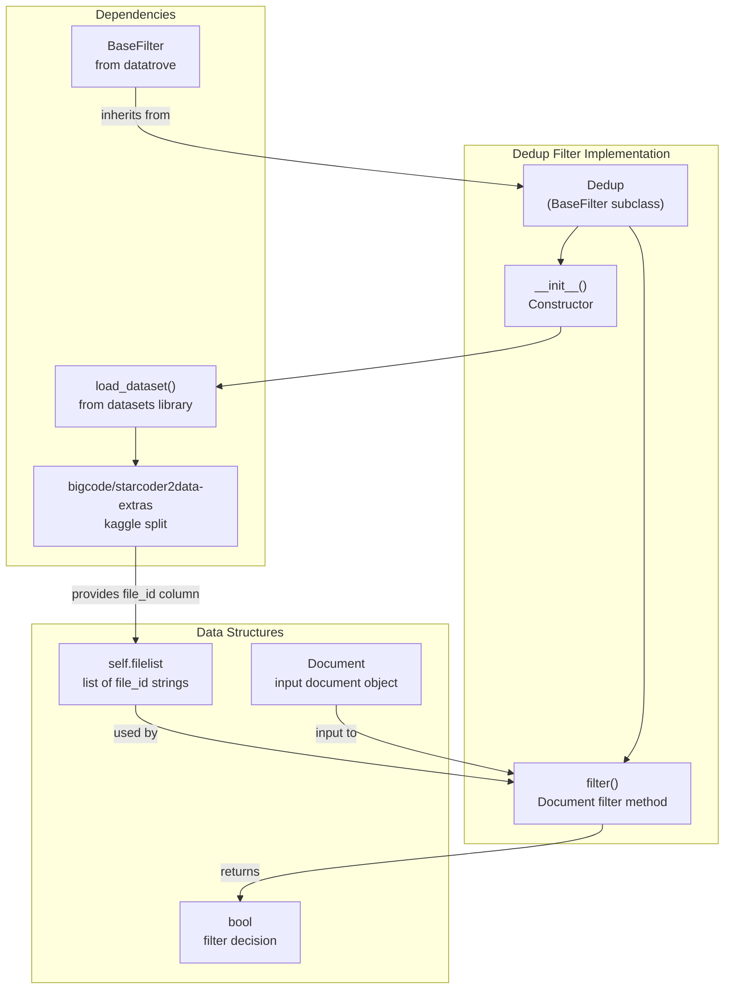
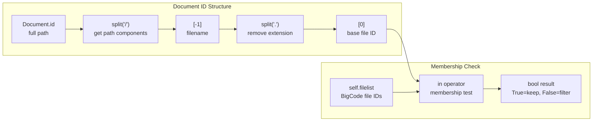
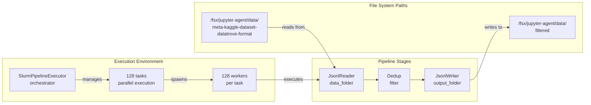
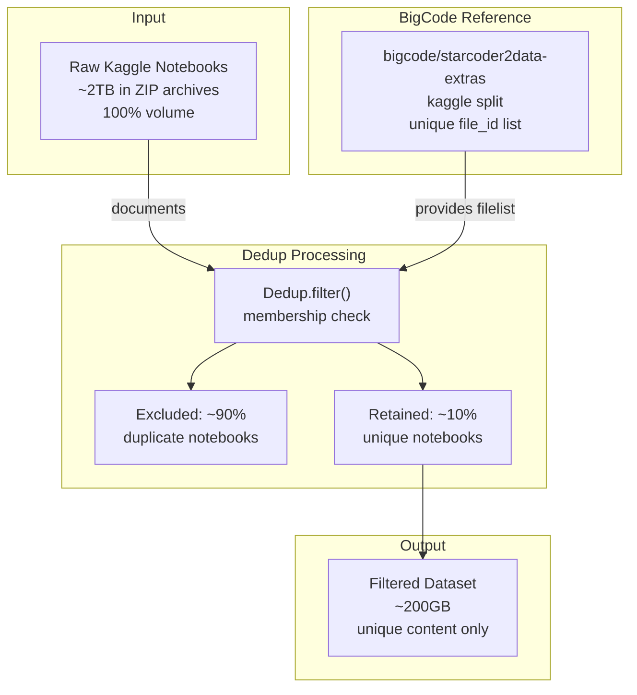

<!-- source: DeepWiki mcp.deepwiki.com · repo huggingface/jupyter-agent · extra page Deduplication Filter · fetched 2026-10-26 -->

# Deduplication Filter

<details>
<summary>Relevant source files</summary>

The following files were used as context for generating this wiki page:

- [data/pipelines/dedup.py](data/pipelines/dedup.py)

</details>


## Purpose and Scope

This document describes the deduplication filter implementation in the Jupyter Agent pipeline. The filter removes duplicate notebooks from the raw Kaggle dataset using a pre-computed filelist from the BigCode project, achieving approximately 90% data reduction in Stage 2 of the data generation pipeline.

For information about how notebooks are initially loaded from ZIP archives, see [Kaggle Loader](#2.2.1). For the overall pipeline orchestration, see [Pipeline Orchestration](#2.1).

**Sources:** [data/pipelines/dedup.py:1-70]()

---

## Overview of Deduplication Strategy

The deduplication filter relies on external work performed by the BigCode project, which identified duplicate notebooks across the Kaggle dataset. Rather than implementing its own deduplication algorithm, the pipeline leverages BigCode's `starcoder2data-extras` dataset, specifically the "kaggle" split, which contains a list of unique file IDs.

The deduplication process occurs in two conceptual phases:
1. **Filelist Loading**: The `bigcode/starcoder2data-extras` dataset is loaded once during filter initialization
2. **Document Filtering**: Each document is checked against the filelist; only documents with IDs present in the filelist are retained

This approach is efficient because the duplicate detection work has already been performed, and the filter only needs to perform membership checks against a pre-computed set.

**Sources:** [data/pipelines/dedup.py:25-26](), [data/pipelines/dedup.py:48-49]()

---

## Dedup Filter Class Architecture



**Figure 1: Dedup Class Structure and Dependencies**

The `Dedup` class is implemented as a subclass of `datatrove.pipeline.filters.base_filter.BaseFilter`, following the datatrove pipeline pattern. The class has two primary methods:

| Method | Purpose | Key Operations |
|--------|---------|----------------|
| `__init__` | Initialize the filter with BigCode filelist | Load dataset, extract file IDs, store in `self.filelist` |
| `filter` | Determine if a document should be kept | Extract document ID, check membership in filelist, return boolean |

The constructor accepts an optional `exclusion_writer` parameter (inherited from `BaseFilter`) that can be used to write filtered-out documents to a separate location, though this is not used in the current implementation.

**Sources:** [data/pipelines/dedup.py:12-26]()

---

## Filtering Logic and Document ID Processing



**Figure 2: Document ID Extraction and Filtering Decision Flow**

The `filter` method implements a simple but critical transformation and lookup operation. The filtering logic consists of three steps:

1. **Path Extraction**: The document ID is split by `/` and the last component is taken using `[-1]`
2. **Extension Removal**: The filename is split by `.` and the first component `[0]` is taken
3. **Membership Check**: The resulting base ID is checked for presence in `self.filelist`

The method returns `True` if the document should be kept (ID is in the filelist) and `False` if it should be filtered out. The implementation is:

```python
def filter(self, doc: Document) -> bool:
    return doc.id.split("/")[-1].split(".")[0] in self.filelist
```

This one-line implementation efficiently processes each document by extracting the base file ID from the full path and checking membership in the pre-loaded filelist. The use of Python's `in` operator on a list provides O(n) lookup time, which is acceptable given the filelist is loaded once and used many times across distributed workers.

**Sources:** [data/pipelines/dedup.py:28-35]()

---

## Pipeline Integration and Execution Configuration

The deduplication filter is executed as part of a multi-stage datatrove pipeline orchestrated by `SlurmPipelineExecutor`. The pipeline configuration demonstrates the filter's integration with the broader processing workflow.

### Pipeline Components



**Figure 3: Deduplication Pipeline Execution Architecture**

The pipeline is configured in the `main` function with the following stages:

1. **JsonlReader**: Reads documents from `/fsx/jupyter-agent/data/meta-kaggle-dataset-datatrove-format`
2. **Dedup**: Applies the deduplication filter
3. **JsonlWriter**: Writes surviving documents to `/fsx/jupyter-agent/data/filtered` with max file size of 1GB

**Sources:** [data/pipelines/dedup.py:38-65]()

### Execution Parameters

The deduplication stage runs with substantial computational resources to process the large dataset efficiently:

| Parameter | Value | Purpose |
|-----------|-------|---------|
| `tasks` | 128 | Number of parallel Slurm tasks |
| `workers` | 128 | Number of worker threads per task |
| `time` | 20:00:00 | Maximum wall time (20 hours) |
| `partition` | hopper-cpu | Slurm partition (CPU-only nodes) |
| `cpus_per_task` | 4 | CPU cores per task |
| `mem_per_cpu_gb` | 16 | Memory per CPU core (64GB total per task) |
| `qos` | high | Quality of service (high priority) |
| `max_file_size` | 10^9 (1GB) | Maximum output file size |

This configuration allocates a total of 512 CPU cores (128 tasks × 4 CPUs) and approximately 8TB of memory (128 tasks × 64GB) to parallelize the deduplication process across the entire dataset. The 20-hour time limit provides sufficient runtime for processing while maintaining efficient cluster utilization.

**Sources:** [data/pipelines/dedup.py:39-63]()

---

## Data Reduction Impact and Performance

The deduplication filter achieves approximately 90% data reduction, as referenced in the high-level system diagrams. This dramatic reduction occurs because:

1. **BigCode Pre-Processing**: The BigCode project performed comprehensive duplicate detection across the entire Kaggle notebook corpus
2. **Filelist Selectivity**: Only unique notebooks (approximately 10% of the raw dataset) have their file IDs included in the `bigcode/starcoder2data-extras` dataset
3. **Conservative Filtering**: Any notebook not explicitly listed in the BigCode filelist is excluded, ensuring only verified unique content proceeds to subsequent pipeline stages

### Data Flow Summary



**Figure 4: Data Reduction Flow Through Deduplication Stage**

The aggressive filtering at this early stage is intentional and beneficial:

- **Storage Efficiency**: Reduces downstream processing volume by 90%, saving computational resources in later stages
- **Quality Improvement**: Eliminates redundant content that would not contribute additional training value
- **Processing Speed**: Fewer documents to score, enrich, and transform in subsequent pipeline stages

The deduplication stage completes before any LLM-based processing occurs, ensuring that expensive operations (educational scoring, metadata extraction, QA generation) only run on unique notebooks.

**Sources:** [data/pipelines/dedup.py:48-49]()

---

## Command-Line Execution

The deduplication stage can be executed independently or as part of the full pipeline. To run it as a standalone process:

```bash
uv run data/pipelines/dedup.py
```

This command will:
1. Load the BigCode filelist from Hugging Face Hub
2. Initialize the Slurm executor with the configured parameters
3. Submit 128 parallel jobs to the `hopper-cpu` partition
4. Read documents from the meta-kaggle-dataset-datatrove-format directory
5. Apply the deduplication filter
6. Write surviving documents to the filtered directory

Logs will be written to `logs/kaggle-filter` for monitoring and debugging purposes.

**Sources:** [data/pipelines/dedup.py:41](), [data/pipelines/dedup.py:68-69]()

---

