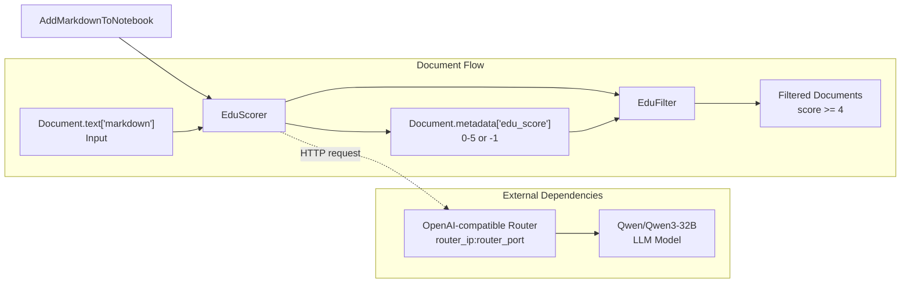
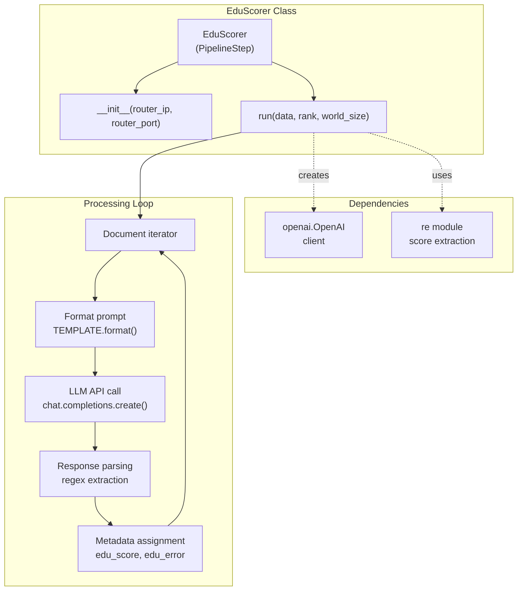
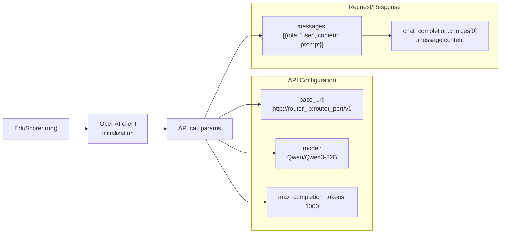
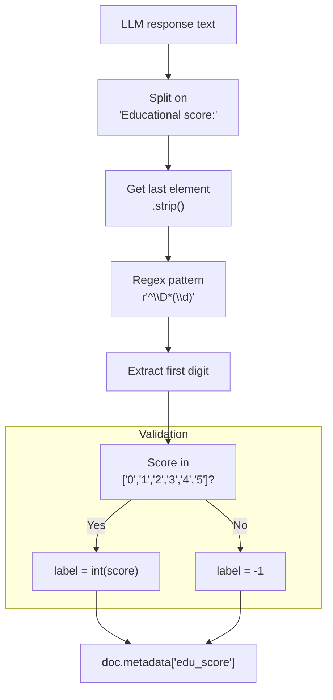
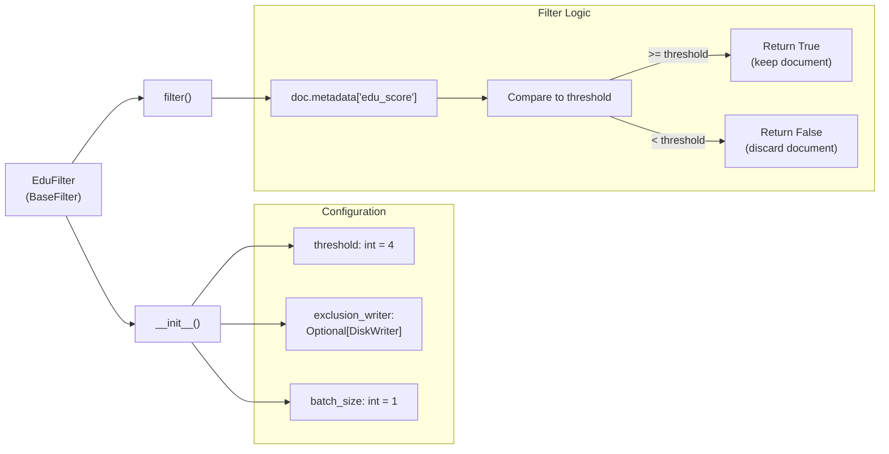
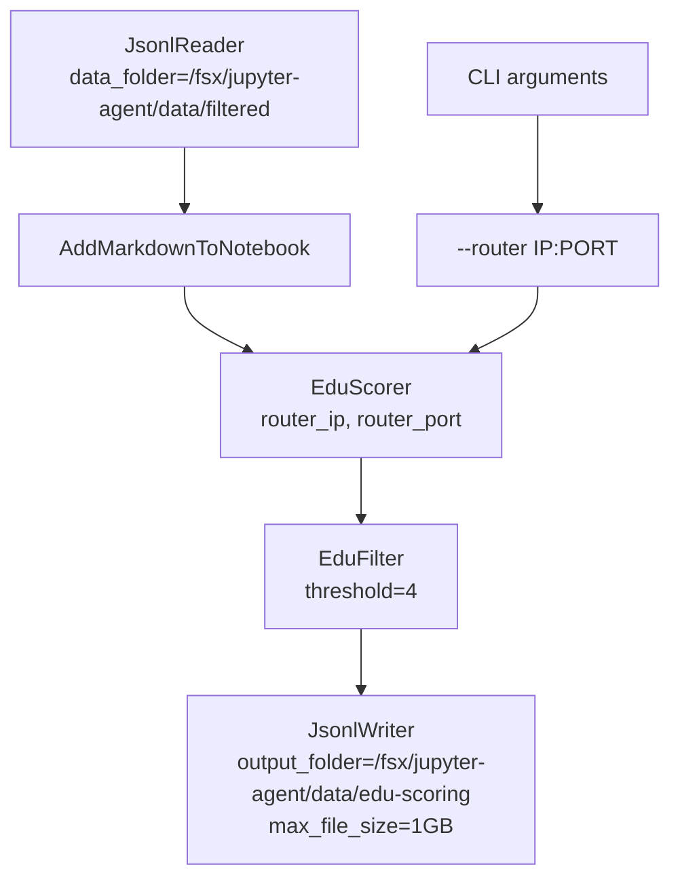
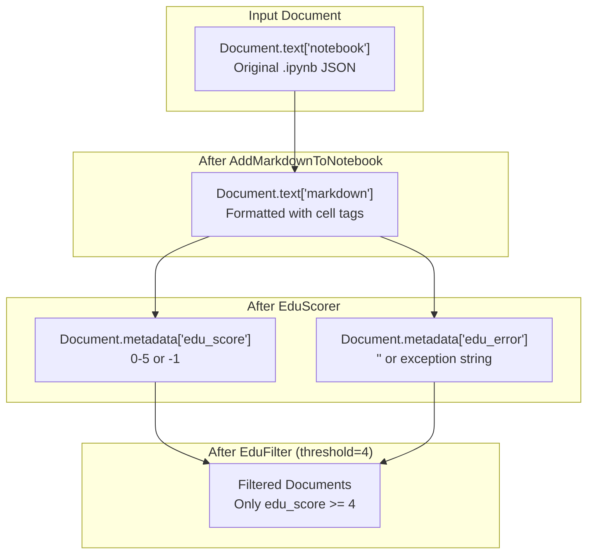

<!-- source: DeepWiki mcp.deepwiki.com · repo huggingface/jupyter-agent · extra page Educational Scoring · fetched 2026-10-26 -->

# Educational Scoring

<details>
<summary>Relevant source files</summary>

The following files were used as context for generating this wiki page:

- [data/pipelines/edu_scoring.py](data/pipelines/edu_scoring.py)

</details>


## Purpose and Scope

This document describes the educational scoring system that evaluates Jupyter notebooks for their pedagogical and analytical value. The `EduScorer` pipeline step uses LLM-based assessment to assign quality scores from 0-5, followed by the `EduFilter` that retains only high-quality notebooks (score ≥ 4) for downstream processing.

This is part of Stage 3-4 of the data generation pipeline. For the markdown conversion that precedes scoring, see [Markdown Conversion](#2.3.1). For the metadata extraction that follows quality filtering, see [Stage 5: Metadata Extraction](#2.4).

Sources: [data/pipelines/edu_scoring.py:1-204]()

## Scoring System Architecture

The educational scoring system consists of three sequential components that transform raw notebooks into quality-assessed documents:



**Educational Scoring Pipeline Flow**

The `AddMarkdownToNotebook` step converts notebooks to markdown format (see [Markdown Conversion](#2.3.1)), then `EduScorer` sends this markdown to an LLM for quality assessment, and finally `EduFilter` applies a threshold to retain only high-quality notebooks.

Sources: [data/pipelines/edu_scoring.py:65-147]()

## Scoring Rubric

The system uses a 5-point additive scoring rubric where each criterion builds on the previous one. A notebook must satisfy all preceding criteria to earn higher scores:

| Score | Criterion | Description |
|-------|-----------|-------------|
| 1 | Valid Python Code | Contains syntactically correct Python code that could execute without errors |
| 2 | Data Loading | Successfully loads and displays a dataset (CSV, JSON, API, etc.) with visible output confirming the load |
| 3 | Data Analysis | Performs meaningful analysis beyond basic loading - statistics, transformations, filtering, or visualizations with appropriate outputs |
| 4 | Educational Narrative | Majority of code cells are accompanied by markdown explanations that interpret results, explain methodology, or provide insights (not just code comments) |
| 5 | Exceptional Quality | Demonstrates advanced analysis with multiple interconnected analytical steps, well-designed annotated visualizations, clear problem-solving progression, and actionable insights or conclusions |

**Automatic Exclusions (score = 0):**
- Non-English text
- Non-Python code
- No data analysis component
- Only text cells OR only code cells
- Broken/incomplete code blocks

The scoring system notes that only exceptional notebooks meeting all 5 criteria receive full points, and they should be "above the level of student exercises or introductory material on sample datasets."

Sources: [data/pipelines/edu_scoring.py:14-62]()

## EduScorer Implementation

### Class Architecture



**EduScorer Class Structure**

The `EduScorer` class inherits from `PipelineStep` and implements an `__init__` method to store router configuration and a `run` method that processes documents through LLM-based scoring.

Sources: [data/pipelines/edu_scoring.py:65-117]()

### LLM Integration

The scorer integrates with the Qwen3-32B model through an OpenAI-compatible router endpoint:



**LLM API Integration Flow**

The implementation creates an OpenAI client instance with a custom base URL pointing to the router, then makes completion requests using the Qwen3-32B model identifier.

**Client Initialization:**
```python
client = OpenAI(
    api_key="token-abc123",
    base_url=f"http://{self.router_ip}:{self.router_port}/v1",
)
```

**API Request:**
```python
chat_completion = client.chat.completions.create(
    messages=[{"role": "user", "content": prompt}],
    model="Qwen/Qwen3-32B",
    max_completion_tokens=1000,
)
```

Sources: [data/pipelines/edu_scoring.py:78-96]()

### Score Extraction Logic

The system extracts numerical scores from LLM responses using regular expressions:



**Score Extraction Process**

The extraction logic searches for "Educational score:" in the response, then uses regex to find the first digit after that marker. Invalid scores are assigned -1.

**Implementation:**
```python
match = re.search(
    r"^\D*(\d)", response.split("Educational score:")[-1].strip()
)
score = match.group(1) if match else "no match"

label = (
    int(score) if score in ["0", "1", "2", "3", "4", "5"] else -1
)

doc.metadata["edu_score"] = label
```

Sources: [data/pipelines/edu_scoring.py:100-110]()

### Error Handling

The scorer implements exception handling to ensure pipeline continuity:

| Error Scenario | Behavior | Metadata Assignment |
|----------------|----------|---------------------|
| Successful scoring | Normal flow | `edu_score`: 0-5, `edu_error`: "" |
| API failure | Catch exception | `edu_score`: -1, `edu_error`: exception string |
| Parsing failure | Catch exception | `edu_score`: -1, `edu_error`: exception string |
| Invalid response | Regex returns None | `edu_score`: -1, `edu_error`: "" |

**Error Handling Implementation:**
```python
try:
    # ... scoring logic ...
    doc.metadata["edu_score"] = label
    doc.metadata["edu_error"] = ""
except Exception as e:
    doc.metadata["edu_score"] = -1
    doc.metadata["edu_error"] = str(e)
```

This ensures that documents with scoring errors continue through the pipeline but are flagged with `edu_score = -1` for potential debugging and are later filtered out by `EduFilter`.

Sources: [data/pipelines/edu_scoring.py:86-116]()

## EduFilter Implementation

The `EduFilter` class applies a threshold-based filter to retain only high-quality notebooks:



**EduFilter Class Structure**

The filter extends `BaseFilter` and implements a simple comparison against the configured threshold (default: 4).

**Filter Implementation:**
```python
def filter(self, doc: Document) -> bool:
    return doc.metadata["edu_score"] >= self.threshold
```

This means notebooks with scores of 4 or 5 pass through to subsequent pipeline stages, while scores 0-3 and -1 (errors) are excluded.

Sources: [data/pipelines/edu_scoring.py:120-146]()

## Execution Configuration

The educational scoring stage is configured for distributed execution on a Slurm cluster:

### Resource Allocation

| Parameter | Value | Description |
|-----------|-------|-------------|
| `N_TASKS` | 128 | Number of parallel Slurm tasks |
| `N_WORKERS` | 128 | Workers per task |
| `cpus_per_task` | 4 | CPU cores per task |
| `mem_per_cpu_gb` | 16 | Memory per CPU in GB |
| `partition` | "hopper-cpu" | Slurm partition name |
| `time` | "4-00:00:00" | Max execution time (4 days) |

**Total Resources:** 512 CPUs, 8TB RAM

### Pipeline Configuration

The `main()` function orchestrates a complete pipeline:



**Complete Scoring Pipeline Configuration**

The pipeline reads filtered notebooks, adds markdown representation, scores them, filters by threshold, and writes results to JSONL files.

**Command-Line Execution:**
```bash
uv run data/pipelines/edu_scoring.py --router 10.0.0.1:39876
```

The router parameter specifies the IP and port of the OpenAI-compatible endpoint serving Qwen3-32B. If port is omitted, defaults to 39876.

Sources: [data/pipelines/edu_scoring.py:149-200]()

## Data Flow and Storage

### Input/Output Paths

| Stage | Path | Description |
|-------|------|-------------|
| Input | `/fsx/jupyter-agent/data/filtered` | Deduplicated notebooks from Stage 2 |
| Output | `/fsx/jupyter-agent/data/edu-scoring` | Quality-filtered notebooks with scores |

### Document Transformation



**Document Metadata Evolution Through Scoring Stage**

The scoring process enriches each document with `edu_score` and `edu_error` metadata fields, then filters to retain only documents meeting the quality threshold.

Sources: [data/pipelines/edu_scoring.py:85-117](), [data/pipelines/edu_scoring.py:138-146]()

## Performance Characteristics

### Processing Statistics

Based on the pipeline configuration and high-level system documentation:

- **Input Volume:** ~200,000 notebooks (after 90% deduplication)
- **LLM Calls:** 1 per notebook
- **Filtering Rate:** Typically retains top-tier educational notebooks
- **Throughput:** 128 concurrent LLM requests across distributed workers
- **Max Execution Time:** 4 days allocated

### Prompt Token Count

The prompt template is approximately 400 tokens, plus the notebook markdown content. With max_completion_tokens=1000, each scoring operation can consume up to ~1400 tokens total, though actual completions are typically much shorter (justification + score = ~100 tokens).

Sources: [data/pipelines/edu_scoring.py:14-62](), [data/pipelines/edu_scoring.py:149-200]()

---

