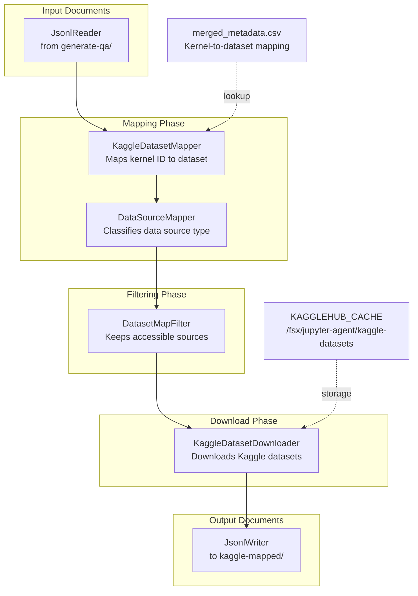
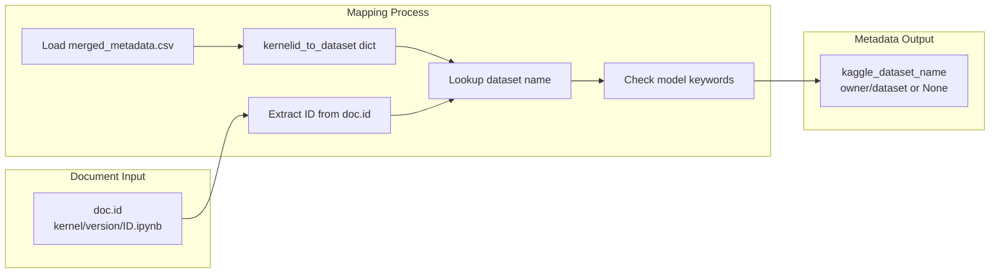
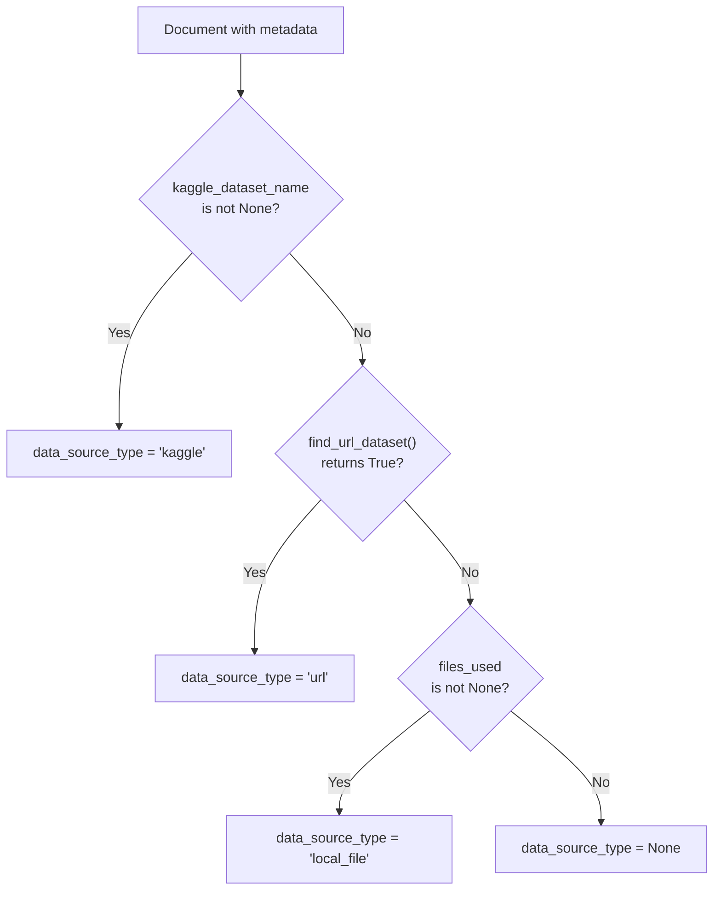
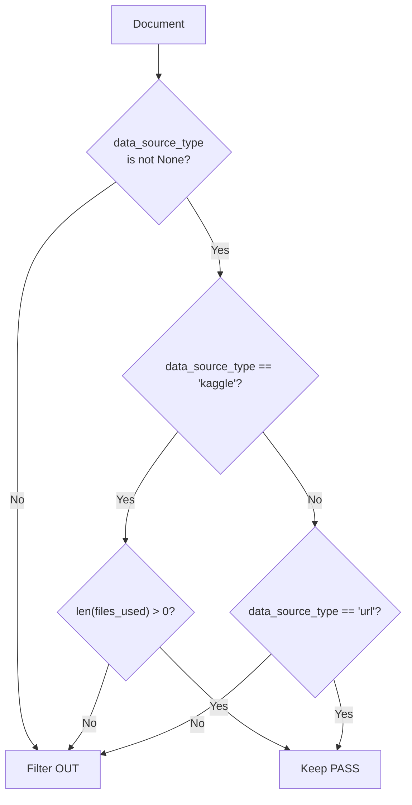
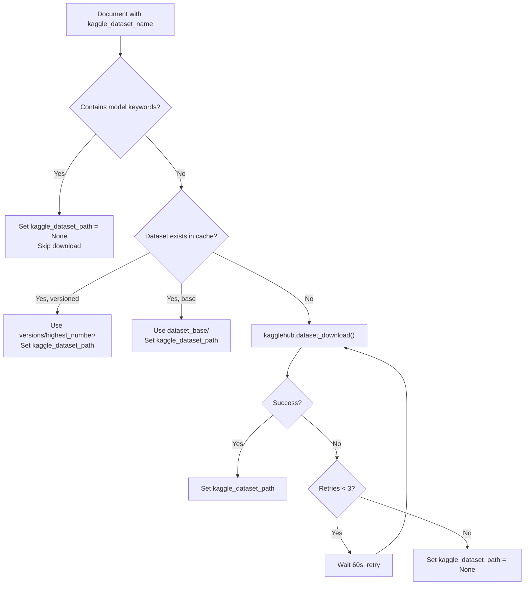
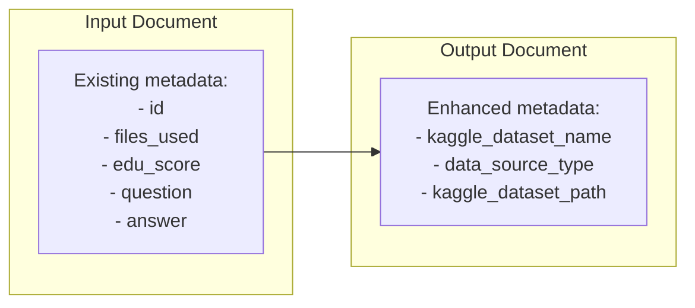

<!-- source: DeepWiki mcp.deepwiki.com · repo huggingface/jupyter-agent · extra page Kaggle Dataset Mapping · fetched 2026-10-26 -->

# Kaggle Dataset Mapping

<details>
<summary>Relevant source files</summary>

The following files were used as context for generating this wiki page:

- [data/pipelines/kaggle_data_mapping.py](data/pipelines/kaggle_data_mapping.py)

</details>


This document describes Stage 7 of the data generation pipeline, which links notebooks to their original Kaggle datasets and downloads the data for execution. This stage implements a four-component process that maps kernel IDs to dataset paths, classifies data source types, filters notebooks by availability, and downloads datasets from Kaggle Hub.

For information about the subsequent trace generation that uses these downloaded datasets, see [Stage 8: Trace Generation](#2.7). For details about the metadata merging that creates the kernel-to-dataset mapping file, see [Kaggle Sourcing Utilities](#2.6.2).

## Purpose and Scope

The Kaggle Dataset Mapping stage serves to:

1. **Link notebooks to datasets**: Map kernel version IDs to their corresponding Kaggle dataset paths
2. **Classify data sources**: Determine whether notebooks use Kaggle datasets, external URLs, or local files
3. **Filter by availability**: Select only notebooks with accessible data sources
4. **Download datasets**: Retrieve original Kaggle datasets to enable code execution in trace generation

This stage is critical for the pipeline because trace generation (Stage 8) requires access to the original data that notebooks operate on. Without this stage, synthetic execution traces would lack the data dependencies needed for realistic code execution.

## Architecture Overview

The stage consists of four sequential pipeline components implemented in [data/pipelines/kaggle_data_mapping.py](). Each component enriches document metadata with information needed for dataset acquisition and trace generation.



**Sources:** [data/pipelines/kaggle_data_mapping.py:259-267]()

## Component Implementations

### KaggleDatasetMapper

The `KaggleDatasetMapper` class loads a pre-computed kernel-to-dataset mapping file and annotates documents with their corresponding Kaggle dataset names.



**Key Implementation Details:**

| Aspect | Implementation |
|--------|----------------|
| Mapping Source | `/fsx/jupyter-agent/data/kaggle-sourcing/merged_metadata.csv` |
| Key Column | `KernelVersionId` (string) |
| Value Column | `FullDatasetPath` (owner/dataset format) |
| Exclusion Keywords | model, vit-, resnet, alexnet, vgg, torch, keras, tensorflow, gemma, llama, mistral, bert, llm- |
| Metadata Field | `kaggle_dataset_name` |

The exclusion keywords filter out datasets containing model weights rather than raw data, as these are too large and not useful for data analysis training.

**Sources:** [data/pipelines/kaggle_data_mapping.py:20-72]()

### DataSourceMapper

The `DataSourceMapper` classifies notebooks into four data source categories by analyzing their content and existing metadata.



**Classification Logic:**

| Priority | Condition | Classification | Reason |
|----------|-----------|----------------|--------|
| 1 | `kaggle_dataset_name` is set | `kaggle` | Mapped to Kaggle dataset |
| 2 | Download code with URLs found | `url` | Downloads from external sources |
| 3 | `files_used` metadata exists | `local_file` | Uses files without known source |
| 4 | None of the above | `None` | No identifiable data source |

The `find_url_dataset()` method implements URL detection by:
- Parsing the notebook JSON structure
- Searching code cells for download keywords: `wget`, `curl`, `requests.get`, `urllib.request`, `download`, `pd.read_csv`, `pd.read_json`, etc.
- Using regex pattern `https?://\S+` to find URLs in code containing these keywords

**Sources:** [data/pipelines/kaggle_data_mapping.py:75-124]()

### DatasetMapFilter

The `DatasetMapFilter` selects notebooks with data sources suitable for trace generation. It implements a strict filtering policy to ensure downstream execution can access required data.



**Filtering Rules:**

| Data Source Type | Additional Condition | Result | Rationale |
|------------------|---------------------|--------|-----------|
| `kaggle` | `len(files_used) > 0` | PASS | Has mapped dataset and uses files |
| `url` | None | PASS | Can download from external source |
| `local_file` | N/A | FAIL | Source unavailable for downloading |
| `None` | N/A | FAIL | No identified data source |

Note the commented alternative at line 154 (`if doc.metadata.get('data_source_type') == 'kaggle':`) which would accept Kaggle notebooks without file metadata, but the active implementation is stricter.

**Sources:** [data/pipelines/kaggle_data_mapping.py:127-159]()

### KaggleDatasetDownloader

The `KaggleDatasetDownloader` retrieves Kaggle datasets from Kaggle Hub, storing them in a shared cache for use by trace generation.



**Download Configuration:**

| Parameter | Value | Purpose |
|-----------|-------|---------|
| Cache Location | `/fsx/jupyter-agent/kaggle-datasets` | Shared storage via `KAGGLEHUB_CACHE` |
| Dataset Base Path | `datasets/{owner}/{dataset-name}` | Standard KaggleHub structure |
| Version Path | `datasets/{owner}/{dataset-name}/versions/{N}` | Versioned downloads (highest N used) |
| Max Retries | 3 | Handle transient download failures |
| Retry Delay | 60 seconds | Wait between retry attempts |
| Model Keywords | model, vit-, resnet, alexnet, vgg, torch, keras, -tf, tensorflow, gemma, -llama, mistral, bert, llm-, -llm | Exclude large model files |

**Path Resolution Logic:**

1. Check if versioned path exists: `/fsx/jupyter-agent/kaggle-datasets/datasets/{dataset}/versions/{N}/`
2. If versioned, use highest-numbered version folder
3. Otherwise, check if base path exists: `/fsx/jupyter-agent/kaggle-datasets/datasets/{dataset}/`
4. If neither exists, call `kagglehub.dataset_download()` to fetch and cache

The metadata field `kaggle_dataset_path` stores the absolute path to the downloaded dataset directory, which trace generation uses to populate sandbox environments.

**Sources:** [data/pipelines/kaggle_data_mapping.py:162-241]()

## Execution Configuration

The pipeline stage runs as a distributed Slurm job with the following resource allocation:

| Parameter | Value | Notes |
|-----------|-------|-------|
| **Executor** | `SlurmPipelineExecutor` | Distributed processing framework |
| **Tasks** | 4 | Parallel processing streams |
| **Workers per Task** | 64 | Worker threads for I/O operations |
| **Total Workers** | 256 | 4 tasks × 64 workers |
| **CPUs per Task** | 4 | |
| **Memory per CPU** | 16 GB | Total: 256 GB RAM |
| **Wall Time** | 20 hours | Maximum execution duration |
| **Partition** | `hopper-prod` | Production cluster partition |
| **QoS** | `high` | Priority queue |
| **Input Path** | `/fsx/jupyter-agent/data/generate-qa` | From Stage 6 output |
| **Output Path** | `/fsx/jupyter-agent/data/kaggle-mapped-test` | Intermediate storage |
| **Output Chunk Size** | 1 GB | JSONL file size limit |

**Environment Variables:**

```
KAGGLEHUB_CACHE=/fsx/jupyter-agent/kaggle-datasets
KAGGLE_USERNAME=<optional>
KAGGLE_KEY=<optional>
```

The Kaggle credentials are optional because most datasets are public, but authentication enables access to private datasets and higher rate limits.

**Sources:** [data/pipelines/kaggle_data_mapping.py:15-17, 244-279]()

## Data Flow and Metadata Evolution

The stage enriches documents with three new metadata fields:



**Metadata Fields Added:**

| Field | Type | Source Component | Example Value | Purpose |
|-------|------|------------------|---------------|---------|
| `kaggle_dataset_name` | str or None | `KaggleDatasetMapper` | `"brendan45774/test-dataset"` | Dataset identifier for lookup |
| `data_source_type` | str or None | `DataSourceMapper` | `"kaggle"`, `"url"`, `"local_file"`, `None` | Classification for filtering |
| `kaggle_dataset_path` | str or None | `KaggleDatasetDownloader` | `"/fsx/.../datasets/brendan45774/test-dataset/versions/1"` | Absolute path for sandbox mounting |

These fields are consumed by Stage 8 (GenerateTraces) to:
1. Mount dataset directories into E2B sandboxes at the expected paths
2. Enable code cells to access the same files the original notebook used
3. Generate realistic execution traces with actual data processing

**Sources:** [data/pipelines/kaggle_data_mapping.py:65-70, 115-122, 193-239]()

## Decision Logic Summary

The following table summarizes which notebooks pass through each component:

| Stage | Input Condition | Output Action | Pass Rate Estimate |
|-------|-----------------|---------------|-------------------|
| **KaggleDatasetMapper** | Has kernel ID in metadata CSV | Sets `kaggle_dataset_name` | ~60% (rough estimate based on Kaggle metadata coverage) |
| **DataSourceMapper** | Any notebook | Classifies `data_source_type` | 100% (all classified) |
| **DatasetMapFilter** | `data_source_type` is kaggle or url | Passes document | ~30-40% (only accessible sources) |
| **KaggleDatasetDownloader** | `kaggle_dataset_name` is set | Downloads and sets path | ~95% (most datasets downloadable) |

The aggressive filtering at `DatasetMapFilter` ensures that only notebooks with reproducible data sources proceed to trace generation, maintaining high quality for the synthetic dataset.

**Sources:** [data/pipelines/kaggle_data_mapping.py:141-159]()

## Integration with Pipeline

This stage connects to the broader pipeline as follows:

**Upstream Dependencies:**
- **Stage 6 (GenerateQA)**: Provides input documents with question/answer pairs in `/fsx/jupyter-agent/data/generate-qa`
- **Kaggle Sourcing Utilities**: Provides `merged_metadata.csv` mapping file (see [Kaggle Sourcing Utilities](#2.6.2))

**Downstream Consumers:**
- **Stage 8 (GenerateTraces)**: Uses `kaggle_dataset_path` to mount datasets in E2B sandboxes
- Trace generation reads the downloaded datasets from the cache directory to enable code execution

**Shared Resources:**
- `/fsx/jupyter-agent/kaggle-datasets`: Shared cache prevents redundant downloads across pipeline runs
- `merged_metadata.csv`: Pre-computed mapping file shared across all tasks

**Sources:** [data/pipelines/kaggle_data_mapping.py:254-255, 15]()

---

