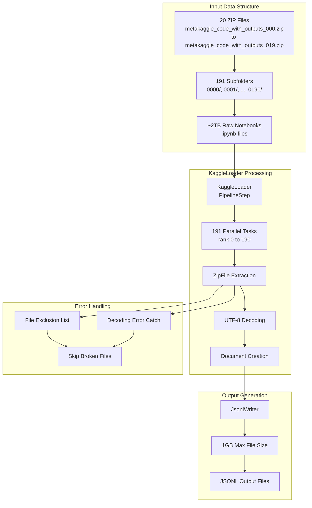
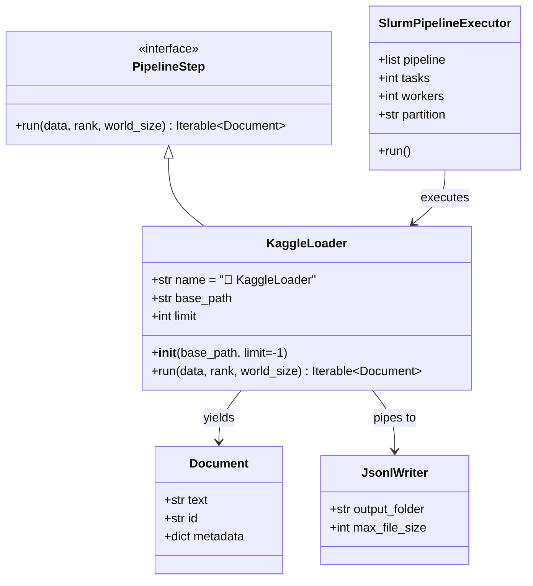
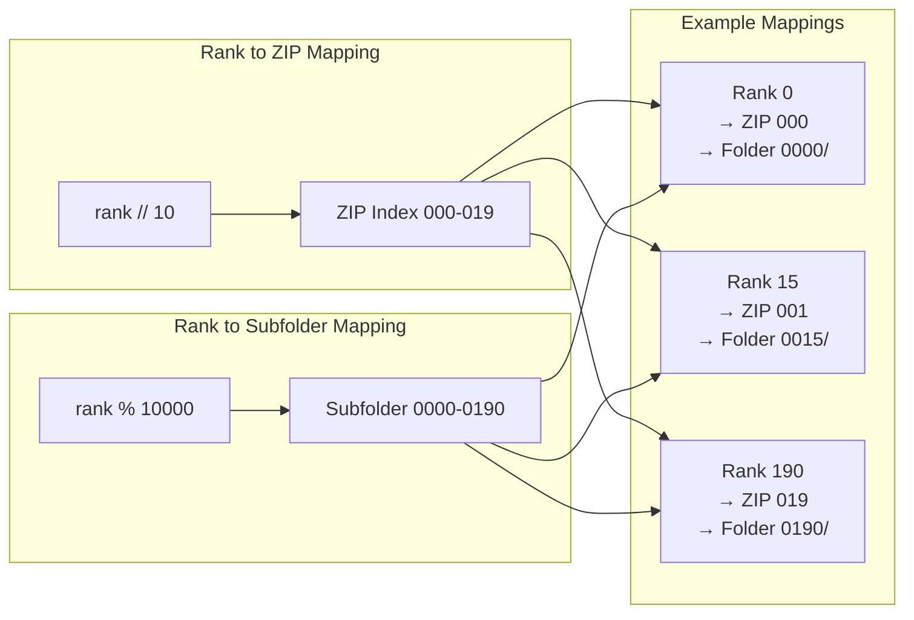
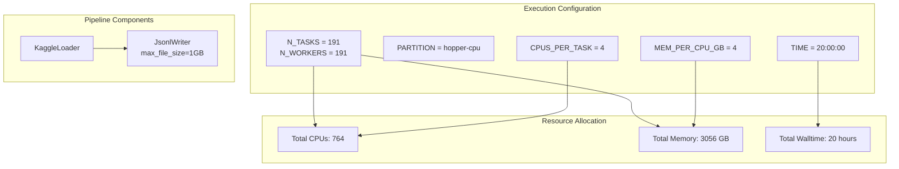

<!-- source: DeepWiki mcp.deepwiki.com · repo huggingface/jupyter-agent · extra page Kaggle Loader · fetched 2026-10-26 -->

# Kaggle Loader

<details>
<summary>Relevant source files</summary>

The following files were used as context for generating this wiki page:

- [data/pipelines/kaggle_loader.py](data/pipelines/kaggle_loader.py)

</details>


## Purpose and Scope

The Kaggle Loader is the first stage of the data generation pipeline, responsible for extracting and loading raw Jupyter notebooks from the Meta Kaggle dataset ZIP archives. It implements distributed parallel processing to handle approximately 2TB of compressed notebook data across 191 tasks.

This document covers the `KaggleLoader` class implementation, its integration with the Slurm execution framework, and the distribution strategy for processing large-scale ZIP archives. For the subsequent deduplication stage that processes the loaded notebooks, see [Deduplication Filter](#2.2.2). For overall pipeline orchestration, see [Pipeline Orchestration](#2.1).

**Sources:** [data/pipelines/kaggle_loader.py:1-93]()

## System Architecture

The Kaggle Loader implements a distributed extraction pattern where 191 parallel tasks each process a specific subset of notebooks from ZIP archives. Each task extracts notebooks from its assigned subfolder, converts them to `Document` objects, and writes them to JSONL format.



**Diagram: KaggleLoader Data Flow and Error Handling**

The loader maps each rank to a specific subfolder within a ZIP archive. The distribution strategy ensures that each of the 191 tasks processes exactly one subfolder, avoiding overlap and enabling efficient parallel processing.

**Sources:** [data/pipelines/kaggle_loader.py:8-60]()

## Class Structure and Implementation

### KaggleLoader Class

The `KaggleLoader` class extends `PipelineStep` from the datatrove library, implementing the standard pipeline interface for distributed document processing.



**Diagram: KaggleLoader Class Relationships**

**Key Parameters:**
- `base_path`: Root directory containing the ZIP archives (default: `/fsx/jupyter-agent/data/meta-kaggle-dataset`)
- `limit`: Optional limit on number of documents to process per task (default: -1, meaning no limit)

**Sources:** [data/pipelines/kaggle_loader.py:8-14]()

## Distribution Strategy

The loader implements a two-level distribution scheme that maps 191 tasks to 20 ZIP files containing 191 subfolders.

### ZIP Archive and Subfolder Mapping



**Diagram: Rank-to-Archive Distribution Logic**

The filepath computation formula:
```
filepath = f"{base_path}/metakaggle_code_with_outputs_{str(rank // 10).zfill(3)}.zip"
```

Each task filters files within the ZIP based on the subfolder pattern:
```
file_info.filename.split("/")[0] == str(rank).zfill(4)
```

This ensures that:
- **ZIP 000-018**: Each contains 10 subfolders (ranks 0-9, 10-19, ..., 180-189)
- **ZIP 019**: Contains only 1 subfolder (rank 190)
- **Total**: 191 tasks processing 191 unique subfolders

**Sources:** [data/pipelines/kaggle_loader.py:26-43]()

## Document Processing Pipeline

Each task follows a sequential processing workflow for files in its assigned subfolder:

| Step | Operation | Implementation |
|------|-----------|----------------|
| 1. ZIP Access | Open ZIP archive in read mode | `zipfile.ZipFile(filepath, "r")` |
| 2. File Filtering | Check file belongs to current rank | `filename.split("/")[0] == str(rank).zfill(4)` |
| 3. Exclusion Check | Skip known problematic files | Check against `file_exclusion_list` |
| 4. File Extraction | Read file from ZIP | `zip_ref.open(file_info.filename)` |
| 5. UTF-8 Decoding | Decode bytes to string | `file.read().decode("utf-8")` |
| 6. Document Creation | Create Document object | `Document(text=content, id=filename)` |
| 7. Output | Yield document to writer | `yield document` |

**Sources:** [data/pipelines/kaggle_loader.py:31-59]()

## Error Handling and Robustness

### File Exclusion List

The loader maintains a hardcoded exclusion list for files that consistently cause crashes:

```python
file_exclusion_list = [
    "0132/087/132087938.ipynb"
]
```

Files in this list are skipped during processing with a log message.

**Sources:** [data/pipelines/kaggle_loader.py:22-24]()

### Decoding Error Handling

UTF-8 decoding errors are caught and logged without crashing the entire task:

```python
try:
    content = file.read().decode("utf-8")
except Exception as e:
    print(f"Error decoding: {file_info.filename}: {e}")
    continue
```

This ensures that a single corrupted file doesn't prevent processing of the remaining notebooks in the subfolder.

**Sources:** [data/pipelines/kaggle_loader.py:51-55]()

### Document Limit

An optional `limit` parameter enables processing a subset of documents for testing:

```python
if self.limit != -1 and documents_processed >= self.limit:
    print(f"Reached limit of {self.limit} documents. Stopping processing.")
    break
```

**Sources:** [data/pipelines/kaggle_loader.py:34-38]()

## Slurm Execution Configuration

The `main()` function configures distributed execution using `SlurmPipelineExecutor`:



**Diagram: Slurm Resource Allocation**

### Configuration Parameters

| Parameter | Value | Purpose |
|-----------|-------|---------|
| `tasks` | 191 | Number of parallel tasks (one per subfolder) |
| `workers` | 191 | Number of workers (1:1 with tasks) |
| `time` | "20:00:00" | Maximum walltime (20 hours) |
| `partition` | "hopper-cpu" | Slurm partition for CPU-only jobs |
| `cpus_per_task` | 4 | CPU cores per task |
| `mem_per_cpu_gb` | 4 | Memory per CPU core (16GB total per task) |
| `qos` | "high" | Quality of service level |
| `skip_completed` | False | Reprocess all data (no resumption) |

**Sources:** [data/pipelines/kaggle_loader.py:62-88]()

## Input and Output Locations

### Input Configuration

```python
BASE_PATH = "/fsx/jupyter-agent/data/meta-kaggle-dataset"
```

Expected ZIP files:
- `metakaggle_code_with_outputs_000.zip` through `metakaggle_code_with_outputs_019.zip`
- Each ZIP contains `.ipynb` files organized in zero-padded subfolders (e.g., `0000/`, `0001/`)

### Output Configuration

```python
output_folder = "/fsx/jupyter-agent/data/meta-kaggle-dataset-datatrove-format"
logs_file = "logs/kaggle-loader"
```

Output characteristics:
- **Format**: JSONL (JSON Lines)
- **Max file size**: 1GB per file
- **Content**: One JSON document per line with `text` (notebook content) and `id` (filename)

**Sources:** [data/pipelines/kaggle_loader.py:66-69]()

## Document Structure

Each processed notebook is converted to a `Document` object with the following structure:

| Field | Type | Content | Example |
|-------|------|---------|---------|
| `text` | str | Raw `.ipynb` JSON content as UTF-8 string | `{"cells": [...]...}` |
| `id` | str | Original file path within ZIP | `"0042/123/42123456.ipynb"` |
| `metadata` | dict | (Initially empty, enriched by downstream stages) | `{}` |

The `text` field contains the complete notebook JSON, which will be parsed and transformed by subsequent pipeline stages.

**Sources:** [data/pipelines/kaggle_loader.py:57]()

## Execution

### Standalone Execution

To run the Kaggle Loader independently:

```bash
uv run data/pipelines/kaggle_loader.py
```

This submits a Slurm job array with 191 tasks to the `hopper-cpu` partition.

### Integration with Full Pipeline

The Kaggle Loader is automatically invoked as Stage 1 when running the complete pipeline via `data/main.py`. For details on full pipeline execution, see [Pipeline Orchestration](#2.1).

**Sources:** [data/pipelines/kaggle_loader.py:91-92]()

## Performance Characteristics

Based on the configuration and data volume:

| Metric | Value | Calculation |
|--------|-------|-------------|
| Input data size | ~2TB | Meta Kaggle dataset ZIP archives |
| Parallelization | 191 tasks | One task per subfolder |
| CPU allocation | 764 cores | 191 tasks × 4 CPUs/task |
| Memory allocation | 3056 GB | 191 tasks × 16 GB/task |
| Max execution time | 20 hours | Configured walltime limit |
| Output file size | 1GB chunks | Controlled by `JsonlWriter.max_file_size` |

The loader's throughput depends primarily on ZIP extraction I/O performance and UTF-8 decoding speed. The distributed design ensures that all subfolders are processed in parallel, maximizing resource utilization on the Slurm cluster.

**Sources:** [data/pipelines/kaggle_loader.py:63-82]()

---

