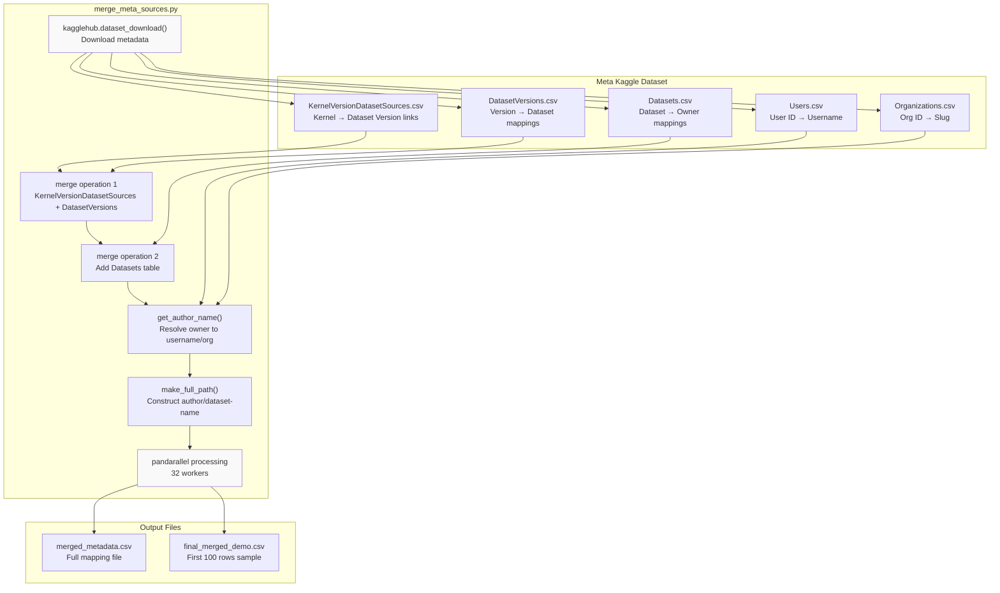
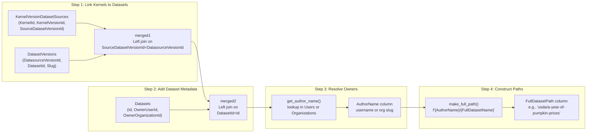
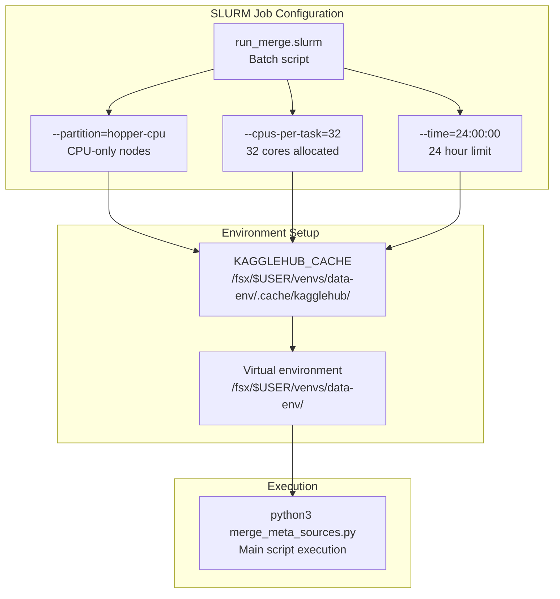

<!-- source: DeepWiki mcp.deepwiki.com · repo huggingface/jupyter-agent · extra page Kaggle Sourcing Utilities · fetched 2026-10-26 -->

# Kaggle Sourcing Utilities

<details>
<summary>Relevant source files</summary>

The following files were used as context for generating this wiki page:

- [data/pipelines/kaggle_sourcing/README.md](data/pipelines/kaggle_sourcing/README.md)
- [data/pipelines/kaggle_sourcing/final_merged_demo.csv](data/pipelines/kaggle_sourcing/final_merged_demo.csv)
- [data/pipelines/kaggle_sourcing/merge_meta_sources.py](data/pipelines/kaggle_sourcing/merge_meta_sources.py)
- [data/pipelines/kaggle_sourcing/run_merge.slurm](data/pipelines/kaggle_sourcing/run_merge.slurm)

</details>


## Purpose and Scope

This document covers the metadata merging utilities that create mappings between Kaggle kernel IDs and their associated dataset paths. The `merge_meta_sources.py` script is a prerequisite step that must run before the dataset mapping pipeline (see [Kaggle Dataset Mapping](#2.6.1)) to generate the `merged_metadata.csv` file containing kernel-to-dataset associations.

The utilities download the Meta Kaggle metadata dataset and perform a series of join operations across five CSV tables to produce a denormalized mapping file that links each notebook kernel to its source datasets with full paths in the format `author/dataset-name`.

**Sources:** [data/pipelines/kaggle_sourcing/README.md:1-15]()

## System Architecture

### Data Flow Overview



**Data Flow Diagram**: Shows how five input CSV files from Meta Kaggle are downloaded and merged through a series of join operations to produce the final mapping files. The process uses parallel processing for performance.

**Sources:** [data/pipelines/kaggle_sourcing/merge_meta_sources.py:1-90](), [data/pipelines/kaggle_sourcing/README.md:1-4]()

## Input Data Sources

The script processes five CSV files from the [Meta Kaggle dataset](https://www.kaggle.com/datasets/kaggle/meta-kaggle), which is automatically downloaded via `kagglehub.dataset_download()`:

| CSV File | Key Columns | Purpose |
|----------|-------------|---------|
| `KernelVersionDatasetSources.csv` | `Id`, `KernelVersionId`, `SourceDatasetVersionId` | Links kernel versions to dataset versions they use |
| `DatasetVersions.csv` | `DatasourceVersionId`, `DatasetId`, `Slug` | Maps dataset versions to dataset IDs and slugs |
| `Datasets.csv` | `Id`, `OwnerUserId`, `OwnerOrganizationId` | Contains dataset ownership information |
| `Users.csv` | `Id`, `UserName` | Maps user IDs to usernames |
| `Organizations.csv` | `Id`, `Slug` | Maps organization IDs to slugs |

The `usecols` parameter in each `pd.read_csv()` call ensures only necessary columns are loaded to minimize memory usage [merge_meta_sources.py:9-27]().

**Sources:** [data/pipelines/kaggle_sourcing/merge_meta_sources.py:6-27]()

## Merge Operations

### Join Sequence



**Merge Sequence Diagram**: Illustrates the four-step process of joining tables and deriving columns to produce the final mapping.

**Sources:** [data/pipelines/kaggle_sourcing/merge_meta_sources.py:36-79]()

### Step 1: Kernel to Dataset Version

The first merge operation joins `KernelVersionDatasetSources` with `DatasetVersions` to link kernels to datasets:

```python
merged1 = kernel_dataset_version_sources.merge(
    dataset_versions,
    left_on="SourceDatasetVersionId",
    right_on="DatasourceVersionId",
    how="left",
)
```

This produces `merged1` containing columns: `KernelId`, `KernelVersionId`, `DatasetId`, `Slug` [merge_meta_sources.py:36-41]().

### Step 2: Add Dataset Ownership

The second merge adds dataset ownership information:

```python
merged2 = merged1.merge(datasets, left_on="DatasetId", right_on="Id", how="left")
```

This adds `OwnerUserId` and `OwnerOrganizationId` columns [merge_meta_sources.py:47-49]().

### Step 3: Author Name Resolution

The `get_author_name()` function resolves owner IDs to human-readable names:

```python
def get_author_name(row):
    if not pd.isna(row["OwnerUserId"]) and row["OwnerUserId"] != "":
        user = users.loc[users["Id"] == row["OwnerUserId"], "UserName"]
        return user.values[0] if not user.empty else None
    elif not pd.isna(row["OwnerOrganizationId"]) and row["OwnerOrganizationId"] != "":
        org = organizations.loc[
            organizations["Id"] == row["OwnerOrganizationId"], "Slug"
        ]
        return org.values[0] if not org.empty else None
    else:
        return None
```

This function prioritizes user ownership over organization ownership and returns `None` for datasets without identifiable owners [merge_meta_sources.py:54-64]().

### Step 4: Full Path Construction

The `make_full_path()` function constructs the standard Kaggle dataset path format:

```python
def make_full_path(row):
    if row["AuthorName"] is not None and row["FullDatasetName"] is not None:
        return f"{row['AuthorName']}/{row['FullDatasetName']}"
    else:
        return ""
```

This produces paths like `usda/a-year-of-pumpkin-prices` or `epa/fuel-economy` [merge_meta_sources.py:72-76]().

**Sources:** [data/pipelines/kaggle_sourcing/merge_meta_sources.py:54-79]()

## Parallel Processing

The script uses `pandarallel` to parallelize the `apply()` operations across 32 workers:

```python
pandarallel.initialize(nb_workers=32, progress_bar=True)

merged2["AuthorName"] = merged2.parallel_apply(get_author_name, axis=1)
merged2["FullDatasetPath"] = merged2.parallel_apply(make_full_path, axis=1)
```

This significantly accelerates processing when dealing with the full Meta Kaggle dataset, which contains millions of kernel-dataset relationships. The progress bar provides visibility into execution status [merge_meta_sources.py:67-79]().

**Sources:** [data/pipelines/kaggle_sourcing/merge_meta_sources.py:67-79]()

## Output Format

### Final DataFrame Structure

The script produces a denormalized DataFrame with five columns:

| Column | Type | Description | Example |
|--------|------|-------------|---------|
| `KernelId` | int | Unique kernel identifier | `640047` |
| `KernelVersionId` | int | Specific version of the kernel | `1787271` |
| `FullDatasetPath` | str | Author/dataset path | `usda/a-year-of-pumpkin-prices` |
| `FullDatasetName` | str | Dataset slug only | `a-year-of-pumpkin-prices` |
| `AuthorName` | str | Author username or org slug | `usda` |

Note that some rows may have empty `FullDatasetPath` values when kernels have no identifiable dataset sources [merge_meta_sources.py:81-83]().

### Output Files

Two CSV files are generated:

1. **`merged_metadata.csv`** - Complete mapping file at `/fsx/jupyter-agent/data/kaggle-sourcing/merged_metadata.csv` containing all kernel-dataset relationships [merge_meta_sources.py:89]()

2. **`final_merged_demo.csv`** - Sample of first 100 rows at `/fsx/jupyter-agent/data/kaggle-sourcing/final_merged_demo.csv` for quick inspection [merge_meta_sources.py:87]()

**Sources:** [data/pipelines/kaggle_sourcing/merge_meta_sources.py:81-90](), [data/pipelines/kaggle_sourcing/final_merged_demo.csv:1-102]()

## Execution Methods

### SLURM Cluster Execution



**SLURM Execution Architecture**: Shows the job configuration and environment setup for running the merge script on the Slurm cluster.

The SLURM script `run_merge.slurm` configures cluster execution with the following parameters:

- **Partition**: `hopper-cpu` for CPU-only workloads
- **QoS**: `high` priority queue
- **Resources**: 1 node, 32 CPUs per task, 1 task per node
- **Time limit**: 24 hours
- **Output logs**: `./logs/metadata-merge/merge-meta-kaggle_{job_id}.out/err`

Execute with:

```bash
sbatch run_merge.slurm
```

**Sources:** [data/pipelines/kaggle_sourcing/run_merge.slurm:1-17]()

### Local Execution

For local development or testing with smaller datasets:

```bash
export KAGGLEHUB_CACHE="/path/to/cache"
python merge_meta_sources.py
```

Local execution may be slower due to fewer CPU cores available compared to the SLURM cluster allocation.

**Sources:** [data/pipelines/kaggle_sourcing/README.md:1-4]()

## Environment Configuration

### Required Environment Variables

#### KAGGLEHUB_CACHE

The `KAGGLEHUB_CACHE` environment variable specifies the local directory for caching downloaded Kaggle datasets. This should point to a location with sufficient storage capacity (the Meta Kaggle dataset is large):

```bash
export KAGGLEHUB_CACHE="/fsx/jupyter-agent/kaggle-datasets"
```

On SLURM, the script sets this to `/fsx/$USER/venvs/data-env/.cache/kagglehub/` [run_merge.slurm:12]().

**Important**: Ensure this directory exists and has sufficient disk space before execution.

#### Kaggle API Credentials (Optional)

Setting Kaggle API credentials may provide higher rate limits:

```bash
export KAGGLE_USERNAME="<your_username>"
export KAGGLE_KEY="<your_api_key>"
```

Credentials are obtained from the [Kaggle Settings page](https://www.kaggle.com/settings). Rate limits are not officially documented but are estimated at ~1,000 requests per day [README.md:10-15]().

**Sources:** [data/pipelines/kaggle_sourcing/README.md:6-15](), [data/pipelines/kaggle_sourcing/run_merge.slurm:12]()

## Integration with Dataset Mapping Pipeline

The `merged_metadata.csv` output file serves as input to the dataset mapping pipeline documented in [Kaggle Dataset Mapping](#2.6.1). The workflow sequence is:

1. **Run `merge_meta_sources.py`** (this utility) to generate `merged_metadata.csv`
2. **Run pipeline steps in `pipelines/kaggle_data_mapping.py`** to classify and download datasets

This two-step process separates the metadata aggregation (which only needs to run once) from the dataset classification and downloading (which may need to run multiple times with different filtering criteria).

**Sources:** [data/pipelines/kaggle_sourcing/README.md:1-4]()

## Performance Considerations

- **Memory Usage**: The script loads multiple large CSV files into memory. With `usecols` filtering, memory footprint is minimized but still substantial
- **Parallelization**: 32 workers provide significant speedup for the `apply()` operations. Adjust `nb_workers` in [merge_meta_sources.py:67]() based on available CPU cores
- **Disk I/O**: Both input reads and output writes are performed on the shared `/fsx` filesystem. Ensure adequate I/O bandwidth during execution
- **Execution Time**: Full execution typically completes within the 24-hour SLURM time limit with 32 cores

**Sources:** [data/pipelines/kaggle_sourcing/merge_meta_sources.py:67](), [data/pipelines/kaggle_sourcing/run_merge.slurm:9]()

---

